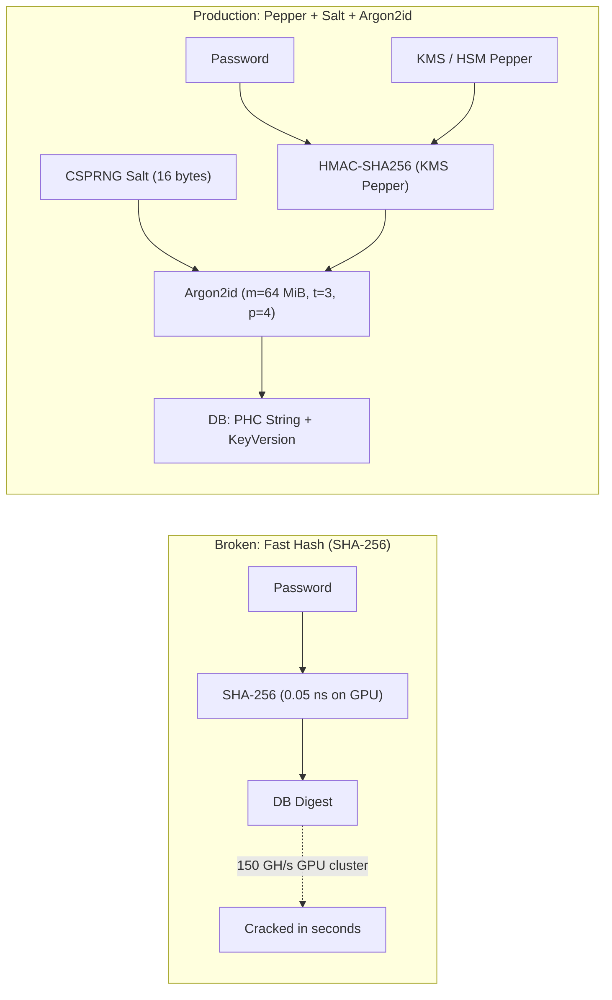
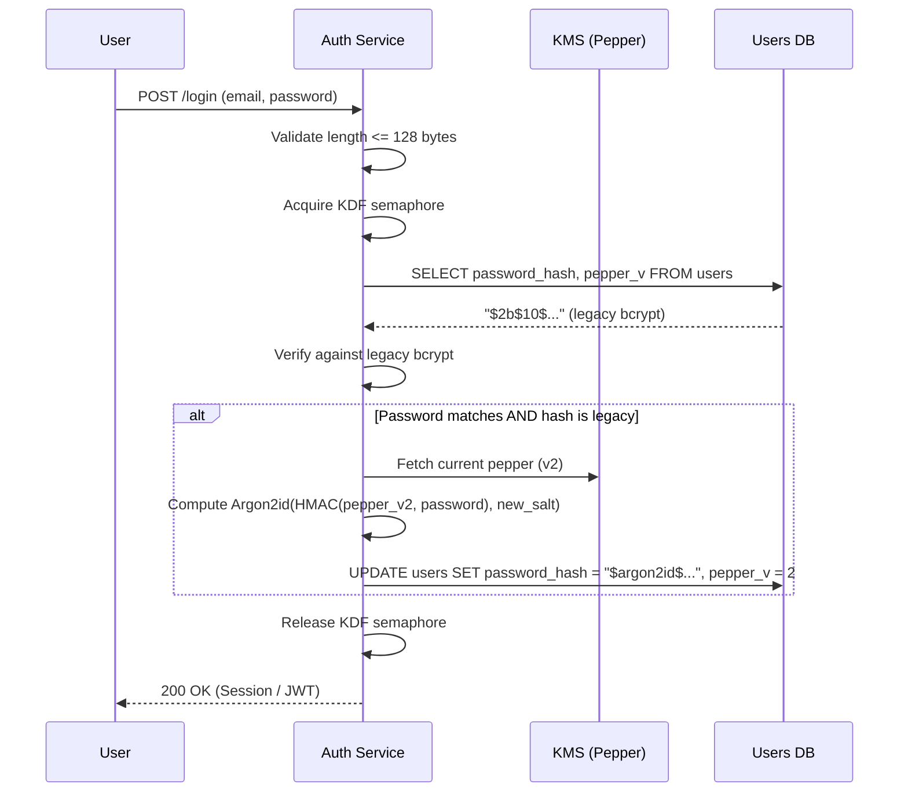
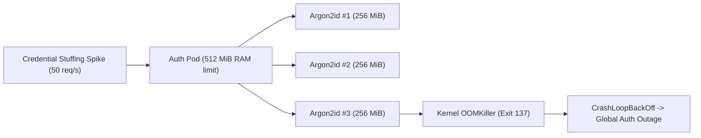

# Hashing Passwords: Why Not SHA-256? Argon2, bcrypt, Salt & Pepper

> **Prerequisites:** [Lesson 10: Secrets Management](../10-secrets-management/README.md).  
> **Estimated Reading Time:** 24–28 minutes  
> **Target Audience:** Backend engineers designing authentication systems, and candidates asked "how do you store passwords securely and why not SHA-256?"  
> **Free PDF Notes:** [Download SD-M-011.pdf](https://backendroadmap.com/notes/system-design/SD-M-011.pdf)

> [!NOTE]
> **In one line:** Password hashing must be **intentionally slow, salted, and memory-hard** so an attacker who steals your database cannot brute-force passwords on GPUs or ASICs. Fast hashes like **SHA-256** are built for throughput (billions of hashes per second on a single GPU), whereas **Argon2id** (and **bcrypt**/**scrypt**) force attackers to spend significant CPU, RAM, and time per guess.

> [!TIP]
> **The Golden Rule:** Use **Argon2id** (OWASP minimum: `m=19 MiB, t=2, p=1` or stronger `m=64 MiB, t=3, p=4`) with a unique 128-bit cryptographic **salt** per user, stored in PHC string format. Add a **pepper** (HMAC-SHA256 pre-hash or post-hash keyed by a KMS/HSM secret) if you want database-only dumps to be useless without the application secret.

---

## 1. What Password Hashing Is, and What It Isn't

A user registers with `password = "Summer2025!"`. If your database stores plaintext, any SQL injection, backup leak, or rogue insider compromises every user's account—and because users reuse passwords, compromises their bank and email accounts too. If you encrypt passwords with AES-256, anyone who steals the encryption key can decrypt every password. Password verification only ever needs **one-way** comparison: given a candidate password, does it produce the stored digest?

| Term | Precise Meaning | Example |
| :--- | :--- | :--- |
| **Fast cryptographic hash** | One-way digest optimized for speed and data integrity, not secrecy | SHA-256, SHA-3, BLAKE3 |
| **Password KDF (slow hash)** | Key derivation function with tunable work factor (CPU, memory, parallelism) | Argon2id, scrypt, bcrypt, PBKDF2 |
| **Salt** | Unique, public, random 16+ byte value per password; defeats rainbow tables | `openssl rand 16` stored in PHC string |
| **Pepper** | Secret, application-wide key stored outside the DB (KMS/HSM); defeats offline DB-only cracks | `HMAC-SHA256(pepper, password)` |
| **Memory-hard function** | Requires large RAM per evaluation, neutralizing massively parallel GPU/ASIC attacks | Argon2id (64 MiB), scrypt |
| **PHC string format** | Self-describing hash encoding algorithm, version, params, salt, and digest | `$argon2id$v=19$m=65536,t=3,p=4$...` |
| **Encryption** | Two-way reversible transformation; **wrong** tool for storing passwords | AES-256-GCM |
| **Not** | A substitute for MFA, rate limiting, or breached-password checks | Defense-in-depth layer |

### Why It Matters
1. **Database leaks happen:** Even well-defended companies suffer backup exposures, SQLi, or misconfigured S3 buckets; password hashing determines whether a breach is a minor reset or a catastrophic credential dump.
2. **Hardware asymmetry favors attackers:** Modern GPUs (e.g., RTX 4090) compute tens of billions of SHA-256 hashes per second, turning an 8-character password into a sub-second crack.
3. **Auth latency vs. security budget:** Every login must run the KDF on your server, so tuning cost parameters is a live capacity-planning and DoS-resistance problem.

---

## 2. Anatomy: Fast Hash vs. Salted & Peppered Argon2id



When a user logs in, the application fetches the PHC string from the database, extracts the algorithm, version, cost parameters, and salt, optionally applies the versioned pepper from KMS/memory, runs Argon2id, and compares the resulting digest using a **constant-time comparison** (`subtle.ConstantTimeCompare` / `hmac.compare_digest`) to prevent timing side-channels.

| Algorithm | Memory-Hard? | Max Password Length | GPU/ASIC Resistance | Status |
| :--- | :---: | :---: | :---: | :--- |
| **SHA-256 / MD5** | No | Unlimited | None (10^10+ H/s on GPU) | **Never use for passwords** |
| **PBKDF2-HMAC-SHA256** | No | Unlimited | Low (ASIC/GPU friendly) | Legacy / FIPS-140 compliance only |
| **bcrypt** | Partial (4 KiB) | **72 bytes** (silent truncation!) | Medium (low RAM allows GPU scaling) | Acceptable legacy; prefer Argon2id |
| **scrypt** | Yes | Unlimited | High (memory-bandwidth bound) | Good, superseded by Argon2id |
| **Argon2id** | **Yes** | Unlimited | **Highest** (winner of PHC, hybrid side-channel + GPU resistance) | **OWASP & RFC 9106 recommended** |

> [!WARNING]
> **The bcrypt 72-byte truncation trap:** Standard bcrypt silently ignores every byte after byte 72 (and older implementations stopped at NUL `\x00` bytes). If you pre-hash with SHA-256 before bcrypt (`bcrypt(base64(sha256(pw)))`), be careful not to introduce NUL-byte truncation bugs. **Argon2id** has no 72-byte limit and requires no pre-hash workaround.

---

## 3. Mathematical Model: Cracking Cost, Search Space, and Server CPU Budget

**Crack time.** Let $S$ be the password search space (e.g., $95^8 \approx 6.63 \times 10^{15}$ for random 8-char printable ASCII, or $\approx 10^9$ for common human patterns), and let $R$ be the attacker's hash rate (hashes/sec across their rig). Expected time to crack 50% of hashes is:

$$T_{\text{crack}} = \frac{S}{2 R}$$

**GPU vs. Argon2id.** A single high-end GPU (e.g., RTX 4090) computes $\approx 2.2 \times 10^{10}$ SHA-256 hashes/sec, or $\approx 1.8 \times 10^5$ bcrypt (cost 10) hashes/sec, but only $\approx 250$ Argon2id hashes/sec at $m=64\text{ MiB}$ because 24 GiB of VRAM holds at most $\lfloor 24{,}576 / 64 \rfloor = 384$ concurrent Argon2id lanes!

**Worked Numerical Example:**
Suppose an attacker steals a database and targets a password with an effective search space of $S = 10^{10}$ (typical human passphrase variations) using an **8-GPU rig**:
1. **Unsalted / Fast SHA-256:** $R = 8 \times 2.2 \times 10^{10} = 1.76 \times 10^{11}\text{ H/s}$.
   $$T_{\text{crack}} = \frac{10^{10}}{2 \times 1.76 \times 10^{11}} \approx 0.028\text{ seconds}$$
2. **Argon2id ($m=64\text{ MiB}, t=3, p=4$):** $R \approx 8 \times 250 = 2{,}000\text{ H/s}$.
   $$T_{\text{crack}} = \frac{10^{10}}{2 \times 2{,}000} = 2{,}500{,}000\text{ seconds} \approx 28.9\text{ days}$$

**Server Login Throughput & RAM Budget:**
If each Argon2id verification takes $t_{\text{hash}} = 150\text{ ms}$ on $p=4$ threads and allocates $M = 64\text{ MiB}$, a 16-vCPU, 8-GiB auth pod can sustain:

$$\lambda_{\max} = \frac{\text{vCPUs}}{p \cdot t_{\text{hash}}} \cdot p = \frac{16}{4 \times 0.15} \approx 26.7\text{ logins/s (CPU-bound)}$$

Concurrent RAM during peak: $N_{\text{conc}} \times 64\text{ MiB}$. With 8 GiB RAM (6 GiB usable), max concurrent hashes before OOM is $\lfloor 6144 / 64 \rfloor = 96$. You **must** bound concurrent password-hashing workers with a semaphore!

---

## 4. Metrics & Percentiles

| Metric | Meaning | Alert when |
| :--- | :--- | :--- |
| **`auth_hash_duration_ms` ($p_{99}$)** | Time spent computing Argon2id/bcrypt | Exceeds 500 ms (UX degradation) or drops below 50 ms (too weak) |
| **`auth_hash_concurrency`** | Active in-flight KDF evaluations | Approaches semaphore limit (OOM / CPU saturation risk) |
| **`auth_rehash_rate`** | Logins upgraded from legacy hash (SHA-256/bcrypt) to Argon2id | Unexpectedly drops to 0 during migration |
| **`auth_pepper_version_mismatch`** | Failed decrypt/verify due to unknown pepper ID | Any non-zero spike after key rotation |
| **`auth_429_rate_limited`** | Login requests rejected by rate limiter / semaphore | Sudden spike (credential stuffing or hash-DoS attack) |

### Worked Example (Hash-DoS Protection)
An attacker sends 500 concurrent `POST /login` requests with 100 KB passwords. Without a semaphore or max password length check, 500 concurrent Argon2id calls at 64 MiB each allocate **32 GiB of RAM**, triggering an immediate OOMKill across all auth pods. With a **128-byte max password length** check, a **per-IP rate limit**, and a **semaphore capped at 32 concurrent hashes** (2 GiB RAM), excess requests fail fast with `429 Too Many Requests` in `< 1 ms` while legitimate users experience normal latency.

---

## 5. Compounding & Failure Modes: Unbounded Hashing vs. Semaphore-Guarded Auth

| Failure Mode | Mechanism | Blast Radius |
| :--- | :--- | :--- |
| **Hash-DoS (Memory Exhaustion)** | Attacker floods `/login`; each Argon2id call allocates 64 MiB | Entire auth cluster OOMKills; 100% login outage |
| **Long-Password CPU Exhaustion** | 10 MB password passed to `HMAC`/`Argon2` | Seconds of CPU per request before hashing even finishes |
| **Reused / Static Salt** | Same salt across users (`salt = "myapp"`) | Attacker cracks all identical passwords in 1 pass; rainbow tables work |
| **Non-Constant-Time Compare** | `hash == stored_hash` short-circuits on first byte mismatch | Timing side-channel leaks digest bytes (rare over network, critical locally) |
| **Pepper Loss** | KMS pepper deleted without backup | Every user in the database is locked out permanently |

---

## 6. Numbers Every Engineer Must Know

| Item | Typical | Implication |
| :--- | :---: | :--- |
| **Salt size** | 16 bytes (128 bits) | $2^{128}$ space; zero collision risk across all users |
| **OWASP Argon2id minimum** | `m=19 MiB, t=2, p=1` | Baseline for constrained servers; target `64 MiB, t=3, p=4` when possible |
| **Target auth hash latency** | 100–300 ms | Slow enough to hurt crackers, fast enough for interactive login |
| **Max password length** | 128–1024 bytes | Prevents DoS on pre-hashing; never enforce tiny limits like 16 chars |
| **bcrypt max input** | 72 bytes | Silently truncates longer passphrases |
| **PBKDF2-SHA256 OWASP min** | 600,000 iterations | Needed only for FIPS 140-2/3 compliance |
| **RTX 4090 SHA-256 rate** | ~22 billion H/s | Fast hashes offer zero protection against offline cracking |

---

## 7. Protocol Deep Dive: Transparent Hash Migration (Verify-and-Upgrade)

When migrating from legacy `SHA-256` or `bcrypt` to `Argon2id`, you cannot convert existing hashes offline (because hashing is one-way). Instead, you **upgrade on successful login**—or wrap legacy hashes immediately with Argon2id (`Argon2id(legacy_hash)`) offline and unwrap on login.



| Question | Answer |
| :--- | :--- |
| **What if a user never logs in again?** | Wrap all legacy hashes offline: `Argon2id(legacy_hash)`. On login, check if wrapped, verify `bcrypt(pw)` inside, then re-hash `pw` directly with `Argon2id`. |
| **Should pepper be applied before or after Argon2id?** | Either works if cryptographic: `HMAC-SHA256(pepper, password)` before Argon2id, or `AES-GCM(pepper, argon2_digest)` after. Post-hashing lets you rotate the pepper offline without user passwords! |
| **Why store parameters in PHC format?** | Future-proofs upgrades: `$argon2id$v=19$m=65536,t=3,p=4$<salt>$<hash>` lets the verifier parse old parameters automatically. |
| **Does salt need to be secret?** | No. Salt only ensures uniqueness so precomputed tables and multi-target attacks fail. |

**When not to use Argon2id.** If your environment strictly mandates **FIPS 140-3** validated cryptographic modules (e.g., FedRAMP High / certain government contracts), Argon2id is not yet FIPS-approved; use **PBKDF2-HMAC-SHA256** with at least **600,000 iterations** (per OWASP / NIST SP 800-132).

---

## 8. Hierarchical Budgets & Design Rules

| Slice | Rule | Control |
| :--- | :--- | :--- |
| **Algorithm** | Argon2id for all new systems | Reject MD5, SHA-1, SHA-256, unsalted hashes in code review |
| **Salt** | 16-byte CSPRNG per password | Never reuse salts; never derive salt from email/username |
| **Pepper** | Stored in KMS/HSM/Vault, versioned | Post-hash encryption (`AES-GCM`) enables offline pepper rotation |
| **Input bounds** | Reject passwords > 128 bytes (or hash-limit) | Prevents CPU DoS before KDF runs |
| **Concurrency** | Semaphore capping active KDF slots | `max_slots = floor(usable_ram_mb / m_mb)` |
| **Comparison** | Constant-time equality | `subtle.ConstantTimeCompare` / `hmac.compare_digest` |
| **Migration** | Verify-and-upgrade + offline wrapping | Zero forced password resets required |

---

## 9. Top Mitigations

1. **Standardize on Argon2id** (`m=64 MiB, t=3, p=4` or OWASP minimum `m=19 MiB, t=2, p=1`) encoded in PHC string format.
2. **Enforce a bounded KDF semaphore** in every auth instance so login floods return `429` instead of OOMKilling the service.
3. **Cap password length** (e.g., 128–256 bytes) before running any cryptographic primitive, while allowing at least 64 characters for passphrases.
4. **Use a versioned pepper** stored outside the database (KMS/HSM); prefer encrypting the resulting Argon2id hash with `AES-256-GCM(pepper)` so you can rotate peppers offline.
5. **Wrap legacy hashes offline** (`Argon2id(legacy_bcrypt)`) and transparently upgrade to native `Argon2id(password)` on next login.
6. **Check breached-password corpora** (e.g., Have I Been Pwned k-anonymity API) at registration and password reset—hashing doesn't help if the user picks `123456`.
7. **Always compare digests in constant time** and never log raw passwords, salts, or peppers in error traces.

---

## 10. Production Reference: The 2012 LinkedIn Breach vs. Modern Hash-DoS Outages

In 2012, LinkedIn suffered a breach of 6.5 million (later revealed to be 117+ million) user credentials. The passwords were stored as **unsalted SHA-1** hashes. Within days, attackers cracked over 90% of the dump using commodity GPUs and published plaintext lists online—demonstrating that fast, unsalted hashes provide virtually zero protection once a database leaks.

Conversely, a common modern production incident occurs when teams adopt **Argon2id** with aggressive parameters (`m=256 MiB, p=4`) inside a 512 MiB Kubernetes pod *without* a concurrency semaphore:



**Root Cause:** Memory-hard KDFs trade attacker GPU parallelism for server RAM per request. Without admission control, a modest traffic spike multiplies memory usage linearly until the container hits its cgroup limit.  
**Fix:** Right-size Argon2id to `m=64 MiB, t=3, p=4`, set pod memory limit to 2 GiB, and wrap the verifier in a bounded worker pool (`max_concurrent = 16`, reserving 1 GiB for KDFs and 1 GiB for runtime overhead), shedding excess traffic with `429 Retry-After`.

---

## 11. Multi-Language Production Code Tabs

Production-shaped password hashers with **Argon2id**, **PHC string format**, **constant-time comparison**, and **concurrency semaphore** to prevent Hash-DoS.

````carousel
```go
// Go: Argon2id with PHC encoding, constant-time verify, and a semaphore against Hash-DoS.
package auth

import (
	"crypto/rand"
	"crypto/subtle"
	"encoding/base64"
	"errors"
	"fmt"
	"strings"

	"golang.org/x/crypto/argon2"
)

type Hasher struct {
	sem     chan struct{}
	memory  uint32
	time    uint32
	threads uint8
	keyLen  uint32
}

func NewHasher(maxConcurrent int) *Hasher {
	return &Hasher{
		sem:     make(chan struct{}, maxConcurrent),
		memory:  64 * 1024, // 64 MiB
		time:    3,
		threads: 4,
		keyLen:  32,
	}
}

func (h *Hasher) Hash(password string) (string, error) {
	if len(password) == 0 || len(password) > 128 {
		return "", errors.New("invalid password length")
	}
	h.sem <- struct{}{}
	defer func() { <-h.sem }()

	salt := make([]byte, 16)
	if _, err := rand.Read(salt); err != nil {
		return "", err
	}
	hash := argon2.IDKey([]byte(password), salt, h.time, h.memory, h.threads, h.keyLen)
	return fmt.Sprintf("$argon2id$v=%d$m=%d,t=%d,p=%d$%s$%s",
		argon2.Version, h.memory, h.time, h.threads,
		base64.RawStdEncoding.EncodeToString(salt),
		base64.RawStdEncoding.EncodeToString(hash)), nil
}

func (h *Hasher) Verify(password, phc string) (bool, error) {
	if len(password) > 128 {
		return false, errors.New("password too long")
	}
	parts := strings.Split(phc, "$")
	if len(parts) != 6 || parts[1] != "argon2id" {
		return false, errors.New("unsupported hash format")
	}
	var m, t uint32
	var p uint8
	if _, err := fmt.Sscanf(parts[3], "m=%d,t=%d,p=%d", &m, &t, &p); err != nil {
		return false, err
	}
	salt, err := base64.RawStdEncoding.DecodeString(parts[4])
	if err != nil {
		return false, err
	}
	expected, err := base64.RawStdEncoding.DecodeString(parts[5])
	if err != nil {
		return false, err
	}

	h.sem <- struct{}{}
	defer func() { <-h.sem }()

	actual := argon2.IDKey([]byte(password), salt, t, m, p, uint32(len(expected)))
	return subtle.ConstantTimeCompare(actual, expected) == 1, nil
}
```
<!-- slide -->
```typescript
// TypeScript (Node.js): scrypt (stdlib crypto) or argon2 with concurrency semaphore & timingSafeEqual.
import { randomBytes, scrypt, timingSafeEqual } from "node:crypto";
import { promisify } from "node:util";

const scryptAsync = promisify(scrypt);

export class PasswordHasher {
  private active = 0;
  private readonly maxConcurrent: number;

  constructor(maxConcurrent = 16) {
    this.maxConcurrent = maxConcurrent;
  }

  private async withPermit<T>(fn: () => Promise<T>): Promise<T> {
    if (this.active >= this.maxConcurrent) {
      throw new Error("429: KDF concurrency budget exhausted");
    }
    this.active++;
    try {
      return await fn();
    } finally {
      this.active--;
    }
  }

  async hash(password: string): Promise<string> {
    if (password.length === 0 || Buffer.byteLength(password) > 128) {
      throw new Error("Invalid password length");
    }
    return this.withPermit(async () => {
      const salt = randomBytes(16);
      // N=32768 (32 MiB), r=8, p=1
      const derived = (await scryptAsync(password, salt, 32, {
        N: 32768,
        r: 8,
        p: 1,
        maxmem: 64 * 1024 * 1024,
      })) as Buffer;
      return `$scrypt$N=32768,r=8,p=1$${salt.toString("base64url")}$${derived.toString("base64url")}`;
    });
  }

  async verify(password: string, encoded: string): Promise<boolean> {
    if (Buffer.byteLength(password) > 128) return false;
    const [, alg, params, saltB64, hashB64] = encoded.split("$");
    if (alg !== "scrypt") throw new Error("Unsupported algorithm");
    const match = /N=(\d+),r=(\d+),p=(\d+)/.exec(params);
    if (!match) throw new Error("Malformed params");

    const [, N, r, p] = match.map(Number);
    const salt = Buffer.from(saltB64, "base64url");
    const expected = Buffer.from(hashB64, "base64url");

    return this.withPermit(async () => {
      const actual = (await scryptAsync(password, salt, expected.length, {
        N, r, p, maxmem: 64 * 1024 * 1024,
      })) as Buffer;
      return timingSafeEqual(actual, expected);
    });
  }
}
```
<!-- slide -->
```python
# Python 3.13 (stdlib): scrypt + HMAC pepper + Semaphore + constant-time verify.
# (In production, prefer `argon2-cffi` with PasswordHasher(memory_cost=65536, time_cost=3, parallelism=4).)
import base64
import hashlib
import hmac
import os
import threading


class PasswordService:
    def __init__(self, pepper: bytes, max_concurrent: int = 16):
        self._pepper = pepper
        self._sem = threading.BoundedSemaphore(max_concurrent)

    def _prehash(self, password: str) -> bytes:
        raw = password.encode("utf-8")
        if not (1 <= len(raw) <= 128):
            raise ValueError("Password must be 1..128 bytes")
        return hmac.new(self._pepper, raw, hashlib.sha256).digest()

    def hash_password(self, password: str) -> str:
        pre = self._prehash(password)
        salt = os.urandom(16)
        n, r, p = 32768, 8, 1  # ~32 MiB memory-hard
        with self._sem:
            dk = hashlib.scrypt(pre, salt=salt, n=n, r=r, p=p, maxmem=64 * 1024 * 1024, dklen=32)
        s_b64 = base64.b64encode(salt).decode("ascii")
        d_b64 = base64.b64encode(dk).decode("ascii")
        return f"$scrypt$n={n},r={r},p={p}${s_b64}${d_b64}"

    def verify_password(self, password: str, stored: str) -> bool:
        try:
            _, alg, params, s_b64, d_b64 = stored.split("$")
            if alg != "scrypt":
                return False
            kv = dict(item.split("=") for item in params.split(","))
            n, r, p = int(kv["n"]), int(kv["r"]), int(kv["p"])
            salt = base64.b64decode(s_b64)
            expected = base64.b64decode(d_b64)
            pre = self._prehash(password)
        except Exception:
            return False

        if not self._sem.acquire(blocking=False):
            raise RuntimeError("429: KDF concurrency limit reached")
        try:
            actual = hashlib.scrypt(pre, salt=salt, n=n, r=r, p=p, maxmem=64 * 1024 * 1024, dklen=len(expected))
            return hmac.compare_digest(actual, expected)
        finally:
            self._sem.release()
```
<!-- slide -->
```csharp
// C# (.NET 8): Argon2id via Konscious.Security.Cryptography (or PBKDF2/Rfc2898DeriveBytes stdlib) + SemaphoreSlim.
using System.Security.Cryptography;
using System.Text;

public sealed class PasswordService
{
    private readonly SemaphoreSlim _sem;
    private readonly byte[] _pepper;

    public PasswordService(byte[] pepper, int maxConcurrent = 16)
    {
        _pepper = pepper;
        _sem = new SemaphoreSlim(maxConcurrent, maxConcurrent);
    }

    private byte[] PrehashWithPepper(string password)
    {
        var bytes = Encoding.UTF8.GetBytes(password);
        if (bytes.Length is < 1 or > 128)
            throw new ArgumentException("Password must be 1..128 bytes.");
        return HMACSHA256.HashData(_pepper, bytes);
    }

    public async Task<string> HashAsync(string password, CancellationToken ct = default)
    {
        var pre = PrehashWithPepper(password);
        var salt = RandomNumberGenerator.GetBytes(16);
        const int iterations = 600_000; // OWASP PBKDF2-SHA256 baseline when using stdlib

        await _sem.WaitAsync(ct);
        try
        {
            byte[] hash = Rfc2898DeriveBytes.Pbkdf2(pre, salt, iterations, HashAlgorithmName.SHA256, 32);
            return $"$pbkdf2-sha256$i={iterations}${Convert.ToBase64String(salt)}${Convert.ToBase64String(hash)}";
        }
        finally
        {
            _sem.Release();
        }
    }

    public async Task<bool> VerifyAsync(string password, string stored, CancellationToken ct = default)
    {
        var parts = stored.Split('$', StringSplitOptions.RemoveEmptyEntries);
        if (parts.Length != 4 || parts[0] != "pbkdf2-sha256") return false;
        int iterations = int.Parse(parts[1].Split('=')[1]);
        var salt = Convert.FromBase64String(parts[2]);
        var expected = Convert.FromBase64String(parts[3]);
        var pre = PrehashWithPepper(password);

        if (!await _sem.WaitAsync(0, ct))
            throw new InvalidOperationException("429: KDF concurrency budget exhausted");
        try
        {
            byte[] actual = Rfc2898DeriveBytes.Pbkdf2(pre, salt, iterations, HashAlgorithmName.SHA256, expected.Length);
            return CryptographicOperations.FixedTimeEquals(actual, expected);
        }
        finally
        {
            _sem.Release();
        }
    }
}
```
````

---

## 12. Hands-On CLI Verification Workflows

Benchmark Argon2id latency and verify PHC formatting locally:

```bash
# 1. Test Argon2id parameters with the argon2 CLI (if installed)
printf "Summer2025!" | argon2 "$(openssl rand -hex 16)" -id -t 3 -m 16 -p 4 -l 32
# -m 16 means 2^16 KiB = 64 MiB; output shows PHC string and elapsed time (e.g., 0.14s)

# 2. Benchmark Python stdlib scrypt vs SHA-256 throughput
python3 -c '
import hashlib, os, time
pw, salt = b"Summer2025!", os.urandom(16)
t0 = time.perf_counter()
for _ in range(10000): hashlib.sha256(salt + pw).digest()
print(f"10,000 SHA-256: {(time.perf_counter()-t0)*1000:.2f} ms")

t0 = time.perf_counter()
hashlib.scrypt(pw, salt=salt, n=32768, r=8, p=1, maxmem=64*1024*1024)
print(f"1 scrypt (32 MiB): {(time.perf_counter()-t0)*1000:.2f} ms")
'
```

Expected output: 10,000 SHA-256 calls finish in ~5 ms, while a single 32 MiB scrypt call takes ~60–120 ms.

---

## 13. Common Mistakes to Avoid

1. **Using SHA-256, SHA-512, or MD5** (even salted or iterated 10 times) for password storage.
2. **Reusing a static salt** across all users, allowing attackers to crack all identical passwords simultaneously.
3. **Forgetting the bcrypt 72-byte limit**, silently truncating user passphrases.
4. **Running Argon2id without a concurrency semaphore**, letting attackers OOMKill auth pods via Hash-DoS.
5. **Storing the pepper in the same database** or `.env` file baked into the DB backup.
6. **Comparing hashes with `==` or `===`** instead of constant-time comparison.
7. **Forcing all users to reset passwords** during a hash upgrade instead of using verify-and-upgrade or offline wrapping.
8. **Skipping breached-password checks**, allowing `Password123!` to be hashed cleanly with Argon2id.

---

## 14. Key Terms Glossary

| Key Term | Definition |
| :--- | :--- |
| **Argon2id** | Memory-hard, GPU/ASIC-resistant password hashing algorithm; winner of the Password Hashing Competition (RFC 9106). |
| **bcrypt** | Blowfish-based adaptive password hash with 4 KiB state and a 72-byte input limit. |
| **scrypt** | Memory-hard KDF designed to require large sequential memory bandwidth. |
| **PBKDF2** | CPU-bound KDF (not memory-hard); used primarily when FIPS 140 compliance is mandatory. |
| **Salt** | Unique, public per-user random bytes mixed into the hash to defeat rainbow tables and multi-target attacks. |
| **Pepper** | Secret application-level key stored in KMS/HSM so database-only leaks cannot be cracked offline. |
| **Rainbow table** | Precomputed lookup table mapping plaintext passwords to hashes; defeated by unique salts. |
| **PHC string** | Standardized text format encoding algorithm, parameters, salt, and digest (`$argon2id$v=19$...`). |
| **Hash-DoS** | Denial-of-service attack exploiting expensive password KDF CPU/RAM consumption via concurrent login requests. |
| **Constant-time compare** | Byte-by-byte comparison that always checks every byte to prevent timing side-channel leaks. |

---

## 15. System Design Interview Questions & Answers

### Basic Conceptual Questions

<details>
<summary><strong>Q1: Why can't we use SHA-256 to hash passwords? [BASIC]</strong></summary>

**Answer:**
SHA-256 is designed to be as fast as possible on hardware. A single modern GPU computes over 20 billion SHA-256 hashes per second, meaning an attacker with a stolen database can brute-force typical 8–10 character passwords in seconds. Password hashing requires a slow, memory-hard KDF like Argon2id.
</details>

<details>
<summary><strong>Q2: What is the difference between a salt and a pepper? [BASIC]</strong></summary>

**Answer:**
A **salt** is unique per user, random, and stored publicly alongside the hash in the database; it defeats rainbow tables and prevents identical passwords from having identical hashes. A **pepper** is a secret key shared across the application and stored outside the database (e.g., in KMS/HSM); it ensures a database-only dump cannot be cracked offline at all.
</details>

<details>
<summary><strong>Q3: Why is Argon2id preferred over bcrypt and PBKDF2? [BASIC]</strong></summary>

**Answer:**
Argon2id is **memory-hard** (e.g., 64 MiB per hash), which starves GPUs and ASICs of VRAM/on-chip memory, whereas PBKDF2 uses negligible RAM and bcrypt uses only 4 KiB. Argon2id also avoids bcrypt's 72-byte truncation limit and combines data-independent (side-channel resistant) and data-dependent (GPU resistant) passes.
</details>

<details>
<summary><strong>Q4: Why hash passwords instead of encrypting them with AES-256? [BASIC]</strong></summary>

**Answer:**
Encryption is reversible: if an attacker compromises the application server or KMS key, they can decrypt every user's plaintext password. Hashing is one-way—the server never needs to know the original password, only whether a login attempt hashes to the same digest.
</details>

### Scenario-Based Architecture Questions

<details>
<summary><strong>Q5: Your legacy database has 10 million MD5/SHA-256 password hashes. How do you migrate to Argon2id without forcing password resets? [SCENARIO]</strong></summary>

**Answer:**
Two-step strategy: (1) Immediately run an **offline batch job** to wrap every legacy digest with Argon2id (`Argon2id(legacy_hash)`), upgrading database-leak resistance right away. (2) On each user's next login, compute `legacy_hash(input)`, verify against the wrapped Argon2id hash, and if valid, transparently re-hash the raw `input` directly with native `Argon2id` and update the row.
</details>

<details>
<summary><strong>Q6: After switching to Argon2id (m=64 MiB), your auth pods start OOMKilling during traffic spikes. Why, and how do you fix it? [SCENARIO]</strong></summary>

**Answer:**
Each concurrent login allocates 64 MiB of RAM. A burst of 32 concurrent logins consumes 2 GiB, exceeding pod memory limits. Fix this by (1) bounding active KDF evaluations per pod with a **semaphore** (e.g., `max_concurrent = floor(usable_RAM / 64 MiB)`), returning `429 Too Many Requests` when full, (2) enforcing a 128-byte max password length, and (3) rate-limiting at the edge/WAF.
</details>

<details>
<summary><strong>Q7: How do you rotate a pepper without locking out all users? [SCENARIO]</strong></summary>

**Answer:**
If you apply the pepper **after** Argon2id—by encrypting the Argon2id digest with `AES-256-GCM(pepper_v1)` and storing `pepper_version`—you can rotate to `pepper_v2` completely offline in a background job by decrypting with `v1` and re-encrypting with `v2`, without ever needing the user's plaintext password.
</details>

<details>
<summary><strong>Q8: A client requires FIPS 140-3 compliance. Can you use Argon2id? [SCENARIO]</strong></summary>

**Answer:**
No, Argon2id is not currently FIPS 140-3 approved. In FIPS-mandated environments, use **PBKDF2-HMAC-SHA256** with at least **600,000 iterations** (OWASP baseline) and a 128-bit salt, paired with strict MFA and rate limiting to compensate for PBKDF2's lower GPU resistance.
</details>

### Advanced & Tricky Interview Questions

<details>
<summary><strong>Q9: An attacker sends 10 MB passwords to your login endpoint. Your Argon2id hasher is fast enough, yet CPU hits 100%. Why? [TRICKY]</strong></summary>

**Answer:**
Pre-hashing or hashing a 10 MB string still requires reading and mixing 10 MB of input bytes into SHA-256/Blake2b before the fixed-cost iterations run, and allocates huge buffers per request. Always enforce a hard upper bound (e.g., 128–256 bytes) at the API gateway and auth service before any hashing occurs.
</details>

<details>
<summary><strong>Q10: Why can't you offload password hashing to the client (browser) to save server CPU? [TRICKY]</strong></summary>

**Answer:**
If the client sends `Argon2id(password, salt)` directly, that hash **becomes** the password equivalent: anyone who intercepts or steals the hash from the DB can replay it directly to `/login` without knowing the original password. Client-side hashing only helps if the server *still* runs its own KDF on the received value.
</details>

<details>
<summary><strong>Q11: What is the danger of using `bcrypt` with a SHA-256 pre-hash (`bcrypt(sha256(pw))`)? [TRICKY]</strong></summary>

**Answer:**
Raw binary `sha256` output has a ~25% chance of containing a `0x00` (NUL) byte in the first 32 bytes. C-based bcrypt implementations treat `0x00` as a string terminator, effectively truncating the hash to a few bytes of entropy! If pre-hashing for bcrypt, you **must** encode the digest as Base64 or Hex first—or better yet, use Argon2id.
</details>

<details>
<summary><strong>Q12: How do you choose `m`, `t`, and `p` for Argon2id in production? [TRICKY]</strong></summary>

**Answer:**
Benchmark on your actual production auth hardware: set `p` to match available threads per request (often 1–4), set `m` as high as your pod memory budget and concurrency SLA allow (e.g., 19–64 MiB), and tune `t` (iterations) until a single hash takes **100–300 ms** at p50. Never tune parameters on a developer laptop and deploy blindly.
</details>

---

## 16. One-Page Master Cheat Sheet

```
+---------------------------------------------------------------------------------------------------------+
|                    PASSWORD HASHING — MASTER CHEAT SHEET                                                |
+---------------------------------------------------------------------------------------------------------+
| 1. NEVER USE FAST HASHES: SHA-256 = 22 GH/s on 1 GPU. Argon2id (64 MiB) = ~250 H/s on 1 GPU.           |
+---------------------------------------------------------------------------------------------------------+
| 2. DEFAULT CHOICE: Argon2id (m=64 MiB, t=3, p=4; OWASP min m=19 MiB, t=2, p=1) in PHC string format.    |
|    FIPS fallback: PBKDF2-HMAC-SHA256 >= 600,000 iterations.                                             |
+---------------------------------------------------------------------------------------------------------+
| 3. SALT vs PEPPER: Salt = 16-byte CSPRNG, public, per-user (defeats rainbow tables).                    |
|    Pepper = secret key in KMS/HSM (defeats DB-only dumps); post-hash AES-GCM enables offline rotation.  |
+---------------------------------------------------------------------------------------------------------+
| 4. HASH-DoS DEFENCE: Cap password <= 128 bytes + bounded KDF semaphore + constant-time compare.         |
+---------------------------------------------------------------------------------------------------------+
| 5. MIGRATION: Wrap legacy hashes offline Argon2id(old_hash); upgrade to Argon2id(pw) on next login.      |
+---------------------------------------------------------------------------------------------------------+
```

---

## Further Reading & Sources

- OWASP Cheat Sheet Series, [Password Storage Cheat Sheet](https://cheatsheetseries.owasp.org/cheatsheets/Password_Storage_Cheat_Sheet.html).
- IETF RFC 9106, *Argon2 Memory-Hard Function for Password Hashing and Proof-of-Work Applications*.
- NIST Special Publication 800-63B, *Digital Identity Guidelines: Authentication and Lifecycle Management*.
- Dropbox Engineering, [How Dropbox securely stores your passwords](https://dropbox.tech/security/how-dropbox-securely-stores-your-passwords) (bcrypt + SHA-512 + AES pepper).

---

## Free PDF Notes

[SD-M-011.pdf](https://backendroadmap.com/notes/system-design/SD-M-011.pdf)

---

## Next

Continue with [OWASP Top 10 Explained: Injection, Broken Access Control, SSRF & More](../12-owasp-top-10-explained/README.md).
