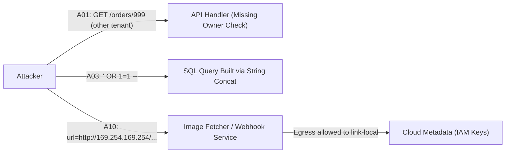
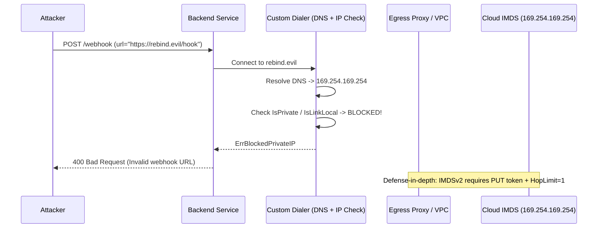
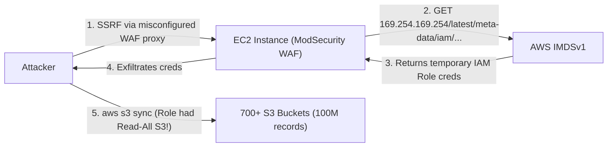

# OWASP Top 10 Explained: Injection, Broken Access Control, SSRF & More

> **Prerequisites:** [Lesson 11: Hashing Passwords](../11-hashing-passwords/README.md).  
> **Estimated Reading Time:** 24–28 minutes  
> **Target Audience:** Backend engineers building web APIs and services, and candidates asked "what are the most critical web application vulnerabilities and how do you architect against them?"  
> **Free PDF Notes:** [Download SD-M-012.pdf](https://backendroadmap.com/notes/system-design/SD-M-012.pdf)

> [!NOTE]
> **In one line:** The **OWASP Top 10** is the industry-standard taxonomy of the ten most critical web application security risks—led by **Broken Access Control (A01)**, **Cryptographic Failures (A02)**, and **Injection (A03)**—and defending against them is an architectural discipline, not a last-minute WAF rule.

> [!TIP]
> **The Golden Rule:** Fix vulnerabilities at the **structural layer**: enforce **deny-by-default authorization** in shared middleware (A01), use **parameterized queries** instead of string concatenation (A03), and block **SSRF** with egress network policies plus metadata-endpoint isolation (A10).

---

## 1. What the OWASP Top 10 Is, and What It Isn't

A junior engineer sanitizes SQL input with a regex (`replace("'", "")`) and assumes the app is safe from SQL injection. Meanwhile, an attacker passes `1 OR 1=1` (no quotes needed for numeric fields), dumps the entire `users` table, or simply changes `/api/invoices/1042` to `/api/invoices/1041` to read another customer's invoice because the handler never checked ownership. The **OWASP Top 10** (2021 edition) catalogs these systemic root causes so teams design controls into frameworks rather than chasing bugs one endpoint at a time.

| Term | Precise Meaning | Example |
| :--- | :--- | :--- |
| **A01: Broken Access Control** | Users act outside their intended permissions (horizontal or vertical escalation) | Changing `?accountId=10` to `11` |
| **A02: Cryptographic Failures** | Weak or missing encryption in transit/at rest, bad key management, or weak hashes | Plaintext HTTP, MD5 passwords, hardcoded keys |
| **A03: Injection** | Untrusted input is interpreted as code or commands by an interpreter | SQLi, NoSQLi, OS command injection, XSS |
| **A04: Insecure Design** | Missing threat modeling or flawed business-logic architecture | Unlimited password-reset attempts; no fraud checks |
| **A05: Security Misconfiguration** | Default credentials, verbose stack traces, open S3 buckets, permissive CORS | `Access-Control-Allow-Origin: *` with credentials |
| **A07: Auth Failures** | Weak session management, credential stuffing, predictable tokens | Session ID in URL, no MFA, weak passwords |
| **A10: SSRF** | Server-Side Request Forgery: server fetches an attacker-supplied internal URL | Fetching `http://169.254.169.254/latest/meta-data/` |
| **Not** | A complete compliance checklist or a substitute for threat modeling | It covers the top 10, not every risk |

### Why It Matters
1. **A01 (Broken Access Control)** jumped to #1 in OWASP 2021 because 94% of tested applications had some form of access control flaw—often invisible to automated scanners.
2. **Architectural fixes beat WAFs:** A Web Application Firewall can be bypassed by encoding tricks; parameterized queries and centralized policy enforcement eliminate entire vulnerability classes.
3. **Cloud-native amplification:** In AWS/GCP/Kubernetes, a single **SSRF (A10)** bug can steal IAM role credentials from the instance metadata service and compromise the entire cloud account.

---

## 2. Anatomy: How A01, A03, and A10 Exploit a Backend



Notice the common thread across all three attacks: **the application trusts caller-supplied data to cross a trust boundary without structural enforcement**.
- In **A01**, the caller's object ID crosses into another tenant's data because authorization was left to individual route handlers.
- In **A03**, user data crosses from data-plane into the SQL/shell/DOM control-plane because the parser cannot separate syntax from values.
- In **A10**, a user-supplied URL crosses from public internet routing into the private VPC and link-local metadata plane.

| Vulnerability | Trust Boundary Violated | Structural Control |
| :--- | :--- | :--- |
| **Broken Access Control (A01)** | Caller identity vs. resource ownership | Deny-by-default middleware + tenant-scoped queries (`WHERE tenant_id = ?`) |
| **SQL / Command Injection (A03)** | Data vs. executable syntax | Prepared statements (bind parameters); `execFile` with arg arrays (no shell) |
| **XSS (A03)** | Untrusted text vs. browser HTML/JS | Context-aware output encoding + strict Content-Security-Policy (CSP) |
| **SSRF (A10)** | Public URL vs. internal VPC / IMDS | DNS resolution check (block RFC1918/link-local) + IMDSv2 + egress proxy |

> [!WARNING]
> **Blacklists always fail for Injection and SSRF.** Blocking `SELECT`, `'`, or `127.0.0.1` is trivially bypassed (`0x7f000001`, `[::1]`, DNS rebinding, or hex-encoded SQL). Always use **structural separation** (bind parameters) and **allowlists** (explicit permitted domains/IPs).

---

## 3. Mathematical Model: Exploit Probability & Defense-in-Depth

Consider an application with $N = 200$ API endpoints. If authorization is implemented manually inside each handler and each developer has a $p = 0.02$ (2%) chance of forgetting an ownership check on any given endpoint, the probability that **at least one** endpoint has a Broken Access Control vulnerability is:

$$P(\text{at least 1 flaw}) = 1 - (1 - p)^N$$

**Worked Numerical Example:**
With $N = 200$ endpoints and $p = 0.02$:

$$P(\text{at least 1 flaw}) = 1 - (0.98)^{200} = 1 - 0.0176 = 98.24\%$$

If you move authorization into a **centralized, deny-by-default framework** (where routes fail closed unless a policy is attached) and reduce per-endpoint error rate to $p = 0.0005$ (reviewed policy files + automated integration tests):

$$P(\text{at least 1 flaw}) = 1 - (0.9995)^{200} \approx 9.52\%$$

And with **Defense-in-Depth** (Layer 1: Gateway JWT/scope check, Layer 2: Service RBAC/ABAC policy, Layer 3: Database Row-Level Security where `p_db = 0.01`), an attacker must bypass all three independent layers simultaneously:

$$P_{\text{combined}} = p_1 \times p_2 \times p_3 = 0.01 \times 0.01 \times 0.01 = 10^{-6}$$

---

## 4. Metrics & Percentiles

| Metric | Meaning | Alert when |
| :--- | :--- | :--- |
| **`authz_deny_rate`** | Percentage of requests rejected with `403 Forbidden` | Sudden spike (enumeration/scanning) or drop to 0 (broken middleware) |
| **`sqli_waf_blocks` / `5xx_db_syntax`** | SQL syntax errors in logs (`42601`) | **Any** SQL syntax error in production logs indicates potential unparameterized query |
| **`egress_blocked_connections`** | Outbound connections blocked by SSRF proxy / NetworkPolicy | Any attempt to reach `169.254.169.254` or RFC1918 from public-facing pods |
| **`dependency_critical_cves`** | Known CVEs in SBOM / lockfiles (A06: Vulnerable Components) | Any Critical/High CVE with exploitability > SLA (e.g., 48 hours) |
| **`cors_wildcard_endpoints`** | Endpoints returning `Access-Control-Allow-Origin: *` with credentials | Any occurrence in CI/CD security scan |

### Worked Example (Detecting Silent A03 via 5xx Logs)
A backend team notices a spike in `HTTP 500` responses with PostgreSQL error `ERROR: syntax error at or near "UNION"` on `/api/search?sort=price`. Even though the WAF missed an obfuscated payload, the database error log immediately proves that the `sort` parameter is being concatenated into `ORDER BY` rather than mapped through an allowlist! Fixing `sort` with a strict `switch` / map lookup eliminates the injection vector.

---

## 5. Compounding & Failure Modes: When Vulnerabilities Chain

Attackers rarely stop at one OWASP item; they chain them:

| Chain | Step 1 | Step 2 | Final Impact |
| :--- | :--- | :--- | :--- |
| **A05 + A10 -> Cloud Takeover** | Verbose error (A05) reveals AWS region & webhook feature | SSRF (A10) hits `169.254.169.254` (IMDSv1) | Attacker steals IAM instance credentials and reads all S3 buckets |
| **A03 (XSS) + A07 -> Account Takeover** | Stored XSS (A03) in user bio executes JS | Cookie lacks `HttpOnly` (A07) | Attacker exfiltrates session cookies of admin users |
| **A06 + A08 -> RCE** | Outdated deserialization library (A06) | Untrusted YAML/JSON gadget (A08: Integrity Failure) | Remote Code Execution inside container |

---

## 6. Numbers Every Engineer Must Know

| Item | Typical | Implication |
| :--- | :---: | :--- |
| **Apps with A01 (Broken Access Control)** | ~94% (OWASP 2021) | Most common risk; requires architectural deny-by-default |
| **IMDSv2 hop limit** | `1` (HTTP PUT token required) | Blocks SSRF via proxies and simple GET requests |
| **Metadata IPv4 address** | `169.254.169.254` | Must be blocked in all egress proxies & SSRF validators |
| **Mean time to exploit new CVE** | Hours to days | Automated dependency scanning (Dependabot/Snyk/Trivy) is mandatory |
| **CSP `unsafe-inline`** | Disables XSS script protection | Always use nonces or hashes in Content-Security-Policy |

---

## 7. Protocol Deep Dive: Defending SSRF (A10) with DNS-Pinning & IMDSv2

Simple URL regexes fail against **DNS rebinding** (a domain resolves to a public IP during validation, then resolves to `127.0.0.1` milliseconds later when `http.Get()` runs). To defeat SSRF structurally, you must validate the **resolved IP at connection time** inside the HTTP client's `DialContext` / socket hook, disable HTTP redirects (or re-validate every hop), and enforce **IMDSv2** on cloud instances.



| Question | Answer |
| :--- | :--- |
| **Why isn't checking `url.Hostname() == "localhost"` enough?** | Attackers use `127.0.0.1`, `0.0.0.0`, `[::1]`, decimal IP `2130706433`, or a public DNS A-record pointing to `10.0.0.5`. |
| **Why disable redirects on outbound fetchers?** | `https://good.com` can return `302 Found -> http://169.254.169.254/`, bypassing initial URL checks. |
| **What about `ORDER BY` or table names in SQL?** | Bind parameters (`$1`) only work for *values*, not identifiers. Use a strict **allowlist map** (`allowedSorts[input]`). |
| **How does IMDSv2 stop SSRF?** | Requires a `PUT /latest/api/token` with `X-aws-ec2-metadata-token-ttl-seconds` header, which GET-based SSRF and open proxies cannot forge. |

**When not to build a custom SSRF validator.** If your service only needs to call 3 known partner APIs, don't accept arbitrary URLs at all—store an enum/partner ID and look up the base URL from server-side configuration.

---

## 8. Hierarchical Budgets & Design Rules

| Slice | Rule | Control |
| :--- | :--- | :--- |
| **Access Control (A01)** | Deny-by-default; verify ownership on every query | Middleware + tenant-scoped SQL / Postgres RLS |
| **Cryptography (A02)** | TLS 1.3 in transit; AES-GCM + Argon2id at rest | HSTS header; KMS-managed keys |
| **Injection (A03)** | Never concatenate untrusted input into SQL/shell/HTML | Parameterized queries; `execFile` args; auto-escaping templates |
| **Misconfiguration (A05)** | Minimal containers, no default creds, generic error responses | Distroless images; disable debug/stack traces in prod |
| **Components (A06)** | Zero unpatched Critical CVEs; pinned lockfiles | Trivy/Snyk in CI + automated PRs |
| **Logging (A09)** | Log auth failures, 403s, and admin actions; never log secrets | Structured JSON logs with PII redaction |
| **SSRF (A10)** | Allowlist domains or validate resolved IP at dial time | Custom `DialContext` + egress proxy + IMDSv2 |

---

## 9. Top Mitigations

1. **Enforce deny-by-default authorization** in framework middleware and scope all database queries by `tenant_id` / `user_id` (plus Row-Level Security where supported).
2. **Use parameterized queries exclusively** for values, and strict server-side **allowlist maps** for dynamic column names (`ORDER BY`) or table names.
3. **Eliminate shell invocation** (`sh -c`); use `execFile` / `exec.Command(bin, arg1, arg2)` with explicit argument arrays.
4. **Deploy a strict `Content-Security-Policy`** (nonce-based, no `unsafe-inline`) and set `HttpOnly; Secure; SameSite=Lax` on session cookies.
5. **Block SSRF at the socket layer** by checking resolved IPs against RFC1918, loopback, and link-local ranges in `DialContext`, and disable automatic HTTP redirects.
6. **Mandate IMDSv2** (`http-tokens=required`, `http-put-response-hop-limit=1`) across all cloud VMs and Kubernetes nodes.
7. **Automate SCA/SAST/DAST in CI/CD** (e.g., Semgrep, Trivy, `govulncheck`, `npm audit`) and fail builds on Critical CVEs.

---

## 10. Production Reference: The 2019 Capital One Breach (SSRF + Excessive IAM)

In 2019, Capital One suffered a breach exposing over 100 million customer credit applications. It was a textbook **OWASP Top 10 chain** combining **A10 (SSRF)**, **A05 (Misconfiguration)**, and **A01 (Broken Access Control / Over-privileged IAM)**:



**Root Cause:**
1. A reverse-proxy/WAF running on EC2 allowed **SSRF (A10)** by forwarding requests to attacker-controlled `Host`/URL targets.
2. The EC2 instance still permitted **IMDSv1**, allowing a simple `GET` request to retrieve temporary IAM credentials.
3. The EC2 IAM role violated **Least Privilege (A01)**, granting read access to hundreds of S3 buckets containing sensitive customer data.

**Fix:** Enforce **IMDSv2** (token-required, hop limit 1), block link-local traffic at the host/proxy firewall, and scope every compute role to only the exact S3 prefixes it needs.

---

## 11. Multi-Language Production Code Tabs

Structural defences against **A03 (Parameterized SQL + Allowlisted Sort)** and **A10 (Socket-level SSRF protection)** in Go, TypeScript, Python, and C#.

````carousel
```go
// Go: A03 (allowlisted sort + parameterized query) & A10 (SSRF-safe DialContext).
package security

import (
	"context"
	"database/sql"
	"errors"
	"fmt"
	"net"
	"net/http"
	"time"
)

var allowedSorts = map[string]string{
	"price":      "price ASC",
	"created_at": "created_at DESC",
}

func ListInvoices(ctx context.Context, db *sql.DB, tenantID, sortKey string) (*sql.Rows, error) {
	orderBy, ok := allowedSorts[sortKey]
	if !ok {
		orderBy = "created_at DESC"
	}
	// Parameterized tenantID (A01 + A03) + allowlisted ORDER BY
	query := fmt.Sprintf("SELECT id, amount FROM invoices WHERE tenant_id = $1 ORDER BY %s LIMIT 50", orderBy)
	return db.QueryContext(ctx, query, tenantID)
}

func isBlockedIP(ip net.IP) bool {
	return ip.IsLoopback() || ip.IsPrivate() || ip.IsLinkLocalUnicast() ||
		ip.IsLinkLocalMulticast() || ip.IsMulticast() || ip.IsUnspecified()
}

func NewSSRFSafeClient() *http.Client {
	dialer := &net.Dialer{Timeout: 3 * time.Second}
	transport := &http.Transport{
		DialContext: func(ctx context.Context, network, addr string) (net.Conn, error) {
			host, port, err := net.SplitHostPort(addr)
			if err != nil {
				return nil, err
			}
			ips, err := net.DefaultResolver.LookupIPAddr(ctx, host)
			if err != nil {
				return nil, err
			}
			for _, ip := range ips {
				if isBlockedIP(ip.IP) {
					return nil, errors.New("SSRF blocked: private or link-local IP")
				}
			}
			// Connect directly to the validated IP (prevents DNS rebinding)
			return dialer.DialContext(ctx, network, net.JoinHostPort(ips[0].IP.String(), port))
		},
	}
	return &http.Client{
		Transport: transport,
		Timeout:   5 * time.Second,
		CheckRedirect: func(_ *http.Request, _ []*http.Request) error {
			return http.ErrUseLastResponse // Disable redirects to prevent 302 SSRF bypass
		},
	}
}
```
<!-- slide -->
```typescript
// TypeScript: A03 (strict sort allowlist + bind params) & A10 (SSRF IP check before fetch).
import { lookup } from "node:dns/promises";
import net from "node:net";

const ALLOWED_SORTS: Record<string, string> = {
  price: "price ASC",
  created_at: "created_at DESC",
};

export function buildInvoiceQuery(tenantId: string, sortKey: string) {
  const orderBy = ALLOWED_SORTS[sortKey] ?? "created_at DESC";
  return {
    sql: `SELECT id, amount FROM invoices WHERE tenant_id = $1 ORDER BY ${orderBy} LIMIT 50`,
    params: [tenantId],
  };
}

function isPrivateOrLinkLocal(ip: string): boolean {
  if (net.isIPv4(ip)) {
    const [a, b] = ip.split(".").map(Number);
    return (
      a === 10 ||
      a === 127 ||
      a === 0 ||
      (a === 169 && b === 254) ||
      (a === 172 && b >= 16 && b <= 31) ||
      (a === 192 && b === 168)
    );
  }
  const norm = ip.toLowerCase();
  return norm === "::1" || norm.startsWith("fc") || norm.startsWith("fd") || norm.startsWith("fe80");
}

export async function safeFetch(rawUrl: string): Promise<Response> {
  const u = new URL(rawUrl);
  if (u.protocol !== "https:") throw new Error("Only HTTPS allowed");

  const records = await lookup(u.hostname, { all: true });
  for (const r of records) {
    if (isPrivateOrLinkLocal(r.address)) {
      throw new Error(`SSRF blocked: ${r.address}`);
    }
  }
  return fetch(u.toString(), { redirect: "error", signal: AbortSignal.timeout(5000) });
}
```
<!-- slide -->
```python
# Python 3.13: A03 (parameterized SQL + allowlist) & A10 (IP validation using stdlib ipaddress).
import ipaddress
import socket
import sqlite3
from urllib.parse import urlparse

ALLOWED_SORTS = {"price": "price ASC", "created_at": "created_at DESC"}


def list_invoices(conn: sqlite3.Connection, tenant_id: str, sort_key: str):
    order_by = ALLOWED_SORTS.get(sort_key, "created_at DESC")
    # Parameterized tenant_id prevents A01/A03; allowlist prevents ORDER BY injection
    sql = f"SELECT id, amount FROM invoices WHERE tenant_id = ? ORDER BY {order_by} LIMIT 50"
    return conn.execute(sql, (tenant_id,)).fetchall()


def validate_public_url(raw_url: str) -> str:
    parsed = urlparse(raw_url)
    if parsed.scheme != "https" or not parsed.hostname:
        raise ValueError("Only HTTPS URLs with a valid hostname are allowed")

    infos = socket.getaddrinfo(parsed.hostname, parsed.port or 443, type=socket.SOCK_STREAM)
    for _, _, _, _, sockaddr in infos:
        ip = ipaddress.ip_address(sockaddr[0])
        if ip.is_private or ip.is_loopback or ip.is_link_local or ip.is_multicast or ip.is_reserved:
            raise ValueError(f"SSRF blocked: {ip} is non-public")
    return str(infos[0][4][0])  # Return pinned IP to connect to directly
```
<!-- slide -->
```csharp
// C# (.NET 8): A03 (SqlParameter + sort allowlist) & A10 (SocketsHttpHandler ConnectCallback SSRF guard).
using System.Net;
using System.Net.Sockets;

public static class SecurityGuards
{
    private static readonly Dictionary<string, string> AllowedSorts = new()
    {
        ["price"] = "price ASC",
        ["created_at"] = "created_at DESC"
    };

    public static string GetSafeOrderBy(string sortKey) =>
        AllowedSorts.TryGetValue(sortKey, out var clause) ? clause : "created_at DESC";

    private static bool IsBlockedIP(IPAddress ip)
    {
        if (IPAddress.IsLoopback(ip) || ip.IsIPv6LinkLocal || ip.IsIPv6SiteLocal) return true;
        var bytes = ip.GetAddressBytes();
        if (ip.AddressFamily == AddressFamily.InterNetwork)
        {
            return bytes[0] == 10 || bytes[0] == 127 || bytes[0] == 0 ||
                   (bytes[0] == 169 && bytes[1] == 254) ||
                   (bytes[0] == 172 && bytes[1] >= 16 && bytes[1] <= 31) ||
                   (bytes[0] == 192 && bytes[1] == 168);
        }
        return false;
    }

    public static HttpClient CreateSSRFSafeHttpClient()
    {
        var handler = new SocketsHttpHandler
        {
            AllowAutoRedirect = false,
            ConnectCallback = async (ctx, ct) =>
            {
                var ips = await Dns.GetHostAddressesAsync(ctx.DnsEndPoint.Host, ct);
                var safeIp = ips.FirstOrDefault(ip => !IsBlockedIP(ip))
                    ?? throw new HttpRequestException("SSRF blocked: private or link-local IP");
                var socket = new Socket(safeIp.AddressFamily, SocketType.Stream, ProtocolType.Tcp);
                await socket.ConnectAsync(new IPEndPoint(safeIp, ctx.DnsEndPoint.Port), ct);
                return new NetworkStream(socket, ownsSocket: true);
            }
        };
        return new HttpClient(handler) { Timeout = TimeSpan.FromSeconds(5) };
    }
}
```
````

---

## 12. Hands-On CLI Verification Workflows

Scan your codebase, containers, and cloud metadata configuration:

```bash
# 1. Verify AWS EC2 enforces IMDSv2 (blocks SSRF GET to 169.254.169.254)
aws ec2 describe-instances --query "Reservations[].Instances[].[InstanceId,MetadataOptions.HttpTokens]"

# 2. Run Semgrep OWASP Top 10 static analysis locally
semgrep --config "p/owasp-top-ten" .

# 3. Scan container image for A06 (Vulnerable and Outdated Components)
trivy image --severity HIGH,CRITICAL my-api:latest

# 4. Verify security headers (CSP, HSTS, X-Content-Type-Options) on a live endpoint
curl -sI https://api.example.com/health | grep -iE "strict-transport|content-security|x-content-type"
```

---

## 13. Common Mistakes to Avoid

1. **Sanitizing SQL with regexes or blacklists** instead of parameterized queries.
2. **Putting authorization checks inside UI buttons** while leaving backend endpoints unprotected.
3. **Validating SSRF URLs with string checks** (`!url.Contains("127.0.0.1")`) instead of resolved IP checks at dial time.
4. **Allowing HTTP redirects** on outbound webhook/image fetchers.
5. **Using `Access-Control-Allow-Origin: *`** alongside `Access-Control-Allow-Credentials: true` (or reflecting arbitrary `Origin` headers).
6. **Returning stack traces and SQL errors** in production `500` responses (A05).
7. **Forgetting to scope `UPDATE` and `DELETE` queries** by `tenant_id` / `user_id`.
8. **Ignoring `ORDER BY` / column-name injection** because ORMs only parameterize values.

---

## 14. Key Terms Glossary

| Key Term | Definition |
| :--- | :--- |
| **OWASP Top 10** | Consensus list of the 10 most critical web application security risks (current edition: 2021). |
| **Broken Access Control (A01)** | Failure to enforce what authenticated users are allowed to do or see. |
| **Parameterized Query** | SQL statement separating query structure from user-supplied values via bind variables. |
| **XSS (Cross-Site Scripting)** | Injection of malicious scripts into trusted web pages viewed by other users. |
| **CSRF (Cross-Site Request Forgery)** | Tricking a victim's browser into sending an authenticated state-changing request. |
| **SSRF (Server-Side Request Forgery)** | Tricking a backend server into making HTTP requests to internal or metadata endpoints. |
| **IMDSv2** | AWS Instance Metadata Service v2 requiring a session token via `PUT` and hop-limit 1 to block SSRF. |
| **DNS Rebinding** | Attack where a domain resolves to a public IP during validation and a private IP during connection. |
| **CSP (Content-Security-Policy)** | HTTP header restricting which scripts, styles, and origins a browser may execute. |
| **SBOM** | Software Bill of Materials listing all third-party dependencies for CVE tracking (A06). |

---

## 15. System Design Interview Questions & Answers

### Basic Conceptual Questions

<details>
<summary><strong>Q1: What is the #1 vulnerability in the OWASP Top 10 (2021) and why? [BASIC]</strong></summary>

**Answer:**
**A01: Broken Access Control.** It moved from #5 to #1 because ~94% of tested applications had some access control flaw (like IDORs or missing role checks). Unlike SQL injection, automated scanners rarely catch business-logic authorization bugs.
</details>

<details>
<summary><strong>Q2: How do parameterized queries completely prevent SQL injection? [BASIC]</strong></summary>

**Answer:**
The database compiles the SQL query structure with placeholders (`$1`, `?`) *before* receiving the user input. The input is sent out-of-band as a typed literal value, so the SQL parser never interprets characters like `'` or `--` as SQL syntax.
</details>

<details>
<summary><strong>Q3: What is SSRF and why is it especially dangerous in the cloud? [BASIC]</strong></summary>

**Answer:**
Server-Side Request Forgery tricks a server into fetching an attacker-chosen URL. In cloud environments (AWS/GCP/Azure), the server can reach internal VPC services and the link-local Instance Metadata Service (`169.254.169.254`), potentially leaking IAM credentials.
</details>

<details>
<summary><strong>Q4: What is the difference between XSS and CSRF? [BASIC]</strong></summary>

**Answer:**
**XSS** injects malicious JavaScript into your site so it runs in the victim's browser with full access to their DOM and non-`HttpOnly` tokens. **CSRF** tricks the victim's browser into sending a forged request to your site, exploiting automatically attached cookies (mitigated by `SameSite` cookies and CSRF tokens).
</details>

### Scenario-Based Architecture Questions

<details>
<summary><strong>Q5: Users can upload a profile avatar by pasting an image URL. How do you design this securely? [SCENARIO]</strong></summary>

**Answer:**
Run the fetcher in an isolated egress-only subnet/proxy, use a custom `DialContext` that resolves DNS once and blocks private/loopback/link-local IPs, disable HTTP redirects, enforce a strict 5 MB size cap and 5-second timeout, validate the image magic bytes (re-encode with an image library), and serve from a separate sandboxed CDN domain.
</details>

<details>
<summary><strong>Q6: Your REST API lets users sort and filter by arbitrary fields (`?sort=name`). How do you prevent SQL injection when using an ORM? [SCENARIO]</strong></summary>

**Answer:**
ORMs only parameterize *values*, not column names or `ORDER BY` directions. Map user-supplied sort keys through a strict server-side **allowlist dictionary** (`{"name": "name ASC", "date": "created_at DESC"}`) and reject or default any unknown key.
</details>

<details>
<summary><strong>Q7: How do you prevent Broken Access Control across 150 microservices? [SCENARIO]</strong></summary>

**Answer:**
Centralize authentication and coarse-grained authorization at the API Gateway, pass signed identity/tenant claims downstream, enforce **deny-by-default** policy middleware in the shared service template, and add **Row-Level Security (RLS)** in the database so queries cannot return rows outside the request's `tenant_id`.
</details>

<details>
<summary><strong>Q8: A third-party library you use has a critical RCE CVE disclosed today. What is your architecture's response? [SCENARIO]</strong></summary>

**Answer:**
Query our SBOM/dependency inventory to identify every affected service within minutes, apply a temporary virtual patch at the WAF/API Gateway if applicable, bump and deploy the patched dependency via CI/CD, and rotate any secrets that were exposed if exploitation is suspected.
</details>

### Advanced & Tricky Interview Questions

<details>
<summary><strong>Q9: Why does validating `net.LookupIP(host)` before calling `http.Get(url)` still leave you vulnerable to SSRF? [TRICKY]</strong></summary>

**Answer:**
**TOCTOU / DNS Rebinding.** `LookupIP` and `http.Get` perform two separate DNS resolutions. An attacker's DNS server with `TTL=0` can return a public IP (`1.2.3.4`) on the first lookup and `169.254.169.254` on the second lookup. You must validate the IP inside the HTTP client's `DialContext` / `ConnectCallback` and dial that exact IP directly.
</details>

<details>
<summary><strong>Q10: Can a WAF replace parameterized queries and authorization middleware? [TRICKY]</strong></summary>

**Answer:**
No. A WAF is a probabilistic perimeter layer that can be bypassed with novel encodings, JSON nesting, or HTTP smuggling, and it has zero visibility into application-level object ownership (A01). WAFs buy time during zero-days; they never replace structural fixes.
</details>

<details>
<summary><strong>Q11: Why is `Access-Control-Allow-Origin: <reflected Origin>` worse than `*`? [TRICKY]</strong></summary>

**Answer:**
Browsers forbid `Access-Control-Allow-Origin: *` when `Access-Control-Allow-Credentials: true` is set. Reflecting whatever `Origin` header the caller sends bypasses that browser safeguard, allowing any malicious website to make authenticated cross-origin requests and read private API responses.
</details>

<details>
<summary><strong>Q12: How does an insecure `Object.assign` or ORM auto-binding relate to OWASP? [TRICKY]</strong></summary>

**Answer:**
It bridges **A01 (Broken Access Control)** and **A04 (Insecure Design)**—specifically Mass Assignment (API3). If a user sends `{"role": "admin", "balance": 9999}` in a profile update and the backend binds the JSON directly to the ORM model, the user escalates privileges. Always bind to explicit allowlisted DTOs.
</details>

---

## 16. One-Page Master Cheat Sheet

```
+---------------------------------------------------------------------------------------------------------+
|                    OWASP TOP 10 — MASTER CHEAT SHEET                                                    |
+---------------------------------------------------------------------------------------------------------+
| A01 BROKEN ACCESS CONTROL (#1): Deny-by-default middleware + tenant_id in WHERE + Postgres RLS.         |
+---------------------------------------------------------------------------------------------------------+
| A02 CRYPTOGRAPHIC FAILURES: TLS 1.3 in transit · Argon2id for passwords · KMS-backed AES-GCM at rest.   |
+---------------------------------------------------------------------------------------------------------+
| A03 INJECTION: Parameterized queries (values) + Allowlist maps (ORDER BY) + execFile (no shell) + CSP.  |
+---------------------------------------------------------------------------------------------------------+
| A05 MISCONFIGURATION / A06 COMPONENTS: Distroless images, no stack traces, SBOM + Trivy/Semgrep in CI.  |
+---------------------------------------------------------------------------------------------------------+
| A10 SSRF: Resolve DNS once in DialContext, block RFC1918/169.254.169.254, disable redirects, IMDSv2.    |
+---------------------------------------------------------------------------------------------------------+
```

---

## Further Reading & Sources

- OWASP Foundation, [OWASP Top 10:2021](https://owasp.org/Top10/).
- OWASP Cheat Sheet Series, [Server-Side Request Forgery Prevention Cheat Sheet](https://cheatsheetseries.owasp.org/cheatsheets/Server_Side_Request_Forgery_Prevention_Cheat_Sheet.html).
- AWS Documentation, [Configuring the Instance Metadata Service (IMDSv2)](https://docs.aws.amazon.com/AWSEC2/latest/UserGuide/configuring-instance-metadata-service.html).
- Google Cloud, [BeyondCorp & Defense-in-Depth Architecture](https://cloud.google.com/beyondcorp).

---

## Free PDF Notes

[SD-M-012.pdf](https://backendroadmap.com/notes/system-design/SD-M-012.pdf)

---

## Next

Continue with [OWASP API Security Risks: BOLA, Mass Assignment & Data Exposure](../13-owasp-api-security-risks/README.md).
