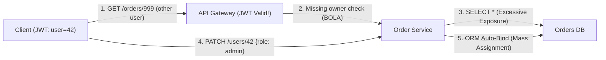
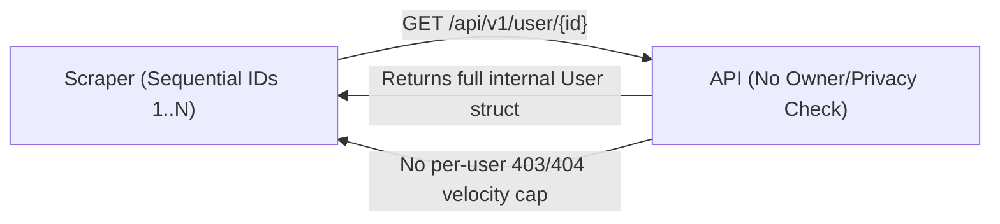

# OWASP API Security Risks: BOLA, Mass Assignment & Data Exposure

> **Prerequisites:** [Lesson 12: OWASP Top 10 Explained](../12-owasp-top-10-explained/README.md).  
> **Estimated Reading Time:** 24–28 minutes  
> **Target Audience:** Backend and API platform engineers designing REST, GraphQL, and gRPC endpoints, and candidates asked "how do you secure APIs against BOLA, Mass Assignment, and excessive data exposure?"  
> **Free PDF Notes:** [Download SD-M-013.pdf](https://backendroadmap.com/notes/system-design/SD-M-013.pdf)

> [!NOTE]
> **In one line:** Modern APIs expose structured objects and rich query surfaces directly to clients, making **Broken Object Level Authorization (BOLA / API1)**, **Broken Object Property Level Authorization (BOPLA — Mass Assignment + Excessive Data Exposure / API3)**, and **Unrestricted Resource Consumption (API4)** the dominant attack vectors.

> [!TIP]
> **The Golden Rule:** Never trust an object ID, a JSON property, or a pagination limit from a client. Scope every DB lookup by `owner_id` / `tenant_id`, bind inputs to explicit **allowlisted DTOs**, project outputs to **explicit response DTOs**, and cap pagination, payload sizes, and GraphQL query depth.

---

## 1. What OWASP API Security Risks Are, and What They Aren't

A mobile app calls `GET /api/v1/rides/84920` to fetch the user's receipt. The backend verifies the user's JWT (`user_id = 42`), runs `SELECT * FROM rides WHERE id = 84920`, and returns the full `Ride` struct—including the driver's home address, phone number, and internal payout rate. An attacker simply iterates `84921`, `84922`, `84923` and scrapes millions of riders' trips (**BOLA** + **Excessive Data Exposure**). Then they `PATCH /api/v1/users/me` with `{"role": "admin", "credits": 99999}` and the ORM binds it straight to the `User` model (**Mass Assignment**).

| Term | Precise Meaning | Example |
| :--- | :--- | :--- |
| **API1: BOLA (IDOR)** | Endpoint checks *authentication* (valid JWT) but not *object ownership* | `GET /invoices/999` returns another user's invoice |
| **API3: Mass Assignment** | Server binds client JSON fields directly into internal models/DB rows | `PATCH /profile` with `{"is_admin": true}` |
| **API3: Excessive Data Exposure** | Server serializes full DB entity instead of a minimal response DTO | Returning `password_hash`, `ssn`, or `internal_notes` |
| **API4: Unrestricted Resource Consumption** | Missing caps on page size, batch size, file upload, or GraphQL depth | `?limit=10000000` or 20-level nested GraphQL query |
| **API5: BFLA** | Broken Function Level Authorization: regular user calls admin route | `DELETE /api/admin/users/42` lacks role check |
| **API9: Improper Inventory Management** | Forgotten shadow/beta/v1 APIs left running without auth or patches | `/api/v1/debug/users` left open in prod |
| **Not** | Something an API Gateway JWT check alone can solve | Gateways verify *who* you are, rarely *which* row you own |

### Why It Matters
1. **APIs are machine-readable by design:** Unlike HTML forms, REST/GraphQL endpoints return predictable JSON schemas that attackers can enumerate at thousands of requests per second.
2. **BOLA accounts for ~40% of real-world API breaches** because sequential IDs (`1001, 1002, 1003`) make scraping trivial and JWT middleware gives teams a false sense of security.
3. **GraphQL and ORM auto-serialization amplify API3 & API4:** A single unguarded ORM `toJSON()` or unbounded GraphQL resolver can leak PII or trigger a database-wide DoS.

---

## 2. Anatomy: BOLA, Mass Assignment, and Excessive Data Exposure



Notice why the API Gateway did not stop any of these:
1. The JWT was completely valid (`user=42`).
2. **BOLA (API1)** happened because `SVC` queried `WHERE id = 999` instead of `WHERE id = 999 AND user_id = 42`.
3. **Excessive Data Exposure (API3)** happened because `SVC` returned `SELECT *` instead of projecting only `{id, status, total}`.
4. **Mass Assignment (API3)** happened because `SVC` unmarshaled the request body straight into the database entity instead of an explicit `UpdateProfileRequest` DTO.

| Risk | Broken Pattern | Secure Pattern |
| :--- | :--- | :--- |
| **BOLA (API1)** | `db.Find(&order, id)` | `db.Where("id = ? AND tenant_id = ?", id, ctx.TenantID).First(&order)` + UUIDv4 |
| **Mass Assignment (API3)** | `json.Decode(r.Body, &userModel)` | `json.Decode(r.Body, &updateProfileDTO)` (only `DisplayName`, `AvatarURL`) |
| **Data Exposure (API3)** | `return c.JSON(userModel)` | `return c.JSON(UserPublicDTO{ID: u.ID, Name: u.DisplayName})` |
| **Resource Exhaustion (API4)** | `?limit=1000000` | `limit = clamp(req.Limit, 1, 100)` + cursor pagination + GraphQL depth <= 5 |

> [!WARNING]
> **UUIDs alone do NOT fix BOLA.** Switching `/orders/1001` to `/orders/550e8400-e29b-41d4-a716-446655440000` stops trivial sequential scraping, but UUIDs still leak in browser history, Referer headers, logs, and shared links. You **must** enforce object-level ownership (`AND tenant_id = ?`) on every single query.

---

## 3. Mathematical Model: Enumeration Velocity & GraphQL Amplification

**Sequential vs. UUIDv4 Scraping.** With sequential 32-bit IDs, an attacker scanning at $R = 500\text{ req/s}$ enumerates $10^6$ records in:

$$T_{\text{enum}} = \frac{10^6}{500} = 2{,}000\text{ seconds} \approx 33.3\text{ minutes}$$

With UUIDv4 (122 random bits), the probability of guessing a valid ID among $N = 10^8$ existing records per request is:

$$P(\text{hit}) = \frac{10^8}{2^{122}} \approx 1.88 \times 10^{-29}$$

**GraphQL / Batch Amplification (API4).** Suppose a GraphQL query allows nesting `user -> friends (limit 50) -> posts (limit 50) -> comments (limit 50)`. A single HTTP request of depth $d = 4$ with branching factor $b = 50$ triggers up to:

$$\text{Total Objects} = \sum_{k=0}^{d-1} b^k = 1 + 50 + 2{,}500 + 125{,}000 = 127{,}551\text{ rows}$$

If each row lookup costs $0.2\text{ ms}$ without DataLoader batching, one HTTP request consumes $127{,}551 \times 0.2\text{ ms} \approx 25.5\text{ seconds}$ of DB time—10 concurrent requests saturate a 250-connection Postgres pool! Enforcing **max depth $d \le 5$** and **query complexity cost budget $\le 1{,}000$** rejects the query at the parser in `< 1 ms` before touching the database.

---

## 4. Metrics & Percentiles

| Metric | Meaning | Alert when |
| :--- | :--- | :--- |
| **`api_403_404_per_user_rate`** | Rate of authorization denials or missing-ID lookups per user/token | > 20/min from a single user (active BOLA enumeration) |
| **`api_response_payload_bytes` ($p_{99}$)** | Response body size across endpoints | Sudden jump after deploy (accidental `SELECT *` / Data Exposure) |
| **`api_page_limit_clamped_total`** | Requests asking for `limit > max_limit` | Spike indicates scraping or API4 probe |
| **`graphql_query_complexity_rejected`** | Queries exceeding cost/depth budget | Sustained spike (DoS probe) |
| **`api_shadow_route_hits`** | Traffic hitting deprecated or undocumented routes (API9) | Any traffic to retired endpoints |

### Worked Example (Detecting BOLA Scraping)
A normal user triggers `0–1` `403/404` responses per day on `/api/v1/documents/{id}`. During an attack, a compromised JWT sends 300 requests/minute to `/api/v1/documents/{id}` with a 92% `403 Forbidden` rate. By tracking a sliding-window counter `bola_403_count{user_id}` in Redis and auto-revoking/throttling tokens that exceed `30` `403`s in `60 s`, the platform halts enumeration in under 6 seconds.

---

## 5. Compounding & Failure Modes: API Risk Interactions

| Failure Mode | Mechanism | Blast Radius |
| :--- | :--- | :--- |
| **BOLA + Sequential IDs** | Missing `owner_id` check + auto-increment PK | Complete database exfiltration via simple `for` loop |
| **Mass Assignment + Soft Delete / Status** | Client sends `{"status": "PAID", "deleted_at": null}` | Free merchandise or undeleting banned accounts |
| **Data Exposure + Public GraphQL Introspection** | `__schema` enabled in prod + full entity serialization | Attackers discover hidden admin fields (`internalRiskScore`) and query them |
| **API4 + Unbounded Batch Endpoint** | `POST /api/users/batch` accepts 50,000 IDs | Single request triggers 50,000 DB queries, taking down the DB |

---

## 6. Numbers Every Engineer Must Know

| Item | Typical | Implication |
| :--- | :---: | :--- |
| **Max pagination `limit`** | 50–100 items | Always clamp server-side; prefer cursor pagination |
| **Max JSON request body** | 100 KB–1 MB (non-upload) | Enforce at API Gateway / HTTP server (`MaxBytesReader`) |
| **GraphQL max depth / cost** | Depth $\le 5$, Cost $\le 1{,}000$ | Reject complex queries before execution |
| **UUIDv4 random bits** | 122 bits | Stops blind guessing, but never replaces ownership checks |
| **BOLA share of API breaches** | ~40% | Highest-ROI check in code reviews and integration tests |

---

## 7. Protocol Deep Dive: Request/Response Lifecycle with DTOs & Policy Enforcement

```mermaid
sequenceDiagram
    participant C as Client
    participant GW as API Gateway
    participant H as Handler (Input DTO)
    participant P as Policy / AuthZ Layer
    participant D as Database (Scoped Query)

    C->>GW: PATCH /api/v1/orders/550e... {"note":"fragile","status":"PAID"}
    GW->>GW: Verify JWT, body <= 64KB, rate limit
    GW->>H: Forward with X-Tenant-ID, X-User-ID
    H->>H: Bind JSON to UpdateOrderInputDTO (only "note"; "status" ignored/rejected!)
    H->>P: Authorize(user, "order:update", orderID)
    P->>D: SELECT id, tenant_id, status FROM orders WHERE id=$1 AND tenant_id=$2
    D-->>P: Row found (belongs to tenant)
    P-->>H: Allowed
    H->>D: UPDATE orders SET note=$1 WHERE id=$2 AND tenant_id=$3
    H->>H: Map row to OrderPublicDTO (strips internal_cost, margin)
    H-->>C: 200 OK (OrderPublicDTO)
```

| Question | Answer |
| :--- | :--- |
| **Should Mass Assignment silently ignore unknown fields or return `400`?** | Returning `400 Bad Request` (`DisallowUnknownFields` / `forbidNonWhitelisted`) is stricter and alerts developers/security monitoring when someone probes `is_admin`. |
| **Should BOLA return `403 Forbidden` or `404 Not Found`?** | Return `404 Not Found` for resources the user has no business knowing exist (prevents ID existence oracle); return `403` when the resource's existence is already public. |
| **How do you prevent API9 (Improper Inventory Management)?** | Generate routes from an OpenAPI spec, block undocumented routes at the API Gateway (strict schema validation), and sunset deprecated versions with `Deprecation` headers + telemetry. |

**When not to build per-endpoint ownership SQL.** If you use PostgreSQL across multi-tenant services, enable **Row-Level Security (RLS)** (`CREATE POLICY tenant_iso ON orders USING (tenant_id = current_setting('app.tenant_id')::uuid)`) so even a developer bug cannot leak cross-tenant rows.

---

## 8. Hierarchical Budgets & Design Rules

| Slice | Rule | Control |
| :--- | :--- | :--- |
| **BOLA (API1)** | Every resource query includes `tenant_id` / `owner_id` | Scoped repository helpers + Postgres RLS |
| **AuthN (API2)** | Short-lived JWTs (5–15 min) + mTLS/HMAC internal | API Gateway signature verification |
| **Mass Assignment (API3)** | Explicit Input DTOs; reject unknown fields | `DisallowUnknownFields` / Zod `.strict()` / Pydantic `extra="forbid"` |
| **Data Exposure (API3)** | Explicit Output DTOs; never serialize DB models | Code-review rule + OpenAPI response schema tests |
| **Resource Limits (API4)** | Clamp `limit <= 100`, body `<= 1 MB`, timeout `<= 5s` | Gateway + middleware guards |
| **BFLA (API5)** | Separate admin router with explicit role middleware | Deny-by-default RBAC |
| **Inventory (API9)** | OpenAPI-driven gateway; disable GraphQL introspection in prod | CI/CD contract diffing |

---

## 9. Top Mitigations

1. **Enforce object-level authorization in the data-access layer** (`WHERE id = $1 AND tenant_id = $2`), backed by PostgreSQL Row-Level Security for multi-tenant isolation.
2. **Use strict Input DTOs** with unknown-field rejection (`DisallowUnknownFields`, Pydantic `extra="forbid"`, `class-validator` `forbidNonWhitelisted`) to eliminate Mass Assignment.
3. **Use explicit Output DTOs** (or GraphQL field-level auth) and never serialize raw ORM/DB structs to JSON.
4. **Cap pagination, batch sizes, and payload sizes** at both the API Gateway and service middleware (`limit <= 100`, `MaxBytesReader`, GraphQL depth/cost limits).
5. **Write automated BOLA regression tests** in CI: for every endpoint, assert that User B receives `403`/`404` when accessing User A's resource ID.
6. **Enable strict OpenAPI schema validation** at the API Gateway to block undocumented parameters and shadow endpoints (API9).
7. **Alert and auto-throttle on high `403`/`404` velocity** per user/IP to stop BOLA enumeration in real time.

---

## 10. Production Reference: Peloton & Parler BOLA / Excessive Data Exposure Incidents

In 2021, security researchers uncovered two textbook **API1 + API3** failures in major consumer platforms:
- **Peloton API:** Unauthenticated or low-privilege requests to `/api/user/{userId}` returned private user profile fields (age, gender, location, workout stats) even for users who had set their profiles to "private" (**BOLA + Excessive Data Exposure**).
- **Parler API:** Sequential numeric post/user IDs combined with missing access checks and unstripped EXIF metadata allowed researchers to archive ~70 TB of public and "deleted" posts/videos before the platform could rate-limit them (**BOLA + API4 Unrestricted Resource Consumption**).



**Root Cause:** Endpoints relied on client-side UI hiding ("private profile" flag) and sequential IDs without server-side authorization or response DTO projection.  
**Fix:** Enforce privacy/ownership predicates inside the query/policy layer, project only public-safe fields into a `PublicProfileDTO`, use UUIDv4s, and rate-limit enumeration patterns.

---

## 11. Multi-Language Production Code Tabs

Strict **Input DTO (anti-Mass Assignment)**, **BOLA-safe scoped lookup**, **Output DTO (anti-Data Exposure)**, and **pagination clamping (anti-API4)** across Go, TypeScript, Python, and C#.

````carousel
```go
// Go: Strict Input DTO (DisallowUnknownFields), BOLA-safe query, Output DTO, and limit clamping.
package api

import (
	"encoding/json"
	"net/http"
)

type UpdateOrderInput struct {
	Note string `json:"note"` // "status" and "total" intentionally excluded
}

type OrderPublicDTO struct {
	ID     string `json:"id"`
	Status string `json:"status"`
	Note   string `json:"note"`
}

func ClampLimit(limit int) int {
	if limit < 1 {
		return 20
	}
	if limit > 100 {
		return 100
	}
	return limit
}

func HandlePatchOrder(w http.ResponseWriter, r *http.Request, tenantID, orderID string) {
	r.Body = http.MaxBytesReader(w, r.Body, 64*1024) // API4: 64 KiB body cap
	dec := json.NewDecoder(r.Body)
	dec.DisallowUnknownFields() // API3: reject unexpected fields like "status" or "is_admin"

	var input UpdateOrderInput
	if err := dec.Decode(&input); err != nil {
		http.Error(w, "invalid payload", http.StatusBadRequest)
		return
	}

	// API1 (BOLA): query MUST scope by both orderID and authenticated tenantID
	// SELECT id, status, note FROM orders WHERE id = $1 AND tenant_id = $2
	dto := OrderPublicDTO{ID: orderID, Status: "PROCESSING", Note: input.Note}
	w.Header().Set("Content-Type", "application/json")
	_ = json.NewEncoder(w).Encode(dto)
}
```
<!-- slide -->
```typescript
// TypeScript: Zod strict Input DTO (anti-Mass Assignment) + BOLA check + Output DTO.
import { z } from "zod";

// .strict() rejects unknown keys like {"role": "admin"} with a validation error
const UpdateProfileInputSchema = z.object({
  displayName: z.string().min(1).max(80),
  bio: z.string().max(300).optional(),
}).strict();

export interface UserPublicDTO {
  id: string;
  displayName: string;
  bio?: string;
}

export function clampLimit(raw: number): number {
  if (!Number.isFinite(raw) || raw < 1) return 20;
  return Math.min(raw, 100);
}

export async function updateOrderNote(
  reqBody: unknown,
  authUserId: string,
  targetUserId: string,
  repo: { updateProfile: (id: string, data: z.infer<typeof UpdateProfileInputSchema>) => Promise<any> }
): Promise<UserPublicDTO> {
  // API1 (BOLA): enforce ownership before touching DB
  if (authUserId !== targetUserId) {
    throw new Error("404: Resource not found");
  }
  const safeInput = UpdateProfileInputSchema.parse(reqBody); // API3: anti-Mass Assignment
  const row = await repo.updateProfile(authUserId, safeInput);

  // API3: explicit Output DTO strips passwordHash, ssn, internalFlags
  return { id: row.id, displayName: row.displayName, bio: row.bio };
}
```
<!-- slide -->
```python
# Python 3.13: Strict Input validation + BOLA-scoped query + Output DTO projection.
from dataclasses import dataclass


@dataclass(frozen=True)
class UpdateOrderInput:
    note: str

    @classmethod
    def from_json(cls, payload: dict) -> "UpdateOrderInput":
        allowed = {"note"}
        extra = set(payload.keys()) - allowed
        if extra:  # API3: Reject Mass Assignment attempts loudly
            raise ValueError(f"Unexpected fields: {sorted(extra)}")
        note = str(payload.get("note", ""))[:500]
        return cls(note=note)


@dataclass(frozen=True)
class OrderPublicDTO:
    id: str
    status: str
    note: str


def clamp_limit(limit: int) -> int:
    return max(1, min(limit, 100))  # API4: cap page size


def update_order_note(db_conn, tenant_id: str, order_id: str, raw_body: dict) -> OrderPublicDTO:
    safe_in = UpdateOrderInput.from_json(raw_body)
    # API1 (BOLA): tenant_id is mandatory in the WHERE clause
    cur = db_conn.execute(
        "UPDATE orders SET note = ? WHERE id = ? AND tenant_id = ? RETURNING id, status, note",
        (safe_in.note, order_id, tenant_id),
    )
    row = cur.fetchone()
    if row is None:
        raise LookupError("404: Order not found")
    return OrderPublicDTO(id=row[0], status=row[1], note=row[2])
```
<!-- slide -->
```csharp
// C# (.NET 8): Explicit Input/Output records + BOLA-scoped EF/SQL check + limit clamping.
using System.Text.Json;
using System.Text.Json.Serialization;

[JsonUnmappedMemberHandling(JsonUnmappedMemberHandling.Disallow)] // API3: Reject unknown JSON fields
public sealed record UpdateOrderInput(string Note);

public sealed record OrderPublicDto(string Id, string Status, string Note);

public static class OrderEndpoints
{
    public static int ClampLimit(int limit) => Math.Clamp(limit, 1, 100);

    public static OrderPublicDto UpdateOrderNote(
        string rawJson, string authTenantId, string orderId, Func<string, string, string, OrderPublicDto?> updateInDb)
    {
        var input = JsonSerializer.Deserialize<UpdateOrderInput>(rawJson)
            ?? throw new ArgumentException("Invalid JSON");

        // API1 (BOLA): DB update must filter by BOTH orderId and authTenantId
        var updated = updateInDb(orderId, authTenantId, input.Note);
        if (updated is null)
            throw new KeyNotFoundException("404: Order not found");

        return updated; // API3: returns only OrderPublicDto fields
    }
}
```
````

---

## 12. Hands-On CLI Verification Workflows

Test for Mass Assignment, BOLA, and Excessive Data Exposure against a local API:

```bash
# 1. Probe for Mass Assignment (API3): send privileged fields in a PATCH request
curl -i -X PATCH https://api.example.com/v1/users/me \
  -H "Authorization: Bearer $USER_TOKEN" \
  -H "Content-Type: application/json" \
  -d '{"display_name": "Alice", "role": "admin", "is_verified": true}'
# Expect: 400 Bad Request (unknown fields rejected) — never 200 with role="admin"

# 2. Probe for BOLA (API1): User B requests User A's resource ID
curl -s -o /dev/null -w "%{http_code}\n" \
  -H "Authorization: Bearer $USER_B_TOKEN" \
  https://api.example.com/v1/orders/"$USER_A_ORDER_ID"
# Expect: 404 or 403 — never 200

# 3. Probe for API4 (Unrestricted Resource Consumption)
curl -s -w "\nTime: %{time_total}s Size: %{size_download}B\n" \
  -H "Authorization: Bearer $USER_TOKEN" \
  "https://api.example.com/v1/orders?limit=999999"
# Expect: clamped to <= 100 items and fast response
```

---

## 13. Common Mistakes to Avoid

1. **Relying on API Gateway JWT validation** and assuming downstream endpoints don't need object-ownership checks.
2. **Using UUIDv4s as a substitute for BOLA checks** instead of defense-in-depth.
3. **Binding HTTP JSON directly into ORM/database models** (Mass Assignment).
4. **Returning `SELECT *` or raw ORM entities** in API responses (Excessive Data Exposure).
5. **Leaving GraphQL introspection and unlimited query depth enabled** in production.
6. **Allowing unbounded `?limit=` or batch arrays** without server-side clamping.
7. **Forgetting to test cross-tenant access** in automated CI integration tests.

---

## 14. Key Terms Glossary

| Key Term | Definition |
| :--- | :--- |
| **BOLA (API1)** | Broken Object Level Authorization (IDOR): accessing another user's object by changing its ID. |
| **BOPLA (API3)** | Broken Object Property Level Authorization: combines Mass Assignment and Excessive Data Exposure. |
| **Mass Assignment** | Vulnerability where client-supplied JSON properties overwrite protected internal model fields. |
| **Excessive Data Exposure** | Returning more object fields than the client needs, leaking PII or internal state. |
| **BFLA (API5)** | Broken Function Level Authorization: calling privileged/admin endpoints without role checks. |
| **API4** | Unrestricted Resource Consumption: missing limits on payload size, pagination, rate, or query depth. |
| **API9** | Improper Inventory Management: unmaintained, shadow, or deprecated API versions left exposed. |
| **DTO** | Data Transfer Object: explicit struct defining allowed input or output fields at an API boundary. |
| **Row-Level Security (RLS)** | Database-enforced policy restricting which rows a query can read or modify per tenant/user. |
| **Query Complexity Budget** | Static cost limit applied to GraphQL queries before execution to prevent resource exhaustion. |

---

## 15. System Design Interview Questions & Answers

### Basic Conceptual Questions

<details>
<summary><strong>Q1: What is BOLA (API1) and how does it differ from BFLA (API5)? [BASIC]</strong></summary>

**Answer:**
**BOLA** (Broken Object Level Authorization) is when User A accesses User B's specific record (e.g., `GET /orders/999`). **BFLA** (Broken Function Level Authorization) is when a regular user invokes an administrative function/endpoint they have no role for (e.g., `DELETE /admin/users/42`).
</details>

<details>
<summary><strong>Q2: What is Mass Assignment and how do you prevent it? [BASIC]</strong></summary>

**Answer:**
Mass Assignment occurs when a backend binds raw JSON/form input directly to a database model, letting attackers set fields like `is_admin` or `account_balance`. Prevent it by binding requests to explicit **Input DTOs** that only contain user-editable fields and rejecting unknown JSON properties.
</details>

<details>
<summary><strong>Q3: Why is "Excessive Data Exposure" dangerous if the UI hides the extra fields? [BASIC]</strong></summary>

**Answer:**
Attackers don't use your UI—they inspect raw HTTP responses with `curl` or browser DevTools. If the API returns `password_hash`, `ssn`, or `internal_margin`, that data is already compromised. Always project responses into minimal **Output DTOs** on the server.
</details>

<details>
<summary><strong>Q4: How do you prevent API4 (Unrestricted Resource Consumption) on list endpoints? [BASIC]</strong></summary>

**Answer:**
Enforce a hard server-side cap on `limit` (e.g., `1..100`), use cursor-based pagination instead of deep `OFFSET`, cap request body sizes (`MaxBytesReader`), set per-request timeouts, and apply per-user/IP rate limits.
</details>

### Scenario-Based Architecture Questions

<details>
<summary><strong>Q5: You are designing a multi-tenant SaaS API. How do you guarantee one tenant can never read another tenant's data via BOLA? [SCENARIO]</strong></summary>

**Answer:**
Defense-in-depth across three layers: (1) extract `tenant_id` solely from the verified JWT/session (never from query/body), (2) require `tenant_id` in every repository method (`WHERE id = $1 AND tenant_id = $2`), and (3) enable **PostgreSQL Row-Level Security (RLS)** on all tenant tables so even a missing `WHERE` clause cannot return cross-tenant rows.
</details>

<details>
<summary><strong>Q6: A mobile team asks for a GraphQL endpoint over your microservices. What API-specific security controls do you add? [SCENARIO]</strong></summary>

**Answer:**
Disable schema introspection in production, enforce **max query depth** ($\le 5$) and **query complexity cost** limits, use **DataLoader** to prevent N+1 DB exhaustion, enforce object-level authorization inside every field/edge resolver, and consider **persisted queries** (allowlisting known query hashes).
</details>

<details>
<summary><strong>Q7: How do you detect and stop an attacker scraping your `/api/v1/profiles/{id}` endpoint? [SCENARIO]</strong></summary>

**Answer:**
Replace sequential integer IDs with UUIDv4s, enforce strict pagination/rate limits, track per-user/IP `403` and `404` velocity in Redis (auto-blocking tokens exceeding e.g. 30 misses/min), and return minimal public DTOs.
</details>

<details>
<summary><strong>Q8: Your company has `v1`, `v2`, and `beta` APIs running in production. How do you manage API9 (Improper Inventory Management)? [SCENARIO]</strong></summary>

**Answer:**
Maintain an authoritative OpenAPI catalog in Git, configure the API Gateway to reject any route/method not in the active spec, emit `Deprecation` and `Sunset` headers on old versions, monitor traffic to deprecated routes, and decommission `v1` on schedule.
</details>

### Advanced & Tricky Interview Questions

<details>
<summary><strong>Q9: Why does switching from auto-increment IDs to UUIDv4s NOT solve BOLA? [TRICKY]</strong></summary>

**Answer:**
UUIDv4s only add obscurity against blind guessing. If an ID leaks via a shared link, support ticket, browser history, or a list endpoint, an endpoint without an ownership check (`WHERE id = $1 AND owner_id = $2`) is still 100% exploitable. Authorization must be enforced, not hidden.
</details>

<details>
<summary><strong>Q10: In a `PATCH` endpoint, why should you return `400 Bad Request` on unknown JSON fields instead of silently ignoring them? [TRICKY]</strong></summary>

**Answer:**
Silently ignoring unknown fields hides client typos (e.g., `firstName` vs `first_name`) and hides active Mass Assignment probing from security telemetry. Returning `400` (`DisallowUnknownFields` / `.strict()`) fails fast and makes probing attempts visible in logs.
</details>

<details>
<summary><strong>Q11: Should a BOLA violation return `403 Forbidden` or `404 Not Found`? [TRICKY]</strong></summary>

**Answer:**
For private resources addressed by ID, return **`404 Not Found`** so an attacker cannot even confirm whether an ID exists (preventing an existence oracle). Return `403` only when the resource's existence is already known to the caller (e.g., an admin route or shared workspace).
</details>

<details>
<summary><strong>Q12: How can a `SELECT` query with `OFFSET 1000000` cause an API4 outage? [TRICKY]</strong></summary>

**Answer:**
The database still has to scan and discard the first 1,000,000 rows before returning 20 rows, consuming massive CPU and I/O. Use **keyset (cursor) pagination** (`WHERE id > $cursor ORDER BY id LIMIT 20`) which runs in $O(\log N)$ via index seek.
</details>

---

## 16. One-Page Master Cheat Sheet

```
+---------------------------------------------------------------------------------------------------------+
|                    OWASP API SECURITY — MASTER CHEAT SHEET                                              |
+---------------------------------------------------------------------------------------------------------+
| 1. BOLA (API1): JWT only proves WHO you are. Scope EVERY query by owner_id/tenant_id + Postgres RLS.    |
+---------------------------------------------------------------------------------------------------------+
| 2. MASS ASSIGNMENT (API3): Bind JSON to strict Input DTOs (DisallowUnknownFields / .strict()).          |
+---------------------------------------------------------------------------------------------------------+
| 3. DATA EXPOSURE (API3): Never serialize DB structs. Project to minimal Output DTOs.                    |
+---------------------------------------------------------------------------------------------------------+
| 4. RESOURCE LIMITS (API4): Clamp limit <= 100, keyset pagination, body <= 1 MB, GraphQL depth/cost cap. |
+---------------------------------------------------------------------------------------------------------+
| 5. INVENTORY & CI (API9): OpenAPI-enforced gateway + automated cross-tenant BOLA tests in CI.           |
+---------------------------------------------------------------------------------------------------------+
```

---

## Further Reading & Sources

- OWASP Foundation, [OWASP API Security Top 10 (2023)](https://owasp.org/API-Security/).
- OWASP Cheat Sheet Series, [Mass Assignment Cheat Sheet](https://cheatsheetseries.owasp.org/cheatsheets/Mass_Assignment_Cheat_Sheet.html).
- PostgreSQL Documentation, [Row Security Policies](https://www.postgresql.org/docs/current/ddl-rowsecurity.html).
- Apollo GraphQL, [Securing GraphQL APIs (Depth & Complexity Limits)](https://www.apollographql.com/docs/apollo-server/security/terminating-operations/).

---

## Free PDF Notes

[SD-M-013.pdf](https://backendroadmap.com/notes/system-design/SD-M-013.pdf)

---

## Next

Continue with [Credential Stuffing Defence: Rate Limits, WAF, Bot Detection & MFA](../14-credential-stuffing-defence/README.md).
