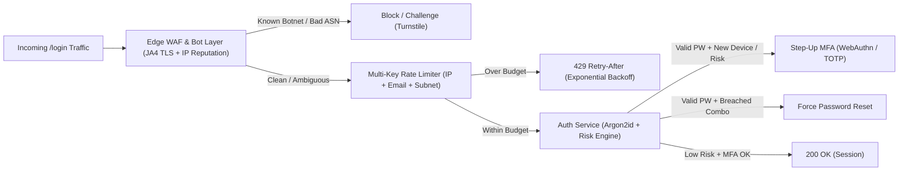
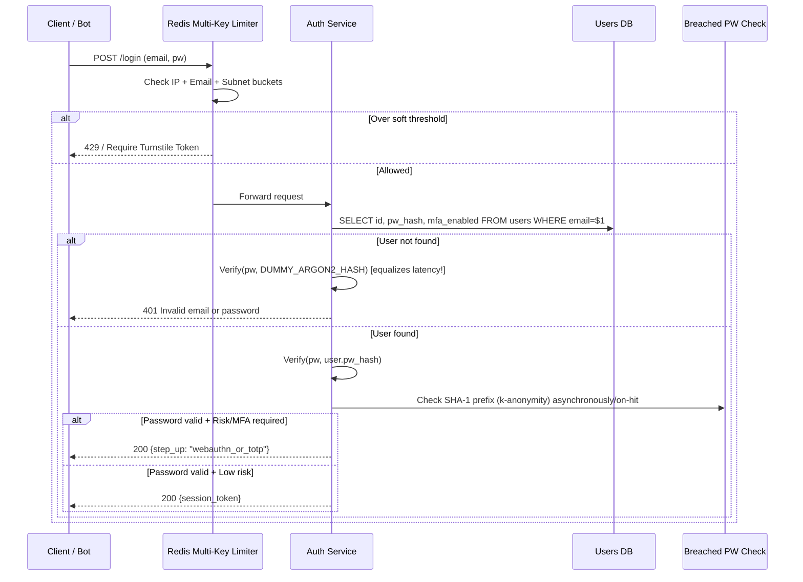
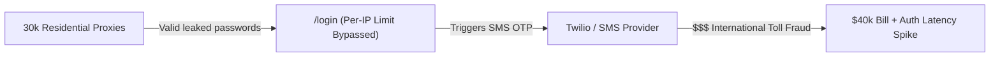

# Credential Stuffing Defence: Rate Limits, WAF, Bot Detection & MFA

> **Prerequisites:** [Lesson 13: OWASP API Security Risks](../13-owasp-api-security-risks/README.md).  
> **Estimated Reading Time:** 24–28 minutes  
> **Target Audience:** Backend and security engineers protecting login, signup, and reset endpoints, and candidates asked "how do you defend a high-traffic login system against credential stuffing?"  
> **Free PDF Notes:** [Download SD-M-014.pdf](https://backendroadmap.com/notes/system-design/SD-M-014.pdf)

> [!NOTE]
> **In one line:** **Credential stuffing** replays billions of leaked `(email, password)` pairs from other breaches against your login endpoint using distributed residential proxies—meaning naive per-IP rate limits fail, and you must combine **multi-dimensional rate limiting**, **bot/TLS fingerprinting**, **breached-password checks**, and **phishing-resistant MFA**.

> [!TIP]
> **The Golden Rule:** Never rely on a single IP rate limit or a hard account lockout (which enables attacker-triggered DoS!). Layer **per-IP + per-account + per-ASN/device** token buckets, **progressive friction** (CAPTCHA/WebAuthn step-up), **breached-credential screening**, and **MFA**.

---

## 1. What Credential Stuffing Is, and What It Isn't

An attacker downloads a 2-billion-row combo list from an unrelated breach and rents a botnet of 50,000 residential IP addresses. Each IP sends only **1–2 login requests per minute** to your `POST /login` endpoint—staying completely under a naive `10 req/min per IP` limit while hammering your auth service at **1,500+ logins/sec**. Because ~65% of people reuse passwords across sites, even a 0.5% hit rate yields **thousands of compromised accounts** in hours.

| Term | Precise Meaning | Example |
| :--- | :--- | :--- |
| **Credential stuffing** | Automated replay of leaked `(username, password)` pairs from external breaches | Botnet testing 10M leaked combos against `/login` |
| **Password spraying** | Testing 1–3 common passwords against *many* usernames to avoid account lockouts | Trying `Winter2025!` on 50,000 corporate emails |
| **Brute force** | Guessing many passwords against *one* target account | Dictionary attack on `admin@example.com` |
| **Account lockout DoS** | Attacker intentionally fails 5 logins per user to lock out legitimate customers | Locking out CEO or 10,000 users before a sale |
| **Progressive delay / Step-up** | Increasing friction (exponential backoff, CAPTCHA, email/MFA challenge) without hard lockout | Require Turnstile/WebAuthn after 3 failures |
| **JA3 / JA4 fingerprint** | TLS ClientHello fingerprint identifying headless bots spoofing Chrome `User-Agent` | Python `requests` or Go TLS claiming to be Safari |
| **Not** | Stopped by password hashing alone (Argon2id protects stolen DBs, not live `/login` replay) | Hashing cannot tell a bot from a real user |

### Why It Matters
1. **Password reuse is widespread:** Even with Argon2id and TLS 1.3, valid credentials from another site's breach give attackers legitimate access unless you block the replay or require MFA.
2. **Auth endpoints are expensive:** Every stuffed login triggers an Argon2id check (~100 ms CPU + 64 MiB RAM); an undefended stuffing wave can both compromise accounts **and** DDoS your auth cluster.
3. **Naive lockouts backfire:** Hard-locking an account after 5 failed attempts lets any attacker lock out every user whose email they know.

---

## 2. Anatomy: Layered Credential Stuffing Defence



Every layer filters a different class of attacker:
1. **Edge WAF / Bot Management:** Drops headless browsers and spoofed User-Agents via **JA4 TLS fingerprinting** and ASN reputation before traffic hits your origin.
2. **Multi-Dimensional Rate Limiter:** Tracks `(IP)`, `(email)`, `(IP /24 subnet)`, and `(device_id)` simultaneously so distributed proxies cannot bypass per-account limits, and spraying cannot bypass per-IP limits.
3. **Risk-Based Step-Up & Breached-Password Check:** Even if a password matches, if the IP/device is unfamiliar or the password appears in a known breach corpus (HIBP k-anonymity), require **MFA** or force a password reset.

| Defence Layer | Stops Distributed Stuffing? | Stops Password Spraying? | Stops Account Lockout DoS? |
| :--- | :---: | :---: | :---: |
| **Per-IP rate limit only** | No (residential proxies) | No | Yes |
| **Hard account lockout (5 fails)** | Yes | Yes | **No (causes DoS!)** |
| **Per-account progressive delay + CAPTCHA** | Yes | Yes | **Yes** |
| **JA4 TLS + Bot detection** | Yes (catches scripted bots) | Yes | Yes |
| **MFA (WebAuthn / TOTP)** | **Yes (blocks takeover even on valid PW)** | **Yes** | Yes |

> [!WARNING]
> **Never return different error messages for "user not found" vs. "wrong password"** (and watch out for timing differences!). Returning `"Email does not exist"` lets attackers enumerate valid accounts at 10x speed before stuffing them. Always return a generic `"Invalid email or password"` with uniform timing.

---

## 3. Mathematical Model: Hit Rate, Botnet Spread & Cost Asymmetry

Suppose an attacker has $N = 10{,}000{,}000$ leaked credentials, a botnet of $M = 20{,}000$ residential IPs, and your site has a $p_{\text{exist}} = 0.05$ (5%) user overlap and $p_{\text{reuse}} = 0.08$ (8%) password reuse rate among overlapping users.

**Expected Compromised Accounts (Undefended):**

$$E[\text{compromised}] = N \times p_{\text{exist}} \times p_{\text{reuse}} = 10^7 \times 0.05 \times 0.08 = 40{,}000\text{ accounts}$$

**Why Per-IP Limits Fail:** If the botnet sends at $R_{\text{total}} = 2{,}000\text{ req/s}$ spread evenly across $M = 20{,}000$ IPs, each IP sends only:

$$r_{\text{per\_ip}} = \frac{2{,}000}{20{,}000} = 0.1\text{ req/s} = 6\text{ req/min}$$

A `20 req/min per IP` limit lets **100% of the attack through**.

**Auth Cluster Cost:** At $t_{\text{hash}} = 150\text{ ms}$ per Argon2id check, $2{,}000\text{ req/s}$ requires:

$$\text{vCPUs needed} = 2{,}000 \times 0.15 = 300\text{ vCPUs}$$

Filtering 95% of bot traffic at the edge WAF (costing `< 0.1 ms` per request) drops origin CPU demand from **300 vCPUs** down to **15 vCPUs**.

---

## 4. Metrics & Percentiles

| Metric | Meaning | Alert when |
| :--- | :--- | :--- |
| **`login_failure_ratio`** | `failed_logins / total_logins` | Jumps from baseline (~5–10%) to > 50% (active stuffing wave) |
| **`login_unique_emails_per_ip`** | Distinct emails attempted from one IP/subnet | > 10 distinct emails in 5 min (credential stuffing / spraying) |
| **`login_unique_ips_per_email`** | Distinct IPs attempting one account | > 5 distinct IPs in 10 min (distributed brute force) |
| **`waf_bot_challenge_rate`** | % of `/login` requests challenged or blocked at edge | Sudden spike > 3x baseline |
| **`mfa_stepup_failure_rate`** | Valid password followed by failed/abandoned MFA | Spike indicates attackers have valid passwords (stuffing succeeded at step 1!) |

### Worked Example (Spotting Stuffing via `mfa_stepup_failure_rate`)
A fintech app sees `login_failure_ratio` rise from 8% to 72% at 02:00 UTC, while `mfa_stepup_failure_rate` jumps from 2% to 40%. That second metric is a smoking gun: attackers are actually **guessing valid passwords** from a recent external breach, and MFA is the only thing stopping account takeover. The security team immediately enables stricter WAF challenges, checks those accounts against HIBP, and forces password resets on compromised credentials.

---

## 5. Compounding & Failure Modes

| Failure Mode | Mechanism | Blast Radius |
| :--- | :--- | :--- |
| **Timing Side-Channel Enumeration** | Non-existent email returns in 2 ms; existing email runs Argon2id (150 ms) | Attackers enumerate 100% of user emails via response latency |
| **Hard Account Lockout** | 5 wrong passwords lock account for 24h | Attacker locks out all known users (customer support flood) |
| **Fail-Open Rate Limiter** | Redis timeout bypasses rate check | Stuffing wave floods origin Argon2id workers -> OOM/CPU outage |
| **SMS MFA SIM-Swapping / Toll Fraud** | Stuffing + SMS OTP triggers expensive international SMS pumping | Compromised accounts + $50,000+ SMS bill |

---

## 6. Numbers Every Engineer Must Know

| Item | Typical | Implication |
| :--- | :---: | :--- |
| **Password reuse rate** | 50–65% across sites | External breaches directly threaten your users |
| **Stuffing hit rate** | 0.1%–2% | Small % still equals thousands of accounts at scale |
| **Per-account soft threshold** | 3–5 failures -> challenge | Triggers CAPTCHA/WebAuthn without locking out user |
| **Per-IP /24 subnet window** | e.g., 30–60 req/min | Catches rotated IPs within the same proxy block |
| **Dummy hash latency** | Match real Argon2id (~150 ms) | Prevents timing-based account enumeration |
| **WebAuthn / Passkey phishing** | 0% (origin-bound) | Strongest MFA; immune to AiTM proxies |

---

## 7. Protocol Deep Dive: Constant-Time Login + Multi-Key Token Bucket

To prevent **timing enumeration**, when a user email is *not* found in the database, you must still run a **dummy Argon2id verification** against a precomputed dummy hash before returning `401 Invalid credentials`.



| Question | Answer |
| :--- | :--- |
| **How does HIBP k-anonymity work without leaking passwords?** | Hash the password with SHA-1 locally, send only the **first 5 hex chars** (`21BD1`) to `api.pwnedpasswords.com/range/21BD1`, and check locally if the remaining 35 chars appear in the returned list. |
| **Why track `(IP, email)` and `(email)` separately?** | Tracking `(email)` alone allows lockout DoS; tracking `(IP)` alone fails against residential proxies. Combining `(IP)` hard limit + `(email)` progressive CAPTCHA/MFA step-up stops both. |
| **What is the best MFA against credential stuffing?** | **Passkeys / WebAuthn (FIDO2)** (phishing-resistant, origin-bound) or **TOTP**; avoid SMS OTP where possible due to SIM-swapping and SMS pumping fraud. |

**When not to require CAPTCHA on every login.** Never show a CAPTCHA to clean, low-risk users on their first attempt—it hurts conversion. Trigger CAPTCHA/Turnstile **adaptively** only when risk signals (bad ASN, JA4 mismatch, > 2 failures on email/IP) fire.

---

## 8. Hierarchical Budgets & Design Rules

| Slice | Rule | Control |
| :--- | :--- | :--- |
| **Edge / WAF** | Block known bad ASNs, Tor exit nodes, headless TLS | JA4 fingerprinting + Cloudflare/AWS WAF Bot Control |
| **Rate Limiting** | Multi-key: IP, `/24` subnet, `email`, `device_id` | Redis sliding window / token bucket |
| **Lockout Policy** | Never hard-lock indefinitely on failed passwords | Progressive backoff + CAPTCHA + MFA step-up |
| **Enumeration** | Identical error message + identical response time | Dummy Argon2id verify on unknown email |
| **Breached Passwords** | Screen at signup, reset, and suspicious login | HIBP k-anonymity API (local prefix cache) |
| **MFA** | Mandatory for high-risk logins and privileged roles | WebAuthn / Passkeys > TOTP > Push > SMS |

---

## 9. Top Mitigations

1. **Deploy multi-dimensional rate limiting** keyed on `IP`, `/24` subnet, `email`, and `device_fingerprint`—never IP alone.
2. **Replace hard account lockouts with progressive friction** (exponential backoff + Turnstile/CAPTCHA challenge + email/MFA verification) to prevent lockout DoS.
3. **Eliminate account enumeration** by returning identical error messages and running a dummy Argon2id verification when the email does not exist.
4. **Screen passwords against breached-credential lists** (HIBP k-anonymity) at registration, password change, and on suspicious logins.
5. **Enforce phishing-resistant MFA** (Passkeys/WebAuthn or TOTP) and trigger step-up MFA on new devices, impossible travel, or elevated risk scores.
6. **Filter automated bots at the edge** using TLS fingerprinting (JA4), JS challenges, and ASN reputation before requests reach your Argon2id workers.
7. **Alert on `mfa_stepup_failure_rate` and `unique_emails_per_ip`** so you detect stuffing waves in minutes, not days.

---

## 10. Production Reference: Credential Stuffing & SMS Pumping Mitigation

A common production incident at consumer fintechs occurs when a credential stuffing wave hits `/login` using 30,000 residential proxies. Even when the auth team has **SMS OTP MFA** enabled, attackers intentionally replay valid leaked passwords to trigger tens of thousands of SMS OTPs to premium-rate numbers (**SMS pumping / toll fraud**), costing $40,000+ in a single night while degrading login latency.



**Root Cause:** Relying solely on per-IP rate limits and defaulting to SMS OTP without per-account/per-country SMS velocity caps or edge bot challenges.  
**Fix:** Add a **per-account + per-ASN + per-country-prefix** rate limit before sending any OTP, require a **Turnstile/CAPTCHA challenge** on risk-elevated logins *before* verifying credentials or sending SMS, and migrate users to **Passkeys / TOTP**.

---

## 11. Multi-Language Production Code Tabs

A **multi-key token bucket rate limiter** (`ip`, `email`) + **constant-time dummy-hash login guard** to prevent both credential stuffing and timing-based account enumeration.

````carousel
```go
// Go: Multi-key sliding-window guard + dummy-verify anti-enumeration.
package defence

import (
	"crypto/subtle"
	"sync"
	"time"
)

type Bucket struct {
	tokens     float64
	lastRefill time.Time
}

type LoginGuard struct {
	mu       sync.Mutex
	buckets  map[string]*Bucket
	capacity float64
	rate     float64 // tokens per second
}

func NewLoginGuard(capacity, refillPerSec float64) *LoginGuard {
	return &LoginGuard{
		buckets:  make(map[string]*Bucket),
		capacity: capacity,
		rate:     refillPerSec,
	}
}

func (g *LoginGuard) allowKey(key string, now time.Time) bool {
	b, ok := g.buckets[key]
	if !ok {
		b = &Bucket{tokens: g.capacity, lastRefill: now}
		g.buckets[key] = b
	}
	elapsed := now.Sub(b.lastRefill).Seconds()
	b.tokens = min(g.capacity, b.tokens+elapsed*g.rate)
	b.lastRefill = now
	if b.tokens < 1.0 {
		return false
	}
	b.tokens -= 1.0
	return true
}

// Allow checks BOTH ip and email keys; returns false if either budget is exhausted.
func (g *LoginGuard) Allow(ip, email string) bool {
	g.mu.Lock()
	defer g.mu.Unlock()
	now := time.Now()
	return g.allowKey("ip:"+ip, now) && g.allowKey("email:"+email, now)
}

// DummyCompare simulates constant work when user is not found.
func DummyCompare(a, b []byte) bool {
	return subtle.ConstantTimeCompare(a, b) == 1
}
```
<!-- slide -->
```typescript
// TypeScript: Multi-key token bucket (IP + email) + adaptive challenge threshold.
interface Bucket {
  tokens: number;
  lastRefillMs: number;
}

export class LoginGuard {
  private buckets = new Map<string, Bucket>();

  constructor(private capacity = 5, private refillPerSec = 0.1) {}

  private take(key: string, now: number): boolean {
    let b = this.buckets.get(key);
    if (!b) {
      b = { tokens: this.capacity, lastRefillMs: now };
      this.buckets.set(key, b);
    }
    const elapsedSec = (now - b.lastRefillMs) / 1000;
    b.tokens = Math.min(this.capacity, b.tokens + elapsedSec * this.refillPerSec);
    b.lastRefillMs = now;
    if (b.tokens < 1) return false;
    b.tokens -= 1;
    return true;
  }

  checkLogin(ip: string, email: string): "allow" | "challenge" | "block" {
    const now = Date.now();
    const ipOk = this.take(`ip:${ip}`, now);
    const emailOk = this.take(`email:${email.toLowerCase()}`, now);
    if (!ipOk) return "block";        // Hard 429 on IP flood
    if (!emailOk) return "challenge"; // Require Turnstile/MFA step-up (no hard lockout DoS!)
    return "allow";
  }
}
```
<!-- slide -->
```python
# Python 3.13: Multi-key token bucket + HIBP k-anonymity check helper (stdlib only).
import hashlib
import time


class LoginGuard:
    def __init__(self, capacity: float = 5.0, refill_per_sec: float = 0.1):
        self._capacity = capacity
        self._refill = refill_per_sec
        self._buckets: dict[str, list[float]] = {}

    def _take(self, key: str, now: float) -> bool:
        tokens, last = self._buckets.get(key, [self._capacity, now])
        tokens = min(self._capacity, tokens + (now - last) * self._refill)
        self._buckets[key] = [tokens, now]
        if tokens < 1.0:
            return False
        self._buckets[key][0] -= 1.0
        return True

    def evaluate(self, ip: str, email: str) -> str:
        now = time.monotonic()
        ip_ok = self._take(f"ip:{ip}", now)
        email_ok = self._take(f"email:{email.lower()}", now)
        if not ip_ok:
            return "429_BLOCK"
        if not email_ok:
            return "CHALLENGE_STEP_UP"  # Adaptive CAPTCHA / MFA instead of account lockout
        return "ALLOW"


def hibp_k_anonymity_parts(password: str) -> tuple[str, str]:
    """Returns (5-char SHA-1 prefix to send to HIBP, 35-char suffix to check locally)."""
    digest = hashlib.sha1(password.encode("utf-8")).hexdigest().upper()
    return digest[:5], digest[5:]
```
<!-- slide -->
```csharp
// C# (.NET 8): Thread-safe multi-key LoginGuard preventing IP floods and lockout DoS.
using System.Collections.Concurrent;

public sealed class LoginGuard
{
    private sealed class Bucket { public double Tokens; public long LastTicks; }
    private readonly ConcurrentDictionary<string, Bucket> _buckets = new();
    private readonly double _capacity;
    private readonly double _refillPerSec;

    public LoginGuard(double capacity = 5.0, double refillPerSec = 0.1)
    {
        _capacity = capacity;
        _refillPerSec = refillPerSec;
    }

    private bool TryTake(string key, long nowTicks)
    {
        var b = _buckets.GetOrAdd(key, _ => new Bucket { Tokens = _capacity, LastTicks = nowTicks });
        lock (b)
        {
            double elapsed = (nowTicks - b.LastTicks) / (double)TimeSpan.TicksPerSecond;
            b.Tokens = Math.Min(_capacity, b.Tokens + elapsed * _refillPerSec);
            b.LastTicks = nowTicks;
            if (b.Tokens < 1.0) return false;
            b.Tokens -= 1.0;
            return true;
        }
    }

    public string Evaluate(string ip, string email)
    {
        long now = DateTime.UtcNow.Ticks;
        bool ipOk = TryTake($"ip:{ip}", now);
        bool emailOk = TryTake($"email:{email.ToLowerInvariant()}", now);
        if (!ipOk) return "429_BLOCK";
        if (!emailOk) return "CHALLENGE_STEP_UP";
        return "ALLOW";
    }
}
```
````

---

## 12. Hands-On CLI Verification Workflows

Verify HIBP k-anonymity screening and test login rate-limit headers:

```bash
# 1. Test HIBP k-anonymity API locally (never sends the full password!)
python3 -c '
import hashlib, urllib.request
sha1 = hashlib.sha1(b"password123").hexdigest().upper()
prefix, suffix = sha1[:5], sha1[5:]
res = urllib.request.urlopen(f"https://api.pwnedpasswords.com/range/{prefix}").read().decode()
hits = [line.split(":")[1] for line in res.splitlines() if line.startswith(suffix)]
print(f"Prefix sent: {prefix} | Breached count: {hits[0] if hits else 0}")
'

# 2. Verify rate limiter returns 429 + Retry-After on burst
for i in $(seq 1 10); do
  curl -s -o /dev/null -w "Req $i: %{http_code}\n" -X POST https://api.example.com/login \
    -H "Content-Type: application/json" -d '{"email":"test@example.com","password":"wrong"}'
done
```

---

## 13. Common Mistakes to Avoid

1. **Relying solely on per-IP rate limits** (defeated by residential proxy botnets).
2. **Implementing hard account lockouts** after 5 failures (creates an easy DoS against your users).
3. **Leaking account existence** via `"User not found"` messages or fast-path timing differences.
4. **Skipping breached-password checks** at signup and password reset.
5. **Using SMS OTP as the only MFA** without per-country/per-account SMS velocity caps.
6. **Failing open** on Redis rate-limiter timeouts without a local fallback limiter.
7. **Forgetting to protect `/forgot-password` and `/token/refresh`** with the same anti-automation controls.

---

## 14. Key Terms Glossary

| Key Term | Definition |
| :--- | :--- |
| **Credential Stuffing** | Automated replay of leaked `(username, password)` pairs from external breaches. |
| **Password Spraying** | Testing a few common passwords across thousands of accounts to evade per-account limits. |
| **Account Lockout DoS** | Abuse of hard lockout policies to intentionally lock legitimate users out of their accounts. |
| **JA3 / JA4 Fingerprint** | Hash of TLS ClientHello parameters used to identify bots spoofing browser User-Agents. |
| **k-Anonymity (HIBP)** | Protocol sending only a 5-char SHA-1 prefix to check breached passwords without revealing the password. |
| **Step-Up Authentication** | Triggering extra verification (CAPTCHA, WebAuthn, TOTP) only when risk signals fire. |
| **SMS Pumping** | Abuse of SMS OTP endpoints to generate fraudulent international SMS charges. |
| **Timing Enumeration** | Inferring whether an email exists by measuring login response latency differences. |
| **WebAuthn / Passkeys** | Origin-bound, cryptographic MFA resistant to credential stuffing and phishing. |
| **Token Bucket** | Rate-limiting algorithm allowing short bursts while capping sustained request rates. |

---

## 15. System Design Interview Questions & Answers

### Basic Conceptual Questions

<details>
<summary><strong>Q1: What is the difference between credential stuffing and brute-force attacks? [BASIC]</strong></summary>

**Answer:**
Brute force guesses passwords against a target account from a dictionary or character space. Credential stuffing replays exact `(email, password)` pairs stolen from *other* breached websites, exploiting password reuse.
</details>

<details>
<summary><strong>Q2: Why does per-IP rate limiting fail against modern credential stuffing? [BASIC]</strong></summary>

**Answer:**
Attackers use botnets of tens of thousands of residential proxies. Each IP sends only 1–2 requests per minute—staying well below per-IP thresholds while still generating thousands of login attempts per second globally.
</details>

<details>
<summary><strong>Q3: Why are hard account lockouts considered an anti-pattern for consumer apps? [BASIC]</strong></summary>

**Answer:**
If 5 failed logins lock an account for hours, an attacker can deliberately fail 5 logins for every known user email, causing a mass Denial-of-Service for legitimate customers. Use progressive friction (CAPTCHA/MFA step-up) instead.
</details>

<details>
<summary><strong>Q4: How does HIBP k-anonymity check if a password is breached without exposing it? [BASIC]</strong></summary>

**Answer:**
The server computes `SHA-1(password)`, sends only the first 5 hex characters to the API, receives ~500 matching hash suffixes, and checks locally if the full 40-char hash is in the set. The full hash or password never leaves your server.
</details>

### Scenario-Based Architecture Questions

<details>
<summary><strong>Q5: Design a login endpoint that handles 10,000 req/s during a credential stuffing attack without crashing your Argon2id workers. [SCENARIO]</strong></summary>

**Answer:**
Layer defenses: (1) Edge WAF with JA4 TLS fingerprinting and bot challenges drops scripted bots before origin; (2) Multi-key Redis rate limiter (`IP`, `/24`, `email`) with local in-memory fallback sheds floods with `429` or Turnstile challenges; (3) Auth workers wrap Argon2id in a bounded semaphore so CPU/RAM cannot be exhausted; (4) Valid logins from risky contexts trigger WebAuthn/TOTP step-up.
</details>

<details>
<summary><strong>Q6: How do you prevent attackers from using `/login` to enumerate which emails are registered? [SCENARIO]</strong></summary>

**Answer:**
Return the exact same HTTP status (`401`) and message (`"Invalid email or password"`) for both unknown emails and wrong passwords, and run a **dummy Argon2id verification** when the email is not found so response times are indistinguishable.
</details>

<details>
<summary><strong>Q7: Your `mfa_stepup_failure_rate` suddenly spikes to 45% at 3 AM. What does that tell you, and what do you do? [SCENARIO]</strong></summary>

**Answer:**
Attackers have a fresh breach list and are successfully matching real passwords on `/login`, getting stopped only at MFA. Immediately tighten edge bot challenges, screen affected accounts against HIBP, invalidate active sessions for accounts with suspicious logins, and force password resets on compromised credentials.
</details>

<details>
<summary><strong>Q8: How do you stop password spraying against a corporate SSO portal? [SCENARIO]</strong></summary>

**Answer:**
Because spraying uses 1–2 passwords across *many* accounts, per-account limits won't trigger. Track `unique_emails_per_ip` and `unique_emails_per_subnet` (plus global failed-login velocity for common passwords), block/challenge offending IPs/ASNs, and enforce phishing-resistant MFA (Passkeys/FIDO2).
</details>

### Advanced & Tricky Interview Questions

<details>
<summary><strong>Q9: If Redis (your distributed rate limiter) goes down during an attack, should `/login` fail open or fail closed? [TRICKY]</strong></summary>

**Answer:**
Neither pure fail-open nor total outage! Degrade to an **in-process local token bucket** per auth pod (which protects Argon2id workers from OOM/CPU overload) and optionally tighten edge WAF Turnstile challenges until Redis recovers.
</details>

<details>
<summary><strong>Q10: Why can an attacker still bypass MFA if you only enforce it on `/login` and not on `/api/token/refresh` or `/oauth/authorize`? [TRICKY]</strong></summary>

**Answer:**
Legacy endpoints, mobile OAuth flows, or password-reset flows often lack the same rate-limiting and risk checks. Attackers target the weakest auth entry point; every credential-accepting or session-issuing endpoint must share the same Risk & Rate-Limit middleware.
</details>

<details>
<summary><strong>Q11: How do you rate-limit IPv6 clients without letting an attacker rotate through `/64` addresses? [TRICKY]</strong></summary>

**Answer:**
Residential ISPs assign users a `/64` (or `/56`) IPv6 prefix containing $2^{64}$ addresses. Rate-limiting by full `/128` IPv6 address is useless; always normalize IPv6 keys to their **`/64` network prefix** (and `/56` for subnet-level limits).
</details>

<details>
<summary><strong>Q12: Why is CAPTCHA alone insufficient against determined credential stuffing? [TRICKY]</strong></summary>

**Answer:**
CAPTCHA-solving farms solve challenges for pennies per thousand, and headless browsers can mimic human mouse movements. CAPTCHA raises attacker cost, which is why it must be paired with TLS fingerprinting, multi-key rate limits, breached-password checks, and MFA.
</details>

---

## 16. One-Page Master Cheat Sheet

```
+---------------------------------------------------------------------------------------------------------+
|                    CREDENTIAL STUFFING DEFENCE — MASTER CHEAT SHEET                                     |
+---------------------------------------------------------------------------------------------------------+
| 1. WHY IP LIMITS FAIL: 20k residential proxies * 0.1 req/s = 2,000 req/s globally, invisible per IP.    |
+---------------------------------------------------------------------------------------------------------+
| 2. MULTI-KEY LIMITS: Track IP (/24 v4, /64 v6) + Email + Device. Progressive step-up, NEVER hard lock!  |
+---------------------------------------------------------------------------------------------------------+
| 3. ANTI-ENUMERATION: Identical error message + dummy Argon2id verify when email does not exist.         |
+---------------------------------------------------------------------------------------------------------+
| 4. EDGE & SCREENING: JA4 TLS fingerprinting at WAF + HIBP k-anonymity (5-char SHA-1 prefix).            |
+---------------------------------------------------------------------------------------------------------+
| 5. MFA: Passkeys/WebAuthn > TOTP > SMS (cap SMS velocity to stop toll fraud).                           |
+---------------------------------------------------------------------------------------------------------+
```

---

## Further Reading & Sources

- OWASP Foundation, [Credential Stuffing Prevention Cheat Sheet](https://cheatsheetseries.owasp.org/cheatsheets/Credential_Stuffing_Prevention_Cheat_Sheet.html).
- Troy Hunt / Have I Been Pwned, [Pwned Passwords k-Anonymity API](https://haveibeenpwned.com/API/v3#PwnedPasswords).
- NIST Special Publication 800-63B, *Digital Identity Guidelines (Rate Limiting & Breached Password Checks)*.
- Cloudflare, [JA4+ Fingerprinting and Bot Management](https://blog.cloudflare.com/).

---

## Free PDF Notes

[SD-M-014.pdf](https://backendroadmap.com/notes/system-design/SD-M-014.pdf)

---

## Next

Continue with [Least Privilege & Zero Trust: IAM, Segmentation, Just-in-Time Access](../15-least-privilege-zero-trust/README.md).
