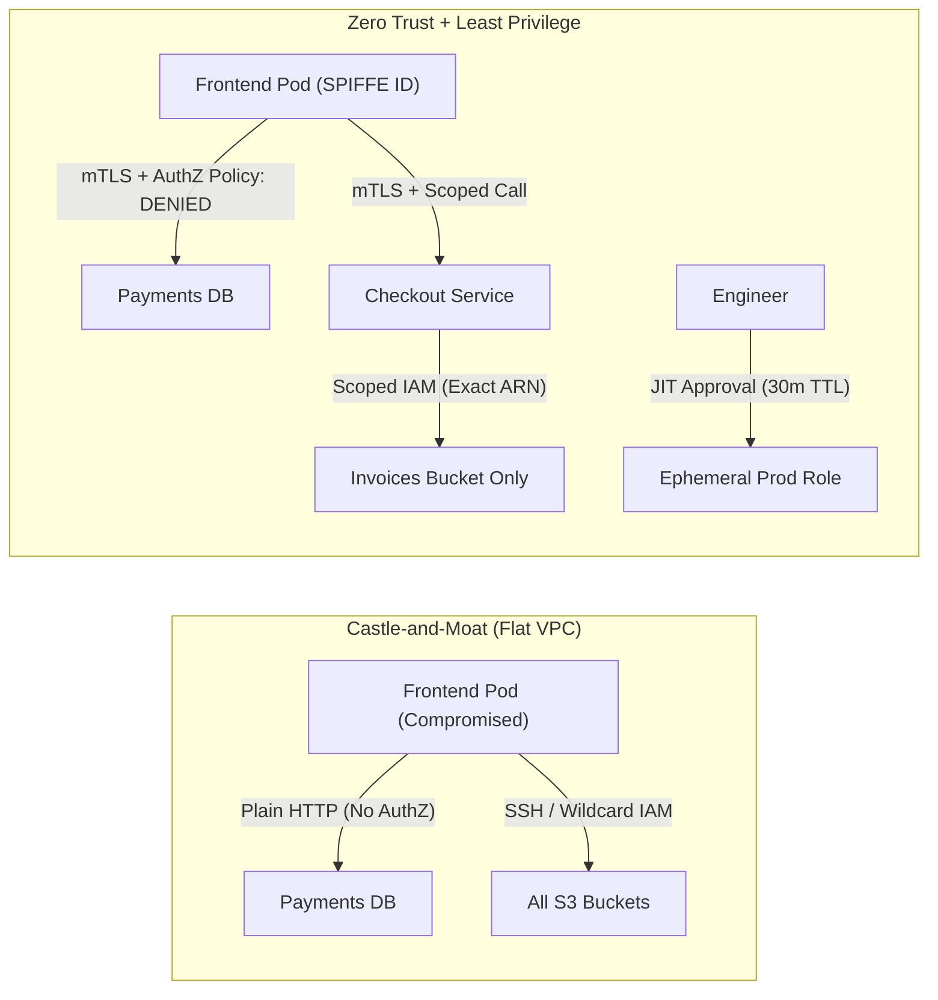
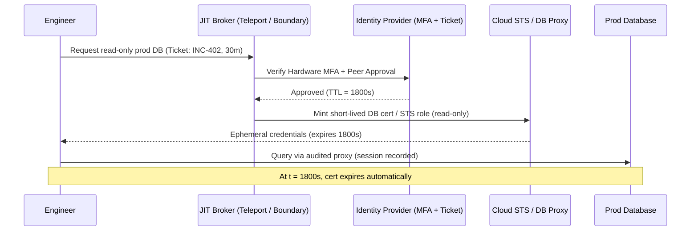
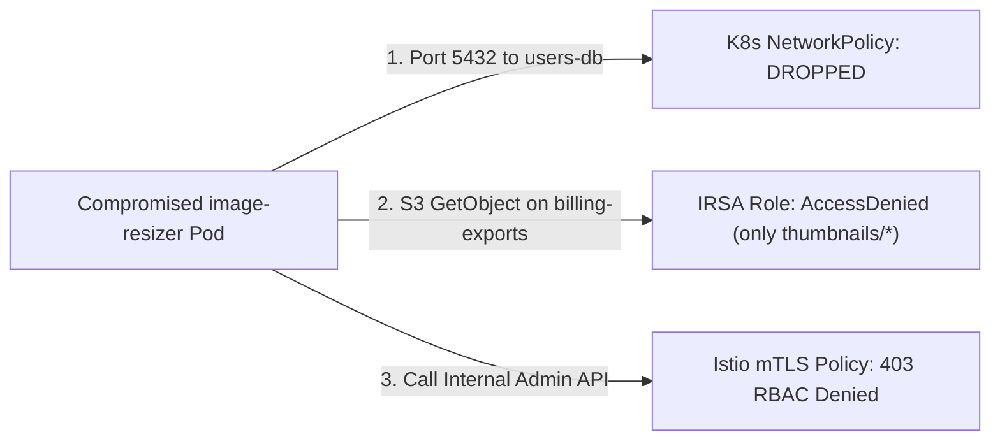

# Least Privilege & Zero Trust: IAM, Segmentation, Just-in-Time Access

> **Prerequisites:** [Lesson 14: Credential Stuffing Defence](../14-credential-stuffing-defence/README.md).  
> **Estimated Reading Time:** 24–28 minutes  
> **Target Audience:** Backend and cloud architects designing microservice IAM, network segmentation, and production access controls, and candidates asked "how do you implement Zero Trust and Least Privilege in a distributed system?"  
> **Free PDF Notes:** [Download SD-M-015.pdf](https://backendroadmap.com/notes/system-design/SD-M-015.pdf)

> [!NOTE]
> **In one line:** **Zero Trust** replaces implicit network trust ("inside the VPC = safe") with **"never trust, always verify"**—authenticating, authorizing, and encrypting every human and service-to-service request—while **Least Privilege** ensures every identity holds only the minimum permissions for the shortest time needed.

> [!TIP]
> **The Golden Rule:** Eliminate standing admin privileges and flat internal networks. Enforce **service-level mTLS + SPIFFE/OIDC identity**, **narrow IAM policies scoped to exact resource ARNs**, **deny-by-default micro-segmentation**, and **Just-in-Time (JIT) ephemeral access** for humans.

---

## 1. What Least Privilege & Zero Trust Are, and What They Aren't

In a traditional "castle-and-moat" network, once an attacker breaches a single perimeter service (via SSRF, a vulnerable dependency, or a phished VPN credential), they find a flat internal network with no mTLS, wildcard IAM roles (`s3:*`, `dynamodb:*`), and engineers holding permanent `AdministratorAccess` in production. **Zero Trust** assumes the internal network is already compromised, requiring explicit cryptographic identity and per-request authorization on every hop.

| Term | Precise Meaning | Example |
| :--- | :--- | :--- |
| **Zero Trust (ZTNA)** | Security model where network location grants zero implicit trust; every request is verified | Service A must present mTLS + JWT/policy check to call Service B |
| **Principle of Least Privilege** | Granting an identity only the exact actions on exact resources required for its task | Billing service has `s3:GetObject` on `arn:aws:s3:::invoices/*` only |
| **Micro-segmentation** | Fine-grained L3/L4/L7 network policies isolating workloads from each other | Kubernetes `NetworkPolicy` blocking Payment pods from talking to Analytics |
| **Workload Identity (SPIFFE)** | Short-lived cryptographic X.509/JWT identity bound to a workload's attestation | SPIFFE ID `spiffe://prod/ns/payments/sa/checkout` rotated every 1h |
| **Just-in-Time (JIT) Access** | Ephemeral, time-boxed elevation granted only after approval + ticket context | Break-glass prod DB read access for 30 minutes, auto-revoked |
| **Standing Privilege** | Permanent, always-on admin or broad write permissions | Engineer with 24/7 `Owner` role in prod AWS account |
| **Not** | A single vendor product you buy, or "putting everything behind a VPN" | A VPN is still perimeter-based castle-and-moat |

### Why It Matters
1. **Containment of blast radius:** Breaches start at one pod, one leaked token, or one phished laptop; Least Privilege and segmentation determine whether the attacker steals 1 record or 100 million.
2. **Eliminates lateral movement:** Without flat VPC trust and standing credentials, an attacker who pops a frontend pod cannot pivot to the database or CI/CD runner.
3. **Auditability and compliance:** Short-lived JIT sessions tied to incident/change tickets provide an exact audit trail for SOC 2, PCI-DSS, and ISO 27001.

---

## 2. Anatomy: Castle-and-Moat vs. Zero Trust Micro-Segmented Architecture



In the Zero Trust architecture:
- **Network plane:** Kubernetes `NetworkPolicy` (L3/L4) and service mesh `AuthorizationPolicy` (L7) enforce **default-deny**: `Frontend` can only call `Checkout` on `POST /checkout`, and has zero network path to `Payments DB`.
- **Identity plane:** Every pod receives a short-lived SPIFFE/OIDC identity (rotated hourly, never static `.env` API keys).
- **Cloud IAM plane:** `Checkout` holds a role scoped to `s3:PutObject` on `arn:aws:s3:::prod-invoices/*`—nothing else.
- **Human plane:** Engineers have **read-only** or zero prod access by default, requesting **JIT elevation** tied to a Jira/PagerDuty ticket when debugging an incident.

| Dimension | Castle-and-Moat | Zero Trust + Least Privilege |
| :--- | :--- | :--- |
| **Trust basis** | Source IP / VPC subnet / VPN | Cryptographic workload & user identity + device posture |
| **East-West traffic** | Unencrypted HTTP, open ports | Mandatory mTLS + per-method L7 policy |
| **IAM permissions** | Broad service roles (`*:*`), shared keys | Action + Resource ARN + Condition scoped |
| **Human prod access** | Standing SSH / Admin roles | Zero standing privilege; 15–60 min JIT elevation |
| **Blast radius** | Entire VPC / Cloud account | Single compromised service or narrow resource prefix |

> [!WARNING]
> **mTLS alone is Authentication, NOT Authorization!** Enabling strict mTLS in Istio/Linkerd proves *who* the caller is (`Frontend`), but without an explicit L7 `AuthorizationPolicy` or RBAC rule, `Frontend` can still call `PaymentsService.DeleteAccount()`. You need **both** mTLS (AuthN) and deny-by-default policy (AuthZ).

---

## 3. Mathematical Model: Blast Radius & Standing Privilege Exposure

Define **Blast Radius ($B$)** of a compromised identity as the number of sensitive resources reachable multiplied by the **Exposure Window ($T_{\text{exp}}$)** during which the credential remains valid:

$$\text{Risk Exposure} \propto B \times T_{\text{exp}}$$

Suppose a production environment has $R = 500$ sensitive resources (databases, S3 buckets, KMS keys).
- **Standing Admin + Flat Network:** An engineer's leaked credential or compromised pod role can reach $B_{\text{flat}} = 500$ resources, and standing credentials remain valid indefinitely until manual rotation ($T_{\text{exp}} \approx 90\text{ days} = 2{,}160\text{ hours}$).
  $$\text{Exposure}_{\text{flat}} = 500 \times 2{,}160 = 1{,}080{,}000\text{ resource-hours}$$
- **Least Privilege + JIT + Short-Lived Workload Certs:** A scoped service role reaches only $B_{\text{scoped}} = 2$ resources (1 table + 1 bucket), and workload certs/JIT tokens expire in $T_{\text{exp}} = 0.5\text{ hours}$ (30 minutes).
  $$\text{Exposure}_{\text{ZT}} = 2 \times 0.5 = 1\text{ resource-hour}$$

That is a **$1{,}080{,}000\times$ reduction** in exposure window $\times$ reachable surface area!

**Lateral Movement Probability:** If an attacker must compromise a chain of $k$ segmented boundaries, each with independent detection/block probability $1 - p_i$, the probability of reaching the crown-jewel database is:

$$P(\text{breach}) = \prod_{i=1}^{k} p_i$$

With $k = 4$ independent controls (Edge WAF $p_1=0.1$, Pod NetworkPolicy $p_2=0.05$, mTLS + L7 Policy $p_3=0.05$, Scoped IAM/DB Role $p_4=0.05$), $P(\text{breach}) = 0.1 \times 0.05^3 = 1.25 \times 10^{-5}$.

---

## 4. Metrics & Percentiles

| Metric | Meaning | Alert when |
| :--- | :--- | :--- |
| **`iam_unused_permissions_ratio`** | % of granted IAM actions never invoked in last 90 days | > 20% (policy bloat; run IAM Access Analyzer) |
| **`standing_admin_accounts_count`** | Human users with permanent prod write/admin roles | > 0 outside emergency break-glass vault |
| **`jit_elevation_duration_p99`** | Duration of human JIT production sessions | Exceeds 60 min or missing ticket ID |
| **`mtls_policy_denies_total`** | East-west requests blocked by mesh/NetworkPolicy | Unexpected spike (lateral movement probe or misconfig) |
| **`workload_cert_ttl_seconds`** | Lifetime of SPIFFE/mTLS certificates | > 86,400 s (24h) |

### Worked Example (Pruning IAM Bloat)
An audit via AWS IAM Access Analyzer reveals a `reporting-worker` role has `s3:*` across `*`, yet over 90 days it only ever called `s3:GetObject` on `arn:aws:s3:::prod-exports/*`. Replacing `s3:*` with a single scoped statement shrinks `B` from 120 buckets to 1 prefix—zero code changes required.

---

## 5. Compounding & Failure Modes

| Failure Mode | Mechanism | Blast Radius |
| :--- | :--- | :--- |
| **Wildcard IAM (`Action: "*", Resource: "*"`)** | Developer copies permissive policy from tutorial to prod | Any SSRF or RCE in that pod compromises the entire cloud account |
| **Break-Glass Lockout During Outage** | JIT approval requires 2 peer approvals, but Slack/Okta is down during SEV-1 | Engineers cannot mitigate outage -> extended downtime |
| **Static Long-Lived Service Tokens** | Hardcoded API key with 1-year TTL stored in CI/CD | Leaked key stays valid for months undetected |
| **Implicit Trust on `X-Forwarded-For` / `X-User-ID`** | Backend trusts internal headers without verifying mTLS/HMAC from gateway | Any compromised pod spoofs `X-User-ID: admin` |

---

## 6. Numbers Every Engineer Must Know

| Item | Typical | Implication |
| :--- | :---: | :--- |
| **Workload cert / OIDC token TTL** | 15–60 minutes | Limits stolen token usefulness to minutes |
| **Human JIT session TTL** | 15–60 minutes | Auto-revoked; requires reason + ticket |
| **Break-glass emergency accounts** | 2 hardware-MFA sealed accounts | Usable even if SSO/IdP is completely down |
| **mTLS handshake overhead** | < 1–2 ms (with TLS session resumption) | Negligible latency cost for full east-west encryption |
| **Unused IAM permissions in typical org** | 70–90% | Continuous policy right-sizing is high-ROI |

---

## 7. Protocol Deep Dive: Just-in-Time (JIT) Access & Workload Identity (OIDC/SPIFFE)

Modern Zero Trust eliminates static secrets for both **workloads** (via OIDC/IRSA/SPIFFE) and **humans** (via JIT elevation):



| Question | Answer |
| :--- | :--- |
| **What if the IdP or JIT broker is down during a SEV-1 outage?** | Maintain 2 **break-glass** emergency accounts with physical FIDO2 hardware keys stored in a safe, triggering an immediate PagerDuty/SIEM page whenever used. |
| **How do pods authenticate to AWS/GCP without static access keys?** | **Workload Identity / IRSA:** Kubernetes mounts a short-lived projected OIDC JWT; the pod exchanges it with AWS STS (`AssumeRoleWithWebIdentity`) for temporary 1-hour credentials. |
| **How do you migrate a legacy VPC to Zero Trust without breaking prod?** | Run policies in **permissive / audit-only mode** first (`Log-Only`), observe legitimate service-to-service edges for 2 weeks, auto-generate the allowlist, and then flip to **Enforce (Default-Deny)**. |

**When not to enforce strict JIT peer-approval.** Automated CI/CD deploys and pre-authorized on-call read-only diagnostics should be pre-approved via policy-as-code (requiring MFA + active on-call shift, not waking up a second engineer at 3 AM for `SELECT` access).

---

## 8. Hierarchical Budgets & Design Rules

| Slice | Rule | Control |
| :--- | :--- | :--- |
| **Network (L3/L4)** | Default-deny all pod-to-pod traffic | Kubernetes `NetworkPolicy` per namespace |
| **Service Mesh (L7)** | Strict mTLS + explicit method/path allowlists | Istio `PeerAuthentication` + `AuthorizationPolicy` |
| **Cloud IAM** | Zero `*` actions or `*` resources in prod | SCPs + OPA/Checkov CI policy gates + Access Analyzer |
| **Workload Auth** | No static IAM keys or long-lived secrets | OIDC/IRSA / SPIFFE short-lived certs (<= 1h) |
| **Human Access** | Zero standing prod write/admin privileges | JIT broker + hardware MFA + session recording |
| **Emergency** | Out-of-band break-glass path if SSO fails | Hardware-key root/break-glass with instant SIEM alert |

---

## 9. Top Mitigations

1. **Eliminate standing prod admin privileges**—enforce Just-in-Time (JIT) time-boxed elevation (15–60 min) tied to a ticket and hardware MFA.
2. **Replace static API/IAM keys with Workload Identity** (SPIFFE, AWS IRSA, GCP Workload Identity Federation) issuing <= 1-hour tokens.
3. **Enforce strict mTLS + L7 AuthorizationPolicies** between microservices so network location never implies trust.
4. **Apply default-deny Kubernetes `NetworkPolicy` rules** isolating databases, payment services, and public-facing ingress pods.
5. **Scope every IAM role to exact Actions, Resource ARNs, and Conditions** (`aws:PrincipalOrgID`, `aws:SourceVpc`), enforced by CI/CD policy-as-code (OPA/Rego).
6. **Run continuous IAM permission pruning** (IAM Access Analyzer) to remove unused permissions every quarter.
7. **Maintain tested break-glass access** independent of your IdP so Zero Trust never blocks SEV-1 incident recovery.

---

## 10. Production Reference: Lateral Movement Stopped by Micro-Segmentation & Scoped IAM

Consider a common supply-chain or SSRF compromise in a public-facing `image-resizer` microservice. In a flat VPC with a shared EC2/node IAM role, the attacker achieves RCE inside `image-resizer`, reads the node's IAM credentials, queries the internal `users-db` directly on port 5432, and exfiltrates the `billing-exports` S3 bucket.

With **Least Privilege + Zero Trust**:


**Outcome:** Every lateral pivot fails immediately, and the `NetworkPolicy` + `IAM AccessDenied` alerts page the security team within 60 seconds, containing the incident to a single stateless pod.

---

## 11. Multi-Language Production Code Tabs

Implementing **Zero Trust policy enforcement** in code: verifying **caller SPIFFE/JWT identity + action + resource scope + JIT expiration** before executing sensitive operations.

````carousel
```go
// Go: Zero-Trust Policy Decision Point (PDP) checking workload identity, scope, and token TTL.
package zerotrust

import (
	"errors"
	"strings"
	"time"
)

type Principal struct {
	SPIFFEID string   // e.g. "spiffe://prod/ns/checkout/sa/api"
	Scopes   []string // e.g. ["invoices:read"]
	Expires  time.Time
}

type PolicyRule struct {
	AllowedCallerPrefix string
	RequiredScope       string
}

var policies = map[string]PolicyRule{
	"POST:/v1/invoices": {
		AllowedCallerPrefix: "spiffe://prod/ns/checkout/",
		RequiredScope:       "invoices:write",
	},
}

func Authorize(p Principal, methodPath string, now time.Time) error {
	if now.After(p.Expires) || p.Expires.Sub(now) > time.Hour {
		return errors.New("401: missing or over-lived ephemeral credential")
	}
	rule, ok := policies[methodPath] // Default-deny if route is not explicitly listed
	if !ok {
		return errors.New("403: default-deny (no matching policy)")
	}
	if !strings.HasPrefix(p.SPIFFEID, rule.AllowedCallerPrefix) {
		return errors.New("403: caller workload identity not permitted")
	}
	for _, s := range p.Scopes {
		if s == rule.RequiredScope {
			return nil
		}
	}
	return errors.New("403: missing required least-privilege scope")
}
```
<!-- slide -->
```typescript
// TypeScript: Default-deny Zero Trust policy evaluator + JIT expiration guard.
export interface IdentityContext {
  spiffeId: string;
  scopes: ReadonlySet<string>;
  expiresAtMs: number;
  ticketId?: string; // Mandatory for human JIT elevation
}

interface Rule {
  allowedCallers: string[];
  requiredScope: string;
  requireTicket?: boolean;
}

const POLICY_TABLE: Record<string, Rule> = {
  "POST:/v1/invoices": {
    allowedCallers: ["spiffe://prod/ns/checkout/sa/api"],
    requiredScope: "invoices:write",
  },
  "DELETE:/v1/admin/cache": {
    allowedCallers: ["jit://human/oncall-sre"],
    requiredScope: "cache:purge",
    requireTicket: true,
  },
};

export function authorizeZeroTrust(ctx: IdentityContext, action: string, nowMs = Date.now()): void {
  if (ctx.expiresAtMs <= nowMs || ctx.expiresAtMs - nowMs > 3600_000) {
    throw new Error("401: Token expired or violates 1h max TTL");
  }
  const rule = POLICY_TABLE[action];
  if (!rule) throw new Error("403: Default-deny");

  if (!rule.allowedCallers.includes(ctx.spiffeId)) {
    throw new Error("403: Caller identity not allowlisted");
  }
  if (!ctx.scopes.has(rule.requiredScope)) {
    throw new Error("403: Insufficient scope");
  }
  if (rule.requireTicket && !ctx.ticketId) {
    throw new Error("403: JIT ticket context required");
  }
}
```
<!-- slide -->
```python
# Python 3.13: Zero Trust default-deny authorizer with JIT TTL and ticket enforcement.
from dataclasses import dataclass
import time


@dataclass(frozen=True)
class Identity:
    subject: str        # e.g. "spiffe://prod/ns/checkout/sa/api"
    scopes: frozenset[str]
    expires_at: float
    jit_ticket: str | None = None


POLICIES = {
    "invoices:write": {
        "callers": {"spiffe://prod/ns/checkout/sa/api"},
        "require_ticket": False,
    },
    "prod_db:breakglass_read": {
        "callers": {"jit://human/sre"},
        "require_ticket": True,
    },
}


def authorize(ident: Identity, action: str, now: float | None = None) -> None:
    now = now or time.time()
    if ident.expires_at <= now or (ident.expires_at - now) > 3600:
        raise PermissionError("401: Credential expired or exceeds 1h max TTL")

    rule = POLICIES.get(action)
    if rule is None:
        raise PermissionError("403: Default-deny (unlisted action)")
    if ident.subject not in rule["callers"]:
        raise PermissionError("403: Caller identity not authorized")
    if action not in ident.scopes:
        raise PermissionError("403: Missing least-privilege scope")
    if rule["require_ticket"] and not ident.jit_ticket:
        raise PermissionError("403: JIT access requires an incident/change ticket")
```
<!-- slide -->
```csharp
// C# (.NET 8): Zero Trust default-deny policy check with SPIFFE/JIT validation.
public sealed record IdentityContext(
    string Subject,
    IReadOnlySet<string> Scopes,
    DateTimeOffset ExpiresAt,
    string? JitTicket = null);

public static class ZeroTrustAuthorizer
{
    private static readonly Dictionary<string, (string[] Callers, bool RequireTicket)> Policies = new()
    {
        ["invoices:write"] = (["spiffe://prod/ns/checkout/sa/api"], false),
        ["prod_db:read"] = (["jit://human/oncall"], true),
    };

    public static void Authorize(IdentityContext ctx, string action, DateTimeOffset? now = null)
    {
        var current = now ?? DateTimeOffset.UtcNow;
        if (ctx.ExpiresAt <= current || (ctx.ExpiresAt - current) > TimeSpan.FromHours(1))
            throw new UnauthorizedAccessException("401: Credential expired or exceeds 1h TTL");

        if (!Policies.TryGetValue(action, out var rule))
            throw new UnauthorizedAccessException("403: Default-deny");

        if (!rule.Callers.Contains(ctx.Subject) || !ctx.Scopes.Contains(action))
            throw new UnauthorizedAccessException("403: Caller or scope denied");

        if (rule.RequireTicket && string.IsNullOrWhiteSpace(ctx.JitTicket))
            throw new UnauthorizedAccessException("403: JIT ticket required");
    }
}
```
````

---

## 12. Hands-On CLI Verification Workflows

Audit Kubernetes network isolation, Istio mTLS enforcement, and AWS IAM least privilege:

```bash
# 1. Verify Kubernetes NetworkPolicies exist and enforce default-deny in prod namespace
kubectl get networkpolicy -n prod -o wide

# 2. Verify Istio PeerAuthentication is set to STRICT mTLS (no plaintext east-west)
kubectl get peerauthentication --all-namespaces -o jsonpath='{range .items[*]}{.metadata.namespace}{"\t"}{.spec.mtls.mode}{"\n"}{end}'

# 3. Audit AWS IAM policies for dangerous wildcards ("Action": "*" or "Resource": "*")
aws iam list-policies --scope Local --query 'Policies[].Arn' --output text | \
  xargs -n1 aws iam get-policy-version --version-id v1 --policy-arn
```

---

## 13. Common Mistakes to Avoid

1. **Equating Zero Trust with "putting services behind a VPN"** (VPNs still grant broad internal network trust).
2. **Enabling mTLS without L7 AuthorizationPolicies** (proves identity, but allows any service to call any endpoint).
3. **Shipping wildcard IAM policies (`*:*`) to production** with a promise to "tighten it later."
4. **Granting permanent `AdministratorAccess` to engineers** instead of JIT time-boxed elevation.
5. **Forgetting break-glass emergency access**, causing an outage when the IdP/SSO goes down.
6. **Trusting `X-Forwarded-For` or `X-User-ID` headers** from any pod without verifying mTLS/gateway signature.
7. **Skipping `Log-Only` rollout** before flipping `NetworkPolicy` or mesh policies to `Enforce`.

---

## 14. Key Terms Glossary

| Key Term | Definition |
| :--- | :--- |
| **Zero Trust (ZTNA)** | Security architecture based on "never trust, always verify" regardless of network location. |
| **Least Privilege** | Granting an identity only the minimum actions and resources needed for its specific job. |
| **Micro-segmentation** | Isolating workloads with granular L3/L4/L7 policies to block lateral movement. |
| **SPIFFE / Workload ID** | Cryptographic, short-lived identity issued to a workload via platform attestation. |
| **IRSA** | IAM Roles for Service Accounts: exchanging Kubernetes OIDC tokens for short-lived AWS STS credentials. |
| **Just-in-Time (JIT) Access** | Ephemeral, ticket-backed privilege elevation that automatically expires after a short TTL. |
| **Standing Privilege** | Permanent, always-active administrative or write permissions. |
| **Break-Glass Account** | Out-of-band emergency admin account protected by hardware MFA for IdP outages. |
| **Lateral Movement** | Attacker pivoting from an initial compromised host/pod to higher-value internal targets. |
| **Blast Radius** | Total scope of data and systems impacted if a single identity or service is compromised. |

---

## 15. System Design Interview Questions & Answers

### Basic Conceptual Questions

<details>
<summary><strong>Q1: What is the core principle of Zero Trust, and how does it differ from Castle-and-Moat? [BASIC]</strong></summary>

**Answer:**
Castle-and-Moat trusts everything inside the corporate VPN or VPC perimeter. Zero Trust assumes the internal network is already hostile ("never trust, always verify"), requiring every human and service request to be cryptographically authenticated, authorized, and encrypted on every hop.
</details>

<details>
<summary><strong>Q2: What is the Principle of Least Privilege in IAM? [BASIC]</strong></summary>

**Answer:**
Every user, role, or service receives only the exact permissions (`Action`), on the exact resources (`Resource` ARN), under the exact conditions (`Condition`) needed to perform its function—nothing more.
</details>

<details>
<summary><strong>Q3: What is Just-in-Time (JIT) access and why does it matter? [BASIC]</strong></summary>

**Answer:**
JIT replaces permanent ("standing") admin roles with temporary, time-boxed elevation (e.g., 30 minutes) granted only after MFA and ticket/peer approval. If an engineer's laptop is compromised at 2 AM, the attacker gains zero standing prod access.
</details>

<details>
<summary><strong>Q4: Why isn't mTLS alone enough for Zero Trust service-to-service security? [BASIC]</strong></summary>

**Answer:**
mTLS provides **authentication and encryption** (proving a pod is `frontend`), but it does not enforce **authorization**. Without an L7 `AuthorizationPolicy`, `frontend` could still call sensitive internal admin endpoints on `payments`.
</details>

### Scenario-Based Architecture Questions

<details>
<summary><strong>Q5: How do you migrate a legacy 80-microservice VPC from flat networking to Zero Trust without causing a production outage? [SCENARIO]</strong></summary>

**Answer:**
Roll out incrementally in **audit/permissive mode**: (1) enable permissive mTLS and capture real east-west service dependencies; (2) generate explicit L7 `AuthorizationPolicy` and Kubernetes `NetworkPolicy` allowlists from observed traffic; (3) switch mTLS to `STRICT`; (4) enforce policies one namespace at a time with instant rollback capability.
</details>

<details>
<summary><strong>Q6: How do your microservices authenticate to cloud databases and S3 without storing static API keys? [SCENARIO]</strong></summary>

**Answer:**
Use **Workload Identity** (AWS IRSA / GCP Workload Identity / SPIFFE). Kubernetes injects a short-lived projected OIDC token into the pod, which exchanges it with AWS STS for temporary (1-hour) IAM credentials—or uses IAM database authentication—eliminating static keys completely.
</details>

<details>
<summary><strong>Q7: Design a production debugging workflow for on-call engineers that satisfies Zero Trust. [SCENARIO]</strong></summary>

**Answer:**
Default access is zero prod SSH/DB access; engineers debug via centralized logs/metrics/traces. When live inspection is needed, they request **JIT elevation** through a broker (e.g., Teleport/Boundary) providing a PagerDuty/Jira ticket ID and hardware MFA, receiving a 30-minute read-only session with full command/query audit logging.
</details>

<details>
<summary><strong>Q8: How do you prevent developers from accidentally deploying wildcard IAM policies (`*:*`)? [SCENARIO]</strong></summary>

**Answer:**
Enforce **Policy-as-Code** (OPA/Rego, Checkov, or `cfn-nag`) in CI/CD to block PRs containing wildcard actions or resources, apply AWS **Service Control Policies (SCPs)** / Permission Boundaries at the organization root as a hard guardrail, and run IAM Access Analyzer quarterly to prune unused permissions.
</details>

### Advanced & Tricky Interview Questions

<details>
<summary><strong>Q9: Your Zero Trust JIT broker relies on Okta SSO. During a SEV-1 outage, Okta goes down. How do engineers fix prod? [TRICKY]</strong></summary>

**Answer:**
You must pre-provision **break-glass** emergency accounts that bypass SSO/IdP entirely, protected by physical FIDO2 hardware keys stored in a secure vault. Using a break-glass account must automatically trigger a high-severity security page and post-incident review.
</details>

<details>
<summary><strong>Q10: A compromised frontend pod sends `X-User-ID: admin` to an internal service. Why did Zero Trust fail here? [TRICKY]</strong></summary>

**Answer:**
The internal service trusted an unauthenticated HTTP header instead of verifying a cryptographic token/mTLS identity. Under Zero Trust, the API Gateway signs a short-lived internal JWT (or propagates verified end-user claims alongside mTLS), and the internal service verifies the signature and checks that the caller (`frontend`) is even allowed to act on behalf of users.
</details>

<details>
<summary><strong>Q11: Why is rotating static IAM keys every 90 days inferior to Workload Identity / STS? [TRICKY]</strong></summary>

**Answer:**
A 90-day static key still gives an attacker up to 90 days of validity ($2{,}160\text{ hours}$) and introduces operational risk during rotation. Ephemeral STS/SPIFFE credentials expire in **15–60 minutes** automatically with zero manual rotation.
</details>

<details>
<summary><strong>Q12: How does Zero Trust affect latency in a high-throughput microservice mesh? [TRICKY]</strong></summary>

**Answer:**
Initial mTLS handshakes add ~1–2 ms, but persistent HTTP/2 / gRPC connection pools and TLS session resumption amortize handshake cost to near zero (`< 0.2 ms` per request). Policy evaluation (OPA/Envoy RBAC) runs in-memory in microseconds.
</details>

---

## 16. One-Page Master Cheat Sheet

```
+---------------------------------------------------------------------------------------------------------+
|                    LEAST PRIVILEGE & ZERO TRUST — MASTER CHEAT SHEET                                    |
+---------------------------------------------------------------------------------------------------------+
| 1. ZERO TRUST: "Never trust, always verify." VPC/VPN location != trust. Verify every hop.               |
+---------------------------------------------------------------------------------------------------------+
| 2. EAST-WEST: Strict mTLS (AuthN) + L7 AuthorizationPolicy (AuthZ) + K8s NetworkPolicy (default-deny).  |
+---------------------------------------------------------------------------------------------------------+
| 3. WORKLOAD IDENTITY: Replace static keys with SPIFFE / IRSA / OIDC (<= 1h TTL).                        |
+---------------------------------------------------------------------------------------------------------+
| 4. HUMAN ACCESS: Zero standing prod admin. Use JIT elevation (15-60m TTL, MFA, ticket, audit log).      |
+---------------------------------------------------------------------------------------------------------+
| 5. GUARDRAILS: CI policy-as-code (no *:* IAM) + quarterly IAM pruning + out-of-band break-glass keys.    |
+---------------------------------------------------------------------------------------------------------+
```

---

## Further Reading & Sources

- NIST Special Publication 800-207, *Zero Trust Architecture*.
- Google Cloud, [BeyondCorp: A New Approach to Enterprise Security](https://cloud.google.com/beyondcorp).
- SPIFFE / SPIRE Project, [Secure Production Identity Framework for Everyone](https://spiffe.io/docs/latest/spiffe-about/overview/).
- AWS Well-Architected Framework, [Security Pillar: Identity and Access Management (Least Privilege)](https://docs.aws.amazon.com/wellarchitected/latest/security-pillar/identity-and-access-management.html).

---

## Free PDF Notes

[SD-M-015.pdf](https://backendroadmap.com/notes/system-design/SD-M-015.pdf)

---

## Next

Continue with [Threat Modeling with STRIDE: Find the Holes Before Launch](../16-threat-modeling-with-stride/README.md).
