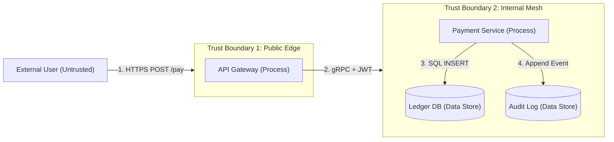
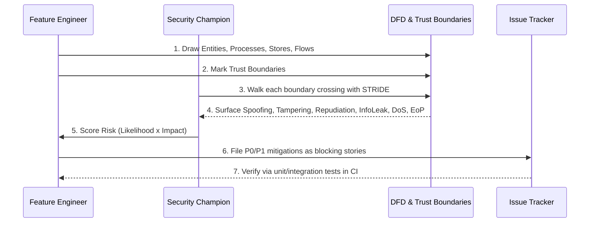
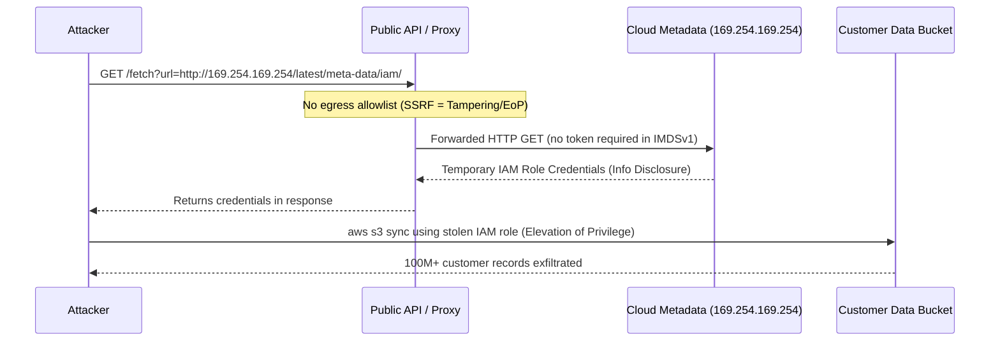

# Threat Modeling with STRIDE: Find the Holes Before Launch

> **Prerequisites:** [Lesson 15: Least Privilege & Zero Trust](../15-least-privilege-zero-trust/README.md).  
> **Estimated Reading Time:** 24–28 minutes  
> **Target Audience:** Backend and platform engineers designing new services, security champions running design reviews, and candidates asked "how would you secure this architecture before writing code?"  
> **Free PDF Notes:** [Download SD-M-016.pdf](https://backendroadmap.com/notes/system-design/SD-M-016.pdf)

> [!NOTE]
> **In one line:** **STRIDE** is a structured six-category threat taxonomy (**S**poofing, **T**ampering, **R**epudiation, **I**nformation Disclosure, **D**enial of Service, **E**levation of Privilege) applied to a **Data Flow Diagram (DFD)** across every **trust boundary**, turning vague "be secure" wishes into concrete, testable mitigations before a single line of code ships.

> [!TIP]
> **The Golden Rule:** Draw the Data Flow Diagram first, mark every **trust boundary** (where privilege or network zone changes), and run STRIDE on every **crossing arrow** and **data store**. A threat model without trust boundaries is just a pretty architecture diagram.

---

## 1. What Threat Modeling with STRIDE Is, and What It Isn't

A team designs a new webhook-driven billing service: an API gateway receives Stripe events, verifies a signature, writes an invoice to Postgres, and enqueues a receipt email. Two weeks after launch, a researcher discovers that an internal admin endpoint on the same service trusts an unverified `X-User-Id` header, allowing any compromised pod to forge refunds. A 45-minute STRIDE session at the whiteboard would have flagged that trust boundary crossing on day one.

| Term | Precise Meaning | Example |
| :--- | :--- | :--- |
| **Threat Modeling** | A structured engineering exercise to identify assets, attackers, trust boundaries, threats, and mitigations | Pre-launch design review of a payment service |
| **STRIDE** | Six-category mnemonic: Spoofing, Tampering, Repudiation, Information Disclosure, Denial of Service, Elevation of Privilege | Mapping "Tampering" to unsigned webhook payloads |
| **Data Flow Diagram (DFD)** | Graph of External Entities, Processes, Data Stores, and Data Flows | Browser -> API Gateway -> Auth Service -> Postgres |
| **Trust Boundary** | Any line where data crosses between different privilege levels, ownership, or network zones | Internet to VPC; User Pod to Admin DB; Service A to Service B |
| **Attack Tree** | Hierarchical decomposition of an attacker's goal into AND/OR sub-goals | "Steal PII" -> ("SQLi" OR "Stolen Backup Key") |
| **DREAD / Risk Matrix** | Scoring framework (Likelihood × Impact) used to prioritize which threats to fix first | P0: unauthenticated RCE; P3: verbose version header |
| **Not** | A penetration test, a compliance checkbox, or a one-time waterfall document | Pen tests find bugs *after* build; STRIDE prevents design flaws *before* build |

### Why It Matters
1. **Design flaws are 10x–30x cheaper to fix before coding** than after production launch (changing an auth model or adding an outbox after launch means migrations and downtime).
2. **Penetration tests miss architectural gaps** like missing audit trails (Repudiation) or confused-deputy privilege paths (Elevation of Privilege) that only show up when you trace data flows.
3. **In system design interviews**, walking through STRIDE on your own whiteboard diagram is the fastest way to prove senior-level security judgment.

---

## 2. Anatomy: DFD + Trust Boundaries + STRIDE Matrix



Every DFD has four element types, and each element type is vulnerable to a specific subset of STRIDE (known as **STRIDE-per-element**):

| DFD Element | S | T | R | I | D | E | Why |
| :--- | :-: | :-: | :-: | :-: | :-: | :-: | :--- |
| **External Entity** (User, 3rd-party webhook) | X | | X | | | | Can pretend to be someone else or deny sending a request |
| **Process** (API, worker, Lambda) | X | X | X | X | X | X | Executes logic; can be impersonated, crashed, or tricked into escalating |
| **Data Flow** (HTTP, gRPC, Kafka message) | | X | | X | X | | In transit: can be sniffed, modified, or flooded |
| **Data Store** (Postgres, S3, Redis) | | X | X | X | X | | At rest: can be modified, read, filled up, or lack auditability |

| STRIDE Letter | Security Property Violated | Concrete Example | Primary Control |
| :--- | :--- | :--- | :--- |
| **S — Spoofing** | Authentication | Forged JWT or spoofed `X-Forwarded-For` | mTLS, HMAC signatures, asymmetric JWT verification |
| **T — Tampering** | Integrity | Modifying order total in transit or DB | TLS 1.3, AEAD, DB constraints, signed webhooks |
| **R — Repudiation** | Non-repudiation | Admin denies deleting a tenant record | Append-only, hash-chained audit logs |
| **I — Information Disclosure** | Confidentiality | Stack trace or PII leaked in logs/cache | Field encryption, error scrubbing, RLS |
| **D — Denial of Service** | Availability | Unbounded regex/pagination exhausts CPU/DB | Rate limiting, timeouts, bounded payloads |
| **E — Elevation of Privilege** | Authorization | IDOR (`/invoices/102`) or SSRF to IMDSv1 | Server-side RBAC/ABAC, IMDSv2, egress allowlists |

> [!WARNING]
> **The #1 Threat Modeling Trap: Treating the internal network as a single trust zone.** If your DFD has no trust boundary between the API gateway, microservices, and the database, a single SSRF or compromised sidecar gives the attacker lateral movement across the entire backend.

---

## 3. Mathematical Model: Risk Scoring, Residual Risk & ROI

Threat modeling produces dozens of findings; engineering capacity is finite. You prioritize using **Expected Annualized Loss (ALE)** and **Risk Reduction ROI**:

$$\text{Risk} = P(\text{Exploit}) \times \text{Impact}, \qquad \text{ALE} = \text{ARO} \times \text{SLE}$$

where $\text{ARO}$ is the Annualized Rate of Occurrence and $\text{SLE}$ is the Single Loss Expectancy (incident response + fines + churn). After applying a control with effectiveness $e \in [0, 1]$ and engineering + operational cost $C_{\text{control}}$, the **Residual Risk** and **ROI** are:

$$\text{ALE}_{\text{residual}} = (1 - e) \cdot \text{ALE}_{\text{baseline}}, \qquad \text{ROI} = \frac{\text{ALE}_{\text{baseline}} - \text{ALE}_{\text{residual}} - C_{\text{control}}}{C_{\text{control}}}$$

### Worked Numerical Example
Suppose a payment service has an unauthenticated internal refund endpoint (Elevation of Privilege) discovered during STRIDE:
- $\text{SLE} = \$1{,}200{,}000$ (fraudulent refunds + incident response + PCI audit).
- $\text{ARO} = 0.25/\text{year}$ (once every 4 years via SSRF or compromised pod).
- $\text{ALE}_{\text{baseline}} = 0.25 \times \$1{,}200{,}000 = \$300{,}000/\text{year}$.
- Adding mTLS + RBAC scope check reduces exploit probability by $e = 0.96$ ($96\%$) and costs $C_{\text{control}} = \$15{,}000$ (1 week of engineering + ops):
  - $\text{ALE}_{\text{residual}} = (1 - 0.96) \times \$300{,}000 = \$12{,}000/\text{year}$.
  - $\text{Savings} = \$300{,}000 - \$12{,}000 = \$288{,}000/\text{year}$.
  - $\text{ROI} = \frac{\$288{,}000 - \$15{,}000}{\$15{,}000} = 18.2\times$ ($1{,}820\%$).

By contrast, fixing a low-impact verbose `Server` header ($\text{SLE} = \$5{,}000$, $\text{ARO} = 0.05$, $\text{ALE} = \$250$) for $\$2{,}000$ has negative ROI and is deferred to P3.

---

## 4. Metrics & Percentiles

| Metric | Meaning | Alert when |
| :--- | :--- | :--- |
| **Threat Model Coverage** | % of Tier-1/Tier-2 services with a current (< 6 mo) threat model | $< 95\%$ for Tier-1 services |
| **Mitigation Burn-Down Rate** | % of P0/P1 STRIDE findings closed before GA launch | Any P0 open at launch gate |
| **Mean Time to Threat Model (MTTM)** | Hours from RFC submission to completed STRIDE review | $> 48$ hours (review bottleneck) |
| **Architecture Drift Rate** | % of production trust-boundary changes not in the DFD | $> 5\%$ per quarter |
| **Post-Launch Design Flaw Rate** | Security incidents traced to missed design-phase threats | $> 0$ per quarter for Tier-1 |
| **False-Positive Threat Ratio** | % of auto-generated threats dismissed as non-applicable | $> 40\%$ (tooling fatigue) |

### Worked Example (Pre-Launch Gate)
A fintech team runs a 60-minute STRIDE workshop on a new ACH Payout Service:
- **14 threats identified**: 2 P0 (missing idempotency + unsigned webhook = Tampering/Replay; missing tenant check on `/payouts/{id}` = Elevation of Privilege), 5 P1, 7 P2.
- **Launch Gate Policy**: P0s block production deploy; P1s must have tracked tickets with 30-day SLA; P2s enter backlog.
- Both P0s are mitigated in 3 days before any code is merged to `main`, avoiding an estimated $\$300\text{k/yr}$ risk exposure.

---

## 5. Compounding & Failure Modes: Chained Threats

Single threats rarely stay isolated; attackers **chain** low-to-medium STRIDE findings across trust boundaries. If an attacker needs $k$ chained steps with individual success probabilities $p_1, p_2, \dots, p_k$, defense-in-depth multiplies the difficulty:

$$P(\text{Full Compromise}) = \prod_{i=1}^{k} p_i$$

Consider a 3-step chain against a cloud backend:
1. **Step 1 (Tampering / Spoofing):** SSRF in an image-resizer endpoint ($p_1 = 0.40$ if unvalidated URLs are allowed).
2. **Step 2 (Information Disclosure):** Querying cloud metadata `169.254.169.254` for IAM role credentials ($p_2 = 0.80$ under IMDSv1, vs $0.02$ under IMDSv2 requiring `PUT` token).
3. **Step 3 (Elevation of Privilege):** Using the over-privileged IAM role to read the production S3 bucket ($p_3 = 0.90$ with `s3:*`, vs $0.01$ with least-privilege prefix policy).

| Defense Posture | Chain Probability ($p_1 \times p_2 \times p_3$) | Relative Risk |
| :--- | :---: | :--- |
| **No STRIDE mitigations** | $0.40 \times 0.80 \times 0.90 = 0.288$ ($28.8\%$) | Baseline (1 in 3.5 attempts succeed) |
| **SSRF allowlist only** | $0.05 \times 0.80 \times 0.90 = 0.036$ ($3.6\%$) | 8x safer, but still fragile |
| **Full defense-in-depth** (Allowlist + IMDSv2 + Least-Privilege IAM) | $0.05 \times 0.02 \times 0.01 = 0.00001$ ($0.001\%$) | **28,800x safer** |

---

## 6. Numbers Every Engineer Must Know

| Item | Typical | Implication |
| :--- | :---: | :--- |
| **Design-phase vs post-prod fix cost** | 10x – 30x | Catching an auth/boundary flaw in RFC saves weeks of migration |
| **STRIDE workshop duration** | 45 – 90 min | Short enough to run per major feature without slowing velocity |
| **DFD elements per microservice** | 5 – 15 | Keep DFDs focused; decompose large systems into sub-DFDs |
| **Trust boundaries per request** | 2 – 5 | Edge -> Mesh -> Service -> DB -> External Webhook |
| **Threat model staleness window** | 6 months | Re-run delta threat modeling whenever a new data store or integration is added |
| **P0 mitigation SLA** | Before GA (0 days) | Never ship known P0 spoofing or privilege-escalation paths |

---

## 7. Mechanism Deep Dive: Running a STRIDE Session



| Question | Answer |
| :--- | :--- |
| **Who attends a STRIDE session?** | The feature author, a senior backend/infra peer, and a security champion (3–4 people max) |
| **When do you run it?** | At RFC / design-doc review, *before* implementation starts |
| **How do you avoid missing threats?** | Use STRIDE-per-element systematically on every arrow crossing a trust boundary |
| **How do you prevent "threat model rot"?** | Store the DFD + threat table as Markdown/YAML in the repo (`docs/threat-model.md`) and require updates in PRs that add endpoints or data stores |
| **What if a threat is accepted instead of fixed?** | Record explicit risk acceptance with owner, rationale, and expiration date |

**When not to run a full STRIDE workshop:** For trivial UI copy changes, internal refactors that do not alter data flows or trust boundaries, or dependency bump PRs (handled by SCA/supply-chain tooling). Instead, use **delta threat modeling** only when trust boundaries, auth, or sensitive data flows change.

---

## 8. Hierarchical Budgets & Design Rules

| Slice | Rule | Control |
| :--- | :--- | :--- |
| **Scope** | Every RFC touching auth, PII, money, or external ingress requires a DFD | PR/RFC template checklist |
| **Trust Boundaries** | Every boundary crossing must specify authn, authz, and transport encryption | mTLS / JWT / TLS 1.3 |
| **Spoofing** | Never trust client-supplied identity headers (`X-User-Id`) across untrusted hops | Strip at edge; verify signed tokens |
| **Tampering** | Validate schemas and signatures at every ingress | HMAC / JSON Schema / DB constraints |
| **Repudiation** | Log all state-changing and admin actions to append-only audit storage | Lesson 17 (Audit Logging) |
| **Info Disclosure** | Redact PII/secrets from logs, errors, and metrics | Structured logger + scrubbing middleware |
| **DoS** | Enforce timeouts, payload caps, and per-tenant rate limits at the edge | Token bucket + circuit breakers |
| **Elevation** | Enforce object-level authorization (`tenant_id` / `owner_id`) on every query | RBAC + Postgres RLS (Lesson 19) |

---

## 9. Top Mitigations

1. **Mandate a DFD with explicit trust boundaries** in every architecture RFC.
2. **Apply STRIDE-per-element** so you don't waste time asking if a Data Flow can suffer from Spoofing (focus on Tampering, Info Disclosure, DoS).
3. **Eliminate implicit trust** on internal networks; enforce mTLS and service-to-service identity (SPIFFE/Workload Identity).
4. **Enforce object-level authorization** on every resource fetch to kill IDOR (Elevation of Privilege) at the data layer.
5. **Version threat models in Git** alongside the code so they stay alive as the system evolves.
6. **Turn top threats into automated CI tests** (e.g., an integration test asserting Tenant A cannot read Tenant B's invoice, or unsigned webhooks return `401`).
7. **Prioritize ruthlessly with ALE/ROI** so teams fix P0s immediately instead of drowning in 100 low-value findings.

---

## 10. Production Reference: The Confused Deputy & SSRF-to-IMDSv1 Breach

A well-documented cloud incident pattern (made famous by the 2019 Capital One breach and numerous subsequent cloud post-mortems) happens when a public-facing web application acts as a **confused deputy**:



- **Root Cause:** Three STRIDE failures combined: (1) **Tampering/EoP** via unvalidated URL fetch (SSRF), (2) **Spoofing/Info Disclosure** because IMDSv1 trusted any local HTTP `GET` without a session token, and (3) **Elevation of Privilege** because the compute role had broad `s3:GetObject` permissions.
- **The Fix:** Enforce egress allowlists / block link-local `169.254.0.0/16`, require **IMDSv2** (`PUT` token + hop limit = 1), scope IAM roles to exact bucket prefixes, and alert on anomalous S3 `ListObjects` calls.

---

## 11. Multi-Language Production Code Tabs

A lightweight, code-first **STRIDE Threat Model Validator & Risk Scorer**: parses a service's DFD components and trust-boundary crossings, flags unmitigated STRIDE categories per element type, and computes ALE/ROI so CI can block P0 launches.

````carousel
```go
// Go: STRIDE-per-element validator & risk scorer (stdlib only).
package main

import (
	"fmt"
	"strings"
)

type ElementType string

const (
	ExternalEntity ElementType = "external_entity"
	Process        ElementType = "process"
	DataFlow       ElementType = "data_flow"
	DataStore      ElementType = "data_store"
)

var strideMatrix = map[ElementType][]string{
	ExternalEntity: {"S", "R"},
	Process:        {"S", "T", "R", "I", "D", "E"},
	DataFlow:       {"T", "I", "D"},
	DataStore:      {"T", "R", "I", "D"},
}

type Component struct {
	Name       string
	Type       ElementType
	Mitigated  map[string]bool
	ARO, SLE   float64
}

func Audit(components []Component) []string {
	var gaps []string
	for _, c := range components {
		for _, cat := range strideMatrix[c.Type] {
			if !c.Mitigated[cat] {
				ale := c.ARO * c.SLE
				gaps = append(gaps, fmt.Sprintf("[GAP] %s (%s) missing %s | ALE=$%.0f/yr", c.Name, c.Type, cat, ale))
			}
		}
	}
	return gaps
}

func main() {
	svc := []Component{
		{
			Name: "WebhookIngress", Type: DataFlow,
			Mitigated: map[string]bool{"T": true, "I": true, "D": false},
			ARO: 0.5, SLE: 40000,
		},
	}
	fmt.Println(strings.Join(Audit(svc), "\n"))
}
```
<!-- slide -->
```typescript
// TypeScript: STRIDE-per-element auditor & ALE calculator.
type ElementType = "external_entity" | "process" | "data_flow" | "data_store";
type StrideCategory = "S" | "T" | "R" | "I" | "D" | "E";

const STRIDE_PER_ELEMENT: Record<ElementType, StrideCategory[]> = {
  external_entity: ["S", "R"],
  process: ["S", "T", "R", "I", "D", "E"],
  data_flow: ["T", "I", "D"],
  data_store: ["T", "R", "I", "D"],
};

interface DfdComponent {
  name: string;
  type: ElementType;
  mitigated: Partial<Record<StrideCategory, string>>;
  aro: number;
  sleUsd: number;
}

export function auditThreatModel(components: DfdComponent[]): string[] {
  const findings: string[] = [];
  for (const c of components) {
    for (const cat of STRIDE_PER_ELEMENT[c.type]) {
      if (!c.mitigated[cat]) {
        const ale = Math.round(c.aro * c.sleUsd);
        findings.push(`[P0/P1] ${c.name} (${c.type}) unmitigated ${cat} | ALE=$${ale}/yr`);
      }
    }
  }
  return findings;
}
```
<!-- slide -->
```python
# Python: STRIDE-per-element auditor, chained probability, and ALE/ROI calculator.
STRIDE_MATRIX = {
    "external_entity": ("S", "R"),
    "process": ("S", "T", "R", "I", "D", "E"),
    "data_flow": ("T", "I", "D"),
    "data_store": ("T", "R", "I", "D"),
}


def audit_dfd(components: list[dict]) -> list[str]:
    gaps = []
    for c in components:
        for cat in STRIDE_MATRIX[c["type"]]:
            if cat not in c.get("mitigated", {}):
                ale = c["aro"] * c["sle"]
                gaps.append(f"[GAP] {c['name']} ({c['type']}) missing {cat} | ALE=${ale:,.0f}/yr")
    return gaps


def risk_roi(aro: float, sle: float, effectiveness: float, cost: float) -> dict:
    ale_base = aro * sle
    ale_res = (1.0 - effectiveness) * ale_base
    savings = ale_base - ale_res
    roi = (savings - cost) / cost
    return {"ale_base": ale_base, "ale_residual": ale_res, "roi": round(roi, 2)}


def chain_probability(probs: list[float]) -> float:
    total = 1.0
    for p in probs:
        total *= p
    return total
```
<!-- slide -->
```csharp
// C#: STRIDE-per-element auditor for CI RFC checks.
using System;
using System.Collections.Generic;

public enum ElementType { ExternalEntity, Process, DataFlow, DataStore }

public sealed record Component(string Name, ElementType Type, HashSet<string> Mitigated, double Aro, double Sle);

public static class StrideAuditor
{
    private static readonly Dictionary<ElementType, string[]> Matrix = new()
    {
        [ElementType.ExternalEntity] = new[] { "S", "R" },
        [ElementType.Process]        = new[] { "S", "T", "R", "I", "D", "E" },
        [ElementType.DataFlow]       = new[] { "T", "I", "D" },
        [ElementType.DataStore]      = new[] { "T", "R", "I", "D" },
    };

    public static List<string> FindGaps(IEnumerable<Component> components)
    {
        var gaps = new List<string>();
        foreach (var c in components)
        {
            foreach (var cat in Matrix[c.Type])
            {
                if (!c.Mitigated.Contains(cat))
                    gaps.Add($"[GAP] {c.Name} ({c.Type}) missing {cat} | ALE=${c.Aro * c.Sle:N0}/yr");
            }
        }
        return gaps;
    }
}
```
````

---

## 12. Hands-On CLI Verification Workflows

Verify the math from Sections 3 and 5 in Python 3:

```bash
python -c "
ale_base = 0.25 * 1_200_000
ale_res = (1 - 0.96) * ale_base
roi = (ale_base - ale_res - 15_000) / 15_000
print(f'ALE_base={ale_base:,.0f}, ALE_res={ale_res:,.0f}, ROI={roi:.1f}x')
print('Chained prob (baseline):', round(0.40 * 0.80 * 0.90, 4))
print('Chained prob (hardened):', f'{0.05 * 0.02 * 0.01:.5f}')
"
```

Verify threat-model-as-code in a CI pipeline using `pytm` (OWASP Pythonic Threat Modeling) or `threagile`:

```bash
# Install OWASP pytm and generate a DFD + threat report from Python code
pip install pytm
python threat_model.py --dfd | dot -Tpng -o dfd.png
python threat_model.py --report docs/threat-model.md

# Or run Threagile (agile threat modeling as YAML in CI)
docker run --rm -v "$(pwd)":/app/work threagile/threagile -model /app/work/threagile.yaml -output /app/work/out
```

---

## 13. Common Mistakes to Avoid

1. **Drawing a system diagram with no trust boundaries**, making it impossible to see where privilege changes.
2. **Running STRIDE on the whole system at once** instead of element-by-element across each boundary.
3. **Confusing threat modeling with penetration testing** and waiting until after launch to think about design flaws.
4. **Treating the internal VPC or Kubernetes cluster as trusted**, ignoring lateral movement and SSRF.
5. **Listing 80 unranked threats with no ALE/impact scoring**, causing teams to ignore the whole document.
6. **Writing a Word/Confluence doc that rots** instead of versioning the threat model in Git next to the code.
7. **Forgetting Repudiation and Denial of Service** while focusing only on auth and encryption.
8. **Never turning P0 threats into automated regression tests** in CI.

---

## 14. Key Terms Glossary

| Key Term | Definition |
| :--- | :--- |
| **STRIDE** | Threat taxonomy: Spoofing, Tampering, Repudiation, Information Disclosure, Denial of Service, Elevation of Privilege. |
| **Data Flow Diagram (DFD)** | Visual model of External Entities, Processes, Data Stores, and Data Flows. |
| **Trust Boundary** | Boundary where data crosses between different privilege levels or network zones. |
| **STRIDE-per-Element** | Mapping which STRIDE categories apply to each DFD element type. |
| **Confused Deputy** | A privileged service tricked by an untrusted caller into misusing its authority (e.g., SSRF). |
| **IDOR** | Insecure Direct Object Reference: Elevation of Privilege by changing an ID without ownership checks. |
| **ALE / SLE / ARO** | Annualized Loss Expectancy = Single Loss Expectancy × Annualized Rate of Occurrence. |
| **Residual Risk** | Risk remaining after a security control is applied. |
| **Attack Tree** | Tree modeling an attacker's goal broken into AND/OR sub-steps. |
| **Delta Threat Modeling** | Re-evaluating only the changed DFD elements and boundaries on an existing service. |

---

## 15. System Design Interview Questions & Answers

### Basic Conceptual Questions

<details>
<summary><strong>Q1: What does STRIDE stand for, and what security property does each letter map to? [BASIC]</strong></summary>

**Answer:**
**S**poofing (Authentication), **T**ampering (Integrity), **R**epudiation (Non-repudiation), **I**nformation Disclosure (Confidentiality), **D**enial of Service (Availability), and **E**levation of Privilege (Authorization).
</details>

<details>
<summary><strong>Q2: What is a trust boundary, and why is it the centerpiece of a DFD? [BASIC]</strong></summary>

**Answer:**
A trust boundary is any line where data moves between two zones of different privilege, ownership, or network exposure (e.g., browser to API gateway, or app pod to admin database). Every arrow crossing a trust boundary requires explicit authentication, authorization, input validation, and transport security.
</details>

<details>
<summary><strong>Q3: How is threat modeling different from penetration testing? [BASIC]</strong></summary>

**Answer:**
Threat modeling is a *design-time* architectural review that finds structural flaws (like missing audit logs or broken trust boundaries) before code is written. Penetration testing is an *implementation-time* exercise that probes a running system for bugs and misconfigurations. You need both.
</details>

<details>
<summary><strong>Q4: What are the four elements of a Data Flow Diagram (DFD)? [BASIC]</strong></summary>

**Answer:**
External Entities (users, third-party APIs), Processes (services, workers), Data Stores (databases, caches, buckets), and Data Flows (network calls, queues, file writes).
</details>

### Scenario-Based Architecture Questions

<details>
<summary><strong>Q5: Walk through STRIDE on a webhook receiver that updates billing status in Postgres. [SCENARIO]</strong></summary>

**Answer:**
- **S:** Attacker spoofs Stripe webhook -> verify HMAC-SHA256 signature + timestamp tolerance.
- **T:** Attacker replays or alters payload -> enforce idempotency key + TLS 1.3 + DB constraints.
- **R:** Dispute over when subscription changed -> write immutable audit event with webhook ID.
- **I:** Verbose 500 error leaks SQL/keys -> return generic `500`, scrub secrets from logs.
- **D:** Webhook flood exhausts DB connections -> verify signature at edge, cap body size, enqueue to broker.
- **E:** Webhook payload triggers admin-only state transition -> restrict allowed state transitions per webhook event type.
</details>

<details>
<summary><strong>Q6: You have 25 STRIDE findings and 1 sprint before launch. How do you prioritize? [SCENARIO]</strong></summary>

**Answer:**
Score each finding by Likelihood × Impact (or ALE = ARO × SLE) and check whether it sits on an external trust boundary or leads to chained compromise. Block launch on P0s (unauthenticated EoP, RCE, cross-tenant data leak), commit P1s to a 30-day post-launch SLA, and defer P2/P3 defense-in-depth items to the backlog.
</details>

<details>
<summary><strong>Q7: How do you threat-model a microservice architecture without slowing down every PR? [SCENARIO]</strong></summary>

**Answer:**
Use **delta threat modeling**: only trigger a 45-minute STRIDE review when an RFC adds a new external endpoint, data store, auth flow, or trust boundary. Keep the DFD and threat table in Git (`docs/threat-model.md`) so reviews take minutes rather than starting from scratch.
</details>

<details>
<summary><strong>Q8: Your app fetches user-supplied avatar URLs. What STRIDE threats apply and how do you mitigate them? [SCENARIO]</strong></summary>

**Answer:**
Primary threats are **Elevation of Privilege / Information Disclosure** via SSRF (fetching `169.254.169.254` or internal services) and **Denial of Service** (downloading a 10 GB zip bomb). Mitigate with an isolated egress proxy, DNS resolution check blocking RFC1918/link-local IPs, IMDSv2, strict `http/https` scheme check, max response size (e.g., 5 MB), and short timeouts.
</details>

### Advanced & Tricky Interview Questions

<details>
<summary><strong>Q9: Why does STRIDE-per-element say a Data Flow isn't vulnerable to Spoofing or Elevation of Privilege? [TRICKY]</strong></summary>

**Answer:**
A Data Flow is just bytes on a wire; it has no identity or execution context of its own. Spoofing and Elevation of Privilege happen at the **Process** or **External Entity** endpoints that send or receive the flow, whereas the wire itself suffers from Tampering, Information Disclosure, and Denial of Service.
</details>

<details>
<summary><strong>Q10: How can a system pass every individual STRIDE check yet still be compromised? [TRICKY]</strong></summary>

**Answer:**
Through **threat chaining** and **emergent state**: e.g., a low-severity Info Disclosure (leaking an internal host) + a low-severity DoS (forcing a cache fallback) + a race condition in token refresh. Attack trees and end-to-end attack-path modeling catch multi-hop chains that per-component checklists miss.
</details>

<details>
<summary><strong>Q11: How do you prove to auditors that your threat model isn't just shelfware? [TRICKY]</strong></summary>

**Answer:**
Link every P0/P1 threat in the versioned threat model directly to a Jira ticket and an automated CI test (unit, integration, or OPA/Terraform policy check). When a test fails, CI blocks the merge—turning the threat model into executable security invariants.
</details>

<details>
<summary><strong>Q12: An internal service trusts `X-Tenant-Id` from the API Gateway. What happens if a pod in the same cluster is compromised? [TRICKY]</strong></summary>

**Answer:**
If there is no trust boundary inside the cluster, any compromised pod can call the internal service directly with `X-Tenant-Id: victim` (Spoofing + Elevation of Privilege). Fix by enforcing mTLS + signed internal JWTs (or SPIFFE IDs) so the service verifies *both* the caller's identity and the end-user's tenant claim.
</details>

---

## 16. One-Page Master Cheat Sheet

```
+---------------------------------------------------------------------------------------------------------+
|                    THREAT MODELING WITH STRIDE — MASTER CHEAT SHEET                                     |
+---------------------------------------------------------------------------------------------------------+
| 1. DFD FIRST: External Entities, Processes, Data Stores, Data Flows + explicit TRUST BOUNDARIES.        |
+---------------------------------------------------------------------------------------------------------+
| 2. STRIDE: Spoofing (AuthN) · Tampering (Integrity) · Repudiation (Audit) · Info Disclosure (Conf) ·    |
|            Denial of Service (Avail) · Elevation of Privilege (AuthZ).                                  |
+---------------------------------------------------------------------------------------------------------+
| 3. STRIDE-PER-ELEMENT: Entity (S,R) · Flow (T,I,D) · Store (T,R,I,D) · Process (S,T,R,I,D,E).           |
+---------------------------------------------------------------------------------------------------------+
| 4. PRIORITIZE WITH MATH: ALE = ARO * SLE. Fix P0s before GA; track P1s with 30-day SLA.                 |
+---------------------------------------------------------------------------------------------------------+
| 5. DEFENSE IN DEPTH: Chained probability = p1 * p2 * p3. Never trust an internal network blindly.       |
+---------------------------------------------------------------------------------------------------------+
| 6. KEEP IT ALIVE: Version DFDs in Git, run delta reviews on new boundaries, enforce P0s via CI tests.    |
+---------------------------------------------------------------------------------------------------------+
```

---

## Further Reading & Sources

- Adam Shostack, *Threat Modeling: Designing for Security* (Wiley, 2014) — the canonical STRIDE reference.
- OWASP Foundation, [Threat Modeling Cheat Sheet](https://cheatsheetseries.owasp.org/cheatsheets/Threat_Modeling_Cheat_Sheet.html).
- Microsoft Security Development Lifecycle (SDL), [The STRIDE Threat Model](https://learn.microsoft.com/en-us/azure/security/develop/threat-modeling-tool-threats).
- Martin Kleppmann, *Designing Data-Intensive Applications*, security & integrity considerations across distributed boundaries.

---

## Free PDF Notes

[SD-M-016.pdf](https://backendroadmap.com/notes/system-design/SD-M-016.pdf)

---

## Next

Continue with [Lesson 17: Audit Logging: Who Did What, When — Append-Only and Tamper-Evident](../17-audit-logging/README.md).
