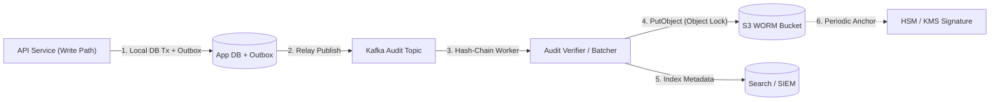
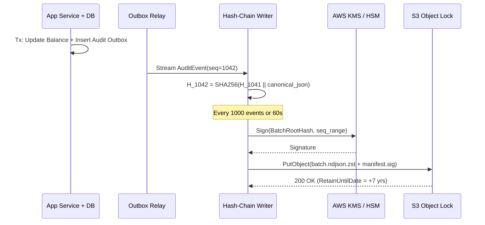
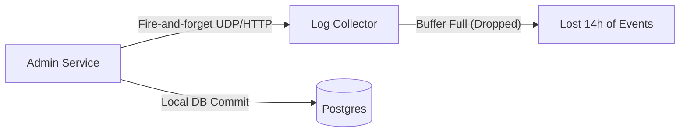

# Audit Logging: Who Did What, When — Append-Only and Tamper-Evident

> **Prerequisites:** [Lesson 16: Threat Modeling with STRIDE](../16-threat-modeling-with-stride/README.md).  
> **Estimated Reading Time:** 24–28 minutes  
> **Target Audience:** Backend engineers building regulated fintech, healthcare, or B2B SaaS systems, and candidates asked "how do you design a tamper-evident audit trail?"  
> **Free PDF Notes:** [Download SD-M-017.pdf](https://backendroadmap.com/notes/system-design/SD-M-017.pdf)

> [!NOTE]
> **In one line:** **Audit logging** records a durable, structured, **append-only** ledger of **who did what, to which resource, when, from where, and with what outcome**, chained cryptographically (hash chains or Merkle trees) and stored in **WORM** (Write-Once-Read-Many) storage so neither an external attacker nor a rogue admin can silently rewrite history.

> [!TIP]
> **The Golden Rule:** Separate **operational logs** (for debugging) from **security audit logs** (for forensics and compliance). Never let the service that generates an audit event also hold `DELETE` or `UPDATE` permissions on the audit store.

---

## 1. What Audit Logging Is, and What It Isn't

A B2B SaaS customer notices that 500 API keys were exported at 03:14 UTC. The engineering team checks `stdout` application logs, only to find they were rotated after 7 days, lacked the `actor_id` and `before/after` diff, and were stored in a database table where an attacker with DBA credentials ran `DELETE FROM logs WHERE actor_id = 'admin_9'`. That is **not** an audit log—it is a mutable debug log.

| Term | Precise Meaning | Example |
| :--- | :--- | :--- |
| **Audit Log** | Immutable record of security-relevant state changes and access events | `admin_42 revoked role=Owner on tenant_7` |
| **Application / Debug Log** | Ephemeral diagnostic output for engineers | `DEBUG retrying Redis connection attempt 2` |
| **Non-Repudiation** | Proof that an actor performed an action and cannot credibly deny it | Signed, hash-chained audit entry |
| **Hash Chain** | Each entry includes $H(\text{prev\_hash} \parallel \text{entry})$, making edits detectable | $H_n = \text{SHA256}(H_{n-1} \parallel \text{payload}_n)$ |
| **Merkle Tree** | Binary hash tree over a batch of entries enabling $O(\log N)$ inclusion proofs | Amazon QLDB, Certificate Transparency |
| **WORM Storage** | Write-Once-Read-Many storage enforcing retention locks | S3 Object Lock (Compliance Mode) |
| **Not** | A substitute for authorization, or a place to dump raw passwords/PII | Audit logs detect & prove; auth prevents |

### Why It Matters
1. **Repudiation mitigation (STRIDE's "R"):** Without an immutable audit trail, neither you nor a court/regulator can prove who authorized a wire transfer or deleted a record.
2. **Compliance mandates:** SOC 2, PCI-DSS, HIPAA, and ISO 27001 explicitly require tamper-evident audit trails with 1–7 year retention.
3. **Forensic blast-radius scoping:** During an incident, audit logs tell you *exactly* which records an attacker touched so you notify only affected customers instead of everyone.

---

## 2. Anatomy: Dual-Path Append-Only & Tamper-Evident Pipeline



A production audit pipeline separates **capture**, **chaining**, **immutable archival**, and **querying**:
1. **Capture (Fail-Closed vs Outbox):** For high-value mutations (e.g., wire transfers, RBAC changes), write the audit event in the **same local database transaction** as the business mutation (Transactional Outbox) so an event is never lost on crash.
2. **Hash Chaining:** A dedicated writer computes $H_n = \text{SHA256}(H_{n-1} \parallel \text{canonical\_json}_n)$ and signs batch checkpoints with a KMS/HSM key.
3. **WORM Archival:** Batches (e.g., Parquet/NDJSON every 1 minute or 10,000 events) are written to **S3 Object Lock (Compliance Mode)** where even the AWS root account cannot delete them before the retention date.
4. **SIEM / Search Index:** A read-only projection feeds Elasticsearch/ClickHouse for fast SOC queries without making the search cluster the system of record.

| Property | Operational Logs | Security Audit Logs |
| :--- | :--- | :--- |
| **Audience** | SREs, developers | Security, compliance, enterprise customers |
| **Retention** | 7–30 days | 1–7 years (WORM locked) |
| **Loss tolerance** | Best-effort (drop under load) | **Zero loss** for Tier-1 mutations |
| **Mutability** | Rotated/purged freely | Append-only, tamper-evident |
| **Schema** | Free-form or semi-structured | Strict schema (`actor`, `action`, `resource`, `outcome`, `ts`) |

> [!WARNING]
> **The #1 Audit Logging Trap: Logging into the same database with the same role as the application.** If an attacker gets SQL injection or compromised app credentials, their very next query is `DELETE FROM audit_logs`. Always ship audit logs out-of-band to a separate account/bucket with no `DELETE` permission.

---

## 3. Mathematical Model: Storage Sizing, Hash Chain Verification & Tamper Detection

**Storage Sizing.** Let $\lambda$ be audit events per second, $\bar{s}$ the average serialized event size (bytes), $R$ the retention period (seconds), and $c$ the compression ratio (e.g., `zstd` on JSON/Parquet achieves $c \approx 4$–$6$).

$$V_{\text{raw}} = \lambda \cdot \bar{s} \cdot R, \qquad V_{\text{compressed}} = \frac{V_{\text{raw}}}{c}$$

**Merkle Verification Cost.** For a batch of $N$ events, linear hash-chain verification requires $O(N)$ hashes to verify a single event, whereas a Merkle tree requires only $O(\log_2 N)$ sibling hashes:

$$\text{Proof Size} = \lceil \log_2 N \rceil \times 32\text{ bytes (SHA-256)}$$

### Worked Numerical Example
A SaaS platform handles $\lambda = 2{,}000\text{ audit events/s}$ with average event size $\bar{s} = 600\text{ bytes}$, 7-year retention ($R = 7 \times 365 \times 86{,}400 = 2.2075 \times 10^8\text{ s}$), and `zstd` compression $c = 5$:
- **Raw volume per year:** $2{,}000 \times 600 \times 31{,}536{,}000 \approx 37.84\text{ TB/year}$.
- **Compressed volume per year:** $37.84 / 5 \approx 7.57\text{ TB/year}$.
- **7-year WORM storage:** $7 \times 7.57 \approx 53.0\text{ TB}$. At S3 Glacier Instant Retrieval ($\approx \$0.004/\text{GB-month}$), 53 TB costs $\approx \$212/\text{month}$.
- **Merkle inclusion proof for $N = 1{,}000{,}000$ events in a daily batch:** $\lceil \log_2(10^6) \rceil = 20$ hashes $\times 32\text{ bytes} = \mathbf{640\text{ bytes}}$ to cryptographically prove any single event existed without tampering.

---

## 4. Metrics & Percentiles

| Metric | Meaning | Alert when |
| :--- | :--- | :--- |
| **Audit Delivery Lag ($p_{99}$)** | Time from mutation commit to WORM archival | $> 60\text{ s}$ |
| **Outbox Depth** | Unshipped audit events waiting in local DB | Rising for $> 5\text{ min}$ |
| **Hash-Chain Verification Failures** | Mismatches detected by periodic verifier | $> 0$ (immediate SEV-1 page) |
| **Drop / Reject Rate** | Events failing schema validation or broker write | $> 0$ for Tier-1 actions |
| **WORM Lock Compliance** | % of archive buckets with Object Lock active | $< 100\%$ |
| **PII Leak Detections** | Audit entries matching secret/PAN regexes | $> 0$ |

### Worked Example (RBAC Escalation Forensics)
A tenant reports unauthorized data export. The security team queries the SIEM by `tenant_id = t_88` and `timestamp BETWEEN 02:00 AND 04:00`:
1. They find `actor=svc_billing` granted `role=Admin` to `user_19` at `03:11:04Z` from IP `203.0.113.44`.
2. They pull the raw WORM batch from S3 and run the Merkle verifier against the KMS-signed daily root hash.
3. The proof passes in 2 ms, giving legal/compliance mathematical certainty that the log was not altered after `03:11:04Z`.

---

## 5. Compounding & Failure Modes: Fail-Open vs Fail-Closed & Clock Skew

| Failure Mode | Fail-Open (Async Best-Effort) | Fail-Closed (Sync / Outbox) |
| :--- | :--- | :--- |
| **Audit broker is down** | Business action succeeds; **audit gap created** | Business action fails (`503`) or queues in local DB outbox |
| **Attacker floods logs (DoS)** | Drops critical security events (log blindness) | Rate-limits noisy read events; preserves Tier-1 mutations |
| **Clock skew across nodes** | Events appear out of order across servers | Monotonic sequence numbers per partition + NTP/chrony |
| **Rogue DBA** | Can `TRUNCATE` local table | Outbox already shipped to cross-account S3 WORM; gap detected |

A subtle compounding failure: **Log Blindness via Flood**. If an attacker triggers 100,000 `403 Forbidden` events per second on a shared queue, legitimate `AdminRoleGranted` events get delayed or dropped. Mitigate by separating **high-volume access logs** from **low-volume control-plane/mutation audit logs** onto distinct Kafka topics.

---

## 6. Numbers Every Engineer Must Know

| Item | Typical | Implication |
| :--- | :---: | :--- |
| **SHA-256 hashing speed** | ~500 MB/s – 2 GB/s per core | Hash-chaining 10k events/s costs $< 1\%$ CPU |
| **KMS asymmetric sign latency** | 5 – 20 ms | Sign *batch roots* (every 1k–10k events), not every event |
| **S3 Object Lock minimum** | 1 day – 100 years | Compliance mode cannot be shortened even by root |
| **Tier-1 retention (SOC2 / PCI)** | 1 year online, 7 years archive | Tier storage from hot SIEM to cold WORM |
| **Clock drift tolerance** | $< 100\text{ ms}$ (NTP) | Never rely on wall-clock alone for causal order; use sequence IDs |
| **Average structured audit event** | 400 – 1,000 bytes | Predictable storage math before compression |

---

## 7. Mechanism Deep Dive: Hash-Chained Batch & WORM Verification



| Question | Answer |
| :--- | :--- |
| **Why not sign every single audit event with KMS?** | KMS costs money and 5–20 ms per call; signing a Merkle/chain root per batch gives the exact same cryptographic guarantee at $1/1000$th the cost |
| **What if the Hash-Chain Writer crashes mid-batch?** | It resumes from the last committed Kafka offset + last persisted `H_prev` in a checkpoint store |
| **How do you handle GDPR "Right to be Forgotten" on immutable logs?** | Store `actor_id` (pseudonymous UUID) rather than raw email/name, or encrypt PII fields with a per-user key (crypto-shredding, Lesson 18) |
| **Should read events (`GET /user/123`) be audited?** | Audit *sensitive* reads (e.g., medical records, PII exports, admin impersonation), not every healthcheck or public catalog read |

**When not to use heavy WORM + hash-chaining:** For ephemeral debug telemetry, metrics, or non-security clickstream analytics. Over-engineering debug logs with KMS signing wastes budget and slows down troubleshooting.

---

## 8. Hierarchical Budgets & Design Rules

| Slice | Rule | Control |
| :--- | :--- | :--- |
| **Who / What / When / Where** | Every entry must have `actor_id`, `action`, `resource_id`, `timestamp_utc`, `source_ip`, `outcome`, `request_id` | JSON Schema validation at producer |
| **Zero Secret Leakage** | Never log passwords, JWTs, API keys, or raw credit card numbers | Field allowlist + regex scrubber |
| **Separation of Duties** | App services have `INSERT` (outbox) or `Produce` only; zero `DELETE/UPDATE` | Cross-account IAM + S3 Object Lock |
| **Causal Ordering** | Include both UTC timestamp and monotonic sequence ID per stream | Lamport/partition offset |
| **Tiered Priority** | Separate control-plane mutations from high-volume data-plane reads | Dedicated Kafka topics |
| **Continuous Verification** | Run an automated verifier job hourly to check hash-chain continuity | Alert on any missing sequence or hash mismatch |

---

## 9. Top Mitigations

1. **Use the Transactional Outbox** for Tier-1 mutations so business state and audit events commit atomically.
2. **Ship logs cross-account to WORM storage** (S3 Object Lock Compliance Mode) with no delete permissions anywhere in the app account.
3. **Hash-chain entries and sign batch checkpoints** with KMS/HSM so any deletion or modification is mathematically detectable.
4. **Enforce strict schemas with field allowlists** so sensitive payloads (tokens, passwords) are never accidentally serialized.
5. **Include `before` and `after` diffs** (redacted of secrets) for configuration and permission changes.
6. **Isolate control-plane audit topics from noisy access logs** to prevent log-flood DoS.
7. **Run a scheduled integrity verifier** that recomputes hashes and alerts on gaps.

---

## 10. Production Reference: The Silent Audit Gap Incident

During a routine SOC 2 Type II audit, an enterprise SaaS company discovered a 14-hour gap in its admin-action audit trail from 4 months earlier.



- **Root Cause:** The admin service emitted audit events via a fire-and-forget async HTTP call after committing to Postgres. During a traffic spike, the log collector's in-memory buffer filled up and silently dropped events, while the app returned `200 OK`.
- **The Fix:** Moved Tier-1 audit events into a Postgres `audit_outbox` table inside the same ACID transaction, added a Debezium/relay publisher to Kafka, and added an hourly sequence-gap verifier writing signed batches to S3 Object Lock.

---

## 11. Multi-Language Production Code Tabs

A production-shaped **Hash-Chained Tamper-Evident Audit Logger** (canonical JSON serialization, SHA-256 chaining, and chain verification) in all 4 languages using standard libraries.

````carousel
```go
// Go: append-only hash-chained audit log with tamper verification (stdlib only).
package main

import (
	"crypto/sha256"
	"encoding/hex"
	"encoding/json"
	"fmt"
	"time"
)

type AuditEvent struct {
	Seq       uint64 `json:"seq"`
	Timestamp string `json:"ts"`
	ActorID   string `json:"actor_id"`
	Action    string `json:"action"`
	Resource  string `json:"resource"`
	Outcome   string `json:"outcome"`
	PrevHash  string `json:"prev_hash"`
	Hash      string `json:"hash"`
}

type AuditLog struct {
	events   []AuditEvent
	lastHash string
}

func NewAuditLog() *AuditLog {
	return &AuditLog{lastHash: stringsRepeatZero()}
}

func stringsRepeatZero() string { return fmt.Sprintf("%064d", 0) }

func computeHash(e AuditEvent) string {
	e.Hash = ""
	raw, _ := json.Marshal(e) // deterministic struct field order
	sum := sha256.Sum256(raw)
	return hex.EncodeToString(sum[:])
}

func (l *AuditLog) Append(actor, action, resource, outcome string) AuditEvent {
	ev := AuditEvent{
		Seq:       uint64(len(l.events) + 1),
		Timestamp: time.Now().UTC().Format(time.RFC3339Nano),
		ActorID:   actor,
		Action:    action,
		Resource:  resource,
		Outcome:   outcome,
		PrevHash:  l.lastHash,
	}
	ev.Hash = computeHash(ev)
	l.lastHash = ev.Hash
	l.events = append(l.events, ev)
	return ev
}

func (l *AuditLog) Verify() bool {
	expectedPrev := stringsRepeatZero()
	for _, ev := range l.events {
		if ev.PrevHash != expectedPrev || computeHash(ev) != ev.Hash {
			return false
		}
		expectedPrev = ev.Hash
	}
	return true
}
```
<!-- slide -->
```typescript
// TypeScript: hash-chained audit logger & verifier (Node crypto).
import { createHash } from "crypto";

export interface AuditEvent {
  seq: number;
  ts: string;
  actorId: string;
  action: string;
  resource: string;
  outcome: "ALLOW" | "DENY";
  prevHash: string;
  hash: string;
}

export class AuditChain {
  private events: AuditEvent[] = [];
  private prevHash = "0".repeat(64);

  private hashPayload(e: Omit<AuditEvent, "hash">): string {
    const canonical = JSON.stringify([e.seq, e.ts, e.actorId, e.action, e.resource, e.outcome, e.prevHash]);
    return createHash("sha256").update(canonical).digest("hex");
  }

  append(actorId: string, action: string, resource: string, outcome: "ALLOW" | "DENY"): AuditEvent {
    const base = {
      seq: this.events.length + 1,
      ts: new Date().toISOString(),
      actorId,
      action,
      resource,
      outcome,
      prevHash: this.prevHash,
    };
    const ev: AuditEvent = { ...base, hash: this.hashPayload(base) };
    this.prevHash = ev.hash;
    this.events.push(ev);
    return ev;
  }

  verify(): boolean {
    let expectedPrev = "0".repeat(64);
    for (const ev of this.events) {
      const { hash, ...rest } = ev;
      if (ev.prevHash !== expectedPrev || this.hashPayload(rest) !== hash) return false;
      expectedPrev = hash;
    }
    return true;
  }
}
```
<!-- slide -->
```python
# Python: tamper-evident hash-chained audit log (stdlib only).
import hashlib
import json
from datetime import datetime, timezone


class AuditChain:
    def __init__(self):
        self.events: list[dict] = []
        self.prev_hash = "0" * 64

    @staticmethod
    def _hash_entry(entry: dict) -> str:
        payload = {k: v for k, v in entry.items() if k != "hash"}
        canonical = json.dumps(payload, sort_keys=True, separators=(",", ":")).encode()
        return hashlib.sha256(canonical).hexdigest()

    def append(self, actor_id: str, action: str, resource: str, outcome: str) -> dict:
        entry = {
            "seq": len(self.events) + 1,
            "ts": datetime.now(timezone.utc).isoformat(),
            "actor_id": actor_id,
            "action": action,
            "resource": resource,
            "outcome": outcome,
            "prev_hash": self.prev_hash,
        }
        entry["hash"] = self._hash_entry(entry)
        self.prev_hash = entry["hash"]
        self.events.append(entry)
        return entry

    def verify(self) -> bool:
        expected_prev = "0" * 64
        for entry in self.events:
            if entry["prev_hash"] != expected_prev:
                return False
            if self._hash_entry(entry) != entry["hash"]:
                return False
            expected_prev = entry["hash"]
        return True
```
<!-- slide -->
```csharp
// C#: hash-chained audit log with tamper detection (stdlib only).
using System;
using System.Collections.Generic;
using System.Security.Cryptography;
using System.Text;
using System.Text.Json;

public sealed record AuditEvent(
    long Seq, string Ts, string ActorId, string Action, string Resource, string Outcome, string PrevHash, string Hash);

public sealed class AuditChain
{
    private readonly List<AuditEvent> _events = new();
    private string _prevHash = new string('0', 64);

    private static string ComputeHash(long seq, string ts, string actor, string action, string res, string outcome, string prev)
    {
        var json = JsonSerializer.Serialize(new object[] { seq, ts, actor, action, res, outcome, prev });
        var bytes = SHA256.HashData(Encoding.UTF8.GetBytes(json));
        return Convert.ToHexString(bytes).ToLowerInvariant();
    }

    public AuditEvent Append(string actor, string action, string resource, string outcome)
    {
        long seq = _events.Count + 1;
        string ts = DateTime.UtcNow.ToString("O");
        string hash = ComputeHash(seq, ts, actor, action, resource, outcome, _prevHash);
        var ev = new AuditEvent(seq, ts, actor, action, resource, outcome, _prevHash, hash);
        _prevHash = hash;
        _events.Add(ev);
        return ev;
    }

    public bool Verify()
    {
        string expectedPrev = new string('0', 64);
        foreach (var e in _events)
        {
            if (e.PrevHash != expectedPrev) return false;
            if (ComputeHash(e.Seq, e.Ts, e.ActorId, e.Action, e.Resource, e.Outcome, e.PrevHash) != e.Hash) return false;
            expectedPrev = e.Hash;
        }
        return true;
    }
}
```
````

---

## 12. Hands-On CLI Verification Workflows

Test hash-chain tamper detection in Python 3:

```bash
python -c "
import hashlib, json
chain = []
prev = '0' * 64
for i, act in enumerate(['LOGIN', 'GRANT_ADMIN', 'EXPORT_PII'], 1):
    e = {'seq': i, 'action': act, 'prev': prev}
    e['hash'] = hashlib.sha256(json.dumps(e, sort_keys=True).encode()).hexdigest()
    prev = e['hash']
    chain.append(e)
print('Valid before tamper:', all(c['hash'] == hashlib.sha256(json.dumps({k:v for k,v in c.items() if k!='hash'}, sort_keys=True).encode()).hexdigest() for c in chain))
chain[1]['action'] = 'VIEW_PROFILE'
print('Link 2 broken after tamper:', chain[2]['prev'] == hashlib.sha256(json.dumps({k:v for k,v in chain[1].items() if k!='hash'}, sort_keys=True).encode()).hexdigest())
"
```

Verify AWS S3 Object Lock (WORM) configuration on an audit bucket:

```bash
# Confirm Object Lock is enabled in COMPLIANCE mode
aws s3api get-object-lock-configuration --bucket prod-security-audit-worm

# Verify an archived batch cannot be deleted before its RetainUntilDate
aws s3api head-object --bucket prod-security-audit-worm --key 2026/11/25/batch-001.ndjson.zst
```

---

## 13. Common Mistakes to Avoid

1. **Storing audit logs in the same database** where the app user has `UPDATE` or `DELETE` privileges.
2. **Fire-and-forget async logging** for Tier-1 mutations, silently dropping events during spikes.
3. **Logging raw secrets, JWTs, or credit card numbers** inside `before/after` payloads.
4. **Missing context fields** (e.g., logging `"user updated"` without `actor_id`, `target_id`, `source_ip`, or `request_id`).
5. **Using a single shared queue** for noisy healthchecks/reads and critical admin mutations.
6. **Signing every individual event with KMS** instead of batching and signing Merkle/chain roots.
7. **Never running an integrity verifier**, so a broken chain or missing sequence goes unnoticed for months.

---

## 14. Key Terms Glossary

| Key Term | Definition |
| :--- | :--- |
| **Audit Log** | Immutable, structured record of who did what, to which resource, when, and with what outcome. |
| **Non-Repudiation** | Cryptographic assurance that an actor cannot deny performing a recorded action. |
| **Hash Chain** | Sequence where each entry's hash includes the previous entry's hash. |
| **Merkle Tree** | Binary tree of hashes allowing $O(\log N)$ inclusion proofs for any event in a batch. |
| **WORM Storage** | Write-Once-Read-Many storage that blocks deletion/modification until retention expires. |
| **Transactional Outbox** | Writing the audit event in the same DB transaction as the business change to guarantee zero loss. |
| **Canonical Serialization** | Deterministic byte representation (sorted keys, no whitespace variance) before hashing. |
| **Fail-Closed** | Rejecting the business operation if the audit event cannot be durably recorded. |
| **SIEM** | Security Information and Event Management system used for querying and alerting on logs. |
| **Retention Lock** | Policy preventing even privileged admins from shortening log retention. |

---

## 15. System Design Interview Questions & Answers

### Basic Conceptual Questions

<details>
<summary><strong>Q1: How is an audit log different from an application debug log? [BASIC]</strong></summary>

**Answer:**
Debug logs are for engineers troubleshooting bugs; they are ephemeral (7–30 days), best-effort, and unstructured. Audit logs are for security, forensics, and compliance; they are strictly structured (who/what/when/where/outcome), retained for 1–7 years, append-only, and tamper-evident.
</details>

<details>
<summary><strong>Q2: What fields belong in every audit log event? [BASIC]</strong></summary>

**Answer:**
`event_id`, `timestamp_utc`, `seq` (monotonic), `actor_id` (and impersonator if applicable), `action`, `resource_type`, `resource_id`, `tenant_id`, `outcome` (`ALLOW`/`DENY`/`ERROR`), `source_ip`, `request_id`/`trace_id`, and redacted `before/after` state for mutations.
</details>

<details>
<summary><strong>Q3: Why isn't `INSERT`-only SQL permissions on a Postgres table enough for tamper-evidence? [BASIC]</strong></summary>

**Answer:**
A compromised DBA, superuser, or cloud root account can still `ALTER`, `TRUNCATE`, or restore a snapshot to erase history. True tamper-evidence requires shipping logs out-of-band to cross-account WORM storage (e.g., S3 Object Lock Compliance Mode) plus cryptographic hash chaining.
</details>

<details>
<summary><strong>Q4: What is a hash chain, and what does it prove? [BASIC]</strong></summary>

**Answer:**
Each entry computes $H_n = \text{SHA256}(H_{n-1} \parallel \text{payload}_n)$. If an attacker alters or deletes entry $k$, $H_k$ changes, breaking $H_{k+1}, H_{k+2}, \dots$ all the way to the signed checkpoint. It proves *tamper-evidence* (any edit is detected).
</details>

### Scenario-Based Architecture Questions

<details>
<summary><strong>Q5: Design an audit logging system for a high-throughput banking API (5,000 TPS). [SCENARIO]</strong></summary>

**Answer:**
Write business mutations + audit events atomically via a **Transactional Outbox** in Postgres. A CDC/relay worker publishes to a dedicated Kafka `audit-tier1` topic. A batcher hashes events into a Merkle tree every 60s or 10k events, signs the root with KMS, and writes `zstd`-compressed Parquet to cross-account S3 Object Lock (7-year Compliance Mode), while projecting metadata to ClickHouse/SIEM for fast search.
</details>

<details>
<summary><strong>Q6: Should an API fail-open or fail-closed if the audit pipeline is unreachable? [SCENARIO]</strong></summary>

**Answer:**
For Tier-1 security/financial mutations (wire transfers, IAM role changes), **fail-closed**—or use a local DB transactional outbox so the commit only succeeds if the audit row is durably written locally. For high-volume read-only telemetry, fail-open with alerts so a logging outage doesn't take down the site.
</details>

<details>
<summary><strong>Q7: How do you protect audit logs from an attacker who gains AWS Admin in the app account? [SCENARIO]</strong></summary>

**Answer:**
Ship audit logs in real time to a **separate, locked-down Security/Log-Archive AWS account** with **S3 Object Lock in Compliance Mode**. Even the root user of the archive account cannot delete or overwrite locked objects before the retention date expires.
</details>

<details>
<summary><strong>Q8: How do you let enterprise B2B customers view their own audit logs without leaking other tenants? [SCENARIO]</strong></summary>

**Answer:**
Project the read-only SIEM index with strict `tenant_id` partitioning/filtering (or Postgres RLS), expose a paginated/streaming export API, and optionally include the Merkle proof so compliance-heavy customers can independently verify log integrity.
</details>

### Advanced & Tricky Interview Questions

<details>
<summary><strong>Q9: How do you reconcile immutable audit logs with GDPR "Right to be Forgotten"? [TRICKY]</strong></summary>

**Answer:**
Never store raw PII (name, email, SSN) in the immutable audit payload—store only an opaque `user_uuid`. If PII *must* appear (e.g., an email change audit), encrypt the PII fields with a per-user DEK and delete that DEK on erasure (**crypto-shredding**, Lesson 18), leaving the hash chain intact while rendering the PII unrecoverable.
</details>

<details>
<summary><strong>Q10: If an attacker steals the hash-chain signing key, can they rewrite the whole log? [TRICKY]</strong></summary>

**Answer:**
Yes, if they can also bypass WORM storage. That's why you use an asymmetric KMS/HSM key where the writer only has `kms:Sign` (never `GetPublicKey`/export), WORM blocks rewriting past objects, and periodic root hashes are anchored externally (e.g., emailed/pushed to a separate SIEM or ledger).
</details>

<details>
<summary><strong>Q11: Why is `JSON.stringify(obj)` dangerous when computing audit hashes across services? [TRICKY]</strong></summary>

**Answer:**
JSON key ordering, whitespace, and float formatting (`1.0` vs `1`) vary across languages and serializers, causing false verification failures. Always use **canonical JSON** (RFC 8785 JCS) or serialize a deterministic binary format (e.g., Protobuf) and hash the exact raw bytes archived.
</details>

<details>
<summary><strong>Q12: How do you prevent an attacker from blinding your SIEM by flooding 100k failed logins/sec? [TRICKY]</strong></summary>

**Answer:**
Separate **control-plane mutation logs** from **data-plane/auth-failure logs** into distinct topics and rate-limit/aggregate noisy `401/403` bursts at the edge (e.g., emit a summary counter after 100 failures/min from one IP) so critical admin events never experience consumer lag.
</details>

---

## 16. One-Page Master Cheat Sheet

```
+---------------------------------------------------------------------------------------------------------+
|                    AUDIT LOGGING — MASTER CHEAT SHEET                                                   |
+---------------------------------------------------------------------------------------------------------+
| 1. SEPARATE FROM DEBUG LOGS: Audit = Who, What, When, Where, Outcome. Immutable, 1–7 yr retention.      |
+---------------------------------------------------------------------------------------------------------+
| 2. ZERO LOSS ON MUTATIONS: Use Transactional Outbox (business write + audit row in 1 ACID tx).          |
+---------------------------------------------------------------------------------------------------------+
| 3. TAMPER-EVIDENCE: Hash chain H_n = SHA256(H_{n-1} || payload) + Merkle batch roots signed by KMS.     |
+---------------------------------------------------------------------------------------------------------+
| 4. WORM STORAGE: Ship cross-account to S3 Object Lock (Compliance Mode). App has ZERO delete perms.     |
+---------------------------------------------------------------------------------------------------------+
| 5. PRIVACY & GDPR: Store opaque user_uuid or crypto-shred PII fields; never log passwords/tokens.       |
+---------------------------------------------------------------------------------------------------------+
| 6. VERIFY CONTINUOUSLY: Scheduled job checks sequence gaps & hashes; separate noisy reads from writes.  |
+---------------------------------------------------------------------------------------------------------+
```

---

## Further Reading & Sources

- NIST Special Publication 800-92, *Guide to Computer Security Log Management*.
- AWS Documentation, [Amazon S3 Object Lock Overview (Compliance Mode)](https://docs.aws.amazon.com/AmazonS3/latest/userguide/object-lock.html).
- OWASP Foundation, [Logging Cheat Sheet](https://cheatsheetseries.owasp.org/cheatsheets/Logging_Cheat_Sheet.html).
- Martin Kleppmann, *Designing Data-Intensive Applications*, Chapter 11 (Stream Processing & Event Logs).

---

## Free PDF Notes

[SD-M-017.pdf](https://backendroadmap.com/notes/system-design/SD-M-017.pdf)

---

## Next

Continue with [Lesson 18: 'Delete My Data' Across a Distributed System: GDPR + Crypto-Shredding](../18-delete-my-data-across-a-distributed-system/README.md).
