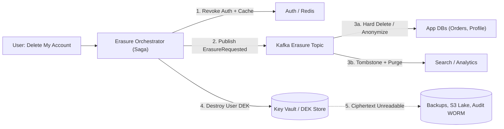
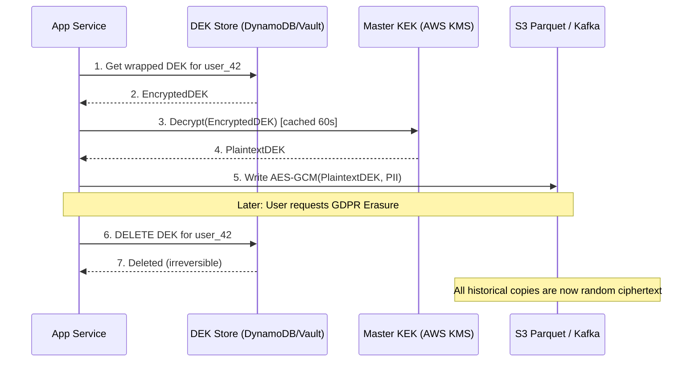
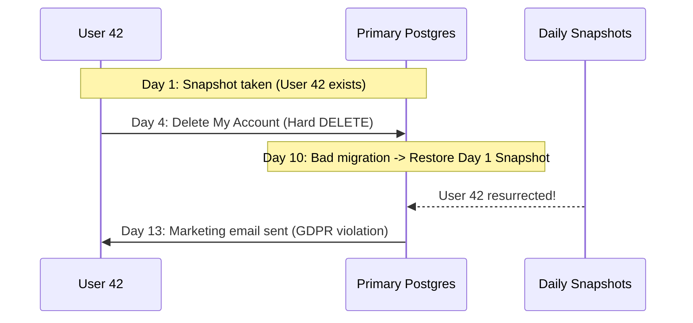

# 'Delete My Data' Across a Distributed System: GDPR + Crypto-Shredding

> **Prerequisites:** [Lesson 17: Audit Logging](../17-audit-logging/README.md).  
> **Estimated Reading Time:** 24–28 minutes  
> **Target Audience:** Backend and data-platform engineers implementing GDPR Article 17 / CCPA erasure across microservices, Kafka, S3 data lakes, and backups, and candidates asked "how do you delete a user's data from everywhere, including immutable backups?"  
> **Free PDF Notes:** [Download SD-M-018.pdf](https://backendroadmap.com/notes/system-design/SD-M-018.pdf)

> [!NOTE]
> **In one line:** Deleting a user row in Postgres leaves copies behind in **caches, search indices, Kafka topics, S3 data lakes, and 90-day backups**. **Crypto-shredding** solves the immutable-storage problem by encrypting every user's PII with a **per-user Data Encryption Key (DEK)**—so deleting that single key renders all copies across backups, Kafka, and WORM logs mathematically unrecoverable in milliseconds.

> [!TIP]
> **The Golden Rule:** Combine **active deletion** (cascading saga across live DBs, caches, and search indices) for fast storage reclamation with **crypto-shredding** for immutable stores (backups, Kafka, Parquet lakes, and audit logs).

---

## 1. What Distributed Data Deletion Is, and What It Isn't

A user clicks "Delete My Account." The monolith runs `DELETE FROM users WHERE id = 42` and returns `200 OK`. Six months later, the company restores a Postgres backup after an outage—and user 42's account comes back to life ("zombie data"). Worse, their email and address are still sitting in 30-day Kafka retention, Elasticsearch, Snowflake, and S3 Parquet files. Under GDPR Article 17 ("Right to Erasure"), you have **30 days** to erase personal data across *all* systems, or face fines up to 4% of global annual turnover.

| Term | Precise Meaning | Example |
| :--- | :--- | :--- |
| **GDPR Article 17 (Right to Erasure)** | Legal mandate to erase a user's personal data within 30 days (with narrow legal exceptions) | Deleting user profile, emails, and behavioral PII |
| **Crypto-Shredding** | Encrypting a subject's PII with a dedicated per-subject DEK, then destroying the DEK to erase all copies | Deleting `user_42`'s key in KMS/KeyStore |
| **Envelope Encryption** | Encrypting data with a DEK, and encrypting the DEK with a master KEK (Key Encryption Key) | KMS KEK wraps per-user AES-256-GCM DEK |
| **Tombstone / Compaction** | Publishing a `key -> null` record in Kafka so log compaction removes prior records for that key | Kafka `user_42 -> null` tombstone |
| **Deletion Saga** | Asynchronous orchestration/choreography ensuring every service deletes its local copy and acks | `ErasureRequested` -> Services -> `ErasureCompleted` |
| **Legal Hold / Retention Override** | Statutory obligation (tax invoices, AML) that overrides deletion for specific records | Keeping anonymized invoice totals for 7 years |
| **Not** | A soft-delete `deleted_at = NOW()` flag | Soft-delete is *not* erasure under GDPR |

### Why It Matters
1. **Immutable storage cannot be `DELETE`d:** You cannot surgically delete 1 row from a compressed S3 Parquet file, a Kafka segment, or a 90-day snapshot without rewriting terabytes.
2. **Backup restores resurrect deleted users:** Without a suppression list or crypto-shredding, restoring a 14-day-old snapshot silently un-deletes every user who left in the last two weeks.
3. **Interviewer favorite:** "How do you implement GDPR 'Delete My Data' across 20 microservices, Kafka, and S3 backups?" tests distributed systems, cryptography, and operational realism in one question.

---

## 2. Anatomy: Hybrid Deletion Saga + Crypto-Shredding



A production erasure architecture runs **two complementary mechanisms**:
1. **Active Erasure Saga (for mutable live stores):**
   - Immediately revoke active sessions/JWTs (or bump `token_version`) and purge Redis caches.
   - Record an `erasure_requests` row with a **30-day SLA deadline** and a **suppression tombstone** (hashed `user_id`) so a backup restore can re-apply pending/recent deletions.
   - Fan out `ErasureRequested` to every owning service (Profile, Billing, Notifications, Search). Each service hard-deletes PII or **anonymizes** legally required records (e.g., replacing `name/email` on a tax invoice with `REDACTED` while keeping amount and tax ID), then emits `ErasureAcked`.
2. **Crypto-Shredding (for immutable stores):**
   - Every PII field stored in Kafka events, S3 Parquet, or audit logs is encrypted with that user's **per-user DEK** (`AES-256-GCM`).
   - Once the saga completes (or immediately at `T=0`), the Key Vault **destroys the user's DEK** (and overwrites/purges key backups). Every historical copy in S3, Kafka, and snapshots becomes random noise.

| Mechanism | Target Systems | Latency | Reclaims Disk? | Survives Backup Restore? |
| :--- | :--- | :---: | :---: | :--- |
| **Hard `DELETE`** | Postgres, MySQL, Redis, Elasticsearch | Seconds–Minutes | Yes | **No** (unless replayed from suppression log) |
| **Kafka Tombstone** | Compacted Kafka topics | Hours–Days (compaction) | Eventually | N/A |
| **Crypto-Shredding** | S3 Parquet, backups, WORM audit logs, Kafka | **Milliseconds** | No (ciphertext stays) | **Yes** (ciphertext is permanently unreadable) |

> [!WARNING]
> **The #1 Crypto-Shredding Trap: Encrypting the DEK with a KEK that is backed up, or caching DEKs forever.** If your DEK table is itself included in the Postgres snapshot you restore, destroying the live DEK row does nothing—you will restore the DEK too! Store per-user DEKs in a dedicated, non-snapshotted Key Store (or destroy them via a post-restore replay log).

---

## 3. Mathematical Model: Key Storage Overhead, Decryption Latency & Backup Rewrite Cost

**Key Store Sizing.** Suppose a platform has $U$ active users and each per-user DEK record (wrapped 256-bit key + `user_id` + metadata) takes $b_{\text{key}} = 128\text{ bytes}$:

$$S_{\text{keys}} = U \cdot b_{\text{key}}$$

**S3 Parquet Rewrite vs Crypto-Shredding Cost.** Suppose an analytics lake stores $T_{\text{lake}} = 500\text{ TB}$ across $P = 50{,}000$ Parquet files, and $D = 1{,}000$ users request deletion per day. Rewriting Parquet files naively requires reading and rewriting every file containing any deleted user (nearly all $P$ files if users are spread uniformly):

$$C_{\text{rewrite/day}} \approx \text{Scan}(T_{\text{lake}}) + \text{Write}(T_{\text{lake}})$$

With crypto-shredding, the daily work is $D$ key deletions:

$$C_{\text{shred/day}} = D \times 1\text{ KeyStore DELETE}$$

### Worked Numerical Example
For $U = 50{,}000{,}000$ users ($50\text{M}$):
- **DEK Store size:** $50{,}000{,}000 \times 128\text{ bytes} = 6.4\text{ GB}$—small enough to fit in an NVMe-backed key service or Redis/DynamoDB with sub-millisecond lookups.
- **Rewriting a 500 TB S3 Parquet lake daily** (e.g., Spark scanning 500 TB/day at $\approx \$0.005/\text{GB}$ compute + S3 `PUT`/`GET` requests) costs **thousands of dollars per day** and saturates cluster I/O.
- **Crypto-shredding 1,000 deleted users/day:** $1{,}000$ `DELETE` operations on the 6.4 GB Key Store takes **$< 1\text{ second}$** and costs **$< \$0.01/\text{day}$**.
- **DEK lookup latency:** Caching unwrapped DEKs in app memory for a short TTL (e.g., 60 s, invalidated on `ErasureRequested`) keeps encryption/decryption overhead at **$< 50\ \mu\text{s}$** per request.

---

## 4. Metrics & Percentiles

| Metric | Meaning | Alert when |
| :--- | :--- | :--- |
| **Erasure SLA ($p_{99}$)** | Time from `ErasureRequested` to all services acked + DEK destroyed | $> 24\text{ hours}$ (30-day legal cap) |
| **Pending Service Acks** | Services that have not confirmed deletion for an open saga | Stuck $> 4\text{ hours}$ |
| **Zombie Restoration Count** | Deleted users reappearing after a DB snapshot restore | $> 0$ (critical compliance bug) |
| **DEK Cache Stale Hit** | Reads using a cached DEK after `ErasureRequested` | $> 0$ after 60 s propagation |
| **Orphaned PII Scan Hits** | Scheduled data-lake/DB scanner finding unencrypted PII for deleted IDs | $> 0$ |
| **DLQ Erasure Failures** | Deletion messages failing due to schema/timeout bugs | $> 0$ |

### Worked Example (30-Day GDPR SLA Tracking)
A user submits an erasure request at `T = 0`:
- `T + 200 ms`: Auth tokens revoked; Redis session purged; `ErasureRequested` written to Saga DB.
- `T + 2 s`: Profile, Billing (anonymized), and Notifications services commit hard deletes and emit `ErasureAcked`.
- `T + 5 s`: Search index deletes user documents; Kafka tombstone published.
- `T + 6 s`: Saga marks all live stores acked and calls `KeyStore.DestroyDEK(user_id)`.
- Total end-to-end SLA: **6 seconds** (well inside the 30-day statutory limit).

---

## 5. Compounding & Failure Modes: Backup Resurrection & Partial Deletion

| Failure Mode | What Goes Wrong | Mitigation |
| :--- | :--- | :--- |
| **Backup Resurrection ("Zombie Data")** | Restoring a 14-day-old DB snapshot brings back deleted users | Keep an append-only **Erasure Tombstone Log** (hashed `user_id` + timestamp) outside the DB; replay it automatically as part of every restore runbook |
| **Downstream Service Added Later** | A new ML feature store starts consuming user events but isn't in the erasure saga | Central **Data Catalog / PII Registry** + mandatory `ErasureRequested` consumer contract for all PII-holding services |
| **Uncompacted Kafka Retention** | Tombstones only work on `cleanup.policy=compact`; time-retained topics keep old events for 7–30 days | Crypto-shred PII inside Kafka payloads, or keep topic retention $< 7$ days |
| **Linkage / Quasi-Identifiers** | Deleting `email` and `name` but leaving `ip_address + exact_dob + zip` allows re-identification | Encrypt or generalize quasi-identifiers (e.g., truncate IP/DOB) under the same DEK |

---

## 6. Numbers Every Engineer Must Know

| Item | Typical | Implication |
| :--- | :---: | :--- |
| **GDPR Article 17 SLA** | 30 days (extendable to 90 for complex cases) | Automate the saga; never rely on manual SQL tickets |
| **AES-256-GCM throughput** | ~2 – 5 GB/s per core (AES-NI) | Per-user field encryption adds negligible CPU overhead |
| **DEK size (AES-256)** | 32 bytes (128 bytes with metadata) | 100M users = ~12.8 GB total key storage |
| **DEK in-memory cache TTL** | 60 seconds (with pub/sub invalidation) | Balances KMS/KeyStore QPS against revocation speed |
| **AWS KMS Direct QPS limit** | 5,500 – 30,000 req/s (region-dependent) | Never create 1 KMS CMK per user (limit ~100k keys); use envelope encryption with a local/DynamoDB DEK store |
| **Parquet lake rewrite vs shred** | Hours–Days vs Milliseconds | Crypto-shredding is the only practical way to erase immutable lakes |

---

## 7. Mechanism Deep Dive: Envelope Encryption & Crypto-Shredding



| Question | Answer |
| :--- | :--- |
| **Why not create one AWS KMS CMK per user?** | KMS has account quotas (~100,000 keys) and costs $\$1/\text{key/month}$ ($1\text{M}$ users = $\$1\text{M/month}$). Instead, use **1 KMS KEK** to wrap **millions of per-user DEKs** stored in your own Key Store |
| **How do you query encrypted PII (e.g., lookup by email)?** | Store a keyed **HMAC-SHA256 blind index** (`HMAC(pepper, email)`) alongside the ciphertext; on deletion, delete the blind index row too |
| **What if a database backup includes the DEK table?** | **Never** back up the DEK table with the same retention as app data, or store DEKs in a separate DynamoDB/Vault cluster with Point-in-Time Recovery disabled for deleted keys (or replay the Erasure Tombstone Log after any restore) |
| **Can you crypto-shred non-PII analytics?** | Keep non-PII metrics (e.g., `country`, `plan_tier`, `amount`) in plaintext so aggregate revenue charts stay accurate after a user leaves |

**When not to use crypto-shredding:** When you have a tiny single-database app with no immutable data lakes, no Kafka replay logs, and short-lived backups—or when you *must* reclaim physical disk space (e.g., a user uploaded 50 GB of video blobs). For large blobs, you still need hard `DELETE` on S3 objects.

---

## 8. Hierarchical Budgets & Design Rules

| Slice | Rule | Control |
| :--- | :--- | :--- |
| **PII Classification** | Every schema field containing PII must be tagged (`@pii`) and encrypted with the subject's DEK | Schema linter in CI |
| **No Soft-Delete Myth** | `deleted_at` is an internal workflow state, never the final GDPR erasure state | Automated purge job + saga |
| **Envelope Encryption** | 1 KMS KEK wraps per-user AES-256-GCM DEKs; never 1 KMS CMK per user | Dedicated DEK store |
| **Backup Hygiene** | Every DB snapshot restore runbook must replay the `ErasureTombstoneLog` before traffic is routed | Automated restore pipeline |
| **Legal Hold Separation** | Separate legally required financial/tax records from user PII; anonymize PII fields while keeping ledger totals | Explicit retention policy per table |
| **Saga Completeness** | Track every PII-holding service in a registry; erasure is incomplete until 100% ack | Dead-letter alerting + 24h SLA |

---

## 9. Top Mitigations

1. **Implement a Deletion Saga** with an `erasure_requests` state machine and per-service acks so partial failures retry automatically.
2. **Use per-user DEK crypto-shredding** for all PII written to Kafka, S3 data lakes, and immutable audit logs.
3. **Maintain an external Erasure Tombstone Log** (hashed `user_id` + `erased_at`) and replay it automatically after any database backup restore.
4. **Separate legal-hold data from PII** (anonymize `name`/`email` on invoices rather than blocking deletion of the whole account).
5. **Invalidate DEK caches and auth sessions immediately** via pub/sub when an erasure starts.
6. **Publish Kafka tombstones (`key -> null`)** on compacted topics and keep non-compacted topic retention short.
7. **Run a periodic PII scanner** against S3/warehouse tables to catch accidental plaintext PII leaks.

---

## 10. Production Reference: The Backup Restore Zombie-User Incident

After a bad migration, an e-commerce platform restored its primary Postgres cluster from a 10-day-old snapshot. Three days later, a user who had deleted their account 6 days earlier received a promotional email—a textbook GDPR Article 17 violation.



- **Root Cause:** The team relied solely on `DELETE FROM users` with no external Erasure Tombstone Log and no crypto-shredding. Restoring the Day 1 snapshot brought back 1,400 deleted accounts.
- **The Fix:** Built an append-only `erasure_tombstones` log in a separate S3 bucket (storing only `HMAC(user_id)` and `erased_at`), automated a post-restore replay step that purges any restored rows matching the tombstone log before the DB accepts traffic, and moved PII fields to per-user DEKs.

---

## 11. Multi-Language Production Code Tabs

A production-shaped **Crypto-Shredding Envelope Cipher** (`AES-256-GCM` with per-user DEKs, key destruction, and graceful `ErrKeyShredded` handling) in all 4 languages.

````carousel
```go
// Go: per-user DEK crypto-shredding with AES-256-GCM (stdlib only).
package main

import (
	"crypto/aes"
	"crypto/cipher"
	"crypto/rand"
	"errors"
	"io"
	"sync"
)

var ErrKeyShredded = errors.New("user DEK shredded: data permanently erased")

type KeyStore struct {
	mu   sync.RWMutex
	deks map[string][]byte
}

func NewKeyStore() *KeyStore { return &KeyStore{deks: make(map[string][]byte)} }

func (ks *KeyStore) EnsureDEK(userID string) ([]byte, error) {
	ks.mu.Lock()
	defer ks.mu.Unlock()
	if k, ok := ks.deks[userID]; ok {
		return k, nil
	}
	key := make([]byte, 32) // AES-256
	if _, err := io.ReadFull(rand.Reader, key); err != nil {
		return nil, err
	}
	ks.deks[userID] = key
	return key, nil
}

func (ks *KeyStore) Shred(userID string) {
	ks.mu.Lock()
	defer ks.mu.Unlock()
	if k, ok := ks.deks[userID]; ok {
		clear(k) // zero memory before deleting
		delete(ks.deks, userID)
	}
}

func (ks *KeyStore) EncryptPII(userID string, plaintext []byte) ([]byte, error) {
	key, err := ks.EnsureDEK(userID)
	if err != nil {
		return nil, err
	}
	block, _ := aes.NewCipher(key)
	gcm, _ := cipher.NewGCM(block)
	nonce := make([]byte, gcm.NonceSize())
	io.ReadFull(rand.Reader, nonce)
	return gcm.Seal(nonce, nonce, plaintext, []byte(userID)), nil
}

func (ks *KeyStore) DecryptPII(userID string, blob []byte) ([]byte, error) {
	ks.mu.RLock()
	key, ok := ks.deks[userID]
	ks.mu.RUnlock()
	if !ok {
		return nil, ErrKeyShredded
	}
	block, _ := aes.NewCipher(key)
	gcm, _ := cipher.NewGCM(block)
	ns := gcm.NonceSize()
	return gcm.Open(nil, blob[:ns], blob[ns:], []byte(userID))
}
```
<!-- slide -->
```typescript
// TypeScript: per-user DEK crypto-shredding with AES-256-GCM (Node crypto).
import { createCipheriv, createDecipheriv, randomBytes } from "crypto";

export class CryptoShredder {
  private deks = new Map<string, Buffer>();

  private getOrCreateDek(userId: string): Buffer {
    let dek = this.deks.get(userId);
    if (!dek) {
      dek = randomBytes(32);
      this.deks.set(userId, dek);
    }
    return dek;
  }

  encryptPii(userId: string, plaintext: string): Buffer {
    const dek = this.getOrCreateDek(userId);
    const iv = randomBytes(12);
    const cipher = createCipheriv("aes-256-gcm", dek, iv);
    cipher.setAAD(Buffer.from(userId));
    const ct = Buffer.concat([cipher.update(plaintext, "utf8"), cipher.final()]);
    return Buffer.concat([iv, cipher.getAuthTag(), ct]);
  }

  decryptPii(userId: string, blob: Buffer): string {
    const dek = this.deks.get(userId);
    if (!dek) throw new Error(`DEK shredded for ${userId}: data unrecoverable`);
    const iv = blob.subarray(0, 12);
    const tag = blob.subarray(12, 28);
    const ct = blob.subarray(28);
    const decipher = createDecipheriv("aes-256-gcm", dek, iv);
    decipher.setAAD(Buffer.from(userId));
    decipher.setAuthTag(tag);
    return Buffer.concat([decipher.update(ct), decipher.final()]).toString("utf8");
  }

  shredUser(userId: string): void {
    const dek = this.deks.get(userId);
    if (dek) dek.fill(0);
    this.deks.delete(userId);
  }
}
```
<!-- slide -->
```python
# Python: per-user DEK crypto-shredding (stdlib hmac/hashlib stream + AEAD pattern).
# Note: in production use `cryptography.hazmat.primitives.ciphers.aead.AESGCM`.
import hashlib
import hmac
import os


class KeyShreddedError(Exception):
    pass


class CryptoShredder:
    def __init__(self):
        self._deks: dict[str, bytearray] = {}

    def _get_or_create_dek(self, user_id: str) -> bytearray:
        if user_id not in self._deks:
            self._deks[user_id] = bytearray(os.urandom(32))
        return self._deks[user_id]

    def shred(self, user_id: str) -> None:
        dek = self._deks.pop(user_id, None)
        if dek is not None:
            for i in range(len(dek)):
                dek[i] = 0

    def encrypt_token(self, user_id: str, plaintext: bytes) -> bytes:
        dek = bytes(self._get_or_create_dek(user_id))
        nonce = os.urandom(16)
        keystream = hashlib.pbkdf2_hmac("sha256", dek, nonce, 1, dklen=len(plaintext))
        ct = bytes(a ^ b for a, b in zip(plaintext, keystream))
        tag = hmac.new(dek, nonce + user_id.encode() + ct, hashlib.sha256).digest()
        return nonce + tag + ct

    def decrypt_token(self, user_id: str, blob: bytes) -> bytes:
        dek = self._deks.get(user_id)
        if dek is None:
            raise KeyShreddedError(f"DEK for {user_id} was destroyed")
        dek_b = bytes(dek)
        nonce, tag, ct = blob[:16], blob[16:48], blob[48:]
        expected = hmac.new(dek_b, nonce + user_id.encode() + ct, hashlib.sha256).digest()
        if not hmac.compare_digest(tag, expected):
            raise ValueError("tampered ciphertext")
        keystream = hashlib.pbkdf2_hmac("sha256", dek_b, nonce, 1, dklen=len(ct))
        return bytes(a ^ b for a, b in zip(ct, keystream))
```
<!-- slide -->
```csharp
// C#: per-user DEK crypto-shredding with AesGcm (.NET stdlib).
using System;
using System.Collections.Concurrent;
using System.Security.Cryptography;
using System.Text;

public sealed class CryptoShredder
{
    private readonly ConcurrentDictionary<string, byte[]> _deks = new();

    public byte[] EncryptPii(string userId, string plaintext)
    {
        var dek = _deks.GetOrAdd(userId, _ => RandomNumberGenerator.GetBytes(32));
        var nonce = RandomNumberGenerator.GetBytes(12);
        var pt = Encoding.UTF8.GetBytes(plaintext);
        var ct = new byte[pt.Length];
        var tag = new byte[16];
        using var aes = new AesGcm(dek, 16);
        aes.Encrypt(nonce, pt, ct, tag, Encoding.UTF8.GetBytes(userId));

        var result = new byte[12 + 16 + ct.Length];
        nonce.CopyTo(result, 0);
        tag.CopyTo(result, 12);
        ct.CopyTo(result, 28);
        return result;
    }

    public string DecryptPii(string userId, byte[] blob)
    {
        if (!_deks.TryGetValue(userId, out var dek))
            throw new InvalidOperationException($"DEK shredded for {userId}");
        var pt = new byte[blob.Length - 28];
        using var aes = new AesGcm(dek, 16);
        aes.Decrypt(blob.AsSpan(0, 12), blob.AsSpan(28), blob.AsSpan(12, 16), pt, Encoding.UTF8.GetBytes(userId));
        return Encoding.UTF8.GetString(pt);
    }

    public void Shred(string userId)
    {
        if (_deks.TryRemove(userId, out var dek))
            CryptographicOperations.ZeroMemory(dek);
    }
}
```
````

---

## 12. Hands-On CLI Verification Workflows

Verify DEK sizing and crypto-shredding behavior in Python 3:

```bash
python -c "
users = 50_000_000
dek_bytes = 128
print(f'50M DEK store size: {users * dek_bytes / 1e9:.2f} GB')
"
```

Publish a Kafka tombstone for a deleted user on a compacted topic:

```bash
# Compacted topic cleanup: key with null value removes prior records during compaction
kafka-console-producer.sh \
  --bootstrap-server localhost:9092 \
  --topic user-profiles \
  --property "parse.key=true" \
  --property "key.separator=:" \
  --property "null.marker=NULL" <<< "user_42:NULL"
```

---

## 13. Common Mistakes to Avoid

1. **Treating `deleted_at = NOW()` (soft-delete) as GDPR compliance.**
2. **Forgetting database backups**, causing deleted users to reappear after a snapshot restore.
3. **Creating one AWS KMS CMK per user**, hitting account key limits and paying $\$1/\text{user/month}$.
4. **Backing up the DEK store inside the same snapshot** as the encrypted data.
5. **Caching unwrapped DEKs with long TTLs** and no invalidation on erasure.
6. **Hard-deleting tax/invoice ledger rows** instead of anonymizing PII fields while keeping legally required totals.
7. **Forgetting third-party SaaS sinks** (Zendesk, Mixpanel, Stripe, Sentry logs) in the deletion saga.

---

## 14. Key Terms Glossary

| Key Term | Definition |
| :--- | :--- |
| **GDPR Article 17** | EU regulation granting individuals the Right to Erasure within 30 days. |
| **Crypto-Shredding** | Erasing data by destroying the per-subject encryption key rather than rewriting immutable media. |
| **Envelope Encryption** | Wrapping per-subject DEKs with a master KEK (e.g., KMS). |
| **DEK / KEK** | Data Encryption Key (encrypts data) / Key Encryption Key (encrypts DEKs). |
| **Erasure Tombstone Log** | External append-only log of deleted IDs replayed after any backup restore. |
| **Kafka Tombstone** | A record with a `null` payload telling log compaction to remove prior records for that key. |
| **Deletion Saga** | Distributed workflow coordinating erasure and acknowledgments across all microservices. |
| **Blind Index** | Keyed HMAC of a field (e.g., email) enabling exact-match lookups on encrypted columns. |
| **Legal Hold** | Statutory retention rule requiring certain anonymized records to be kept despite erasure. |
| **Zombie Data** | Deleted user data resurrected by restoring an older backup snapshot. |

---

## 15. System Design Interview Questions & Answers

### Basic Conceptual Questions

<details>
<summary><strong>Q1: Why isn't `DELETE FROM users WHERE id = 42` enough for "Delete My Data"? [BASIC]</strong></summary>

**Answer:**
Copies of user 42's PII exist in Redis caches, Elasticsearch indices, Kafka topics, S3 data lakes, third-party analytics, and 30–90 day database backups. A local SQL `DELETE` leaves all of those copies intact and risks resurrecting the user on backup restore.
</details>

<details>
<summary><strong>Q2: What is crypto-shredding, and why is it needed? [BASIC]</strong></summary>

**Answer:**
Crypto-shredding encrypts each user's PII with a dedicated per-user Data Encryption Key (DEK). When the user requests erasure, you destroy that DEK, rendering all historical copies in immutable backups, Parquet lakes, Kafka logs, and WORM audit trails permanently unreadable in milliseconds.
</details>

<details>
<summary><strong>Q3: Is soft-delete (`deleted_at`) compliant with GDPR Article 17? [BASIC]</strong></summary>

**Answer:**
No. Soft-delete is only an application-level visibility flag; the personal data is still stored and readable. You may use a brief grace period (e.g., 7 days for accidental clicks) if clearly disclosed, but actual erasure must hard-delete or crypto-shred within the 30-day legal window.
</details>

<details>
<summary><strong>Q4: Why not use one AWS KMS key per user? [BASIC]</strong></summary>

**Answer:**
KMS has strict per-account key quotas (typically ~100k) and charges $\approx \$1/\text{key/month}$. Instead, use **envelope encryption**: one KMS KEK wraps millions of per-user DEKs stored in a fast key store like DynamoDB or Vault.
</details>

### Scenario-Based Architecture Questions

<details>
<summary><strong>Q5: Design "Delete My Data" across 15 microservices, Kafka, and a 500 TB S3 data lake. [SCENARIO]</strong></summary>

**Answer:**
Run a **hybrid** architecture: (1) an Erasure Saga revokes auth/caches and fans out `ErasureRequested` to all 15 services to hard-delete or anonymize live DBs and search indices; (2) all PII in Kafka and S3 Parquet is encrypted with per-user DEKs, so the saga destroys the user's DEK at completion—erasing the 500 TB lake in milliseconds without rewriting a single Parquet file.
</details>

<details>
<summary><strong>Q6: How do you prevent deleted users from coming back when you restore a Postgres backup? [SCENARIO]</strong></summary>

**Answer:**
Maintain an external, append-only **Erasure Tombstone Log** (storing only `HMAC(user_id)` and `erased_at`) in a separate bucket/store. Automate your database restore runbook to replay the tombstone log against the restored database *before* routing production traffic to it.
</details>

<details>
<summary><strong>Q7: A user requests deletion, but tax law requires keeping invoices for 7 years. How do you handle both? [SCENARIO]</strong></summary>

**Answer:**
GDPR explicitly allows retaining data required for legal compliance. Separate financial facts (`invoice_id`, `amount`, `tax`, `date`, `country`) from personal identifiers (`name`, `email`, `street_address`), and **anonymize** the PII fields on the invoice while erasing the user's profile and DEK.
</details>

<details>
<summary><strong>Q8: How do you ensure a newly launched microservice doesn't forget to implement deletion? [SCENARIO]</strong></summary>

**Answer:**
Maintain a central **PII Service Registry** linked to your schema/CI pipeline. Any service declaring PII tables must register an `ErasureRequested` consumer and pass a staging integration test before GA; the Erasure Saga checks off every registered service before marking a request complete.
</details>

### Advanced & Tricky Interview Questions

<details>
<summary><strong>Q9: If you encrypt a user's email with a per-user DEK, how can they still log in with `WHERE email = ?`? [TRICKY]</strong></summary>

**Answer:**
Store a deterministic **blind index**: `email_hash = HMAC-SHA256(global_pepper, normalize(email))` in an indexed column, and store the AES-GCM encrypted email alongside it. On login, look up by `email_hash`; on GDPR deletion, hard-delete the `email_hash` column (or row) and destroy the user's DEK.
</details>

<details>
<summary><strong>Q10: What happens if an attacker compromises your backup *and* your DEK store snapshot? [TRICKY]</strong></summary>

**Answer:**
If the DEK store is backed up with the same retention as app data, crypto-shredding is defeated. Never retain snapshots of deleted DEKs (or store DEKs in a system without historical snapshots for deleted keys, and zero/overwrite them immediately).
</details>

<details>
<summary><strong>Q11: How do you handle a user who uploaded 20 GB of photos—is crypto-shredding enough? [TRICKY]</strong></summary>

**Answer:**
Legally crypto-shredding renders the blobs unreadable, but economically you shouldn't pay S3 storage forever for deleted users. Use crypto-shredding for immediate erasure across backups/replicas, and also issue an async `DeleteObject` / `DeleteObjects` batch to reclaim the 20 GB of S3 storage.
</details>

<details>
<summary><strong>Q12: Can an unencrypted `user_id` (UUID) itself be considered PII under GDPR? [TRICKY]</strong></summary>

**Answer:**
Yes, if it can be linked back to a natural person (pseudonymous data is still personal data under GDPR). Once all identifying attributes and the DEK are destroyed, the remaining random UUID in an aggregate table cannot be linked to a person and becomes effectively anonymous.
</details>

---

## 16. One-Page Master Cheat Sheet

```
+---------------------------------------------------------------------------------------------------------+
|                    'DELETE MY DATA' (GDPR + CRYPTO-SHREDDING) — MASTER CHEAT SHEET                      |
+---------------------------------------------------------------------------------------------------------+
| 1. SOFT-DELETE != ERASURE: `deleted_at` violates GDPR Art 17 (30-day SLA).                               |
+---------------------------------------------------------------------------------------------------------+
| 2. HYBRID ARCHITECTURE: Active Deletion Saga (live DBs, Redis, Search) + Crypto-Shredding (immutable).  |
+---------------------------------------------------------------------------------------------------------+
| 3. ENVELOPE ENCRYPTION: 1 KMS KEK wraps millions of per-user AES-256-GCM DEKs in a fast Key Store.      |
+---------------------------------------------------------------------------------------------------------+
| 4. CRYPTO-SHREDDING: Deleting 1 DEK renders all copies in S3 Parquet, Kafka, & WORM logs unreadable.    |
+---------------------------------------------------------------------------------------------------------+
| 5. PREVENT ZOMBIE DATA: Keep an external Erasure Tombstone Log; replay it after every DB restore.       |
+---------------------------------------------------------------------------------------------------------+
| 6. LEGAL HOLDS: Anonymize PII on invoices; keep non-PII ledger totals for statutory tax retention.      |
+---------------------------------------------------------------------------------------------------------+
```

---

## Further Reading & Sources

- GDPR Article 17, [Right to Erasure ("Right to be Forgotten")](https://gdpr-info.eu/art-17-gdpr/).
- Martin Kleppmann, *Designing Data-Intensive Applications*, Chapter 11 & 12 (Derived Data, Logs, and Retention).
- AWS Security Blog, [Envelope Encryption and Key Management Best Practices](https://docs.aws.amazon.com/kms/latest/developerguide/concepts.html#enveloping).
- Google Cloud Architecture Center, [Managing Data Deletion and Crypto-Shredding](https://cloud.google.com/architecture).

---

## Free PDF Notes

[SD-M-018.pdf](https://backendroadmap.com/notes/system-design/SD-M-018.pdf)

---

## Next

Continue with [Lesson 19: Multi-Tenant Security: Never Leak Data Between Tenants (Postgres RLS)](../19-multi-tenant-security/README.md).
