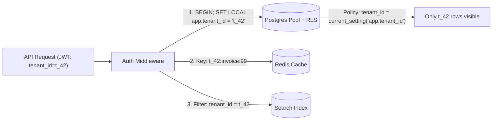
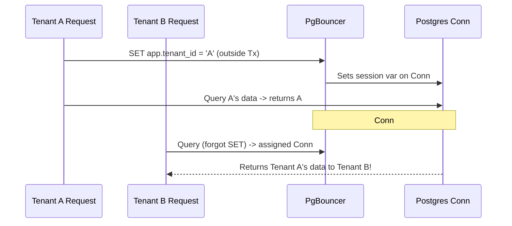

# Multi-Tenant Security: Never Leak Data Between Tenants (Postgres RLS)

> **Prerequisites:** [Lesson 18: 'Delete My Data' Across a Distributed System](../18-delete-my-data-across-a-distributed-system/README.md).  
> **Estimated Reading Time:** 24–28 minutes  
> **Target Audience:** Backend engineers building B2B SaaS platforms on shared databases, caches, and queues, and candidates asked "how do you guarantee Tenant A can never read Tenant B's data?"  
> **Free PDF Notes:** [Download SD-M-019.pdf](https://backendroadmap.com/notes/system-design/SD-M-019.pdf)

> [!NOTE]
> **In one line:** Application-level `WHERE tenant_id = ?` filters fail the moment a single developer forgets a clause, leaks a cache key, or misconfigures a connection pool. **Multi-tenant security** enforces **defense-in-depth** at the database layer using **Postgres Row-Level Security (RLS)**, scoped session variables, tenant-prefixed cache keys, and per-tenant encryption or isolation tiers.

> [!TIP]
> **The Golden Rule:** Never rely solely on application code to remember `WHERE tenant_id = ?`. Push tenant isolation into the database engine with **Postgres RLS (`FORCE ROW LEVEL SECURITY`)** and bind the tenant context inside a **transaction-scoped `SET LOCAL`**.

---

## 1. What Multi-Tenant Security Is, and What It Isn't

A B2B SaaS engineer ships a new reporting endpoint: `SELECT * FROM invoices WHERE id = $1`. Because the query forgot `AND tenant_id = $2`, any logged-in user can iterate `id=1, 2, 3...` and download every other customer's invoices. Even worse, another team caches `invoice:1042` in Redis without a tenant prefix, serving Tenant A's PDF to Tenant B. That is a **cross-tenant data leak**—the single most fatal bug in B2B SaaS.

| Term | Precise Meaning | Example |
| :--- | :--- | :--- |
| **Multi-Tenancy** | Serving multiple independent customers (tenants) on shared infrastructure | Slack, Stripe, Salesforce |
| **Cross-Tenant Leak** | Tenant A reading or mutating Tenant B's rows, files, or cache entries | Missing `WHERE tenant_id = ?` (IDOR) |
| **Noisy Neighbor** | One tenant exhausting shared CPU, IOPS, or connection pool | Tenant A runs a 10M-row export |
| **Silo Model** | Dedicated DB instance/cluster per tenant | High isolation, high cost/ops |
| **Bridge Model** | Shared DB cluster, separate schema per tenant (`tenant_a.invoices`) | Medium isolation, schema migration pain |
| **Pool Model + RLS** | Shared tables with `tenant_id` column enforced by Postgres Row-Level Security | High density, low cost, DB-enforced |
| **Not** | Just adding `tenant_id` to your ORM models | ORMs can be bypassed by raw SQL or bugs |

### Why It Matters
1. **One cross-tenant leak can end a B2B company:** Enterprise contracts include strict breach-termination clauses and massive liability.
2. **Connection pools (`PgBouncer`) introduce subtle session leaks:** Using `SET app.tenant_id = ...` at the *session* level leaks Tenant A's context to Tenant B on the next pooled transaction!
3. **In system design interviews**, choosing between Silo, Bridge, and Pool+RLS—and knowing how to isolate caches, search, and queues—is a classic staff-level B2B SaaS question.

---

## 2. Anatomy: Silo vs Bridge vs Pool (Postgres RLS)



| Model | Isolation | Cost / Density | Migration Complexity | Best For |
| :--- | :--- | :--- | :--- | :--- |
| **Silo (DB per tenant)** | Physical (highest) | Low density, high cost | Hard (1,000 DBs to migrate) | Regulated enterprise / FedRAMP |
| **Bridge (Schema per tenant)** | Logical schema | Medium (catalog bloat > 5k schemas) | Medium–Hard | Mid-market with < 1,000 tenants |
| **Pool + Postgres RLS** | Engine-enforced row policy | **Highest density, lowest cost** | **Easy (1 schema)** | High-scale SaaS (10k–1M+ tenants) |

How **Postgres RLS** works under the hood:
1. Enable RLS on every tenant-scoped table: `ALTER TABLE invoices ENABLE ROW LEVEL SECURITY;`
2. Force it even for the table owner: `ALTER TABLE invoices FORCE ROW LEVEL SECURITY;` (critical—by default, table owners bypass RLS!).
3. Run the application as a **non-superuser, non-`BYPASSRLS`** role.
4. Create a policy:
   ```sql
   CREATE POLICY tenant_isolation ON invoices
     USING (tenant_id = NULLIF(current_setting('app.tenant_id', true), '')::uuid)
     WITH CHECK (tenant_id = NULLIF(current_setting('app.tenant_id', true), '')::uuid);
   ```
5. Inside every request's DB transaction, execute `SET LOCAL app.tenant_id = '<uuid>';`—it automatically resets on `COMMIT` or `ROLLBACK`.

> [!WARNING]
> **The #1 Multi-Tenant Trap: Using `SET` instead of `SET LOCAL` with `PgBouncer` transaction pooling, or connecting as a Postgres `SUPERUSER`.** `SET` persists for the entire TCP connection, leaking Tenant A's ID to Tenant B's next request. And `SUPERUSER` / `BYPASSRLS` silently disables every RLS policy.

---

## 3. Mathematical Model: Blast Radius, Index Selectivity & Connection Pool Contention

**Blast Radius.** In a Silo model with $T$ tenants, a compromised DB credential exposes $1/T$ of total data. In a Pool model without RLS, a single missing `WHERE` clause exposes $100\%$ ($T/T$). With RLS + non-superuser role, a missing `WHERE` clause exposes **$0$ cross-tenant rows** (fail-closed if `app.tenant_id` is unset).

**Composite Index Ordering.** In a shared table of $N$ total rows across $T$ tenants (average $N/T$ rows per tenant), placing `tenant_id` **first** in every B-tree index `(tenant_id, id)` or `(tenant_id, created_at)` reduces index scan work by a factor of $T$:

$$\text{Index Scan Cost} = O\!\left(\log N + \frac{N}{T}\right) \quad \text{vs} \quad O(N)\text{ without leading } \text{tenant\_id}$$

**Noisy Neighbor Queueing.** If $T$ tenants share a connection pool of $C$ connections and one tenant consumes $k$ slow connections, the remaining $T-1$ tenants compete for $C - k$ connections; if $k \to C$, global availability drops to $0\%$.

### Worked Numerical Example
Suppose a shared `events` table has $N = 100{,}000{,}000$ rows across $T = 10{,}000$ tenants ($10{,}000$ rows/tenant):
- **Query with `(tenant_id, created_at)` index:** Postgres jumps straight to the tenant's $10{,}000$-row slice ($\approx 4$ B-tree page reads, **$< 1\text{ ms}$**).
- **Query with `(created_at)` index only + RLS filter:** Postgres scans all tenants' recent rows and discards $9{,}999/10{,}000$ of them (**$10{,}000\times$ more I/O**, hundreds of ms).
- **Per-tenant connection cap:** With $C = 100$ pool connections, capping any single tenant at $20\%$ ($20$ concurrent queries) ensures even a runaway tenant leaves $80$ connections for everyone else.

---

## 4. Metrics & Percentiles

| Metric | Meaning | Alert when |
| :--- | :--- | :--- |
| **RLS Policy Coverage** | % of tenant-scoped tables with `ENABLE` + `FORCE` RLS | $< 100\%$ (block deploy in CI) |
| **Unset Tenant Context Errors** | Queries failing because `app.tenant_id` was empty/null | $> 0$ (indicates middleware bug) |
| **Cross-Tenant Canary Test** | Automated synthetic probe attempting Tenant A -> Tenant B read | Any `200 OK` (SEV-1 page) |
| **Per-Tenant Pool Utilization** | % of DB connections or CPU held by top-1 tenant | $> 25\%$ sustained |
| **Cache Key Namespace Violations** | Redis keys missing `t:{tenant_id}:` prefix | $> 0$ |
| **Query Plan Seq-Scan Rate** | Queries on >1M-row tenant tables doing `Seq Scan` | Rising (missing leading `tenant_id` index) |

### Worked Example (Canary Isolation Test)
Every 5 minutes, a synthetic monitor authenticates as `Tenant_Canary_A` and attempts to `GET /v1/invoices/<Tenant_Canary_B_Invoice_ID>`.
- **Expected:** `404 Not Found` (RLS filters out the row so it appears non-existent).
- **If `200 OK` is ever returned:** PagerDuty fires a SEV-1 alert and the edge WAF immediately blocks the endpoint.

---

## 5. Compounding & Failure Modes: Where Tenant Leaks Actually Happen

| Layer | How It Leaks | Fix |
| :--- | :--- | :--- |
| **Postgres RLS** | App connects as `postgres` superuser or table owner without `FORCE` | Use a dedicated `app_user` role with `NOSUPERUSER NOBYPASSRLS` + `FORCE ROW LEVEL SECURITY` |
| **PgBouncer** | `SET app.tenant_id = ...` leaks across pooled transactions | Always use `SET LOCAL` inside an explicit `BEGIN ... COMMIT` block |
| **Redis / Memcached** | Cache key `user:123` or `dashboard:summary` omits `tenant_id` | Enforce a cache client wrapper that requires `tenantId` and prefixes `t:{tenantId}:` |
| **S3 / Object Storage** | Presigned URL or predictable path `/exports/report-42.csv` | Prefix keys with `tenants/{tenant_id}/{uuid}.csv` + validate tenant claim before signing |
| **Background Workers** | Worker pops Kafka job and forgets to restore `SET LOCAL app.tenant_id` | Require `tenant_id` in message envelope; wrap every job handler in a tenant-scoped DB tx |
| **LLM / Vector DBs** | Shared RAG vector index returns Tenant B's chunks in similarity search | Mandatory metadata filter `tenant_id == ctx.tenant_id` (or per-tenant namespace/index) |

---

## 6. Numbers Every Engineer Must Know

| Item | Typical | Implication |
| :--- | :---: | :--- |
| **Postgres RLS overhead** | ~1 – 5% CPU (near zero with `(tenant_id, ...)` index) | Negligible compared to a cross-tenant breach |
| **Postgres schema limit (Bridge)** | ~1,000 – 5,000 schemas per cluster | Beyond 5k tenants, `pg_catalog` bloat slows migrations/backups; use Pool + RLS |
| **`SET LOCAL` round-trip cost** | 0 extra round-trips if batched in `BEGIN` | Send `BEGIN; SET LOCAL app.tenant_id = $1;` together |
| **Per-tenant rate limit cap** | 10–25% of shared pool capacity | Prevents a single noisy neighbor from DoS-ing all tenants |
| **BYOK (Bring Your Own Key)** | Enterprise tier (+KMS per tenant) | Offer KMS CMK per enterprise tenant on top of Pool + RLS |

---

## 7. Mechanism Deep Dive: Transaction-Scoped RLS Lifecycle

```mermaid
sequenceDiagram
    participant C as Client (Tenant 42)
    participant API as API Middleware
    participant PGB as PgBouncer (Tx Pool)
    participant PG as Postgres (app_user, RLS)
    C->>API: GET /invoices/99 (JWT: tid=42)
    API->>PGB: BEGIN; SET LOCAL app.tenant_id = '42';
    PGB->>PG: Forward on pooled conn
    API->>PG: SELECT * FROM invoices WHERE id = 99;
    Note over PG: RLS appends: AND tenant_id = '42'
    PG-->>API: 0 rows (if invoice 99 belongs to Tenant 7!)
    API->>PGB: COMMIT; (app.tenant_id automatically cleared)
```

| Question | Answer |
| :--- | :--- |
| **What if a developer forgets `SET LOCAL` before querying?** | `current_setting('app.tenant_id', true)` returns `NULL`, `NULL = tenant_id` evaluates to `NULL` (false), and Postgres returns **0 rows** (fail-closed!) |
| **Can Tenant A insert a row with `tenant_id = 'B'`?** | No, because `WITH CHECK (...)` on the RLS policy rejects any `INSERT` or `UPDATE` whose `tenant_id` doesn't match `app.tenant_id` |
| **How do cross-tenant admin/billing jobs run?** | Use a separate `billing_admin` role with explicit audit logging (Lesson 17) rather than giving the web API `BYPASSRLS` |
| **Does RLS work with `JOIN`s and views?** | Yes, RLS is enforced on every underlying table scanned by a `JOIN`, unless a `VIEW` is owned by a superuser without `security_invoker = true` (Postgres 15+) |

**When not to use Pool + RLS:** When a customer has a contractual/regulatory mandate for physical isolation (e.g., HIPAA dedicated single-tenant, EU data residency in a separate region, or FedRAMP)—use the **Silo** model (separate DB/cluster) for those enterprise tiers while keeping standard tiers on Pool + RLS.

---

## 8. Hierarchical Budgets & Design Rules

| Slice | Rule | Control |
| :--- | :--- | :--- |
| **Identity Source** | Derive `tenant_id` *only* from verified JWT/session, never from URL/body/untrusted headers | Auth middleware |
| **DB Role Hygiene** | Web app connects as `NOSUPERUSER NOBYPASSRLS`; `FORCE ROW LEVEL SECURITY` on all tenant tables | CI migration linter |
| **Transaction Scoping** | Always use `SET LOCAL app.tenant_id`, never session-level `SET` | Shared `WithTenantTx()` DB wrapper |
| **Index Discipline** | Every index on a tenant table must lead with `tenant_id` | `pg_indexes` CI check |
| **Cache & Queue Isolation** | Every Redis key and Kafka message must carry and validate `tenant_id` | Typed SDK wrappers |
| **Noisy Neighbor Guard** | Per-tenant rate limits, query timeouts (`statement_timeout`), and pool quotas | Edge + DB resource limits |

---

## 9. Top Mitigations

1. **Enable and `FORCE ROW LEVEL SECURITY`** on every tenant-scoped Postgres table, and connect as a `NOBYPASSRLS` role.
2. **Wrap every DB access in a `WithTenantTx(ctx, tenantID)` helper** that runs `BEGIN; SET LOCAL app.tenant_id = $1;` and fails closed if `tenantID` is empty.
3. **Lead every B-tree index with `tenant_id`** so RLS filtering stays $O(\log N + N/T)$ instead of scanning the table.
4. **Enforce typed cache/S3 wrappers** that automatically prefix `t:{tenant_id}:` and refuse unprefixed keys.
5. **Propagate `tenant_id` in background job envelopes** and re-establish `SET LOCAL` inside the worker transaction.
6. **Run continuous cross-tenant canary tests** in CI and production to catch any RLS/view/cache regression immediately.
7. **Cap per-tenant concurrency and `statement_timeout`** to isolate noisy neighbors.

---

## 10. Production Reference: The `PgBouncer` Session-Context Leak

A fast-growing SaaS company enabled Postgres RLS and used `SET app.tenant_id = 'tenant_a'` at the start of each HTTP request—forgetting that `PgBouncer` was configured in **transaction pooling** mode (`pool_mode = transaction`).



- **Root Cause:** `SET` (without `LOCAL`) binds to the *session* on Postgres Conn #1. Under transaction pooling, Conn #1 was handed to Tenant B on the next request before `app.tenant_id` was cleared.
- **The Fix:** Switched exclusively to `SET LOCAL app.tenant_id = $1` inside an explicit `BEGIN ... COMMIT` transaction, added `RESET ALL` on connection checkout, and added a CI test that runs two concurrent tenants over a shared connection pool.

---

## 11. Multi-Language Production Code Tabs

A production-shaped **Tenant-Scoped Repository & Cache Wrapper** (enforcing `SET LOCAL` inside a transaction, fail-closed empty-tenant checks, and `t:{tenantId}:` cache key namespacing) in all 4 languages.

````carousel
```go
// Go: fail-closed tenant-scoped transaction helper + namespaced cache key.
package tenant

import (
	"context"
	"database/sql"
	"errors"
	"fmt"
)

var ErrMissingTenant = errors.New("tenant_id is required")

type ctxKey struct{}

func WithTenant(ctx context.Context, tenantID string) context.Context {
	return context.WithValue(ctx, ctxKey{}, tenantID)
}

func FromContext(ctx context.Context) (string, error) {
	tid, _ := ctx.Value(ctxKey{}).(string)
	if tid == "" {
		return "", ErrMissingTenant
	}
	return tid, nil
}

// WithTenantTx binds SET LOCAL app.tenant_id inside an explicit transaction.
func WithTenantTx(ctx context.Context, db *sql.DB, fn func(*sql.Tx) error) error {
	tid, err := FromContext(ctx)
	if err != nil {
		return err
	}
	tx, err := db.BeginTx(ctx, nil)
	if err != nil {
		return err
	}
	defer tx.Rollback()

	if _, err := tx.ExecContext(ctx, "SELECT set_config('app.tenant_id', $1, true)", tid); err != nil {
		return err
	}
	if err := fn(tx); err != nil {
		return err
	}
	return tx.Commit()
}

func CacheKey(ctx context.Context, resource string) (string, error) {
	tid, err := FromContext(ctx)
	if err != nil {
		return "", err
	}
	return fmt.Sprintf("t:%s:%s", tid, resource), nil
}
```
<!-- slide -->
```typescript
// TypeScript: fail-closed tenant transaction wrapper & cache key builder.
export interface DbClient {
  query(sql: string, params?: unknown[]): Promise<unknown>;
}

export async function withTenantTx<T>(
  pool: { connect: () => Promise<DbClient & { release: () => void }> },
  tenantId: string,
  fn: (tx: DbClient) => Promise<T>
): Promise<T> {
  if (!tenantId) throw new Error("Forbidden: missing tenantId");
  const client = await pool.connect();
  try {
    await client.query("BEGIN");
    // 3rd arg `true` = is_local (transaction-scoped, safe for PgBouncer)
    await client.query("SELECT set_config('app.tenant_id', $1, true)", [tenantId]);
    const result = await fn(client);
    await client.query("COMMIT");
    return result;
  } catch (err) {
    await client.query("ROLLBACK");
    throw err;
  } finally {
    client.release();
  }
}

export function tenantCacheKey(tenantId: string, key: string): string {
  if (!tenantId) throw new Error("Forbidden: missing tenantId for cache key");
  return `t:${tenantId}:${key}`;
}
```
<!-- slide -->
```python
# Python: fail-closed tenant-scoped DB transaction & Redis key wrapper.
from contextlib import contextmanager


class MissingTenantError(PermissionError):
    pass


@contextmanager
def tenant_tx(conn, tenant_id: str):
    if not tenant_id:
        raise MissingTenantError("tenant_id must be non-empty")
    with conn.cursor() as cur:
        try:
            cur.execute("BEGIN")
            cur.execute("SELECT set_config('app.tenant_id', %s, true)", (tenant_id,))
            yield cur
            cur.execute("COMMIT")
        except Exception:
            cur.execute("ROLLBACK")
            raise


def tenant_cache_key(tenant_id: str, key: str) -> str:
    if not tenant_id:
        raise MissingTenantError("tenant_id required for cache access")
    return f"t:{tenant_id}:{key}"
```
<!-- slide -->
```csharp
// C#: fail-closed tenant-scoped transaction & cache key helper.
using System;
using System.Data.Common;
using System.Threading.Tasks;

public static class TenantGuard
{
    public static async Task<T> WithTenantTxAsync<T>(
        DbConnection conn, string tenantId, Func<DbTransaction, Task<T>> action)
    {
        if (string.IsNullOrWhiteSpace(tenantId))
            throw new UnauthorizedAccessException("Missing tenant_id");

        await using var tx = await conn.BeginTransactionAsync();
        await using (var cmd = conn.CreateCommand())
        {
            cmd.Transaction = tx;
            cmd.CommandText = "SELECT set_config('app.tenant_id', @tid, true)";
            var p = cmd.CreateParameter();
            p.ParameterName = "@tid";
            p.Value = tenantId;
            cmd.Parameters.Add(p);
            await cmd.ExecuteNonQueryAsync();
        }
        var result = await action(tx);
        await tx.CommitAsync();
        return result;
    }

    public static string CacheKey(string tenantId, string key)
    {
        if (string.IsNullOrWhiteSpace(tenantId))
            throw new UnauthorizedAccessException("Missing tenant_id");
        return $"t:{tenantId}:{key}";
    }
}
```
````

---

## 12. Hands-On CLI Verification Workflows

Verify Postgres RLS enforcement and `FORCE ROW LEVEL SECURITY` in `psql`:

```bash
psql "$DATABASE_URL" <<'SQL'
-- 1. Check all tables in public schema have RLS enabled AND forced
SELECT relname, relrowsecurity AS rls_enabled, relforcerowsecurity AS rls_forced
FROM pg_class c
JOIN pg_namespace n ON n.oid = c.relnamespace
WHERE n.nspname = 'public' AND c.relkind = 'r';

-- 2. Simulate Tenant A inside a transaction
BEGIN;
SELECT set_config('app.tenant_id', '11111111-1111-1111-1111-111111111111', true);
SELECT count(*) FROM invoices;
COMMIT;

-- 3. Verify fail-closed when app.tenant_id is unset
BEGIN;
SELECT count(*) FROM invoices; -- Must return 0
COMMIT;
SQL
```

---

## 13. Common Mistakes to Avoid

1. **Connecting as `postgres` superuser or table owner without `FORCE ROW LEVEL SECURITY`**, silently bypassing all RLS policies.
2. **Using session-level `SET` instead of `SET LOCAL`** (`set_config(..., true)`) behind `PgBouncer`.
3. **Forgetting `WITH CHECK` on the RLS policy**, allowing `INSERT`/`UPDATE` to write rows into another tenant.
4. **Indexing `(created_at)` without leading `tenant_id`**, causing RLS queries to scan the whole table.
5. **Sharing Redis keys or S3 paths without a `t:{tenant_id}:` prefix**.
6. **Trusting a client-supplied `X-Tenant-Id` header** instead of deriving it from a verified JWT/session.
7. **Letting background workers run without setting `app.tenant_id`**, or giving workers `BYPASSRLS`.

---

## 14. Key Terms Glossary

| Key Term | Definition |
| :--- | :--- |
| **Multi-Tenancy** | Architecture where multiple customers share compute/storage while remaining logically isolated. |
| **Postgres RLS** | Row-Level Security: engine-enforced per-row visibility and write policies on tables. |
| **`FORCE ROW LEVEL SECURITY`** | Ensures RLS applies even to the table owner (still bypassed by `SUPERUSER`/`BYPASSRLS`). |
| **`SET LOCAL` / `set_config(..., true)`** | Sets a Postgres config variable scoped strictly to the current transaction. |
| **Silo / Bridge / Pool** | Three multi-tenant DB models: DB-per-tenant / Schema-per-tenant / Shared-table + RLS. |
| **Noisy Neighbor** | One tenant's workload degrading performance or availability for other tenants. |
| **Cross-Tenant Leak** | Unauthorized exposure of Tenant B's data to Tenant A. |
| **IDOR** | Insecure Direct Object Reference: accessing another tenant's resource by ID. |
| **BYOK** | Bring Your Own Key: encrypting each enterprise tenant's data with their own KMS key. |
| **Canary Probe** | Synthetic test continuously verifying Tenant A cannot read Tenant B's test record. |

---

## 15. System Design Interview Questions & Answers

### Basic Conceptual Questions

<details>
<summary><strong>Q1: Compare Silo, Bridge, and Pool multi-tenant database models. [BASIC]</strong></summary>

**Answer:**
- **Silo (DB per tenant):** Highest physical isolation, easiest per-tenant backup/restore, highest cost and migration complexity.
- **Bridge (Schema per tenant):** Moderate isolation, shares cluster, but schema migrations and `pg_catalog` bloat hurt beyond ~1,000–5,000 tenants.
- **Pool (Shared tables + Postgres RLS):** Highest density, lowest cost, single schema to migrate; relies on engine-enforced RLS and careful noisy-neighbor controls.
</details>

<details>
<summary><strong>Q2: Why isn't `WHERE tenant_id = ?` in application code sufficient? [BASIC]</strong></summary>

**Answer:**
It is a single point of human failure: one forgotten `WHERE` clause in a raw SQL query, reporting view, or ORM scope causes an immediate cross-tenant data breach. Postgres RLS enforces isolation at the database engine layer so even a buggy query cannot return another tenant's rows.
</details>

<details>
<summary><strong>Q3: What is the difference between `ENABLE ROW LEVEL SECURITY` and `FORCE ROW LEVEL SECURITY`? [BASIC]</strong></summary>

**Answer:**
`ENABLE` turns on RLS for non-owner roles, but the **table owner** still bypasses it by default. `FORCE` ensures RLS is enforced on the table owner too (note: `SUPERUSER` and `BYPASSRLS` roles still bypass it, so app connections must never use those).
</details>

<details>
<summary><strong>Q4: What is a noisy neighbor, and how do you mitigate it in a Pool model? [BASIC]</strong></summary>

**Answer:**
A tenant whose heavy queries or traffic burst starves other tenants of CPU, IOPS, or DB connections. Mitigate with per-tenant rate limiting at the edge, `statement_timeout`, per-tenant connection pool quotas, and moving heavy analytics/exports to read replicas or async queues.
</details>

### Scenario-Based Architecture Questions

<details>
<summary><strong>Q5: You use PgBouncer in transaction-pooling mode with Postgres RLS. How do you set `tenant_id` safely? [SCENARIO]</strong></summary>

**Answer:**
Use `SELECT set_config('app.tenant_id', $1, true)` (or `SET LOCAL app.tenant_id = ...`) inside an explicit `BEGIN ... COMMIT` transaction. Never use session-level `SET`, which persists on the pooled connection and leaks Tenant A's context to Tenant B.
</details>

<details>
<summary><strong>Q6: How do you isolate Redis, S3, and Kafka in a multi-tenant SaaS? [SCENARIO]</strong></summary>

**Answer:**
- **Redis:** Wrap the client so every key is prefixed with `t:{tenant_id}:` and throw if `tenant_id` is empty.
- **S3:** Store objects under `tenants/{tenant_id}/{uuid}`, validate tenant ownership before issuing short-lived presigned URLs.
- **Kafka:** Include `tenant_id` in message headers/payload, partition by `tenant_id` (or use dedicated topics for noisy enterprise tenants), and re-bind `SET LOCAL` in every consumer.
</details>

<details>
<summary><strong>Q7: How do you handle Postgres 15+ `VIEW`s with RLS? [SCENARIO]</strong></summary>

**Answer:**
By default, Postgres views run with the permissions of the *view owner* (who might have `BYPASSRLS`), bypassing RLS on underlying tables. In Postgres 15+, create views with `WITH (security_invoker = true)` so RLS policies are evaluated using the *calling* user's role and `app.tenant_id`.
</details>

<details>
<summary><strong>Q8: An enterprise customer demands physical isolation and their own encryption key, while 10,000 SMBs share Pool+RLS. How do you design this? [SCENARIO]</strong></summary>

**Answer:**
Use a **tiered routing architecture**: route SMB tenants to the shared Pool+RLS cluster, and route Enterprise-tier tenants (via a tenant-routing table cached at the API gateway/service layer) to dedicated Silo DB clusters encrypted with their KMS key (BYOK), using the exact same application code and schema.
</details>

### Advanced & Tricky Interview Questions

<details>
<summary><strong>Q9: How can an RLS policy silently degrade query performance by 1,000x? [TRICKY]</strong></summary>

**Answer:**
If a table has an index on `(created_at)` instead of `(tenant_id, created_at)`, or if the RLS expression wraps `tenant_id` in a non-inlined function, Postgres may scan thousands of rows across all tenants and filter them out at the RLS step. Always lead composite indexes with `tenant_id` and keep the RLS predicate sargable (`tenant_id = current_setting(...)::uuid`).
</details>

<details>
<summary><strong>Q10: What happens if `app.tenant_id` is unset (`''`) and you cast `''::uuid` in an RLS policy? [TRICKY]</strong></summary>

**Answer:**
`''::uuid` throws a Postgres syntax error (`invalid input syntax for type uuid: ""`), which fails the query—good for fail-closed, but noisy in logs. Using `NULLIF(current_setting('app.tenant_id', true), '')::uuid` cleanly evaluates to `NULL`, returning 0 rows without crashing.
</details>

<details>
<summary><strong>Q11: How do you prevent cross-tenant leaks in a shared RAG / Vector DB for an AI SaaS? [TRICKY]</strong></summary>

**Answer:**
Never rely on post-filtering top-$k$ results in app code (which leaks tenant data if all top-$k$ belong to another tenant, and returns fewer than $k$ results). Either use **pre-filtering** metadata indexes (`tenant_id = X`) inside the vector engine or isolate embeddings into per-tenant namespaces/collections.
</details>

<details>
<summary><strong>Q12: How do you verify in CI that no developer ever adds a table without RLS? [TRICKY]</strong></summary>

**Answer:**
Run a CI migration test against an ephemeral Postgres container that queries `pg_class` for all tables in the `public` schema (excluding an explicit allowlist of global reference tables) and fails the build if `relrowsecurity` or `relforcerowsecurity` is `false`.
</details>

---

## 16. One-Page Master Cheat Sheet

```
+---------------------------------------------------------------------------------------------------------+
|                    MULTI-TENANT SECURITY (POSTGRES RLS) — MASTER CHEAT SHEET                            |
+---------------------------------------------------------------------------------------------------------+
| 1. MODELS: Silo (DB/tenant) · Bridge (Schema/tenant, <5k) · Pool + RLS (shared tables, highest scale).  |
+---------------------------------------------------------------------------------------------------------+
| 2. POSTGRES RLS: ENABLE + FORCE ROW LEVEL SECURITY. App connects as NOSUPERUSER NOBYPASSRLS.            |
+---------------------------------------------------------------------------------------------------------+
| 3. PGBOUNCER SAFE: Always `SELECT set_config('app.tenant_id', $1, true)` inside `BEGIN ... COMMIT`.     |
+---------------------------------------------------------------------------------------------------------+
| 4. INDEXING: Lead every index with `tenant_id` so RLS scans O(N/T), not O(N).                           |
+---------------------------------------------------------------------------------------------------------+
| 5. BEYOND THE DB: Prefix Redis (`t:{tid}:`), S3 (`tenants/{tid}/`), Kafka headers, & Vector DB filters. |
+---------------------------------------------------------------------------------------------------------+
| 6. VERIFY: CI checks `pg_class` for 100% RLS coverage; prod canary probes Tenant A -> Tenant B = 404.   |
+---------------------------------------------------------------------------------------------------------+
```

---

## Further Reading & Sources

- PostgreSQL Documentation, [Row Security Policies](https://www.postgresql.org/docs/current/ddl-rowsecurity.html).
- AWS Architecture Whitepaper, [SaaS Tenant Isolation Strategies](https://docs.aws.amazon.com/whitepapers/latest/saas-architecture-fundamentals/tenant-isolation.html).
- Citus / Azure Cosmos DB for PostgreSQL, *Multi-Tenant Database Design & Indexing*.
- OWASP, [Insecure Direct Object Reference (IDOR) Prevention Cheat Sheet](https://cheatsheetseries.owasp.org/cheatsheets/Insecure_Direct_Object_Reference_Prevention_Cheat_Sheet.html).

---

## Free PDF Notes

[SD-M-019.pdf](https://backendroadmap.com/notes/system-design/SD-M-019.pdf)

---

## Next

Continue with [Lesson 20: Software Supply Chain Security: SBOMs, Signed Images, SLSA, cosign](../20-software-supply-chain-security/README.md).
