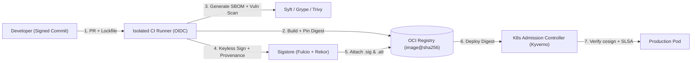
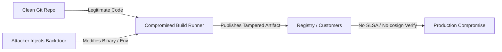

# Software Supply Chain Security: SBOMs, Signed Images, SLSA, cosign

> **Prerequisites:** [Lesson 19: Multi-Tenant Security](../19-multi-tenant-security/README.md).  
> **Estimated Reading Time:** 24–28 minutes  
> **Target Audience:** Backend, platform, and DevSecOps engineers securing CI/CD pipelines and container deployments, and candidates asked "how do you prevent a SolarWinds/Codecov/XZ-style supply-chain compromise?"  
> **Free PDF Notes:** [Download SD-M-020.pdf](https://backendroadmap.com/notes/system-design/SD-M-020.pdf)

> [!NOTE]
> **In one line:** **Software supply chain security** guarantees that the container image running in production was built from **verified source commits**, on an **isolated, ephemeral CI runner**, with **pinned, vulnerability-scanned dependencies**, documented in an **SBOM**, and **cryptographically signed (`cosign`)** with **SLSA provenance** verified at Kubernetes admission time.

> [!TIP]
> **The Golden Rule:** Never deploy mutable image tags (`:latest`, `:v1.2`) and never trust an unsigned artifact. Pin by **immutable SHA-256 digest** (`image@sha256:...`), sign with **keyless OIDC `cosign`**, and enforce **admission-controller verification** (Kyverno / Sigstore Policy Controller) before any pod starts.

---

## 1. What Software Supply Chain Security Is, and What It Isn't

A team locks down its runtime Kubernetes cluster with mTLS, NetworkPolicies, and Postgres RLS—yet an attacker compromises an engineer's npm token or injects a malicious step into a GitHub Actions workflow, shipping a backdoored container image straight through CI into production. Runtime firewalls cannot stop a trojanized binary that *you* built and deployed. Supply chain security protects **everything between `git push` and `kubectl apply`**.

| Term | Precise Meaning | Example |
| :--- | :--- | :--- |
| **SBOM (Software Bill of Materials)** | Machine-readable inventory of every package, version, and license in an artifact | CycloneDX or SPDX JSON generated by `syft` |
| **SLSA (Supply-chain Levels for Software Artifacts)** | 4-level framework (Build L1–L3) defining provenance and build-platform integrity | SLSA Build L3: isolated, non-falsifiable CI provenance |
| **Provenance Attestation** | Signed metadata stating *which* repo, commit, builder, and inputs produced a digest | `in-toto` predicate signed by GitHub OIDC |
| **`cosign` (Sigstore)** | Tool for signing/verifying OCI images & attestations using short-lived OIDC certs + Rekor log | `cosign sign --yes image@sha256:...` |
| **Immutable Digest** | Content-addressed SHA-256 hash of an image manifest | `ghcr.io/org/api@sha256:9f86d0...` |
| **Dependency Confusion / Typosquatting** | Attacker publishes a higher-version public package matching an internal name | Internal `@acme/auth` hijacked on public npm |
| **Not** | Just running `npm audit` or `trivy` once a month | Scanners find known CVEs; signing + SLSA stop build tampering |

### Why It Matters
1. **80%+ of modern service code is third-party dependencies**—when `log4j` or `xz-utils` hits, an SBOM tells you in seconds *which* running images are affected.
2. **Mutable tags (`:v1.4.2`) are a silent backdoor:** Anyone with registry push access can overwrite `:v1.4.2` with a malicious image; pinning `@sha256:...` + verifying `cosign` signatures makes silent swaps impossible.
3. **Zero-trust ends at the cluster unless you verify provenance:** Admission controllers close the loop so only CI-built, signed images can ever schedule in production.

---

## 2. Anatomy: End-to-End Signed Build & Admission Pipeline



| Stage | Threat Mitigated | Concrete Control |
| :--- | :--- | :--- |
| **Source** | Unauthorized code push | Protected `main`, 2-person PR review, signed commits (`git -S`), pinned GitHub Actions (`uses: actions/checkout@<sha>`) |
| **Dependencies** | Typosquatting, hijacked packages | Committed lockfiles (`go.sum`, `package-lock.json`), private registry proxy, Dependabot/Renovate |
| **Build (SLSA L3)** | Compromised build script / runner | Ephemeral, isolated CI runners; no long-lived cloud keys (OIDC only) |
| **Packaging** | Vulnerable base image / bloat | Distroless / minimal base images, non-root `USER`, SBOM attached |
| **Signing (Sigstore)** | Tampered registry artifact | Keyless `cosign` via Fulcio short-lived cert + immutable Rekor transparency log |
| **Admission** | Rogue/unsigned image deployed | Kyverno / Sigstore Policy Controller rejects unsigned or `:latest` images |

> [!WARNING]
> **The #1 Supply Chain Trap: Pinning GitHub Actions or Docker base images by mutable tag (`@v4`, `:latest`, `:alpine`) instead of full commit SHA / digest.** If an upstream action or base image maintainer is compromised, your next CI run silently executes attacker code with access to your secrets.

---

## 3. Mathematical Model: Transitive Dependency Blast Radius & CVE Exposure

A typical backend service declares $d$ direct dependencies, each pulling an average branching factor $b$ across depth $L$ in the dependency graph:

$$N_{\text{total}} \approx \sum_{k=1}^{L} d \cdot b^{k-1}$$

If each package has an annual probability $p_{\text{vuln}}$ of a critical CVE or malicious takeover, the probability that **at least one** package in your service is compromised in a year is:

$$P(\text{At least 1 compromise}) = 1 - (1 - p_{\text{vuln}})^{N_{\text{total}}}$$

And **Mean Time to Remediate (MTTR)** for a zero-day like Log4Shell depends directly on whether you have a centralized SBOM index:

$$\text{MTTR}_{\text{no SBOM}} = T_{\text{grep repos}} + T_{\text{rebuild/inspect}} \quad \text{vs} \quad \text{MTTR}_{\text{SBOM}} = T_{\text{index query}} + T_{\text{patch}}$$

### Worked Numerical Example
Suppose a Node.js/Python microservice has $d = 20$ direct dependencies, branching factor $b = 4$, depth $L = 3$:
- **Total packages:** $N_{\text{total}} = 20 + 80 + 320 = 420$ packages.
- If $p_{\text{vuln}} = 0.002$ ($0.2\%$/year per package), then:
  $$P(\text{At least 1}) = 1 - (0.998)^{420} = 1 - 0.431 = \mathbf{56.9\%\text{ chance per year!}}$$
- Switching to a minimal/distroless base image + trimming dependencies to $N_{\text{total}} = 60$ drops annual exposure to $1 - (0.998)^{60} = \mathbf{11.3\%}$ (a **5x reduction**).
- With 200 microservices, querying a central SBOM store for `pkg:maven/org.apache.logging.log4j/log4j-core@2.14.1` takes **$< 2\text{ seconds}$**, versus **days** of manually inspecting 200 repos.

---

## 4. Metrics & Percentiles

| Metric | Meaning | Alert when |
| :--- | :--- | :--- |
| **Signed Image Coverage** | % of production pods verified by `cosign` at admission | $< 100\%$ |
| **Digest-Pinned Deployments** | % of manifests using `@sha256:` instead of mutable tags | $< 100\%$ in prod |
| **SBOM Coverage** | % of released artifacts with attached CycloneDX/SPDX SBOM | $< 100\%$ |
| **Critical CVE Age ($p_{95}$)** | Days since a Critical/KEV CVE was published in a prod image | $> 7\text{ days}$ (or $> 24\text{h}$ for CISA KEV) |
| **SLSA Provenance Level** | Build level achieved by Tier-1 service pipelines | Below SLSA Build L2/L3 |
| **Unpinned CI Action Count** | Workflows referencing `@main` or `@v3` instead of 40-char SHA | $> 0$ |

### Worked Example (Zero-Day CVE Triage)
A critical RCE is disclosed in `libwebp` at 09:00 UTC:
1. Platform team queries the central SBOM database (populated by CI `syft` uploads) at 09:02 UTC.
2. Within 3 seconds, the query identifies **11 of 180 services** containing the vulnerable `libwebp` version.
3. Automated PRs bump the base image digest, CI rebuilds, scans, generates new SBOMs, signs with `cosign`, and rolls out by 11:30 UTC—**2.5 hours** end-to-end.

---

## 5. Compounding & Failure Modes: Keyless Sigstore vs Long-Lived Keys

| Failure Mode | Long-Lived CI Signing Key | Keyless `cosign` (OIDC + Fulcio + Rekor) |
| :--- | :--- | :--- |
| **CI secret stolen** | Attacker can forge signatures indefinitely until key is rotated | Short-lived cert expires in **10 minutes**; bound to exact repo + workflow OIDC claim |
| **Key rotation** | Manual ceremony across all repos and clusters | **Zero rotation needed**; ephemeral ECDSA keys generated per build |
| **Tamper audit** | No public/append-only proof of when signing happened | **Rekor transparency log** records immutable timestamped entry |
| **Tag mutation** | Signing `:latest` allows tag swap if verifier doesn't pin digest | Always sign and deploy the immutable `@sha256:...` digest |

---

## 6. Numbers Every Engineer Must Know

| Item | Typical | Implication |
| :--- | :---: | :--- |
| **Fulcio OIDC cert lifetime** | ~10 minutes | Short-lived; Rekor timestamp proves it was valid at signing time |
| **Distroless vs Ubuntu base image** | ~20 MB vs ~80–200 MB | 5x–10x fewer OS packages = drastically fewer CVEs |
| **SLSA Build Levels** | L1 (scripted) -> L2 (hosted + signed) -> L3 (isolated + non-falsifiable) | Aim for SLSA L3 for production services |
| **SBOM generation time (`syft`)** | 2 – 10 seconds per image | Negligible CI overhead |
| **Admission verify latency** | 20 – 100 ms (cached in Kyverno/Policy Controller) | Zero runtime pod overhead after scheduling |
| **CISA KEV remediation SLA** | 24 – 72 hours (Critical) | Automate SBOM query + base-image rebuild PRs |

---

## 7. Mechanism Deep Dive: Keyless `cosign` Signing & Admission Verification

```mermaid
sequenceDiagram
    participant GH as GitHub Actions (OIDC)
    participant Fulcio as Sigstore Fulcio CA
    participant Rekor as Rekor Transparency Log
    participant Reg as OCI Registry
    participant K8s as K8s Admission Controller
    GH->>Fulcio: 1. Send OIDC JWT + ephemeral public key
    Fulcio-->>GH: 2. Issue 10-min X.509 cert (repo + workflow)
    GH->>GH: 3. Sign image@sha256 with ephemeral private key
    GH->>Rekor: 4. Upload signature + cert to append-only log
    Rekor-->>GH: 5. Signed Inclusion Proof (SET)
    GH->>Reg: 6. Push .sig & .att (SBOM/SLSA) alongside image
    K8s->>Reg: 7. Fetch .sig + verify OIDC issuer/repo + Rekor proof
    K8s-->>K8s: 8. Allow Pod if valid; Reject otherwise
```

| Question | Answer |
| :--- | :--- |
| **How does a 10-minute certificate remain valid months later?** | Because **Rekor** (an append-only Merkle transparency log) timestamps the signature at build time. The verifier checks that the cert was valid *at the Rekor timestamp*, not today |
| **What stops *any* GitHub repo from signing an image with keyless `cosign`?** | The admission policy explicitly pins `--certificate-oidc-issuer=https://token.actions.githubusercontent.com` and `--certificate-identity-regexp=^https://github.com/my-org/.*` |
| **Where are SBOMs and SLSA provenance stored?** | As OCI artifacts/referrers (`.att`) attached to the exact image digest in the container registry |
| **What if an image has a known CVE with no fix yet?** | Attach a signed **VEX (Vulnerability Exploitability eXchange)** statement or time-bounded exception attested in CI rather than disabling the gate globally |

**When not to block deployments on *every* CVE:** Blocking CI on *any* `MEDIUM` or unexploitable OS CVE creates alert fatigue and forces teams to bypass the gate. Block on **unsigned images** (100% strict), **Critical/High CVEs with available fixes**, and **CISA KEVs**.

---

## 8. Hierarchical Budgets & Design Rules

| Slice | Rule | Control |
| :--- | :--- | :--- |
| **Dependencies** | Committed lockfiles (`go.sum`, `package-lock.json`, `poetry.lock`); verify hashes | CI `--frozen-lockfile` / `-mod=readonly` |
| **CI Workflows** | Pin all third-party GitHub Actions to 40-char commit SHAs; OIDC only, no static keys | `pinact` / `step-security` linter |
| **Base Images** | Use minimal/distroless images pinned by `@sha256:` digest | Dockerfile linter (`hadolint`) |
| **SBOM & Scan** | Generate CycloneDX/SPDX SBOM + Trivy/Grype scan on every build | CI gate + central SBOM store |
| **Provenance & Signing** | SLSA L3 builder + keyless `cosign` sign + attest SBOM to digest | Sigstore in CI |
| **Cluster Admission** | Reject any pod with mutable tags, missing `cosign` sig, or wrong OIDC identity | Kyverno / Sigstore Policy Controller |

---

## 9. Top Mitigations

1. **Enforce lockfiles and private registry proxies** to defeat typosquatting and dependency confusion.
2. **Pin CI actions and base images by full SHA/digest**, never mutable tags (`@v3`, `:latest`).
3. **Eliminate static registry/cloud secrets in CI**; use short-lived OIDC federation.
4. **Generate and attach an SBOM** (CycloneDX/SPDX) to every container image in CI and index it centrally.
5. **Sign every image and SLSA provenance attestation with `cosign`**, verified by a Kubernetes admission controller.
6. **Use distroless / scratch base images** running as non-root to shrink the CVE surface by 5x–10x.
7. **Automate dependency & base-image updates** (Renovate/Dependabot) so patches land within hours.

---

## 10. Production Reference: The CI-Injected Artifact (SolarWinds / Codecov Pattern)

Both the 2020 SolarWinds Orion breach and the 2021 Codecov bash-uploader incident demonstrated the exact same structural gap: **the build environment was compromised and produced a malicious artifact that downstream consumers trusted without provenance verification.**



- **Root Cause:** No cryptographic binding between the reviewed Git commit, an isolated ephemeral builder, and the published artifact (lack of SLSA L3 provenance + Rekor/cosign verification).
- **The Fix:** Move builds onto ephemeral, isolated CI runners with OIDC-only credentials; generate non-falsifiable SLSA provenance attesting the exact Git SHA and workflow; sign with `cosign`; and verify both signature and provenance at admission time before anything runs in production.

---

## 11. Multi-Language Production Code Tabs

A production-shaped **Supply-Chain Policy Gate** (verifying `@sha256:` digest pinning, SBOM CVE severity thresholds, and `cosign` attestation presence before deployment) in all 4 languages.

````carousel
```go
// Go: OCI deployment & SBOM policy gate (stdlib only).
package main

import (
	"errors"
	"fmt"
	"strings"
)

type ImagePolicyInput struct {
	ImageRef     string
	CosignValid  bool
	SbomAttached bool
	CriticalCVEs int
}

func ValidateAdmission(in ImagePolicyInput) error {
	if !strings.Contains(in.ImageRef, "@sha256:") || strings.HasSuffix(in.ImageRef, ":latest") {
		return errors.New("rejected: image must be pinned by immutable @sha256 digest")
	}
	if !in.CosignValid {
		return errors.New("rejected: missing or invalid cosign signature")
	}
	if !in.SbomAttached {
		return errors.New("rejected: missing SBOM attestation")
	}
	if in.CriticalCVEs > 0 {
		return fmt.Errorf("rejected: %d critical CVEs present", in.CriticalCVEs)
	}
	return nil
}

func main() {
	err := ValidateAdmission(ImagePolicyInput{
		ImageRef:     "ghcr.io/org/api@sha256:9f86d081884c7d659a2feaa0c55ad015a3bf4f1b2b0b822cd15d6c15b0f00a08",
		CosignValid:  true,
		SbomAttached: true,
		CriticalCVEs: 0,
	})
	fmt.Println("Admission result:", err)
}
```
<!-- slide -->
```typescript
// TypeScript: Supply-chain admission & CycloneDX SBOM gate.
export interface ArtifactCheck {
  imageRef: string;
  cosignVerified: boolean;
  slsaLevel: number;
  criticalCves: string[];
}

export function verifySupplyChain(art: ArtifactCheck): { allowed: boolean; reasons: string[] } {
  const reasons: string[] = [];
  if (!/@sha256:[a-f0-9]{64}$/.test(art.imageRef)) {
    reasons.push("Image must be pinned to a 64-hex @sha256 digest");
  }
  if (!art.cosignVerified) reasons.push("Missing valid cosign OIDC signature");
  if (art.slsaLevel < 2) reasons.push(`SLSA level ${art.slsaLevel} < required minimum 2`);
  if (art.criticalCves.length > 0) {
    reasons.push(`Blocked by Critical CVEs: ${art.criticalCves.join(", ")}`);
  }
  return { allowed: reasons.length === 0, reasons };
}
```
<!-- slide -->
```python
# Python: Supply-chain admission & transitive risk calculator (stdlib only).
import re

DIGEST_RE = re.compile(r"^[^@]+@sha256:[a-f0-9]{64}$")


def check_artifact(image_ref: str, cosign_ok: bool, sbom_ok: bool, critical_cves: int) -> list[str]:
    errors = []
    if not DIGEST_RE.match(image_ref):
        errors.append("image_ref must be pinned by @sha256:<64-hex>")
    if not cosign_ok:
        errors.append("cosign signature verification failed")
    if not sbom_ok:
        errors.append("SBOM attestation missing")
    if critical_cves > 0:
        errors.append(f"{critical_cves} unpatched critical CVEs")
    return errors


def annual_compromise_prob(total_packages: int, p_vuln: float = 0.002) -> float:
    return round(1.0 - (1.0 - p_vuln) ** total_packages, 4)
```
<!-- slide -->
```csharp
// C#: Supply-chain policy evaluator for CI/CD release gates.
using System.Collections.Generic;
using System.Text.RegularExpressions;

public sealed record ArtifactManifest(string ImageRef, bool CosignVerified, bool HasSbom, int SlsaLevel, int CriticalCves);

public static class SupplyChainGate
{
    private static readonly Regex DigestRegex = new(@"^[^@]+@sha256:[a-f0-9]{64}$", RegexOptions.Compiled);

    public static List<string> Evaluate(ArtifactManifest m)
    {
        var failures = new List<string>();
        if (!DigestRegex.IsMatch(m.ImageRef)) failures.Add("Image must use immutable @sha256 digest");
        if (!m.CosignVerified) failures.Add("cosign signature missing or invalid");
        if (!m.HasSbom) failures.Add("SBOM attestation missing");
        if (m.SlsaLevel < 2) failures.Add("SLSA level below 2");
        if (m.CriticalCves > 0) failures.Add($"{m.CriticalCves} critical CVEs found");
        return failures;
    }
}
```
````

---

## 12. Hands-On CLI Verification Workflows

Generate an SBOM, scan for CVEs, sign keyless with `cosign`, and verify provenance:

```bash
# 1. Generate a CycloneDX SBOM from an OCI image
syft ghcr.io/org/api@sha256:9f86d0... -o cyclonedx-json > sbom.cdx.json

# 2. Scan the SBOM (fast!) for Critical CVEs with grype
grype sbom:./sbom.cdx.json --fail-on critical

# 3. Keyless sign the image digest (in GitHub Actions with id-token: write)
cosign sign --yes ghcr.io/org/api@sha256:9f86d0...

# 4. Attach the SBOM as a signed attestation
cosign attest --yes --predicate sbom.cdx.json --type cyclonedx ghcr.io/org/api@sha256:9f86d0...

# 5. Verify signature + exact OIDC identity before deploy
cosign verify ghcr.io/org/api@sha256:9f86d0... \
  --certificate-oidc-issuer=https://token.actions.githubusercontent.com \
  --certificate-identity-regexp='^https://github\.com/my-org/.*'
```

---

## 13. Common Mistakes to Avoid

1. **Deploying mutable image tags (`:latest`, `:v1.2`)** instead of `@sha256:` digests.
2. **Pinning GitHub Actions to `@v3` or `@main`** instead of full 40-character commit SHAs.
3. **Storing long-lived signing private keys in CI secrets** instead of keyless OIDC `cosign`.
4. **Generating SBOMs without indexing or querying them**, leaving zero-day triage manual.
5. **Running `npm install` instead of `npm ci`** (ignoring the lockfile in CI).
6. **Using bloated `ubuntu:latest` base images** full of unnecessary shells, `curl`, and OS CVEs.
7. **Scanning in CI without an admission controller in Kubernetes**, allowing manual `kubectl apply` to bypass CI completely.

---

## 14. Key Terms Glossary

| Key Term | Definition |
| :--- | :--- |
| **SBOM** | Software Bill of Materials: machine-readable inventory of all packages in an artifact (CycloneDX/SPDX). |
| **SLSA** | Supply-chain Levels for Software Artifacts: framework for build integrity and provenance. |
| **Provenance** | Signed metadata describing the source commit, builder, and inputs used to create an artifact. |
| **`cosign`** | Sigstore CLI for signing and verifying container images and attestations. |
| **Fulcio / Rekor** | Sigstore's ephemeral OIDC Certificate Authority and immutable transparency log. |
| **Immutable Digest** | Content-addressed `@sha256:...` identifier of an OCI image manifest. |
| **Admission Controller** | Kubernetes webhook (e.g., Kyverno) that accepts or rejects pods before scheduling. |
| **Dependency Confusion** | Attack hijacking an internal package name by publishing a higher version to a public registry. |
| **Distroless** | Minimal container image containing only the app and runtime—no shell or package manager. |
| **VEX** | Vulnerability Exploitability eXchange: machine-readable statement on whether a CVE is actually exploitable. |

---

## 15. System Design Interview Questions & Answers

### Basic Conceptual Questions

<details>
<summary><strong>Q1: What is an SBOM, and why do engineering teams generate one on every build? [BASIC]</strong></summary>

**Answer:**
An SBOM (Software Bill of Materials) is a structured inventory (CycloneDX or SPDX) of every direct and transitive library, OS package, and license inside an artifact. When a zero-day CVE hits, you query your central SBOM index to find every affected service in seconds instead of manually grepping hundreds of repos.
</details>

<details>
<summary><strong>Q2: Why should production Kubernetes manifests use `@sha256:...` instead of `:v1.4.2`? [BASIC]</strong></summary>

**Answer:**
Image tags are mutable pointers—anyone with push access (or a compromised registry) can overwrite `:v1.4.2` with a different image. A `@sha256:` digest is content-addressed and immutable, guaranteeing the exact bytes verified in CI are the bytes scheduled in production.
</details>

<details>
<summary><strong>Q3: What is SLSA, and what does SLSA Build Level 3 add over Level 1? [BASIC]</strong></summary>

**Answer:**
SLSA is a supply-chain security framework. Level 1 only requires a scripted build and basic provenance. Level 3 requires a hosted, **isolated, ephemeral build platform** that generates **non-falsifiable signed provenance** so build steps cannot tamper with the provenance or steal signing keys from another build.
</details>

<details>
<summary><strong>Q4: What problem does `cosign` keyless signing solve? [BASIC]</strong></summary>

**Answer:**
Managing long-lived private signing keys in CI secrets is fragile and hard to rotate. Keyless `cosign` exchanges a short-lived CI OIDC token for a 10-minute Fulcio certificate, signs the image digest, and records the event in the append-only Rekor transparency log—zero static keys to leak or rotate.
</details>

### Scenario-Based Architecture Questions

<details>
<summary><strong>Q5: Design an end-to-end supply chain pipeline from `git push` to Kubernetes prod. [SCENARIO]</strong></summary>

**Answer:**
Require signed commits and 2-person PR reviews; pin GitHub Actions to commit SHAs; run builds on ephemeral OIDC-authenticated runners with committed lockfiles; build onto distroless base images; generate a CycloneDX SBOM (`syft`) and scan (`grype`/`trivy`); sign the `@sha256:` image and attest the SBOM + SLSA provenance with `cosign`; and enforce a Kyverno/Sigstore Policy Controller webhook in Kubernetes that rejects any unsigned or non-digest image.
</details>

<details>
<summary><strong>Q6: A critical zero-day CVE (like Log4Shell) drops at 2 AM. How does your architecture respond? [SCENARIO]</strong></summary>

**Answer:**
Query the central SBOM database for the affected package PURL/version to get the exact list of impacted services in seconds; trigger automated Renovate/CI PRs to bump the dependency/base image; rebuild, re-sign with `cosign`, and roll out via progressive canary delivery.
</details>

<details>
<summary><strong>Q7: How do you stop an attacker who gains `kubectl apply` access from deploying an unsigned backdoor image? [SCENARIO]</strong></summary>

**Answer:**
Deploy a **Kubernetes Validating Admission Controller** (Kyverno or Sigstore Policy Controller) configured to require a valid `cosign` signature matching your exact GitHub org OIDC identity and `@sha256:` digest on all production namespaces. Even if an engineer bypasses CI and runs `kubectl apply` manually, the API server rejects the pod.
</details>

<details>
<summary><strong>Q8: How do you prevent dependency confusion on internal npm/PyPI packages? [SCENARIO]</strong></summary>

**Answer:**
Scope internal packages (e.g., `@my-org/pkg`), register the org scope/name on the public registry as a placeholder, and configure a **private artifact proxy** (Artifactory/CodeArtifact) with strict routing rules so internal scopes never fall back to public registries.
</details>

### Advanced & Tricky Interview Questions

<details>
<summary><strong>Q9: If Fulcio certificates expire in 10 minutes, why doesn't `cosign verify` fail 6 months later? [TRICKY]</strong></summary>

**Answer:**
`cosign` records a Signed Entry Timestamp (SET) in the **Rekor** append-only transparency log at the moment of signing. During verification, `cosign` checks that the Fulcio certificate was valid *at the Rekor log timestamp*, proving the signature was legitimately created during that 10-minute CI window.
</details>

<details>
<summary><strong>Q10: Can `cosign` alone stop a compromised GitHub Actions workflow in your own repo? [TRICKY]</strong></summary>

**Answer:**
If an attacker compromises a step *inside* the authorized build workflow (e.g., via an unpinned third-party action `@v3`), the workflow still has a valid OIDC token and will sign the malicious output! That's why you must pair `cosign` with **pinned action SHAs**, **branch protection**, **lockfile integrity**, and **SLSA L3 isolated runners**.
</details>

<details>
<summary><strong>Q11: Why is scanning the SBOM (`grype sbom:...`) better than scanning the live image repeatedly? [TRICKY]</strong></summary>

**Answer:**
Generating an SBOM once at build time and storing it centrally lets you re-scan thousands of deployed artifacts against newly published CVE feeds in seconds without pulling multi-hundred-MB images from the registry or touching production nodes.
</details>

<details>
<summary><strong>Q12: How do you handle a Critical CVE in a base image when no upstream patch exists yet? [TRICKY]</strong></summary>

**Answer:**
Evaluate exploitability in your runtime context (e.g., the vulnerable C library isn't loaded or reachable); if unexploitable, publish a signed **VEX (Vulnerability Exploitability eXchange)** attestation scoped to that exact digest with an expiration date (e.g., 14 days), rather than disabling the admission gate.
</details>

---

## 16. One-Page Master Cheat Sheet

```
+---------------------------------------------------------------------------------------------------------+
|                    SOFTWARE SUPPLY CHAIN SECURITY — MASTER CHEAT SHEET                                  |
+---------------------------------------------------------------------------------------------------------+
| 1. SOURCE & DEPS: Signed commits, 2-person PRs, committed lockfiles, private proxy, pin Actions by SHA. |
+---------------------------------------------------------------------------------------------------------+
| 2. BUILD (SLSA L3): Ephemeral isolated CI runners, OIDC federation (zero static secrets), distroless.   |
+---------------------------------------------------------------------------------------------------------+
| 3. SBOM & SCAN: Generate CycloneDX/SPDX (`syft`) at build time; index centrally for instant 0-day query.|
+---------------------------------------------------------------------------------------------------------+
| 4. SIGN (`cosign`): Keyless OIDC -> Fulcio (10-min cert) -> Rekor transparency log + `.att` provenance. |
+---------------------------------------------------------------------------------------------------------+
| 5. IMMUTABLE DIGESTS: Never deploy `:latest` or mutable tags; always pin `image@sha256:...`.            |
+---------------------------------------------------------------------------------------------------------+
| 6. ADMISSION GATE: Kyverno / Sigstore Policy Controller verifies `cosign` + OIDC identity on every pod. |
+---------------------------------------------------------------------------------------------------------+
```

---

## Further Reading & Sources

- SLSA Framework, [Supply-chain Levels for Software Artifacts (SLSA v1.0)](https://slsa.dev/spec/v1.0/).
- Sigstore Documentation, [Cosign Keyless Signing & Rekor Transparency Log](https://docs.sigstore.dev/).
- NIST Special Publication 800-218, *Secure Software Development Framework (SSDF)*.
- CISA / NTIA, *Minimum Elements for a Software Bill of Materials (SBOM)*.

---

## Free PDF Notes

[SD-M-020.pdf](https://backendroadmap.com/notes/system-design/SD-M-020.pdf)

---

## Next

Continue with [Track 14 — Observability & Delivery, Lesson 01: Observability vs Monitoring](../../14-observability-and-delivery/01-observability-vs-monitoring/README.md).
