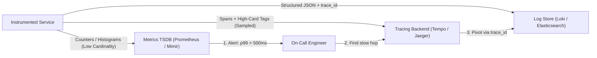
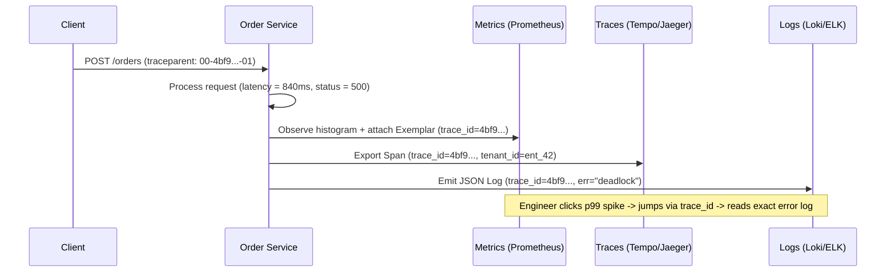
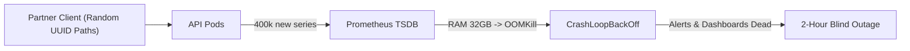

# Observability vs Monitoring: Logs, Metrics, Traces & Cardinality

> **Prerequisites:** [Lesson 20: Software Supply Chain Security](../../13-security/20-software-supply-chain-security/README.md).  
> **Estimated Reading Time:** 24–28 minutes  
> **Target Audience:** Backend and platform engineers designing telemetry pipelines, and candidates asked "how do you debug a slow microservice when all dashboards are green?"  
> **Free PDF Notes:** [Download P5-SD-N-001.pdf](https://backendroadmap.com/notes/system-design/P5-SD-N-001.pdf)

> [!NOTE]
> **In one line:** **Monitoring** answers *known* failure modes ("is CPU > 80% or 5xx > 1%?") using pre-aggregated thresholds; **Observability** is the property of a system that lets you ask arbitrary, *unknown* questions about its internal state ("why are p99 latencies 4x higher only for EU tenants on shard-07 after deploy v42?") from external telemetry—**logs, metrics, and traces**—without shipping new code.

> [!TIP]
> **The Golden Rule:** Use **metrics** to detect that something is wrong (cheap, constant-space, alertable), **traces** to pinpoint *which* service or hop is slow, and **structured logs** (correlated by `trace_id`) to explain *why* it failed. Never put unbounded high-cardinality IDs (`user_id`, `request_id`) into metric labels.

---

## 1. What Observability vs Monitoring Is, and What It Isn't

At 02:14 UTC, checkout p99 latency jumps from 140 ms to 3,800 ms. Your monitoring dashboard—CPU, memory, disk I/O, HTTP 5xx rate—is completely green. Only 0.4% of requests are affected, so the global error budget alert has not fired, yet enterprise customers in `eu-central-1` are timing out. **Monitoring** told you the cluster is healthy; **observability** lets you slice live telemetry by `region`, `tenant_tier`, `db_shard`, and `git_sha` to discover that a connection-pool leak only triggers on `tenant_tier=enterprise` hitting `shard-07`.

| Term | Precise Meaning | Example |
| :--- | :--- | :--- |
| **Monitoring** | Checking known failure modes against pre-defined thresholds and dashboards | Alert if `http_5xx_rate > 1%` for 5 minutes |
| **Observability** | System property enabling root-cause discovery for *unknown unknowns* from external outputs | Slicing latency by `(region, tenant_id, build_sha)` without redeploying |
| **Metric** | Numeric measurement aggregated over a time window; constant storage per series | `http_request_duration_seconds_bucket{route="/pay"}` |
| **Log** | Immutable, timestamped record of a discrete event (ideally structured JSON) | `{"ts":"...","level":"error","trace_id":"abc","err":"timeout"}` |
| **Trace** | Directed acyclic graph (DAG) of **spans** representing one request across services | `API Gateway -> Auth (12ms) -> Ledger (3400ms)` |
| **Cardinality** | Number of unique combinations of label/tag values in a metric or index | `status(5) * method(4) * route(20) = 400` series |
| **High-cardinality** | Dimensions with thousands to billions of distinct values | `user_id`, `request_id`, `ip_address`, `order_id` |
| **Not** | Buying three separate SaaS tools or dumping `printf` strings to stdout | Uncorrelated telemetry still leaves you blind |

### Why It Matters
1. **Microservices turn single-node bugs into distributed mysteries:** A slow downstream lock or retry storm rarely shows up as high CPU on the caller.
2. **Cost scales with cardinality and volume, not linearly with traffic:** A single unbounded label on one metric can bankrupt a TSDB or OOM-kill Prometheus overnight.
3. **Interviewers test signal selection:** Strong candidates explain *which* signal (metric, trace, log) answers *which* question, and how to bound cost at scale.

---

## 2. Anatomy: The Three Pillars & Cardinality Boundary



The three pillars are not interchangeable; they sit at opposite points on the **cost vs. context** curve.

| Dimension | Metrics | Traces | Logs |
| :--- | :--- | :--- | :--- |
| **Primary Question** | *Is* something broken, and *how widespread* is it? | *Where* in the call graph did time or errors happen? | *Why* did this specific execution fail? |
| **Aggregation** | Pre-aggregated in memory / scrape interval | Per-request DAG of spans (usually sampled) | Raw discrete events (often filtered or sampled) |
| **Cardinality Limit** | Strict low cardinality ($< 10^4$ series/metric) | High cardinality allowed on span attributes | Arbitrary high cardinality (`user_id`, stack traces) |
| **Storage Cost / Req** | $O(1)$ per active series, independent of QPS | $O(\text{sample\_rate} \times \text{spans\_per\_req})$ | $O(\text{QPS} \times \text{events\_per\_req} \times \text{bytes})$ |
| **Retention** | Months to years (downsampled) | Days to weeks | Days to months (hot/cold tiers) |

> [!WARNING]
> **The #1 Observability Trap: High-Cardinality Metric Labels.** Adding `user_id` or `request_id` as a Prometheus/Datadog metric label explodes the number of active time series from hundreds to millions. Every unique label combination creates a new time series in memory, indexes, and WAL—crashing your TSDB and spiking your observability bill by 100x. Put `user_id` in **traces** and **logs**, never in **metric labels**.

---

## 3. Mathematical Model: Cardinality Explosion & Telemetry Cost

**Metric Cardinality ($C$).** If a metric has $k$ labels and label $i$ has $d_i$ distinct values, the worst-case number of active time series is the Cartesian product:

$$C = \prod_{i=1}^{k} d_i$$

For a Prometheus TSDB scraping every $\Delta t$ seconds, where each sample costs $b_{\text{sample}} \approx 1.5\text{–}2\text{ bytes}$ compressed on disk and each active series consumes $m_{\text{series}} \approx 3\text{–}8\text{ KB}$ of head-block RAM:

$$\text{RAM}_{\text{head}} = C \times m_{\text{series}}, \qquad \text{Samples/sec} = \frac{C}{\Delta t}$$

**Worked Numerical Example.** Suppose an API service exposes `http_requests_total` with labels `method` (4), `status` (6), `route` (25), `pod` (50):

$$C_{\text{safe}} = 4 \times 6 \times 25 \times 50 = 30{,}000 \text{ series}$$

At $\Delta t = 15\text{ s}$ and $m_{\text{series}} = 4\text{ KB}$, this single metric uses $30{,}000 \times 4\text{ KB} = 120\text{ MB}$ of TSDB RAM and $2{,}000\text{ samples/s}$.

Now an engineer "temporarily" adds `tenant_id` with $10{,}000$ active tenants:

$$C_{\text{exploded}} = 30{,}000 \times 10{,}000 = 300{,}000{,}000 \text{ series}$$

Head-block RAM jumps to $300{,}000{,}000 \times 4\text{ KB} = 1.2\text{ TB}$ and ingestion spikes to $20{,}000{,}000\text{ samples/s}$—an instant OOM kill.

**Log Ingestion Volume ($V_{\text{logs}}$).** For QPS $Q$, average log lines per request $L$, and average JSON event size $S_{\text{bytes}}$:

$$V_{\text{logs/day}} = Q \times L \times S_{\text{bytes}} \times 86{,}400$$

At $Q = 5{,}000\text{ req/s}$, $L = 6\text{ lines/req}$, $S_{\text{bytes}} = 600\text{ B}$:

$$V_{\text{logs/day}} = 5{,}000 \times 6 \times 600 \times 86{,}400 = 1.555 \times 10^{12}\text{ B} \approx 1.56\text{ TB/day}$$

---

## 4. Metrics & Percentiles

| Metric | Meaning | Alert when |
| :--- | :--- | :--- |
| **Active time series count** | Total unique label combinations in TSDB head | Sudden step jump $> 20\%$ after a deploy |
| **TSDB ingestion rate** | Samples/sec written across all targets | Approaching 70% of collector/TSDB memory ceiling |
| **Log volume (GB/min)** | Raw bytes shipped by log agents | Unexplained spike (e.g., `DEBUG` left on in prod) |
| **Trace drop rate** | Spans discarded by SDK/Collector queues | $> 1\%$ dropped on tail-sampled error paths |
| **Telemetry pipeline lag** | Time from event emission to queryability | $> 60\text{ s}$ (blinds incident responders) |
| **Exemplar hit rate** | Histogram buckets linked to a live `trace_id` | Missing exemplars on SLO-critical routes |

### Worked Example (Telemetry Budget for a 10,000 RPS Platform)
A platform runs 10,000 req/s across 8 microservices (average 5 spans/request, 1 KB/span; 4 info logs/request, 500 B/log).
- **100% raw logs:** $10{,}000 \times 4 \times 500\text{ B} = 20\text{ MB/s} = 1.73\text{ TB/day}$.
- **100% raw traces:** $10{,}000 \times 5 \times 1\text{ KB} = 50\text{ MB/s} = 4.32\text{ TB/day}$.
- **With observability design:** Keep 100% of **metrics** (150k series $\approx$ 10k samples/s $\approx$ 1.7 GB/day), **tail-sample traces** (100% of errors + slow $> 500\text{ ms}$, 1% of healthy $\approx$ 130 GB/day), and **log** only errors/warnings + 5% sampled info access logs ($\approx$ 120 GB/day). Total storage drops from **6.05 TB/day** to **252 GB/day** (24x reduction) with zero loss of failure visibility.

---

## 5. Compounding & Failure Modes

Telemetry systems fail in two ways: **cardinality explosions** that crash the backend, and **observability blind spots** during incidents.

| Failure Mode | Trigger | Compounding Effect |
| :--- | :--- | :--- |
| **Cardinality Bomb** | Unnormalized URL (`/users/12345`) or `user_id` in metric label | Scrape timeouts $\to$ collector OOM $\to$ blind during outage |
| **Retry-Induced Log Storm** | Downstream DB hangs; 50 pods log stack trace every 100 ms | Log volume spikes 30x $\to$ Fluent Bit drops logs $\to$ root cause lost |
| **Mean vs Tail Blindness** | Monitoring averages (`avg(latency)`) instead of `p99` | 1% of users wait 10 s; average moves from 40 ms to 139 ms; no alert |
| **Missing Context Propagation** | `traceparent` header dropped at async queue boundary | Traces split into disconnected fragments; cannot follow request |
| **Observability Coupling** | Synchronous log/trace HTTP export in request path | Telemetry backend outage stalls production API threads |

---

## 6. Numbers Every Engineer Must Know

| Item | Typical | Implication |
| :--- | :---: | :--- |
| Safe Prometheus series per instance | $100\text{k}\text{–}2\text{M}$ (with sizing) | Shard or use Mimir/Thanos beyond single-node limits |
| Memory per active Prometheus series | $3\text{–}8\text{ KB}$ | 1M series $\approx 4\text{–}8\text{ GB}$ RAM just for head block |
| Compressed sample size on disk | $1.3\text{–}2.0\text{ bytes}$ | Long retention is cheap if cardinality is bounded |
| Typical scrape interval | $15\text{ s}\text{–}60\text{ s}$ | Sub-second spikes are smoothed out in metrics |
| Healthy head-sampling rate (high QPS) | $0.1\%\text{–}5\%$ | Use tail sampling to keep 100% of errors/slow traces |
| Structured JSON log overhead | $2\text{–}4\times$ plaintext | Worth it for indexed querying; compress in transit |
| Telemetry CPU/RAM overhead budget | $< 3\%\text{–}5\%$ of service | Async batching + bounded ring buffers prevent OOM |

---

## 7. Mechanism Deep Dive: Signal Correlation & Exemplars



| Question | Answer |
| :--- | :--- |
| **How do metrics link to traces without high cardinality?** | **Exemplars**: a histogram stores one recent `trace_id` per bucket without creating a new time series. |
| **Where should `tenant_id` or `user_id` live?** | As **span attributes** in traces and **fields** in structured logs—never as metric labels. |
| **What if a metric alert fires but traces are sampled at 1%?** | Use **tail-based sampling** in the Collector so 100% of error and high-latency traces are retained. |
| **Why not just log everything and derive metrics from logs?** | Logs cost $10\text{–}50\times$ more per GB to ingest, index, and scan than pre-aggregated metrics. |

**When not to over-instrument:** A single monolith with 50 RPS and one Postgres database does not need a 3-tier distributed tracing mesh and Kafka log pipeline. Start with structured JSON logs, RED metrics, and a single-node collector; add distributed tracing when requests cross process or async boundaries.

---

## 8. Hierarchical Budgets & Design Rules

| Slice | Rule | Control |
| :--- | :--- | :--- |
| **Metric Labels** | Bounded enums only (`status_class`, `route_template`, `method`) | CI/lint check + relabel drop rules in Collector |
| **URL Normalization** | Always use route templates (`/users/:id`), never raw paths | Framework middleware + fallback `unmatched` bucket |
| **Telemetry I/O** | Strictly asynchronous with bounded drop-oldest queues | Never block request threads on telemetry export |
| **Log Levels** | `ERROR`/`WARN` always; `INFO` for lifecycle/sampled; `DEBUG` off in prod | Dynamic log-level endpoint or sampling filter |
| **Trace Propagation** | Propagate W3C `traceparent` across HTTP, gRPC, and broker headers | Shared SDK middleware + contract tests |
| **Alerting** | Page only on user-facing symptoms (SLO burn rate, 5xx, p99) | Route cause-only metrics to dashboards, not PagerDuty |

---

## 9. Top Mitigations

1. **Enforce strict label allowlists** on every metric; strip or hash dynamic path segments before recording.
2. **Use Exemplars** to bridge low-cardinality Prometheus histograms to high-cardinality traces.
3. **Always emit `trace_id` and `span_id`** in every structured JSON log line so logs and traces join in one click.
4. **Never block application requests** on log/trace/metric delivery—use bounded async queues that drop telemetry under backpressure.
5. **Apply tail sampling** at the Collector layer to keep 100% of errors and slow requests while sampling healthy traffic at 1%.
6. **Set cardinality circuit breakers** (e.g., `sample_limit` in Prometheus, series-per-metric caps in Collector).
7. **Alert on symptoms, debug with causes**: page on SLO burn rate, not raw CPU spikes.

---

## 10. Production Reference / War Story: The Unbounded `path` Label Outage

A fintech payments API deployed a custom HTTP metrics middleware that recorded `http_request_duration_seconds{path=req.URL.Path}`. Everything looked fine in staging. In production, a partner's misconfigured webhook client began sending `GET /v1/webhooks/verify?token=<random-uuid>` and hitting 404 routes like `/v1/orders/<order_uuid>/receipt`. Within 18 minutes:



- **Root Cause:** Raw `req.URL.Path` (unbounded cardinality) was used as a metric label instead of the matched router pattern (`/v1/orders/{id}/receipt`). Prometheus head-block memory grew to 32 GB and OOM-killed repeatedly, blinding on-call during a simultaneous database failover.
- **Fix:** (1) Switched middleware to use the router's matched template (`route="/v1/orders/{id}/receipt"`), collapsing all unmatched 404s into `route="unmatched"`; (2) Added `sample_limit: 50000` per scrape target in Prometheus so a rogue service fails its own scrape instead of killing the TSDB; (3) Moved exact raw URLs into structured access logs and trace span attributes.

---

## 11. Multi-Language Production Code Tabs

A production-safe telemetry emitter that enforces **low-cardinality route normalization** for metrics while preserving **high-cardinality attributes (`user_id`, `trace_id`)** for logs and traces.

````carousel
```go
// Go: Normalize raw URL paths before recording metrics; keep high-cardinality IDs in structured logs.
package main

import (
	"encoding/json"
	"os"
	"regexp"
	"sync"
	"time"
)

var uuidOrNum = regexp.MustCompile(`/[0-9a-fA-F-]{8,}|/\d+`)

func NormalizeRoute(rawPath string) string {
	return uuidOrNum.ReplaceAllString(rawPath, "/:id")
}

type Telemetry struct {
	mu      sync.Mutex
	metrics map[string]int64
}

func NewTelemetry() *Telemetry {
	return &Telemetry{metrics: make(map[string]int64)}
}

func (t *Telemetry) RecordRequest(rawPath, statusClass, userID, traceID string, latencyMs float64) {
	route := NormalizeRoute(rawPath) // Low cardinality: /orders/:id
	key := route + "|" + statusClass

	t.mu.Lock()
	t.metrics[key]++
	t.mu.Unlock()

	// High cardinality lives in structured JSON logs, correlated by trace_id
	_ = json.NewEncoder(os.Stdout).Encode(map[string]any{
		"ts":         time.Now().UTC().Format(time.RFC3339Nano),
		"level":      "info",
		"route":      route,
		"raw_path":   rawPath,
		"user_id":    userID,
		"trace_id":   traceID,
		"latency_ms": latencyMs,
	})
}

func main() {
	tel := NewTelemetry()
	tel.RecordRequest("/orders/98412/items", "2xx", "usr_42", "4bf92f3577b34da6", 42.5)
}
```
<!-- slide -->
```typescript
// TypeScript: Low-cardinality metric key + high-cardinality structured log with trace_id.
const ID_SEGMENT = /\/([0-9a-fA-F-]{8,}|\d+)/g;

export function normalizeRoute(rawPath: string): string {
  return rawPath.replace(ID_SEGMENT, "/:id");
}

export class TelemetryEmitter {
  private readonly counters = new Map<string, number>();

  recordRequest(
    rawPath: string,
    statusClass: "2xx" | "4xx" | "5xx",
    userId: string,
    traceId: string,
    latencyMs: number
  ): void {
    const route = normalizeRoute(rawPath);
    const metricKey = `${route}|${statusClass}`;
    this.counters.set(metricKey, (this.counters.get(metricKey) ?? 0) + 1);

    // High-cardinality fields stay in logs/spans, never in metric keys
    console.log(
      JSON.stringify({
        ts: new Date().toISOString(),
        level: statusClass === "5xx" ? "error" : "info",
        route,
        raw_path: rawPath,
        user_id: userId,
        trace_id: traceId,
        latency_ms: latencyMs,
      })
    );
  }
}
```
<!-- slide -->
```python
# Python: Cardinality calculator + safe telemetry emitter (stdlib only).
import json
import math
import re
from collections import Counter
from datetime import datetime, timezone

ID_RE = re.compile(r"/([0-9a-fA-F-]{8,}|\d+)")


def normalize_route(raw_path: str) -> str:
    return ID_RE.sub("/:id", raw_path)


def estimate_cardinality(label_domains: dict[str, int], ram_per_series_kb: float = 4.0) -> dict[str, float]:
    series = math.prod(label_domains.values())
    ram_mb = (series * ram_per_series_kb) / 1024.0
    return {"active_series": series, "head_ram_mb": round(ram_mb, 2)}


class TelemetryEmitter:
    def __init__(self) -> None:
        self.counters: Counter[tuple[str, str]] = Counter()

    def record_request(self, raw_path: str, status_class: str, user_id: str, trace_id: str, latency_ms: float) -> None:
        route = normalize_route(raw_path)
        self.counters[(route, status_class)] += 1  # Bounded metric key
        print(json.dumps({
            "ts": datetime.now(timezone.utc).isoformat(),
            "level": "error" if status_class == "5xx" else "info",
            "route": route,
            "raw_path": raw_path,
            "user_id": user_id,
            "trace_id": trace_id,
            "latency_ms": latency_ms,
        }))
```
<!-- slide -->
```csharp
// C#: Low-cardinality metric key + high-cardinality structured JSON log.
using System.Collections.Concurrent;
using System.Text.Json;
using System.Text.RegularExpressions;

public sealed class TelemetryEmitter
{
    private static readonly Regex IdPattern = new(@"/([0-9a-fA-F-]{8,}|\d+)", RegexOptions.Compiled);
    private readonly ConcurrentDictionary<string, long> _counters = new();

    public static string NormalizeRoute(string rawPath) => IdPattern.Replace(rawPath, "/:id");

    public void RecordRequest(string rawPath, string statusClass, string userId, string traceId, double latencyMs)
    {
        var route = NormalizeRoute(rawPath);
        _counters.AddOrUpdate($"{route}|{statusClass}", 1, (_, v) => v + 1);

        var logEvent = new
        {
            ts = DateTimeOffset.UtcNow,
            level = statusClass == "5xx" ? "error" : "info",
            route,
            raw_path = rawPath,
            user_id = userId,
            trace_id = traceId,
            latency_ms = latencyMs
        };
        Console.WriteLine(JsonSerializer.Serialize(logEvent));
    }
}
```
````

---

## 12. Hands-On CLI Verification Workflows

Verify cardinality math in Python 3:

```bash
python3 -c '
import math
safe = {"method": 4, "status": 6, "route": 25, "pod": 50}
exploded = {**safe, "tenant_id": 10000}
print("Safe series:", math.prod(safe.values()), "RAM MB:", math.prod(safe.values()) * 4 / 1024)
print("Exploded series:", math.prod(exploded.values()), "RAM GB:", math.prod(exploded.values()) * 4 / 1024 / 1024)
'
```

Inspect live Prometheus cardinality and top offending metrics:

```bash
# Query Prometheus TSDB status for highest-cardinality metrics
curl -s http://localhost:9090/api/v1/status/tsdb | jq '.data.seriesCountByMetricName[:10]'

# Count total active time series in Prometheus
curl -s 'http://localhost:9090/api/v1/query?query=prometheus_tsdb_head_series' | jq '.data.result[0].value[1]'

# Check Collector dropped spans/logs (OpenTelemetry Collector internal metrics)
curl -s http://localhost:8888/metrics | grep -E 'otelcol_exporter_send_failed|otelcol_processor_dropped'
```

---

## 13. Common Mistakes to Avoid

1. **Treating monitoring and observability as synonyms**—dashboards only catch the failures you anticipated.
2. **Putting `user_id`, `request_id`, or raw URLs in metric labels**, causing TSDB OOMs.
3. **Logging unstructured plaintext** that breaks regex parsers on multiline stack traces.
4. **Dropping `trace_id` across async queues** (Kafka/SQS), severing end-to-end visibility.
5. **Alerting on averages (`avg`) instead of `p95`/`p99`**, hiding tail-latency outages.
6. **Synchronous telemetry exports** in the request path, turning collector hiccups into API outages.
7. **Keeping `DEBUG` logs enabled in production**, burning storage and I/O budgets.
8. **100% head sampling at 1% without tail sampling**, throwing away 99% of your rarest error traces.

---

## 14. Key Terms Glossary

| Key Term | Definition |
| :--- | :--- |
| **Monitoring** | Checking known failure modes using pre-defined thresholds, alerts, and dashboards. |
| **Observability** | System property allowing diagnosis of unknown unknowns from external telemetry. |
| **Metric** | Numeric time-series measurement aggregated over intervals (counter, gauge, histogram). |
| **Structured Log** | Immutable, timestamped event record formatted as machine-parseable JSON. |
| **Distributed Trace** | Causal DAG of spans tracking a single request across service and queue boundaries. |
| **Span** | A single timed operation within a trace, carrying attributes, events, and parent ID. |
| **Cardinality** | Count of unique label-value combinations; drives TSDB RAM and index cost. |
| **Exemplar** | A specific `trace_id` attached to a metric histogram bucket for one-click drill-down. |
| **Head Sampling** | Making the keep/drop trace decision at the root span before the outcome is known. |
| **Tail Sampling** | Making the keep/drop decision after the full trace completes (keeping errors/slowness). |
| **Unknown Unknowns** | Novel failure modes you did not predict when writing alerts or dashboards. |

---

## 15. System Design Interview Questions & Answers

### Basic Conceptual Questions

<details>
<summary><strong>Q1: What is the difference between monitoring and observability? [BASIC]</strong></summary>

**Answer:**
Monitoring tracks *known* failure modes using predefined thresholds and dashboards ("is 5xx > 1%?"). Observability is a property of the system that lets engineers investigate *unknown* failure modes by slicing and correlating high-dimensional telemetry (metrics, traces, logs) without deploying new code.
</details>

<details>
<summary><strong>Q2: When do you use metrics vs traces vs logs? [BASIC]</strong></summary>

**Answer:**
Use **metrics** for cheap, continuous alerting and trend detection ("what is p99 latency?"). Use **traces** to locate which service, DB call, or hop caused latency or errors in a distributed request. Use **structured logs** (joined by `trace_id`) to inspect exact payloads, error messages, and stack traces.
</details>

<details>
<summary><strong>Q3: What is metric cardinality, and why is it dangerous? [BASIC]</strong></summary>

**Answer:**
Cardinality is the number of unique label-value combinations for a metric (the Cartesian product of all label domains). High-cardinality labels like `user_id` or raw URLs create millions of active time series in memory, causing TSDB OOM crashes and massive cost spikes.
</details>

<details>
<summary><strong>Q4: What is an Exemplar? [BASIC]</strong></summary>

**Answer:**
An Exemplar is a reference (typically a `trace_id` and `span_id`) attached to a metric sample or histogram bucket. It lets an engineer click a p99 latency spike on a Grafana dashboard and jump directly to an actual slow trace without polluting metric labels with high-cardinality IDs.
</details>

### Scenario-Based Architecture Questions

<details>
<summary><strong>Q5: Your dashboards are all green, yet enterprise users report 5-second timeouts. How do you debug this? [SCENARIO]</strong></summary>

**Answer:**
Global averages or even global p99 can mask a small segment (e.g., 0.5% of traffic). Slice latency by `tenant_tier`, `region`, and `build_sha` in traces/logs, or inspect Exemplars on the upper histogram buckets (`> 2s`). Once a slow trace is found, inspect its span waterfall to isolate the slow dependency and pivot via `trace_id` to error/debug logs.
</details>

<details>
<summary><strong>Q6: You need to observe a 20,000 RPS microservice architecture without spending more on observability than compute. How do you budget telemetry? [SCENARIO]</strong></summary>

**Answer:**
Keep 100% of low-cardinality RED/USE metrics (fixed cost regardless of RPS). Use tail-based sampling for traces: retain 100% of error and slow (`> SLO`) traces and 1% of healthy traces. For logs, emit 100% of `WARN`/`ERROR`, drop `DEBUG`, and sample `INFO` access logs at 1–5% while retaining full `trace_id` correlation.
</details>

<details>
<summary><strong>Q7: A developer added `customer_id` to `http_requests_total` and Prometheus is OOM-crashing. What are your immediate and long-term fixes? [SCENARIO]</strong></summary>

**Answer:**
Immediate: add a `metric_relabel_configs` rule in Prometheus/Collector to drop the `customer_id` label (or drop the metric) and set `sample_limit` per scrape target. Long-term: move `customer_id` to trace span attributes and structured JSON logs, and add CI linting/admission checks on metric label schemas.
</details>

<details>
<summary><strong>Q8: How do you ensure telemetry never takes down production traffic? [SCENARIO]</strong></summary>

**Answer:**
Export telemetry asynchronously via a local agent/Collector sidecar using bounded in-memory ring buffers. Configure non-blocking "drop oldest/newest" backpressure when buffers fill, enforce strict export timeouts, and isolate telemetry transport from application worker threads.
</details>

### Advanced & Tricky Interview Questions

<details>
<summary><strong>Q9: Why can't you just derive all metrics from logs and skip a TSDB? [TRICKY]</strong></summary>

**Answer:**
At 10,000+ RPS, shipping, indexing, and scanning raw logs for every request costs 10–50x more than pre-aggregating counters/histograms in memory. Furthermore, log pipelines lag under heavy load (retry storms), meaning your alerts would fail precisely when you need them most.
</details>

<details>
<summary><strong>Q10: How do you maintain observability across asynchronous Kafka/SQS pipelines? [TRICKY]</strong></summary>

**Answer:**
Inject the W3C `traceparent` header into message headers at publish time (stored in the transactional outbox if used), and extract it at the consumer to create a child or `FollowsFrom` span link. Include `trace_id` and `message_id` in all consumer logs and measure consumer lag + message age as metrics.
</details>

<details>
<summary><strong>Q11: What is the difference between a wide event (canonical log line) and traditional per-step logging? [TRICKY]</strong></summary>

**Answer:**
Instead of emitting 10 fragmented log lines per request, a service accumulates context (`user_id`, `tenant_id`, `db_ms`, `cache_hit`, `err`) on the request/span context and emits one rich, structured JSON "wide event" at the end of the request. It cuts log volume by 5–10x and makes arbitrary multi-dimensional filtering trivial.
</details>

<details>
<summary><strong>Q12: Why does Prometheus scrape (`pull`) instead of services pushing metrics, and how does that affect cardinality? [TRICKY]</strong></summary>

**Answer:**
Pulling gives Prometheus natural backpressure, health detection (`up` metric), and centralized `sample_limit` enforcement per target. However, ephemeral batch jobs need a Pushgateway or OTel Collector, and unbounded labels still crash Prometheus unless relabel/sample limits are enforced.
</details>

---

## 16. One-Page Master Cheat Sheet

```
+---------------------------------------------------------------------------------------------------------+
|                    OBSERVABILITY VS MONITORING — MASTER CHEAT SHEET                                     |
+---------------------------------------------------------------------------------------------------------+
| 1. MONITORING = known unknowns (thresholds, alerts). OBSERVABILITY = unknown unknowns (slice/dice).     |
+---------------------------------------------------------------------------------------------------------+
| 2. THREE PILLARS:                                                                                       |
|    - Metrics: O(1) cost, low cardinality (<10k series/metric) -> Detect & Alert.                        |
|    - Traces:  DAG of spans, sampled (tail-sample errors/slow) -> Localize slow hop.                     |
|    - Logs:    Structured JSON + trace_id, high cardinality    -> Explain exact root cause.              |
+---------------------------------------------------------------------------------------------------------+
| 3. CARDINALITY MATH: C = prod(d_i). 1M series ~= 4-8 GB TSDB RAM. Never put user_id/raw URL in labels!  |
+---------------------------------------------------------------------------------------------------------+
| 4. CORRELATION: Metrics -> Exemplar (trace_id) -> Trace waterfall -> JSON Logs (trace_id).              |
+---------------------------------------------------------------------------------------------------------+
| 5. SAFETY: Async non-blocking export, bounded queues, sample_limit, route templates (/users/:id).       |
+---------------------------------------------------------------------------------------------------------+
```

---

## Further Reading & Sources

- Charity Majors, Liz Fong-Jones, and George Miranda, *Observability Engineering* (O'Reilly, 2022).
- Betsy Beyer et al., *Site Reliability Engineering* (Google SRE Book), Chapter 6: "Monitoring Distributed Systems".
- Prometheus Documentation, [Metric and Label Naming & Cardinality Best Practices](https://prometheus.io/docs/practices/naming/).
- Cindy Sridharan, *Distributed Systems Observability* (O'Reilly, 2018).

---

## Free PDF Notes

[P5-SD-N-001.pdf](https://backendroadmap.com/notes/system-design/P5-SD-N-001.pdf)

---

## Next

Continue with [Lesson 02: Structured Logging: JSON Logs, Levels, Context & What Never to Log](../02-structured-logging/README.md).
