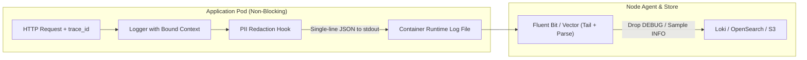
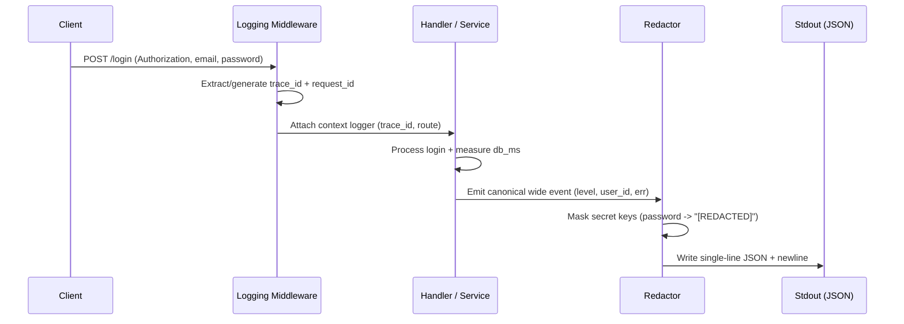
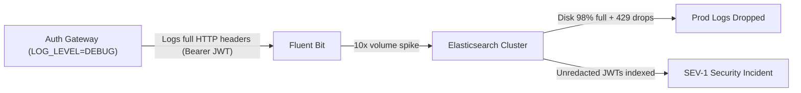

# Structured Logging: JSON Logs, Levels, Context & What Never to Log

> **Prerequisites:** [Lesson 01: Observability vs Monitoring: Logs, Metrics, Traces & Cardinality](../01-observability-vs-monitoring/README.md).  
> **Estimated Reading Time:** 22–26 minutes  
> **Target Audience:** Backend engineers designing production logging pipelines, and candidates asked "how do you make logs searchable at 50,000 events/sec without leaking PII or blowing up disk?"  
> **Free PDF Notes:** [Download P5-SD-N-002.pdf](https://backendroadmap.com/notes/system-design/P5-SD-N-002.pdf)

> [!NOTE]
> **In one line:** **Structured logging** emits machine-parseable key-value records (typically single-line JSON) with consistent schema, correlation IDs (`trace_id`, `request_id`), and strict PII redaction—turning `grep` guesswork into fast indexed queries while bounding storage and compliance risk.

> [!TIP]
> **The Golden Rule:** Log **events, not prose**, once per significant boundary (or as a single canonical **wide event** per request), always include `trace_id`, and **never** log secrets, tokens, or unredacted PII.

---

## 1. What Structured Logging Is, and What It Isn't

Consider a classic plaintext log line:
`2026-11-25 02:14:09 ERROR Payment failed for user 88412 amount 49.99: timeout`

When 40 pods interleave multiline Java/Python stack traces onto stdout, regex parsers break, alerts miss half the errors, and querying "all timeouts for `merchant_id=m_99` over $100" is nearly impossible. Structured logging emits a single atomic JSON object per event:
`{"ts":"2026-11-25T02:14:09.112Z","level":"error","event":"payment_failed","user_id":"usr_88412","amount_cents":4999,"trace_id":"4bf92f...","err":"upstream_timeout"}`

| Term | Precise Meaning | Example |
| :--- | :--- | :--- |
| **Structured log** | Single-line machine-parseable record (JSON / logfmt) with typed fields | `{"ts":"...","level":"info","duration_ms":42}` |
| **Canonical log line (wide event)** | One rich JSON event emitted at request completion summarizing all context | Includes `route`, `status`, `user_id`, `db_ms`, `trace_id` |
| **Log level** | Severity filter controlling emission and retention (`ERROR`, `WARN`, `INFO`, `DEBUG`) | `DEBUG` disabled in prod; `ERROR` always kept |
| **Correlation context** | Request-scoped fields (`trace_id`, `span_id`, `request_id`) attached to every log | Propagated via `context.Context` / `AsyncLocalStorage` |
| **PII / Secret redaction** | Scrubbing sensitive fields before serialization or at the collector | Masking `Authorization`, `ssn`, `card_number`, `email` |
| **Log shipping pipeline** | Non-blocking stdout $\to$ node agent (Fluent Bit/Vector) $\to$ Log store (Loki/ES) | Decouples app threads from network I/O |
| **Not** | `console.log("User " + id + " failed")` or pretty-printed multi-line JSON | Multi-line JSON splits into broken fragments |

### Why It Matters
1. **Incident speed:** Indexed JSON fields let you filter 10 TB of logs in seconds instead of writing fragile regexes under pressure.
2. **Compliance & security:** A single unredacted `Authorization: Bearer ...` or credit card number in logs becomes a GDPR/PCI-DSS breach replicated across backups.
3. **Cost control:** Logging is often the #1 or #2 line item in cloud observability bills; wide events + level discipline cut volume by 5–10x.

---

## 2. Anatomy: Plaintext vs Structured Pipeline



| Aspect | Unstructured Plaintext | Structured JSON (Wide Events) |
| :--- | :--- | :--- |
| **Parsing** | Fragile regex; breaks on newlines/commas | Zero-regex native JSON parsing |
| **Multi-line Stack Traces** | Split into separate unrelated log lines | Contained inside `"stack": "..."` string field |
| **Querying** | Full-text substring scan | Indexed field filters (`status >= 500 AND db_ms > 200`) |
| **Schema Drift** | Silent formatting inconsistencies | Enforced keys (`ts`, `level`, `service`, `trace_id`) |
| **Byte Overhead** | Smaller per line (~120 B) | Larger per line (~400–700 B), but far fewer lines needed |

> [!WARNING]
> **Never write logs directly over the network from application request threads.** If Elasticsearch or a SaaS log endpoint stalls, synchronous HTTP log appenders will exhaust your thread pool and take down production. Always write single-line JSON to `stdout` (or a local ring buffer) and let an out-of-process daemon (`Fluent Bit`, `Vector`, `OTel Collector`) tail, buffer, and ship asynchronously.

---

## 3. Mathematical Model: Log Volume, Indexing Cost & Sampling

**Daily Log Volume ($V_{\text{day}}$).** For request rate $Q$ (req/s), average log lines per request $L$, and average JSON event size $S$ (bytes):

$$V_{\text{day}} = Q \times L \times S \times 86{,}400$$

**Compression & Retention Storage ($D_{\text{total}}$).** With gzip/zstd compression ratio $r_c$ (typically $5\text{–}8\times$ for repetitive JSON keys), replication factor $R$, and retention $D$ days:

$$D_{\text{total}} = \frac{V_{\text{day}}}{r_c} \times R \times D$$

**Worked Numerical Example.** A service handles $Q = 4{,}000\text{ req/s}$.
- **Before (chatty per-step logging):** $L = 12\text{ lines/req}$, $S = 450\text{ B}$:
  $$V_{\text{day, chatty}} = 4{,}000 \times 12 \times 450 \times 86{,}400 = 1.866\text{ TB/day}$$
  With $r_c = 6$, $R = 2$, $D = 30\text{ days}$:
  $$D_{\text{total, chatty}} = \frac{1.866}{6} \times 2 \times 30 = 18.66\text{ TB}$$
- **After (1 canonical wide event + error-only details + 10% info sampling):** $L_{\text{eff}} = 0.10\text{ (sampled info)} + 0.01\text{ (1\% errors)} = 0.11\text{ lines/req}$, $S = 700\text{ B}$:
  $$V_{\text{day, wide}} = 4{,}000 \times 0.11 \times 700 \times 86{,}400 = 26.61\text{ GB/day}$$
  Storage drops from **1.87 TB/day** to **26.6 GB/day** (70x reduction) while actually *increasing* per-request diagnostic richness.

---

## 4. Metrics & Percentiles

| Metric | Meaning | Alert when |
| :--- | :--- | :--- |
| **Log bytes/sec per service** | Raw stdout emission rate | $> 2\times$ baseline (often `DEBUG` left enabled or error loop) |
| **Agent dropped records/sec** | Lines dropped by Fluent Bit/Vector due to backpressure | $> 0$ sustained for $> 2\text{ min}$ |
| **Log ingestion lag** | `ingest_ts - event_ts` | $> 30\text{ s}$ (delays incident triage) |
| **Unparsed / non-JSON line rate** | Lines failing JSON schema validation | $> 1\%$ (new library printing raw stdout) |
| **PII / secret scanner hits** | Collector regex matches for tokens/cards/emails | $> 0$ (page security/owner immediately) |
| **Field explosion count** | Distinct dynamic keys in JSON objects (e.g., ES mapping) | Approaching index field limit (default 1,000 in ES) |

### Worked Example (Mapping Explosion in Elasticsearch)
An engineer logs a raw user-supplied JSON payload under `"payload": { "<arbitrary_key>": ... }` instead of stringifying it or whitelisting fields. Within 4 hours, 1,200 distinct dynamic keys are created, hitting Elasticsearch's `index.mapping.total_fields.limit` (1,000). New log documents are **silently rejected** with `400 Bad Request`—blinding every service sharing that index.

---

## 5. Compounding & Failure Modes

| Failure Mode | Trigger | Compounding Effect |
| :--- | :--- | :--- |
| **Error-Loop Disk Fill** | DB fails $\to$ tight retry loop logs 2 KB stack trace 1,000x/sec | Node `/var/log` fills $\to$ kubelet evicts pods $\to$ cascading outage |
| **Dynamic Key Explosion** | Logging `map[string]any` with user IDs or timestamps as JSON *keys* | Search index mapping limit exceeded $\to$ all logs dropped |
| **PII Leakage** | Logging full HTTP `req.headers` or `req.body` | `Authorization` JWTs & passwords indexed in plain text |
| **Pretty-Print Corruption** | `JSON.stringify(obj, null, 2)` in production | 1 event becomes 15 lines; agent treats each line as broken log |
| **Log-Level Drift** | Everything logged as `ERROR` (including expected 404s/validation) | Alert fatigue; real `ERROR`s buried in noise |

---

## 6. Numbers Every Engineer Must Know

| Item | Typical | Implication |
| :--- | :---: | :--- |
| Single JSON structured log size | $300\text{–}1{,}000\text{ bytes}$ | Keep keys short and avoid dumping full request bodies |
| JSON compression ratio (zstd/gzip) | $5\times\text{–}8\times$ | Repetitive JSON keys compress very well in transit/storage |
| Elasticsearch default field limit | $1{,}000\text{ fields/index}$ | Never use dynamic IDs as JSON *keys*; use arrays or strings |
| Disk write speed vs network ship | Local disk $\sim$ GB/s; network $\sim$ MB/s | Always decouple via local stdout + async collector |
| Max recommended log line size | $16\text{–}64\text{ KB}$ | Container runtimes (CRI) split lines $> 16\text{ KB}$, breaking JSON |
| Log levels used in prod | `ERROR`, `WARN`, `INFO` | Keep `DEBUG`/`TRACE` off by default; toggle dynamically |

---

## 7. Mechanism Deep Dive: Request-Scoped Context & Redaction



| Question | Answer |
| :--- | :--- |
| **What must ALWAYS be in every log?** | `ts` (ISO-8601 UTC), `level`, `service`, `env`, `trace_id`, `event` (snake_case name). |
| **What must NEVER be logged?** | Passwords, API keys, JWTs/`Authorization` headers, session cookies, credit cards (PAN/CVV), SSNs, private keys, raw PII unless masked. |
| **When should you use `WARN` vs `ERROR`?** | `ERROR` = unexpected failure needing human/auto attention (5xx, DB down). `WARN` = degraded but handled (retry succeeded, fallback cache used, 429 rate-limited). |
| **How do you handle expected 4xx client errors?** | Log at `INFO` or `DEBUG` (not `ERROR`); otherwise bad bots trigger error-rate pages. |

**When not to log:** Do not emit per-item logs inside tight loops (e.g., logging every row of a 100,000-row batch). Log a summary event (`batch_completed`, `processed=100000`, `failed=3`, `duration_ms=4120`) and log only the 3 failed item IDs.

---

## 8. Hierarchical Budgets & Design Rules

| Slice | Rule | Control |
| :--- | :--- | :--- |
| **Format** | Single-line JSON on `stdout` (`\n`-delimited) | Structured logger library (`slog`/`zap`, `pino`, `structlog`, `Serilog`) |
| **Schema** | Fixed top-level keys (`ts`, `level`, `service`, `trace_id`, `event`) | Shared org-wide logger package + schema tests |
| **Keys** | Never use dynamic values as JSON keys | Map `[{"k": "id", "v": 1}]` or stringify nested blobs |
| **Redaction** | Deny-list sensitive keys + regex scrubbers in SDK and Collector | Automated unit tests asserting secrets become `[REDACTED]` |
| **Volume** | Cap line size ($< 16\text{ KB}$) and rate-limit repeated identical errors | Truncate large payloads; sample `INFO` at high QPS |
| **Correlation** | Inject `trace_id` and `span_id` automatically from request context | Middleware/interceptor on all HTTP/gRPC/queue entrypoints |

---

## 9. Top Mitigations

1. **Adopt canonical wide events**—one rich JSON log per request/job instead of 10 scattered `INFO` lines.
2. **Use a zero-allocation structured logger** (`log/slog` or `zap` in Go, `pino` in Node, `structlog` in Python, `Serilog` in C#) rather than `fmt.Printf` or `console.log`.
3. **Enforce two-layer PII redaction**: redact at the application logger *and* run a regex/processor scrub in the OTel Collector/Fluent Bit before storage.
4. **Never log `req.headers` or `req.body` wholesale**; explicitly allowlist safe fields (`content_length`, `user_agent`).
5. **Truncate stack traces and error strings** (e.g., max 4 KB) so container runtimes never split a JSON line mid-object.
6. **Keep `DEBUG` disabled in production** by default, with a runtime feature flag or header override for targeted debugging.
7. **Rate-limit identical error logs** in hot loops (e.g., log 1st occurrence + summary every 10 seconds).

---

## 10. Production Reference / War Story: The `DEBUG` Flag & JWT Leak

During a Friday afternoon incident, an engineer enabled `LOG_LEVEL=DEBUG` on a Kubernetes auth gateway deployment to inspect a token-validation bug and forgot to revert it.



- **Root Cause:** (1) `DEBUG` mode dumped raw `Authorization` headers containing live customer JWTs; (2) No automated TTL or revert on `LOG_LEVEL=DEBUG`; (3) Volume jumped 10x, saturating Elasticsearch and causing real `ERROR` logs from other services to be dropped.
- **Fix:** (1) Implemented automatic key redaction (`authorization`, `cookie`, `token`, `password` $\to$ `[REDACTED]`) in the logger library; (2) Removed raw header dumping even at `DEBUG`; (3) Replaced global `LOG_LEVEL` env overrides with a 15-minute auto-expiring dynamic debug toggle scoped to a single `trace_id` or `tenant_id`.

---

## 11. Multi-Language Production Code Tabs

Structured JSON loggers with **context-bound `trace_id`** and **automatic PII/secret redaction**.

````carousel
```go
// Go: stdlib log/slog with JSON handler, automatic PII redaction, and trace_id context.
package main

import (
	"context"
	"log/slog"
	"os"
	"strings"
)

type ctxKey string

const traceIDKey ctxKey = "trace_id"

var sensitiveKeys = map[string]bool{
	"password": true, "token": true, "authorization": true, "secret": true, "ssn": true,
}

func NewProdLogger() *slog.Logger {
	opts := &slog.HandlerOptions{
		Level: slog.LevelInfo,
		ReplaceAttr: func(_ []string, a slog.Attr) slog.Attr {
			if sensitiveKeys[strings.ToLower(a.Key)] {
				return slog.String(a.Key, "[REDACTED]")
			}
			return a
		},
	}
	return slog.New(slog.NewJSONHandler(os.Stdout, opts)).With("service", "checkout-api")
}

func WithTrace(ctx context.Context, logger *slog.Logger) *slog.Logger {
	if tid, ok := ctx.Value(traceIDKey).(string); ok {
		return logger.With("trace_id", tid)
	}
	return logger
}

func main() {
	logger := NewProdLogger()
	ctx := context.WithValue(context.Background(), traceIDKey, "4bf92f3577b34da6")
	WithTrace(ctx, logger).Info("payment_processed",
		"user_id", "usr_42",
		"amount_cents", 4999,
		"authorization", "Bearer secret-jwt-123", // Automatically becomes [REDACTED]
	)
}
```
<!-- slide -->
```typescript
// TypeScript: Zero-dependency structured JSON logger with key redaction and bound trace_id.
const SENSITIVE_KEYS = new Set(["password", "token", "authorization", "secret", "ssn", "cvv"]);

type LogLevel = "debug" | "info" | "warn" | "error";

export class StructuredLogger {
  constructor(
    private readonly service: string,
    private readonly minLevel: LogLevel = "info",
    private readonly baseContext: Record<string, unknown> = {}
  ) {}

  child(ctx: Record<string, unknown>): StructuredLogger {
    return new StructuredLogger(this.service, this.minLevel, { ...this.baseContext, ...ctx });
  }

  private redact(obj: Record<string, unknown>): Record<string, unknown> {
    const clean: Record<string, unknown> = {};
    for (const [k, v] of Object.entries(obj)) {
      clean[k] = SENSITIVE_KEYS.has(k.toLowerCase()) ? "[REDACTED]" : v;
    }
    return clean;
  }

  log(level: LogLevel, event: string, fields: Record<string, unknown> = {}): void {
    const order: Record<LogLevel, number> = { debug: 10, info: 20, warn: 30, error: 40 };
    if (order[level] < order[this.minLevel]) return;

    const record = {
      ts: new Date().toISOString(),
      level,
      service: this.service,
      event,
      ...this.redact(this.baseContext),
      ...this.redact(fields),
    };
    process.stdout.write(JSON.stringify(record) + "\n");
  }
}
```
<!-- slide -->
```python
# Python: Zero-dependency single-line JSON logger with PII redaction and trace context.
import json
import logging
import sys
from datetime import datetime, timezone

SENSITIVE_KEYS = {"password", "token", "authorization", "secret", "ssn", "cvv"}


class JsonFormatter(logging.Formatter):
    def __init__(self, service: str) -> None:
        super().__init__()
        self.service = service

    def format(self, record: logging.LogRecord) -> str:
        payload = {
            "ts": datetime.now(timezone.utc).isoformat(),
            "level": record.levelname.lower(),
            "service": self.service,
            "event": record.getMessage(),
        }
        extra = getattr(record, "fields", {})
        for k, v in extra.items():
            payload[k] = "[REDACTED]" if k.lower() in SENSITIVE_KEYS else v
        if record.exc_info:
            payload["stack"] = self.formatException(record.exc_info)[:4096]
        return json.dumps(payload, separators=(",", ":"))


def get_logger(service: str) -> logging.Logger:
    logger = logging.getLogger(service)
    logger.setLevel(logging.INFO)
    handler = logging.StreamHandler(sys.stdout)
    handler.setFormatter(JsonFormatter(service))
    logger.handlers = [handler]
    return logger


if __name__ == "__main__":
    log = get_logger("checkout-api")
    log.info("payment_processed", extra={"fields": {"trace_id": "4bf92f35", "token": "secret-123", "ms": 42}})
```
<!-- slide -->
```csharp
// C#: Zero-dependency single-line JSON logger with automatic sensitive key redaction.
using System.Text.Json;

public sealed class StructuredLogger
{
    private static readonly HashSet<string> SensitiveKeys = new(StringComparer.OrdinalIgnoreCase)
    {
        "password", "token", "authorization", "secret", "ssn", "cvv"
    };

    private readonly string _service;

    public StructuredLogger(string service) => _service = service;

    public void Log(string level, string @event, string traceId, Dictionary<string, object?> fields)
    {
        var payload = new Dictionary<string, object?>
        {
            ["ts"] = DateTimeOffset.UtcNow.ToString("O"),
            ["level"] = level.ToLowerInvariant(),
            ["service"] = _service,
            ["event"] = @event,
            ["trace_id"] = traceId
        };

        foreach (var (k, v) in fields)
            payload[k] = SensitiveKeys.Contains(k) ? "[REDACTED]" : v;

        Console.WriteLine(JsonSerializer.Serialize(payload));
    }
}
```
````

---

## 12. Hands-On CLI Verification Workflows

Validate structured JSON logs and check for accidental plaintext or leaked secrets using `jq`:

```bash
# 1. Verify every log line from your app is valid single-line JSON
./my-service 2>&1 | jq -c . >/dev/null && echo "All lines valid JSON"

# 2. Filter logs for a specific trace_id and latency > 500ms
cat app.log | jq -c 'select(.trace_id == "4bf92f3577b34da6" and .duration_ms > 500)'

# 3. Audit logs for accidental secret/JWT leakage (should return 0 matches)
grep -E 'Bearer [A-Za-z0-9\-_]+\.[A-Za-z0-9\-_]+' app.log | wc -l

# 4. Calculate daily log volume from current rate (Python 3)
python3 -c '
qps, lines_per_req, bytes_per_line = 4000, 0.11, 700
gb_day = qps * lines_per_req * bytes_per_line * 86400 / (1024**3)
print(f"Estimated daily log volume: {gb_day:.2f} GB/day")
'
```

---

## 13. Common Mistakes to Avoid

1. **Multi-line pretty-printed JSON** in production, which splits one event into dozens of broken log lines.
2. **Logging full HTTP request/response bodies or headers**, leaking JWTs, passwords, and PII.
3. **Using dynamic IDs as JSON object keys** (e.g., `{"user_123": true}`), causing search-index mapping explosions.
4. **Synchronous network log appenders** that block request threads when the log store slows down.
5. **Omitting `trace_id`**, making it impossible to join logs with distributed traces.
6. **Logging expected client errors (400/404) at `ERROR`**, causing alert fatigue.
7. **Unbounded logging inside tight retry loops**, filling node disks during downstream outages.

---

## 14. Key Terms Glossary

| Key Term | Definition |
| :--- | :--- |
| **Structured logging** | Emitting logs as consistent, machine-parseable key-value objects (usually JSON). |
| **Canonical log line (wide event)** | One comprehensive JSON log emitted at the end of a request with all context. |
| **Log level** | Severity tag (`ERROR`, `WARN`, `INFO`, `DEBUG`) controlling filtering and retention. |
| **Correlation ID / `trace_id`** | Shared identifier propagated across services and attached to every log line. |
| **PII redaction** | Masking or removing personally identifiable information and secrets before emission. |
| **Log shipper / agent** | Out-of-process daemon (Fluent Bit, Vector) that tails stdout and ships asynchronously. |
| **Field / mapping explosion** | Unbounded growth of distinct JSON keys breaking search-engine index schemas. |
| **CRI line limit** | Container runtime max line length (typically 16 KB) before splitting a log line. |
| **Dynamic log level** | Ability to raise verbosity temporarily for a specific tenant/trace without redeploying. |
| **Log sampling** | Retaining 100% of errors/warnings while keeping only a percentage of `INFO` logs. |

---

## 15. System Design Interview Questions & Answers

### Basic Conceptual Questions

<details>
<summary><strong>Q1: Why is structured JSON logging preferred over plaintext logging in production? [BASIC]</strong></summary>

**Answer:**
Structured JSON logs are machine-parseable without fragile regexes, preserve multi-line stack traces inside a single atomic record, enforce consistent fields (`ts`, `level`, `trace_id`), and allow fast indexed filtering (e.g., `tenant_id="ent_1" AND duration_ms > 500`) across terabytes of logs.
</details>

<details>
<summary><strong>Q2: What fields should every production log line contain, and what should NEVER be logged? [BASIC]</strong></summary>

**Answer:**
Always include: `ts` (UTC ISO-8601), `level`, `service`, `event`, and `trace_id`/`span_id`. Never log: passwords, API keys, `Authorization` headers/JWTs, session cookies, credit card numbers (PAN/CVV), SSNs, or unredacted PII.
</details>

<details>
<summary><strong>Q3: Why should applications write logs to `stdout` instead of directly to Elasticsearch or Datadog over HTTP? [BASIC]</strong></summary>

**Answer:**
Writing to `stdout` decouples application latency and availability from the log backend. An out-of-process agent (Fluent Bit, Vector, OTel Collector) tails the container log file, buffers to disk, compresses batches, and handles retries/backpressure without blocking request threads.
</details>

<details>
<summary><strong>Q4: How do you decide between `INFO`, `WARN`, and `ERROR`? [BASIC]</strong></summary>

**Answer:**
`ERROR` is for unexpected failures requiring investigation (5xx, unhandled exceptions, failed DB commits). `WARN` is for degraded but recovered conditions (retry succeeded, fallback cache used, approaching quota). `INFO` is for normal lifecycle and request summaries. Expected client 4xx errors should be `INFO` or `DEBUG`, not `ERROR`.
</details>

### Scenario-Based Architecture Questions

<details>
<summary><strong>Q5: Your Elasticsearch cluster is rejecting logs with "Limit of total fields [1000] exceeded". What happened and how do you fix it? [SCENARIO]</strong></summary>

**Answer:**
A service logged dynamic values (such as `user_id` or request parameters) as JSON *keys* rather than values, causing an index mapping explosion. Fix it by changing the code to use fixed keys (e.g., array of `{key, value}` or serialized string), enabling `dynamic: false` or explicit templates on the index, and rotating the affected index.
</details>

<details>
<summary><strong>Q6: A service at 10,000 RPS is spending $40,000/month on log ingestion. How do you cut cost by 80% without losing debugging power? [SCENARIO]</strong></summary>

**Answer:**
Replace 8–10 per-step `INFO` logs per request with a single canonical wide event at request completion, ensure `DEBUG` is off in production, sample healthy `INFO` access logs at 5–10% (while keeping 100% of `WARN`/`ERROR` and slow requests), and move high-frequency counters into Prometheus metrics.
</details>

<details>
<summary><strong>Q7: How do you prevent a downstream outage from causing a log storm that fills node disks? [SCENARIO]</strong></summary>

**Answer:**
Rate-limit identical error logs in hot loops (log once + emit suppressed count periodically), truncate stack traces to a safe max (e.g., 4 KB), configure container runtime log rotation (`max-size`, `max-file`), and set backpressure drop policies in Fluent Bit/Vector.
</details>

<details>
<summary><strong>Q8: Security flags that customer emails and JWTs are appearing in your centralized logs. How do you remediate? [SCENARIO]</strong></summary>

**Answer:**
Immediately purge/expire affected indices and rotate compromised tokens if needed. Add a redaction processor at the OTel Collector / Fluent Bit layer to scrub `Authorization` headers and email/card patterns, and enforce key-level redaction in the shared application logger library with CI tests.
</details>

### Advanced & Tricky Interview Questions

<details>
<summary><strong>Q9: What is a canonical log line (wide event), and why does it outperform traditional logging? [TRICKY]</strong></summary>

**Answer:**
A canonical log line accumulates all request context (`user_id`, `route`, `status`, `db_queries`, `db_ms`, `cache_hit`, `err`) throughout the request lifecycle and emits one rich JSON event at the end. It reduces log volume by 5–10x and lets you query correlations across fields on a single row without expensive cross-line joins.
</details>

<details>
<summary><strong>Q10: How can you enable `DEBUG` logging for a single problematic customer in production without restarting pods or flooding storage? [TRICKY]</strong></summary>

**Answer:**
Use dynamic, request-scoped debug flags: propagate a signed debug header or check a fast in-memory config/feature flag keyed by `tenant_id` (with an automatic TTL). Only that tenant's requests elevate to `DEBUG` for 15 minutes, leaving 99.9% of traffic at `INFO`.
</details>

<details>
<summary><strong>Q11: Why do container runtimes break large JSON logs, and how do you handle it? [TRICKY]</strong></summary>

**Answer:**
Kubernetes CRI runtimes (containerd) split stdout lines exceeding 16 KB into partial chunks, which breaks JSON parsing. Prevent this by capping payload/stack-trace fields well under 16 KB and configuring the log agent's CRI multiline/partial-message reassembly filter.
</details>

<details>
<summary><strong>Q12: If you sample `INFO` logs at 5%, how do you ensure you don't lose logs for a request that ended in an error? [TRICKY]</strong></summary>

**Answer:**
Make the sampling decision at the *end* of the request (tail-based log decision / wide event) rather than at the start. If `status >= 500` or `latency > SLO`, emit the full event at 100%; only apply the 5% sample rate to fast, successful `2xx` requests.
</details>

---

## 16. One-Page Master Cheat Sheet

```
+---------------------------------------------------------------------------------------------------------+
|                    STRUCTURED LOGGING — MASTER CHEAT SHEET                                              |
+---------------------------------------------------------------------------------------------------------+
| 1. FORMAT: Single-line JSON on stdout. Always include: ts (UTC), level, service, event, trace_id.       |
+---------------------------------------------------------------------------------------------------------+
| 2. WIDE EVENTS: Emit 1 rich canonical JSON event per request instead of 10 fragmented INFO lines (10x<).  |
+---------------------------------------------------------------------------------------------------------+
| 3. NEVER LOG: Passwords, JWTs, Authorization headers, cookies, PAN/CVV, SSNs, or dynamic JSON keys.     |
+---------------------------------------------------------------------------------------------------------+
| 4. PIPELINE: App -> stdout (non-blocking) -> Fluent Bit/Vector (buffer + redact) -> Loki/OpenSearch.    |
+---------------------------------------------------------------------------------------------------------+
| 5. LEVELS: ERROR (unexpected 5xx/failure) | WARN (degraded/recovered) | INFO (lifecycle) | DEBUG (off). |
+---------------------------------------------------------------------------------------------------------+
```

---

## Further Reading & Sources

- Brandur Leach, [Canonical Log Lines](https://brandur.org/canonical-log-lines) (Stripe engineering pattern).
- OWASP, [Logging Cheat Sheet](https://cheatsheetseries.owasp.org/cheatsheets/Logging_Cheat_Sheet.html) (injection & PII prevention).
- Martin Kleppmann, *Designing Data-Intensive Applications*, Chapter 11: "Stream Processing" (event logs).
- OpenTelemetry Specification, [Logs Data Model](https://opentelemetry.io/docs/specs/otel/logs/data-model/).

---

## Free PDF Notes

[P5-SD-N-002.pdf](https://backendroadmap.com/notes/system-design/P5-SD-N-002.pdf)

---

## Next

Continue with [Lesson 03: Metrics Design: Counters, Gauges, Histograms, RED/USE & Cardinality](../03-metrics-design/README.md).
