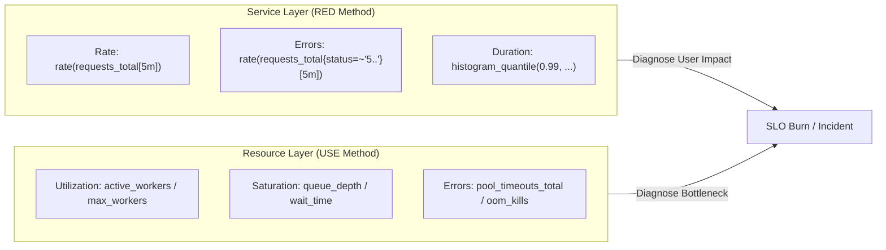
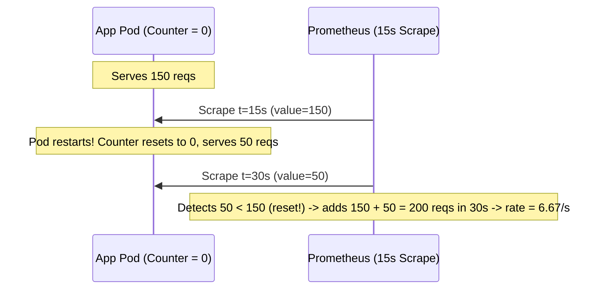
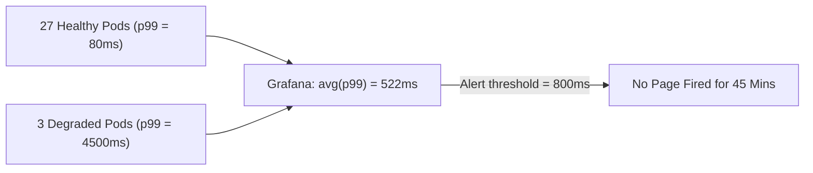

# Metrics Design: Counters, Gauges, Histograms, RED/USE & Cardinality

> **Prerequisites:** [Lesson 02: Structured Logging: JSON Logs, Levels, Context & What Never to Log](../02-structured-logging/README.md).  
> **Estimated Reading Time:** 24–28 minutes  
> **Target Audience:** Backend and SRE engineers instrumenting services and designing SLIs/SLOs, and candidates asked "how do you measure p99 latency across 50 pods without losing accuracy?"  
> **Free PDF Notes:** [Download P5-SD-N-003.pdf](https://backendroadmap.com/notes/system-design/P5-SD-N-003.pdf)

> [!NOTE]
> **In one line:** Good **metrics design** pairs the right metric type (**Counter** for rates, **Gauge** for point-in-time state, **Histogram** for aggregatable latency distributions) with the right framework (**RED** for services, **USE** for infrastructure) while strictly bounding **label cardinality**.

> [!TIP]
> **The Golden Rule:** Never average pre-computed percentiles (`avg(p99)`) across pods—it is mathematically invalid. Always emit **Histograms** (or native exponential histograms) so the TSDB can sum bucket counts across pods and compute true fleet-wide `p95`/`p99`.

---

## 1. What Metrics Design Is, and What It Isn't

Suppose you run 20 checkout pods. Pod 1 handles 1,000 RPS at `p99 = 40 ms`; Pod 20 has a noisy neighbor and handles 50 RPS at `p99 = 2,000 ms`. If each pod exports a pre-computed `Summary` `p99` gauge and your dashboard takes `avg(p99)`, you get $(19 \times 40 + 2000)/20 = 138\text{ ms}$—completely wrong, because Pod 20 only served $0.25\%$ of traffic, or conversely if Pod 20 served 50% of traffic, `avg` would still under-report it. **Metrics design** is choosing primitives that compose accurately across distributed instances at $O(1)$ memory per series.

| Term | Precise Meaning | Example |
| :--- | :--- | :--- |
| **Counter** | Monotonically increasing cumulative value (resets to 0 only on restart) | `http_requests_total` (query with `rate()`) |
| **Gauge** | Point-in-time snapshot that can go up or down | `db_pool_active_connections`, `queue_depth` |
| **Histogram** | Cumulative counts of observations falling into pre-defined buckets + `_sum` + `_count` | `http_request_duration_seconds_bucket{le="0.5"}` |
| **Summary** | Client-side sliding-window quantiles (`0.5`, `0.99`); **cannot** be aggregated across pods | Legacy RPC client quantile |
| **RED Method** | Request-driven service metrics: **R**ate, **E**rrors, **D**uration | APIs, microservices, gRPC handlers |
| **USE Method** | Resource-driven infra metrics: **U**tilization, **S**aturation, **E**rrors | CPU, memory, disk I/O, thread pools |
| **Native / HDR Histogram** | High-dynamic-range exponential buckets requiring no manual bucket tuning | OTel / Prometheus Native Histograms |
| **Not** | Exporting raw `latency_ms` as a Gauge or `user_id` as a label | Gauges miss spikes between scrapes; high-card kills TSDB |

### Why It Matters
1. **Percentile math is unforgiving:** Choosing `Summary` instead of `Histogram` makes fleet-wide `p99` impossible to compute accurately.
2. **RED + USE cover 95% of outages:** RED tells you *user pain* (Rate, Errors, Duration); USE tells you *resource bottlenecks* (Utilization, Saturation, Errors).
3. **Bucket count multiplies cardinality:** A histogram with 12 buckets creates $12 + 2 = 14$ time series for *every* label combination.

---

## 2. Anatomy: Metric Types & RED vs USE



| Metric Type | Operations Allowed | Aggregatable Across Pods? | Cost per Label Combo |
| :--- | :--- | :---: | :--- |
| **Counter** | `rate()`, `increase()`, `sum()` | Yes | 1 series |
| **Gauge** | `avg()`, `max()`, `min()`, `sum()` | Yes | 1 series |
| **Histogram** | `sum()` buckets $\to$ `histogram_quantile()` | Yes | $B + 3$ series ($B$ buckets + `+Inf`, `_sum`, `_count`) |
| **Summary** | Single-instance quantile only | **No** | $Q + 2$ series ($Q$ quantiles) |

> [!WARNING]
> **Beware the Histogram Series Multiplier.** A histogram with 15 buckets (`le`) and 4 labels (`method`, `route`, `status`, `pod`) generates $18 \times C$ time series! With 2,000 label combinations, that is $36{,}000$ time series from *one* metric. Keep histogram labels minimal (e.g., `route`, `method`) and drop `pod` or `status` if not needed for latency slicing.

---

## 3. Mathematical Model: Histogram Quantile Interpolation & Bucket Cost

**Prometheus Histogram Quantile ($\hat{q}_\phi$).** Given cumulative bucket counts $b_0, b_1, \dots, b_n$ with upper bounds $u_0, u_1, \dots, u_n$ (summed across all pods) and total count $N = b_n$:
1. Target rank: $r = \phi \cdot N$ (for `p99`, $\phi = 0.99$).
2. Find the smallest bucket $i$ such that $b_i \ge r$.
3. Linearly interpolate within bucket $[u_{i-1}, u_i]$:

$$\hat{q}_\phi = u_{i-1} + (u_i - u_{i-1}) \cdot \frac{r - b_{i-1}}{b_i - b_{i-1}}$$

**Worked Numerical Example.** Across 10 pods over 5 minutes, $N = 10{,}000$ requests are observed:
- `le="0.1"` ($100\text{ ms}$): $b = 8{,}500$
- `le="0.25"` ($250\text{ ms}$): $b = 9{,}600$
- `le="0.5"` ($500\text{ ms}$): $b = 9{,}850$
- `le="1.0"` ($1000\text{ ms}$): $b = 9{,}950$
- `le="+Inf"`: $b = 10{,}000$

Compute `p99` ($\phi = 0.99$):
- Target rank: $r = 0.99 \times 10{,}000 = 9{,}900$.
- $9{,}900$ falls in bucket $(0.5, 1.0]$ because $b_{0.5} = 9{,}850 < 9{,}900 \le b_{1.0} = 9{,}950$.
- Interpolated `p99`:

$$\hat{q}_{0.99} = 0.5 + (1.0 - 0.5) \cdot \frac{9{,}900 - 9{,}850}{9{,}950 - 9{,}850} = 0.5 + 0.5 \cdot \frac{50}{100} = 0.75\text{ s} = 750\text{ ms}$$

Notice the error bound: if your buckets jump from `0.5s` to `5.0s`, linear interpolation can be off by **seconds**! Place dense buckets around your SLO threshold (e.g., `0.1, 0.2, 0.3, 0.5, 0.75, 1.0, 2.0`).

---

## 4. Metrics & Percentiles

| Metric | Meaning | Alert when |
| :--- | :--- | :--- |
| **RED: Request Rate** | `sum(rate(http_requests_total[5m]))` | Sudden drop $> 50\%$ (upstream outage) or abnormal spike |
| **RED: Error Ratio** | `sum(rate(5xx[5m])) / sum(rate(total[5m]))` | Exceeds SLO error budget burn rate (e.g., $> 1\%$) |
| **RED: Duration `p99`** | `histogram_quantile(0.99, sum by (le)(rate(...)))` | Exceeds latency SLO (e.g., $> 500\text{ ms}$ for 5m) |
| **USE: Pool Utilization** | `db_pool_in_use / db_pool_max` | $> 85\%$ sustained |
| **USE: Saturation** | `db_pool_wait_count` or `runqueue_depth` | $> 0$ queuing threads for $> 2\text{ min}$ |
| **Counter Reset Rate** | `resets(http_requests_total[15m])` | Frequent resets indicate crash-looping pods |

### Worked Example (Why Averages Hide Outages)
A checkout service has 990 requests at `20 ms` and 10 requests at `5,000 ms`.
- **Mean (`_sum / _count`):** $\frac{990 \times 20 + 10 \times 5000}{1000} = 69.8\text{ ms}$ (looks completely healthy!).
- **`p99`:** `5,000 ms` (10x above a 500 ms SLO).
Tracking `_sum / _count` as your primary latency metric masks tail-latency incidents affecting your highest-value requests.

---

## 5. Compounding & Failure Modes

| Failure Mode | Cause | Impact |
| :--- | :--- | :--- |
| **Averaging Quantiles** | Using `Summary` and averaging `p99` across pods | False-green dashboards when one pod or zone degrades |
| **Coarse Histogram Buckets** | Using default `[0.005..10]` when SLO is `250 ms` | Linear interpolation error of $\pm 200\text{ ms}$; noisy alerts |
| **Gauge for Request Duration** | Setting a gauge `last_request_ms` | 99.9% of requests between 15s scrapes are lost |
| **Missing `rate()` on Counters** | Graphing raw `http_requests_total` | Sawtooth lines that drop to 0 on every deploy |
| **Over-Labeling Histograms** | Adding `pod` + `status` + `route` on a 15-bucket histogram | $18\times$ series explosion exhausts TSDB memory |

---

## 6. Numbers Every Engineer Must Know

| Item | Typical | Implication |
| :--- | :---: | :--- |
| Classic histogram bucket count | $8\text{–}12$ buckets | Keep $< 15$ to avoid $15\times$ series multiplication |
| Time series per classic histogram | $B + 3$ per label combo | 10 buckets = 13 time series per label set |
| Native/exponential histogram overhead | 1 series per label combo | Eliminates bucket tuning and cuts series count $10\times$ |
| Minimum `rate()` window | $4\times$ scrape interval | With 15s scrape, use `rate(...[1m])` minimum (2+ samples) |
| Standard base units (Prometheus) | Seconds, Bytes (never ms/MB) | Consistent units prevent `1000x` math bugs in PromQL |
| Acceptable SLO error-rate burn | $0.1\%\text{–}1\%$ (99.9%–99% SLO) | Multi-window burn-rate alerts catch fast & slow leaks |

---

## 7. Mechanism Deep Dive: Scrape Intervals, `rate()` & Counter Resets



| Question | Answer |
| :--- | :--- |
| **How does `rate()` handle pod restarts?** | Prometheus detects when a counter decreases ($v_2 < v_1$) and treats it as a reset from 0, adding $v_1 + v_2$. |
| **Why use `rate()` instead of `irate()` for alerts?** | `irate()` only uses the last 2 samples and is hyper-volatile; `rate()` averages over the full window (`[5m]`) and is safe for alerting. |
| **Why does Prometheus recommend base units (`seconds`, `bytes`)?** | Uniform base units avoid mixing `_ms` and `_seconds` in dashboards and cross-service aggregations. |
| **When should you use a Gauge instead of a Counter?** | Only for values that naturally go *up and down* (active connections, queue depth, memory bytes, temperature). |

**When not to use a classic Histogram:** If you need exact `p99.9` across 4 orders of magnitude ($1\text{ ms}$ to $10\text{ s}$) without pre-guessing buckets, use **Prometheus Native Histograms** (OTel Exponential Histograms) or compute exact quantiles in traces.

---

## 8. Hierarchical Budgets & Design Rules

| Slice | Rule | Control |
| :--- | :--- | :--- |
| **Naming** | `<namespace>_<name>_<unit>` (`_total` for counters, `_seconds` for durations) | Prometheus naming conventions + linter |
| **Framework** | RED for every RPC/HTTP handler; USE for every pool/queue/disk | Shared instrumentation middleware |
| **Histograms** | 8–12 buckets clustered near the SLO; drop `pod` label before alerting | Recording rules (`sum by (le, route)`) |
| **Labels** | Max 3–4 low-cardinality labels per metric | Code review + collector relabel rules |
| **Units** | Always SI base units (`seconds`, `bytes`, `ratio`) | Never mix `ms` and `s` |
| **SLIs** | Derive SLIs directly from RED counters and histograms | `good_events / total_events` |

---

## 9. Top Mitigations

1. **Always use Histograms (never Summaries) for latency** across multiple instances.
2. **Cluster histogram buckets around your SLO** (e.g., if SLO is 300 ms, include `0.1, 0.2, 0.3, 0.5, 1.0`).
3. **Pre-aggregate heavy histograms with Recording Rules** (`job:http_request_duration_seconds_bucket:rate5m`) so Grafana doesn't scan millions of samples on every load.
4. **Use `rate()` over at least $4\times$ the scrape interval** (e.g., `[1m]` or `[5m]` for 15s scrapes) to survive missed scrapes.
5. **Emit `_total` suffix on all counters** and never expose raw gauges for monotonically increasing counts.
6. **Instrument USE metrics on every bounded resource** (DB connection pools, worker queues, Go goroutines / JVM heap).
7. **Migrate to Native/Exponential Histograms** where supported to eliminate manual bucket tuning and cut series count by $10\times$.

---

## 10. Production Reference / War Story: The `avg(p99)` Illusion

An e-commerce search team instrumented their 30-pod search cluster using a client-side `Summary` metric (`search_latency_summary{quantile="0.99"}`). Their Grafana panel plotted `avg(search_latency_summary{quantile="0.99"})`. During a regional AZ brownout, 3 pods in `us-east-1c` stalled on a degraded cache shard, spiking their `p99` to `4,500 ms` while the other 27 pods stayed at `80 ms`.



- **Root Cause:** Client-side `Summary` quantiles cannot be mathematically combined across pods; `avg(p99)` diluted a `4.5s` outage across 10% of users down to `522 ms`, staying below the `800 ms` alert threshold for 45 minutes.
- **Fix:** Replaced `Summary` with a `Histogram` (`search_duration_seconds_bucket`), aggregated buckets across all 30 pods with `sum by (le) (rate(search_duration_seconds_bucket[5m]))`, and computed true fleet-wide `histogram_quantile(0.99, ...)`.

---

## 11. Multi-Language Production Code Tabs

Thread-safe **Counter, Gauge, and Histogram** implementation with linear-interpolation `histogram_quantile` (zero external dependencies).

````carousel
```go
// Go: Thread-safe Counter, Gauge, and Histogram with Prometheus-style quantile interpolation.
package main

import (
	"fmt"
	"sync"
	"sync/atomic"
)

type Counter struct{ val atomic.Int64 }

func (c *Counter) Inc()        { c.val.Add(1) }
func (c *Counter) Load() int64 { return c.val.Load() }

type Histogram struct {
	mu      sync.Mutex
	bounds  []float64
	buckets []uint64 // cumulative counts per bucket +Inf at end
	sum     float64
	count   uint64
}

func NewHistogram(bounds []float64) *Histogram {
	return &Histogram{bounds: bounds, buckets: make([]uint64, len(bounds)+1)}
}

func (h *Histogram) Observe(v float64) {
	h.mu.Lock()
	defer h.mu.Unlock()
	h.sum += v
	h.count++
	for i, b := range h.bounds {
		if v <= b {
			h.buckets[i]++
		}
	}
	h.buckets[len(h.bounds)]++ // +Inf
}

func (h *Histogram) Quantile(q float64) float64 {
	h.mu.Lock()
	defer h.mu.Unlock()
	if h.count == 0 {
		return 0
	}
	rank := q * float64(h.count)
	for i, b := range h.bounds {
		if float64(h.buckets[i]) >= rank {
			prevCount, prevBound := 0.0, 0.0
			if i > 0 {
				prevCount = float64(h.buckets[i-1])
				prevBound = h.bounds[i-1]
			}
			return prevBound + (b-prevBound)*(rank-prevCount)/(float64(h.buckets[i])-prevCount)
		}
	}
	return h.bounds[len(h.bounds)-1]
}

func main() {
	h := NewHistogram([]float64{0.1, 0.25, 0.5, 1.0})
	for i := 0; i < 990; i++ {
		h.Observe(0.08)
	}
	for i := 0; i < 10; i++ {
		h.Observe(0.8)
	}
	fmt.Printf("p99=%.3fs\n", h.Quantile(0.99))
}
```
<!-- slide -->
```typescript
// TypeScript: Cumulative Histogram with Prometheus-style linear interpolation.
export class Histogram {
  private readonly buckets: number[];
  private count = 0;
  private sum = 0;

  constructor(private readonly bounds: number[]) {
    this.buckets = new Array(bounds.length + 1).fill(0);
  }

  observe(value: number): void {
    this.count++;
    this.sum += value;
    for (let i = 0; i < this.bounds.length; i++) {
      if (value <= this.bounds[i]) this.buckets[i]++;
    }
    this.buckets[this.bounds.length]++; // +Inf
  }

  quantile(q: number): number {
    if (this.count === 0) return 0;
    const rank = q * this.count;
    for (let i = 0; i < this.bounds.length; i++) {
      if (this.buckets[i] >= rank) {
        const prevCount = i > 0 ? this.buckets[i - 1] : 0;
        const prevBound = i > 0 ? this.bounds[i - 1] : 0;
        const currCount = this.buckets[i];
        return prevBound + ((this.bounds[i] - prevBound) * (rank - prevCount)) / (currCount - prevCount);
      }
    }
    return this.bounds[this.bounds.length - 1];
  }
}
```
<!-- slide -->
```python
# Python: Cumulative Histogram + Prometheus histogram_quantile formula (stdlib only).
class Histogram:
    def __init__(self, bounds: list[float]) -> None:
        self.bounds = sorted(bounds)
        self.buckets = [0] * (len(self.bounds) + 1)  # last slot is +Inf
        self.count = 0
        self.sum = 0.0

    def observe(self, value: float) -> None:
        self.count += 1
        self.sum += value
        for i, b in enumerate(self.bounds):
            if value <= b:
                self.buckets[i] += 1
        self.buckets[-1] += 1

    def quantile(self, q: float) -> float:
        if self.count == 0:
            return 0.0
        rank = q * self.count
        for i, b in enumerate(self.bounds):
            if self.buckets[i] >= rank:
                prev_count = self.buckets[i - 1] if i > 0 else 0
                prev_bound = self.bounds[i - 1] if i > 0 else 0.0
                return prev_bound + (b - prev_bound) * (rank - prev_count) / (self.buckets[i] - prev_count)
        return self.bounds[-1]


if __name__ == "__main__":
    h = Histogram([0.1, 0.25, 0.5, 1.0])
    for _ in range(9900):
        h.observe(0.08)
    for _ in range(100):
        h.observe(0.75)
    print(f"p99={h.quantile(0.99):.3f}s")
```
<!-- slide -->
```csharp
// C#: Thread-safe Cumulative Histogram with Prometheus-style quantile interpolation.
public sealed class Histogram
{
    private readonly double[] _bounds;
    private readonly long[] _buckets;
    private readonly object _lock = new();
    private long _count;
    private double _sum;

    public Histogram(double[] bounds)
    {
        _bounds = bounds.OrderBy(b => b).ToArray();
        _buckets = new long[_bounds.Length + 1];
    }

    public void Observe(double value)
    {
        lock (_lock)
        {
            _count++;
            _sum += value;
            for (int i = 0; i < _bounds.Length; i++)
                if (value <= _bounds[i]) _buckets[i]++;
            _buckets[^1]++;
        }
    }

    public double Quantile(double q)
    {
        lock (_lock)
        {
            if (_count == 0) return 0;
            double rank = q * _count;
            for (int i = 0; i < _bounds.Length; i++)
            {
                if (_buckets[i] >= rank)
                {
                    double prevCount = i > 0 ? _buckets[i - 1] : 0;
                    double prevBound = i > 0 ? _bounds[i - 1] : 0;
                    return prevBound + (_bounds[i] - prevBound) * (rank - prevCount) / (_buckets[i] - prevCount);
                }
            }
            return _bounds[^1];
        }
    }
}
```
````

---

## 12. Hands-On CLI Verification Workflows

Verify the worked `p99` interpolation math and histogram series cost in Python 3:

```bash
python3 -c '
bounds = [0.1, 0.25, 0.5, 1.0]
buckets = [8500, 9600, 9850, 9950, 10000]
rank = 0.99 * buckets[-1]
for i, b in enumerate(bounds):
    if buckets[i] >= rank:
        pc = buckets[i-1] if i > 0 else 0
        pb = bounds[i-1] if i > 0 else 0.0
        p99 = pb + (b - pb) * (rank - pc) / (buckets[i] - pc)
        print(f"Interpolated p99: {p99:.3f}s")
        break
'
```

Inspect Prometheus exposition format on a running service:

```bash
# Check raw counter, gauge, and histogram buckets from /metrics
curl -s http://localhost:8080/metrics | grep -E '^http_request_duration_seconds'

# Count how many time series one histogram creates
curl -s http://localhost:8080/metrics | grep -c '^http_request_duration_seconds_bucket'
```

---

## 13. Common Mistakes to Avoid

1. **Using `Summary` instead of `Histogram`** and averaging `p99` across pods.
2. **Recording latencies as a `Gauge`**, losing every spike between scrape intervals.
3. **Forgetting `rate()` on a `Counter`**, producing sawtooth graphs that reset on deploys.
4. **Adding too many labels to a Histogram**, multiplying cardinality by $B + 3$.
5. **Using coarse default buckets** far away from your actual SLO threshold.
6. **Mixing units** (`_ms` vs `_seconds`), causing 1,000x errors in dashboards and alerts.
7. **Alerting on `mean` (`_sum / _count`)** instead of `p95`/`p99`.

---

## 14. Key Terms Glossary

| Key Term | Definition |
| :--- | :--- |
| **Counter** | Monotonically increasing cumulative metric; queried via `rate()` or `increase()`. |
| **Gauge** | Point-in-time metric that can increase or decrease (memory, queue depth). |
| **Histogram** | Cumulative bucketed distribution (`_bucket`, `_sum`, `_count`); aggregatable across pods. |
| **Summary** | Client-side pre-computed quantiles; cannot be aggregated across instances. |
| **RED Method** | Service telemetry framework: Rate, Errors, Duration. |
| **USE Method** | Infrastructure telemetry framework: Utilization, Saturation, Errors. |
| **Linear interpolation** | Estimating quantiles inside a histogram bucket assuming uniform distribution. |
| **Native Histogram** | Exponential-bucket histogram requiring no manual bucket configuration. |
| **Recording rule** | Pre-computed PromQL expression saved as a new time series for fast dashboards. |
| **Counter reset** | Counter returning to 0 on process restart, handled automatically by `rate()`. |

---

## 15. System Design Interview Questions & Answers

### Basic Conceptual Questions

<details>
<summary><strong>Q1: What are the three core metric types, and when do you use each? [BASIC]</strong></summary>

**Answer:**
**Counter** (monotonically increasing): request counts, error counts, bytes sent (always query with `rate()`). **Gauge** (up/down snapshot): active connections, queue depth, memory usage. **Histogram** (bucketed distribution): request latency, payload sizes—aggregatable across instances for `p95`/`p99`.
</details>

<details>
<summary><strong>Q2: Explain the RED and USE methods. [BASIC]</strong></summary>

**Answer:**
**RED** (for services/APIs) tracks **R**ate (RPS), **E**rrors (5xx rate), and **D**uration (latency distribution). **USE** (for resources/infra) tracks **U**tilization (% busy), **S**aturation (queue depth/wait), and **E**rrors (hardware/pool failures).
</details>

<details>
<summary><strong>Q3: Why can't you average `p99` across 10 servers? [BASIC]</strong></summary>

**Answer:**
Percentiles are non-additive. Averaging per-pod `p99`s ignores traffic skew (one pod serving 1% of traffic shouldn't weight equally with a pod serving 50%) and mathematically distorts the tail. You must aggregate raw **Histogram** buckets across pods first, then compute the quantile.
</details>

<details>
<summary><strong>Q4: How does Prometheus `rate()` handle a pod restart? [BASIC]</strong></summary>

**Answer:**
Because counters only increase, if sample $t_2 < t_1$, `rate()` detects a counter reset, assumes the counter restarted from 0, and adds $t_1 + t_2$ to compute the true delta over the time window.
</details>

### Scenario-Based Architecture Questions

<details>
<summary><strong>Q5: Your API has a 300 ms p99 SLO, but your histogram buckets are `[0.01, 0.1, 1.0, 5.0]`. What goes wrong? [SCENARIO]</strong></summary>

**Answer:**
Any latency between `100 ms` and `1,000 ms` falls into one huge 900 ms bucket. Linear interpolation can misreport a `220 ms` p99 as `550 ms` (false page) or a `700 ms` p99 as `280 ms` (missed outage). Add finer buckets around the SLO: `[0.05, 0.1, 0.2, 0.3, 0.5, 1.0, 2.5]`.
</details>

<details>
<summary><strong>Q6: A single `http_duration_seconds` histogram is consuming 60% of your Prometheus memory. How do you fix it? [SCENARIO]</strong></summary>

**Answer:**
With 12 buckets, every label combination creates 15 series. Remove high-cardinality or unnecessary labels (like `pod`, `instance`, or `status_code` if you only need latency per `route`), trim redundant buckets, or migrate to Prometheus Native Histograms.
</details>

<details>
<summary><strong>Q7: How do you instrument a database connection pool using the USE method? [SCENARIO]</strong></summary>

**Answer:**
**Utilization:** `db_pool_connections_in_use` / `db_pool_connections_max` (Gauges). **Saturation:** `db_pool_wait_duration_seconds` (Histogram) and `db_pool_waiters_current` (Gauge). **Errors:** `db_pool_acquire_timeouts_total` (Counter).
</details>

<details>
<summary><strong>Q8: Your Grafana dashboard takes 15 seconds to load a 7-day `p99` latency graph. How do you speed it up? [SCENARIO]</strong></summary>

**Answer:**
Create a Prometheus **recording rule** that pre-aggregates `sum by (le, route) (rate(http_request_duration_seconds_bucket[5m]))` every 30s–60s. Grafana then queries the pre-aggregated series instead of scanning raw pod-level buckets across 7 days.
</details>

### Advanced & Tricky Interview Questions

<details>
<summary><strong>Q9: Why does `histogram_quantile` sometimes return `NaN` or wrong values when traffic is very low? [TRICKY]</strong></summary>

**Answer:**
If a route receives 0 requests in the `[5m]` window, `rate()` returns 0 for all buckets, so `0 / 0 = NaN`. Also, if a route receives only 1 request, interpolation across a wide bucket skews the estimate. Guard dashboards with `> 0` or widen the rate window.
</details>

<details>
<summary><strong>Q10: What is the difference between `rate()` and `irate()`, and when does `irate()` lie? [TRICKY]</strong></summary>

**Answer:**
`irate()` only looks at the last two data points in the range vector, making it ultra-sensitive to single-scrape jitter and completely useless for alerting. Moreover, if you graph `irate([5m])` over a 1-hour view, it skips 90% of the data points between step intervals. Use `rate()` for alerts and capacity graphs.
</details>

<details>
<summary><strong>Q11: How do Prometheus Native Histograms (exponential histograms) solve classic histogram limitations? [TRICKY]</strong></summary>

**Answer:**
Instead of storing 10–15 separate time series with fixed static bounds, Native Histograms store all sparse exponential buckets in a *single* time series sample. They auto-scale to any latency range (microseconds to minutes) with bounded relative error (~1–5%) and eliminate manual bucket tuning.
</details>

<details>
<summary><strong>Q12: Why is `sum(rate(errors[5m])) / sum(rate(requests[5m]))` safer than `sum(rate(errors[5m]) / rate(requests[5m]))`? [TRICKY]</strong></summary>

**Answer:**
Dividing before summing averages per-pod error ratios (giving equal weight to a pod with 1 request and a pod with 10,000) and fails when labels don't match 1:1 (e.g., a pod with 0 errors has no error series). Always sum numerator and denominator separately first, then divide.
</details>

---

## 16. One-Page Master Cheat Sheet

```
+---------------------------------------------------------------------------------------------------------+
|                    METRICS DESIGN — MASTER CHEAT SHEET                                                  |
+---------------------------------------------------------------------------------------------------------+
| 1. TYPES: Counter (rate/increase) | Gauge (point-in-time) | Histogram (aggregatable p95/p99).           |
+---------------------------------------------------------------------------------------------------------+
| 2. NEVER average Summary quantiles across pods. Always sum Histogram buckets first, then quantile.      |
+---------------------------------------------------------------------------------------------------------+
| 3. FRAMEWORKS: RED (Rate, Errors, Duration) for services | USE (Utilization, Saturation, Errors) infra. |
+---------------------------------------------------------------------------------------------------------+
| 4. CARDINALITY: Histogram series = (B + 3) * prod(label_domains). Cluster buckets around your SLO!      |
+---------------------------------------------------------------------------------------------------------+
| 5. UNITS & QUERIES: Use SI base units (_seconds, _bytes). rate() window >= 4x scrape interval.          |
+---------------------------------------------------------------------------------------------------------+
```

---

## Further Reading & Sources

- Tom Wilkie, [The RED Method: How to Instrument Your Services](https://grafana.com/blog/2018/08/02/the-red-method-how-to-instrument-your-services/).
- Brendan Gregg, [The USE Method](https://www.brendangregg.com/usemethod.html).
- Prometheus Documentation, [Histograms and Summaries](https://prometheus.io/docs/practices/histograms/).
- Gil Tene, [How NOT to Measure Latency](https://www.youtube.com/watch?v=lJ8ydIuPFeU) (coordinated omission & tail percentiles).

---

## Free PDF Notes

[P5-SD-N-003.pdf](https://backendroadmap.com/notes/system-design/P5-SD-N-003.pdf)

---

## Next

Continue with [Lesson 04: Prometheus & Grafana: Scraping, PromQL, Alertmanager & p99 Panels](../04-prometheus-grafana/README.md).
