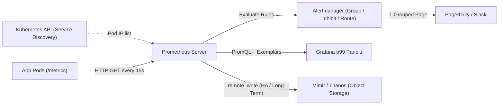
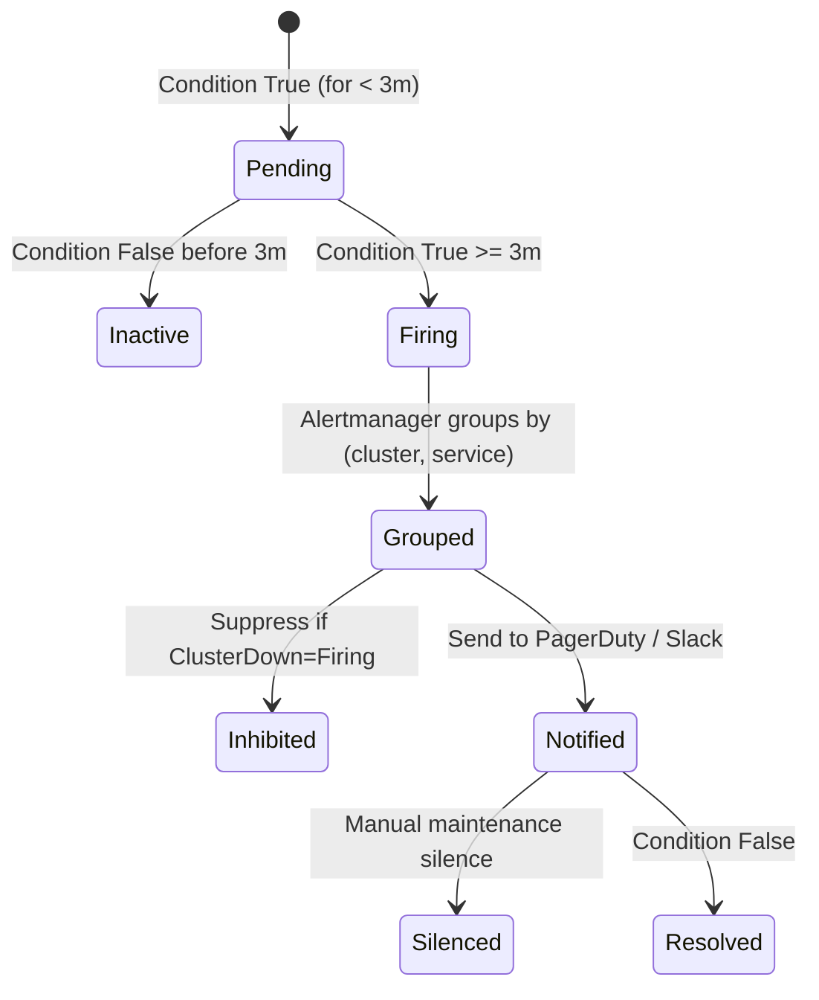
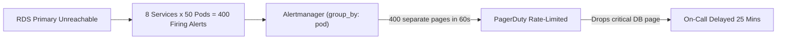

# Prometheus & Grafana: Scraping, PromQL, Alertmanager & p99 Panels

> **Prerequisites:** [Lesson 03: Metrics Design: Counters, Gauges, Histograms, RED/USE & Cardinality](../03-metrics-design/README.md).  
> **Estimated Reading Time:** 24–28 minutes  
> **Target Audience:** Backend and SRE engineers operating Prometheus/Grafana stacks, and candidates asked "how do you scale Prometheus beyond one node and write a PromQL alert for p99 latency?"  
> **Free PDF Notes:** [Download P5-SD-N-004.pdf](https://backendroadmap.com/notes/system-design/P5-SD-N-004.pdf)

> [!NOTE]
> **In one line:** **Prometheus** is a pull-based time-series database (TSDB) that scrapes `/metrics` endpoints via service discovery, evaluates **PromQL** recording/alerting rules, and routes grouped/deduplicated alerts through **Alertmanager**, while **Grafana** visualizes those queries (like `p99` panels) and links them to traces via Exemplars.

> [!TIP]
> **The Golden Rule:** Always use `sum by (le, ...)` *before* `histogram_quantile()`, set `rate()` windows to at least $4\times$ the scrape interval, and scale Prometheus horizontally via **recording rules + remote_write** (Mimir/Thanos/Cortex) before a single instance hits RAM limits.

---

## 1. What Prometheus & Grafana Are, and What They Aren't

You have instrumented your Go, Node, and Python services with Counters and Histograms. Now you need a system to collect those metrics across 400 ephemeral Kubernetes pods, compute fleet-wide `p99` latency every 15 seconds, fire a single PagerDuty page (not 400 pages!) when `checkout` degrades, and render fast dashboards. That is the **Prometheus + Alertmanager + Grafana** stack.

| Term | Precise Meaning | Example |
| :--- | :--- | :--- |
| **Pull / Scrape model** | Prometheus discovers targets and HTTP-GETs `/metrics` every $\Delta t$ | `scrape_interval: 15s` on Kubernetes pods |
| **Service Discovery (SD)** | Dynamic target list from Kubernetes, Consul, EC2, DNS | `kubernetes_sd_configs` watching `Pod` endpoints |
| **TSDB (Head + Blocks)** | In-memory head block (last 2h) + immutable 2h disk blocks (XOR/delta) | Writes WAL first, compacts blocks in background |
| **PromQL** | Functional query language for instant/range vectors and aggregations | `histogram_quantile(0.99, sum by (le)(rate(...[5m])))` |
| **Recording rule** | Pre-evaluated PromQL query stored as a new time series on a schedule | `job:http_duration:p99` evaluated every 30s |
| **Alertmanager** | Handles alert deduplication, grouping, inhibition, and routing | Groups 50 pod alerts into 1 service Slack/PagerDuty alert |
| **Grafana** | Visualization & dashboarding layer querying Prometheus/Loki/Tempo | `p99` latency panel with Exemplar trace links |
| **Not** | An infinite-retention raw event store or log/trace database | Never store per-request logs or raw IDs in Prometheus |

### Why It Matters
1. **Pull vs Push is a classic interview question:** Knowing why Prometheus pulls (target health `up`, natural backpressure, `sample_limit`)—and when push (`Pushgateway` / `remote_write`) is needed—is essential.
2. **Alert storms kill incident response:** Without Alertmanager grouping and inhibition, one rack failure fires 200 simultaneous pages.
3. **PromQL performance determines dashboard usability:** Unoptimized `histogram_quantile` queries over 7 days time out Grafana unless backed by recording rules.

---

## 2. Anatomy: Scraping, Storage, Alerting & Visualization



| Component | Responsibility | Single-Node Limit / HA Pattern |
| :--- | :--- | :--- |
| **Prometheus Scraper** | Pulls `/metrics`, enforces `sample_limit`, runs relabeling | HA pair (2 identical Proms scraping same targets) |
| **TSDB Local Storage** | 2h RAM head block + WAL + compacted 2h–2w disk blocks | Local SSD; 15-day default retention |
| **Alertmanager** | Deduplicates HA alerts via gossip mesh; groups & silences | 3-node Alertmanager cluster (gossip protocol) |
| **Remote Write (Mimir/Thanos)** | Long-term object storage (S3/GCS) + global query view | Scales horizontally to 100M+ active series |
| **Grafana** | Renders PromQL panels, SLO burn-rate views, Exemplar links | Stateless web tier backed by Postgres |

> [!WARNING]
> **Never put a load balancer in front of two Prometheus servers for scraping, or rely on a single Prometheus without `Alertmanager` HA deduplication.** In Prometheus HA, *both* Prometheus A and B scrape *all* targets independently and send identical alerts to a clustered Alertmanager, which deduplicates them before paging.

---

## 3. Mathematical Model: TSDB Sizing, Scrape Bandwidth & `for` Duration

**TSDB Disk & RAM Sizing.** With $C$ active time series, scrape interval $\Delta t$ (seconds), bytes per sample $b_s \approx 1.5\text{ B}$ (Gorilla XOR + delta-of-delta compression), and retention $D$ days:

$$\text{Samples/sec} = \frac{C}{\Delta t}, \qquad \text{Disk}_{\text{TSDB}} \approx \text{Samples/sec} \times b_s \times 86{,}400 \times D$$

$$\text{RAM}_{\text{min}} \approx C \times 5\text{ KB} \quad (\text{head block} + \text{index} + \text{query headroom})$$

**Worked Numerical Example.** A cluster has $C = 500{,}000$ active series scraped at $\Delta t = 15\text{ s}$ with $D = 15\text{ days}$ retention:
- **Ingestion rate:** $\frac{500{,}000}{15} = 33{,}333\text{ samples/sec}$.
- **Disk for 15 days:** $33{,}333 \times 1.5\text{ B} \times 86{,}400 \times 15 \approx 64.8\text{ GB}$ (plus ~20% WAL/index overhead $\approx 78\text{ GB}$).
- **RAM required:** $500{,}000 \times 5\text{ KB} \approx 2.5\text{ GB}$ baseline (provision $8\text{ GB}$ for heavy `PromQL` range queries).

**Alert Detection Delay ($T_{\text{alert}}$).** Total time from incident start to page equals scrape interval + evaluation interval + `for` duration + Alertmanager `group_wait`:

$$T_{\text{alert}} \approx \Delta t_{\text{scrape}} + \Delta t_{\text{eval}} + T_{\text{for}} + T_{\text{group\_wait}}$$

With $\Delta t_{\text{scrape}} = 15\text{ s}$, $\Delta t_{\text{eval}} = 30\text{ s}$, `for: 3m`, `group_wait: 30s`, an alert fires in $\sim 4\text{ min } 15\text{ s}$—fast enough to catch real outages while filtering transient 10-second blips.

---

## 4. Metrics & Percentiles

| Metric | Meaning | Alert when |
| :--- | :--- | :--- |
| **`up{job="..."}`** | `1` if last scrape succeeded, `0` if target unreachable | `== 0` for $> 2\text{ min}$ (target down or scrape timeout) |
| **`prometheus_tsdb_head_series`** | Current active time series in memory | Sudden jump $> 25\%$ (cardinality leak) |
| **`prometheus_target_scrapes_exceeded_sample_limit_total`** | Targets dropped for exceeding `sample_limit` | $> 0$ (service violating cardinality budget) |
| **`prometheus_rule_evaluation_failures_total`** | Recording/alerting rules failing to evaluate | $> 0$ (broken PromQL or query timeout) |
| **`prometheus_remote_storage_samples_dropped_total`** | Samples lost sending to Mimir/Thanos | $> 0$ sustained (remote storage bottleneck) |
| **`alertmanager_notifications_failed_total`** | Failed PagerDuty/Slack webhook deliveries | $> 0$ (broken paging integration!) |

### Worked Example (Multi-Window SLO Burn-Rate Alert)
For a 99.9% availability SLO (error budget = $0.1\% = 0.001$ over 30 days = 43.2 minutes):
- A **14.4x burn rate** ($1.44\%$ error rate) consumes the entire 30-day budget in 2 days (5% in 1 hour).
- PromQL checks *both* a 1-hour and 5-minute window so alerts fire fast AND resolve fast when fixed:
  ```promql
  (
    sum(rate(http_requests_total{status=~"5.."}[1h])) / sum(rate(http_requests_total[1h])) > 14.4 * 0.001
  )
  and
  (
    sum(rate(http_requests_total{status=~"5.."}[5m])) / sum(rate(http_requests_total[5m])) > 14.4 * 0.001
  )
  ```

---

## 5. Compounding & Failure Modes

| Failure Mode | Trigger | Compounding Effect |
| :--- | :--- | :--- |
| **Scrape Timeout Cascade** | Service exposes 100k series; `/metrics` takes $> 10\text{ s}$ | Scrape fails $\to$ `up == 0` $\to$ stale gaps break `rate()` |
| **Alert Storm** | DB goes down; 20 microservices fire separate alerts | On-call flooded with 80 pages; Alertmanager inhibition missing |
| **PromQL `$__rate_interval` Trap** | Hardcoding `[1m]` in Grafana when `scrape_interval` is `60s` | `rate([1m])` has $< 2$ samples $\to$ blank/broken Grafana panels |
| **WAL Corruption / Slow Restart** | Prometheus OOM-kills without graceful shutdown | Replaying multi-GB WAL takes 10–20 minutes of blind time |
| **Missing `group_by` in Alertmanager** | Default grouping by `instance` | 50 crashing pods send 50 separate Slack/PagerDuty messages |

---

## 6. Numbers Every Engineer Must Know

| Item | Typical | Implication |
| :--- | :---: | :--- |
| Default scrape interval | $15\text{ s}\text{–}30\text{ s}$ | Use `$__rate_interval` (at least $4\times$ scrape interval) in Grafana |
| Compressed bytes per sample | $1.3\text{–}2.0\text{ bytes}$ | Very compact storage once cardinality is controlled |
| TSDB block compaction window | $2\text{ hours}$ | Head block lives in RAM for 2h before flushing to disk |
| Max safe series per single Prometheus | $1\text{M}\text{–}3\text{M}$ series | Shard or use Mimir/Thanos beyond this threshold |
| Alertmanager `group_wait` / `group_interval` | $30\text{ s}$ / $5\text{ m}$ | Batches related alerts into one clean notification |
| PromQL default query timeout | $2\text{ minutes}$ | Use recording rules if dashboard panels exceed 2–5s |

---

## 7. Mechanism Deep Dive: Alertmanager Routing, Grouping & Inhibition



| Question | Answer |
| :--- | :--- |
| **Why `Pending` (`for: 3m`) before `Firing`?** | Prevents paging on single-scrape glitches or 15-second GC pauses. |
| **What does Alertmanager **Grouping** do?** | Combines 50 pod-level alerts for `service=checkout` into **one** PagerDuty incident. |
| **What does Alertmanager **Inhibition** do?** | Suppresses downstream alerts (e.g., `HighPodLatency`) when a root-cause alert (`AZDown` or `DBPrimaryDown`) is already firing. |
| **How do you monitor short-lived cron jobs with pull-based Prometheus?** | Push to a **Pushgateway** (or OTel Collector) so Prometheus can scrape the last-known metrics after the job exits. |

**When not to use Prometheus:** Do not use Prometheus for **per-user billing**, **audit trails**, or **exact event counting** where losing a 15s scrape on crash is unacceptable. Prometheus is an eventually-consistent operational telemetry system, not an ACID ledger.

---

## 8. Hierarchical Budgets & Design Rules

| Slice | Rule | Control |
| :--- | :--- | :--- |
| **Scrape Config** | Set `scrape_timeout < scrape_interval` and enforce `sample_limit` | `sample_limit: 50000` per job |
| **Relabeling** | Drop unused high-card labels at scrape time via `metric_relabel_configs` | `action: labeldrop` on noisy Kubernetes annotations |
| **PromQL** | Always `sum by (le, ...)` *before* `histogram_quantile` | Code review + PromQL linter (`promtool check rules`) |
| **Grafana** | Use `$__rate_interval` instead of hardcoded `[1m]` | Prevents empty graphs when zooming out or changing scrape interval |
| **Alerting** | Every page must have a `runbook_url` and `for:` duration $\ge 2\text{ m}$ | `promtool check rules` in CI |
| **Long-Term HA** | Pair 2 Prometheus servers + 3 Alertmanagers + `remote_write` to Mimir/Thanos | Prevents single-node blind spots |

---

## 9. Top Mitigations

1. **Set `sample_limit` on every scrape job** so one buggy microservice cannot OOM-kill the shared Prometheus server.
2. **Pre-compute expensive `histogram_quantile` aggregations via recording rules** so Grafana `p99` panels load in $< 200\text{ ms}$.
3. **Configure Alertmanager `group_by: ['alertname', 'cluster', 'service']`** and **inhibition rules** to eliminate alert storms.
4. **Use `$__rate_interval` in Grafana** so `rate()` always spans at least 4 scrape intervals regardless of zoom level.
5. **Run a Dead Man's Switch alert (`Watchdog`)** firing continuously to PagerDuty/Healthchecks.io so you know if Prometheus/Alertmanager itself dies.
6. **Enable Exemplars** on Prometheus (`--enable-feature=exemplar-storage`) and Grafana data sources to jump from `p99` spikes straight to traces.
7. **Validate all rule YAML files in CI** using `promtool check rules` before merging.

---

## 10. Production Reference / War Story: The Silent Alertmanager & 400-Page Storm

During a network partition in `us-west-2`, a Kubernetes node group lost connectivity to the primary RDS database. Eight microservices immediately breached their 5xx and latency thresholds. Because Alertmanager was configured with `group_by: ['alertname', 'pod']` and lacked an inhibition rule for `DatabaseUnreachable`:



- **Root Cause:** Grouping by `pod` turned 1 database outage into 400 individual notifications, hitting PagerDuty's API rate limit and burying the root-cause `RDSDown` alert.
- **Fix:** (1) Changed `group_by` to `['cluster', 'service', 'alertname']`; (2) Added an `inhibit_rules` block suppressing `High5xxRate` and `HighLatency` when `DatabaseUnreachable` is firing in the same cluster; (3) Added a `Watchdog` heartbeat check to verify alerting pipeline health continuously.

---

## 11. Multi-Language Production Code Tabs

Production **Prometheus `/metrics` exposition + PromQL/Alertmanager config** and a **Grafana `p99` PromQL validator/client** across Go, TypeScript, Python, and C#.

````carousel
```go
// Go: Minimal dependency-free Prometheus exposition endpoint (/metrics) with Counter + Histogram.
package main

import (
	"fmt"
	"net/http"
	"sync/atomic"
)

var (
	reqTotal   atomic.Int64
	reqErr     atomic.Int64
	bucketLe01 atomic.Int64
	bucketLe05 atomic.Int64
	bucketInf  atomic.Int64
)

func observeRequest(latencySec float64, isErr bool) {
	reqTotal.Add(1)
	if isErr {
		reqErr.Add(1)
	}
	if latencySec <= 0.1 {
		bucketLe01.Add(1)
	}
	if latencySec <= 0.5 {
		bucketLe05.Add(1)
	}
	bucketInf.Add(1)
}

func metricsHandler(w http.ResponseWriter, _ *http.Request) {
	w.Header().Set("Content-Type", "text/plain; version=0.0.4")
	fmt.Fprintf(w, "# TYPE http_requests_total counter\n")
	fmt.Fprintf(w, "http_requests_total{status=\"200\"} %d\n", reqTotal.Load()-reqErr.Load())
	fmt.Fprintf(w, "http_requests_total{status=\"500\"} %d\n", reqErr.Load())
	fmt.Fprintf(w, "# TYPE http_request_duration_seconds histogram\n")
	fmt.Fprintf(w, "http_request_duration_seconds_bucket{le=\"0.1\"} %d\n", bucketLe01.Load())
	fmt.Fprintf(w, "http_request_duration_seconds_bucket{le=\"0.5\"} %d\n", bucketLe05.Load())
	fmt.Fprintf(w, "http_request_duration_seconds_bucket{le=\"+Inf\"} %d\n", bucketInf.Load())
	fmt.Fprintf(w, "http_request_duration_seconds_count %d\n", bucketInf.Load())
}
```
<!-- slide -->
```typescript
// TypeScript: Query Prometheus HTTP API for fleet-wide p99 latency & check SLO breach.
interface PromResponse {
  status: "success" | "error";
  data: { result: Array<{ metric: Record<string, string>; value: [number, string] }> };
}

export async function queryFleetP99(promUrl: string, service: string): Promise<number | null> {
  const promql = `histogram_quantile(0.99, sum by (le) (rate(http_request_duration_seconds_bucket{service="${service}"}[5m])))`;
  const url = `${promUrl}/api/v1/query?query=${encodeURIComponent(promql)}`;

  const res = await fetch(url);
  if (!res.ok) throw new Error(`Prometheus HTTP ${res.status}`);
  const body = (await res.json()) as PromResponse;
  const first = body.data.result[0];
  return first ? Number(first.value[1]) : null;
}
```
<!-- slide -->
```python
# Python: Query Prometheus HTTP API for p99 + compute TSDB sizing (stdlib only).
import json
import urllib.parse
import urllib.request


def query_promql(prom_url: str, expr: str) -> list[dict]:
    qs = urllib.parse.urlencode({"query": expr})
    with urllib.request.urlopen(f"{prom_url}/api/v1/query?{qs}", timeout=5) as resp:
        payload = json.loads(resp.read().decode("utf-8"))
    if payload.get("status") != "success":
        raise RuntimeError(f"PromQL error: {payload}")
    return payload["data"]["result"]


def estimate_tsdb_footprint(series: int, scrape_s: int = 15, retention_days: int = 15) -> dict[str, float]:
    samples_per_sec = series / scrape_s
    disk_gb = (samples_per_sec * 1.5 * 86400 * retention_days * 1.2) / (1024**3)
    ram_gb = (series * 5 * 1024) / (1024**3)
    return {"samples_per_sec": round(samples_per_sec, 1), "disk_gb": round(disk_gb, 2), "ram_gb": round(ram_gb, 2)}


if __name__ == "__main__":
    print(estimate_tsdb_footprint(500_000))
```
<!-- slide -->
```csharp
// C#: Query Prometheus HTTP API for fleet p99 latency and active series count.
using System.Net.Http.Json;
using System.Text.Json;

public sealed class PrometheusClient
{
    private readonly HttpClient _http;
    private readonly string _baseUrl;

    public PrometheusClient(HttpClient http, string baseUrl)
    {
        _http = http;
        _baseUrl = baseUrl.TrimEnd('/');
    }

    public async Task<double?> GetP99SecondsAsync(string service, CancellationToken ct = default)
    {
        var query = $"histogram_quantile(0.99, sum by (le) (rate(http_request_duration_seconds_bucket{{service=\"{service}\"}}[5m])))";
        var url = $"{_baseUrl}/api/v1/query?query={Uri.EscapeDataString(query)}";
        using var doc = await _http.GetFromJsonAsync<JsonDocument>(url, ct);
        var results = doc?.RootElement.GetProperty("data").GetProperty("result");
        if (results is null || results.Value.GetArrayLength() == 0) return null;
        var valStr = results.Value[0].GetProperty("value")[1].GetString();
        return double.TryParse(valStr, out var v) ? v : null;
    }
}
```
````

---

## 12. Hands-On CLI Verification Workflows

Validate Prometheus rules, Alertmanager routes, and run live PromQL checks:

```bash
# 1. Validate Prometheus recording & alerting rules before deploying
promtool check rules alerts.yml

# 2. Unit-test PromQL alerts against synthetic time-series fixtures
promtool test rules alerts_test.yml

# 3. Verify Alertmanager routing tree for a specific label set
amtool config routes test --config.file=alertmanager.yml service=checkout severity=critical

# 4. Query live p99 latency via curl + jq
curl -sG 'http://localhost:9090/api/v1/query' \
  --data-urlencode 'query=histogram_quantile(0.99, sum by (le) (rate(http_request_duration_seconds_bucket[5m])))' \
  | jq '.data.result'
```

---

## 13. Common Mistakes to Avoid

1. **Omitting `by (le)` in `histogram_quantile`**—`sum(rate(...))` strips the `le` label and breaks quantile calculation.
2. **Hardcoding `[1m]` in Grafana panels** instead of `$__rate_interval`, producing empty graphs on 30s/60s scrape jobs.
3. **Grouping Alertmanager alerts by `pod` or `instance`**, causing 100-page storms during node/DB outages.
4. **Running Prometheus without `sample_limit`**, allowing one rogue service to OOM-kill the entire monitoring stack.
5. **Forgetting a `Watchdog` (dead man's switch) alert**, leaving you unaware when Alertmanager or PagerDuty integration breaks.
6. **Using `rate()` on a Gauge** instead of a Counter (`rate()` assumes monotonic increases and treats drops as resets!).
7. **Storing long-term (1-year) high-res metrics on local Prometheus disk** instead of `remote_write` to Mimir/Thanos + S3.

---

## 14. Key Terms Glossary

| Key Term | Definition |
| :--- | :--- |
| **Scrape interval** | Frequency at which Prometheus pulls `/metrics` from targets (e.g., `15s`). |
| **Service Discovery (SD)** | Automatic target discovery via Kubernetes API, Consul, or cloud metadata. |
| **PromQL** | Prometheus Query Language for time-series math, `rate()`, and `histogram_quantile()`. |
| **Recording rule** | Pre-computed PromQL expression saved as a new series to speed up dashboards. |
| **Alertmanager** | Component that deduplicates, groups, inhibits, silences, and routes alerts. |
| **Inhibition** | Suppressing noisy downstream alerts when a root-cause alert is already firing. |
| **Remote Write** | Streaming Prometheus samples over HTTP/Protobuf to long-term storage (Mimir/Thanos). |
| **WAL (Write-Ahead Log)** | Append-only crash-recovery log for Prometheus's in-memory head block. |
| **`sample_limit`** | Per-target cap on scraped metrics to prevent cardinality OOMs. |
| **Watchdog alert** | Always-firing heartbeat alert proving the alerting pipeline is alive. |

---

## 15. System Design Interview Questions & Answers

### Basic Conceptual Questions

<details>
<summary><strong>Q1: Why does Prometheus use a pull (scrape) model instead of push? [BASIC]</strong></summary>

**Answer:**
Pulling lets Prometheus know immediately if a target is down (`up == 0`), provides natural backpressure (Prometheus scrapes at its own pace), allows centralized `sample_limit` and relabeling control, and avoids needing to configure every service with a TSDB endpoint. Short-lived batch jobs use Pushgateway.
</details>

<details>
<summary><strong>Q2: Write the PromQL query for fleet-wide p99 latency of an HTTP service. [BASIC]</strong></summary>

**Answer:**
`histogram_quantile(0.99, sum by (le) (rate(http_request_duration_seconds_bucket[5m])))`. You must take `rate()` first, `sum by (le)` across all pods while preserving the `le` bucket label, and then apply `histogram_quantile(0.99, ...)`.
</details>

<details>
<summary><strong>Q3: What is the role of Alertmanager vs Prometheus? [BASIC]</strong></summary>

**Answer:**
Prometheus evaluates PromQL alert rules and fires raw alert states (`Pending` $\to$ `Firing`). Alertmanager receives those alerts from HA Prometheus pairs, deduplicates them, groups related alerts into one notification, applies silences/inhibitions, and routes them to Slack, PagerDuty, or Opsgenie.
</details>

<details>
<summary><strong>Q4: What is a recording rule and when should you use one? [BASIC]</strong></summary>

**Answer:**
A recording rule pre-evaluates an expensive PromQL query (such as `sum by (le, route)(rate(...))`) on a schedule and writes the result as a new time series. Use it for slow Grafana dashboards, multi-window SLO burn-rate alerts, and federation.
</details>

### Scenario-Based Architecture Questions

<details>
<summary><strong>Q5: How do you make Prometheus and Alertmanager highly available? [SCENARIO]</strong></summary>

**Answer:**
Run two identical Prometheus instances scraping the same targets independently (no load balancer in front of scraping). Both send alerts to a 3-node Alertmanager cluster connected via gossip mesh, which deduplicates identical alerts so on-call only receives one page. For long-term HA storage and unified querying, enable `remote_write` to Mimir or Thanos.
</details>

<details>
<summary><strong>Q6: A Grafana panel works for a 1-hour view but goes blank or times out on a 7-day view. Why, and how do you fix it? [SCENARIO]</strong></summary>

**Answer:**
On a 7-day view, Prometheus must scan millions of raw pod-level histogram samples across 100+ pods, hitting the query timeout or memory limit. Fix it by creating a recording rule that pre-aggregates `sum by (le, service)(rate(...[5m]))` and pointing the Grafana panel at the recorded metric.
</details>

<details>
<summary><strong>Q7: Your on-call engineer received 120 PagerDuty pages in 2 minutes when a single database went down. How do you prevent this? [SCENARIO]</strong></summary>

**Answer:**
Configure Alertmanager `group_by: ['cluster', 'service', 'alertname']` with `group_wait: 30s` to collapse per-pod alerts into one notification, and add `inhibit_rules` so a firing `DatabaseDown` alert suppresses downstream `High5xxRate` and `HighLatency` alerts in that cluster.
</details>

<details>
<summary><strong>Q8: You have 10 million active time series across 5 Kubernetes clusters. Can one Prometheus handle this? [SCENARIO]</strong></summary>

**Answer:**
No—a single Prometheus instance comfortably handles ~1–3M active series before RAM and compaction stall. Run one local Prometheus (or Grafana Alloy / OTel Collector) per cluster/shard and `remote_write` to a horizontally scalable TSDB like **Grafana Mimir**, **Thanos**, or **VictoriaMetrics** backed by S3.
</details>

### Advanced & Tricky Interview Questions

<details>
<summary><strong>Q9: Why should you never use `rate()` on a Gauge metric? [TRICKY]</strong></summary>

**Answer:**
`rate()` is designed exclusively for monotonic Counters. When a Gauge decreases (e.g., active connections dropping from 100 to 20), `rate()` interprets the drop as a counter reset from 0 and adds `100 + 20`, reporting a massive fake positive rate! Use `deriv()` or `delta()` for Gauges.
</details>

<details>
<summary><strong>Q10: Explain the "staleness" problem in Prometheus when pods autoscale down. [TRICKY]</strong></summary>

**Answer:**
When a pod terminates, Prometheus stops seeing its `/metrics` endpoint. Without staleness markers, old series would linger for 5 minutes (lookback delta) and inflate `sum()` totals. Prometheus writes a special `StaleNaN` marker as soon as a target disappears from service discovery so queries drop it immediately.
</details>

<details>
<summary><strong>Q11: How do Exemplars work end-to-end in Prometheus and Grafana? [TRICKY]</strong></summary>

**Answer:**
Services attach a `trace_id` exemplar to histogram observations in OpenMetrics format. Prometheus stores the latest exemplar per bucket in a fixed-size circular buffer (`--enable-feature=exemplar-storage`). Grafana overlays stars/diamonds on the `p99` panel; clicking one opens the exact trace in Tempo/Jaeger.
</details>

<details>
<summary><strong>Q12: Why is multi-window, multi-burn-rate SLO alerting superior to static threshold alerting? [TRICKY]</strong></summary>

**Answer:**
Static thresholds (e.g., `5xx > 1%`) either page too late on slow leaks or flap on brief spikes. Multi-window burn-rate alerts compare fast (5m) and slow (1h) windows against your error budget: a fast burn (14.4x) pages immediately, while a slow burn (2x) creates a ticket without waking anyone at 3 AM.
</details>

---

## 16. One-Page Master Cheat Sheet

```
+---------------------------------------------------------------------------------------------------------+
|                    PROMETHEUS & GRAFANA — MASTER CHEAT SHEET                                            |
+---------------------------------------------------------------------------------------------------------+
| 1. PULL MODEL: SD -> HTTP GET /metrics -> TSDB (2h RAM head + WAL -> compacted 2h disk blocks).         |
+---------------------------------------------------------------------------------------------------------+
| 2. GOLDEN PROMQL (p99): histogram_quantile(0.99, sum by (le) (rate(http_duration_bucket[5m]))).          |
+---------------------------------------------------------------------------------------------------------+
| 3. SIZING: 500k series @ 15s ~= 33k samples/s ~= 65-80 GB disk (15d) + 2.5-8 GB RAM.                    |
+---------------------------------------------------------------------------------------------------------+
| 4. ALERTMANAGER: Deduplicate HA Proms + group_by (service) + inhibit downstream alerts + Watchdog.      |
+---------------------------------------------------------------------------------------------------------+
| 5. SCALE & SPEED: Recording rules for heavy panels; sample_limit per target; remote_write to Mimir/S3.  |
+---------------------------------------------------------------------------------------------------------+
```

---

## Further Reading & Sources

- Prometheus Documentation, [Querying Basics & Storage Architecture](https://prometheus.io/docs/prometheus/latest/storage/).
- Rob Ewaschuk, *Site Reliability Workbook* (Google), Chapter 5: "Alerting on SLOs" (Multi-window burn-rate alerts).
- Julius Volz & Brian Brazil, *Prometheus: Up & Running* (O'Reilly).
- Grafana Labs, [Grafana Mimir & Exemplars Documentation](https://grafana.com/docs/grafana/latest/fundamentals/exemplars/).

---

## Free PDF Notes

[P5-SD-N-004.pdf](https://backendroadmap.com/notes/system-design/P5-SD-N-004.pdf)

---

## Next

Continue with [Lesson 05: Distributed Tracing Deep Dive: Spans, Head vs Tail Sampling, Backends](../05-distributed-tracing-deep-dive/README.md).
