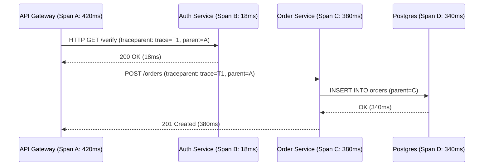
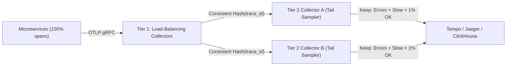
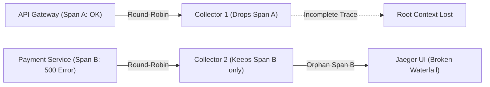

# Distributed Tracing Deep Dive: Spans, Head vs Tail Sampling, Backends

> **Prerequisites:** [Lesson 04: Prometheus & Grafana: Scraping, PromQL, Alertmanager & p99 Panels](../04-prometheus-grafana/README.md).  
> **Estimated Reading Time:** 25–28 minutes  
> **Target Audience:** Backend and distributed-systems engineers debugging cross-service latency, and candidates asked "how do you trace a request across 12 services and Kafka at 50,000 RPS without paying $1M/year?"  
> **Free PDF Notes:** [Download P5-SD-N-005.pdf](https://backendroadmap.com/notes/system-design/P5-SD-N-005.pdf)

> [!NOTE]
> **In one line:** **Distributed tracing** reconstructs the causal execution tree (**Trace**) of a single request as nested timed operations (**Spans**) across services and queues using W3C `traceparent` propagation—and uses **tail-based sampling** to retain 100% of errors and slow requests while dropping 99% of healthy noise.

> [!TIP]
> **The Golden Rule:** Propagate `traceparent` across *every* boundary (HTTP, gRPC, Kafka/SQS), use **head sampling** for ultra-low cost at the edge when needed, and use **tail sampling** in a trace-ID-aware Collector tier whenever you cannot afford to miss rare `p99` or `5xx` failures.

---

## 1. What Distributed Tracing Is, and What It Isn't

A user clicks "Checkout", and 4.2 seconds later receives a `504 Gateway Timeout`. Metrics tell you the API Gateway `p99` spiked, and logs show 15 different services handled thousands of concurrent requests at that second. **Distributed tracing** stitches every hop—`Gateway -> Auth -> Cart -> Inventory -> Postgres -> Kafka -> Payment`—into a single timeline waterfall, revealing that `Inventory` fired 48 sequential N+1 SQL queries while holding a lock.

| Term | Precise Meaning | Example |
| :--- | :--- | :--- |
| **Trace** | Directed Acyclic Graph (DAG) of all spans sharing one 128-bit `trace_id` | End-to-end execution of `POST /checkout` |
| **Span** | A single timed unit of work (`span_id`, `parent_span_id`, start, duration, tags) | `SELECT * FROM stock` (380 ms) |
| **Context Propagation** | Passing `trace_id` + `parent_span_id` + `trace_flags` across process boundaries | W3C `traceparent: 00-<32hex>-<16hex>-01` |
| **Span Link** | Non-parent causal reference (e.g., batch consumer processing 100 producer traces) | Kafka batch consumer linking to 100 `OrderPlaced` spans |
| **Head Sampling** | Keep/drop decision made at the *root span* before outcome is known | Deterministic 1% hash of `trace_id` at API Gateway |
| **Tail Sampling** | Keep/drop decision made *after* all spans of a trace arrive at Collector | Keep 100% of `status=ERROR` or `duration > 500ms`, 1% rest |
| **Trace Backend** | Storage + query engine for spans (Tempo, Jaeger, Zipkin, ClickHouse) | Object-storage backed Tempo or ClickHouse |
| **Not** | A replacement for metrics/alerting or a profiler for CPU flamegraphs | Tracing measures *cross-service* time, not line-by-line CPU |

### Why It Matters
1. **N+1 queries and sequential fan-outs are invisible in metrics:** A service making 40 fast 5 ms Redis calls looks healthy per-call, but a trace waterfall immediately exposes the 200 ms staircase.
2. **Sampling is the #1 architectural trade-off in tracing:** At 50,000 RPS, storing 100% of traces costs more than your entire compute fleet.
3. **Tail sampling requires stateful routing:** Every span with the same `trace_id` must land on the *same* Collector instance—a classic distributed systems interview topic.

---

## 2. Anatomy: Span Waterfall & Head vs Tail Sampling



| Sampling Strategy | Decision Point | Pros | Cons |
| :--- | :--- | :--- | :--- |
| **Head-Based (Probabilistic)** | Root span (Gateway) at $t = 0$ | Stateless, $O(1)$ RAM, zero collector coordination | Drops 99% of rare errors & `p99` outliers at 1% rate |
| **Tail-Based (Policy)** | Collector after trace completes ($t = T_{\text{end}}$) | Keeps 100% of errors, slow traces, and VIP tenants | Stateful: needs `trace_id` consistent hashing + RAM buffer |
| **Adaptive / Priority** | Hybrid (head + dynamic rate + tail) | Bounds collector RAM while prioritizing anomalies | Higher operational complexity |

> [!WARNING]
> **Tail Sampling Breaks Without Trace-ID Load Balancing.** If `Span A` lands on Collector-1 and `Span D` (error) lands on Collector-2 behind a round-robin load balancer, neither Collector sees the complete trace! You **must** deploy a two-tier Collector topology: Tier 1 (stateless Gateway) hashes `trace_id` to route all spans of a trace to the exact same Tier 2 (Tail-Sampling) Collector.

---

## 3. Mathematical Model: Trace Volume, Bandwidth & Tail-Sampler RAM

**Un-sampled Trace Volume ($V_{\text{raw}}$).** Given request rate $Q$ (req/s), average spans per trace $N_s$, and average serialized span size $B_s$ (bytes):

$$V_{\text{raw/sec}} = Q \times N_s \times B_s, \qquad V_{\text{raw/day}} = V_{\text{raw/sec}} \times 86{,}400$$

**Tail-Sampler Buffer RAM ($M_{\text{buf}}$).** A tail sampler must hold *all* incoming spans in memory for the decision wait window $W_{\text{wait}}$ (typically $10\text{–}30\text{ s}$ to let slow traces finish):

$$M_{\text{buf}} = V_{\text{raw/sec}} \times W_{\text{wait}} \times f_{\text{overhead}}$$

where $f_{\text{overhead}} \approx 2.0\text{–}3.0$ accounts for Go/Java object & index map overhead.

**Worked Numerical Example.** A platform serves $Q = 20{,}000\text{ req/s}$, with $N_s = 8\text{ spans/req}$ and $B_s = 800\text{ B/span}$:
- **Raw span rate:** $20{,}000 \times 8 = 160{,}000\text{ spans/sec}$.
- **Raw bandwidth:** $160{,}000 \times 800\text{ B} = 128\text{ MB/s} = 11.06\text{ TB/day}$ (prohibitive to store!).
- **Tail-sampler RAM ($W_{\text{wait}} = 15\text{ s}$, $f_{\text{overhead}} = 2.5$):**
  $$M_{\text{buf}} = 128\text{ MB/s} \times 15\text{ s} \times 2.5 = 4.8\text{ GB total RAM}$$
  Across 4 Tier-2 Collectors, each needs only $\sim 1.2\text{ GB}$ buffer RAM (provision 4 GB/pod).
- **Retained storage** (100% of 0.5% errors + 100% of 1% slow + 1% of healthy = $2.5\%$ effective):
  $$V_{\text{stored/day}} = 11.06\text{ TB} \times 0.025 \approx 276\text{ GB/day}$$
  (and with zstd/Parquet compression $\sim 4\times$, only **~70 GB/day** in S3!).

---

## 4. Metrics & Percentiles

| Metric | Meaning | Alert when |
| :--- | :--- | :--- |
| **Span drop rate (SDK / Collector)** | Spans discarded due to full ring buffer | $> 0.5\%$ (collector under-provisioned) |
| **Orphan / broken trace rate** | Child spans missing root span or `parent_span_id` | $> 2\%$ (header stripped at proxy/queue) |
| **Tail-sampler memory utilization** | RAM used by `decision_wait` trace map | $> 75\%$ (risk of OOM losing error traces) |
| **Trace export latency** | Time from span end to backend queryability | $> 60\text{ s}$ |
| **Effective sample rate** | `%` of total traces persisted | Sudden spike (error storm) or drop to `0%` |
| **Spans per trace `p99`** | Max fan-out depth/breadth | $> 500$ spans (runaway retry or N+1 loop) |

### Worked Example (Detecting an N+1 Query via Trace Metrics)
Your `OrderService` has a healthy `50 ms` average latency, but `p99` is `900 ms`. Checking `spans_per_trace` `p99` reveals `142 spans/trace` (vs median `6`). Opening one tail-sampled slow trace shows `120` sequential `SELECT * FROM product WHERE id = ?` child spans of `6 ms` each—an N+1 loop fixed in one PR by batching with `WHERE id IN (...)`.

---

## 5. Compounding & Failure Modes

| Failure Mode | Trigger | Compounding Effect |
| :--- | :--- | :--- |
| **Broken Context Propagation** | Proxy or Kafka consumer drops `traceparent` | 1 trace fragments into 5 disconnected mini-traces |
| **Tail-Sampler OOM** | Traffic spikes 5x; `decision_wait` holds 5x spans in RAM | Tail-sampler pods OOM-kill $\to$ 100% traces lost during spike |
| **Debug Flag / Header Abuse** | External client sends `traceparent: ...-01` (sampled=true) | Attacker forces 100% trace sampling on your backend |
| **Clock Skew Across Hosts** | NTP drift between Service A and Service B | Child span appears to start *before* its parent span |
| **Unbounded Span Attributes** | Attaching full 50 KB SQL results or JSON bodies to spans | Collector memory & backend storage blow up 20x |

---

## 6. Numbers Every Engineer Must Know

| Item | Typical | Implication |
| :--- | :---: | :--- |
| W3C `traceparent` header size | $55\text{ bytes}$ | Negligible network overhead per HTTP/gRPC hop |
| Average serialized span size | $500\text{–}1{,}500\text{ bytes}$ | Keep attributes concise; avoid dumping large payloads |
| Typical head-sampling rate (high QPS) | $0.1\%\text{–}5\%$ | Too low for rare bugs unless paired with tail sampling |
| Tail-sampler `decision_wait` | $10\text{–}30\text{ seconds}$ | Must exceed your `p99` end-to-end request duration |
| Trace backend compression (Parquet/Tempo) | $4\times\text{–}8\times$ | Object-storage backends (Tempo) cost $5\text{–}10\times$ less than ES |
| Max spans per trace before UI lags | $1{,}000\text{–}5{,}000$ | Aggregate tight loops into span events or attributes |

---

## 7. Mechanism Deep Dive: W3C `traceparent` & Two-Tier Tail Sampling



**W3C Trace Context Format:**
`traceparent: 00-4bf92f3577b34da6a3ce929d0e0e4736-00f067aa0ba902b7-01`
- `00`: Version (1 byte)
- `4bf92f3577b34da6a3ce929d0e0e4736`: 128-bit `trace_id` (16 bytes, globally unique)
- `00f067aa0ba902b7`: 64-bit `parent_span_id` (8 bytes, caller's span)
- `01`: `trace_flags` (`01` = sampled, `00` = not sampled)

| Question | Answer |
| :--- | :--- |
| **Should we trust incoming `traceparent` from public internet clients?** | **No.** At the edge API Gateway, generate a fresh `trace_id` (or reset the `sampled` flag) so external users cannot force 100% sampling or inject fake trace IDs; link their ID as an attribute if needed. |
| **How do you trace async batch jobs (e.g., 100 Kafka messages in 1 batch)?** | Don't pick one parent—create a new trace for the batch consumer and attach **Span Links** pointing to all 100 producer `(trace_id, span_id)` contexts. |
| **Tempo vs Jaeger/Elasticsearch?** | Jaeger on Elasticsearch indexes every tag (fast ad-hoc search, high RAM/disk cost). **Grafana Tempo** stores Parquet/traces in S3/GCS with TraceQL/Bloom filters—much cheaper at scale. |

**When not to use tail sampling:** If your traffic is $< 500\text{ RPS}$ total, storing 100% of traces (or 10% head-sampled) in cheap object storage (Tempo/S3) is simpler and avoids operating a stateful two-tier Collector fleet.

---

## 8. Hierarchical Budgets & Design Rules

| Slice | Rule | Control |
| :--- | :--- | :--- |
| **Propagation** | Use W3C Trace Context (`traceparent`, `tracestate`) everywhere | Standard OTel propagators across HTTP/gRPC/Kafka |
| **Edge Trust** | Strip or ignore untrusted external `sampled=01` flags at public ingress | API Gateway ingress policy |
| **Span Granularity** | Create spans for network/RPC/DB/queue boundaries, not every internal function | Keep $< 50$ spans per normal request |
| **Attributes** | Use OTel Semantic Conventions (`http.method`, `db.system`), max 1 KB/attribute | SDK `attribute_value_length_limit` |
| **Tail Sampling** | Two-tier Collector (`loadbalancing` exporter $\to$ `tail_sampling` processor) | Consistent hash on `trace_id` |
| **Async Links** | Use Span Links across fan-in batch consumers | Never drop context silently |

---

## 9. Top Mitigations

1. **Standardize on W3C `traceparent`** across all languages and gateways (replacing legacy `X-B3-*` or custom headers).
2. **Deploy two-tier Collectors for tail sampling** (`loadbalancing` by `trace_id` $\to$ `tail_sampling`) so related spans always meet on the same node.
3. **Never trust client-supplied `sampled=01` flags** from the public internet—enforce sampling policy at your edge gateway.
4. **Cap span attribute sizes and counts** in the SDK (`SpanLimits`) to prevent large SQL/JSON blobs from OOM-ing Collectors.
5. **Use Span Links for async batching** instead of creating 1,000-child fan-out trees.
6. **Verify clock sync (NTP/Chrony)** across all nodes so span waterfalls don't show negative child durations.
7. **Pair traces with Prometheus Exemplars** so engineers can jump from a `p99` alert straight to a slow trace.

---

## 10. Production Reference / War Story: The Broken Tail-Sampler Topology

A ride-sharing platform rolled out OpenTelemetry tail sampling to catch `100%` of `5xx` payment failures. They deployed 6 OTel Collector pods behind a standard Kubernetes `ClusterIP` Service (round-robin TCP/gRPC). For 3 weeks, on-call noticed that error traces in Jaeger were missing their root API Gateway spans and half of their error spans.



- **Root Cause:** Standard Kubernetes `ClusterIP` load-balanced gRPC connections round-robin across the 6 Collectors. `Span A` (root) went to Collector-1 (dropped as healthy), while `Span B` (500 error) went to Collector-2 (kept as an orphan).
- **Fix:** Deployed a stateless Tier-1 Collector gateway using OTel's `loadbalancing` exporter (`routing_key: traceID`) targeting a headless Kubernetes Service of Tier-2 Tail-Sampling Collectors. Every span for a given `trace_id` now deterministically routes to the same Tier-2 pod.

---

## 11. Multi-Language Production Code Tabs

W3C **`traceparent` parsing/injection** and **in-memory Tail-Sampling policy evaluator** across Go, TypeScript, Python, and C#.

````carousel
```go
// Go: Parse/generate W3C traceparent + tail-sampling policy evaluator.
package main

import (
	"crypto/rand"
	"encoding/hex"
	"fmt"
	"strings"
)

type Span struct {
	TraceID    string
	SpanID     string
	ParentID   string
	DurationMs float64
	IsError    bool
}

func NewTraceparent(traceID, spanID string, sampled bool) string {
	flag := "00"
	if sampled {
		flag = "01"
	}
	return fmt.Sprintf("00-%s-%s-%s", traceID, spanID, flag)
}

func ParseTraceparent(header string) (traceID, parentID string, ok bool) {
	parts := strings.Split(strings.TrimSpace(header), "-")
	if len(parts) != 4 || len(parts[1]) != 32 || len(parts[2]) != 16 {
		return "", "", false
	}
	return parts[1], parts[2], true
}

func RandomHex(nBytes int) string {
	b := make([]byte, nBytes)
	_, _ = rand.Read(b)
	return hex.EncodeToString(b)
}

func ShouldKeepTailTrace(spans []Span, slowMs float64) bool {
	for _, s := range spans {
		if s.IsError || s.DurationMs >= slowMs {
			return true
		}
	}
	return false
}
```
<!-- slide -->
```typescript
// TypeScript: W3C traceparent parser/builder + tail-sampling decision.
export interface Span {
  traceId: string;
  spanId: string;
  parentSpanId?: string;
  durationMs: number;
  isError: boolean;
}

export function parseTraceparent(header: string): { traceId: string; parentSpanId: string } | null {
  const parts = header.trim().split("-");
  if (parts.length !== 4 || parts[1].length !== 32 || parts[2].length !== 16) return null;
  return { traceId: parts[1], parentSpanId: parts[2] };
}

export function formatTraceparent(traceId: string, spanId: string, sampled: boolean): string {
  return `00-${traceId}-${spanId}-${sampled ? "01" : "00"}`;
}

export function shouldKeepTailTrace(spans: Span[], slowThresholdMs = 500, healthySampleRate = 0.01): boolean {
  if (spans.some((s) => s.isError || s.durationMs >= slowThresholdMs)) return true;
  // Deterministic hash-like fallback using first 4 hex chars of traceId
  const bucket = parseInt(spans[0].traceId.slice(0, 4), 16) / 0xffff;
  return bucket < healthySampleRate;
}
```
<!-- slide -->
```python
# Python: W3C traceparent parser + deterministic head/tail sampler (stdlib only).
import re
from dataclasses import dataclass

TRACEPARENT_RE = re.compile(r"^00-([0-9a-f]{32})-([0-9a-f]{16})-([0-9a-f]{2})$")


@dataclass
class Span:
    trace_id: str
    span_id: str
    duration_ms: float
    is_error: bool = False


def parse_traceparent(header: str) -> tuple[str, str, str] | None:
    m = TRACEPARENT_RE.match(header.strip())
    return (m.group(1), m.group(2), m.group(3)) if m else None


def should_keep_tail_trace(spans: list[Span], slow_ms: float = 500.0, healthy_rate: float = 0.01) -> bool:
    if any(s.is_error or s.duration_ms >= slow_ms for s in spans):
        return True
    if not spans:
        return False
    # Deterministic trace_id sampling so all spans agree
    ratio = int(spans[0].trace_id[:8], 16) / 0xFFFFFFFF
    return ratio < healthy_rate


if __name__ == "__main__":
    tid = "4bf92f3577b34da6a3ce929d0e0e4736"
    print("Valid:", parse_traceparent(f"00-{tid}-00f067aa0ba902b7-01"))
    print("Keep error:", should_keep_tail_trace([Span(tid, "00f067aa0ba902b7", 45.0, is_error=True)]))
```
<!-- slide -->
```csharp
// C#: W3C traceparent parser + tail-sampling policy evaluator.
public sealed record Span(string TraceId, string SpanId, double DurationMs, bool IsError);

public static class TracingHelper
{
    public static (string TraceId, string ParentId)? ParseTraceparent(string header)
    {
        var parts = header.Trim().Split('-');
        if (parts.Length != 4 || parts[1].Length != 32 || parts[2].Length != 16) return null;
        return (parts[1], parts[2]);
    }

    public static bool ShouldKeepTailTrace(IReadOnlyList<Span> spans, double slowMs = 500, double healthyRate = 0.01)
    {
        if (spans.Any(s => s.IsError || s.DurationMs >= slowMs)) return true;
        if (spans.Count == 0) return false;
        uint prefix = Convert.ToUInt32(spans[0].TraceId[..8], 16);
        return (prefix / (double)uint.MaxValue) < healthyRate;
    }
}
```
````

---

## 12. Hands-On CLI Verification Workflows

Test W3C `traceparent` propagation end-to-end with `curl` and verify tail-sampler buffer math:

```bash
# 1. Send a request with an explicit W3C traceparent header and inspect downstream logs/traces
TRACE_ID=$(openssl rand -hex 16)
SPAN_ID=$(openssl rand -hex 8)
curl -i -H "traceparent: 00-${TRACE_ID}-${SPAN_ID}-01" http://localhost:8080/api/orders
echo "Trace ID sent: $TRACE_ID"

# 2. Calculate Tail-Sampling Collector RAM & daily storage (Python 3)
python3 -c '
qps, spans_per_req, span_bytes, wait_s, overhead = 20000, 8, 800, 15, 2.5
raw_mb_s = qps * spans_per_req * span_bytes / (1024**2)
ram_gb = raw_mb_s * wait_s * overhead / 1024
print(f"Raw throughput: {raw_mb_s:.1f} MB/s | Tail-sampler RAM needed: {ram_gb:.2f} GB")
'

# 3. Query Grafana Tempo / Jaeger API for a specific trace_id
curl -s "http://localhost:3200/api/traces/${TRACE_ID}" | jq '.batches[0].scopeSpans[0].spans | length'
```

---

## 13. Common Mistakes to Avoid

1. **Deploying tail-sampling Collectors behind a round-robin load balancer** instead of consistent hashing by `trace_id`.
2. **Trusting `traceparent` `sampled=01` flags from untrusted public clients**, allowing sampling-amplification DoS.
3. **Using 1% head-based sampling alone** and wondering why rare 5xx errors have no traces.
4. **Forgetting to propagate `traceparent` across Kafka/SQS/RabbitMQ** message headers.
5. **Creating spans for every tight-loop iteration**, inflating trace size to thousands of spans.
6. **Storing large request/response bodies inside span attributes**, exhausting Collector RAM.
7. **Ignoring NTP clock skew**, leading to confusing waterfalls where child spans start before parents.

---

## 14. Key Terms Glossary

| Key Term | Definition |
| :--- | :--- |
| **Trace** | Complete end-to-end execution DAG of a request across distributed services. |
| **Span** | Single timed operation (`span_id`, `parent_span_id`, start, duration, attributes). |
| **W3C `traceparent`** | Standard HTTP header (`00-<trace_id>-<parent_span_id>-<flags>`) for context propagation. |
| **Head sampling** | Deciding whether to record a trace at the root span before the request finishes. |
| **Tail sampling** | Deciding whether to keep a trace *after* all spans complete (keeping errors/slowness). |
| **Consistent hashing (`trace_id`)** | Routing all spans sharing a `trace_id` to the exact same Collector instance. |
| **`decision_wait`** | Time window a tail sampler buffers a trace in RAM before evaluating keep/drop rules. |
| **Span Link** | Non-hierarchical reference connecting a span to one or more causal traces (e.g., batches). |
| **Orphan span** | Child span whose parent/root span was dropped or never arrived. |
| **TraceQL** | Grafana Tempo's query language for filtering traces by span attributes and structure. |

---

## 15. System Design Interview Questions & Answers

### Basic Conceptual Questions

<details>
<summary><strong>Q1: What is the difference between a Trace and a Span? [BASIC]</strong></summary>

**Answer:**
A **Span** represents a single timed operation (e.g., one RPC call or SQL query) with a `span_id`, `parent_span_id`, start time, duration, and attributes. A **Trace** is the entire directed acyclic graph (tree) of all spans sharing the same `trace_id` for a single request.
</details>

<details>
<summary><strong>Q2: How does context propagation work across microservices? [BASIC]</strong></summary>

**Answer:**
The caller injects the active `trace_id`, its `span_id` (as the next `parent_span_id`), and sampling flags into outbound transport metadata—typically the W3C `traceparent` HTTP/gRPC header or message broker header. The receiver extracts it and starts a child span referencing that parent.
</details>

<details>
<summary><strong>Q3: Compare head-based sampling vs tail-based sampling. [BASIC]</strong></summary>

**Answer:**
**Head sampling** decides keep/drop at the root span ($t=0$): it is stateless and cheap, but a 1% rate drops 99% of errors. **Tail sampling** buffers spans in the Collector until the trace completes ($t=T_{\text{end}}$) and keeps 100% of errors and slow traces while sampling healthy traffic at 1%, at the cost of stateful Collector routing and RAM.
</details>

<details>
<summary><strong>Q4: Why do we need Span Links for message queues / batch jobs? [BASIC]</strong></summary>

**Answer:**
If a Kafka consumer processes a batch of 100 messages from 100 different producer traces, it cannot have 100 parent spans in a tree. Instead, the batch span starts a new trace and attaches 100 **Span Links** pointing back to each producer's `(trace_id, span_id)`.
</details>

### Scenario-Based Architecture Questions

<details>
<summary><strong>Q5: You want to implement tail sampling across 10 OTel Collector pods. What happens if you put them behind a standard Kubernetes Service, and how do you fix it? [SCENARIO]</strong></summary>

**Answer:**
A standard round-robin Service sends different spans of the same `trace_id` to different Collector pods, breaking trace assembly and dropping root context. Fix it by adding a stateless Tier-1 Collector layer using the `loadbalancing` exporter (consistent hashing on `trace_id`) forwarding to the Tier-2 tail-sampling pods.
</details>

<details>
<summary><strong>Q6: A service handles 30,000 RPS with 10 spans/request (1 KB/span). How do you size the tail-sampling Collector tier? [SCENARIO]</strong></summary>

**Answer:**
Raw throughput is $30{,}000 \times 10 \times 1\text{ KB} = 300\text{ MB/s}$. With a 15-second `decision_wait` and $2.5\times$ memory overhead, you need $300\text{ MB/s} \times 15 \times 2.5 = 11.25\text{ GB}$ of active buffer RAM across the Tier-2 fleet (e.g., 6 pods with 4 GB RAM each for headroom).
</details>

<details>
<summary><strong>Q7: Your trace waterfall shows an API call taking 120 ms, with a single child span for Postgres taking 10 ms, and 110 ms of unexplained empty space. What could cause this? [SCENARIO]</strong></summary>

**Answer:**
Uninstrumented time! Common culprits: (1) waiting in a thread/connection pool *before* the DB span starts, (2) DNS/TLS handshake or HTTP client queueing, (3) GC pause or CPU starvation, or (4) an uninstrumented internal library/serialization step.
</details>

<details>
<summary><strong>Q8: An external attacker is sending `traceparent: 00-...-01` on every request, spiking your tracing bill 100x. How do you stop this? [SCENARIO]</strong></summary>

**Answer:**
Configure the public API Gateway / ingress to treat external `traceparent` headers as untrusted: generate a fresh root `trace_id` (and override `trace_flags` to your internal sampling policy), optionally storing the caller's ID in a separate attribute if needed for partner debugging.
</details>

### Advanced & Tricky Interview Questions

<details>
<summary><strong>Q9: How does a tail sampler handle a trace that spans an async queue where the consumer runs 5 minutes later? [TRICKY]</strong></summary>

**Answer:**
It cannot hold the producer trace in RAM for 5 minutes. The producer trace finishes and is sampled within `decision_wait` (15s). When the consumer runs 5 minutes later, it creates a new trace linked via `traceparent` / Span Link, and its own error/latency policy decides whether to keep the consumer segment.
</details>

<details>
<summary><strong>Q10: Why can child spans sometimes appear to start *before* their parent span in a trace UI? [TRICKY]</strong></summary>

**Answer:**
Clock skew between different hosts/VMs. Even with NTP, clocks can drift by 5–20 ms. Tracing UIs either display a skew warning or apply heuristic clock-skew adjustment using `client_send < server_recv` and `server_send < client_recv` invariants.
</details>

<details>
<summary><strong>Q11: Compare Elastic/Jaeger-style indexed tracing vs Grafana Tempo object-storage tracing at 100 TB/month. [TRICKY]</strong></summary>

**Answer:**
Elasticsearch indexes every span attribute into inverted indices, giving sub-second ad-hoc search but requiring massive SSD/RAM clusters ($5\text{–}10\times$ higher infra cost). Tempo writes compressed Parquet/blocks directly to S3/GCS with minimal indexing (TraceID + Bloom/Parquet column scans), trading slightly slower broad searches for dramatic cost savings.
</details>

<details>
<summary><strong>Q12: If you already have 1% head sampling at the Gateway, can tail sampling still recover 100% of downstream errors? [TRICKY]</strong></summary>

**Answer:**
No! If the Gateway dropped the trace at $t=0$ (`sampled=00`), downstream services won't emit spans for it, so the tail sampler never sees the error. To get 100% error capture with tail sampling, services must emit 100% of spans to the Collector tier, and the Collector makes the final drop decision.
</details>

---

## 16. One-Page Master Cheat Sheet

```
+---------------------------------------------------------------------------------------------------------+
|                    DISTRIBUTED TRACING — MASTER CHEAT SHEET                                             |
+---------------------------------------------------------------------------------------------------------+
| 1. DATA MODEL: Trace = DAG of Spans sharing 128-bit trace_id. Span = timed op + parent_span_id + tags.  |
+---------------------------------------------------------------------------------------------------------+
| 2. PROPAGATION: W3C traceparent: 00-<32hex trace_id>-<16hex span_id>-<01/00>. Untrusted at public edge! |
+---------------------------------------------------------------------------------------------------------+
| 3. HEAD vs TAIL SAMPLING:                                                                               |
|    - Head: Stateless, O(1) RAM, decided at t=0, misses rare errors at 1%.                               |
|    - Tail: Keeps 100% errors + slow (>SLO) + 1% healthy. Needs Tier-1 trace_id hash -> Tier-2 buffer.   |
+---------------------------------------------------------------------------------------------------------+
| 4. BUFFER MATH: Tail-Sampler RAM = (QPS * spans * bytes) * decision_wait_s * 2.5 overhead.              |
+---------------------------------------------------------------------------------------------------------+
| 5. ASYNC BATCHES: Use Span Links to connect batch consumer spans to N producer traces.                  |
+---------------------------------------------------------------------------------------------------------+
```

---

## Further Reading & Sources

- W3C Recommendation, [Trace Context Specification (`traceparent` / `tracestate`)](https://www.w3.org/TR/trace-context/).
- Ben Sigelman et al., [Dapper, a Large-Scale Distributed Systems Tracing Infrastructure](https://research.google/pubs/dapper-a-large-scale-distributed-systems-tracing-infrastructure/) (Google Research).
- OpenTelemetry Documentation, [Tail Sampling Processor & Load-Balancing Exporter](https://opentelemetry.io/docs/concepts/sampling/).
- Grafana Labs, [Grafana Tempo Architecture](https://grafana.com/docs/tempo/latest/operations/architecture/).

---

## Free PDF Notes

[P5-SD-N-005.pdf](https://backendroadmap.com/notes/system-design/P5-SD-N-005.pdf)

---

## Next

Continue with [Lesson 06: OpenTelemetry Explained: SDKs, Collector and OTLP (No Vendor Lock-In)](../06-opentelemetry-explained/README.md).
