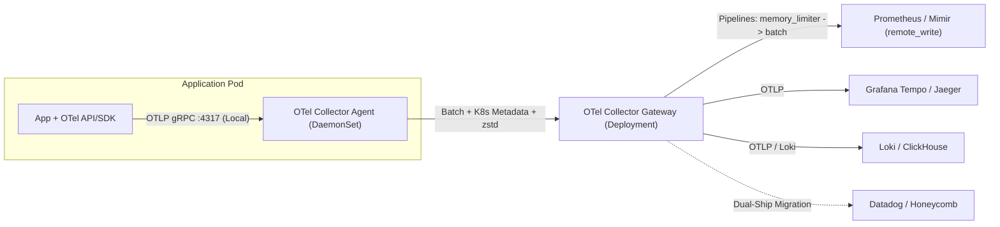
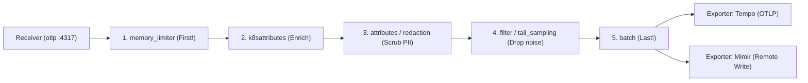
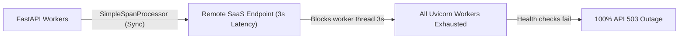

# OpenTelemetry Explained: SDKs, Collector and OTLP (No Vendor Lock-In)

> **Prerequisites:** [Lesson 05: Distributed Tracing Deep Dive: Spans, Head vs Tail Sampling, Backends](../05-distributed-tracing-deep-dive/README.md).  
> **Estimated Reading Time:** 24–28 minutes  
> **Target Audience:** Platform and backend engineers standardizing telemetry pipelines, and candidates asked "how do you switch from Datadog to Grafana/ClickHouse without rewriting 50 microservices?"  
> **Free PDF Notes:** [Download P5-SD-N-006.pdf](https://backendroadmap.com/notes/system-design/P5-SD-N-006.pdf)

> [!NOTE]
> **In one line:** **OpenTelemetry (OTel)** decouples *how* your application emits telemetry (**API + SDK** using vendor-neutral **OTLP** over gRPC/HTTP) from *where* it is processed and stored (**OTel Collector** pipelines: `receivers -> processors -> exporters`), eliminating vendor lock-in across traces, metrics, and logs.

> [!TIP]
> **The Golden Rule:** Instrument your code *only* against the **OpenTelemetry API/SDK**, export via **OTLP** to a local **OTel Collector** (Agent/Gateway), and keep all PII scrubbing, batching, tail-sampling, and vendor routing inside the Collector config—never in application code.

---

## 1. What OpenTelemetry Is, and What It Isn't

Five years ago, migrating from Datadog to Honeycomb or Prometheus + Jaeger meant ripping out proprietary SDKs across 60 repositories in Go, TypeScript, Python, and C#. **OpenTelemetry** (CNCF) solves this by separating the instrumentation **API** (what your code calls), the **SDK** (batching, context propagation, OTLP export), the **OTLP** wire protocol (Protobuf over gRPC `4317` or HTTP `4318`), and the **OTel Collector** (a pluggable telemetry proxy).

| Term | Precise Meaning | Example |
| :--- | :--- | :--- |
| **OTel API** | Zero-dependency interfaces for spans, metrics, and context; safe in libraries | `tracer.Start(ctx, "charge_card")` |
| **OTel SDK** | Language runtime implementation: batching, sampling, OTLP serialization | `BatchSpanProcessor`, `PeriodicExportingMetricReader` |
| **OTLP** | OpenTelemetry Protocol: Protobuf over gRPC (`:4317`) or HTTP (`:4318`) | Unified wire format for traces, metrics, and logs |
| **OTel Collector** | Vendor-neutral binary: `Receivers -> Processors -> Exporters` | Runs as DaemonSet agent or Deployment gateway |
| **Semantic Conventions** | Standardized attribute names across all languages and vendors | `http.request.method`, `db.system`, `service.name` |
| **Auto-Instrumentation** | Zero-code / bytecode / eBPF hooks for HTTP, gRPC, SQL, Redis | `opentelemetry-instrument python app.py` |
| **Not** | A storage database or dashboard UI | OTel *collects & routes* telemetry; Prometheus/Tempo/Datadog *store* it |

### Why It Matters
1. **Zero vendor lock-in:** Switching backends (or dual-shipping during a migration) is a 5-line Collector YAML change—zero application deploys.
2. **Unified context across all 3 signals:** OTel binds `trace_id`, `span_id`, and `resource` attributes (`service.name`, `k8s.pod.name`) across traces, metrics, and logs.
3. **Centralized governance:** PII redaction, cardinality limits, and tail sampling live in one ops-managed Collector pipeline rather than 50 service repos.

---

## 2. Anatomy: SDK $\to$ Agent Collector $\to$ Gateway Collector $\to$ Backends



| Collector Component | Role | Common Plugins |
| :--- | :--- | :--- |
| **Receivers** | Ingest telemetry (push or pull) | `otlp`, `prometheus`, `filelog`, `jaeger` |
| **Processors** | Transform, filter, redact, batch, protect RAM | `memory_limiter`, `k8sattributes`, `attributes` (redact), `tail_sampling`, `batch` |
| **Exporters** | Send telemetry to one or more backends | `otlp`, `prometheusremotewrite`, `loki`, `datadog` |
| **Extensions** | Health checks, pprof, zpages diagnostics | `health_check`, `zpages` |

> [!WARNING]
> **Always put `memory_limiter` FIRST in every Collector processor pipeline.** Without `memory_limiter`, a downstream backend slowdown causes the Collector's `batch` and `tail_sampling` queues to grow unchecked until Linux OOM-kills the Collector—losing all buffered telemetry.

---

## 3. Mathematical Model: Batching Efficiency & Collector Memory Budget

**OTLP Network & CPU Savings via Batching.** Sending 1 span per HTTP/gRPC call incurs ~2 KB of TCP/TLS/HTTP2 framing overhead per span. Batching $N_b$ spans into one compressed OTLP request reduces framing overhead by $N_b\times$ and improves zstd compression ratio $r_c$ ($3\text{–}5\times$).

$$\text{Requests/sec} = \frac{Q \times N_s}{N_b}, \qquad \text{Egress Bytes/sec} = \frac{Q \times N_s \times B_s}{r_c}$$

**Collector Memory Budget (`memory_limiter`).** For a Collector container with memory limit $M_{\text{container}}$:

$$M_{\text{soft}} = 0.75 \times M_{\text{container}}, \qquad M_{\text{hard}} = 0.85 \times M_{\text{container}}$$

leaving $15\text{–}25\%$ headroom for Go garbage collection spikes.

**Worked Numerical Example.** A service emits $25{,}000\text{ spans/sec}$ ($B_s = 900\text{ B}$).
- **Unbatched ($N_b = 1$, $r_c = 1$):** $25{,}000\text{ RPCs/sec}$, $\sim 25{,}000 \times (900 + 2000)\text{ B} = 72.5\text{ MB/s}$ network egress + high CPU serialization.
- **Batched (`send_batch_size: 512`, `timeout: 2s`, zstd $r_c = 4$):**
  $$\text{RPCs/sec} = \frac{25{,}000}{512} \approx 48.8\text{ RPCs/sec} \quad (512\times\text{ fewer RPCs!})$$
  $$\text{Egress} = \frac{25{,}000 \times 900}{4} = 5.625\text{ MB/s} \quad (12.9\times\text{ less bandwidth!})$$
- **Container Sizing:** With a 2 GiB Collector pod, set `memory_limiter` `limit_mib: 1536` (75%) and `spike_limit_mib: 384` (soft threshold at 1,152 MiB).

---

## 4. Metrics & Percentiles

| Metric (Collector Internal `:8888`) | Meaning | Alert when |
| :--- | :--- | :--- |
| **`otelcol_processor_refused_spans`** | Spans refused by `memory_limiter` (backpressure) | $> 0$ sustained (scale Collector or tune sampling) |
| **`otelcol_exporter_send_failed_spans`** | Spans dropped after exporter retry exhaustion | $> 0$ (downstream backend down or auth error) |
| **`otelcol_exporter_queue_size`** | Current items waiting in exporter retry queue | $> 80\%$ of `queue_size` |
| **`otelcol_processor_batch_batch_send_size`** | Actual batch sizes emitted | Consistently $\ll 100$ (timeout too short or low traffic) |
| **`otelcol_process_memory_rss`** | Collector resident memory | Approaching `limit_mib` |
| **SDK dropped spans (`BatchSpanProcessor`)** | Spans dropped inside app pod before reaching Collector | $> 0$ (agent unreachable or `max_queue_size` too small) |

### Worked Example (Zero-Downtime Vendor Migration)
To migrate 80 microservices from Vendor A to Grafana Stack (Mimir + Tempo + Loki) with zero code changes:
1. Keep all apps exporting OTLP to the Gateway Collector.
2. Add `otlp/tempo` and `prometheusremotewrite/mimir` exporters alongside `vendor_a` in `service.pipelines`.
3. Verify dashboards and alert parity for 7 days while dual-shipping.
4. Remove `vendor_a` from the Collector `exporters` list and reload—zero app PRs or restarts.

---

## 5. Compounding & Failure Modes

| Failure Mode | Trigger | Compounding Effect |
| :--- | :--- | :--- |
| **SimpleSpanProcessor in Prod** | Using synchronous `SimpleSpanProcessor` instead of `BatchSpanProcessor` | Every span blocks app thread on network I/O; latency spikes 5x |
| **Missing `memory_limiter`** | Backend stalls; Collector queues fill unbounded | Collector OOM-kills in a loop; all pods lose telemetry |
| **Processor Ordering Bug** | Putting `batch` *before* `memory_limiter` or `tail_sampling` | `tail_sampling` receives split batches; `memory_limiter` acts too late |
| **SDK Version Mismatch** | Library imports OTel API v1.x; app uses incompatible v0.x SDK | Silent no-op tracer; zero spans emitted |
| **Unbounded Retry Queue** | `retry_on_failure` + huge `queue_size` during 1-hour backend outage | Collector exhausts RAM or replays stale spike hours later |

---

## 6. Numbers Every Engineer Must Know

| Item | Typical | Implication |
| :--- | :---: | :--- |
| OTLP gRPC / HTTP standard ports | `4317` (gRPC) / `4318` (HTTP) | Default endpoints (`localhost:4317` for DaemonSet agent) |
| SDK `BatchSpanProcessor` queue | `2,048` spans, batch `512`, `5s` delay | Bounds app memory to $\sim 2\text{–}5\text{ MB}$ per pod |
| Collector `batch` processor | `send_batch_size: 512–8192`, `timeout: 1–5s` | Cuts RPC count by $500\times$ and enables zstd compression |
| Collector `memory_limiter` ceiling | $75\%\text{–}80\%$ of container RAM | Leaves $20\%$ headroom for Go GC spikes |
| OTel Collector binary footprint | $\sim 50\text{–}150\text{ MB}$ RAM idle | Safe to run as a per-node DaemonSet agent |
| Auto-instrumentation overhead | $1\%\text{–}3\%$ CPU | Acceptable for most services; profile ultra-low-latency paths |

---

## 7. Mechanism Deep Dive: Collector Pipeline Ordering & Dual-Export



| Question | Answer |
| :--- | :--- |
| **Why MUST `memory_limiter` be first and `batch` be last?** | `memory_limiter` must reject excess load *before* processors allocate memory; `batch` must run *after* filtering/sampling so you don't batch spans that are about to be dropped. |
| **Agent (DaemonSet) vs Gateway (Deployment) Collector?** | **Agent** runs on every node (`localhost:4317`) for fast local handoff, `filelog` tailing, and `k8sattributes` enrichment. **Gateway** runs centrally for heavy `tail_sampling`, PII scrubbing, and fan-out to backends. |
| **Manual vs Auto-Instrumentation?** | **Auto-instrumentation** gives instant HTTP/DB/gRPC spans in 5 minutes; add **manual spans/attributes** for business context (`order.value_cents`, `tenant.tier`). |
| **Why OTLP/gRPC (`4317`) vs OTLP/HTTP (`4318`)?** | gRPC supports HTTP/2 multiplexing and streaming; OTLP/HTTP (`4318`) works better in serverless (AWS Lambda) or browsers/proxies that struggle with long-lived gRPC connections. |

**When not to run a Gateway Collector:** For small clusters ($< 10$ nodes) using head sampling and a single OTLP backend, a per-node DaemonSet Agent exporting directly to the backend avoids an extra network hop.

---

## 8. Hierarchical Budgets & Design Rules

| Slice | Rule | Control |
| :--- | :--- | :--- |
| **App Instrumentation** | Import *only* OTel API/SDK; never vendor-specific SDKs | Dependency lint / architecture review |
| **SDK Processor** | Always `BatchSpanProcessor` (async, bounded queue) | Never `SimpleSpanProcessor` in production |
| **Semantics** | Follow OTel Semantic Conventions (`service.name`, `http.route`) | Shared org bootstrap helper |
| **Collector Order** | `memory_limiter` $\to$ enrich/redact $\to$ sample $\to$ `batch` | Validated via `otelcol validate` in CI |
| **Security** | Redact secrets/PII in Collector `attributes`/`transform` processor | Defense-in-depth beyond app logger |
| **Resilience** | Enable `sending_queue` + `retry_on_failure` with bounded max elapsed time | Prevents infinite retry memory leaks |

---

## 9. Top Mitigations

1. **Always use `BatchSpanProcessor`** in application SDKs so telemetry export never blocks request threads.
2. **Place `memory_limiter` first and `batch` last** in every OTel Collector pipeline.
3. **Run a DaemonSet Agent on `localhost:4317`** so pods never fail DNS/TLS handshakes to remote collectors on startup.
4. **Use OTel Semantic Conventions** (`service.name`, `deployment.environment`, `http.route`) so dashboards work uniformly across Go, Node, Python, and C#.
5. **Centralize PII scrubbing and cardinality caps in the Collector** using the `transform` / `attributes` processors.
6. **Monitor the Collector itself** by scraping `:8888/metrics` (`otelcol_processor_refused_spans`, `otelcol_exporter_send_failed_spans`).
7. **Validate Collector YAML in CI** with `otelcol --config=otel.yaml validate` before rolling out changes.

---

## 10. Production Reference / War Story: The Synchronous SDK & Missing `memory_limiter`

A SaaS platform instrumented a Python FastAPI service with OpenTelemetry and accidentally left `SimpleSpanProcessor` enabled from a local dev tutorial, pointing directly to a remote SaaS OTLP endpoint. When the SaaS endpoint experienced a 3-second TLS/HTTP slowdown:



- **Root Cause:** `SimpleSpanProcessor` exports every span *synchronously* on the request thread. A 3-second telemetry hiccup stalled every API worker, failing Kubernetes readiness probes and taking down production.
- **Fix:** (1) Switched to `BatchSpanProcessor` exporting asynchronously to a local `localhost:4317` OTel Collector DaemonSet; (2) Configured `memory_limiter` (first) and `batch` (last) in the Collector with bounded `sending_queue` so downstream slowness drops telemetry gracefully instead of affecting API traffic.

---

## 11. Multi-Language Production Code Tabs

Idiomatic **OTel-compatible Resource + Batching OTLP Exporter Pattern** and **Collector `otel-config.yaml`** across Go, TypeScript, Python, and C# (zero-dependency runnable examples showing the exact SDK architecture).

````carousel
```go
// Go: Bounded BatchSpanProcessor pattern + OTLP-shaped JSON payload export.
package main

import (
	"context"
	"fmt"
	"sync"
	"time"
)

type OTelSpan struct {
	TraceID    string            `json:"traceId"`
	SpanID     string            `json:"spanId"`
	Name       string            `json:"name"`
	Attributes map[string]string `json:"attributes"`
}

type BatchSpanProcessor struct {
	queue     chan OTelSpan
	batchSize int
	wg        sync.WaitGroup
}

func NewBatchSpanProcessor(maxQueue, batchSize int) *BatchSpanProcessor {
	b := &BatchSpanProcessor{queue: make(chan OTelSpan, maxQueue), batchSize: batchSize}
	b.wg.Add(1)
	go b.run()
	return b
}

// OnEnd never blocks the request thread: drops if queue is full.
func (b *BatchSpanProcessor) OnEnd(s OTelSpan) {
	select {
	case b.queue <- s:
	default: // Increment otel_sdk_dropped_spans metric
	}
}

func (b *BatchSpanProcessor) run() {
	defer b.wg.Done()
	ticker := time.NewTicker(2 * time.Second)
	defer ticker.Stop()
	batch := make([]OTelSpan, 0, b.batchSize)

	flush := func() {
		if len(batch) > 0 {
			fmt.Printf("Exporting OTLP batch of %d spans to localhost:4317\n", len(batch))
			batch = batch[:0]
		}
	}
	for {
		select {
		case s, ok := <-b.queue:
			if !ok {
				flush()
				return
			}
			batch = append(batch, s)
			if len(batch) >= b.batchSize {
				flush()
			}
		case <-ticker.C:
			flush()
		}
	}
}

func (b *BatchSpanProcessor) Shutdown(ctx context.Context) { close(b.queue); b.wg.Wait() }
```
<!-- slide -->
```typescript
// TypeScript: Non-blocking BatchSpanProcessor exporting OTLP batches.
export interface OTelSpan {
  traceId: string;
  spanId: string;
  name: string;
  attributes: Record<string, string | number>;
}

export class BatchSpanProcessor {
  private queue: OTelSpan[] = [];
  private timer: ReturnType<typeof setInterval>;

  constructor(
    private readonly maxQueueSize = 2048,
    private readonly maxBatchSize = 512,
    private readonly flushIntervalMs = 2000
  ) {
    this.timer = setInterval(() => void this.flush(), this.flushIntervalMs);
  }

  // Never blocks request execution; drops newest when full
  onEnd(span: OTelSpan): boolean {
    if (this.queue.length >= this.maxQueueSize) return false;
    this.queue.push(span);
    if (this.queue.length >= this.maxBatchSize) void this.flush();
    return true;
  }

  async flush(): Promise<void> {
    if (this.queue.length === 0) return;
    const batch = this.queue.splice(0, this.maxBatchSize);
    // In prod: POST OTLP/HTTP to http://localhost:4318/v1/traces
    console.log(`Exported OTLP batch: ${batch.length} spans`);
  }

  async shutdown(): Promise<void> {
    clearInterval(this.timer);
    await this.flush();
  }
}
```
<!-- slide -->
```python
# Python: Bounded BatchSpanProcessor + OTLP Collector YAML generator (stdlib only).
import queue
import threading

COLLECTOR_YAML = """receivers:
  otlp:
    protocols:
      grpc: { endpoint: "0.0.0.0:4317" }
      http: { endpoint: "0.0.0.0:4318" }
processors:
  memory_limiter: { check_interval: 1s, limit_mib: 1536, spike_limit_mib: 384 }
  batch: { send_batch_size: 512, timeout: 2s }
exporters:
  otlp/tempo: { endpoint: "tempo:4317", tls: { insecure: true } }
service:
  pipelines:
    traces:
      receivers: [otlp]
      processors: [memory_limiter, batch]
      exporters: [otlp/tempo]
"""


class BatchSpanProcessor:
    def __init__(self, max_queue: int = 2048, batch_size: int = 512) -> None:
        self.q: queue.Queue = queue.Queue(maxsize=max_queue)
        self.batch_size = batch_size
        self.dropped = 0
        self._stop = threading.Event()
        self._worker = threading.Thread(target=self._run, daemon=True)
        self._worker.start()

    def on_end(self, span: dict) -> None:
        try:
            self.q.put_nowait(span)
        except queue.Full:
            self.dropped += 1

    def _run(self) -> None:
        batch = []
        while not self._stop.is_set() or not self.q.empty():
            try:
                batch.append(self.q.get(timeout=1.0))
                if len(batch) >= self.batch_size:
                    self._export(batch)
                    batch = []
            except queue.Empty:
                if batch:
                    self._export(batch)
                    batch = []

    def _export(self, batch: list[dict]) -> None:
        print(f"Exported OTLP batch of {len(batch)} spans (dropped={self.dropped})")
```
<!-- slide -->
```csharp
// C#: Non-blocking BatchSpanProcessor using System.Threading.Channels.
using System.Threading.Channels;

public sealed record OTelSpan(string TraceId, string SpanId, string Name, Dictionary<string, string> Attributes);

public sealed class BatchSpanProcessor : IAsyncDisposable
{
    private readonly Channel<OTelSpan> _channel;
    private readonly int _batchSize;
    private readonly Task _worker;

    public BatchSpanProcessor(int maxQueue = 2048, int batchSize = 512)
    {
        _batchSize = batchSize;
        _channel = Channel.CreateBounded<OTelSpan>(new BoundedChannelOptions(maxQueue)
        {
            FullMode = BoundedChannelFullMode.DropWrite
        });
        _worker = Task.Run(FlushLoopAsync);
    }

    public bool OnEnd(OTelSpan span) => _channel.Writer.TryWrite(span);

    private async Task FlushLoopAsync()
    {
        var batch = new List<OTelSpan>(_batchSize);
        await foreach (var span in _channel.Reader.ReadAllAsync())
        {
            batch.Add(span);
            if (batch.Count >= _batchSize || _channel.Reader.Count == 0)
            {
                Console.WriteLine($"Exported OTLP batch of {batch.Count} spans");
                batch.Clear();
            }
        }
    }

    public async ValueTask DisposeAsync()
    {
        _channel.Writer.Complete();
        await _worker;
    }
}
```
````

---

## 12. Hands-On CLI Verification Workflows

Validate an OTel Collector config, send a test OTLP payload, and inspect Collector internal health metrics:

```bash
# 1. Validate Collector YAML syntax and pipeline wiring
otelcol-contrib validate --config=otel-collector-config.yaml

# 2. Send a synthetic OTLP/HTTP trace span to localhost:4318
curl -s -X POST http://localhost:4318/v1/traces \
  -H "Content-Type: application/json" \
  -d '{"resourceSpans":[{"resource":{"attributes":[{"key":"service.name","value":{"stringValue":"cli-test"}}]},"scopeSpans":[{"spans":[{"traceId":"4bf92f3577b34da6a3ce929d0e0e4736","spanId":"00f067aa0ba902b7","name":"test-span","startTimeUnixNano":"1700000000000000000","endTimeUnixNano":"1700000000050000000"}]}]}]}'

# 3. Check Collector internal health & dropped telemetry counters
curl -s http://localhost:8888/metrics | grep -E 'otelcol_(processor_refused|exporter_send_failed|exporter_queue_size)'
```

---

## 13. Common Mistakes to Avoid

1. **Using `SimpleSpanProcessor` in production**, blocking request threads on network exports.
2. **Omitting `memory_limiter`** or placing it *after* `batch`/`tail_sampling` in the Collector pipeline.
3. **Hardcoding vendor SDKs** alongside OTel, re-introducing the exact lock-in OTel was meant to remove.
4. **Skipping OTel Semantic Conventions** (`service.name`, `http.route`), breaking cross-service dashboards.
5. **Not monitoring `:8888/metrics` on the Collector**, leaving dropped-span outages invisible.
6. **Shipping uncompressed OTLP** over cross-AZ/WAN links (always enable `compression: zstd` or `gzip`).
7. **Forgetting to flush (`Shutdown()`) the SDK** on `SIGTERM`, losing the last 2–5 seconds of error spans when a pod crashes or scales down.

---

## 14. Key Terms Glossary

| Key Term | Definition |
| :--- | :--- |
| **OpenTelemetry (OTel)** | CNCF standard API, SDK, protocol (OTLP), and Collector for traces, metrics, and logs. |
| **OTLP** | OpenTelemetry Protocol (Protobuf over gRPC `:4317` or HTTP `:4318`). |
| **OTel Collector** | Vendor-neutral telemetry proxy built from Receivers, Processors, and Exporters. |
| **Receiver** | Collector component ingesting data (`otlp`, `prometheus`, `filelog`). |
| **Processor** | Collector stage modifying/protecting data (`memory_limiter`, `batch`, `tail_sampling`). |
| **Exporter** | Collector output sending data to backends (`otlp`, `prometheusremotewrite`, `datadog`). |
| **`BatchSpanProcessor`** | Async SDK processor buffering spans and flushing in compressed batches. |
| **`memory_limiter`** | Collector processor that applies backpressure before Go OOMs occur. |
| **Semantic Conventions** | Standardized attribute names (`service.name`, `db.system`) across all languages. |
| **Auto-instrumentation** | Zero-code instrumentation hooking frameworks/drivers at runtime. |

---

## 15. System Design Interview Questions & Answers

### Basic Conceptual Questions

<details>
<summary><strong>Q1: How does OpenTelemetry eliminate vendor lock-in? [BASIC]</strong></summary>

**Answer:**
Applications instrument once against the vendor-neutral OTel API/SDK and emit **OTLP** to an **OTel Collector**. Switching from Datadog to Grafana/ClickHouse (or dual-shipping during migration) requires changing only the Collector's `exporters` YAML—zero application code changes or redeployments.
</details>

<details>
<summary><strong>Q2: What are the three core components of an OTel Collector pipeline? [BASIC]</strong></summary>

**Answer:**
1. **Receivers** ingest telemetry (push like `otlp`, or pull like `prometheus`). 2. **Processors** transform, enrich, redact, sample, and batch data (`memory_limiter`, `k8sattributes`, `batch`). 3. **Exporters** forward data to one or more backends (`otlp`, `prometheusremotewrite`, `loki`).
</details>

<details>
<summary><strong>Q3: Why is `BatchSpanProcessor` mandatory in production instead of `SimpleSpanProcessor`? [BASIC]</strong></summary>

**Answer:**
`SimpleSpanProcessor` exports every span synchronously on the request thread—if the Collector or network stalls, your API stalls. `BatchSpanProcessor` pushes spans into a bounded in-memory ring buffer and flushes asynchronously in compressed batches, dropping telemetry gracefully if full.
</details>

<details>
<summary><strong>Q4: What is OTLP and which ports does it use? [BASIC]</strong></summary>

**Answer:**
OTLP (OpenTelemetry Protocol) is a unified Protobuf schema for traces, metrics, and logs. It runs over gRPC on port `4317` (preferred for persistent service-to-collector streams) and HTTP/Protobuf or JSON on port `4318` (preferred for serverless/browsers).
</details>

### Scenario-Based Architecture Questions

<details>
<summary><strong>Q5: Your company wants to migrate from Datadog to self-hosted Grafana (Mimir + Tempo + Loki) across 80 services with zero downtime. How do you execute this? [SCENARIO]</strong></summary>

**Answer:**
First standardize all services on OTel SDKs exporting OTLP to a Gateway OTel Collector. Configure the Collector to **dual-export** to both Datadog and Mimir/Tempo/Loki simultaneously. Validate dashboard and alert parity in Grafana for 1–2 weeks, then remove the Datadog exporter from the Collector config.
</details>

<details>
<summary><strong>Q6: Your OTel Collector pods are OOM-crashing during traffic spikes. What is misconfigured? [SCENARIO]</strong></summary>

**Answer:**
Either `memory_limiter` is missing or placed *after* `batch`/`tail_sampling` in `service.pipelines`. Put `memory_limiter` as the **very first** processor (`limit_mib` at ~75% of container RAM), reduce `sending_queue` sizes, enable `zstd` compression, and scale the Collector tier horizontally.
</details>

<details>
<summary><strong>Q7: When should you run the OTel Collector as a DaemonSet Agent vs a central Gateway Deployment? [SCENARIO]</strong></summary>

**Answer:**
Run both in larger clusters: the **DaemonSet Agent** on every node handles `localhost:4317` ingestion, `filelog` stdout tailing, and local `k8sattributes` enrichment with zero cross-node hops. The **Gateway Deployment** handles stateful `tail_sampling`, centralized PII redaction, and external backend exports/retries.
</details>

<details>
<summary><strong>Q8: Security requires that no credit card numbers or JWTs ever leave your VPC to a SaaS observability vendor. Where do you enforce this? [SCENARIO]</strong></summary>

**Answer:**
Enforce defense-in-depth: (1) redact at the application logger/SDK, and (2) add `attributes` / `transform` / `redaction` processors inside your self-hosted **Gateway OTel Collector** inside the VPC to strip sensitive keys and regex-scrub payloads *before* the external exporter sends data out.
</details>

### Advanced & Tricky Interview Questions

<details>
<summary><strong>Q9: Why does `BatchSpanProcessor` risk losing the last few seconds of telemetry on Kubernetes pod termination, and how do you fix it? [TRICKY]</strong></summary>

**Answer:**
Because spans sit in memory for up to `schedule_delay` (e.g., 5s) before flushing. If the process exits immediately on `SIGTERM`, buffered error spans from a crash are lost. Always register a graceful shutdown hook calling `tracerProvider.Shutdown(ctx)` with a 2–5s timeout before exiting.
</details>

<details>
<summary><strong>Q10: Why is the order of processors in an OTel Collector YAML critical? [TRICKY]</strong></summary>

**Answer:**
Processors execute sequentially as listed. `memory_limiter` must be first to shed load before memory is allocated; `k8sattributes` and `transform` (redaction) run next; `filter`/`tail_sampling` drop unwanted spans; and `batch` must be **last** so you only batch spans that survived filtering.
</details>

<details>
<summary><strong>Q11: How does OpenTelemetry handle a library (e.g., an HTTP client) that wants to emit spans without forcing an SDK dependency on its users? [TRICKY]</strong></summary>

**Answer:**
OpenTelemetry strictly separates the lightweight **API** package from the **SDK** implementation. Libraries depend *only* on the OTel API. If the host application doesn't configure an SDK, the API uses a zero-cost no-op implementation; if the app registers an SDK, library spans automatically join the active trace.
</details>

<details>
<summary><strong>Q12: Can OTel Collector convert logs or traces into Prometheus metrics? [TRICKY]</strong></summary>

**Answer:**
Yes! The `spanmetrics` **connector** inside the OTel Collector inspects incoming spans in-flight and synthesizes RED metrics (request rate, error rate, and duration histograms) with bounded dimensions—giving you service-level metrics even for services that only emit traces.
</details>

---

## 16. One-Page Master Cheat Sheet

```
+---------------------------------------------------------------------------------------------------------+
|                    OPENTELEMETRY (OTEL) — MASTER CHEAT SHEET                                            |
+---------------------------------------------------------------------------------------------------------+
| 1. DECOUPLING: App -> OTel API/SDK -> OTLP (gRPC :4317 / HTTP :4318) -> OTel Collector -> Any Backend.  |
+---------------------------------------------------------------------------------------------------------+
| 2. SDK RULE: Always use BatchSpanProcessor (async, bounded queue) + Shutdown() hook on SIGTERM.         |
+---------------------------------------------------------------------------------------------------------+
| 3. COLLECTOR PIPELINE ORDER:                                                                            |
|    Receivers -> [1. memory_limiter -> 2. enrich/redact -> 3. sample -> 4. batch] -> Exporters.          |
+---------------------------------------------------------------------------------------------------------+
| 4. TOPOLOGY: DaemonSet Agent (localhost:4317, filelog, k8s meta) -> Gateway (tail_sampling, dual-ship). |
+---------------------------------------------------------------------------------------------------------+
| 5. HEALTH: Scrape Collector :8888/metrics (refused_spans, send_failed_spans, queue_size).               |
+---------------------------------------------------------------------------------------------------------+
```

---

## Further Reading & Sources

- OpenTelemetry Documentation, [Architecture, OTLP Specification & Collector Configuration](https://opentelemetry.io/docs/collector/).
- Ted Young & Austin Parker, *Learning OpenTelemetry* (O'Reilly, 2024).
- OpenTelemetry Specification, [Semantic Conventions](https://opentelemetry.io/docs/specs/semconv/).
- CNCF, [OpenTelemetry Collector Best Practices & Sizing](https://opentelemetry.io/docs/collector/scaling/).

---

## Free PDF Notes

[P5-SD-N-006.pdf](https://backendroadmap.com/notes/system-design/P5-SD-N-006.pdf)

---

## Next

Continue with [Lesson 07: Correlation and Trace IDs: Follow One Request Through Every Log](../07-correlation-and-trace-ids/README.md).
