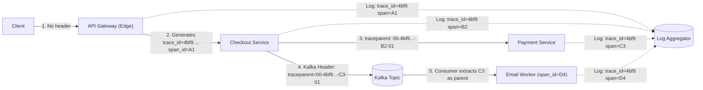
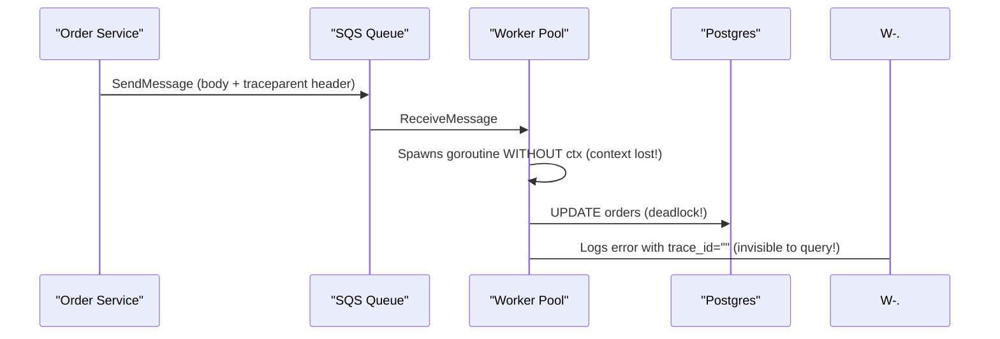

# Correlation and Trace IDs: Follow One Request Through Every Log

> **Prerequisites:** [Lesson 06: OpenTelemetry Explained](../06-opentelemetry-explained/README.md).  
> **Estimated Reading Time:** 22–26 minutes  
> **Target Audience:** Backend engineers debugging distributed microservices, and candidates asked "how do you trace a single user request across 15 services and async queues?"  
> **Free PDF Notes:** [Download P5-SD-N-007.pdf](https://backendroadmap.com/notes/system-design/P5-SD-N-007.pdf)

> [!NOTE]
> **In one line:** A **correlation ID** (business/request handle) and a **W3C Trace ID** (`traceparent`) let you stitch every log line, metric exemplar, and span across synchronous HTTP/gRPC hops and asynchronous message queues into a single causal timeline—turning "grep 40 servers and guess" into a 5-second query.

> [!TIP]
> **The Golden Rule:** Generate the trace context **once at the edge** (API gateway or ingress), propagate the W3C `traceparent` header across **every** outbound HTTP/gRPC call, message header, and background job, and inject `trace_id` + `span_id` automatically into **every** structured log line via context/MDC—never via manual string concatenation.

---

## 1. What Correlation and Trace IDs Are, and What They Isn't

A user clicks "Pay Now." The request hits the API gateway, calls Auth, Checkout, Inventory, Payment, and publishes an `OrderPlaced` event to Kafka, which triggers Email and Analytics workers 400 ms later. When Payment throws a `502 Bad Gateway`, your log aggregator has 80,000 log lines per second from 120 pods. Without a shared identifier stamped at the edge and carried through every hop, finding which Inventory lock or Auth token caused that specific Checkout failure is impossible.

| Term | Precise Meaning | Example |
| :--- | :--- | :--- |
| **Trace ID (`trace_id`)** | A 128-bit (32 hex char) globally unique ID representing an entire end-to-end distributed execution | `4bf92f3577b34da6a3ce929d0e0e4736` |
| **Span ID (`span_id`)** | A 64-bit (16 hex char) ID representing a single unit of work (an RPC, DB query, or job) within a trace | `00f067aa0ba902b7` |
| **Parent Span ID** | The `span_id` of the caller that triggered this span, forming a directed acyclic graph (DAG) | Checkout span's parent is Gateway span |
| **Correlation ID (`X-Correlation-ID`)** | An application-level ID (often UUIDv4) tying related requests or business workflows together | `req-9f8e7d6c` across 3 retries |
| **W3C `traceparent`** | Standard HTTP/message header carrying version, `trace_id`, `parent_id`, and `trace_flags` | `00-4bf92f35...-00f067aa...-01` |
| **W3C `tracestate`** | Optional vendor-specific key-value pairs propagated alongside `traceparent` | `rojo=00f067aa0ba902b7,congo=t61rcWkgMzE` |
| **Baggage** | Key-value business metadata propagated across hops (e.g., `tenant_id`, `canary=true`) | `tenant_id=acme-corp` |
| **Not** | A replacement for idempotency keys or database primary keys | Never use `trace_id` to deduplicate payments |

### Why It Matters
1. **MTTR collapses from hours to seconds:** Filtering logs by `trace_id="4bf92f35..."` immediately surfaces every service, pod, and async worker touched by one failing request.
2. **Trace-to-log correlation is table stakes in interviews:** Interviewers expect you to distinguish `trace_id` vs `span_id` vs `correlation_id` and explain how context crosses thread pools and message brokers.
3. **Tail-based sampling and SLO debugging depend on it:** Without a consistent `trace_id` across hops, distributed traces fragment into disconnected "orphan spans."

---

## 2. Anatomy: Context Propagation Across Sync and Async Hops



At the edge, the API Gateway checks for an incoming `traceparent` header. Because external clients cannot be trusted to supply valid or non-colliding IDs, the edge **generates a fresh `trace_id`** (or records the untrusted client header as a span link/attribute) and starts the root span `A1`. Each downstream synchronous call receives `traceparent` with the **same `trace_id`** and the caller's `span_id` as its `parent_id`. When Checkout publishes to Kafka, it serializes `traceparent` into the **Kafka message headers**—not just the JSON payload—so the Email Worker extracts `C3` as its parent and continues the exact same trace.

| Concept | Correlation ID (`X-Correlation-ID`) | W3C Trace Context (`traceparent`) |
| :--- | :--- | :--- |
| **Scope** | Single request or multi-request business flow (e.g., retries) | Single distributed execution DAG |
| **Hierarchy** | Flat (cannot tell which service called which) | Tree/DAG (`parent_id` -> `span_id`) |
| **Standardization** | Ad-hoc (`X-Request-ID`, `X-Correlation-ID`) | W3C Recommendation (`00-traceid-spanid-flags`) |
| **Sampling flag** | None | Built-in (`01` = sampled, `00` = unsampled) |
| **Best use** | Customer support tickets, retry grouping | Distributed tracing, latency waterfall, log stitching |

> [!WARNING]
> **The #1 Trap: Dropping Context at Thread Pools and Async Queues.** In-process `ThreadLocal` (Java), `contextvars` (Python), `AsyncLocal` (C#), or `context.Context` (Go) break silently the moment you spawn a background goroutine/thread without passing the context, or publish a message to SQS/Kafka without injecting headers. The result is "orphan spans" and unlinked worker logs.

---

## 3. Mathematical Model: Entropy, Collision Probability, and Trace Fan-Out

**1. Collision Probability (Birthday Paradox).**
Why did W3C standardize on 128-bit `trace_id`s (specifically 64-bit or 128-bit random)? Using the birthday bound, the probability $P$ of at least one collision after generating $n$ IDs from a space of size $N = 2^b$ is:

$$P(n, b) \approx 1 - e^{-\frac{n^2}{2 \cdot 2^b}} \approx \frac{n^2}{2^{b+1}}$$

Compare a 32-bit integer ($b=32$) vs a 64-bit ID ($b=64$) vs a 128-bit W3C `trace_id` ($b=128$) at $n = 10^9$ requests per day:

- **32-bit ($2^{32} \approx 4.29 \times 10^9$):** Collides in seconds (50% collision at $n \approx 77{,}163$ requests).
- **64-bit ($2^{64} \approx 1.84 \times 10^{19}$):** At $n = 10^9$ requests/day, $P \approx \frac{10^{18}}{2^{65}} \approx 0.027$ (2.7% daily collision chance—unacceptable at hyperscale).
- **128-bit ($2^{128} \approx 3.40 \times 10^{38}$):** Even at $10^{12}$ traces/day, $P \approx \frac{10^{24}}{2^{129}} \approx 1.47 \times 10^{-15}$ (effectively zero for the lifetime of the universe).

**2. Span Amplification and Log Volume.**
If an edge request fans out to $k$ services, and each service emits $m$ log lines and $s$ spans, total observability records per request are:

$$R_{\text{total}} = \sum_{i=1}^{k} (m_i + s_i)$$

With 10,000 RPS at the edge, $k = 12$ services, $m = 4$ logs/service, and $s = 2$ spans/service:

- **Unsampled logs:** $10{,}000 \times 12 \times 4 = 480{,}000\text{ log lines/s}$.
- **Head-sampled traces at $p = 0.01$ (1%):** $10{,}000 \times 0.01 \times 12 \times 2 = 2{,}400\text{ spans/s}$.
- **Trace ID overhead per log line:** 32 bytes (`trace_id`) + 16 bytes (`span_id`) + JSON keys $\approx 64\text{ bytes/log} \times 480{,}000 = 30.7\text{ MB/s}$ ($\approx 2.65\text{ TB/day}$ just for IDs if uncompressed, $\approx 265\text{ GB/day}$ gzip-compressed).

---

## 4. Metrics & Percentiles

| Metric | Meaning | Alert when |
| :--- | :--- | :--- |
| **Orphan Span Rate** | % of spans whose `parent_id` does not exist in the trace | $> 1\%$ (indicates dropped `traceparent` header) |
| **Log-to-Trace Match Rate** | % of error logs containing a valid 32-hex-char `trace_id` | $< 99\%$ (indicates broken logger MDC/context) |
| **Clock Skew** | Time difference between child span start and parent span start | Child starts before parent by $> 5\text{ ms}$ (NTP drift) |
| **Baggage Header Size** | Total bytes of `tracestate` + `baggage` headers | $> 2\text{ KB}$ (risks HTTP 431 header too large) |
| **Trace Completeness** | % of sampled traces that have a root edge span | $< 95\%$ (indicates inconsistent sampling decisions) |

### Worked Example (`Checkout -> Payment -> Kafka`)
Suppose Gateway receives 5,000 RPS and stamps `traceparent` with a 1% head-sampling decision (`flags=01`).
- Gateway generates `00-4bf92f3577b34da6a3ce929d0e0e4736-00f067aa0ba902b7-01`.
- Checkout logs `{"level":"info","trace_id":"4bf92f3577b34da6a3ce929d0e0e4736","span_id":"a1b2c3d4e5f60708","msg":"reserving inventory"}`.
- Checkout publishes to Kafka with header `traceparent`. Even if Email Worker runs 2 seconds later on a different cluster, it reads `flags=01`, records its span, and logs the same `trace_id`.
- If a developer forgot to pass `ctx` into a goroutine in Payment, Payment's downstream call to Stripe starts a **brand-new `trace_id`**, breaking the trace in half and pushing the Orphan Span Rate up.

---

## 5. Failure Modes at Scale: Context Loss & Sampling Split-Brain

| Failure Mode | Mechanism | Quantitative Impact |
| :--- | :--- | :--- |
| **1. Sampling Split-Brain** | Service A samples at 1%, Service B independently samples at 1% | Probability both record the same trace is $0.01 \times 0.01 = 0.0001$ (99% of traces are broken!) |
| **2. Untrusted Edge Spoofing** | Gateway trusts client-supplied `traceparent` | Attackers send `00-0000...0001-...-01`, polluting traces and forcing 100% sampling |
| **3. Async Header Stripping** | Proxy, API Gateway, or SQS/Kafka bridge strips unknown headers | 100% of downstream spans become disconnected root traces |
| **4. Baggage Explosion** | Team adds `user_permissions` (8 KB) into W3C `baggage` | Multiplied across 15 internal hops = 120 KB/request of pure header overhead; triggers HTTP 431 |
| **5. Batching Context Collapse** | A Kafka consumer batches 100 messages into 1 DB insert | Single child span has 100 parents; requires **Span Links**, not a single `parent_id` |

---

## 6. Numbers Every Engineer Must Know

| Item | Typical | Implication |
| :--- | :---: | :--- |
| W3C `traceparent` length | 55 ASCII bytes | `00-` (3) + `32` + `-` + `16` + `-` + `2` = 55 bytes; negligible per hop |
| `trace_id` size | 128 bits (32 hex chars) | Zero practical collision risk even at $10^{12}$ traces/day |
| `span_id` size | 64 bits (16 hex chars) | Unique within a trace; collision probability negligible per trace |
| Baggage size budget | $\le 1\text{–}2\text{ KB}$ total | Keep to tiny IDs (`tenant_id`, `env`); never put arrays or PII |
| Head sampling rate (prod) | $0.1\% \text{ to } 5\%$ | 100% of logs still get `trace_id`; only span export is sampled |
| Tail sampling buffer window | $15\text{–}30\text{ seconds}$ | Collector holds all spans in RAM before deciding to keep errors/slow traces |

---

## 7. Protocol Deep Dive: W3C Trace Context (`traceparent`)

```mermaid
sequenceDiagram
    participant C as "External Client"
    participant GW as "API Gateway (Edge)"
    participant S1 as "Order Service"
    participant K as "Kafka Broker"
    participant W as "Fulfillment Worker"

    C->>GW: POST /orders (untrusted or missing traceparent)
    GW->>GW: Generate trace_id=T1, root span=S0, flag=01
    GW->>S1: POST /internal/orders [traceparent: 00-T1-S0-01]
    S1->>S1: Extract T1, parent=S0; create child span=S1
    S1->>K: Produce OrderPlaced [header traceparent: 00-T1-S1-01]
    S1-->>GW: 202 Accepted [X-Correlation-ID: T1]
    GW-->>C: 202 Accepted [X-Request-ID: T1]
    K->>W: Consume OrderPlaced [header traceparent: 00-T1-S1-01]
    W->>W: Extract T1, parent=S1; create child span=S2
```

| Question | Answer |
| :--- | :--- |
| **What do the 4 fields of `traceparent` mean?** | `version` (`00`) - `trace-id` (32 hex) - `parent-id` (16 hex) - `trace-flags` (`01` sampled, `00` not sampled). |
| **Should we trust `traceparent` from public mobile/web clients?** | **No.** Either ignore it and generate a new `trace_id` at the edge (linking the client ID as an attribute), or only trust it from authenticated internal partners. |
| **How do you handle a batch consumer reading 50 Kafka messages?** | Start a new trace for the batch job and attach 50 **Span Links** pointing to each message's `trace_id` + `span_id`. |
| **Why return `X-Request-ID` or `trace_id` in the HTTP response?** | When a user screenshots an error, support gets the exact ID to query logs and traces immediately. |

**When NOT to propagate `traceparent` blindly:** Never propagate `traceparent` or `baggage` to **third-party external APIs** (e.g., Stripe, Twilio, analytics vendors) unless explicitly intended—you leak internal trace topology and any `baggage` metadata.

---

## 8. Hierarchical Budgets & Design Rules

| Slice | Rule | Control |
| :--- | :--- | :--- |
| Edge Ingress | Generate 128-bit `trace_id` if missing or untrusted | Gateway middleware |
| Log Injection | Every structured log line MUST include `trace_id` and `span_id` | Logger wrapper / MDC / `slog` handler |
| Sampling | Decide sampling **once at the edge** (`trace-flags`) or use tail-sampling | W3C `sampled` bit (`01`) |
| Async Queues | Inject `traceparent` into message headers (Kafka, SQS, RabbitMQ) | Producer/consumer interceptors |
| Thread / Goroutine | Explicitly pass `context.Context` / `AsyncLocal` / `contextvars` | Linter rules (`contextcheck`) |
| Baggage | Cap at $\le 2\text{ KB}$, no PII, no unbounded cardinality keys | Middleware sanitizer |
| Response Header | Echo `X-Correlation-ID` / `X-Trace-ID` on 4xx/5xx responses | Edge response filter |

---

## 9. Top Mitigations

1. **Standardize on W3C `traceparent` everywhere** instead of inventing custom `X-MyCompany-Trace` headers; every modern proxy (Envoy, NGINX, ALB) and SDK understands it natively.
2. **Use `trace_id` in 100% of logs even when traces are 1% sampled**—logs are often retained for error debugging even for unsampled requests.
3. **Never trust client-supplied `traceparent` at the public edge**; overwrite it or record it as `client.trace_id` so attackers cannot force 100% sampling or collide IDs.
4. **Propagate context through message headers, not payloads**, keeping business schemas clean and decoupling observability from domain models.
5. **Use Span Links for fan-in / batch consumers** so one batch DB write links to all 100 upstream `trace_id`s without breaking parent-child invariants.
6. **Strip `traceparent` and `baggage` on egress to third-party SaaS** to prevent leaking internal metadata.
7. **Run CI/lint checks** (`contextcheck` in Go, ESLint async-context rules) to catch dropped contexts before they hit production.

---

## 10. Production Reference: The "Missing Async Context" SEV-1

During a Black Friday flash sale, a payment-reconciliation worker started deadlocking on the database, causing 14% of orders to stay stuck in `PENDING`. Engineers queried the log aggregator by the failing order's `X-Correlation-ID`—and found logs from the API Gateway and Order Service, **but zero logs from the Reconciliation Worker**. It looked like the worker had never received the message.



- **Root Cause:** The SQS consumer extracted `traceparent` into `ctx` on the poller thread, then dispatched `go processMessage(msg)` without passing `ctx`. The worker logged errors with `trace_id: ""`, making the deadlock invisible to trace-filtered dashboards for 45 minutes.
- **Fix:** Enforced `processMessage(ctx, msg)` signature, added a structured-logging middleware that increments `logs_missing_trace_id_total` whenever `trace_id` is empty, and added an integration test asserting `trace_id` continuity from HTTP ingress through SQS to DB logs.

---

## 11. Multi-Language Production Code Tabs

Idiomatic W3C `traceparent` parsing, child-span generation, and structured log correlation with zero external dependencies.

````carousel
```go
// Go: W3C traceparent parser/generator + context-aware slog handler.
package main

import (
	"context"
	"crypto/rand"
	"encoding/hex"
	"fmt"
	"log/slog"
	"os"
	"strings"
)

type ctxKey struct{}

type TraceContext struct {
	TraceID string
	SpanID  string
	Sampled bool
}

func randomHex(bytesLen int) string {
	b := make([]byte, bytesLen)
	_, _ = rand.Read(b)
	return hex.EncodeToString(b)
}

func ParseOrNewTraceparent(header string) TraceContext {
	parts := strings.Split(strings.TrimSpace(header), "-")
	if len(parts) == 4 && parts[0] == "00" && len(parts[1]) == 32 && len(parts[2]) == 16 {
		return TraceContext{
			TraceID: parts[1],
			SpanID:  randomHex(8), // new child span ID for this service
			Sampled: parts[3] == "01",
		}
	}
	return TraceContext{TraceID: randomHex(16), SpanID: randomHex(8), Sampled: true}
}

func (tc TraceContext) Header() string {
	flag := "00"
	if tc.Sampled {
		flag = "01"
	}
	return fmt.Sprintf("00-%s-%s-%s", tc.TraceID, tc.SpanID, flag)
}

func LogWithTrace(ctx context.Context, logger *slog.Logger, msg string, attrs ...any) {
	if tc, ok := ctx.Value(ctxKey{}).(TraceContext); ok {
		attrs = append(attrs, "trace_id", tc.TraceID, "span_id", tc.SpanID)
	}
	logger.InfoContext(ctx, msg, attrs...)
}

func main() {
	logger := slog.New(slog.NewJSONHandler(os.Stdout, nil))
	tc := ParseOrNewTraceparent("00-4bf92f3577b34da6a3ce929d0e0e4736-00f067aa0ba902b7-01")
	ctx := context.WithValue(context.Background(), ctxKey{}, tc)
	LogWithTrace(ctx, logger, "checkout_started", "order_id", "ord_123")
	fmt.Println("Outbound traceparent:", tc.Header())
}
```
<!-- slide -->
```typescript
// TypeScript: AsyncLocalStorage for automatic trace_id propagation across async/await.
import { AsyncLocalStorage } from "node:async_hooks";
import { randomBytes } from "node:crypto";

interface TraceContext {
  traceId: string;
  spanId: string;
  sampled: boolean;
}

const traceStore = new AsyncLocalStorage<TraceContext>();

export function parseOrNewTraceparent(header?: string): TraceContext {
  const parts = header?.trim().split("-");
  if (parts?.length === 4 && parts[0] === "00" && parts[1].length === 32 && parts[2].length === 16) {
    return {
      traceId: parts[1],
      spanId: randomBytes(8).toString("hex"),
      sampled: parts[3] === "01",
    };
  }
  return {
    traceId: randomBytes(16).toString("hex"),
    spanId: randomBytes(8).toString("hex"),
    sampled: true,
  };
}

export function formatTraceparent(tc: TraceContext): string {
  return `00-${tc.traceId}-${tc.spanId}-${tc.sampled ? "01" : "00"}`;
}

export function logInfo(msg: string, fields: Record<string, unknown> = {}): void {
  const tc = traceStore.getStore();
  console.log(JSON.stringify({ level: "info", msg, trace_id: tc?.traceId, span_id: tc?.spanId, ...fields }));
}

// Usage: context survives await boundaries without manual passing
const incoming = parseOrNewTraceparent("00-4bf92f3577b34da6a3ce929d0e0e4736-00f067aa0ba902b7-01");
traceStore.run(incoming, async () => {
  await Promise.resolve();
  logInfo("payment_authorized", { amount: 4999 });
});
```
<!-- slide -->
```python
# Python: contextvars-based W3C traceparent propagation + structured JSON logger (stdlib only).
import contextvars
import json
import secrets

_trace_ctx: contextvars.ContextVar[dict | None] = contextvars.ContextVar("trace_ctx", default=None)


def parse_or_new_traceparent(header: str | None = None) -> dict:
    parts = (header or "").strip().split("-")
    if len(parts) == 4 and parts[0] == "00" and len(parts[1]) == 32 and len(parts[2]) == 16:
        return {
            "trace_id": parts[1],
            "span_id": secrets.token_hex(8),
            "sampled": parts[3] == "01",
        }
    return {
        "trace_id": secrets.token_hex(16),
        "span_id": secrets.token_hex(8),
        "sampled": True,
    }


def format_traceparent(ctx: dict) -> str:
    flag = "01" if ctx["sampled"] else "00"
    return f"00-{ctx['trace_id']}-{ctx['span_id']}-{flag}"


def log_json(msg: str, **fields) -> None:
    ctx = _trace_ctx.get() or {}
    payload = {"level": "INFO", "msg": msg, "trace_id": ctx.get("trace_id"), "span_id": ctx.get("span_id"), **fields}
    print(json.dumps(payload))


if __name__ == "__main__":
    ctx = parse_or_new_traceparent("00-4bf92f3577b34da6a3ce929d0e0e4736-00f067aa0ba902b7-01")
    token = _trace_ctx.set(ctx)
    try:
        log_json("inventory_reserved", sku="SKU-42")
        print("Outbound:", format_traceparent(ctx))
    finally:
        _trace_ctx.reset(token)
```
<!-- slide -->
```csharp
// C#: System.Diagnostics.Activity natively implements W3C traceparent across async/await.
using System.Diagnostics;
using System.Text.Json;

public static class TraceDemo
{
    private static readonly ActivitySource Source = new("CheckoutService");

    public static void HandleRequest(string? incomingTraceparent)
    {
        using var activity = new Activity("HandleCheckout");
        if (!string.IsNullOrEmpty(incomingTraceparent))
        {
            activity.SetParentId(incomingTraceparent); // parses W3C 00-traceId-spanId-flags
        }
        activity.Start();

        var log = JsonSerializer.Serialize(new
        {
            level = "INFO",
            msg = "order_validated",
            trace_id = activity.TraceId.ToHexString(),
            span_id = activity.SpanId.ToHexString(),
            outbound_traceparent = activity.Id
        });
        Console.WriteLine(log);
    }
}
```
````

---

## 12. Hands-On CLI Verification Workflows

Verify W3C `traceparent` generation, birthday-paradox collision math, and live HTTP propagation:

```bash
# 1. Verify birthday-paradox collision probability for 32-bit, 64-bit, and 128-bit IDs at n=1e9
python -c "
for bits in (32, 64, 128):
    n = 10**9
    p = (n**2) / (2**(bits + 1))
    print(f'{bits}-bit collision prob at 1B requests: {p:.3e}')
"

# 2. Send a request with a known W3C traceparent header and inspect response headers
curl -i -s http://localhost:8080/api/orders \
  -H "traceparent: 00-4bf92f3577b34da6a3ce929d0e0e4736-00f067aa0ba902b7-01" \
  | grep -iE "x-correlation-id|traceparent"

# 3. Correlate all JSON logs for one request across services using jq
cat /var/log/services/*.log | jq -c 'select(.trace_id == "4bf92f3577b34da6a3ce929d0e0e4736")'
```

---

## 13. Common Mistakes to Avoid

1. **Trusting `traceparent` from untrusted public clients**, allowing spoofing or forced 100% sampling.
2. **Spawning goroutines, threads, or async tasks without passing context**, creating orphan spans and blank `trace_id` logs.
3. **Forgetting to inject `traceparent` into Kafka/SQS/RabbitMQ message headers**, breaking traces at async boundaries.
4. **Using 32-bit or 64-bit random IDs for `trace_id`**, causing collisions at scale.
5. **Independent head sampling per service** (sampling split-brain), resulting in 99% fragmented traces.
6. **Putting large payloads or PII into W3C `baggage`**, bloating every internal HTTP call and risking HTTP 431 errors.
7. **Using `trace_id` as an idempotency key**—retries often get new trace IDs; business deduplication needs its own key.
8. **Manually formatting `trace_id` into log strings** instead of injecting it centrally via logger middleware/MDC.

---

## 14. Key Terms Glossary

| Key Term | Definition |
| :--- | :--- |
| **Trace ID** | A 128-bit globally unique identifier linking all work for one distributed request. |
| **Span ID** | A 64-bit identifier for a single operation (RPC, DB query, job) inside a trace. |
| **Parent Span ID** | The `span_id` of the caller, establishing causal parent-child hierarchy. |
| **Correlation ID** | An application-level handle linking related requests, retries, or support tickets. |
| **W3C `traceparent`** | Standard header (`00-<trace_id>-<parent_id>-<flags>`) for cross-service propagation. |
| **W3C `tracestate`** | Vendor-specific propagation key-value list paired with `traceparent`. |
| **Baggage** | Small key-value metadata propagated in-band across service boundaries. |
| **Orphan Span** | A span whose `parent_id` is missing from the trace due to broken propagation or split-brain sampling. |
| **Span Link** | A causal reference connecting a batch/fan-in span to multiple upstream traces. |
| **MDC / `AsyncLocal`** | Thread- or async-scoped context storage used by loggers to auto-attach `trace_id`. |

---

## 15. System Design Interview Questions & Answers

### Basic Conceptual Questions

<details>
<summary><strong>Q1: What is the difference between a Correlation ID, a Trace ID, and a Span ID? [BASIC]</strong></summary>

**Answer:**
A **Trace ID** (128-bit) identifies an entire end-to-end distributed execution across services. A **Span ID** (64-bit) identifies one specific unit of work (like an HTTP call or SQL query) inside that trace, and references a `parent_id` to form a tree/DAG. A **Correlation ID** is an application-level identifier (e.g., `X-Correlation-ID`) that ties related requests or retries together, but lacks parent-child hierarchy.
</details>

<details>
<summary><strong>Q2: What are the four fields in the W3C `traceparent` header? [BASIC]</strong></summary>

**Answer:**
`version-trace_id-parent_id-trace_flags`, for example `00-4bf92f3577b34da6a3ce929d0e0e4736-00f067aa0ba902b7-01`. `00` is the spec version, followed by 32 hex chars for `trace_id`, 16 hex chars for the caller's `span_id`, and 2 hex chars for flags (`01` = sampled).
</details>

<details>
<summary><strong>Q3: Why do we need 128-bit Trace IDs instead of 32-bit or 64-bit? [BASIC]</strong></summary>

**Answer:**
By the birthday paradox, 32-bit IDs collide after ~77k requests, and 64-bit IDs have a ~2.7% daily collision probability at 1 billion requests/day. A 128-bit `trace_id` has $3.4 \times 10^{38}$ values, making collisions practically impossible at any scale.
</details>

<details>
<summary><strong>Q4: Why inject `trace_id` into logs even if tracing is only 1% sampled? [BASIC]</strong></summary>

**Answer:**
Even when a request is not sampled into the tracing backend, its error logs are still written to the log aggregator. Having `trace_id` on every log line lets you correlate all logs for that failing request across services without paying to store 100% of trace spans.
</details>

### Scenario-Based Architecture Questions

<details>
<summary><strong>Q5: A request hits an API Gateway, calls 3 microservices, and publishes to Kafka. How do you ensure the Kafka consumer shares the same trace? [SCENARIO]</strong></summary>

**Answer:**
Generate the W3C `traceparent` at the API Gateway. Pass it in HTTP/gRPC headers across the 3 synchronous services. When publishing to Kafka, use an OpenTelemetry producer interceptor to inject `traceparent` into the **Kafka message headers**. The consumer extracts `traceparent` from the message headers and starts a child span referencing the producer's `span_id`.
</details>

<details>
<summary><strong>Q6: Your team sees thousands of "orphan spans" in Jaeger/Tempo. Where do you look first? [SCENARIO]</strong></summary>

**Answer:**
Check two places: (1) **Sampling split-brain**—downstream services are making independent head-sampling decisions instead of honoring the `01` flag in `traceparent`; (2) **Broken propagation**—a proxy/gateway is stripping `traceparent`, or an async worker/thread pool is spawning tasks without copying the context.
</details>

<details>
<summary><strong>Q7: A Kafka consumer batches 100 messages into a single bulk database insert. How do you model the trace? [SCENARIO]</strong></summary>

**Answer:**
A single span can only have one `parent_id`, so you cannot make it a direct child of 100 traces. Instead, start a new trace/span for the batch consumer execution and attach 100 **Span Links** pointing to each message's `(trace_id, span_id)`.
</details>

<details>
<summary><strong>Q8: Should you accept `traceparent` sent by a public mobile app? [SCENARIO]</strong></summary>

**Answer:**
No. Untrusted clients can send low-entropy IDs, colliding IDs, or force `flags=01` to DoS your tracing backend. At the public edge, always generate a fresh `trace_id` (and optionally store the client's ID as a span attribute or link).
</details>

### Advanced & Tricky Interview Questions

<details>
<summary><strong>Q9: Why can't we use `trace_id` as an idempotency key for payment retries? [TRICKY]</strong></summary>

**Answer:**
A client retrying a timed-out payment generates a *new* edge request and therefore a *new* `trace_id`. If you deduplicated on `trace_id`, the retry would charge the customer twice. Idempotency keys must be generated by the client per business intent and remain constant across retries.
</details>

<details>
<summary><strong>Q10: What happens if a developer puts a 10 KB JSON user profile into W3C `baggage`? [TRICKY]</strong></summary>

**Answer:**
`baggage` is serialized into HTTP headers on **every** internal hop. Across a 15-service call graph, that adds 150 KB of network overhead per request, slows serialization, and frequently triggers `431 Request Header Fields Too Large` from proxies like NGINX or Envoy. Keep baggage under 1–2 KB with tiny IDs only.
</details>

<details>
<summary><strong>Q11: How does tail-based sampling depend on `trace_id`? [TRICKY]</strong></summary>

**Answer:**
Tail-based sampling waits 15–30 seconds until a trace finishes before deciding whether to keep it (e.g., keep 100% of errors and $p_{99}$ slow traces). That requires routing **all** spans with the same `trace_id` to the exact same Collector instance using consistent hashing on `trace_id`.
</details>

<details>
<summary><strong>Q12: Why do child spans sometimes appear to start *before* their parent span in a trace waterfall? [TRICKY]</strong></summary>

**Answer:**
Clock skew between different hosts/VMs. Each host stamps span start times using its own system clock; if Host B's clock is 12 ms behind Host A's, the child span appears to start before the parent sent the RPC. Fix with NTP/chrony sync and visualize with clock-skew adjustment in the tracing UI.
</details>

---

## 16. One-Page Master Cheat Sheet

```
+---------------------------------------------------------------------------------------------------------+
|                    CORRELATION & TRACE IDs — MASTER CHEAT SHEET                                         |
+---------------------------------------------------------------------------------------------------------+
| 1. W3C TRACEPARENT: 00-<32-hex trace_id (128-bit)>-<16-hex parent_id (64-bit)>-<2-hex flags (01=sample)> |
+---------------------------------------------------------------------------------------------------------+
| 2. BOUNDARY RULES: Generate at untrusted edge -> propagate in HTTP/gRPC/Kafka headers -> strip to 3rd   |
|    party SaaS. Echo X-Correlation-ID in error responses for support.                                     |
+---------------------------------------------------------------------------------------------------------+
| 3. LOGGING: Auto-inject trace_id + span_id into 100% of structured JSON logs via context/MDC/AsyncLocal.|
+---------------------------------------------------------------------------------------------------------+
| 4. ASYNC & BATCH: Pass context into goroutines/threads. For N-message batches, use Span Links.          |
+---------------------------------------------------------------------------------------------------------+
| 5. PITFALLS: Sampling split-brain (decide once at edge) · Baggage bloat (>2 KB -> HTTP 431) ·           |
|    Using trace_id as idempotency key (breaks on client retries).                                        |
+---------------------------------------------------------------------------------------------------------+
```

---

## Further Reading & Sources

- W3C Recommendation, [Trace Context Specification (`traceparent` and `tracestate`)](https://www.w3.org/TR/trace-context/).
- OpenTelemetry Documentation, [Context Propagation](https://opentelemetry.io/docs/concepts/context-propagation/).
- Cindy Sridharan, *Distributed Systems Observability* (O'Reilly), Chapter 4: Tracing.
- Google Research, [Dapper, a Large-Scale Distributed Systems Tracing Infrastructure](https://research.google/pubs/pub36356/).

---

## Free PDF Notes

[P5-SD-N-007.pdf](https://backendroadmap.com/notes/system-design/P5-SD-N-007.pdf)

---

## Next

Continue with [Lesson 08: Log Aggregation at Scale: Fluent Bit, Loki vs ELK and Controlling Costs](../08-log-aggregation-at-scale/README.md).
