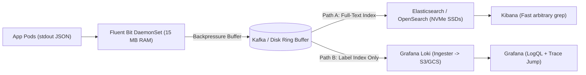
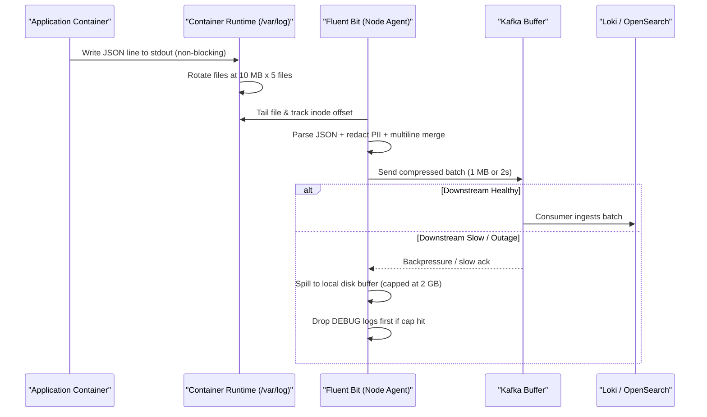
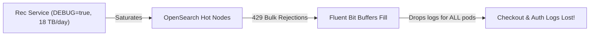

# Log Aggregation at Scale: Fluent Bit, Loki vs ELK and Controlling Costs

> **Prerequisites:** [Lesson 07: Correlation and Trace IDs](../07-correlation-and-trace-ids/README.md).  
> **Estimated Reading Time:** 24–28 minutes  
> **Target Audience:** Backend and platform engineers designing logging pipelines for Kubernetes/cloud fleets, and candidates asked "how do you aggregate 10 TB/day of logs without blowing up the budget?"  
> **Free PDF Notes:** [Download P5-SD-N-008.pdf](https://backendroadmap.com/notes/system-design/P5-SD-N-008.pdf)

> [!NOTE]
> **In one line:** At scale, log aggregation is a **storage and indexing cost problem** disguised as a shipping problem: lightweight agents (**Fluent Bit**) tail stdout, buffer through a queue (**Kafka**), and ship either to a **full-text inverted-index engine (ELK/OpenSearch)** for fast arbitrary search or a **label-indexed object-store engine (Grafana Loki)** for 5–10x lower cost.

> [!TIP]
> **The Golden Rule:** Log structured JSON to `stdout`, index **only** low-cardinality metadata labels (`service`, `env`, `level`), never put high-cardinality IDs (`user_id`, `trace_id`) into Loki labels, and enforce ingestion budgets + sampling before your logging bill exceeds your compute bill.

---

## 1. What Log Aggregation Is, and What It Isn't

When you run 500 microservices across 200 Kubernetes nodes, SSH-ing into containers to run `grep` is impossible—pods are ephemeral and die in seconds. Log aggregation collects `stdout`/`stderr` from every container, parses and enriches it with metadata (`pod`, `namespace`, `trace_id`), buffers it against traffic spikes, and stores it in a queryable backend.

| Term | Precise Meaning | Example |
| :--- | :--- | :--- |
| **Log shipper / agent** | Lightweight process on each node tailing container logs | **Fluent Bit** (~15 MB RAM) vs Logstash (~500 MB JVM) |
| **Structured log** | Machine-parseable JSON line with consistent keys | `{"ts":"...","level":"error","trace_id":"...","msg":"..."}` |
| **ELK / OpenSearch** | Full-text inverted-index search engine (Elasticsearch + Kibana) | Indexes every word in every log line |
| **Grafana Loki** | Label-indexed log store backed by cheap object storage (S3/GCS) | Indexes only stream labels; scans compressed chunks |
| **Label cardinality** | Number of unique label-value combinations (streams) | `env=prod,app=pay` (low) vs `user_id=123` (fatal) |
| **Ingestion pipeline** | Agent -> Buffer (Kafka) -> Parser/Router -> Storage | Prevents log spikes from dropping app traffic |
| **Not** | A metric time-series DB or an analytics warehouse | Don't use logs for dashboards when Prometheus metrics work |

### Why It Matters
1. **Observability bills can rival compute bills:** Uncontrolled `DEBUG` logs or full-text indexing of chatty services routinely cost \$50k–\$200k/month at mid-sized companies.
2. **Loki vs ELK is a classic system design trade-off:** Interviewers love asking why you'd choose label-based indexing (Loki) over full-text inverted indexes (ELK).
3. **Logging must never crash the app:** Synchronous network logging or unbounded disk buffers can OOM-kill nodes or stall request threads.

---

## 2. Anatomy: Fluent Bit Pipeline — Loki vs ELK



Every node runs **Fluent Bit** as a DaemonSet, tailing `/var/log/containers/*.log`, parsing JSON, stripping PII, and shipping batches. At high volume, placing **Kafka** in front of the storage tier absorbs traffic spikes (e.g., an outage causing 20x error-log storms) without dropping logs or overwhelming Elasticsearch/Loki ingesters.

| Dimension | ELK / OpenSearch | Grafana Loki |
| :--- | :--- | :--- |
| **What is indexed?** | **Every token** in every log field (inverted index) | **Only stream labels** (`app`, `env`, `namespace`) |
| **Storage backend** | Expensive NVMe/SSD cluster (hot/warm nodes) | Cheap object storage (S3, GCS, Azure Blob) |
| **Disk footprint (1 TB raw)** | **1.5–2.5 TB** (raw + inverted index + replicas) | **150–250 GB** (gzip/zstd chunks, no full-text index) |
| **Arbitrary keyword search** | Sub-second (`error AND "timeout"`) | Slower unless narrowed by labels/time range |
| **Cardinality sensitivity** | Handles high-cardinality fields well | **Breaks** if high-cardinality IDs are put in labels |
| **Best fit** | Security/SIEM, compliance, ad-hoc search | Cloud-native Kubernetes, cost-sensitive scale, trace-correlated logs |

> [!WARNING]
> **The #1 Trap: High-Cardinality Labels in Loki.** If you promote `trace_id`, `request_id`, or `user_id` to a Loki **stream label**, every single request creates a brand-new stream and index entry. Loki's memory and index explode, and query latency degrades from milliseconds to timeouts. Keep high-cardinality IDs inside the **log body** and filter them with LogQL line filters (`|= "4bf92f35..."`).

---

## 3. Mathematical Model: Ingestion Volume, Storage Cost, and Cardinality

**1. Daily Raw Log Volume ($V_{\text{raw}}$).**
With $R$ log lines/second across the fleet and average line size $S_{\text{avg}}$ bytes:

$$V_{\text{raw}} = R \times S_{\text{avg}} \times 86{,}400\text{ seconds/day}$$

**2. Storage Cost Comparison (30-Day Retention).**
Suppose a fleet emits $R = 50{,}000\text{ logs/s}$ with $S_{\text{avg}} = 600\text{ bytes}$:

$$V_{\text{raw}} = 50{,}000 \times 600 \times 86{,}400 = 2.592 \times 10^{12}\text{ bytes/day} \approx 2.59\text{ TB/day}$$

Over 30 days, raw logs $= 77.7\text{ TB}$.
- **ELK / OpenSearch** (index overhead $1.3\times$, 1 replica $= 2\times$): $77.7 \times 1.3 \times 2 \approx \mathbf{202\text{ TB}}$ on SSDs. At $\$0.10/\text{GB/month}$ (EBS gp3 + compute), storage alone is $\approx \$20{,}200/\text{month}$ (plus cluster RAM/CPU).
- **Loki** (zstd/gzip compression $6:1$, S3 single copy with built-in durability): $77.7 / 6 \approx \mathbf{12.95\text{ TB}}$ on S3. At $\$0.023/\text{GB/month}$, S3 storage is $\approx \mathbf{\$298/\text{month}}$—nearly **70x cheaper** on storage, and 5–10x cheaper overall including ingesters/queriers.

**3. Label Cardinality Explosion.**
Total active streams $C$ is the Cartesian product of label values:

$$C = \prod_{i=1}^{k} |L_i|$$

If you have 50 services $\times$ 3 envs $\times$ 10 pods $= 1{,}500$ streams (healthy). Add `user_id` with $10^6$ users as a label: $1{,}500 \times 10^6 = 1.5 \times 10^9$ streams (instant OOM).

---

## 4. Metrics & Percentiles

| Metric | Meaning | Alert when |
| :--- | :--- | :--- |
| **Log Ingestion Rate (MB/s)** | Bytes/s shipped per service | $> 2\times$ baseline (runaway `DEBUG` loop) |
| **Shipper Drop Rate** | Logs dropped by Fluent Bit due to full ring buffer | $> 0$ sustained for $> 1\text{ min}$ |
| **End-to-End Log Lag** | Time from `stdout` write to searchable in Kibana/Grafana | $> 30\text{ seconds}$ (blocks incident triage) |
| **Active Streams (Loki)** | Unique label-set combinations in ingester memory | $> 80\%$ of per-tenant stream limit |
| **ELK Bulk Rejections (`429`)** | Write thread-pool rejections in Elasticsearch | Any sustained rejections |

### Worked Example (Runaway Retry Loop)
A payment service normally logs 200 lines/s at 500 bytes/line (100 KB/s). A bad deploy causes a tight retry loop logging a 4 KB stack trace 5,000 times/s = **20 MB/s** from one service (a **200x spike**).
- Without rate-limiting or Kafka buffering, Fluent Bit's 50 MB memory buffer fills in **2.5 seconds** and starts dropping logs from *other* healthy services on the same node.
- With per-service ingestion quotas + stack-trace deduplication, the spike is capped at 1 MB/s and the rest of the cluster stays observable.

---

## 5. Failure Modes: Log Storms, Backpressure & Disk Fill

| Failure Mode | Mechanism | Impact |
| :--- | :--- | :--- |
| **1. Logging-Induced App Hang** | App logs synchronously over TCP to Logstash; Logstash stalls | App threads block on socket write; service goes down |
| **2. Node Disk Full** | Container runtime writes logs to `/var/log`; Fluent Bit lags | Kubelet evicts pods due to `DiskPressure` |
| **3. Stack Trace Fragmentation** | Multi-line Java/Python stack trace split into 30 separate log lines | 30x log volume; `trace_id` missing on lines 2–30 |
| **4. PII / Secret Leak** | Unredacted `Authorization: Bearer ...` or credit card logged | Compliance violation (PCI/GDPR) across backups |
| **5. Index Mapping Explosion (ELK)** | Dynamic JSON keys (`metadata.<uuid>`) create 10,000+ fields | Elasticsearch cluster state bloats and crashes master nodes |

---

## 6. Numbers Every Engineer Must Know

| Item | Typical | Implication |
| :--- | :---: | :--- |
| Fluent Bit memory footprint | $10\text{–}25\text{ MB}$ (C-based) | Safe to run as DaemonSet on every node (vs Logstash ~500 MB JVM) |
| JSON log compression (gzip/zstd) | $5:1 \text{ to } 10:1$ | Repetitive JSON keys compress extremely well in Loki/S3 |
| ELK storage amplification | $1.5\times \text{ to } 2.5\times$ raw | Inverted index + replicas + doc values |
| Loki label count target | $\le 10\text{–}15$ labels, $< 10{,}000$ streams | Never put IDs, IPs, or timestamps in labels |
| Max single log line size | $16\text{–}64\text{ KB}$ | Truncate huge payloads; never log full HTTP bodies |
| Hot retention window | $7\text{–}14\text{ days}$ (SSD) / $30\text{–}90\text{ d}$ (S3) | Move older logs to cold object storage |

---

## 7. Protocol Deep Dive: Non-Blocking Log Shipping & Backpressure



| Question | Answer |
| :--- | :--- |
| **Why write to `stdout` instead of shipping over HTTP directly from the app?** | `stdout` decouples app latency from network/collector outages; the container runtime handles rotation, and Fluent Bit handles retries out-of-process. |
| **How do you handle multi-line stack traces?** | Configure Fluent Bit's `multiline.parser` (e.g., `python`, `java`, `go`) so indented lines merge into the parent JSON/timestamped event. |
| **How do you prevent ELK mapping explosions?** | Disable dynamic mapping for arbitrary `metadata` objects, or flatten them into a `keyword` string / `flattened` field type. |

**When NOT to use centralized full-text ELK:** When 90% of your queries filter by `service`, `env`, and `trace_id` (which is true for most microservice debugging). Paying 10x for full-text inverted indexes on NVMe SSDs is wasted money when Loki + object storage answers the same queries.

---

## 8. Hierarchical Budgets & Design Rules

| Slice | Rule | Control |
| :--- | :--- | :--- |
| App Output | Structured single-line JSON to `stdout` only | Logger config + CI schema check |
| Node Disk | Cap container log rotation (e.g., `max-size: 50m`, `max-file: 3`) | Kubelet / Docker daemon config |
| Agent | Use Fluent Bit (not Logstash) on nodes; cap disk buffer | DaemonSet resource limits |
| Privacy | Redact tokens, emails, PANs at **both** app logger and Fluent Bit | Regex/Lua filter in pipeline |
| Sampling / Levels | `INFO` in prod; sample noisy 2xx access logs (e.g., 10%); keep 100% 4xx/5xx | Edge/app log sampler |
| Quotas | Enforce per-team/per-service MB/s ingestion caps | Loki `ingestion_rate_mb` / Kafka quotas |
| Retention | Hot 7d, Warm 30d, Cold/Archive 1y (compliance only) | S3 lifecycle / ILM policies |

---

## 9. Top Mitigations

1. **Write structured JSON to `stdout`**, never to local custom files or synchronous TCP sockets from app code.
2. **Use Fluent Bit on every node** for minimal RAM/CPU overhead, and put **Kafka** in front of Elasticsearch/Loki for burst absorption.
3. **Choose Loki for cost-effective Kubernetes logging** and reserve ELK/OpenSearch for SIEM/compliance or heavy full-text search.
4. **Keep Loki labels strictly low-cardinality** (`cluster`, `namespace`, `app`, `level`); put `trace_id` and `user_id` in the JSON body.
5. **Drop or sample noisy `200 OK` healthcheck and access logs** at the agent (`grep` exclude `/healthz`, `/metrics`)—they often account for 40%+ of total volume.
6. **Redact PII and secrets** in the app logger *and* again in Fluent Bit before data leaves the node.
7. **Set per-service ingestion alerts and hard quotas** so one runaway retry loop cannot bankrupt the logging budget or starve other services.

---

## 10. Production Reference: The "DEBUG Flag Left On" Incident

A team enabled `LOG_LEVEL=DEBUG` on a high-throughput recommendation service (15,000 RPS) to investigate a latency blip, then forgot to revert it. Within 20 minutes, log volume jumped from 150 GB/day to 18 TB/day.



- **Root Cause:** Shared Elasticsearch cluster had no per-service ingestion quota, and Fluent Bit shared one output queue across all namespaces on each node.
- **Fix:** (1) Added per-tenant ingestion rate limits (`10 MB/s` soft alert, `25 MB/s` hard throttle); (2) auto-reverted `LOG_LEVEL=DEBUG` via a 30-minute TTL feature flag; (3) migrated 80% of application logs from OpenSearch to Loki on S3, cutting monthly logging spend by 72%.

---

## 11. Multi-Language Production Code Tabs

Structured JSON logger with **PII redaction**, **log-level filtering**, and **rate-limited sampling** for noisy `INFO` events (while never dropping `ERROR`).

````carousel
```go
// Go: structured slog handler with PII redaction and INFO sampling (never drops ERROR).
package main

import (
	"context"
	"log/slog"
	"os"
	"sync/atomic"
)

type SafeHandler struct {
	next       slog.Handler
	sampleRate uint64
	counter    atomic.Uint64
}

func (h *SafeHandler) Enabled(ctx context.Context, lvl slog.Level) bool {
	return h.next.Enabled(ctx, lvl)
}

func (h *SafeHandler) Handle(ctx context.Context, r slog.Record) error {
	if r.Level < slog.LevelWarn && h.sampleRate > 1 {
		if h.counter.Add(1)%h.sampleRate != 0 {
			return nil // sample noisy INFO/DEBUG logs
		}
	}
	clean := slog.NewRecord(r.Time, r.Level, r.Message, r.PC)
	r.Attrs(func(a slog.Attr) bool {
		if a.Key == "password" || a.Key == "token" {
			a.Value = slog.StringValue("[REDACTED]")
		}
		clean.AddAttrs(a)
		return true
	})
	return h.next.Handle(ctx, clean)
}

func (h *SafeHandler) WithAttrs(attrs []slog.Attr) slog.Handler { return &SafeHandler{next: h.next.WithAttrs(attrs), sampleRate: h.sampleRate} }
func (h *SafeHandler) WithGroup(name string) slog.Handler       { return &SafeHandler{next: h.next.WithGroup(name), sampleRate: h.sampleRate} }

func main() {
	base := slog.NewJSONHandler(os.Stdout, &slog.HandlerOptions{Level: slog.LevelInfo})
	logger := slog.New(&SafeHandler{next: base, sampleRate: 1})
	logger.Info("login_attempt", "user", "alice", "token", "secret-jwt-123")
}
```
<!-- slide -->
```typescript
// TypeScript: structured stdout JSON logger with redaction and deterministic sampling.
const REDACT_KEYS = new Set(["password", "token", "authorization", "ssn"]);

let infoCounter = 0;

export function logEvent(
  level: "info" | "warn" | "error",
  msg: string,
  fields: Record<string, unknown> = {},
  infoSampleRate = 1
): void {
  if (level === "info" && infoSampleRate > 1 && ++infoCounter % infoSampleRate !== 0) {
    return; // keep 100% of warn/error, sample noisy info
  }
  const safe: Record<string, unknown> = {};
  for (const [k, v] of Object.entries(fields)) {
    safe[k] = REDACT_KEYS.has(k.toLowerCase()) ? "[REDACTED]" : v;
  }
  process.stdout.write(JSON.stringify({ ts: new Date().toISOString(), level, msg, ...safe }) + "\n");
}
```
<!-- slide -->
```python
# Python: structured JSON logger with PII redaction + cost calculator for Section 3.
import json
import sys
from datetime import datetime, timezone

REDACT = {"password", "token", "secret", "card_number"}


def log_json(level: str, msg: str, **fields) -> None:
    clean = {k: ("[REDACTED]" if k.lower() in REDACT else v) for k, v in fields.items()}
    record = {"ts": datetime.now(timezone.utc).isoformat(), "level": level, "msg": msg, **clean}
    sys.stdout.write(json.dumps(record) + "\n")


def estimate_monthly_cost(rps: int, avg_bytes: int, retention_days: int = 30) -> dict:
    raw_tb = (rps * avg_bytes * 86400 * retention_days) / 1e12
    elk_tb = raw_tb * 1.3 * 2          # inverted index + 1 replica
    loki_tb = raw_tb / 6.0             # ~6:1 compression on object store
    return {
        "raw_tb": round(raw_tb, 2),
        "elk_ssd_cost_usd": round(elk_tb * 1000 * 0.10, 2),
        "loki_s3_cost_usd": round(loki_tb * 1000 * 0.023, 2),
    }
```
<!-- slide -->
```csharp
// C#: structured JSON console logger with key redaction and sampling.
using System.Text.Json;

public static class StructuredLogger
{
    private static readonly HashSet<string> Redact = new(StringComparer.OrdinalIgnoreCase) { "password", "token", "secret" };
    private static long _counter;

    public static void Log(string level, string msg, Dictionary<string, object?> fields, int infoSampleRate = 1)
    {
        if (level == "INFO" && infoSampleRate > 1 && Interlocked.Increment(ref _counter) % infoSampleRate != 0)
            return;

        var safe = new Dictionary<string, object?> { ["ts"] = DateTime.UtcNow.ToString("O"), ["level"] = level, ["msg"] = msg };
        foreach (var (k, v) in fields)
            safe[k] = Redact.Contains(k) ? "[REDACTED]" : v;

        Console.Out.WriteLine(JsonSerializer.Serialize(safe));
    }
}
```
````

---

## 12. Hands-On CLI Verification Workflows

```bash
# 1. Run the storage cost comparison (50,000 logs/s, 600 bytes/log, 30 days)
python -c "
rps, avg_bytes, days = 50000, 600, 30
raw_tb = (rps * avg_bytes * 86400 * days) / 1e12
print(f'Raw: {raw_tb:.2f} TB | ELK SSD: \${raw_tb*1.3*2*100:.0f}/mo | Loki S3: \${(raw_tb/6)*23:.0f}/mo')
"

# 2. Query Grafana Loki via LogCLI for a specific trace_id without high-cardinality labels
logcli query '{app="checkout", env="prod"} |= "4bf92f3577b34da6a3ce929d0e0e4736"' --limit=50

# 3. Check Fluent Bit internal health & dropped records metrics
curl -s http://localhost:2020/api/v1/metrics/prometheus | grep -E "fluentbit_output_(proc|dropped)_records_total"

# 4. Check Elasticsearch / OpenSearch bulk rejection count
curl -s "http://localhost:9200/_nodes/stats/thread_pool?filter_path=nodes.*.thread_pool.write.rejected"
```

---

## 13. Common Mistakes to Avoid

1. **Putting `trace_id`, `user_id`, or `request_id` into Loki stream labels**, causing cardinality explosion and OOM.
2. **Shipping logs synchronously from application code** over HTTP/TCP, causing app stalls when the log collector lags.
3. **Logging raw unstructured text** instead of JSON, forcing fragile regex parsing at ingestion.
4. **Running Logstash (JVM) as a node DaemonSet** instead of lightweight Fluent Bit, wasting GBs of RAM per node.
5. **Keeping `DEBUG` enabled in production** without TTLs or ingestion rate caps.
6. **Indexing 100% of `/healthz` and 2xx access logs** in Elasticsearch, burning budget on zero-value noise.
7. **Allowing dynamic ELK field mappings on arbitrary user JSON**, crashing master nodes with mapping explosions.
8. **Forgetting to redact secrets/PII** before logs leave the node.

---

## 14. Key Terms Glossary

| Key Term | Definition |
| :--- | :--- |
| **Fluent Bit** | Lightweight C-based log processor and forwarder ideal for Kubernetes DaemonSets. |
| **ELK / OpenSearch** | Stack (Elasticsearch, Logstash/Fluent Bit, Kibana) using full-text inverted indexes. |
| **Grafana Loki** | Log aggregation system that indexes only stream labels and stores compressed chunks in object storage. |
| **Inverted Index** | Data structure mapping every word/token to the documents containing it (fast search, high storage cost). |
| **Stream Cardinality** | Total number of unique label-value combinations; the primary scaling bottleneck in Loki. |
| **Multiline Parser** | Agent rule that merges multi-line stack traces into a single log event. |
| **Log Sampling** | Dropping a fraction of noisy `INFO`/`DEBUG` logs while retaining 100% of `WARN`/`ERROR`. |
| **PII Redaction** | Masking sensitive fields (`token`, `password`, `SSN`) before storage. |
| **ILM (Index Lifecycle Management)** | Automated policy moving logs from hot SSDs to warm/cold storage and eventual deletion. |
| **Backpressure Buffer** | Disk or Kafka queue absorbing log spikes when storage cannot keep up. |

---

## 15. System Design Interview Questions & Answers

### Basic Conceptual Questions

<details>
<summary><strong>Q1: Why choose Fluent Bit over Logstash on Kubernetes nodes? [BASIC]</strong></summary>

**Answer:**
Fluent Bit is written in C and uses ~15–25 MB of RAM per node, whereas Logstash runs on the JVM and consumes ~500 MB–1 GB+ of RAM. On a 200-node cluster, Fluent Bit saves ~100–200 GB of cluster memory while handling high-throughput tailing and JSON parsing.
</details>

<details>
<summary><strong>Q2: What is the core architectural difference between Grafana Loki and Elasticsearch (ELK)? [BASIC]</strong></summary>

**Answer:**
Elasticsearch builds a **full-text inverted index** over every field on NVMe SSDs, enabling sub-second arbitrary search at high storage/RAM cost. Loki indexes **only stream labels** (like `app`, `env`) and stores compressed log chunks in cheap object storage (S3/GCS), making it 5–10x cheaper.
</details>

<details>
<summary><strong>Q3: Why should applications log structured JSON to `stdout` instead of writing to a remote log server? [BASIC]</strong></summary>

**Answer:**
Writing to `stdout` is fast, local, and non-blocking; if the logging pipeline goes down, the application does not hang. The container runtime handles file rotation, and an out-of-process agent (Fluent Bit) handles parsing, retries, and backpressure.
</details>

<details>
<summary><strong>Q4: What is label cardinality explosion? [BASIC]</strong></summary>

**Answer:**
When a high-cardinality value like `user_id` or `trace_id` is used as an index label in Loki (or Prometheus), every unique value creates a new stream/time-series, exhausting memory and slowing queries to a crawl.
</details>

### Scenario-Based Architecture Questions

<details>
<summary><strong>Q5: Your company spends $80k/month on ELK for 10 TB/day of logs. How do you cut costs by 70%+ without losing debuggability? [SCENARIO]</strong></summary>

**Answer:**
(1) Drop noisy `/healthz` and `/metrics` logs at Fluent Bit; (2) sample 2xx access logs to 10% while keeping 100% of 4xx/5xx; (3) tier retention (7 days hot, 30 days cold); (4) migrate general microservice logs to **Grafana Loki on S3** (keeping `trace_id` in the JSON body for LogQL filtering), reserving OpenSearch only for compliance/SIEM workloads.
</details>

<details>
<summary><strong>Q6: A service starts logging 50x more errors during an outage, and other services' logs disappear. Why? [SCENARIO]</strong></summary>

**Answer:**
The noisy service saturated the shared node agent's buffer or Elasticsearch's write thread pool, triggering `429` rejections and dropping logs across all pods. Fix by adding **Kafka** as a durable buffer, enforcing per-service ingestion rate limits, and prioritizing `ERROR` over `INFO`/`DEBUG`.
</details>

<details>
<summary><strong>Q7: How do you handle multi-line Java or Python stack traces in a JSON logging pipeline? [SCENARIO]</strong></summary>

**Answer:**
Best practice: configure the app logger itself to emit single-line JSON where the stack trace is an escaped string field (`"stack": "Traceback...\n..."`). If legacy apps emit raw multi-line text, configure Fluent Bit's `multiline.parser` to merge continuation lines before shipping.
</details>

<details>
<summary><strong>Q8: How do you search for a single `trace_id` in Loki if `trace_id` is NOT a label? [SCENARIO]</strong></summary>

**Answer:**
First narrow down the search space using low-cardinality labels and time range (`{app="checkout", env="prod"}`), then apply a LogQL line filter (`|= "4bf92f35..."`). Loki parallelizes scanning the compressed chunks in S3 for that narrow window in ~1–2 seconds.
</details>

### Advanced & Tricky Interview Questions

<details>
<summary><strong>Q9: What causes an Elasticsearch "mapping explosion" and how do you prevent it? [TRICKY]</strong></summary>

**Answer:**
Logging arbitrary JSON keys (like `metadata.<dynamic_uuid>`) causes Elasticsearch's dynamic mapping to create thousands of new field definitions in the cluster state, overloading master nodes and causing OOMs. Prevent it by using strict schemas, `dynamic: false`, or the `flattened` field type.
</details>

<details>
<summary><strong>Q10: Why can't you just use `grep` on S3 files instead of Loki? [TRICKY]</strong></summary>

**Answer:**
Loki chunks logs by label-stream and time window, builds a compact index of chunk pointers, caches hot chunks in Memcached/ingesters, and fans out parallel range-reads across queriers—giving interactive 1–3 second queries over terabytes, whereas raw S3 `grep` scans sequentially and takes minutes.
</details>

<details>
<summary><strong>Q11: What happens to node stability if Fluent Bit falls behind for 2 hours? [TRICKY]</strong></summary>

**Answer:**
If container logs are not rotated, `/var/log` fills the root disk and Kubernetes evicts pods (`DiskPressure`). If rotated, old log files are overwritten and **logs are silently lost**. Always cap container log rotation *and* alert on Fluent Bit's `inotify`/tail lag and dropped-record metrics.
</details>

<details>
<summary><strong>Q12: Should you ever log full HTTP request/response bodies in production? [TRICKY]</strong></summary>

**Answer:**
No. Full bodies bloat log volume 10–100x, almost always leak PII/tokens, and can exceed max log line limits (causing truncated unparseable JSON). Log metadata (`method`, `path`, `status`, `latency_ms`, `trace_id`) and capture bodies only in a dedicated, access-controlled audit store if legally required.
</details>

---

## 16. One-Page Master Cheat Sheet

```
+---------------------------------------------------------------------------------------------------------+
|                    LOG AGGREGATION AT SCALE — MASTER CHEAT SHEET                                        |
+---------------------------------------------------------------------------------------------------------+
| 1. PIPELINE: App (JSON stdout) -> Fluent Bit (15 MB DaemonSet) -> Kafka Buffer -> Storage (Loki/ELK).    |
+---------------------------------------------------------------------------------------------------------+
| 2. LOKI vs ELK: ELK indexes every token (fast search, ~2x SSD). Loki indexes labels only (5-10x cheaper |
|    on S3, ~6:1 compression). Never put high-cardinality IDs (trace_id, user_id) in Loki labels!         |
+---------------------------------------------------------------------------------------------------------+
| 3. COST CONTROL: Drop /healthz · Sample 2xx access logs · Tier retention (7d hot / 30d S3) · Per-team   |
|    MB/s quotas · TTL on DEBUG flags.                                                                    |
+---------------------------------------------------------------------------------------------------------+
| 4. SAFETY: Non-blocking stdout · Cap disk buffers · Redact PII/secrets · Prevent ELK mapping explosions.|
+---------------------------------------------------------------------------------------------------------+
```

---

## Further Reading & Sources

- Grafana Labs, [Grafana Loki Architecture & Labels Best Practices](https://grafana.com/docs/loki/latest/get-started/architecture/).
- Fluent Bit Documentation, [Buffering & Storage Backpressure](https://docs.fluentbit.io/manual/administration/buffering-and-storage).
- Elastic / OpenSearch Documentation, [Managing Mapping Explosions & Index Lifecycle](https://www.elastic.co/guide/en/elasticsearch/reference/current/mapping.html).
- Martin Kleppmann, *Designing Data-Intensive Applications*, Chapter 11 (Stream Processing & Log Pipelines).

---

## Free PDF Notes

[P5-SD-N-008.pdf](https://backendroadmap.com/notes/system-design/P5-SD-N-008.pdf)

---

## Next

Continue with [Lesson 09: What Makes a Good Alert? Symptoms, SLO Burn Rates and Runbooks](../09-what-makes-a-good-alert-symptoms-slo-burn-rates-and-runbooks/README.md).
