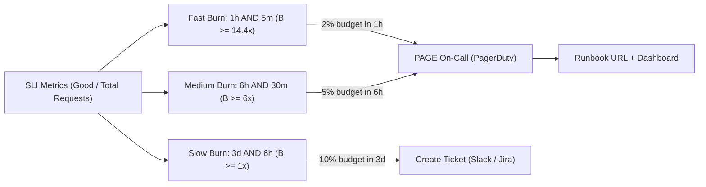
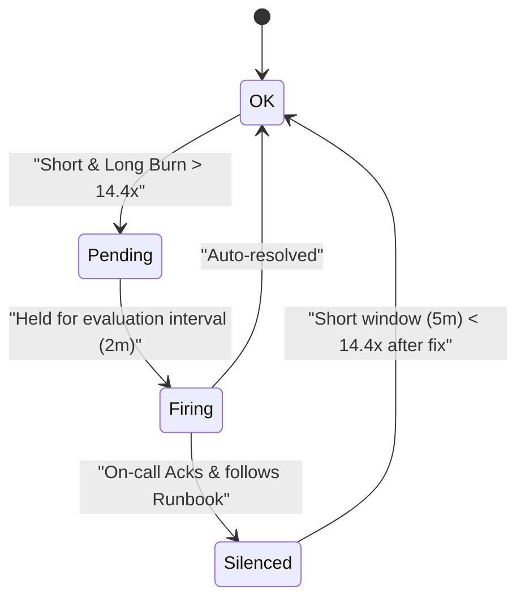
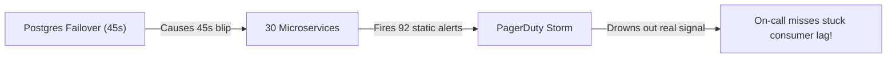

# What Makes a Good Alert? Symptoms, SLO Burn Rates and Runbooks

> **Prerequisites:** [Lesson 08: Log Aggregation at Scale](../08-log-aggregation-at-scale/README.md).  
> **Estimated Reading Time:** 24–28 minutes  
> **Target Audience:** Backend and SRE engineers fighting alert fatigue, and candidates asked "how do you design alerting for a 99.9% service so on-call engineers aren't woken up for nothing?"  
> **Free PDF Notes:** [Download P5-SD-N-009.pdf](https://backendroadmap.com/notes/system-design/P5-SD-N-009.pdf)

> [!NOTE]
> **In one line:** A good alert is **actionable, urgent, and symptom-based**: it pages a human **only** when users are hurting (or about to hurt) fast enough to threaten the **SLO error budget**, using **multi-window, multi-burn-rate** rules paired with a tested **runbook**.

> [!TIP]
> **The Golden Rule:** **Page on symptoms, debug with causes.** Never page an engineer at 3:00 AM because "CPU is 85%" or "1 pod restarted" if user latency and error rates are healthy. Page when the **error budget burn rate** threatens the monthly SLO.

---

## 1. What a Good Alert Is, and What It Isn't

In a naive monitoring setup, every team adds alerts for `CPU > 80%`, `Memory > 85%`, `Disk > 75%`, and `5xx count > 10`. Within six months, on-call engineers receive 40 pages a week—90% of which self-resolve or have zero user impact. Engineers start ignoring Slack channels and muting PagerDuty, so when a real outage hits, it takes 35 minutes for anyone to react.

| Term | Precise Meaning | Example |
| :--- | :--- | :--- |
| **SLI (Indicator)** | Quantitative measure of user-facing behavior | `good_requests / total_requests` or $p_{99}$ latency |
| **SLO (Objective)** | Target reliability over a rolling window (e.g., 30 days) | $99.9\%$ availability over 30 days |
| **Error Budget** | Allowed unreliability: $1 - \text{SLO}$ | $0.1\%$ of 30 days $= 43.2\text{ minutes}$ of 100% outage |
| **Burn Rate ($B$)** | How fast the error budget is being consumed relative to steady-state | $B = 14.4\times$ consumes 30 days of budget in $50\text{ hours}$ |
| **Symptom Alert** | Fires on user-visible failure (5xx rate, checkout latency) | "Checkout 5xx burn rate $> 14.4\times$" |
| **Cause Alert** | Fires on internal resource state (CPU, queue depth, GC pause) | "DB CPU $> 90\%$" (ticket/dashboard, rarely a page) |
| **Runbook** | Step-by-step triage and mitigation playbook linked in the alert | "1. Check canary; 2. Rollback; 3. Scale read replicas" |
| **Not** | A log notification or a "just in case" threshold | An alert with no human action is spam |

### Why It Matters
1. **Alert fatigue kills reliability:** Every false-positive page erodes trust and slows response to real SEV-1 incidents.
2. **SLO burn-rate alerting is the industry standard:** Google's *SRE Workbook* pattern replaces arbitrary static thresholds (`5xx > 1%`) with math tied directly to user impact.
3. **Interviewers test operational maturity:** Knowing *when* to page vs *when* to create a ticket separates senior engineers from juniors.

---

## 2. Anatomy: Multi-Window, Multi-Burn-Rate Alerting



Why use **two windows** (`long` AND `short`, e.g., `1h` AND `5m`)?
- A **long window alone** (`1h`) takes too long to recover after you fix the outage—the alert stays firing for 55 minutes after mitigation.
- A **short window alone** (`5m`) pages on brief 2-minute deploy blips that don't meaningfully dent the monthly budget.
- Requiring **both** the 1-hour AND 5-minute burn rates to exceed $14.4\times$ catches real outages in **~2–5 minutes** and auto-resolves **~5 minutes** after the fix!

| Alert Tier | Cause vs Symptom | Delivery Channel | Response SLA |
| :--- | :--- | :--- | :--- |
| **Page (Urgent)** | High-burn symptom (14.4x / 6x) or imminent cliff (disk full in 1h) | PagerDuty / Phone | $< 5\text{–}15\text{ min}$ |
| **Ticket (Non-urgent)** | Slow burn (1x–3x), cert expiring in 14 days, rising DLQ | Jira / Linear / Slack | Next business day |
| **Dashboard / Log** | High CPU (with healthy latency), single pod OOMKill | Grafana panel only | Investigate during work hours |

> [!WARNING]
> **The #1 Trap: Alerting on Low-Traffic Services with Raw Ratios.** If an internal service gets 2 requests per minute, a single failed request gives a 50% error rate for that minute ($B = 500\times$!) and wakes someone up. Always pair burn-rate alerts with a **minimum request-rate floor** (e.g., `total_rps > 1` or synthetic probes) or use longer windows.

---

## 3. Mathematical Model: Error Budgets and Burn Rates

**1. Error Budget.**
For an availability SLO over a 30-day window ($30 \times 24 = 720\text{ hours} = 43{,}200\text{ minutes}$):

$$\text{Error Budget} = 1 - \text{SLO}$$

At $\text{SLO} = 99.9\%$ ($0.999$): $\text{Error Budget} = 0.001 = 0.1\%$ ($43.2\text{ minutes}$ of total downtime per 30 days).

**2. Burn Rate ($B$).**
Burn rate is the ratio of the observed error rate $e$ to the allowed error rate $(1 - \text{SLO})$:

$$B = \frac{e}{1 - \text{SLO}}$$

- If $B = 1$, you consume exactly 100% of your 30-day error budget in 30 days.
- If $B = 14.4$, you consume $100\%$ of your 30-day budget in $720 / 14.4 = 50\text{ hours}$—which means in **1 hour**, you burn $1/50 = \mathbf{2\%}$ of the entire monthly budget.

**3. General Burn-Rate Threshold Formula.**
To detect when $p$ fraction of the 30-day (720 h) error budget is consumed in window $W$ hours:

$$B = \frac{p \times 720}{W}, \qquad e_{\text{threshold}} = B \times (1 - \text{SLO})$$

| Severity | Budget Consumed ($p$) | Long Window ($W$) | Short Window ($W/12$) | Burn Rate ($B$) | Error Rate at 99.9% SLO |
| :--- | :---: | :---: | :---: | :---: | :---: |
| **Page (Critical)** | $2\%$ | $1\text{ hour}$ | $5\text{ min}$ | $14.4\times$ | $1.44\%$ |
| **Page (High)** | $5\%$ | $6\text{ hours}$ | $30\text{ min}$ | $6.0\times$ | $0.60\%$ |
| **Ticket (Low)** | $10\%$ | $3\text{ days (72h)}$ | $6\text{ hours}$ | $1.0\times$ | $0.10\%$ |

---

## 4. Metrics & Percentiles

| Metric | Meaning | Alert when |
| :--- | :--- | :--- |
| **Error Budget Remaining (%)** | $1 - (\text{errors}_{30\text{d}} / \text{budget}_{30\text{d}})$ | $< 25\%$ remaining mid-month (freeze risky deploys) |
| **1h / 5m Burn Rate** | Fast error-budget consumption rate | Both windows $> 14.4\times$ (Page immediately) |
| **6h / 30m Burn Rate** | Sustained degradation rate | Both windows $> 6.0\times$ (Page) |
| **Pages per On-Call Shift** | Total pages fired per week per engineer | $> 2\text{ pages/week}$ (tune or delete noisy alerts) |
| **False-Positive Page Rate** | % of pages requiring no action / auto-resolved | $> 10\%$ (audit alert rules monthly) |

### Worked Example (`99.9% Checkout SLO`)
Your Checkout service processes 1,000 RPS with a 30-day SLO of $99.9\%$ ($e_{\text{allowed}} = 0.001$).
- At 02:10 UTC, a bad database migration causes `1.8%` of requests to return HTTP 500 ($e = 0.018$).
- Burn rate: $B = \frac{0.018}{0.001} = \mathbf{18\times}$.
- Because $18\times > 14.4\times$ on both the 5-minute and 1-hour windows (it crosses the 1h threshold once enough bad minutes accumulate, in ~48 minutes—or within 2 minutes if $e = 18\%$, $B = 180\times$), PagerDuty fires with the runbook link.
- At 02:25 UTC, on-call rolls back the migration. Error rate drops to $0.02\%$ ($B = 0.2\times$). By 02:30 UTC, the 5-minute short window drops below $14.4\times$, and the alert **cleanly auto-resolves**.

---

## 5. Alert Quality & Noise Comparison

| Alerting Strategy | Detection Speed (2% 5xx outage) | False Pages on 2-min Deploy Blip | Auto-Reset Time After Fix |
| :--- | :---: | :---: | :---: |
| **Static `5xx > 1%` for 1 min** | 1 min | **Fires every deploy** (high fatigue) | 1 min |
| **Single 1h Window ($B > 14.4\times$)** | ~45 min | 0 (ignored) | **55 min** (lingers!) |
| **Multi-Window ($1\text{h} \land 5\text{m}$ at $14.4\times$)** | **~5 min** (for major) | **0** (unless sustained) | **5 min** |

---

## 6. Numbers Every Engineer Must Know

| Item | Typical | Implication |
| :--- | :---: | :--- |
| 99.9% monthly error budget | $43.2\text{ minutes}$ | 100% outage for 43 min blows the entire month |
| 99.99% monthly error budget | $4.32\text{ minutes}$ | Requires automated rollback/failover; humans are too slow |
| Fast-burn threshold | $14.4\times$ (2% budget / 1h) | Standard Google SRE page-now threshold |
| Medium-burn threshold | $6.0\times$ (5% budget / 6h) | Catches slower brownouts before budget is gone |
| Healthy on-call page load | $\le 2\text{ pages / week}$ | Above this, engineers burn out and ignore alerts |
| Short-to-long window ratio | $1:12$ (e.g., 5m / 1h) | Balances fast detection with fast auto-resolution |

---

## 7. Protocol Deep Dive: Alert Lifecycle & Runbook Anatomy



Every paging alert payload MUST include **5 fields** so the on-call engineer never has to hunt at 3 AM:
1. **What is broken & user impact:** `"Checkout 5xx burn rate 18x (1.8% errors, 2% budget/hr)"`
2. **Direct Dashboard Link:** Pre-filtered to the failing service and time window.
3. **Runbook URL:** Exact triage steps, rollback command, and escalation path.
4. **Recent Changes:** Link to last 3 deploys/feature-flag flips.
5. **Severity & Owner:** `SEV-2`, `@team-checkout`.

| Question | Answer |
| :--- | :--- |
| **Why shouldn't we page on CPU = 90%?** | High CPU with normal latency and 0% errors means you are efficiently using the hardware you paid for—not having an outage. |
| **When IS a cause-based alert worth paging?** | When it predicts an **imminent, irreversible cliff** before symptoms appear (e.g., primary DB disk will hit 100% in 30 minutes, or TLS cert expires in 24 hours). |
| **What makes a runbook useless?** | A 10-page wiki doc written two years ago with dead links. A good runbook has 3–5 copy-pasteable diagnostic commands and a clear rollback/mitigation trigger. |

**When NOT to use burn-rate alerts:** On **zero-traffic or batch cron jobs** (e.g., a nightly billing job that runs once per day). Use dead-man's-switch / job-completion alerts (`time_since_last_success > 26h`) instead.

---

## 8. Hierarchical Budgets & Design Rules

| Slice | Rule | Control |
| :--- | :--- | :--- |
| Symptom vs Cause | Page **only** on user-facing symptoms or imminent cliffs | Alert review checklist in PRs |
| Multi-Window | Always pair long window ($W$) with short window ($W/12$) | Prometheus recording rules |
| Low Traffic | Gate burn-rate alerts with `total_requests > min_threshold` | `and sum(rate(...)) > 1` |
| Runbook Link | Every paging alert MUST have a valid `runbook_url` annotation | CI alert linter (`promtool`) |
| Alert Hygiene | Review all pages weekly; delete or tune any alert with $>10\%$ false positives | Weekly on-call handoff |
| Error Budget Policy | If monthly budget hits 0%, freeze feature launches and focus on reliability | Engineering leadership sign-off |

---

## 9. Top Mitigations

1. **Delete all non-actionable alerts**—if an alert fires and the on-call engineer does nothing, either automate the fix or delete the alert.
2. **Migrate static threshold pages (`5xx > 1%`) to multi-window SLO burn-rate alerts** (`14.4x` 1h/5m and `6x` 6h/30m).
3. **Require a `runbook_url` in every alert definition** and fail CI if the URL is missing or 404s.
4. **Separate routing by urgency:** PagerDuty for fast burn (`14.4x`/`6x`), Slack/Jira tickets for slow burn (`1x`) and capacity warnings.
5. **Group and inhibit duplicate alerts** in Alertmanager (e.g., if a whole Availability Zone or DB primary is down, suppress downstream pod alerts).
6. **Guard against low-traffic noise** by adding a minimum RPS floor or synthetic health probes.
7. **Track "pages per shift" as a first-class SRE metric** and hold an alert-tuning review whenever it exceeds 2 pages/week.

---

## 10. Production Reference: The "Alert Storm" During a DB Failover

A payment platform had 140 static threshold alerts across 30 microservices (`latency > 200ms`, `pod_cpu > 80%`, `db_conn > 70%`, `5xx > 5`). When a primary Postgres node failed over (taking 45 seconds), **92 separate PagerDuty pages** fired in 90 seconds.



- **Root Cause:** Static 1-minute thresholds fired on every downstream service simultaneously with no Alertmanager inhibition rules and no multi-window burn-rate smoothing.
- **Fix:** Replaced 110 cause-based pages with 12 SLO burn-rate alerts (`1h/5m` at `14.4x`), added Alertmanager inhibition rules (`severity: critical` inhibits `severity: warning` for the same cluster), and attached concise runbooks. Weekly pages dropped from **38 to 1.5**.

---

## 11. Multi-Language Production Code Tabs

Multi-window SLO burn-rate evaluator in all 4 languages (zero external dependencies).

````carousel
```go
// Go: multi-window SLO burn-rate alert evaluator (1h/5m @ 14.4x and 6h/30m @ 6x).
package main

import "fmt"

type WindowStats struct {
	Total int64
	Bad   int64
}

func burnRate(w WindowStats, slo float64) float64 {
	if w.Total == 0 {
		return 0
	}
	errRate := float64(w.Bad) / float64(w.Total)
	return errRate / (1.0 - slo)
}

func EvaluateAlert(slo float64, m5, h1, m30, h6 WindowStats) string {
	if h1.Total < 100 { // minimum traffic floor to avoid low-RPS noise
		return "OK (insufficient traffic)"
	}
	if burnRate(h1, slo) >= 14.4 && burnRate(m5, slo) >= 14.4 {
		return "PAGE_CRITICAL: fast burn >= 14.4x (2% budget/1h)"
	}
	if burnRate(h6, slo) >= 6.0 && burnRate(m30, slo) >= 6.0 {
		return "PAGE_HIGH: medium burn >= 6.0x (5% budget/6h)"
	}
	return "OK"
}

func main() {
	status := EvaluateAlert(0.999,
		WindowStats{Total: 3000, Bad: 54},     // 5m: 1.8% -> 18x
		WindowStats{Total: 36000, Bad: 648},   // 1h: 1.8% -> 18x
		WindowStats{Total: 18000, Bad: 40},
		WindowStats{Total: 216000, Bad: 200},
	)
	fmt.Println(status)
}
```
<!-- slide -->
```typescript
// TypeScript: multi-window SLO burn-rate evaluator.
interface WindowStats {
  total: number;
  bad: number;
}

function burnRate(w: WindowStats, slo: number): number {
  if (w.total === 0) return 0;
  return (w.bad / w.total) / (1 - slo);
}

export function evaluateAlert(
  slo: number,
  m5: WindowStats,
  h1: WindowStats,
  m30: WindowStats,
  h6: WindowStats
): "PAGE_CRITICAL" | "PAGE_HIGH" | "OK" {
  if (h1.total < 100) return "OK";
  if (burnRate(h1, slo) >= 14.4 && burnRate(m5, slo) >= 14.4) return "PAGE_CRITICAL";
  if (burnRate(h6, slo) >= 6.0 && burnRate(m30, slo) >= 6.0) return "PAGE_HIGH";
  return "OK";
}
```
<!-- slide -->
```python
# Python: multi-window SLO burn-rate evaluator + error-budget calculator.
def burn_rate(bad: int, total: int, slo: float = 0.999) -> float:
    if total == 0:
        return 0.0
    return (bad / total) / (1.0 - slo)


def evaluate_slo_alert(slo: float, m5: tuple[int, int], h1: tuple[int, int],
                       m30: tuple[int, int], h6: tuple[int, int]) -> str:
    if h1[1] < 100:
        return "OK"
    if burn_rate(*h1, slo) >= 14.4 and burn_rate(*m5, slo) >= 14.4:
        return "PAGE_CRITICAL"
    if burn_rate(*h6, slo) >= 6.0 and burn_rate(*m30, slo) >= 6.0:
        return "PAGE_HIGH"
    return "OK"


if __name__ == "__main__":
    print(evaluate_slo_alert(0.999, (54, 3000), (648, 36000), (40, 18000), (200, 216000)))
```
<!-- slide -->
```csharp
// C#: multi-window SLO burn-rate evaluator.
public readonly record struct WindowStats(long Bad, long Total);

public static class SloAlertEvaluator
{
    public static double BurnRate(WindowStats w, double slo) =>
        w.Total == 0 ? 0.0 : ((double)w.Bad / w.Total) / (1.0 - slo);

    public static string Evaluate(double slo, WindowStats m5, WindowStats h1, WindowStats m30, WindowStats h6)
    {
        if (h1.Total < 100) return "OK";
        if (BurnRate(h1, slo) >= 14.4 && BurnRate(m5, slo) >= 14.4) return "PAGE_CRITICAL";
        if (BurnRate(h6, slo) >= 6.0 && BurnRate(m30, slo) >= 6.0) return "PAGE_HIGH";
        return "OK";
    }
}
```
````

---

## 12. Hands-On CLI Verification Workflows

```bash
# 1. Calculate 30-day error budget and burn-rate thresholds for any SLO
python -c "
for slo in (0.999, 0.9995, 0.9999):
    budget_min = (1 - slo) * 30 * 24 * 60
    fast_err = 14.4 * (1 - slo) * 100
    print(f'SLO {slo*100:.2f}% -> Budget: {budget_min:.2f} min/30d | 14.4x err threshold: {fast_err:.3f}%')
"

# 2. Validate Prometheus alert rules & check for missing runbook_url annotations
promtool check rules alerts.yaml

# 3. Query Alertmanager for currently firing alerts
curl -s http://localhost:9093/api/v2/alerts | jq '.[] | {alertname: .labels.alertname, state: .status.state}'
```

---

## 13. Common Mistakes to Avoid

1. **Paging on internal causes** (`CPU > 80%`, `memory > 85%`) when user-facing SLIs are completely healthy.
2. **Using static error-count thresholds** (`5xx > 10`) that break whenever traffic doubles or halves.
3. **Using a single long window** (takes 55 minutes to clear after a fix) or **a single short window** (pages on 1-minute deploy blips).
4. **Forgetting a minimum traffic floor** on low-RPS endpoints, causing 1 failed healthcheck to look like a 50% outage.
5. **Shipping alerts without a `runbook_url`**, leaving the 3 AM on-call engineer guessing.
6. **Routing slow-burn or informational alerts to PagerDuty** instead of a ticket queue.
7. **No Alertmanager inhibition/grouping**, causing 90 simultaneous pages when one database fails over.

---

## 14. Key Terms Glossary

| Key Term | Definition |
| :--- | :--- |
| **SLI** | Service Level Indicator: a quantitative metric of user experience (e.g., success ratio, $p_{99}$ latency). |
| **SLO** | Service Level Objective: target reliability for an SLI over a rolling window (e.g., 99.9% over 30d). |
| **Error Budget** | Allowed unreliability ($1 - \text{SLO}$) over the window. |
| **Burn Rate** | Speed at which error budget is consumed relative to steady-state ($1\times$ = exact budget in 30d). |
| **Multi-Window Alert** | Requiring both a long window ($1\text{h}$) and short window ($5\text{m}$) to breach, ensuring fast detection and fast reset. |
| **Symptom-Based Alert** | Alerting on user-visible degradation rather than internal resource utilization. |
| **Runbook** | Actionable, step-by-step playbook linked directly from an alert. |
| **Alert Fatigue** | Desensitization of on-call engineers caused by frequent, noisy, non-actionable pages. |
| **Inhibition Rule** | Suppressing downstream/child alerts when a root-cause critical alert is already firing. |
| **Dead-Man's Switch** | Alert that fires when an expected periodic heartbeat or batch job *fails to report*. |

---

## 15. System Design Interview Questions & Answers

### Basic Conceptual Questions

<details>
<summary><strong>Q1: What is the difference between a symptom-based alert and a cause-based alert? [BASIC]</strong></summary>

**Answer:**
A **symptom-based alert** fires on user-visible impact (e.g., high 5xx rate or $p_{99}$ latency breaching SLO). A **cause-based alert** fires on an internal resource metric (e.g., CPU > 85%, GC pauses). You should page on symptoms and use causes on dashboards to diagnose *why* the symptom happened.
</details>

<details>
<summary><strong>Q2: What is an error budget for a 99.9% 30-day SLO? [BASIC]</strong></summary>

**Answer:**
$1 - 0.999 = 0.001$ (0.1%). Out of 43,200 minutes in 30 days, that equals **43.2 minutes** of 100% downtime (or 0.1% failed requests across the entire month).
</details>

<details>
<summary><strong>Q3: What does a burn rate of 14.4x mean? [BASIC]</strong></summary>

**Answer:**
It means the service is consuming its 30-day error budget 14.4 times faster than sustainable—burning **2% of the entire monthly budget every 1 hour** (or 100% in 50 hours). For a 99.9% SLO, 14.4x corresponds to a 1.44% error rate.
</details>

<details>
<summary><strong>Q4: What should every good runbook contain? [BASIC]</strong></summary>

**Answer:**
What the alert means in plain English, a link to the pre-filtered dashboard, 3–5 concrete triage commands (logs/metrics), safe immediate mitigations (rollback, feature flag off, scale up), and an escalation contact if mitigation fails.
</details>

### Scenario-Based Architecture Questions

<details>
<summary><strong>Q5: Your on-call team gets 30 pages a week, mostly for "CPU > 80%" that resolve themselves. How do you fix this? [SCENARIO]</strong></summary>

**Answer:**
Delete or downgrade all CPU/memory alerts to dashboards/tickets unless they correlate with user-facing degradation. Replace them with **multi-window SLO burn-rate alerts** on availability and $p_{99}$ latency, require a `runbook_url` on every page, and track "pages per shift" weekly.
</details>

<details>
<summary><strong>Q6: Why do Google SREs recommend checking BOTH a 1-hour window AND a 5-minute window for fast-burn alerts? [SCENARIO]</strong></summary>

**Answer:**
A 1-hour window alone avoids paging on brief 1-minute blips, *but* it takes ~55 minutes to auto-resolve after you fix the outage. Adding `AND 5m burn_rate >= 14.4` means the alert clears within **5 minutes** of deploying a fix while still filtering out transient spikes.
</details>

<details>
<summary><strong>Q7: How do you alert on a low-traffic admin API that only gets 10 requests per hour? [SCENARIO]</strong></summary>

**Answer:**
Standard ratio-based burn-rate alerts will false-page whenever 1 of 10 requests fails (10% error rate). Fix by (1) adding a minimum request-count floor, (2) using **synthetic blackbox probes** (e.g., 1 probe/minute) to generate steady traffic, or (3) routing low-traffic alerts to tickets instead of pages.
</details>

<details>
<summary><strong>Q8: A database primary fails over for 40 seconds and fires 80 alerts across 25 microservices. How do you prevent this? [SCENARIO]</strong></summary>

**Answer:**
Use **Alertmanager grouping** (group by `cluster`/`env` rather than per-pod) and **inhibition rules** (when `PostgresPrimaryDown` is firing, suppress downstream service alerts for 5 minutes), combined with multi-window burn-rate alerts that ignore 40-second blips.
</details>

### Advanced & Tricky Interview Questions

<details>
<summary><strong>Q9: When SHOULD you page on a cause-based metric instead of waiting for a symptom? [TRICKY]</strong></summary>

**Answer:**
When a resource is approaching an **imminent, catastrophic cliff** where waiting for the symptom means it's too late to act—for example, primary database disk predicted to hit 100% in 2 hours, or a TLS certificate expiring in 24 hours.
</details>

<details>
<summary><strong>Q10: How do you apply burn-rate alerting to *latency* SLOs (e.g., 99% of requests < 300 ms)? [TRICKY]</strong></summary>

**Answer:**
Convert latency into a binary good/bad SLI using histogram buckets: `good = requests <= 300ms`, `bad = requests > 300ms`. With a 99% latency SLO, the error budget is 1% slow requests, and the exact same multi-window burn-rate math ($14.4\times \implies 14.4\%$ slow requests over 1h & 5m) applies.
</details>

<details>
<summary><strong>Q11: What happens to burn-rate math if you have a 99.999% ("five nines") SLO? [TRICKY]</strong></summary>

**Answer:**
The monthly error budget is only **26 seconds**. Even a 14.4x burn rate ($0.0144\%$ errors) is impossible for a human to wake up, read a runbook, and mitigate in 26 seconds. At five nines, you must rely on **automated circuit breaking, auto-rollback, and multi-region failover**, not human paging.
</details>

<details>
<summary><strong>Q12: How do you test that your alerts actually work before a real outage? [TRICKY]</strong></summary>

**Answer:**
Run `promtool test rules` with unit-tested synthetic time-series in CI, and periodically run **GameDays / chaos drills** in staging or canary (injecting 2% HTTP 500s) to verify that the alert fires within 5 minutes, routes to the right PagerDuty schedule, and links to an accurate runbook.
</details>

---

## 16. One-Page Master Cheat Sheet

```
+---------------------------------------------------------------------------------------------------------+
|                    WHAT MAKES A GOOD ALERT — MASTER CHEAT SHEET                                         |
+---------------------------------------------------------------------------------------------------------+
| 1. GOLDEN RULE: Page on SYMPTOMS (user-facing SLO burn), debug with CAUSES (CPU/DB/GC on dashboards).   |
+---------------------------------------------------------------------------------------------------------+
| 2. BURN RATE: B = error_rate / (1 - SLO). 99.9% SLO = 43.2 min/30d budget.                              |
|    - Page Critical: 1h AND 5m >= 14.4x (burns 2% budget/hr; 1.44% err at 99.9% SLO).                    |
|    - Page High:     6h AND 30m >= 6.0x (burns 5% budget/6h; 0.60% err at 99.9% SLO).                    |
|    - Ticket:        3d AND 6h >= 1.0x  (burns 10% budget/3d).                                           |
+---------------------------------------------------------------------------------------------------------+
| 3. MULTI-WINDOW: Long window filters blips; short window (W/12) ensures fast auto-resolve after fix.    |
+---------------------------------------------------------------------------------------------------------+
| 4. EVERY PAGE NEEDS: Impact summary · Pre-filtered dashboard · Tested Runbook URL · Recent deploys.     |
+---------------------------------------------------------------------------------------------------------+
```

---

## Further Reading & Sources

- Google SRE Workbook, [Chapter 5: Alerting on SLOs (Multi-Window, Multi-Burn-Rate)](https://sre.google/workbook/alerting-on-slos/).
- Rob Ewaschuk (Google), [My Philosophy on Alerting](https://docs.google.com/document/d/199PqyG3UsyXlwieHaqbGiWVa8eMWi8zzAn0YfcApr8Q/edit).
- Prometheus Documentation, [Alerting Rules & `promtool` Unit Testing](https://prometheus.io/docs/prometheus/latest/configuration/unit_testing_rules/).

---

## Free PDF Notes

[P5-SD-N-009.pdf](https://backendroadmap.com/notes/system-design/P5-SD-N-009.pdf)

---

## Next

Continue with [Lesson 10: Health Endpoints Done Right: /live vs /ready vs /health](../10-health-endpoints-done-right/README.md).
