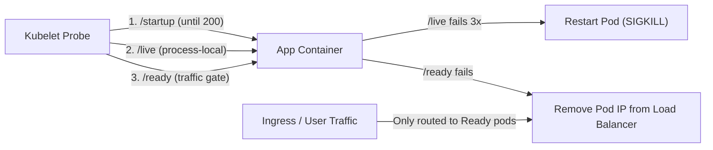
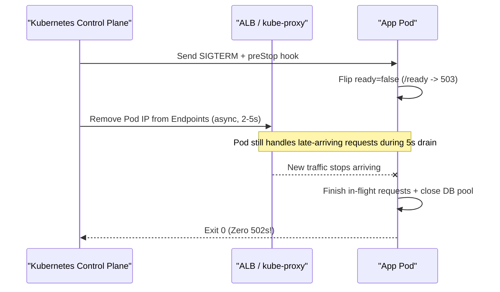

# Health Endpoints Done Right: /live vs /ready vs /health

> **Prerequisites:** [Lesson 09: What Makes a Good Alert? Symptoms, SLO Burn Rates and Runbooks](../09-what-makes-a-good-alert-symptoms-slo-burn-rates-and-runbooks/README.md).  
> **Estimated Reading Time:** 22–26 minutes  
> **Target Audience:** Backend engineers configuring Kubernetes probes and load balancers, and candidates asked "what happens if your `/healthz` endpoint checks Postgres and Postgres has a 5-second hiccup?"  
> **Free PDF Notes:** [Download P5-SD-N-010.pdf](https://backendroadmap.com/notes/system-design/P5-SD-N-010.pdf)

> [!NOTE]
> **In one line:** **`/live` (liveness)** asks *"is this process deadlocked and needing a restart?"* and must **never** check external dependencies; **`/ready` (readiness)** asks *"can this instance serve traffic right now?"* and controls load-balancer routing; **`/health`** is a detailed diagnostic endpoint for humans and dashboards—not orchestrators.

> [!TIP]
> **The Golden Rule:** **Never put a database or downstream API check inside `/live`.** If Postgres blips for 10 seconds and `/live` returns `503`, Kubernetes will **restart every pod in your fleet simultaneously**, turning a 10-second DB hiccup into a 15-minute thundering-herd outage.

---

## 1. What Health Endpoints Are, and What They Isn't

Every production service behind a load balancer or Kubernetes orchestrator needs to answer two completely different questions: (1) *"Should I kill and restart this container?"* and (2) *"Should I send user traffic to this container?"* Conflating them into a single `/health` endpoint that runs `SELECT 1` on Postgres is one of the most common causes of self-inflicted outages in microservice architectures.

| Endpoint / Probe | Question Answered | Action on Failure (`503`) | Should Check External DB/Redis? |
| :--- | :--- | :--- | :--- |
| **`/live` (Liveness)** | Is the process alive and un-deadlocked? | **Kill & restart** the container | **NEVER** (process-local only) |
| **`/ready` (Readiness)** | Is this pod ready to accept traffic? | **Remove from LB/Service** (no restart) | **Carefully** (only critical startup/local state; degrade gracefully) |
| **`/startup` (Startup)** | Has a slow-booting app finished initializing? | Delays liveness/readiness checks | Yes, for initial cache/schema warmup |
| **`/health` (Deep Diag)** | What is the status of all dependencies? | **None** (consumed by humans/dashboards) | Yes (cached, protected, never wired to k8s probes) |
| **Not** | A place to run expensive queries on every poll | Never run full table scans or external HTTP calls un-cached |

### Why It Matters
1. **Cascading restart storms are a top interview scenario:** Explaining why `/live` must never check downstream dependencies immediately signals production battle-scars.
2. **Zero-downtime deploys depend on `/ready`:** Graceful shutdown (`SIGTERM` -> fail `/ready` -> drain in-flight requests -> exit) prevents `502 Bad Gateway` errors during rollouts.
3. **Thundering-herd protection:** Misconfigured probes running every 1 second across 500 pods can DDoS your own database.

---

## 2. Anatomy: Kubernetes Probe Lifecycle & Traffic Routing



When a pod starts, **`startupProbe`** runs first so slow-starting apps (e.g., JVM/Spring Boot warming caches for 45 seconds) aren't killed by `livenessProbe` before they finish booting. Once `startupProbe` succeeds, **`livenessProbe`** (`/live`) checks only internal process health (event loop responsiveness, deadlock canary), while **`readinessProbe`** (`/ready`) gates whether the Kubernetes Service / Load Balancer sends user traffic to that pod.

| Probe Parameter | Typical Value | Why It Matters |
| :--- | :---: | :--- |
| `initialDelaySeconds` | $5\text{–}10\text{ s}$ (use `startupProbe` instead) | Avoids guessing fixed boot times |
| `periodSeconds` | $10\text{ s}$ | Too frequent ($1\text{ s}$) wastes CPU and floods logs |
| `timeoutSeconds` | $2\text{–}3\text{ s}$ | Must be less than `periodSeconds` |
| `failureThreshold` | $3$ | Prevents single GC pause from killing or pulling a pod |

> [!WARNING]
> **The #1 Trap: Checking a Shared Database in `/ready` Without Hysteresis.** If 100 pods all fail `/ready` when Postgres has a 5-second failover, the Load Balancer removes **all 100 pods** (`503 Service Unavailable` at the edge). Worse, if `/ready` executes `SELECT 1` every 2 seconds on 500 pods, that's 250 QPS of probe traffic hitting an already-struggling database!

---

## 3. Mathematical Model: Probe Load Amplification & Cascading Restarts

**1. Probe Traffic Amplification.**
If you run $N$ pods, and each pod's `/ready` or `/health` endpoint queries a downstream database every $P$ seconds:

$$\text{QPS}_{\text{probe}} = \frac{N}{P}$$

With $N = 600\text{ pods}$ and $P = 2\text{ s}$: $\text{QPS}_{\text{probe}} = 300\text{ QPS}$ of pure health-check overhead hitting your primary database **24/7**. If each check opens a new unpooled connection, it can exhaust `max_connections` during a recovery.

**2. Cascading Restart Outage Duration.**
Suppose a shared dependency (Redis or Postgres) has a brief $T_{\text{blip}} = 10\text{ s}$ outage, and `/live` mistakenly checks that dependency with `periodSeconds = 5`, `failureThreshold = 2`:
- At $t = 10\text{ s}$, **100% of $N$ pods** fail 2 liveness probes and are killed simultaneously.
- Each pod takes $T_{\text{boot}} = 45\text{ s}$ to restart + warm caches.
- Total user-facing outage:

$$T_{\text{outage}} = T_{\text{blip}} + T_{\text{boot}} + T_{\text{pool\_warmup}} \approx 10 + 45 + 30 = \mathbf{85\text{ seconds}}$$

And when all 600 pods boot at once, they stampede the database with 600 simultaneous connection/cache-fill requests, often triggering a **second** DB outage.

---

## 4. Metrics & Percentiles

| Metric | Meaning | Alert when |
| :--- | :--- | :--- |
| **Pod Restart Count (`kube_pod_container_status_restarts_total`)** | Liveness-kill or OOMKill restarts | $> 2$ restarts in 10 min across service |
| **Unready Pod Percentage** | `%` of desired pods failing `/ready` | $> 20\%$ unready for $> 2\text{ min}$ |
| **Probe Latency $p_{99}$** | Response time of `/live` and `/ready` | $> 500\text{ ms}$ (risks probe timeout!) |
| **502s During Deploy** | Requests hitting a terminating pod | $> 0$ (missing `preStop` sleep / graceful drain) |

### Worked Example (Zero-Downtime Graceful Shutdown)
During a rolling deploy, Kubernetes sends `SIGTERM` to a pod **in parallel** with removing the pod's IP from kube-proxy/ALB endpoints. Because endpoint propagation across nodes takes $2\text{–}5\text{ seconds}$, traffic still arrives after `SIGTERM`!
- **Broken:** App exits immediately on `SIGTERM` $\implies$ in-flight requests and late-arriving ALB requests get `502 Bad Gateway`.
- **Fixed:** On `SIGTERM`, app immediately flips `/ready` to `503` (draining), waits `5–10 seconds` (`preStop` hook / drain delay) for kube-proxy/ALB to stop sending new requests, finishes in-flight requests, closes DB pools, and exits `0`. Result: **0% 502s**.

---

## 5. Failure Modes: Probe Misconfigurations Compared

| Misconfiguration | What Happens During a 10s DB Blip | Result |
| :--- | :--- | :--- |
| **`/live` checks Postgres** | All pods fail liveness and get `SIGKILL`ed | **Full fleet restart storm** (10s blip $\to$ minutes of outage) |
| **`/ready` checks Postgres (uncached)** | All pods pulled from LB; 300 QPS probe storm hits DB | **Total 503 outage** + DB recovery slowed |
| **No `startupProbe` on slow app** | `livenessProbe` kills pod before it finishes booting | **Infinite `CrashLoopBackOff`** |
| **No graceful drain on `SIGTERM`** | Pod dies while ALB still routes traffic to its IP | **502 Bad Gateway spike** on every deploy |

---

## 6. Numbers Every Engineer Must Know

| Item | Typical | Implication |
| :--- | :---: | :--- |
| `/live` target latency | $< 5\text{ ms}$ | Pure in-memory / event-loop check; zero I/O |
| `/ready` probe period | $5\text{–}10\text{ s}$ | Never $1\text{ s}$; use `failureThreshold: 3` |
| Graceful drain (`preStop`) | $5\text{–}15\text{ s}$ | Covers kube-proxy / ALB endpoint propagation lag |
| `terminationGracePeriodSeconds` | $30\text{–}60\text{ s}$ | Must exceed `preStop` + max in-flight request timeout |
| Dependency check cache TTL | $5\text{–}10\text{ s}$ (in `/health`) | Prevents probe storms from hitting downstream DBs |

---

## 7. Protocol Deep Dive: Graceful Shutdown (`SIGTERM`) Sequence



| Question | Answer |
| :--- | :--- |
| **Should `/ready` ever check an external dependency?** | Only for **pod-local** readiness (e.g., *"has this pod loaded its ML model or config?"*) or a hard per-pod dependency where *other* pods might still be healthy. Never pull the entire fleet for a shared DB blip unless you want the edge LB to return 503 immediately instead of queuing. |
| **Why separate `/health` from `/live` and `/ready`?** | `/health` returns rich JSON (`{"postgres":"ok","redis":"degraded","version":"1.4.2"}`) for engineers and smoke tests, and should be **internal/authenticated** so you don't leak stack topology publicly. |
| **What should `/live` actually check?** | Process responsiveness: HTTP server responds, event loop isn't blocked (e.g., goroutine/thread-pool canary), and no unrecoverable internal deadlock. |

**When NOT to expose `/health` publicly:** Never expose detailed `/health` dependency statuses on public internet ingress—attackers can use it to map your internal stack (Postgres version, Redis status) or trigger expensive checks via unauthenticated GETs.

---

## 8. Hierarchical Budgets & Design Rules

| Slice | Rule | Control |
| :--- | :--- | :--- |
| `/live` | Zero external I/O; $<5\text{ ms}$; checks process/event-loop only | Code review + unit test |
| `/ready` | Gates LB traffic; flips to `503` immediately on `SIGTERM` | Graceful shutdown handler |
| `/startup` | Protects slow-booting apps from premature liveness kills | `startupProbe` in Helm/K8s |
| `/health` | Detailed JSON for humans; cached 5–10s; internal/auth-gated | Ingress network policy |
| Access Logs | Exclude `/live` and `/ready` from Fluent Bit / access logs | Agent filter (saves 20–40% log volume) |
| Shutdown | `preStop` sleep $5\text{ s}$ + `terminationGracePeriodSeconds: 45` | Deployment YAML linter |

---

## 9. Top Mitigations

1. **Keep `/live` strictly process-local**—zero DB, Redis, or HTTP calls.
2. **Use `startupProbe` for slow-starting services** instead of setting huge `initialDelaySeconds` on `livenessProbe`.
3. **Flip `/ready` to `503` on `SIGTERM` and wait 5–10 seconds** before closing the HTTP server so load balancers drain cleanly.
4. **Cache any dependency checks in `/health` for 5–10 seconds** (with a short `500 ms` timeout) so probes cannot DDoS downstream services.
5. **Protect `/health` from public internet traffic** via Ingress rules or internal-only ports.
6. **Exclude `/live` and `/ready` from access logs and tracing** so they don't pollute observability budgets.
7. **Test graceful shutdown and DB-blip resilience in staging** before shipping to production.

---

## 10. Production Reference: The "Self-Inflicted Restart Storm"

A fintech API had `/healthz` wired to **both** `livenessProbe` and `readinessProbe` in Kubernetes, and `/healthz` ran `SELECT 1` on Postgres and `PING` on Redis. When Redis underwent a routine 12-second primary failover:


- **Root Cause:** Sharing one DB-checking `/healthz` endpoint for both liveness and readiness turned a 12-second Redis failover into a 14-minute fleet-wide outage.
- **Fix:** Split into `/live` (process-local `200 OK`), `/ready` (local warmup + `SIGTERM` drain gate; Redis degraded mode uses DB fallback), and `/health` (cached 10s, internal-only). The next Redis failover caused **zero pod restarts** and $< 0.1\%$ impact.

---

## 11. Multi-Language Production Code Tabs

Production-ready `/live`, `/ready` (with `SIGTERM` graceful drain), and `/health` (cached dependency check) in all 4 languages.

````carousel
```go
// Go: /live (process-local), /ready (SIGTERM drain gate), /health (cached) with net/http.
package main

import (
	"context"
	"encoding/json"
	"net/http"
	"os/signal"
	"sync/atomic"
	"syscall"
	"time"
)

func main() {
	var ready atomic.Bool
	ready.Store(true) // set true once startup warmup finishes

	mux := http.NewServeMux()
	mux.HandleFunc("/live", func(w http.ResponseWriter, r *http.Request) {
		w.WriteHeader(http.StatusOK) // NEVER check DB/Redis here
		_, _ = w.Write([]byte("ok"))
	})
	mux.HandleFunc("/ready", func(w http.ResponseWriter, r *http.Request) {
		if !ready.Load() {
			http.Error(w, "draining", http.StatusServiceUnavailable)
			return
		}
		w.WriteHeader(http.StatusOK)
		_, _ = w.Write([]byte("ready"))
	})
	mux.HandleFunc("/health", func(w http.ResponseWriter, r *http.Request) {
		w.Header().Set("Content-Type", "application/json")
		_ = json.NewEncoder(w).Encode(map[string]any{"status": "ok", "ready": ready.Load()})
	})

	srv := &http.Server{Addr: ":8080", Handler: mux}
	ctx, stop := signal.NotifyContext(context.Background(), syscall.SIGTERM, syscall.SIGINT)
	defer stop()

	go func() { _ = srv.ListenAndServe() }()
	<-ctx.Done()

	ready.Store(false)                    // 1. Fail /ready immediately
	time.Sleep(5 * time.Second)           // 2. Wait for LB/kube-proxy propagation
	shutdownCtx, cancel := context.WithTimeout(context.Background(), 15*time.Second)
	defer cancel()
	_ = srv.Shutdown(shutdownCtx)         // 3. Drain in-flight requests
}
```
<!-- slide -->
```typescript
// TypeScript (Node.js): /live, /ready with SIGTERM drain, and /health.
import http from "node:http";

let isReady = true;

const server = http.createServer((req, res) => {
  if (req.url === "/live") {
    res.writeHead(200).end("ok"); // process-local only
    return;
  }
  if (req.url === "/ready") {
    res.writeHead(isReady ? 200 : 503).end(isReady ? "ready" : "draining");
    return;
  }
  if (req.url === "/health") {
    res.writeHead(200, { "Content-Type": "application/json" });
    res.end(JSON.stringify({ status: "ok", ready: isReady, uptime_s: Math.floor(process.uptime()) }));
    return;
  }
  res.writeHead(404).end();
});

server.listen(8080);

process.on("SIGTERM", () => {
  isReady = false; // fail /ready immediately so LB stops routing new traffic
  setTimeout(() => {
    server.close(() => process.exit(0));
  }, 5000); // wait for kube-proxy / ALB endpoint removal
});
```
<!-- slide -->
```python
# Python: /live, /ready with SIGTERM drain, and /health (stdlib http.server).
from http.server import BaseHTTPRequestHandler, ThreadingHTTPServer
import json
import signal
import threading
import time

READY = True


class HealthHandler(BaseHTTPRequestHandler):
    def do_GET(self):
        if self.path == "/live":
            self.send_response(200)
            self.end_headers()
            self.wfile.write(b"ok")
        elif self.path == "/ready":
            self.send_response(200 if READY else 503)
            self.end_headers()
            self.wfile.write(b"ready" if READY else b"draining")
        elif self.path == "/health":
            self.send_response(200)
            self.send_header("Content-Type", "application/json")
            self.end_headers()
            self.wfile.write(json.dumps({"status": "ok", "ready": READY}).encode())
        else:
            self.send_response(404)
            self.end_headers()

    def log_message(self, format, *args):
        return  # suppress noisy probe access logs


def handle_sigterm(*_):
    global READY
    READY = False
    time.sleep(5)
    threading.Thread(target=server.shutdown, daemon=True).start()


if __name__ == "__main__":
    signal.signal(signal.SIGTERM, handle_sigterm)
    server = ThreadingHTTPServer(("0.0.0.0", 8080), HealthHandler)
    server.serve_forever()
```
<!-- slide -->
```csharp
// C# (ASP.NET Core minimal API): separate /live, /ready, and /health with graceful drain.
var builder = WebApplication.CreateBuilder(args);
var app = builder.Build();

var isReady = true;
var lifetime = app.Services.GetRequiredService<IHostApplicationLifetime>();
lifetime.ApplicationStopping.Register(() =>
{
    isReady = false;                  // fail /ready immediately on SIGTERM
    Thread.Sleep(TimeSpan.FromSeconds(5)); // allow LB endpoint propagation
});

app.MapGet("/live", () => Results.Ok("ok")); // zero external dependencies
app.MapGet("/ready", () => isReady ? Results.Ok("ready") : Results.StatusCode(503));
app.MapGet("/health", () => Results.Json(new { status = "ok", ready = isReady }));

app.Run();
```
````

---

## 12. Hands-On CLI Verification Workflows

```bash
# 1. Verify /live, /ready, and /health responses and latencies
for ep in /live /ready /health; do
  curl -s -o /dev/null -w "$ep -> HTTP %{http_code} in %{time_total}s\n" "http://localhost:8080$ep"
done

# 2. Simulate SIGTERM and verify /ready flips to 503 during the 5s drain window
kill -TERM $(pgrep -f health_server) && sleep 1 && curl -i -s http://localhost:8080/ready | head -n 1

# 3. Inspect Kubernetes probe configuration and restart counts on a live deployment
kubectl get pods -l app=checkout -o custom-columns="NAME:.metadata.name,READY:.status.containerStatuses[0].ready,RESTARTS:.status.containerStatuses[0].restartCount"
```

---

## 13. Common Mistakes to Avoid

1. **Checking Postgres, Redis, or downstream HTTP APIs inside `/live`**, triggering fleet-wide restart storms.
2. **Wiring `/health` (deep diagnostic) to Kubernetes `livenessProbe` or `readinessProbe`**.
3. **Omitting `startupProbe` on slow-booting apps**, causing infinite `CrashLoopBackOff`.
4. **Exiting immediately on `SIGTERM`** without failing `/ready` and waiting 5–10s for LB propagation, causing `502`s on every deploy.
5. **Polling `/ready` every 1 second** across hundreds of pods with uncached DB queries.
6. **Exposing detailed `/health` JSON publicly** on the internet, leaking internal versions and topology.
7. **Logging every `/live` and `/ready` 200 OK**, wasting 20–40% of your log aggregation budget.

---

## 14. Key Terms Glossary

| Key Term | Definition |
| :--- | :--- |
| **`/live` (Liveness Probe)** | Process-local check determining if a container is deadlocked and must be restarted. |
| **`/ready` (Readiness Probe)** | Traffic-gating check determining if a container can receive load-balancer requests. |
| **`/startup` (Startup Probe)** | Boot-time probe that disables liveness/readiness until initialization completes. |
| **`/health` (Deep Diagnostic)** | Human/dashboard endpoint reporting detailed dependency states (never wired to k8s restarts). |
| **Graceful Drain** | Failing `/ready` on `SIGTERM`, waiting for LB removal, then finishing in-flight requests. |
| **Restart Storm** | Cascading failure where a dependency blip causes liveness probes to kill all pods simultaneously. |
| **`CrashLoopBackOff`** | Kubernetes state when a container repeatedly fails liveness/startup and is restarted with exponential backoff. |
| **`preStop` Hook** | Kubernetes lifecycle hook run before/at `SIGTERM` (e.g., `sleep 5`) to absorb LB propagation lag. |

---

## 15. System Design Interview Questions & Answers

### Basic Conceptual Questions

<details>
<summary><strong>Q1: What is the difference between `/live` (liveness) and `/ready` (readiness)? [BASIC]</strong></summary>

**Answer:**
`/live` tells the orchestrator whether to **kill and restart** the container (e.g., if deadlocked). `/ready` tells the load balancer whether to **route traffic** to the container (e.g., during warmup or graceful shutdown).
</details>

<details>
<summary><strong>Q2: Why should `/live` NEVER check a database or external service? [BASIC]</strong></summary>

**Answer:**
If a shared database has a brief 10-second hiccup, every pod's `/live` probe will fail and Kubernetes will restart the entire fleet simultaneously—causing a thundering-herd outage long after the database recovered.
</details>

<details>
<summary><strong>Q3: What is a `startupProbe` used for? [BASIC]</strong></summary>

**Answer:**
It protects slow-starting applications (like JVM services loading caches or ML models) from being killed by `livenessProbe` before they finish booting, without forcing you to use a loose liveness timeout in steady state.
</details>

<details>
<summary><strong>Q4: What is `/health` for if we already have `/live` and `/ready`? [BASIC]</strong></summary>

**Answer:**
`/health` is an internal/authenticated diagnostic endpoint for humans, smoke tests, and status dashboards that reports detailed dependency health (DB, Redis, Kafka, build SHA) without triggering automated pod restarts.
</details>

### Scenario-Based Architecture Questions

<details>
<summary><strong>Q5: Users see a spike of `502 Bad Gateway` errors every time you deploy a new version. Why, and how do you fix it? [SCENARIO]</strong></summary>

**Answer:**
Kubernetes sends `SIGTERM` to the pod *in parallel* with removing the pod's IP from kube-proxy/ALB endpoints, which takes 2–5 seconds. If the app exits immediately, in-flight and late-arriving requests get `502`. Fix by flipping `/ready` to `503` on `SIGTERM`, adding a 5–10s `preStop` sleep, draining in-flight requests, and then exiting.
</details>

<details>
<summary><strong>Q6: Should `/ready` check Postgres? What happens if Postgres blips for 5 seconds? [SCENARIO]</strong></summary>

**Answer:**
Generally **no** for a shared critical database: if Postgres blips for 5 seconds and all 100 pods fail `/ready`, the load balancer removes all 100 pods and returns `503` at the edge—even for endpoints that don't need Postgres. Only check a dependency in `/ready` if *individual* pods can lose connectivity independently (e.g., a local sidecar) or if you intentionally want the edge LB to shed traffic immediately.
</details>

<details>
<summary><strong>Q7: You have 500 pods and `/health` runs `SELECT 1` on Postgres every 2 seconds. What goes wrong? [SCENARIO]</strong></summary>

**Answer:**
That generates 250 QPS of constant health-check traffic against Postgres. During a slowdown, probe queries pile up and starve real user queries. Fix by never wiring `/health` to frequent probes, and caching dependency check results in memory for 5–10 seconds with a 500 ms timeout.
</details>

<details>
<summary><strong>Q8: A pod is in `CrashLoopBackOff` right after a deploy, even though it works locally. What probe issue could cause this? [SCENARIO]</strong></summary>

**Answer:**
The app takes 40 seconds to boot in production (e.g., warming caches), but `livenessProbe` starts after 10 seconds with `failureThreshold: 3`, killing the pod at 30 seconds before it ever finishes starting. Add a `startupProbe` covering the max boot time.
</details>

### Advanced & Tricky Interview Questions

<details>
<summary><strong>Q9: How do you test that `/live` actually catches a deadlock without checking external dependencies? [TRICKY]</strong></summary>

**Answer:**
Check **process-local** health: in Node.js, measure event-loop lag (fail if $> 2\text{ s}$); in Go/Java, verify the HTTP worker pool can acquire a goroutine/thread and complete a trivial in-memory check within the timeout.
</details>

<details>
<summary><strong>Q10: Why can't `preStop: sleep 5` alone guarantee zero 502s if `terminationGracePeriodSeconds` is default (30s)? [TRICKY]</strong></summary>

**Answer:**
If a pod has a long-running request (e.g., 35-second file export) and `preStop` uses 5 seconds, `SIGKILL` arrives at 30 seconds and kills the request mid-flight. Set `terminationGracePeriodSeconds` > `preStop` + max request timeout (e.g., 60s).
</details>

<details>
<summary><strong>Q11: What is the risk of exposing `/health` with full dependency details on a public API gateway? [TRICKY]</strong></summary>

**Answer:**
Information disclosure (attackers see exact DB/cache/queue dependencies and versions) and unauthenticated DoS amplification if `/health` triggers uncached backend queries. Always restrict `/health` to internal VPCs or require an admin token.
</details>

<details>
<summary><strong>Q12: If `/ready` returns 503 during a dependency outage, how does that interact with circuit breakers? [TRICKY]</strong></summary>

**Answer:**
If `/ready` pulls all pods from the LB, the service cannot serve *degraded* responses (like cached data or a friendly fallback). Keeping `/ready` up and using **per-dependency circuit breakers** inside the app lets healthy endpoints stay up and failing endpoints degrade gracefully.
</details>

---

## 16. One-Page Master Cheat Sheet

```
+---------------------------------------------------------------------------------------------------------+
|                    HEALTH ENDPOINTS DONE RIGHT — MASTER CHEAT SHEET                                     |
+---------------------------------------------------------------------------------------------------------+
| 1. /live (Liveness):  Process-local ONLY (<5ms). NEVER check DB/Redis. Failure = K8s kills/restarts pod.|
+---------------------------------------------------------------------------------------------------------+
| 2. /ready (Readiness): Gates LB traffic. Flip to 503 on SIGTERM + 5-10s drain -> zero 502 deploys.      |
+---------------------------------------------------------------------------------------------------------+
| 3. /startup:          Protects slow-booting apps from premature liveness kills (prevents CrashLoop).    |
+---------------------------------------------------------------------------------------------------------+
| 4. /health:           Detailed JSON for humans/dashboards. Cache 5-10s; keep internal/auth-protected.   |
+---------------------------------------------------------------------------------------------------------+
| 5. RULE OF THUMB:     Never turn a 10-second DB blip into a 15-minute fleet-wide restart storm.         |
+---------------------------------------------------------------------------------------------------------+
```

---

## Further Reading & Sources

- Kubernetes Documentation, [Configure Liveness, Readiness and Startup Probes](https://kubernetes.io/docs/tasks/configure-pod-container/configure-liveness-readiness-startup-probes/).
- Google Cloud Blog, [Kubernetes Best Practices: Terminating with Grace](https://cloud.google.com/blog/products/containers-kubernetes/kubernetes-best-practices-terminating-with-grace).
- Microsoft Azure Architecture Center, [Health Endpoint Monitoring Pattern](https://learn.microsoft.com/en-us/azure/architecture/patterns/health-endpoint-monitoring).

---

## Free PDF Notes

[P5-SD-N-010.pdf](https://backendroadmap.com/notes/system-design/P5-SD-N-010.pdf)

---

## Next

Continue with [Lesson 11: Root-Cause Analysis: Debug Incidents You've Never Seen (5 Whys)](../11-root-cause-analysis/README.md).
