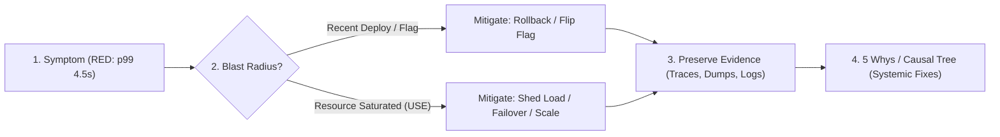
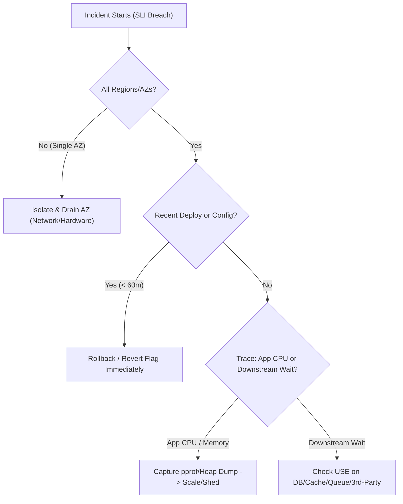
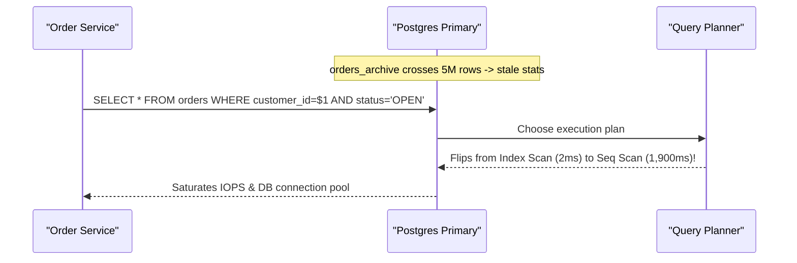

# Root-Cause Analysis: Debug Incidents You've Never Seen (5 Whys)

> **Prerequisites:** [Lesson 10: Health Endpoints Done Right](../10-health-endpoints-done-right/README.md).  
> **Estimated Reading Time:** 24–28 minutes  
> **Target Audience:** Backend and SRE engineers debugging unfamiliar production failures under pressure, and candidates asked "p99 latency just jumped 10x and you've never seen this failure before—how do you debug it?"  
> **Free PDF Notes:** [Download P5-SD-N-011.pdf](https://backendroadmap.com/notes/system-design/P5-SD-N-011.pdf)

> [!NOTE]
> **In one line:** Debugging an incident you have never seen requires **mitigating user impact first**, then systematically narrowing the search space using **RED/USE metrics**, **differential analysis** (*what changed?*), and **5 Whys / Contributing-Factor Trees**—never random shotgun restarts or blaming "human error."

> [!TIP]
> **The Golden Rule:** **Restore service before finding the root cause.** In production, rolling back a suspect deploy or failing over a region cuts MTTR in half; you can dissect the exact bug afterward from preserved heap dumps, traces, and logs.

---

## 1. What Root-Cause Analysis Is, and What It Isn't

When an unfamiliar SEV-1 hits—say, checkout $p_{99}$ latency spikes from 80 ms to 4,500 ms with zero 500s—junior engineers guess randomly (*"maybe restart Redis?"*, *"maybe Postgres needs vacuum?"*). Senior engineers run a repeatable **scientific method**: observe symptoms (RED), check resource bottlenecks (USE), bisect what changed (deploys, flags, traffic, dependencies), mitigate, and then use **5 Whys** to uncover the systemic—not personal—causes.

| Term | Precise Meaning | Example |
| :--- | :--- | :--- |
| **RED Method** | Request-scoped telemetry: **Rate, Errors, Duration** (for services) | Checkout RPS=2k, 5xx=0.1%, $p_{99}=4.5\text{ s}$ |
| **USE Method** | Resource-scoped telemetry: **Utilization, Saturation, Errors** (for infra) | DB CPU=35%, Connection Pool Queue=240 waiting (Saturation!) |
| **Differential Diagnosis** | Comparing *failing* vs *healthy* dimensions (AZ, version, tenant, endpoint) | Only `us-east-1b` pods or only `v2.14.0` canary is slow |
| **5 Whys** | Iterative questioning ("Why did X happen?") to move past symptoms to systemic fixes | 5th Why: "No connection-pool timeout + no canary gate" |
| **Contributing Factors** | Multiple independent flaws that aligned to cause an outage (Swiss Cheese model) | Traffic spike + missing timeout + stale cache TTL |
| **Proximate vs Systemic Cause** | Immediate trigger vs underlying architectural/process gap | Trigger: bad config push. Systemic: unvalidated config schema |
| **Not** | Finding one person to blame ("Bob ran the wrong script") | Human error is a *starting point*, never a root cause |

### Why It Matters
1. **"How do you debug X?" is a universal senior interview question:** Interviewers look for a structured framework (RED -> USE -> Bisect -> Mitigate -> 5 Whys), not guesswork.
2. **Distributed outages rarely have a single "root cause":** Treating complex failures as a causal tree prevents superficial fixes that let the same outage recur next month.
3. **Preserving evidence matters:** Restarting a wedged pod *before* grabbing a goroutine/thread dump or trace ID destroys the only clue to a rare deadlock.

---

## 2. Anatomy: The Incident Triage & 5-Whys Funnel



Notice the order of operations:
1. **Scope with RED:** Is it one endpoint, one AZ, one tenant, or global?
2. **Check USE on dependencies:** A service with 10% CPU and 4,500 ms latency is almost always **waiting on a saturated queue, lock, or pool** downstream.
3. **Mitigate first:** Roll back, drain AZ, or shed non-critical load.
4. **Analyze with 5 Whys:** Walk backward from the symptom until you hit an engineering control you can permanently harden.

| Method | Best For | Blind Spot |
| :--- | :--- | :--- |
| **RED (Rate, Errors, Duration)** | Detecting *where* users feel pain | Doesn't tell you *which* internal resource is saturated |
| **USE (Utilization, Saturation, Errors)** | Finding CPU, memory, disk, pool, or lock bottlenecks | Doesn't measure user-facing business impact |
| **5 Whys** | Uncovering systemic process/design gaps | Can oversimplify into a single linear chain if branching causes exist |
| **Fault Tree / Causal Graph** | Complex multi-factor distributed outages | Takes longer to write; best for SEV-1 postmortems |

> [!WARNING]
> **The #1 Trap: Stopping at "Human Error" in 5 Whys.** If your 5th Why is *"Engineer Bob typoed the config"* or *"Alice forgot to check the dashboard"*, you have failed RCA. Ask one more Why: *"Why was it possible for a single typo to reach production without schema validation or canary rollback?"*

---

## 3. Mathematical Model: MTTR Decomposition & Binary Search Triage

**1. Mean Time to Recovery (MTTR).**
Total outage duration is the sum of four sequential phases:

$$\text{MTTR} = T_{\text{detect}} + T_{\text{triage}} + T_{\text{mitigate}} + T_{\text{verify}}$$

- $T_{\text{detect}}$: Time for SLO burn-rate alert to page on-call (target: $2\text{–}5\text{ min}$).
- $T_{\text{triage}}$: Time to isolate the failing component/change (where structured RCA shines).
- $T_{\text{mitigate}}$: Time to rollback, failover, or shed load.
- $T_{\text{verify}}$: Time for short-window SLIs ($5\text{m}$) to return to green.

**2. Binary Search vs Linear Guessing ($O(\log_2 N)$ vs $O(N)$).**
Suppose a service deployed $N = 64$ commits since the last known good release, or has $N = 64$ microservices in a call graph:
- **Linear guessing** (inspecting one service/commit at a time): averages $N/2 = 32\text{ steps}$. At 3 minutes per check, $T_{\text{triage}} = \mathbf{96\text{ minutes}}$.
- **Binary search** (`git bisect` on commits, or checking the midpoint of a distributed trace waterfall): takes $\lceil \log_2(64) \rceil = \mathbf{6\text{ steps}}$. At 3 minutes per check, $T_{\text{triage}} = \mathbf{18\text{ minutes}}$—a **5.3x speedup**.

---

## 4. Metrics & Percentiles

| Metric | Meaning | Alert / Investigate when |
| :--- | :--- | :--- |
| **Queue / Pool Saturation** | Requests waiting for a DB connection, thread, or lock | Wait queue $> 0$ sustained; $p_{99}$ wait $> 50\text{ ms}$ |
| **Tail-to-Median Ratio ($p_{99} / p_{50}$)** | Skew between typical and worst-case requests | Ratio $> 10\times$ (indicates lock contention, GC, or cold retries) |
| **Retry Amplification** | Upstream retries per original user request | $> 1.2\times$ (retry storm multiplying load) |
| **TCP Retransmits / Socket Errors** | Network packet loss or exhausted ephemeral ports | Sudden spike in one AZ |

### Worked Example (The "Low CPU, 4.5s Latency" Mystery)
Checkout $p_{50}$ is 45 ms, $p_{99}$ jumps to 4,500 ms, and pod CPU is only **12%**.
1. **RED:** `POST /checkout` $p_{99} = 4.5\text{ s}$; `GET /catalog` $p_{99} = 20\text{ ms}$. (Scoped to checkout write path).
2. **Trace Waterfall:** Checkout span takes 4,500 ms; its child span `db.acquire_connection` takes **4,420 ms**, while the SQL query itself takes **8 ms**.
3. **USE on DB Pool:** Pool size $= 20$, Utilization $= 100\%$ (20/20 active), Saturation $= 180$ goroutines waiting!
4. **5 Whys:**
   - *Why 1:* Checkout waited 4.4s for a DB connection.
   - *Why 2:* All 20 connections were held by a new background export query.
   - *Why 3:* The export query ran inside the same OLTP connection pool without a `statement_timeout`.
   - *Why 4:* No pool-wait metric or separate read-replica pool existed.
   - *Why 5:* **Systemic fix:** Separate OLTP vs batch pools, enforce `statement_timeout = 2s`, and alert on `db_pool_wait_ms > 50ms`.

---

## 5. Failure Modes in Debugging (Anti-Patterns)

| Anti-Pattern | What Happens | Consequence |
| :--- | :--- | :--- |
| **1. "Reboot First, Ask Never"** | Team restarts wedged pods immediately | Outage returns in 20 minutes; heap/goroutine dumps are gone forever |
| **2. Correlation = Causation** | Team sees high CPU on Service A and blames A | Service A is actually spinning on retries because Service B is dropping packets |
| **3. Tunnel Vision** | 5 engineers all stare at Postgres logs for 40 min | Nobody checked that a CDN/DNS config change rolled out 5 minutes before the spike |
| **4. Single-Cause Bias** | Stopping 5 Whys at "bad SQL query" | Misses why the query wasn't caught in staging, why there was no query timeout, and why canary didn't block it |

---

## 6. Numbers Every Engineer Must Know

| Item | Typical | Implication |
| :--- | :---: | :--- |
| First question in any outage | *"What changed in the last 30–60 min?"* | ~70–80% of incidents are triggered by deploys, flags, or config changes |
| `git bisect` steps for 1,000 commits | $\lceil \log_2(1000) \rceil = 10\text{ steps}$ | Finds breaking commit exponentially faster than reading diffs |
| Healthy $p_{99} / p_{50}$ ratio | $2\times \text{ to } 5\times$ | $> 10\times$ screams queueing, GC, or lock contention |
| Timebox before escalating/rolling back | $10\text{–}15\text{ minutes}$ | If you can't explain it in 15 min, roll back the last change |
| Evidence capture before pod kill | $< 30\text{ seconds}$ | Grab `pprof` / thread dump / `trace_id` before terminating |

---

## 7. Protocol Deep Dive: Differential Diagnosis Decision Tree



| Question | Answer |
| :--- | :--- |
| **What if *nothing* changed in our code, yet latency spiked?** | Check external changes: traffic volume/shape (bot/flash sale), third-party API latency, cloud provider AZ degradation, expired TLS cert, or a data-size threshold (table crossed 10M rows and query planner switched from index scan to seq scan). |
| **How do you debug an intermittent Heisenbug that only happens 0.1% of the time?** | Use **tail-based tracing** (keep 100% of slow/error traces), correlate by `trace_id` + pod/AZ/tenant attributes, and look for common denominators across 20 failing `trace_id`s. |
| **When do you stop asking "Why?" in 5 Whys?** | When you reach a concrete **organizational, architectural, or tooling gap** (missing timeout, missing canary check, missing quota) rather than a person's mistake. |

**When NOT to spend 2 hours doing RCA during an outage:** During an active SEV-1/SEV-2! Always **mitigate first** (rollback, failover, disable feature flag) and run deep 5-Whys RCA *after* the system is green.

---

## 8. Hierarchical Budgets & Design Rules

| Slice | Rule | Control |
| :--- | :--- | :--- |
| Change Correlation | Overlay deploy/config/flag events on every Grafana dashboard | Deployment markers (`annotations`) |
| Timeboxing | If root cause isn't clear in 15 min, execute safe rollback | Incident runbook policy |
| Evidence | Capture `pprof`/thread-dump/heap before killing a wedged pod | Automated pre-kill debug hook |
| Telemetry | Every service exports RED metrics; every resource exports USE metrics | Standard observability template |
| Timeouts | Every outbound call and DB query has a bounded timeout | Linter / client wrapper |
| RCA Standard | 5 Whys must end in systemic/tooling fixes, never "be more careful" | Postmortem review gate |

---

## 9. Top Mitigations

1. **Overlay deploy, feature-flag, and config-change markers** directly on latency/error graphs so "what changed?" takes 2 seconds.
2. **Capture a diagnostic snapshot** (`pprof`, thread dump, top 10 failing `trace_id`s) *before* restarting a broken pod.
3. **Timebox live debugging to 10–15 minutes**—if a recent deploy exists, roll back first and investigate in staging.
4. **Use distributed trace waterfalls to bisect latency**—immediately tells you whether time was spent in app code, lock/pool wait, or a downstream RPC.
5. **Group failing requests by dimensions** (AZ, pod version, tenant ID, payload size) to spot differential patterns.
6. **Run multi-branch 5 Whys** (a causal tree) so you fix *both* the trigger and the missing safety net (e.g., missing timeout + missing canary).
7. **Build a "Never Seen Before" diagnostic cheat sheet** into your runbooks (`curl /debug/pprof`, `EXPLAIN ANALYZE`, `ss -s`).

---

## 10. Production Reference: The "Silent Query-Plan Flip"

An e-commerce API had zero deploys for 48 hours, yet at 14:12 UTC checkout $p_{99}$ jumped from 90 ms to 3,800 ms. Nothing had changed in code or config.



- **Root Cause (5 Whys):** (1) Checkout stalled waiting on DB; (2) Postgres CPU/IOPS hit 100%; (3) a common query switched from Index Scan to Sequential Scan; (4) `autovacuum` / `ANALYZE` hadn't run on a high-churn table, leaving planner row-count estimates off by 100x; (5) **Systemic fix:** tuned per-table `autovacuum_analyze_scale_factor = 0.01`, added `pg_stat_statements` top-query alerting, and added a 1.5s `statement_timeout`.

---

## 11. Multi-Language Production Code Tabs

Differential diagnosis helper: groups failing vs healthy request samples by dimension (`az`, `version`, `tenant`) to instantly surface anomalies, plus `bisect_first_bad` for $O(\log N)$ change isolation.

````carousel
```go
// Go: differential diagnosis (error rate by dimension) + binary search bisect.
package main

import "fmt"

type Sample struct {
	AZ      string
	Version string
	OK      bool
}

func DifferentialErrorRate(samples []Sample, keyFn func(Sample) string) map[string]float64 {
	total, bad := map[string]int{}, map[string]int{}
	for _, s := range samples {
		k := keyFn(s)
		total[k]++
		if !s.OK {
			bad[k]++
		}
	}
	rates := make(map[string]float64, len(total))
	for k, n := range total {
		rates[k] = float64(bad[k]) / float64(n)
	}
	return rates
}

func BisectFirstBad(n int, isBad func(int) bool) int {
	lo, hi := 0, n-1
	for lo < hi {
		mid := lo + (hi-lo)/2
		if isBad(mid) {
			hi = mid
		} else {
			lo = mid + 1
		}
	}
	return lo
}

func main() {
	samples := []Sample{{"az-1", "v1", true}, {"az-2", "v1", false}, {"az-2", "v1", false}}
	fmt.Println("Error rate by AZ:", DifferentialErrorRate(samples, func(s Sample) string { return s.AZ }))
	fmt.Println("First bad commit index:", BisectFirstBad(64, func(i int) bool { return i >= 42 }))
}
```
<!-- slide -->
```typescript
// TypeScript: differential dimension analyzer + binary search for first bad deploy.
interface Sample {
  az: string;
  version: string;
  ok: boolean;
}

export function errorRateByDimension(samples: Sample[], dim: "az" | "version"): Record<string, number> {
  const counts: Record<string, { total: number; bad: number }> = {};
  for (const s of samples) {
    const k = s[dim];
    counts[k] ??= { total: 0, bad: 0 };
    counts[k].total++;
    if (!s.ok) counts[k].bad++;
  }
  return Object.fromEntries(Object.entries(counts).map(([k, v]) => [k, v.bad / v.total]));
}

export function bisectFirstBad(n: number, isBad: (idx: number) => boolean): number {
  let lo = 0, hi = n - 1;
  while (lo < hi) {
    const mid = (lo + hi) >> 1;
    if (isBad(mid)) hi = mid;
    else lo = mid + 1;
  }
  return lo;
}
```
<!-- slide -->
```python
# Python: differential diagnosis across dimensions + O(log N) bisect.
from collections import defaultdict


def error_rate_by_dimension(samples: list[dict], key: str) -> dict[str, float]:
    stats = defaultdict(lambda: [0, 0])  # [bad, total]
    for s in samples:
        stats[s[key]][1] += 1
        if not s["ok"]:
            stats[s[key]][0] += 1
    return {k: round(bad / total, 4) for k, (bad, total) in stats.items()}


def bisect_first_bad(n: int, is_bad) -> int:
    lo, hi = 0, n - 1
    while lo < hi:
        mid = (lo + hi) // 2
        if is_bad(mid):
            hi = mid
        else:
            lo = mid + 1
    return lo


if __name__ == "__main__":
    data = [{"az": "1a", "ok": True}, {"az": "1b", "ok": False}, {"az": "1b", "ok": False}]
    print(error_rate_by_dimension(data, "az"))          # {'1a': 0.0, '1b': 1.0}
    print(bisect_first_bad(64, lambda i: i >= 42))      # 42
```
<!-- slide -->
```csharp
// C#: differential diagnosis by dimension + binary search bisect.
public sealed record Sample(string Az, string Version, bool Ok);

public static class RcaTools
{
    public static Dictionary<string, double> ErrorRateBy(IEnumerable<Sample> samples, Func<Sample, string> keySelector) =>
        samples.GroupBy(keySelector)
               .ToDictionary(g => g.Key, g => (double)g.Count(s => !s.Ok) / g.Count());

    public static int BisectFirstBad(int n, Func<int, bool> isBad)
    {
        int lo = 0, hi = n - 1;
        while (lo < hi)
        {
            int mid = lo + (hi - lo) / 2;
            if (isBad(mid)) hi = mid;
            else lo = mid + 1;
        }
        return lo;
    }
}
```
````

---

## 12. Hands-On CLI Verification Workflows

```bash
# 1. Binary search a breaking commit in Git automatically
git bisect start HEAD v2.13.0
git bisect run pytest tests/test_latency_regression.py

# 2. Capture a 15-second Go CPU profile or goroutine dump before restarting a wedged pod
curl -s "http://localhost:6060/debug/pprof/goroutine?debug=2" > goroutines.txt
curl -s "http://localhost:6060/debug/pprof/profile?seconds=15" > cpu.pprof

# 3. Inspect active Postgres locks & long-running queries during a latency spike
psql -c "SELECT pid, now() - query_start AS duration, state, wait_event, left(query, 80) FROM pg_stat_activity WHERE state != 'idle' ORDER BY duration DESC LIMIT 10;"
```

---

## 13. Common Mistakes to Avoid

1. **Restarting pods before capturing evidence** (`pprof`, heap dumps, `trace_id`s), destroying the only proof of a rare bug.
2. **Guessing randomly** instead of running RED $\to$ USE $\to$ Differential Diagnosis.
3. **Debugging for 45 minutes instead of rolling back** a suspect deploy within 15 minutes.
4. **Confusing correlation with causation** (blaming the caller that retries instead of the downstream that stalls).
5. **Stopping 5 Whys at "human error"** instead of asking why the system allowed a human mistake to cause an outage.
6. **Assuming "nothing changed"**—forgetting data growth, cert expiry, DNS/CDN changes, or third-party degradations.
7. **Forgetting to write down action items** with owners and deadlines after the fire is out.

---

## 14. Key Terms Glossary

| Key Term | Definition |
| :--- | :--- |
| **Root-Cause Analysis (RCA)** | Structured investigation into *why* an incident occurred and how to prevent recurrence. |
| **RED Method** | Service telemetry framework: **Rate, Errors, Duration**. |
| **USE Method** | Resource telemetry framework: **Utilization, Saturation, Errors**. |
| **Differential Diagnosis** | Comparing failing vs healthy slices (AZ, version, tenant) to isolate the fault boundary. |
| **5 Whys** | Iterative questioning technique to peel back symptoms to systemic causes. |
| **Contributing Factors** | Multiple independent weaknesses that combined to produce an incident. |
| **MTTR** | Mean Time to Recovery: Detect + Triage + Mitigate + Verify. |
| **Binary Search (`git bisect`)** | $O(\log_2 N)$ method to pinpoint the exact commit or hop that introduced a regression. |
| **Query-Plan Flip** | Sudden database slowdown when stale statistics cause the optimizer to abandon an index. |
| **Blameless Culture** | Treating human mistakes as symptoms of missing guardrails, encouraging honest reporting. |

---

## 15. System Design Interview Questions & Answers

### Basic Conceptual Questions

<details>
<summary><strong>Q1: What is the difference between the RED method and the USE method? [BASIC]</strong></summary>

**Answer:**
**RED** (**R**ate, **E**rrors, **D**uration) measures request-facing behavior of *services*. **USE** (**U**tilization, **S**aturation, **E**rrors) measures resource bottlenecks of *infrastructure* (CPU, memory, disk, connection pools). Together, RED tells you *where* users hurt and USE tells you *which* resource is choked.
</details>

<details>
<summary><strong>Q2: What is the 5 Whys technique, and what is its biggest pitfall? [BASIC]</strong></summary>

**Answer:**
Asking "Why?" iteratively (~5 times) to trace a visible symptom back to an underlying systemic gap. Its biggest pitfall is **single-cause bias** (forcing a branching distributed failure into one linear chain) or stopping at "human error."
</details>

<details>
<summary><strong>Q3: Why should you mitigate an outage *before* finding the root cause? [BASIC]</strong></summary>

**Answer:**
Every minute spent investigating while users are down burns SLO error budget and revenue. Rolling back a deploy or failing over an AZ restores service in minutes; you can inspect preserved logs, traces, and dumps calmly afterward.
</details>

<details>
<summary><strong>Q4: What does "Saturation" mean in the USE method? [BASIC]</strong></summary>

**Answer:**
Extra work queued up waiting for a resource that is already busy—for example, runnable threads waiting for CPU, requests waiting for a DB connection pool, or disk I/O queue depth. Saturation often spikes *before* utilization hits 100% and directly drives $p_{99}$ latency.
</details>

### Scenario-Based Architecture Questions

<details>
<summary><strong>Q5: Checkout $p_{99}$ latency jumped from 80 ms to 4 seconds, but pod CPU is only 15%. Walk me through your debugging steps. [SCENARIO]</strong></summary>

**Answer:**
Low CPU + high latency means threads are **blocked waiting on I/O or locks**. (1) Check **RED** per endpoint/AZ/version; (2) inspect a slow **distributed trace waterfall** to see which child span took 3.9s; (3) check **USE** (especially connection pool saturation, DB locks, and downstream timeouts); (4) check recent deploys/flags; (5) mitigate (rollback/kill blocking query) after capturing a thread/goroutine dump.
</details>

<details>
<summary><strong>Q6: Nothing was deployed in the last 48 hours, yet latency suddenly spiked 20x. What could have changed? [SCENARIO]</strong></summary>

**Answer:**
(1) Traffic volume/shape change (bot attack, flash sale, heavy tenant); (2) database **query-plan flip** due to table growth or stale `ANALYZE` stats; (3) third-party API slowdown; (4) expired TLS cert or DNS/CDN change; (5) cache eviction / thundering herd; (6) cloud AZ network degradation.
</details>

<details>
<summary><strong>Q7: A pod is wedged and returning 504s. Your teammate says "let's restart the deployment." What do you do first? [SCENARIO]</strong></summary>

**Answer:**
First, **cordon/drain** one wedged pod out of the load balancer (or isolate it) and **capture evidence** in 15–30 seconds: goroutine/thread dump, heap profile, and recent `trace_id`s. *Then* restart the remaining pods to restore user traffic.
</details>

<details>
<summary><strong>Q8: How do you apply 5 Whys to a developer accidentally deleting a production Redis cache? [SCENARIO]</strong></summary>

**Answer:**
Never stop at "developer ran `FLUSHALL`." Ask: *Why* could a developer run `FLUSHALL` in prod? (Shared admin credentials) $\to$ *Why* were dangerous commands enabled? (Not renamed/disabled via Redis ACLs) $\to$ *Why* did deleting cache take down the DB? (No stampede protection / singleflight). Fix the ACLs, RBAC, and stampede protection.
</details>

### Advanced & Tricky Interview Questions

<details>
<summary><strong>Q9: Why can a 10% packet loss in one Availability Zone cause a 100% outage across all AZs? [TRICKY]</strong></summary>

**Answer:**
If services make cross-AZ calls without circuit breakers and use aggressive **retries without jitter/budgets**, requests hitting the degraded AZ hang and retry, exhausting connection pools and thread pools on healthy pods in *all* AZs (cascading saturation).
</details>

<details>
<summary><strong>Q10: Why is "single root cause" often a myth in distributed systems? [TRICKY]</strong></summary>

**Answer:**
Complex systems have defense-in-depth; an outage almost always requires multiple **contributing factors** aligning simultaneously (e.g., a traffic spike + a missing timeout + an unindexed query + a broken canary). A causal tree fixes *all* four layers rather than just one.
</details>

<details>
<summary><strong>Q11: How do you debug a memory leak that only OOMKills pods every 6 days? [TRICKY]</strong></summary>

**Answer:**
Compare heap profiles (`pprof` / `jmap`) taken at hour 1 vs hour 48 (`--diff_base`) to see which allocation site grows monotonically; check unbounded in-memory caches, unclosed HTTP response bodies, or goroutine/listener leaks.
</details>

<details>
<summary><strong>Q12: How does $p_{99} / p_{50}$ ratio help during triage? [TRICKY]</strong></summary>

**Answer:**
If both $p_{50}$ and $p_{99}$ rise together, the whole system is slower (e.g., CPU throttling or slower SQL). If $p_{50}$ stays flat at 20 ms while $p_{99}$ jumps to 5,000 ms, only a subset of requests is hitting a cliff (lock contention, GC stop-the-world, cold cache miss, or retry timeout).
</details>

---

## 16. One-Page Master Cheat Sheet

```
+---------------------------------------------------------------------------------------------------------+
|                    ROOT-CAUSE ANALYSIS — MASTER CHEAT SHEET                                             |
+---------------------------------------------------------------------------------------------------------+
| 1. ORDER OF OPERATIONS: Scope (RED) -> Mitigate First (Rollback/Failover) -> Preserve Evidence -> 5 Whys|
+---------------------------------------------------------------------------------------------------------+
| 2. RED vs USE: RED = Rate, Errors, Duration (services). USE = Utilization, Saturation, Errors (infra).  |
|    Low CPU + High Latency = blocked on Queue / Lock / Pool / Downstream I/O!                            |
+---------------------------------------------------------------------------------------------------------+
| 3. BISECT: Compare failing vs healthy dimensions (AZ, version, tenant). git bisect = O(log2 N) steps.   |
+---------------------------------------------------------------------------------------------------------+
| 4. 5 WHYS: Never stop at "human error." Ask why the system lacked validation, timeouts, or guardrails.  |
+---------------------------------------------------------------------------------------------------------+
```

---

## Further Reading & Sources

- Brendan Gregg, [The USE Method (Utilization, Saturation, Errors)](https://www.brendangregg.com/usemethod.html).
- Tom Wilkie, [The RED Method: How to Instrument Your Services](https://grafana.com/blog/2018/08/02/the-red-method-how-to-instrument-your-services/).
- John Allspaw, [Blameless PostMortems and a Just Culture](https://www.etsy.com/codeascraft/blameless-postmortems).
- Google SRE Book, [Chapter 12: Effective Troubleshooting](https://sre.google/sre-book/effective-troubleshooting/).

---

## Free PDF Notes

[P5-SD-N-011.pdf](https://backendroadmap.com/notes/system-design/P5-SD-N-011.pdf)

---

## Next

Continue with [Lesson 12: Incident Management: SEV Levels, Incident Commander & Postmortems](../12-incident-management/README.md).
