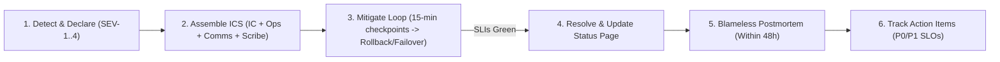
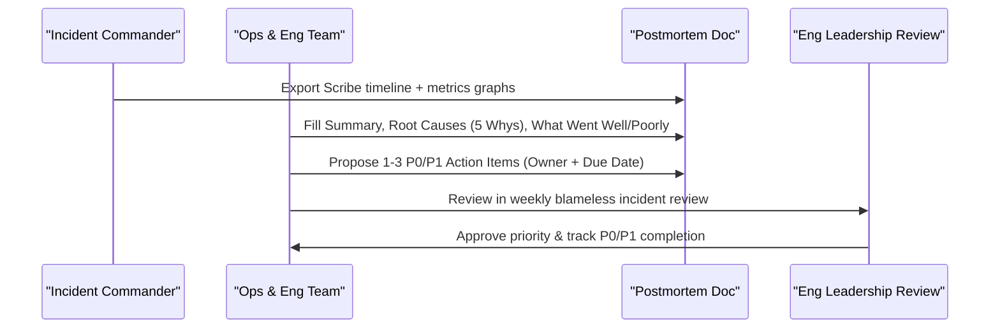
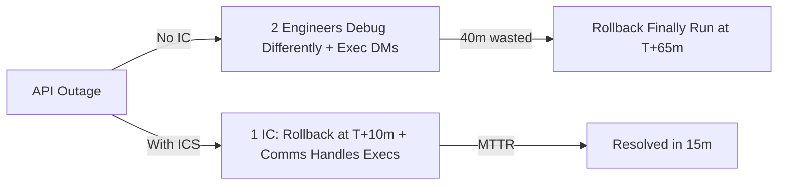

# Incident Management: SEV Levels, Incident Commander & Postmortems

> **Prerequisites:** [Lesson 11: Root-Cause Analysis](../11-root-cause-analysis/README.md).  
> **Estimated Reading Time:** 24–28 minutes  
> **Target Audience:** Engineering leads, SREs, and senior backend candidates asked "how do you run a SEV-1 outage and ensure the same mistake never happens twice?"  
> **Free PDF Notes:** [Download P5-SD-N-012.pdf](https://backendroadmap.com/notes/system-design/P5-SD-N-012.pdf)

> [!NOTE]
> **In one line:** Incident management turns chaotic outages into structured coordination using clear **SEV levels**, an **Incident Command System (IC, Ops, Comms, Scribe)** that separates debugging from stakeholder updates, and **blameless postmortems** with tracked, time-bound action items.

> [!TIP]
> **The Golden Rule:** **The Incident Commander does NOT touch the keyboard.** The IC's job is to coordinate, delegate, track time, and call for rollback/escalation—if the IC starts tailing logs, nobody is steering the ship.

---

## 1. What Incident Management Is, and What It Isn't

When checkout is down and the company is losing \$10,000/minute, 15 engineers piling into one Slack thread, running conflicting commands, and answering panicked emails from executives makes the outage last twice as long. Structured incident management (adapted from emergency-response ICS—Incident Command System) gives everyone a clear role, a single source of truth, and a blameless loop to harden the system afterward.

| Term | Precise Meaning | Example |
| :--- | :--- | :--- |
| **SEV-1 (Critical)** | Major customer-facing outage, data loss, or security breach | Checkout 100% down; immediate war room + exec comms |
| **SEV-2 (High)** | Significant degradation or partial outage; workaround exists | Search slow ($p_{99}=5\text{ s}$) or 1 region degraded |
| **SEV-3 (Medium)** | Minor impact, non-critical feature broken | Admin CSV export failing; fix during business hours |
| **SEV-4 (Low)** | Cosmetic or internal-only issue | Staging alert noisy; backlog ticket |
| **Incident Commander (IC)** | Single decision-maker owning coordination, roles, and timeline | Calls "roll back `v2.14`" and assigns Ops/Comms |
| **Operations Lead (Ops)** | Hands-on engineer(s) executing triage and mitigation | Runs rollback, checks traces, restarts workers |
| **Communications Lead (Comms)** | Owns status page, customer updates, and executive summaries | Posts updates every 15–30 min so Ops isn't interrupted |
| **Scribe** | Records timeline, hypotheses, and decisions in real time | Logs `14:05 UTC: Rolled back PR #842` |
| **Blameless Postmortem** | Written review focusing on *systemic* fixes, never blaming people | Produces P0/P1 action items with owners & due dates |
| **Not** | A witch hunt or a 20-page essay nobody reads | Action items without owners/SLAs are theatre |

### Why It Matters
1. **Coordination cuts MTTR dramatically:** Separating Comms from Ops prevents executives and support teams from distracting the engineers fixing production.
2. **Blameless culture surfaces truth:** If engineers fear punishment, they hide mistakes and delay escalation—turning a 5-minute SEV-2 into a 2-hour SEV-1.
3. **Senior/Staff interviews test leadership:** Expect questions on how you run a war room, communicate during uncertainty, and prevent repeat incidents.

---

## 2. Anatomy: Incident Lifecycle & Command Structure



In a SEV-1, the **IC** opens a dedicated incident channel/bridge, assigns **Ops** (hands on keyboard), **Comms** (status page + exec Slack every 15–30 min), and **Scribe** (live timeline). Every 15 minutes, the IC runs a quick sync: *"What is our current hypothesis, what are we trying next, and if it doesn't work in 10 minutes, what is our rollback?"*

| Role | Primary Responsibility | Must NOT Do |
| :--- | :--- | :--- |
| **Incident Commander (IC)** | Owns incident state, assigns roles, makes go/no-go calls | **Touch production keyboards** or debug logs directly |
| **Operations Lead (Ops)** | Executes diagnostics, rollbacks, failovers | Answer executive DMs or write status-page posts |
| **Communications Lead** | Updates status page, support, and leadership on cadence | Make technical promises ("fixed in 5 min") without IC sign-off |
| **Scribe** | Logs timestamps, decisions, and metrics into timeline | Wait until after the incident to reconstruct from memory |

> [!WARNING]
> **The #1 Trap: "Action Item Graveyard" Postmortems.** Writing a thorough postmortem and filing 8 Jira tickets that sit in the backlog for 6 months guarantees you will suffer the exact same outage again. Every postmortem needs 1–3 **high-priority, time-bound action items** (e.g., P0 due in 7 days) reviewed weekly by engineering leadership.

---

## 3. Mathematical Model: Availability, MTBF/MTTR, and Outage Cost

**1. Availability from MTBF and MTTR.**
For a repairable system, steady-state availability $A$ is governed by Mean Time Between Failures ($\text{MTBF}$) and Mean Time to Recovery ($\text{MTTR}$):

$$A = \frac{\text{MTBF}}{\text{MTBF} + \text{MTTR}}$$

Notice how **reducing MTTR** via good incident management directly improves availability:
- Suppose a service fails once every 30 days ($\text{MTBF} = 43{,}200\text{ min}$).
- **Chaotic response** ($\text{MTTR} = 90\text{ min}$): $A = \frac{43{,}200}{43{,}290} = \mathbf{99.79\%}$ (blows a 99.9% SLO!).
- **Structured ICS + fast rollback** ($\text{MTTR} = 15\text{ min}$): $A = \frac{43{,}200}{43{,}215} = \mathbf{99.965\%}$ (easily meets 99.9% SLO!).

**2. Financial Cost of Downtime.**
If revenue rate is $R_{\text{rev}}$ per minute and SLA penalties/churn add $C_{\text{fixed}}$:

$$\text{Total Cost} = (R_{\text{rev}} \times \text{MTTR}) + C_{\text{fixed}}$$

At $\$4{,}000/\text{min}$ revenue, cutting MTTR from $90\text{ min}$ to $15\text{ min}$ saves **$\$300{,}000$ in a single SEV-1**.

---

## 4. Metrics & Percentiles

| Metric | Meaning | Target / Alert when |
| :--- | :--- | :--- |
| **MTTD (Mean Time to Detect)** | Outage start $\to$ alert fires / declared | Target $< 5\text{ min}$ for SEV-1 |
| **MTTR (Mean Time to Recover)** | Declared $\to$ customer impact mitigated | Target $< 30\text{ min}$ for SEV-1 |
| **Postmortem Completion SLA** | Time from resolve to published postmortem | Target $\le 48\text{ hours}$ |
| **Action Item Closure Rate** | % of P0/P1 postmortem items closed on time | Alert if $< 90\%$ (indicates tech-debt neglect) |
| **Repeat Incident Rate** | Incidents caused by the same systemic failure mode | Target $0\%$ |

### Worked Example (SEV-1 Checkout Outage)
- `14:00 UTC`: Canary deploy promoted to 100%; 5xx rate hits 45%.
- `14:03 UTC`: 14.4x burn-rate alert pages on-call (**MTTD = 3 min**).
- `14:05 UTC`: On-call declares **SEV-1**, becomes **IC**, pulls in Ops + Comms + Scribe.
- `14:08 UTC`: Comms posts "Investigating checkout errors" on status page.
- `14:12 UTC`: Ops rolls back `v2.14.0` to `v2.13.9`.
- `14:17 UTC`: 5m burn-rate drops to 0.2x; IC marks **Mitigated** (**MTTR = 14 min**).
- `14:20 UTC`: Comms posts "Resolved" update. Postmortem scheduled for next morning.

---

## 5. Incident Severity Matrix (SEV-1 to SEV-4)

| Severity | Customer Impact | War Room? | External Status Page? | Update Cadence | Postmortem Required? |
| :--- | :--- | :---: | :---: | :---: | :---: |
| **SEV-1** | Core flow down / data loss / security | **Yes (Immediate)** | **Yes** | Every 15–30 min | **Mandatory (< 48h)** |
| **SEV-2** | Major degradation / workaround exists | **Yes (Business/On-call)** | **Usually** | Every 30–60 min | **Mandatory (< 72h)** |
| **SEV-3** | Minor / non-critical feature broken | Slack thread only | No | Daily / on fix | Optional |
| **SEV-4** | Cosmetic / internal tooling | Ticket only | No | None | No |

---

## 6. Numbers Every Engineer Must Know

| Item | Typical | Implication |
| :--- | :---: | :--- |
| SEV-1 status update cadence | Every $15\text{–}30\text{ min}$ | Even "still investigating" builds customer trust |
| IC handoff shift limit | $4\text{–}6\text{ hours}$ max | Fatigued ICs make bad calls; rotate roles cleanly |
| Postmortem turnaround | Within $48\text{ hours}$ | Memories fade fast; write while timeline is fresh |
| Action items per postmortem | $1\text{–}3$ high-impact items | 15 tiny items never get done |
| P0 action item SLA | $7\text{–}14\text{ days}$ | Blocks repeat outages before they recur |

---

## 7. Protocol Deep Dive: Blameless Postmortem Anatomy



A great blameless postmortem has **6 concise sections**:
1. **Summary & Impact:** Duration, % users/requests affected, SLO budget burned.
2. **Timeline (UTC):** Exact timestamps from trigger $\to$ detect $\to$ mitigate $\to$ resolve.
3. **Root Causes & Contributing Factors (5 Whys):** Systemic gaps, never individual blame.
4. **What Went Well / What Got Lucky / Where We Got Unlucky:** Reinforce good habits and spot near-misses.
5. **Lessons Learned:** What we now know about our architecture.
6. **Action Items:** Specific, measurable, with **Owner**, **Priority (P0/P1)**, and **Due Date**.

| Question | Answer |
| :--- | :--- |
| **What if an engineer deliberately violated safety policy?** | "Blameless" means assuming good intent and fixing systems for honest mistakes; accountability for reckless/malicious behavior is handled separately by HR/management, not in the technical postmortem. |
| **When should you escalate a SEV-2 to a SEV-1?** | Whenever customer impact widens, mitigation stalls past 30 minutes, or data integrity/security risk is discovered. Better to over-declare and downgrade than under-declare. |
| **Why is "Where We Got Lucky" a critical postmortem section?** | It catches near-misses (e.g., *"the backup only worked because traffic was low at 3 AM"*) before they become next month's SEV-1. |

**When NOT to hold a formal war room:** For SEV-3/SEV-4 issues with no active user-facing degradation—overusing SEV-1 war rooms causes organizational fatigue and desensitizes people to real emergencies.

---

## 8. Hierarchical Budgets & Design Rules

| Slice | Rule | Control |
| :--- | :--- | :--- |
| Role Separation | IC coordinates; Ops executes; Comms updates; Scribe logs | Explicit Slack/bot role assignment |
| Escalation | Anyone can declare an incident; no permission needed | "When in doubt, page/declare" policy |
| Status Updates | Comms posts external/exec updates every 15–30 min in SEV-1 | Timer bot reminder in incident channel |
| Handoffs | Rotate IC/Ops every 4–6 hours during long outages | Secondary on-call schedule |
| Postmortems | Blameless, published within 48h, reviewed weekly | Engineering review ritual |
| Action Items | Max 3 P0/P1 items per incident, each with owner + due date | Tracked in sprint/roadmap |

---

## 9. Top Mitigations

1. **Automate incident channel creation** (Slack/PagerDuty bot) that auto-assigns IC, Ops, Comms, and Scribe templates in 5 seconds.
2. **Enforce the "IC doesn't touch the keyboard" rule** so someone always maintains the big picture and 15-minute checkpoints.
3. **Use a pre-written status-page template** so Comms can publish accurate updates in under 2 minutes without pinging Ops.
4. **Record every action in a live Scribe timeline**—exporting that timeline cuts postmortem writing time by 70%.
5. **Run a 4-hour rotation rule** for long incidents so exhausted engineers don't make compounding mistakes.
6. **Limit postmortem action items to 1–3 high-leverage fixes** with P0/P1 SLAs tracked alongside feature work.
7. **Run quarterly GameDays / chaos drills** so the team practices ICS roles *before* a real SEV-1 hits.

---

## 10. Production Reference: The "Two ICs, Zero Rollback" SEV-1

During a major API outage, two senior engineers both acted as self-appointed leaders in the same Slack channel. One spent 40 minutes trying to hot-patch a regex in production while the other asked for database metrics. Nobody owned external comms, so the CEO and Support Lead pinged both engineers directly every 5 minutes. Total outage: **78 minutes**.



- **Root Cause:** No formal IC role, no separation of Comms from Ops, and no 15-minute rollback checkpoint.
- **Fix:** Adopted ICS incident bot (`/incident declare sev1`), enforced single-IC rule, dedicated Comms role with 15-min status-page cadence, and a mandatory 15-minute "rollback if not mitigated" rule. Average SEV-1 MTTR dropped from **68 minutes to 19 minutes**.

---

## 11. Multi-Language Production Code Tabs

Incident state machine & SLA/MTTR tracker enforcing valid transitions (`DETECTED -> MITIGATED -> RESOLVED -> POSTMORTEM_PUBLISHED`) and SEV-level update cadences.

````carousel
```go
// Go: Incident state machine enforcing ICS roles, update cadence, and MTTR calculation.
package main

import (
	"errors"
	"fmt"
	"time"
)

type Severity string
type State string

const (
	SEV1 Severity = "SEV-1"
	SEV2 Severity = "SEV-2"

	StateOpen      State = "OPEN"
	StateMitigated State = "MITIGATED"
	StateResolved  State = "RESOLVED"
)

type Incident struct {
	ID          string
	Sev         Severity
	State       State
	IC, Ops     string
	StartedAt   time.Time
	MitigatedAt *time.Time
}

func (i *Incident) Mitigate(at time.Time) error {
	if i.IC == "" || i.Ops == "" {
		return errors.New("cannot mitigate without assigned IC and Ops")
	}
	if i.State != StateOpen {
		return errors.New("incident is not open")
	}
	i.State = StateMitigated
	i.MitigatedAt = &at
	return nil
}

func (i *Incident) MTTR() time.Duration {
	if i.MitigatedAt == nil {
		return 0
	}
	return i.MitigatedAt.Sub(i.StartedAt)
}

func main() {
	start := time.Now().Add(-14 * time.Minute)
	inc := Incident{ID: "INC-402", Sev: SEV1, State: StateOpen, IC: "alice", Ops: "bob", StartedAt: start}
	_ = inc.Mitigate(time.Now())
	fmt.Printf("%s (%s) mitigated in %v\n", inc.ID, inc.Sev, inc.MTTR().Round(time.Second))
}
```
<!-- slide -->
```typescript
// TypeScript: Incident lifecycle tracker with SEV cadence and availability math.
export type Severity = "SEV-1" | "SEV-2" | "SEV-3" | "SEV-4";
export type IncidentState = "OPEN" | "MITIGATED" | "RESOLVED" | "POSTMORTEM_DONE";

export interface Incident {
  id: string;
  sev: Severity;
  state: IncidentState;
  ic: string;
  comms?: string;
  startedAtMs: number;
  mitigatedAtMs?: number;
}

export function updateCadenceMinutes(sev: Severity): number {
  return sev === "SEV-1" ? 15 : sev === "SEV-2" ? 30 : 1440;
}

export function mitigateIncident(inc: Incident, nowMs = Date.now()): Incident {
  if (inc.sev === "SEV-1" && !inc.comms) {
    throw new Error("SEV-1 requires a dedicated Comms lead");
  }
  return { ...inc, state: "MITIGATED", mitigatedAtMs: nowMs };
}

export function availability(mtbfMin: number, mttrMin: number): number {
  return mtbfMin / (mtbfMin + mttrMin);
}
```
<!-- slide -->
```python
# Python: Incident state machine + MTBF/MTTR availability & downtime cost calculator.
from dataclasses import dataclass
from datetime import datetime, timedelta, timezone


@dataclass
class Incident:
    id: str
    sev: str
    ic: str
    comms: str
    started_at: datetime
    mitigated_at: datetime | None = None
    state: str = "OPEN"

    def mitigate(self, at: datetime) -> None:
        if self.sev == "SEV-1" and not self.comms:
            raise ValueError("SEV-1 requires a dedicated Comms lead")
        self.mitigated_at = at
        self.state = "MITIGATED"

    @property
    def mttr_minutes(self) -> float:
        if not self.mitigated_at:
            return 0.0
        return (self.mitigated_at - self.started_at).total_seconds() / 60.0


def availability(mtbf_min: float, mttr_min: float) -> float:
    return mtbf_min / (mtbf_min + mttr_min)


if __name__ == "__main__":
    t0 = datetime.now(timezone.utc)
    inc = Incident("INC-402", "SEV-1", ic="alice", comms="carol", started_at=t0)
    inc.mitigate(t0 + timedelta(minutes=14))
    print(f"MTTR: {inc.mttr_minutes:.1f}m | Availability: {availability(43200, inc.mttr_minutes):.5%}")
```
<!-- slide -->
```csharp
// C#: Incident lifecycle record with SEV-1 role validation and MTTR calculation.
public enum Severity { Sev1, Sev2, Sev3, Sev4 }
public enum IncidentState { Open, Mitigated, Resolved }

public sealed class Incident(string id, Severity sev, string ic, string? comms, DateTimeOffset startedAt)
{
    public string Id { get; } = id;
    public Severity Sev { get; } = sev;
    public IncidentState State { get; private set; } = IncidentState.Open;
    public DateTimeOffset? MitigatedAt { get; private set; }

    public void Mitigate(DateTimeOffset at)
    {
        if (Sev == Severity.Sev1 && string.IsNullOrWhiteSpace(comms))
            throw new InvalidOperationException("SEV-1 requires a Comms lead.");
        MitigatedAt = at;
        State = IncidentState.Mitigated;
    }

    public double MttrMinutes => MitigatedAt is null ? 0 : (MitigatedAt.Value - startedAt).TotalMinutes;
}
```
````

---

## 12. Hands-On CLI Verification Workflows

```bash
# 1. Calculate availability impact of cutting MTTR from 90 min to 15 min (MTBF = 30 days)
python -c "
mtbf = 30 * 24 * 60
for mttr in (90, 30, 15):
    avail = mtbf / (mtbf + mttr)
    print(f'MTTR={mttr:2d}m -> Availability={avail*100:.4f}% (SLO 99.9% pass={avail >= 0.999})')
"

# 2. Export incident timeline from Git/deploy history around an outage window
git log --since="2026-11-25 13:00" --until="2026-11-25 14:30" --oneline

# 3. Check PagerDuty / Kubernetes recent rollouts during triage
kubectl rollout history deployment/checkout-api
```

---

## 13. Common Mistakes to Avoid

1. **The Incident Commander debugging logs directly**, leaving nobody coordinating roles or watching the clock.
2. **No dedicated Comms lead**, forcing Ops engineers to answer Slack DMs from executives mid-outage.
3. **Blaming an engineer in the postmortem** instead of fixing the missing guardrail or validation.
4. **Waiting days to write the postmortem** when the timeline and hypotheses are already forgotten.
5. **Filing 15 unprioritized action items** that rot in the backlog instead of 1–3 P0/P1 fixes with deadlines.
6. **Over-declaring SEV-1 for minor bugs** (causing war-room fatigue) or **under-declaring** to avoid paperwork.
7. **Skipping GameDays**, so the first time engineers practice ICS roles is during a real outage.

---

## 14. Key Terms Glossary

| Key Term | Definition |
| :--- | :--- |
| **SEV-1 to SEV-4** | Standardized severity tiers mapping customer impact to response urgency and comms. |
| **Incident Commander (IC)** | Single authority coordinating incident response, roles, and mitigation decisions. |
| **Operations Lead (Ops)** | Hands-on responder executing triage, rollbacks, and failovers. |
| **Communications Lead** | Responder managing external status pages, support, and executive updates. |
| **Scribe** | Responder recording a real-time, timestamped log of actions and decisions. |
| **Blameless Postmortem** | Retrospective focused on systemic/architectural improvements without personal blame. |
| **MTBF** | Mean Time Between Failures: average uptime between incidents. |
| **MTTR** | Mean Time to Recovery: average time from incident start/detection to mitigation. |
| **GameDay** | Scheduled chaos/simulation exercise to practice incident response safely. |
| **Action Item SLA** | Binding deadline (e.g., 7–14 days for P0) to complete postmortem fixes. |

---

## 15. System Design Interview Questions & Answers

### Basic Conceptual Questions

<details>
<summary><strong>Q1: What are the four core roles in an Incident Command System (ICS) war room? [BASIC]</strong></summary>

**Answer:**
(1) **Incident Commander (IC)**—coordinates and makes decisions; (2) **Operations Lead (Ops)**—hands on keyboard mitigating; (3) **Communications Lead (Comms)**—updates status page and stakeholders; (4) **Scribe**—logs the real-time timeline.
</details>

<details>
<summary><strong>Q2: Why shouldn't the Incident Commander debug logs or run commands themselves? [BASIC]</strong></summary>

**Answer:**
Debugging creates tunnel vision. If the IC gets sucked into reading stack traces, nobody is tracking 15-minute checkpoints, coordinating across teams, deciding when to roll back, or rotating fatigued responders.
</details>

<details>
<summary><strong>Q3: What does "blameless postmortem" mean? [BASIC]</strong></summary>

**Answer:**
It assumes engineers acted with good intentions given the information available at the time, and treats human mistakes as symptoms of missing tooling, validation, or safety nets—encouraging honest reporting so the system actually gets fixed.
</details>

<details>
<summary><strong>Q4: How do you define SEV-1 vs SEV-2? [BASIC]</strong></summary>

**Answer:**
**SEV-1** is a critical customer-facing outage of a core flow, data loss, or security breach requiring an immediate war room and status-page updates. **SEV-2** is significant degradation or partial outage where a workaround exists or only a subset of users is affected.
</details>

### Scenario-Based Architecture Questions

<details>
<summary><strong>Q5: You are the IC in a SEV-1 outage. After 20 minutes, Ops still hasn't found the root cause, and the CEO is pinging the channel. What do you do? [SCENARIO]</strong></summary>

**Answer:**
(1) Direct **Comms** to message the CEO privately and post a status-page update so Ops isn't distracted; (2) enforce the 15-minute checkpoint rule—if a recent deploy or flag changed, **order a rollback immediately** to restore service before continuing root-cause investigation.
</details>

<details>
<summary><strong>Q6: Your team writes great postmortems, yet the same outages keep happening every quarter. Why? [SCENARIO]</strong></summary>

**Answer:**
Postmortem action items are not prioritized or tracked—they go into an "action item graveyard." Fix by limiting each postmortem to 1–3 concrete P0/P1 action items with explicit owners and 7–14 day due dates, and reviewing closure rates in weekly engineering leadership meetings.
</details>

<details>
<summary><strong>Q7: A SEV-1 outage has been going on for 5 hours. What is your biggest operational risk? [SCENARIO]</strong></summary>

**Answer:**
**Responder fatigue**, which leads to misread commands and secondary outages. As IC, enforce mandatory **4–6 hour handoffs** for IC, Ops, and Comms using secondary on-call rotations, with a structured 10-minute verbal + written Scribe handoff.
</details>

<details>
<summary><strong>Q8: How do you handle an incident where customer impact is unclear at T+5 minutes? [SCENARIO]</strong></summary>

**Answer:**
Over-declare initially (e.g., declare SEV-2 or SEV-1) to mobilize the right people fast; it is always easy to downgrade to SEV-3 once you verify impact is small, whereas under-declaring wastes precious MTTR minutes.
</details>

### Advanced & Tricky Interview Questions

<details>
<summary><strong>Q9: How does cutting MTTR mathematically affect a 99.9% availability SLO? [TRICKY]</strong></summary>

**Answer:**
By $A = \frac{\text{MTBF}}{\text{MTBF} + \text{MTTR}}$, if $\text{MTBF} = 30\text{ days}$ (43,200 min), a 90-minute MTTR yields $99.79\%$ availability (breaching 99.9%). Cutting MTTR to 15 minutes via ICS + fast rollback yields $99.965\%$ availability—achieving the same SLO without needing fewer bugs.
</details>

<details>
<summary><strong>Q10: Why is "Where We Got Lucky" one of the most valuable sections in a postmortem? [TRICKY]</strong></summary>

**Answer:**
It exposes latent risks that *didn't* break only because of coincidence (e.g., *"the DB didn't melt only because traffic was off-peak"*). Fixing those near-misses prevents future catastrophic SEV-1s.
</details>

<details>
<summary><strong>Q11: What if an incident was caused by a third-party cloud provider (e.g., AWS S3 outage)? Should you still run a postmortem? [TRICKY]</strong></summary>

**Answer:**
Yes. You can't fix AWS, but you *can* fix your own blast radius: why didn't graceful degradation, circuit breakers, or multi-region failover isolate your users from S3's outage?
</details>

<details>
<summary><strong>Q12: How do you measure whether your incident management process is actually improving? [TRICKY]</strong></summary>

**Answer:**
Track **MTTD**, **MTTR**, **pages per on-call shift**, **postmortem completion within 48h**, **P0/P1 action-item on-time closure rate**, and **repeat incident rate** quarter over quarter.
</details>

---

## 16. One-Page Master Cheat Sheet

```
+---------------------------------------------------------------------------------------------------------+
|                    INCIDENT MANAGEMENT — MASTER CHEAT SHEET                                             |
+---------------------------------------------------------------------------------------------------------+
| 1. ICS ROLES: IC (coordinates, NO keyboard!) · Ops (mitigates) · Comms (status page/execs) · Scribe.    |
+---------------------------------------------------------------------------------------------------------+
| 2. SEV LEVELS: SEV-1 (critical, war room, 15m comms, 48h postmortem) · SEV-2 (degraded) · SEV-3/4.      |
+---------------------------------------------------------------------------------------------------------+
| 3. AVAILABILITY MATH: A = MTBF / (MTBF + MTTR). Cutting MTTR 90m -> 15m lifts 30d avail 99.79% -> 99.97%|
+---------------------------------------------------------------------------------------------------------+
| 4. BLAMELESS POSTMORTEM: Timeline + 5 Whys (systemic) + Where We Got Lucky + 1-3 P0/P1 items w/ SLAs.   |
+---------------------------------------------------------------------------------------------------------+
```

---

## Further Reading & Sources

- PagerDuty, [Incident Response Documentation (ICS Roles & Severity Levels)](https://response.pagerduty.com/).
- Google SRE Book, [Chapter 14: Managing Incidents](https://sre.google/sre-book/managing-incidents/) & [Chapter 15: Postmortem Culture](https://sre.google/sre-book/postmortem-culture/).
- Atlassian, [Incident Management Handbook](https://www.atlassian.com/incident-management).

---

## Free PDF Notes

[P5-SD-N-012.pdf](https://backendroadmap.com/notes/system-design/P5-SD-N-012.pdf)

---

## Next

Continue with [Lesson 13: Capacity Planning: Saturation, Quotas, Forecasting & Headroom](../13-capacity-planning/README.md).
