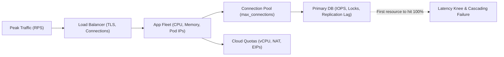
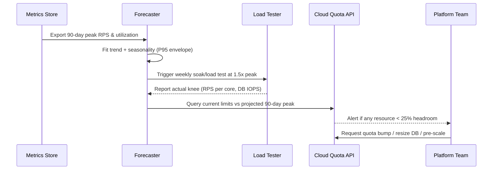
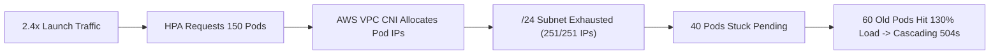

# Capacity Planning: Saturation, Quotas, Forecasting & Headroom

> **Prerequisites:** [Lesson 12: Incident Management](../12-incident-management/README.md).  
> **Estimated Reading Time:** 24–28 minutes  
> **Target Audience:** Backend and SRE engineers sizing fleets for launches, preventing silent saturation, and answering "how do you plan capacity for a 5x traffic event?"  
> **Free PDF Notes:** [Download P5-SD-N-013.pdf](https://backendroadmap.com/notes/system-design/P5-SD-N-013.pdf)

> [!NOTE]
> **In one line:** Capacity planning ensures your system has enough **headroom** across every resource (CPU, memory, DB connections, network, cloud quotas) to absorb organic growth, traffic spikes, and N+1 or N+2 regional failures without crossing the **saturation knee** where tail latency explodes.

> [!TIP]
> **The Golden Rule:** Never plan capacity around *average* CPU at *average* traffic. Size for **peak traffic + failure domain loss + headroom**, and verify your **hard quotas** (cloud limits, IP ranges, DB connection caps) before you verify your autoscaler.

---

## 1. What Capacity Planning Is, and What It Isn't

A team launches a viral feature. Their Kubernetes HPA (Horizontal Pod Autoscaler) scales web pods from 20 to 200 smoothly—until pod 121 fails to schedule because the VPC subnet ran out of IP addresses, and the database hits `max_connections = 500` because each pod opens a pool of 10 connections. Everything collapses at 55% CPU. Capacity planning is the discipline of finding and sizing *every* bottleneck before traffic does.

| Term | Precise Meaning | Example |
| :--- | :--- | :--- |
| **Utilization** | Fraction of a resource's total capacity currently in use | 65% CPU, 72% memory |
| **Saturation** | Work queued because the resource is at or near 100% | Linux run-queue depth > cores; DB pool wait > 0 ms |
| **Headroom** | Reserved spare capacity above peak load for spikes and failures | 35% spare capacity to survive 1 AZ loss |
| **N+1 / N+2 redundancy** | Ability to serve peak load with 1 (or 2) zones/nodes offline | 3 AZs each at $\le 66\%$ capacity |
| **Hard quota** | Fixed limit imposed by cloud provider, OS, or database | 1,000 NAT ports, 500 RDS connections, `/24` subnet IPs |
| **Load testing / benchmarking** | Measuring actual throughput and latency knee under synthetic load | Discovering a single node saturates at 850 RPS |
| **Not** | Just turning on autoscaling and hoping | Autoscalers react too slowly for flash crowds and hit quotas |

### Why It Matters
1. Latency is non-linear near saturation: going from 70% to 90% utilization can multiply $p_{99}$ latency by 5x–10x.
2. Autoscaling is not instant (image pull + JVM/runtime warmup + readiness probe takes 45–180 s) and cannot bypass cloud quotas or database bottlenecks.
3. Interviews test whether you can do back-of-the-envelope sizing, identify the *true* bottleneck resource, and account for failure domains.

---

## 2. Anatomy: Utilization vs Saturation & Bottleneck Hierarchy



A system's effective capacity is bounded by whichever resource saturates first. Scaling the stateless app tier when the database or a cloud quota is the bottleneck only accelerates the crash.

| Resource | Typical Saturation Signal | Failure Mode When Saturated |
| :--- | :--- | :--- |
| **CPU** | Run-queue length > vCPU count; CFS throttling | Tail latency spikes; health checks time out |
| **Memory** | Page cache thrashing; GC pause % > 10% | OOMKill (`Exit 137`); pod restart storm |
| **DB Connections** | Pool wait time > 5 ms; `TooManyConnections` | Request threads block; cascading 504s |
| **Disk I/O** | IOPS / throughput at EBS limit; `iowait` > 20% | WAL fsync stalls; replication lag explodes |
| **Network / NAT** | Ephemeral port exhaustion; packet drops | Random `ETIMEDOUT` to external APIs |
| **Cloud Quotas** | `InsufficientInstanceCapacity` or `LimitExceeded` | Autoscaler stuck; cannot replace failed nodes |

> [!WARNING]
> **The Autoscaling Trap:** Horizontal autoscaling protects against *gradual* diurnal ramps, not *step-function* spikes (e.g., push notifications, flash sales) or *hard quotas*. If your scale-out takes 3 minutes and traffic triples in 10 seconds, you will drop requests unless you pre-warm or maintain headroom.

---

## 3. Mathematical Model: Queueing Knee, Little's Law & Fleet Sizing

**1. M/M/1 Queueing Delay (Why 80% Utilization Hurts).**  
For arrival rate $\lambda$ and service rate $\mu$, utilization is $\rho = \lambda / \mu$. Average response time $W$ scales with $1 / (1 - \rho)$:

$$W = \frac{1}{\mu - \lambda} = \frac{S}{1 - \rho}$$

where $S = 1/\mu$ is the uncontended service time.
- At $\rho = 0.50$ (50% utilized): $W = 2S$
- At $\rho = 0.80$ (80% utilized): $W = 5S$
- At $\rho = 0.95$ (95% utilized): $W = 20S$

**2. Fleet Sizing with Headroom and N+1 Zone Loss.**  
Let $R_{\text{peak}}$ be peak RPS, $C_{\text{node}}$ be the safe single-node throughput (measured at the latency SLO knee, say 70% CPU), $h$ be the target peak utilization cap (e.g., $0.70$), and $Z$ be the number of availability zones (AZs) where the fleet must survive losing 1 AZ:

$$N_{\text{total}} = \left\lceil \frac{R_{\text{peak}}}{C_{\text{node}} \cdot h} \cdot \frac{Z}{Z - 1} \right\rceil$$

**Worked Numerical Example:**  
Suppose $R_{\text{peak}} = 12{,}000\text{ RPS}$, each node handles $C_{\text{node}} = 500\text{ RPS}$ before $p_{99}$ breaches 100 ms, we cap utilization at $h = 0.70$, and we run across $Z = 3$ AZs with N+1 survivability:

$$N_{\text{total}} = \left\lceil \frac{12{,}000}{500 \times 0.70} \times \frac{3}{2} \right\rceil = \left\lceil 34.29 \times 1.5 \right\rceil = \lceil 51.43 \rceil = 52\text{ nodes (18 per AZ = 54 nodes)}$$

If 1 AZ fails, 36 surviving nodes handle $12{,}000 / 36 = 333\text{ RPS/node}$ ($66.7\%$ of $C_{\text{node}}$), staying safely below the latency knee.

**3. Little's Law for Concurrency & Connection Pools.**  

$$L = \lambda \cdot W$$

At $\lambda = 12{,}000\text{ RPS}$ and average latency $W = 0.04\text{ s}$ (40 ms), average in-flight requests $L = 480$. If $p_{99}$ degrades to $0.5\text{ s}$ during a downstream slowdown, in-flight requests jump to $6{,}000$, exhausting thread pools and DB connections.

---

## 4. Metrics & Percentiles

| Metric | Meaning | Alert when |
| :--- | :--- | :--- |
| **Peak-to-average ratio** | Ratio of daily peak RPS to 24h mean RPS | > 3x without pre-warming or autoscaling |
| **Resource utilization $p_{95}$** | 95th percentile CPU/Mem/IOPS across fleet | > 70% (leaves no N+1 headroom) |
| **Saturation queue depth** | Requests waiting on thread pool / DB pool | > 0 sustained for > 60 s |
| **Quota headroom** | `(quota_limit - current_usage) / quota_limit` | < 25% remaining on IPs, vCPUs, DB conns |
| **Days to exhaustion** | Linear/seasonal forecast until limit hit | < 30 days (procurement/quota lead time) |
| **Cost per million requests** | Total infra spend / monthly requests | Rising > 15% MoM without traffic growth |

### Worked Example (Black Friday Readiness)
Baseline peak is 8,000 RPS; marketing forecasts 3x traffic (24,000 RPS) for 2 hours.  
- App tier: 1 node = 400 RPS safe capacity $\rightarrow$ $24{,}000 / (400 \times 0.75) = 80$ pods (plus N+1 = 120 pods).
- DB connections: 120 pods $\times$ 10 connections = 1,200 connections, but RDS `max_connections` is 800. **Fix:** deploy PgBouncer transaction pooling (120 pods $\times$ 10 client conns multiplexed onto 150 server conns).
- Subnet IPs: `/24` subnet has 251 usable IPs; 120 pods + existing services need 290 IPs. **Fix:** expand VPC CIDR / add secondary `/22` pod CIDR 2 weeks before the event.

---

## 5. Compounding & Failure Modes: What Happens When You Under-Provision

Consider a 3-AZ service provisioned for *average* peak without N+1 headroom: 30 nodes total (10 per AZ), each node saturating at 500 RPS, serving 12,000 RPS (400 RPS/node = 80% utilization).

| Event | Per-Node Load | Utilization $\rho$ | Queueing Multiplier $1/(1-\rho)$ | Outcome |
| :--- | :---: | :---: | :---: | :--- |
| **Normal peak (3 AZs, 30 nodes)** | 400 RPS | 80% | 5.0x | Healthy ($p_{99}$ within SLO) |
| **1 AZ lost (20 nodes left)** | 600 RPS | **120% (overloaded)** | $\infty$ (unbounded) | Queue overflows, health checks fail |
| **Retry storm (clients retry 2x)** | 1,800 RPS | **360%** | $\infty$ | Remaining 2 AZs crash; **total outage** |
| **With N+1 sizing (54 nodes, 36 left)** | 333 RPS | 67% | 3.0x | Absorbs AZ loss + 20% spike cleanly |

Under-provisioning turns a single-zone failure into a multi-zone cascading collapse because the surviving zones cross $\rho \ge 1.0$.

---

## 6. Numbers Every Engineer Must Know

| Item | Typical | Implication |
| :--- | :---: | :--- |
| Safe CPU utilization target | 60%–70% at peak | Preserves headroom for GC, spikes, and N+1 |
| Memory utilization cap | 75%–80% | Above 85% risks OOMKill during traffic bursts |
| Autoscaler reaction time | 60–180 seconds | Cannot absorb sub-minute flash spikes |
| Cloud quota increase SLA | 1–7 business days | Request vCPU/IP/API quotas weeks ahead |
| AWS `/24` subnet usable IPs | 251 IPs (5 reserved) | Pod-per-IP CNIs exhaust `/24` quickly |
| PostgreSQL active connections | 2–4x CPU cores optimal | Use PgBouncer; 1,000+ direct conns thrash |

---

## 7. Protocol / Mechanism Deep Dive: Continuous Capacity Forecasting Loop



| Question | Answer |
| :--- | :--- |
| **How do you find $C_{\text{node}}$?** | Run a step-load test on 1–3 isolated prod-like nodes until $p_{99}$ breaches SLO; take 70%–80% of that RPS. |
| **Why forecast on peak, not average?** | Diurnal peaks (e.g., 8 PM) are often 3x–5x the daily mean; average hides saturation. |
| **What about stateful services?** | Databases and caches cannot autoscale in 60 s; plan shard splits and read-replica sizing 1–2 quarters ahead. |
| **How do you handle organic vs event growth?** | Use time-series forecasting (Prophet/Holt-Winters) for organic growth; explicit capacity models for launches. |

**When not to over-invest in custom forecasting:** For early-stage services with < 10 nodes and predictable low traffic, simple N+1 static sizing + standard HPA + monthly quota checks beat complex ML forecasting pipelines.

---

## 8. Hierarchical Budgets & Design Rules

| Slice | Rule | Control |
| :--- | :--- | :--- |
| **Utilization** | Cap peak CPU $\le 70\%$, Mem $\le 80\%$ | HPA target + load test validation |
| **Redundancy** | Survive 1 AZ failure (N+1) at peak | PodDisruptionBudgets + topology spread |
| **Quotas** | Maintain $\ge 25\%$ buffer on all hard limits | Weekly automated quota exporter alerts |
| **Connections** | Bound DB connections per pod and globally | PgBouncer / RDS Proxy + pool limits |
| **Load Testing** | Re-verify single-node capacity every release | CI/staging benchmark gate |
| **Load Shedding** | Shed non-critical work above 85% saturation | Priority queues + 429/503 shedder |

---

## 9. Top Mitigations

1. **Maintain a Capacity Model spreadsheet/script** mapping business drivers (DAU, orders/sec) to every tier's resources (pods, DB IOPS, cache RAM, IPs).
2. **Audit hard cloud quotas automatically** (vCPUs, EBS volumes, NAT gateways, ENIs, API rate limits) and alert at 75% usage.
3. **Run regular GameDays and chaos tests** (drain 1 AZ in staging/prod) to prove N+1 headroom is real, not theoretical.
4. **Use connection poolers (PgBouncer/ProxySQL)** so app-tier autoscaling never exhausts database `max_connections`.
5. **Pre-warm fleets before known events** (scheduled scaling 30–60 minutes before launches or flash sales).
6. **Implement adaptive load shedding** at the edge so if traffic exceeds capacity, the system degrades gracefully instead of collapsing.
7. **Right-size periodically** to reclaim over-provisioned idle capacity and keep unit economics healthy.

---

## 10. Production Reference: The "Invisible IP Exhaustion" SEV-1

A fintech platform prepared for a major product launch by 3x-ing their Kubernetes worker node ASG max limit and upgrading RDS. Fifteen minutes into the launch, traffic hit 2.4x normal peak. The HPA tried to scale from 60 to 150 pods, but 40 new pods stayed stuck in `Pending` with `FailedCreatePodSandBox: failed to allocate for range 0: no IP addresses available in range set`.



- **Root Cause:** The team checked vCPU quotas and RDS size, but forgot that AWS VPC CNI assigns a real VPC IP to every pod, and the cluster's 3 subnets were `/24`s (753 IPs total, already 78% used by other workloads).
- **Fix:** Added a secondary `/16` CGNAT CIDR (`100.64.0.0/16`) dedicated to pods, added a Prometheus alert on `subnet_available_ips < 25%`, and included network/IP capacity in the pre-launch checklist.

---

## 11. Multi-Language Production Code Tabs

A production-style **Capacity Planner & Saturation Calculator** implementing N+1 fleet sizing, M/M/1 latency knee estimation, and quota headroom checks.

````carousel
```go
// Go: N+1 fleet sizing, M/M/1 latency multiplier, and quota check.
package main

import (
	"fmt"
	"math"
)

type CapacityPlan struct {
	NodesTotal     int
	NodesPerAZ     int
	SurvivingLoad  float64
	LatencyMult    float64
	QuotaHeadroom  float64
}

func PlanCapacity(peakRPS, nodeSafeRPS, maxUtil float64, azCount int, quotaLimit int) CapacityPlan {
	// N+1 sizing: surviving (azCount - 1) AZs must handle peakRPS within maxUtil
	rawNodes := (peakRPS / (nodeSafeRPS * maxUtil)) * (float64(azCount) / float64(azCount-1))
	perAZ := int(math.Ceil(rawNodes / float64(azCount)))
	total := perAZ * azCount

	survivingNodes := float64(total - perAZ)
	rho := peakRPS / (survivingNodes * nodeSafeRPS)
	latMult := 1.0 / math.Max(0.01, 1.0-rho)
	headroom := float64(quotaLimit-total) / float64(quotaLimit)

	return CapacityPlan{
		NodesTotal:    total,
		NodesPerAZ:    perAZ,
		SurvivingLoad: rho,
		LatencyMult:   latMult,
		QuotaHeadroom: headroom,
	}
}

func main() {
	plan := PlanCapacity(12000, 500, 0.70, 3, 80)
	fmt.Printf("Total=%d (%d/AZ), 1-AZ-Down Util=%.1f%%, W/S=%.2fx, QuotaHeadroom=%.1f%%\n",
		plan.NodesTotal, plan.NodesPerAZ, plan.SurvivingLoad*100, plan.LatencyMult, plan.QuotaHeadroom*100)
}
```
<!-- slide -->
```typescript
// TypeScript: N+1 fleet sizing and saturation knee evaluator.
interface CapacityResult {
  nodesTotal: number;
  nodesPerAz: number;
  survivingUtilization: number;
  queueingMultiplier: number;
  quotaOk: boolean;
}

export function planCapacity(
  peakRps: number,
  nodeSafeRps: number,
  targetUtil = 0.7,
  azCount = 3,
  quotaLimit = 80
): CapacityResult {
  const raw = (peakRps / (nodeSafeRps * targetUtil)) * (azCount / (azCount - 1));
  const nodesPerAz = Math.ceil(raw / azCount);
  const nodesTotal = nodesPerAz * azCount;

  const survivingNodes = nodesTotal - nodesPerAz;
  const survivingUtilization = peakRps / (survivingNodes * nodeSafeRps);
  const queueingMultiplier = 1 / Math.max(0.01, 1 - survivingUtilization);

  return {
    nodesTotal,
    nodesPerAz,
    survivingUtilization,
    queueingMultiplier,
    quotaOk: nodesTotal <= quotaLimit * 0.75, // enforce 25% quota buffer
  };
}

console.log(planCapacity(12000, 500, 0.7, 3, 80));
```
<!-- slide -->
```python
# Python: capacity planning model + days-to-exhaustion linear forecaster.
import math


def plan_capacity(peak_rps: float, node_safe_rps: float, target_util: float = 0.70,
                  az_count: int = 3, quota_limit: int = 80) -> dict:
    raw_nodes = (peak_rps / (node_safe_rps * target_util)) * (az_count / (az_count - 1))
    per_az = math.ceil(raw_nodes / az_count)
    total = per_az * az_count
    surviving = total - per_az
    rho_fail = peak_rps / (surviving * node_safe_rps)
    latency_mult = 1.0 / max(0.01, 1.0 - rho_fail)
    headroom_pct = (quota_limit - total) / quota_limit * 100
    return {
        "nodes_total": total,
        "nodes_per_az": per_az,
        "one_az_down_util_pct": round(rho_fail * 100, 1),
        "mm1_latency_mult": round(latency_mult, 2),
        "quota_headroom_pct": round(headroom_pct, 1),
    }


def days_to_exhaustion(daily_peaks: list[float], max_capacity: float) -> float:
    """Simple least-squares slope to estimate days until max_capacity is reached."""
    n = len(daily_peaks)
    x_mean = (n - 1) / 2.0
    y_mean = sum(daily_peaks) / n
    slope = sum((i - x_mean) * (y - y_mean) for i, y in enumerate(daily_peaks)) / max(
        1e-9, sum((i - x_mean) ** 2 for i in range(n))
    )
    if slope <= 0:
        return float("inf")
    return round((max_capacity - daily_peaks[-1]) / slope, 1)


if __name__ == "__main__":
    print(plan_capacity(12000, 500))
    print("Days left:", days_to_exhaustion([8000, 8200, 8450, 8600, 8900], 15000))
```
<!-- slide -->
```csharp
// C#: N+1 fleet sizing and quota headroom check.
using System;

public sealed record CapacityPlan(int NodesTotal, int NodesPerAz, double SurvivingUtil, double LatencyMult, bool QuotaSafe);

public static class CapacityPlanner
{
    public static CapacityPlan Compute(double peakRps, double nodeSafeRps, double targetUtil = 0.70, int azCount = 3, int quotaLimit = 80)
    {
        double raw = (peakRps / (nodeSafeRps * targetUtil)) * (azCount / (double)(azCount - 1));
        int perAz = (int)Math.Ceiling(raw / azCount);
        int total = perAz * azCount;

        double survivingUtil = peakRps / ((total - perAz) * nodeSafeRps);
        double latencyMult = 1.0 / Math.Max(0.01, 1.0 - survivingUtil);
        bool quotaSafe = (quotaLimit - total) / (double)quotaLimit >= 0.25;

        return new CapacityPlan(total, perAz, survivingUtil, latencyMult, quotaSafe);
    }

    public static void Main() => Console.WriteLine(Compute(12000, 500));
}
```
````

---

## 12. Hands-On CLI Verification Workflows

```bash
# 1. Verify the Python capacity model and exhaustion forecaster
python3 -c "
import math
peak, safe, util, az = 12000, 500, 0.70, 3
per_az = math.ceil(((peak / (safe * util)) * (az / (az - 1))) / az)
print(f'Total={per_az*az}, PerAZ={per_az}, 1-AZ-down util={peak/((per_az*(az-1))*safe):.1%}')
"

# 2. Check Kubernetes node CPU/Memory requests vs allocatable capacity
kubectl describe nodes | grep -A 5 "Allocated resources:"

# 3. Check AWS EC2 vCPU quota vs current usage
aws service-quotas get-service-quota --service-code ec2 --quota-code L-1216C47A

# 4. Check PostgreSQL active connections vs max_connections
psql -c "SELECT count(*) AS active, current_setting('max_connections') AS limit FROM pg_stat_activity;"
```

---

## 13. Common Mistakes to Avoid

1. **Sizing for average traffic instead of peak traffic** (ignoring 3x–5x diurnal swings).
2. **Forgetting N+1 / N+2 failure domains**, causing surviving zones to cross 100% utilization.
3. **Ignoring non-CPU bottlenecks** (DB `max_connections`, NAT ephemeral ports, VPC subnet IPs, disk IOPS).
4. **Relying solely on autoscaling for step-function spikes** without pre-warming or headroom.
5. **Assuming linear latency up to 100% CPU**, ignoring the $1/(1-\rho)$ queueing knee above 70%–80%.
6. **Never load-testing single-node capacity**, relying on vendor marketing numbers instead of actual SLO measurements.
7. **Skipping cloud quota audits**, discovering a vCPU or IP limit mid-incident.

---

## 14. Key Terms Glossary

| Key Term | Definition |
| :--- | :--- |
| **Utilization ($\rho$)** | Ratio of current demand to total resource capacity. |
| **Saturation** | State where work queues because a resource is at or near capacity. |
| **Headroom** | Intentional spare capacity above peak to absorb spikes and failures. |
| **Latency Knee** | Utilization point (~70–80%) where tail latency rises sharply. |
| **N+1 Redundancy** | Provisioning so peak load survives the loss of 1 failure domain. |
| **Little's Law** | $L = \lambda W$: concurrency equals arrival rate times response time. |
| **Hard Quota** | Fixed ceiling (vCPUs, IPs, DB connections) that blocks scaling. |
| **Connection Pooling** | Multiplexing many client connections onto fewer DB server connections. |
| **Pre-warming** | Scaling fleets ahead of a known traffic event. |
| **Load Shedding** | Dropping low-priority requests when approaching saturation. |

---

## 15. System Design Interview Questions & Answers

### Basic Conceptual Questions

<details>
<summary><strong>Q1: What is the difference between utilization and saturation? [BASIC]</strong></summary>

**Answer:**
Utilization is the percentage of a resource currently busy (e.g., 75% CPU). Saturation is the amount of work that has to *wait* because the resource is full (e.g., threads queued in the run queue or waiting for a DB connection). A system can show 60% average CPU and still be 100% saturated on a single-threaded lock or DB connection pool.
</details>

<details>
<summary><strong>Q2: Why do we cap target utilization at 60%–70% instead of 95%? [BASIC]</strong></summary>

**Answer:**
By queueing theory ($W = S / (1 - \rho)$), latency grows hyperbolically near $\rho = 1$. At 95% utilization, queueing delay is 20x service time; any tiny burst or GC pause pushes $\rho > 1$ and causes unbounded queue growth. Keeping utilization at 60%–70% leaves room for bursts and N+1 failover.
</details>

<details>
<summary><strong>Q3: What is N+1 capacity planning? [BASIC]</strong></summary>

**Answer:**
Provisioning enough capacity so that if one failure domain (a server, rack, or Availability Zone) goes offline at peak traffic, the remaining $N$ domains can carry 100% of the peak load without breaching SLOs. Across 3 AZs, each AZ runs at $\le 66\%$ of its safe capacity during normal peak.
</details>

<details>
<summary><strong>Q4: Why isn't Kubernetes HPA alone a capacity plan? [BASIC]</strong></summary>

**Answer:**
HPA takes 1–3 minutes to detect load, provision nodes, pull images, and pass readiness probes. It fails against instant flash spikes, cannot bypass hard cloud quotas or subnet IP limits, and can overwhelm stateful downstreams like databases if unbounded.
</details>

### Scenario-Based Architecture Questions

<details>
<summary><strong>Q5: Size a stateless API fleet for 15,000 peak RPS across 3 AZs where 1 pod handles 300 RPS safely. [SCENARIO]</strong></summary>

**Answer:**
Targeting 75% utilization and N+1 AZ survivability: $\text{pods} = \lceil \frac{15{,}000}{300 \times 0.75} \times \frac{3}{2} \rceil = \lceil 66.7 \times 1.5 \rceil = 100$ pods (34 pods per AZ = 102 total). Verify VPC has > 150 free pod IPs, LB target group limits allow > 102 targets, and downstream DB pooler handles 102 pods.
</details>

<details>
<summary><strong>Q6: Marketing announces a TV ad in 48 hours that will 5x traffic for 10 minutes. What do you do? [SCENARIO]</strong></summary>

**Answer:**
1) Model 5x load across every tier (edge/CDN, LB, app, cache, DB, third-party APIs). 2) Check and request cloud quota bumps immediately. 3) Pre-scale stateless tiers 30 minutes prior (don't wait for HPA). 4) Enable edge caching and circuit breakers/load shedding for non-critical paths. 5) Run a synthetic load test at 5x in staging.
</details>

<details>
<summary><strong>Q7: Your app pods scale to 200 smoothly, but latency spikes and DB CPU is only 40%. What is saturating? [SCENARIO]</strong></summary>

**Answer:**
Most likely **database connections** (`max_connections` exhausted, causing pods to block in pool wait), **row-level lock contention** on a hot row, or **disk IOPS / WAL fsync** limits. Check `pg_stat_activity` wait events and pool wait time before scaling DB CPU.
</details>

<details>
<summary><strong>Q8: How do you use Little's Law in capacity planning? [SCENARIO]</strong></summary>

**Answer:**
$L = \lambda \cdot W$ tells you the required concurrency (threads, connections, memory per request). At 5,000 RPS and 50 ms latency, you need 250 concurrent workers. If a downstream slows to 500 ms, concurrency jumps to 2,500—so you must size worker/connection pools and timeouts accordingly.
</details>

### Advanced & Tricky Interview Questions

<details>
<summary><strong>Q9: How does a retry storm interact with capacity planning? [TRICKY]</strong></summary>

**Answer:**
If a service is at 90% capacity and a minor blip causes 15% errors, clients retrying 3x multiply incoming load by ~1.45x, pushing utilization to 130% and causing total collapse (metastable failure). Capacity plans must pair headroom with **exponential backoff + jitter, retry budgets (e.g., max 10% extra load), and load shedding**.
</details>

<details>
<summary><strong>Q10: Why can autoscaling a stateless tier *cause* an outage? [TRICKY]</strong></summary>

**Answer:**
Each new pod opens its own DB connection pool, warms its local cache (causing cache-miss stampedes), and increases fan-out to downstream services. Unbounded app-tier scaling shifts saturation onto stateful databases or third-party APIs that cannot scale quickly.
</details>

<details>
<summary><strong>Q11: How do you capacity-plan a stateful database when vertical scaling hits a ceiling? [TRICKY]</strong></summary>

**Answer:**
Track *days to exhaustion* for IOPS, storage, and write CPU. Before hitting 70% on the largest instance type, offload reads to replicas + cache, archive cold data, and plan application-level sharding or partitioning—because resharding takes months, not minutes.
</details>

<details>
<summary><strong>Q12: What is the "irony of high utilization" in multi-tenant clouds? [TRICKY]</strong></summary>

**Answer:**
Chasing 90% utilization to save 20% on compute bills eliminates the headroom needed for noisy neighbors, deploys (rolling `maxSurge`), and AZ failovers—turning routine events into expensive SEV-1 outages. Optimal cost-reliability balance is usually 60%–70% peak utilization with spot/reserved mix.
</details>

---

## 16. One-Page Master Cheat Sheet

```
+---------------------------------------------------------------------------------------------------------+
|                        CAPACITY PLANNING — MASTER CHEAT SHEET                                           |
+---------------------------------------------------------------------------------------------------------+
| 1. FORMULA: N_total = ceil( (Peak_RPS / (Node_Safe_RPS * 0.70)) * (AZ / (AZ - 1)) ).                    |
+---------------------------------------------------------------------------------------------------------+
| 2. QUEUEING KNEE: W = S / (1 - rho). At 80% util -> 5x delay; at 95% -> 20x delay. Cap peak <= 70%.     |
+---------------------------------------------------------------------------------------------------------+
| 3. LITTLE'S LAW: Concurrency L = RPS * Latency. Slow downstreams multiply in-flight memory/threads.     |
+---------------------------------------------------------------------------------------------------------+
| 4. HIDDEN QUOTAS: Check VPC subnet IPs, DB max_connections, NAT ports, vCPU limits BEFORE launch.       |
+---------------------------------------------------------------------------------------------------------+
| 5. AUTOSCALING: Too slow for flash spikes; bound it so it doesn't DDoS your own database.               |
+---------------------------------------------------------------------------------------------------------+
| 6. RETRY STORMS: Pair N+1 headroom with jittered backoff, retry budgets, and edge load shedding.        |
+---------------------------------------------------------------------------------------------------------+
```

---

## Further Reading & Sources

- Google SRE Book, Chapter 18 & Workbook, *Capacity Planning* ([sre.google](https://sre.google/sre-book/software-engineering-in-sre/)).
- Brendan Gregg, *Systems Performance* (USE Method: Utilization, Saturation, Errors).
- Marc Brooker, *Metastable Failures and Retry Amplification* ([brooker.co.za](https://brooker.co.za/blog/)).
- AWS Well-Architected Framework, *Reliability Pillar: Manage Service Quotas and Constraints*.

---

## Free PDF Notes

[P5-SD-N-013.pdf](https://backendroadmap.com/notes/system-design/P5-SD-N-013.pdf)

---

## Next

Continue with [Lesson 14: CI/CD Pipelines: Build Once, Test, Scan, Promote & Roll Back](../14-ci-cd-pipelines/README.md).