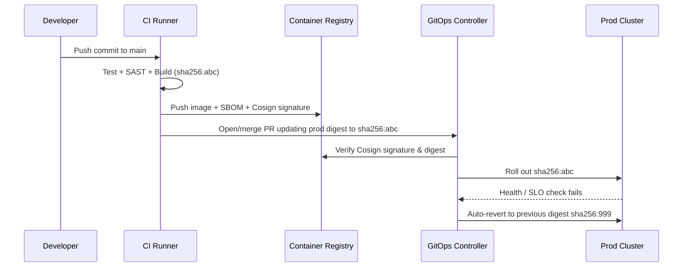
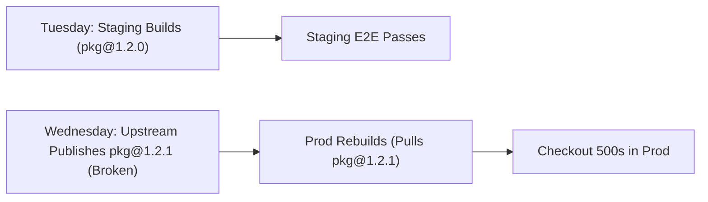

# CI/CD Pipelines: Build Once, Test, Scan, Promote & Roll Back

> **Prerequisites:** [Lesson 13: Capacity Planning](../13-capacity-planning/README.md).  
> **Estimated Reading Time:** 23–27 minutes  
> **Target Audience:** Backend and platform engineers designing reliable release pipelines, eliminating "works in staging" bugs, and answering "how do you take a commit to production safely?"  
> **Free PDF Notes:** [Download P5-SD-N-014.pdf](https://backendroadmap.com/notes/system-design/P5-SD-N-014.pdf)

> [!NOTE]
> **In one line:** A production CI/CD pipeline **builds an immutable artifact once**, verifies it through fast automated gates (tests, SAST/SCA/container scans, SBOM signing), and **promotes that exact digest** across environments with automated health verification and instant rollback.

> [!TIP]
> **The Golden Rule:** **Build once, promote many.** Never recompile or rebuild a container image per environment; inject configuration at runtime so what passed staging is bit-for-bit identical to what runs in production.

---

## 1. What a CI/CD Pipeline Is, and What It Isn't

A developer merges a PR. In a fragile setup, Jenkins builds a Docker image tagged `:latest` for staging, tests pass, and an hour later a separate job runs `docker build` again for production—pulling a newly published broken transitive dependency and shipping untested code. A real CI/CD pipeline produces a single, cryptographically signed immutable artifact (`sha256:9f8a...`) and moves *that exact artifact* through automated quality and security gates.

| Term | Precise Meaning | Example |
| :--- | :--- | :--- |
| **Continuous Integration (CI)** | Merging code frequently with automated build, lint, and test gates | PR triggers unit + integration tests in < 8 min |
| **Continuous Delivery (CD)** | Every green commit is *deployable* to prod; release may have a manual gate | Artifact promoted to staging, awaits 1-click approve |
| **Continuous Deployment** | Every green commit automatically deploys to prod with no human gate | Merge to `main` -> canary -> 100% prod |
| **Immutable Artifact** | Build output identified by content digest, never mutated or rebuilt | `ghcr.io/app@sha256:4b2c...` |
| **Shift-Left Security** | Running SAST, dependency (SCA), secret, and image scans in CI | Trivy / Semgrep blocks Critical CVEs pre-merge |
| **Artifact Promotion** | Moving the same signed digest from `dev` -> `staging` -> `prod` | Updating Helm/ArgoCD image digest |
| **Not** | A bash script running `ssh prod "git pull && pm2 restart"` | Mutable, unrepeatable, zero rollback safety |

### Why It Matters
1. **DORA metrics** (Deployment Frequency, Lead Time for Changes, Change Failure Rate, MTTR) are driven directly by pipeline speed and safety.
2. Rebuilding per environment invalidates all staging tests and introduces supply-chain drift.
3. Fast, deterministic rollbacks require immutable artifacts and backward-compatible database migrations.

---

## 2. Anatomy: Build Once, Scan, Sign & Promote

```mermaid
flowchart LR
    GIT["Git Push / PR"] --> CI["CI: Lint + Unit + Build Once"]
    CI --> SCAN["Security: SAST + SCA + Image Scan"]
    SCAN --> SIGN["Sign Digest + SBOM (Cosign)"]
    SIGN --> REG["Artifact Registry (Immutable Digest)"]
    REG --> STG["Deploy Staging (Smoke + E2E)"]
    STG --> PROD["Promote Same Digest to Prod (Canary)"]
    PROD -. "SLO Breach" .-> RB["Instant Rollback to Previous Digest"]
```



Configuration (DB URLs, feature flags, secrets) is injected at runtime via environment variables or mounted secrets—never baked into the image.

| Stage | Purpose | Typical Time Budget |
| :--- | :--- | :---: |
| **PR Gate (Fast CI)** | Lint, compile, unit tests, secret scan | 3–8 min |
| **Build & Package** | Build immutable container/binary, generate SBOM | 2–5 min |
| **Security & Policy** | SAST, SCA, container CVE scan, Cosign signature | 1–3 min |
| **Staging & E2E** | Deploy exact digest, run contract & smoke tests | 5–12 min |
| **Prod Promotion** | Progressive rollout (rolling/canary) + automated verify | 5–15 min |

> [!WARNING]
> **The `:latest` Tag Trap:** Deploying `:latest` or mutable version tags (`v1.2`) breaks reproducibility and rollback. If `:latest` is overwritten by a broken build, rolling back to `:latest` deploys the broken build again. Always deploy and roll back by **immutable SHA-256 digest**.

---

## 3. Mathematical Model: Pipeline Lead Time, Queueing & Failure Probability

**1. Total Lead Time to Production ($T_{\text{lead}}$).**  
If a pipeline has $k$ sequential stages of duration $t_i$, plus queue wait $W_q$ for CI runners, and a flaky-test retry probability $p_{\text{flake}}$:

$$T_{\text{lead}} = W_q + \sum_{i=1}^{k} t_i \cdot (1 + p_{\text{flake}})$$

**2. Compounding Flakiness Across Suites.**  
If an integration suite has $n$ independent tests and each test has a tiny flake rate $f$, the probability the entire suite passes on a single run is:

$$P(\text{pass}) = (1 - f)^n$$

**Worked Numerical Example:**  
Suppose a suite has $n = 200$ E2E tests, each with a $f = 0.005$ (0.5%) flake rate:

$$P(\text{pass}) = (1 - 0.005)^{200} = 0.995^{200} \approx 0.367 \text{ (36.7\% pass rate!)}$$

Nearly **2 out of 3 valid PRs fail** due to flakes. Developers stop trusting CI, hit "Re-run" blindly, or disable gates—doubling runner costs and hiding real bugs.

**3. Batch Size vs Change Failure Rate.**  
Smaller, frequent deploys (1–3 commits per deploy) isolate blast radius: if a deploy breaks prod, identifying the culprit commit is $O(1)$ instead of bisecting 50 commits.

---

## 4. Metrics & Percentiles (DORA & Pipeline Health)

| Metric | Meaning | Alert / Target |
| :--- | :--- | :--- |
| **PR Feedback $p_{95}$** | Time from push to CI result | Target < 10 min; alert > 20 min |
| **Deployment Frequency** | Prod deploys per day/week per service | Elite: multiple/day |
| **Change Failure Rate (CFR)** | % of deploys causing rollback/incident | Target < 5% (DORA Elite < 15%) |
| **MTTR (Rollback Time)** | Time from bad deploy detection to healthy | Target < 5 min (automated digest revert) |
| **Flaky Test Rate** | % of runs failing then passing on retry | Alert > 1% per suite; quarantine immediately |
| **Runner Queue Wait $p_{95}$** | Time waiting for an available CI runner | Alert > 60 s |

### Worked Example (Cutting Lead Time from 52 min to 11 min)
A monorepo CI pipeline took 52 minutes: 12 min sequential build, 28 min full E2E suite, 12 min rebuild for prod.  
- **Fix 1 (Build Once):** Eliminate the 12-min prod rebuild; promote the staging digest (-12 min).
- **Fix 2 (Parallel Sharding + Caching):** Shard E2E tests across 6 workers and cache build layers (28 min $\rightarrow$ 5 min).
- **Fix 3 (Merge Queue + Fast PR Gate):** Run unit/lint/SAST in 6 min on PR; run full E2E in a batched merge queue.  
Result: PR feedback drops to **6 min**, total merge-to-prod drops to **11 min**, and CFR drops because staging and prod run identical digests.

---

## 5. Compounding & Failure Modes: What Breaks Pipelines at Scale

| Failure Mode | Mechanism | Blast Radius |
| :--- | :--- | :--- |
| **Flaky E2E suite** | $0.5\%$ flake $\times 200$ tests = 63% failure | Devs bypass gates; CI queue backs up 3x |
| **Mutable tags (`:latest`)** | Prod pulls different bits than staging | "Works in staging" SEV-1; broken rollback |
| **Irreversible DB migration** | `DROP COLUMN` runs before old pods drain | Rollback fails because old code needs column |
| **Unpinned dependencies** | `npm install` without lockfile / `pip` unpinned | Supply-chain attack or sudden build breakage |
| **Secrets in CI logs/env** | `env` printed on error or PR from fork | Credential leak across entire org |

---

## 6. Numbers Every Engineer Must Know

| Item | Typical | Implication |
| :--- | :---: | :--- |
| Ideal PR CI feedback time | 5–10 minutes | Longer breaks developer flow state |
| Container image rollback | 30–90 seconds | Just update digest + pull cached layers |
| Full rebuild + deploy rollback | 15–30 minutes | Too slow for SEV-1; never rebuild to roll back |
| Flake rate threshold | < 0.1% per test | Above this, large suites become unusable |
| Artifact retention | Keep last 30–90 days | Must retain previous prod digests for rollback |
| OIDC short-lived token TTL | 5–15 minutes | Replaces static long-lived AWS/GCP CI keys |

---

## 7. Protocol / Mechanism Deep Dive: GitOps Promotion & Supply Chain Attestation



| Question | Answer |
| :--- | :--- |
| **Push-based CD vs Pull-based GitOps?** | Push (GitHub Actions `kubectl apply`) gives CI cluster admin creds. Pull (ArgoCD/Flux) keeps creds inside the cluster and continuously reconciles drift. |
| **How do you prevent unverified images in prod?** | Admission controller (Kyverno/OPA) verifies Cosign cryptographic signature + registry digest before pod creation. |
| **How do you handle DB migrations in CI/CD?** | Expand-and-contract (Lesson 16): run backward-compatible schema additive steps *before* app deploy; drop old columns days later. |

**When not to use full Continuous Deployment:** Regulated environments (banking, healthcare, firmware) requiring change-advisory audit trails or manual release windows should use **Continuous Delivery** (automated up to staging, manual 1-click promotion of the signed digest).

---

## 8. Hierarchical Budgets & Design Rules

| Slice | Rule | Control |
| :--- | :--- | :--- |
| **Artifacts** | Build once; promote immutable `sha256` digest | Admission policy blocks `:latest` |
| **Test Pyramid** | 70% unit, 20% integration/contract, 10% E2E | Keep PR gate < 10 min |
| **Flakes** | Zero tolerance for known flaky tests | Auto-quarantine + track flake budget |
| **Security** | Block Critical/High CVEs, secrets, unsigned images | Trivy + Gitleaks + Cosign in CI |
| **Credentials** | No static cloud keys in CI | OIDC federation (`id-token: write`) |
| **Database** | Schema changes must be backward-compatible | Expand-and-contract migration linter |

---

## 9. Top Mitigations

1. **Enforce Build Once, Promote Many** using content-addressable SHA-256 digests and runtime config injection.
2. **Use OIDC workload identity** instead of long-lived cloud secrets stored in CI variables.
3. **Quarantine flaky tests automatically** so they don't train engineers to ignore red builds.
4. **Add a Merge Queue** for busy repos so `main` stays green even when 20 PRs merge concurrently.
5. **Pin all dependencies and base images** with lockfiles (`package-lock.json`, `go.sum`, `requirements.txt` hashes) and SHA-pinned Docker base images.
6. **Decouple deploy from release** using feature flags (Lesson 18) and backward-compatible DB migrations.
7. **Test rollbacks regularly**—a rollback path that isn't exercised will fail during a SEV-1.

---

## 10. Production Reference: The "Rebuilt in Prod" Outage

An e-commerce team used two separate CI workflows: `deploy-staging` and `deploy-prod`. Both ran `docker build` from `main` using `FROM node:20-alpine` and `npm install` (without `npm ci` + lockfile). Staging passed on Tuesday. On Wednesday morning, a transitive npm package published a breaking minor release. `deploy-prod` ran `docker build`, pulled the broken package, and shipped a 500-error bug to 100% of checkout traffic—even though staging had passed.



- **Root Cause:** Rebuilding per environment + unpinned dependencies violated artifact immutability.
- **Fix:** Consolidated into a single `build` job that runs `npm ci`, builds one image, signs its digest, and promotes that exact `sha256` from staging to prod.

---

## 11. Multi-Language Production Code Tabs

A **Pipeline Gate & Promotion Verifier** that enforces digest immutability, checks CVE/test gates, and computes rollback targets.

````carousel
```go
// Go: immutable artifact promotion & gate validator.
package main

import (
	"errors"
	"fmt"
	"strings"
)

type Artifact struct {
	Digest       string
	TestsPassed  bool
	CriticalCVEs int
	Signed       bool
}

func Promote(art Artifact, targetEnv string) error {
	if !strings.HasPrefix(art.Digest, "sha256:") || len(art.Digest) < 15 {
		return errors.New("refusing mutable tag: must promote immutable sha256 digest")
	}
	if !art.TestsPassed || art.CriticalCVEs > 0 || !art.Signed {
		return fmt.Errorf("gate failed for %s: tests=%v cves=%d signed=%v",
			targetEnv, art.TestsPassed, art.CriticalCVEs, art.Signed)
	}
	fmt.Printf("Promoted %s to %s\n", art.Digest, targetEnv)
	return nil
}

func main() {
	art := Artifact{Digest: "sha256:4b2c8e1a9f0d", TestsPassed: true, CriticalCVEs: 0, Signed: true}
	if err := Promote(art, "production"); err != nil {
		panic(err)
	}
}
```
<!-- slide -->
```typescript
// TypeScript: immutable artifact gate & flaky-suite pass probability check.
interface Artifact {
  digest: string;
  testsPassed: boolean;
  criticalCves: number;
  signed: boolean;
}

export function promoteArtifact(art: Artifact, env: "staging" | "production"): string {
  if (!art.digest.startsWith("sha256:")) {
    throw new Error("Blocked: mutable tag cannot be promoted; use sha256 digest.");
  }
  if (!art.testsPassed || art.criticalCves > 0 || !art.signed) {
    throw new Error(`Gate failed for ${env}`);
  }
  return `Promoted ${art.digest} -> ${env}`;
}

export function suitePassProbability(numTests: number, flakeRate: number): number {
  return Math.pow(1 - flakeRate, numTests);
}

console.log(promoteArtifact({ digest: "sha256:9f8a12bc", testsPassed: true, criticalCves: 0, signed: true }, "production"));
console.log("200 tests @ 0.5% flake pass prob:", suitePassProbability(200, 0.005).toFixed(3));
```
<!-- slide -->
```python
# Python: CI/CD promotion gate + DORA / flake math simulator.
from dataclasses import dataclass


@dataclass(frozen=True)
class Artifact:
    digest: str
    tests_passed: bool
    critical_cves: int
    signed: bool


def promote(art: Artifact, env: str) -> str:
    if not art.digest.startswith("sha256:"):
        raise ValueError("Refusing mutable tag; must promote immutable sha256 digest.")
    if not (art.tests_passed and art.critical_cves == 0 and art.signed):
        raise RuntimeError(f"Promotion gate blocked for {env}")
    return f"Promoted {art.digest} to {env}"


def suite_pass_probability(n_tests: int, flake_rate: float) -> float:
    return round((1.0 - flake_rate) ** n_tests, 4)


if __name__ == "__main__":
    a = Artifact("sha256:7d3f91ab0012", tests_passed=True, critical_cves=0, signed=True)
    print(promote(a, "production"))
    print("Suite pass prob (n=200, f=0.005):", suite_pass_probability(200, 0.005))
```
<!-- slide -->
```csharp
// C#: immutable artifact promotion gate.
using System;

public sealed record Artifact(string Digest, bool TestsPassed, int CriticalCves, bool Signed);

public static class PipelineGate
{
    public static string Promote(Artifact art, string env)
    {
        if (!art.Digest.StartsWith("sha256:", StringComparison.Ordinal))
            throw new InvalidOperationException("Mutable tags are forbidden; use sha256 digest.");
        if (!art.TestsPassed || art.CriticalCves > 0 || !art.Signed)
            throw new InvalidOperationException($"Security/quality gate failed for {env}.");
        return $"Promoted {art.Digest} to {env}";
    }

    public static void Main()
    {
        var art = new Artifact("sha256:4b2c8e1a9f0d", true, 0, true);
        Console.WriteLine(Promote(art, "production"));
    }
}
```
````

---

## 12. Hands-On CLI Verification Workflows

```bash
# 1. Verify flaky-test compounding math in Python
python3 -c "print('200 tests @ 0.5% flake:', round((1 - 0.005)**200, 3))"

# 2. Scan a container image for Critical/High CVEs (Trivy)
trivy image --severity HIGH,CRITICAL --exit-code 1 ghcr.io/org/api@sha256:4b2c8e1a9f0d

# 3. Verify Cosign signature on an immutable digest
cosign verify --certificate-identity-regexp=".*@org.com" --certificate-oidc-issuer=https://token.actions.githubusercontent.com ghcr.io/org/api@sha256:4b2c8e1a9f0d

# 4. Instant Kubernetes rollback to previous ReplicaSet revision
kubectl rollout undo deployment/checkout-api --to-revision=42
```

---

## 13. Common Mistakes to Avoid

1. **Rebuilding artifacts per environment** instead of promoting one immutable digest.
2. **Deploying `:latest` tags**, making rollbacks non-deterministic.
3. **Baking environment secrets or config into container images**.
4. **Ignoring flaky tests**, which destroys trust in the red/green CI signal.
5. **Running destructive DB migrations** (`DROP COLUMN`) before old app versions drain.
6. **Storing long-lived cloud admin keys in CI** instead of short-lived OIDC tokens.
7. **Coupling code deployment with feature release**, forcing full rollbacks for UX bugs.

---

## 14. Key Terms Glossary

| Key Term | Definition |
| :--- | :--- |
| **CI (Continuous Integration)** | Automated build, lint, and test on every commit/PR. |
| **Continuous Delivery** | Every green commit is deployable; prod release may be manual. |
| **Continuous Deployment** | Every green commit ships to prod automatically. |
| **Immutable Digest** | Content-addressed `sha256` hash uniquely identifying an artifact. |
| **SBOM** | Software Bill of Materials listing every dependency in an artifact. |
| **SAST / SCA** | Static code analysis / dependency vulnerability scanning. |
| **GitOps** | Pull-based deployment where Git is the single source of truth. |
| **Merge Queue** | Serialized/batched PR verification before landing on `main`. |
| **DORA Metrics** | Deploy freq, lead time, change failure rate, and MTTR. |
| **Artifact Promotion** | Moving the exact same verified digest across environments. |

---

## 15. System Design Interview Questions & Answers

### Basic Conceptual Questions

<details>
<summary><strong>Q1: What is the difference between Continuous Delivery and Continuous Deployment? [BASIC]</strong></summary>

**Answer:**
In Continuous Delivery, every commit passes automated tests and is packaged into a deployable artifact ready for production, but a human triggers the final promotion. In Continuous Deployment, that final promotion is also automated (usually gated by canary metrics).
</details>

<details>
<summary><strong>Q2: Why does "build once, promote many" matter? [BASIC]</strong></summary>

**Answer:**
Rebuilding for production can pull different transitive dependencies, base image updates, or compiler states—meaning production runs code that was never tested in staging. Promoting an immutable `sha256` digest guarantees bit-for-bit parity.
</details>

<details>
<summary><strong>Q3: How do you handle environment-specific config if you only build once? [BASIC]</strong></summary>

**Answer:**
Follow Twelve-Factor App principles: inject environment URLs, feature flags, and credentials at runtime via environment variables, mounted ConfigMaps/Secrets, or a secrets manager (Vault, AWS Secrets Manager).
</details>

<details>
<summary><strong>Q4: What are the four DORA metrics? [BASIC]</strong></summary>

**Answer:**
Deployment Frequency, Lead Time for Changes, Change Failure Rate (CFR), and Mean Time to Recovery (MTTR). Together they measure both delivery velocity and operational stability.
</details>

### Scenario-Based Architecture Questions

<details>
<summary><strong>Q5: Your CI pipeline takes 45 minutes and developers complain. How do you bring it under 10 minutes? [SCENARIO]</strong></summary>

**Answer:**
1) Split PR gates from post-merge/nightly gates (run lint + unit + SAST on PR; full E2E in merge queue). 2) Parallelize test suites across shards. 3) Cache dependencies and Docker layers remotely. 4) Use affected-target detection in monorepos (Bazel/Nx/Turborepo) so unchanged services aren't rebuilt.
</details>

<details>
<summary><strong>Q6: How do you design a zero-downtime rollback if a bad deploy also ran a DB migration? [SCENARIO]</strong></summary>

**Answer:**
Never run destructive migrations in the same deploy as code changes. Use **expand-and-contract**: Deploy 1 adds nullable columns/tables (backward-compatible); Deploy 2 ships new app code; Deploy 3 (days later) cleans up old columns. If Deploy 2 fails, rolling back the app digest works immediately against the expanded schema.
</details>

<details>
<summary><strong>Q7: How do you prevent a compromised CI pipeline from deploying unverified code to production? [SCENARIO]</strong></summary>

**Answer:**
Separate build and deploy permissions, use short-lived OIDC tokens scoped to protected branches, sign artifacts and SBOMs with Cosign, and enforce a Kubernetes admission controller (Kyverno/OPA) that rejects unsigned images or mutable tags.
</details>

<details>
<summary><strong>Q8: Your E2E suite has 300 tests and a 1% per-test flake rate. Why is CI always red? [SCENARIO]</strong></summary>

**Answer:**
The probability all 300 pass is $0.99^{300} \approx 4.9\%$. Over 95% of runs fail! Fix by moving coverage down the test pyramid (unit/contract tests), eliminating shared mutable test state, and automatically quarantining flaky tests.
</details>

### Advanced & Tricky Interview Questions

<details>
<summary><strong>Q9: Push-based CD vs Pull-based GitOps — which is safer for multi-cluster prod? [TRICKY]</strong></summary>

**Answer:**
Pull-based GitOps (ArgoCD/Flux) is safer because CI never holds production cluster admin credentials; the cluster pulls signed manifests from Git, detects configuration drift automatically, and provides an auditable Git revert for rollbacks.
</details>

<details>
<summary><strong>Q10: How do you handle 50 developers merging to a monorepo simultaneously without breaking main? [TRICKY]</strong></summary>

**Answer:**
Use a **Merge Queue** with speculative execution: PRs are tested against the projected tip of `main` in batches. If a batch fails, bisection isolates the bad PR without blocking the other 49 or letting a broken commit land on `main`.
</details>

<details>
<summary><strong>Q11: Why is `kubectl rollout undo` sometimes insufficient for a rollback? [TRICKY]</strong></summary>

**Answer:**
If configmaps, secrets, or database schemas were mutated outside the Deployment spec, `rollout undo` only reverts the pod template. True rollback requires versioning ConfigMaps/Secrets (immutable names with hash suffixes) and backward-compatible schemas.
</details>

<details>
<summary><strong>Q12: How do you keep rollback fast (under 60 seconds) for a 2 GB container image? [TRICKY]</strong></summary>

**Answer:**
Pre-cache previous image digests on nodes (`imagePullPolicy: IfNotPresent`), slim images with multi-stage distroless builds (often < 50 MB instead of 2 GB), or use Canary/Blue-Green where the previous version is still warm in memory.
</details>

---

## 16. One-Page Master Cheat Sheet

```
+---------------------------------------------------------------------------------------------------------+
|                          CI/CD PIPELINES — MASTER CHEAT SHEET                                           |
+---------------------------------------------------------------------------------------------------------+
| 1. GOLDEN RULE: Build ONCE -> Sign sha256 digest -> Promote SAME digest across Dev -> Staging -> Prod.  |
+---------------------------------------------------------------------------------------------------------+
| 2. NEVER: Rebuild per environment, deploy :latest, bake secrets in images, or run DROP COLUMN in-flight.|
+---------------------------------------------------------------------------------------------------------+
| 3. FLAKE MATH: P(pass) = (1 - f)^n. 200 tests @ 0.5% flake = 36.7% pass rate. Quarantine flakes!        |
+---------------------------------------------------------------------------------------------------------+
| 4. DORA METRICS: Deploy Freq · Lead Time (<10m PR) · Change Failure Rate (<5%) · MTTR (<5m rollback).   |
+---------------------------------------------------------------------------------------------------------+
| 5. SECURITY: OIDC short-lived tokens + SAST/SCA/Trivy + SBOM + Cosign admission verification.           |
+---------------------------------------------------------------------------------------------------------+
| 6. DB SAFETY: Expand-and-contract migrations so rolling back app digest never breaks old code.          |
+---------------------------------------------------------------------------------------------------------+
```

---

## Further Reading & Sources

- Nicole Forsgren, Jez Humble, Gene Kim, *Accelerate: Building and Scaling High Performing Technology Organizations* (DORA metrics).
- Jez Humble & David Farley, *Continuous Delivery* (Deployment Pipeline & Build Once).
- SLSA Framework ([slsa.dev](https://slsa.dev/)) — Supply-chain Levels for Software Artifacts.
- The Twelve-Factor App, *Config & Build, Release, Run* ([12factor.net](https://12factor.net/)).

---

## Free PDF Notes

[P5-SD-N-014.pdf](https://backendroadmap.com/notes/system-design/P5-SD-N-014.pdf)

---

## Next

Continue with [Lesson 15: Rolling Deployments: maxSurge, maxUnavailable & Version Skew](../15-rolling-deployments/README.md).