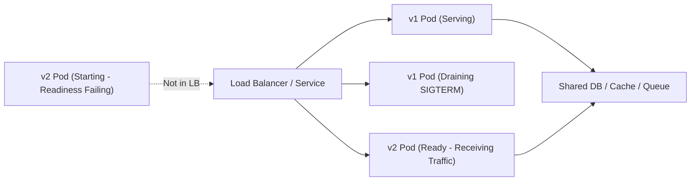

# Rolling Deployments: maxSurge, maxUnavailable & Version Skew

> **Prerequisites:** [Lesson 14: CI/CD Pipelines](../14-ci-cd-pipelines/README.md).  
> **Estimated Reading Time:** 23–27 minutes  
> **Target Audience:** Backend and Kubernetes engineers tuning zero-downtime rollouts, graceful shutdowns, and multi-version compatibility.  
> **Free PDF Notes:** [Download P5-SD-N-015.pdf](https://backendroadmap.com/notes/system-design/P5-SD-N-015.pdf)

> [!NOTE]
> **In one line:** A rolling deployment gradually replaces old instances (`v1`) with new instances (`v2`) using **`maxSurge`** and **`maxUnavailable`** budgets so capacity stays healthy—meaning `v1` and `v2` **must coexist safely** (zero-downtime drain + backward-compatible APIs/schemas).

> [!TIP]
> **The Golden Rule:** A rolling update is only zero-downtime if **three things** hold simultaneously: (1) `readinessProbe` blocks traffic until `v2` is warm, (2) `preStop` + `SIGTERM` drain in-flight requests before killing `v1`, and (3) `v1` and `v2` can read/write the same DB, cache, and queues without breaking each other (**version skew**).

---

## 1. What a Rolling Deployment Is, and What It Isn't

You have 20 pods running `v1`. During a rolling update, Kubernetes spins up a few `v2` pods, waits for their `readinessProbe` to pass, removes a few `v1` pods from the load balancer, drains their in-flight connections, and repeats until all 20 pods are `v2`. Unlike Blue-Green, you don't need 2x permanent capacity—but `v1` and `v2` run **side by side** for the duration of the rollout.

| Term | Precise Meaning | Example |
| :--- | :--- | :--- |
| **`maxSurge`** | Max extra pods above desired `replicas` allowed during update | `replicas=20, maxSurge=25%` $\rightarrow$ up to 25 pods |
| **`maxUnavailable`** | Max pods allowed to be unready/down during update | `replicas=20, maxUnavailable=0` $\rightarrow$ always $\ge 20$ ready |
| **Version Skew** | Period where `v1` and `v2` run concurrently and share state | `v2` writes new JSON field; `v1` must not crash |
| **Readiness Probe** | Health check gating when a pod receives LB traffic | `/ready` returns 200 only after cache/DB warm |
| **Graceful Drain** | Waiting for LB deregistration + in-flight requests before exit | `preStop: sleep 10` + `SIGTERM` drain |
| **Not** | Instant cutover or instant rollback | Rollback is another rolling update (takes minutes) |

### Why It Matters
1. Rolling deployment is the default strategy in Kubernetes, ECS, and cloud instance groups.
2. Misconfigured `maxUnavailable` or missing graceful drain causes 502/504 errors on *every* deploy.
3. Version skew bugs (DB schemas, Redis keys, Protobuf/JSON contracts, sticky sessions) are the #1 cause of rolling-deploy incidents.

---

## 2. Anatomy: Rolling Wave & Pod Termination Timeline



During the rollout, `v1` and `v2` both read and write to the **exact same database, cache, and message broker**. If `v2` writes a serialized object that `v1` fails to deserialize, `v1` pods crash while the rollout is only halfway done.

| Parameter Setting | Behavior | Best For |
| :--- | :--- | :--- |
| `maxSurge=25%, maxUnavailable=0` | Creates `v2` first, waits for Ready, then kills `v1` | Latency-sensitive prod services (no capacity drop) |
| `maxSurge=0, maxUnavailable=25%` | Kills `v1` first, then creates `v2` | Strict quota/IP/memory-constrained clusters |
| `maxSurge=1, maxUnavailable=0` | Slowest, safest 1-by-1 replacement | Stateful or heavy-warmup services |
| `maxSurge=100%, maxUnavailable=0` | Effectively a temporary Blue-Green surge | Fast rollouts when 2x headroom exists |

> [!WARNING]
> **The `SIGTERM` Race Condition:** In Kubernetes, `Endpoints` removal (updating iptables/IPVS/ALB targets) happens **asynchronously** with sending `SIGTERM` to the container. If your app exits immediately on `SIGTERM`, the load balancer will still route new requests to the dead pod for 2–10 seconds, causing `502 Bad Gateway` errors. Always add a `preStop` sleep (5–15 s) before the app stops accepting connections, then drain in-flight requests.

---

## 3. Mathematical Model: Rollout Duration, Capacity Floor & Skew Window

**1. Minimum Ready Capacity During Rollout.**  
With desired count $R$, `maxUnavailable` $U$, and `maxSurge` $S$:

$$R_{\text{min\_ready}} = R - U, \qquad R_{\text{max\_total}} = R + S$$

**2. Total Rollout Time ($T_{\text{rollout}}$).**  
Each batch replaces at most $B = S + U$ pods (when $U > 0$, or $B = S$ when $U = 0$ and `v2` must become ready before `v1` terminates). Let $t_{\text{ready}}$ be `v2` startup + readiness time, and $t_{\text{drain}}$ be `v1` `preStop` + drain time:

$$N_{\text{batches}} = \left\lceil \frac{R}{B} \right\rceil, \qquad T_{\text{rollout}} \approx N_{\text{batches}} \cdot (t_{\text{ready}} + t_{\text{drain}})$$

**Worked Numerical Example:**  
Suppose $R = 40$ pods, `maxSurge` $= 25\%$ ($S = 10$), `maxUnavailable` $= 0$ ($U = 0$), $t_{\text{ready}} = 25\text{ s}$, and $t_{\text{drain}} = 15\text{ s}$:

$$N_{\text{batches}} = \left\lceil \frac{40}{10} \right\rceil = 4\text{ batches}$$

$$T_{\text{rollout}} \approx 4 \times (25 + 15) = 160\text{ s (2 min 40 s)}$$

During those 160 seconds:
- Ready pods never drop below $40 - 0 = 40$ (100% capacity preserved).
- Peak pods reach $40 + 10 = 50$ (verify cluster/DB headroom for 50 pods!).
- **Version skew window** lasts 160 seconds—both `v1` and `v2` are live simultaneously.

---

## 4. Metrics & Percentiles

| Metric | Meaning | Alert when |
| :--- | :--- | :--- |
| **502/504 spikes during deploy** | Requests hitting dying `v1` or unready `v2` | Any > 0.05% error bump during rollout |
| **Ready replica ratio** | `ready_replicas / desired_replicas` | < 100% when `maxUnavailable=0` |
| **Rollout duration** | Time from `Progressing` to `Available` | > `progressDeadlineSeconds` (e.g., 10 min) |
| **Pod startup latency $p_{95}$** | Time from `Scheduled` to `Ready` | Rising > 60 s (slows rollout & rollback) |
| **Graceful drain completion** | % of pods exiting cleanly vs `SIGKILL` | Any `SIGKILL` (means `terminationGracePeriodSeconds` too short) |

### Worked Example (Fixing Deploy-Time 502s)
A 30-pod Go API saw ~150 `502 Bad Gateway` errors on every deploy.  
- **Diagnosis:** `terminationGracePeriodSeconds` was 30 s, no `preStop` hook, and the Go server closed its listener immediately on `SIGTERM` while AWS ALB took ~8 s to deregister targets.
- **Fix:** Added `preStop: exec: ["sh", "-c", "sleep 10"]`, `server.Shutdown(ctx)` with a 15 s drain timeout, and `terminationGracePeriodSeconds: 45`.  
- **Result:** ALB stops sending new traffic within 8 s while the pod still accepts/drains; at 10 s `SIGTERM` triggers clean shutdown. Deploy 502s dropped to **0**.

---

## 5. Compounding & Failure Modes

| Failure Mode | What Happens | Result |
| :--- | :--- | :--- |
| **Missing `preStop` + fast exit** | Pod closes socket before LB updates endpoints | 2–10 s of 502s per pod terminated |
| **Unbounded `maxUnavailable`** | `v2` crashes, but `v1` was already killed | Fleet capacity drops; cascading overload |
| **Version skew in Redis/DB** | `v2` writes new schema/key format; `v1` reads it | `v1` throws 500s mid-rollout |
| **Rolling rollback is slow** | Bad `v2` rolls out in 4 min; rollback also takes 4 min | Longer MTTR than Blue-Green |
| **Surge exceeds quotas** | `maxSurge=25%` hits VPC IP or DB connection limit | Rollout stalls at batch 1 |

---

## 6. Numbers Every Engineer Must Know

| Item | Typical | Implication |
| :--- | :---: | :--- |
| LB endpoint propagation | 2–15 seconds | `preStop` sleep must exceed this |
| `terminationGracePeriodSeconds` | 45–90 seconds | Must be `> preStop + max_request_timeout` |
| Healthy `maxUnavailable` | `0` (for prod APIs) | Guarantees zero capacity loss during deploy |
| Healthy `maxSurge` | `20%–25%` | Balances rollout speed vs surge headroom |
| `minReadySeconds` | 10–30 seconds | Catches crash-loops before proceeding to next batch |

---

## 7. Protocol / Mechanism Deep Dive: Zero-Downtime Pod Lifecycle

```mermaid
sequenceDiagram
    participant K8s as Kubelet / Control Plane
    participant LB as Load Balancer / Endpoints
    participant App as v1 Container
    K8s->>LB: Remove v1 Pod IP from Endpoints (async)
    K8s->>App: Run preStop hook (sleep 10s)
    Note over LB,App: LB finishes draining new connections (2-8s)
    K8s->>App: Send SIGTERM
    App->>App: Stop accepting new conns; drain in-flight (<=15s)
    App-->>K8s: Exit 0 (clean shutdown)
```

| Question | Answer |
| :--- | :--- |
| **Why `preStop` sleep instead of handling `SIGTERM` with a delay?** | In many runtimes, `SIGTERM` immediately marks the app unhealthy or stops accepting connections. `preStop` keeps the app serving normally for 10 s while the LB propagates endpoint removal. |
| **How does `minReadySeconds` protect a rolling update?** | If `v2` passes `/ready` at $t=5\text{ s}$ and crashes at $t=12\text{ s}$, `minReadySeconds: 20` catches the crash before Kubernetes terminates more `v1` pods. |
| **How do you handle version skew on APIs/queues?** | Make all schema and message changes backward- and forward-compatible (additive fields, tolerant readers) across at least $N$ and $N-1$. |

**When not to use Rolling Deployments:** When `v1` and `v2` **cannot** coexist (e.g., incompatible singleton lock, exclusive hardware/port, or breaking protocol change) or when you require **instant (< 5 s) rollback**—use **Blue-Green** (Lesson 16) instead.

---

## 8. Hierarchical Budgets & Design Rules

| Slice | Rule | Control |
| :--- | :--- | :--- |
| **Availability** | `maxUnavailable: 0` for user-facing services | Deployment manifest linter |
| **Surge** | `maxSurge: 25%` (ensure cluster/DB headroom) | Capacity plan includes +25% surge |
| **Drain** | `preStop` (10 s) + `SIGTERM` drain < `terminationGracePeriod` | Pod spec policy + integration test |
| **Readiness** | Probe verifies DB/cache warmup, not just process up | `/ready` vs `/live` separation |
| **Version Skew** | `v1` and `v2` compatible for DB, cache, and queues | Expand-and-contract + schema registry |
| **Halt on Failure** | `minReadySeconds: 15`, `progressDeadlineSeconds: 300` | Auto-pause rollout on crash loop |

---

## 9. Top Mitigations

1. **Set `maxUnavailable: 0` and `maxSurge: 25%`** for critical stateless services so capacity never dips.
2. **Implement `preStop` sleep (10 s) + `SIGTERM` graceful drain** to eliminate deploy-time 502s.
3. **Separate `/live` (is process deadlocked?) from `/ready` (can it serve traffic?)**—never put DB checks in `/live`.
4. **Use `minReadySeconds` (15–30 s)** so fast-crashing `v2` pods halt the rollout before `v1` is gone.
5. **Version cache keys** (e.g., `user:v2:{id}`) when changing serialized struct shapes so `v1` and `v2` don't poison each other's Redis reads.
6. **Enforce backward-compatible DB & queue schemas** (additive-only during the rollout).
7. **Account for `maxSurge` in your capacity and DB connection budgets** so the extra 25% pods don't exhaust `max_connections`.

---

## 10. Production Reference: The "Redis Serialization Skew" Outage

A payments team added a required `currency_minor_units` field to a cached `MerchantConfig` struct and deployed `v2` via a 50-pod rolling update (`maxSurge=25%`). As `v2` pods came up, they populated Redis with the new JSON shape, removing an old field `v1` expected. The 35 remaining `v1` pods read those keys, threw `NullPointerException` on every request, and failed their readiness probes—leaving only 12 `v2` pods to handle 100% of traffic, which immediately overloaded and crashed.


- **Root Cause:** Breaking cache schema change deployed via rolling update without key versioning or tolerant readers.
- **Fix:** Namespaced cache keys by schema version (`merchant:v2:{id}`), added `minReadySeconds: 30`, and made deserializers tolerant of missing/extra fields.

---

## 11. Multi-Language Production Code Tabs

Graceful HTTP server shutdown (`SIGTERM` drain) + rolling-wave batch simulator.

````carousel
```go
// Go: graceful HTTP shutdown on SIGTERM with drain timeout.
package main

import (
	"context"
	"log"
	"net/http"
	"os/signal"
	"syscall"
	"time"
)

func main() {
	mux := http.NewServeMux()
	mux.HandleFunc("/ready", func(w http.ResponseWriter, r *http.Request) { w.WriteHeader(http.StatusOK) })
	mux.HandleFunc("/work", func(w http.ResponseWriter, r *http.Request) {
		time.Sleep(500 * time.Millisecond) // simulate in-flight work
		w.Write([]byte("ok"))
	})

	srv := &http.Server{Addr: ":8080", Handler: mux}
	ctx, stop := signal.NotifyContext(context.Background(), syscall.SIGTERM, syscall.SIGINT)
	defer stop()

	go func() {
		if err := srv.ListenAndServe(); err != nil && err != http.ErrServerClosed {
			log.Fatalf("listen: %v", err)
		}
	}()

	<-ctx.Done() // SIGTERM received (after k8s preStop sleep)
	drainCtx, cancel := context.WithTimeout(context.Background(), 15*time.Second)
	defer cancel()
	if err := srv.Shutdown(drainCtx); err != nil {
		log.Printf("forced shutdown: %v", err)
	}
}
```
<!-- slide -->
```typescript
// TypeScript (Node.js): graceful HTTP drain on SIGTERM + rollout duration calculator.
import http from "node:http";

const server = http.createServer((req, res) => {
  if (req.url === "/ready") {
    res.writeHead(200).end("ready");
    return;
  }
  setTimeout(() => res.writeHead(200).end("ok"), 300);
});

process.on("SIGTERM", () => {
  // Stop accepting new connections; finish in-flight requests
  server.close(() => process.exit(0));
  setTimeout(() => process.exit(1), 15_000).unref();
});

export function rolloutDurationSec(replicas: number, surge: number, unavail: number, readyS: number, drainS: number): number {
  const batch = unavail > 0 ? surge + unavail : surge;
  const batches = Math.ceil(replicas / batch);
  return batches * (readyS + drainS);
}
```
<!-- slide -->
```python
# Python: rolling deployment batch & capacity simulator.
import math


def simulate_rolling(replicas: int = 40, max_surge: int = 10, max_unavail: int = 0,
                     ready_s: int = 25, drain_s: int = 15) -> dict:
    batch_size = max_surge + max_unavail if max_unavail > 0 else max_surge
    batches = math.ceil(replicas / batch_size)
    duration_s = batches * (ready_s + drain_s)
    min_ready = replicas - max_unavail
    max_total = replicas + max_surge
    return {
        "batches": batches,
        "duration_s": duration_s,
        "min_ready_pods": min_ready,
        "max_total_pods": max_total,
        "version_skew_window_s": duration_s,
    }


if __name__ == "__main__":
    print(simulate_rolling())
```
<!-- slide -->
```csharp
// C#: rolling deployment duration & capacity calculator + graceful shutdown hook.
using System;
using System.Threading;

public sealed record RolloutPlan(int Batches, int DurationSec, int MinReady, int MaxTotal);

public static class RollingSimulator
{
    public static RolloutPlan Compute(int replicas, int maxSurge, int maxUnavail, int readySec, int drainSec)
    {
        int batch = maxUnavail > 0 ? maxSurge + maxUnavail : maxSurge;
        int batches = (int)Math.Ceiling(replicas / (double)batch);
        return new RolloutPlan(batches, batches * (readySec + drainSec), replicas - maxUnavail, replicas + maxSurge);
    }

    public static void Main()
    {
        using var cts = new CancellationTokenSource();
        AppDomain.CurrentDomain.ProcessExit += (_, _) => cts.Cancel(); // drain on SIGTERM
        Console.WriteLine(Compute(40, 10, 0, 25, 15));
    }
}
```
````

---

## 12. Hands-On CLI Verification Workflows

```bash
# 1. Verify rolling update batch math in Python
python3 -c "
import math
r, s, u, ready, drain = 40, 10, 0, 25, 15
batches = math.ceil(r / (s + u if u > 0 else s))
print(f'Batches={batches}, Duration={batches*(ready+drain)}s, MinReady={r-u}, MaxPods={r+s}')
"

# 2. Inspect Deployment rolling strategy and surge/unavailable settings
kubectl get deployment checkout-api -o jsonpath='{.spec.strategy.rollingUpdate}'

# 3. Watch a live rolling deployment wave by wave
kubectl rollout status deployment/checkout-api --watch

# 4. Pause a misbehaving rolling update mid-flight for inspection
kubectl rollout pause deployment/checkout-api
```

---

## 13. Common Mistakes to Avoid

1. **Exiting immediately on `SIGTERM`** without a `preStop` sleep, causing LB 502s.
2. **Putting downstream DB checks in `livenessProbe`**, causing cluster-wide restart storms if DB blips.
3. **Setting `maxUnavailable: 25%` on under-provisioned services**, dropping below N+1 capacity during deploy.
4. **Ignoring version skew** on Redis keys, DB columns, or Kafka message formats.
5. **Forgetting `maxSurge` headroom** when sizing VPC subnet IPs and DB connection pools.
6. **Setting `minReadySeconds: 0`**, allowing crash-looping `v2` pods to replace healthy `v1` pods too fast.
7. **Assuming rolling rollback is instant**—it takes another full rollout duration.

---

## 14. Key Terms Glossary

| Key Term | Definition |
| :--- | :--- |
| **`maxSurge`** | Extra instances allowed above desired count during rollout. |
| **`maxUnavailable`** | Instances allowed to be unready during rollout. |
| **Version Skew** | Simultaneous execution of `v1` and `v2` sharing state. |
| **Readiness Probe** | Check determining whether a pod receives LB traffic. |
| **Liveness Probe** | Check determining whether a deadlocked pod should be restarted. |
| **`preStop` Hook** | Lifecycle command run before `SIGTERM` to let LB deregister. |
| **Graceful Drain** | Completing in-flight requests after stopping new accepts. |
| **`minReadySeconds`** | Minimum healthy duration before a new pod counts as available. |
| **Tolerant Reader** | Deserializer that ignores unknown fields and handles missing ones. |
| **Key Versioning** | Prefixing cache keys with schema version (`v2:`) to avoid skew. |

---

## 15. System Design Interview Questions & Answers

### Basic Conceptual Questions

<details>
<summary><strong>Q1: Explain `maxSurge` and `maxUnavailable` in Kubernetes rolling updates. [BASIC]</strong></summary>

**Answer:**
`maxSurge` caps how many extra pods above `replicas` can exist during an update; `maxUnavailable` caps how many pods can be unready. Setting `maxUnavailable: 0, maxSurge: 25%` ensures 100% capacity is always available by bringing up `v2` pods before terminating `v1` pods.
</details>

<details>
<summary><strong>Q2: What is the difference between a liveness probe and a readiness probe? [BASIC]</strong></summary>

**Answer:**
Readiness removes a pod from the load balancer temporarily (e.g., during startup warmup or overload). Liveness kills and restarts the container. Never put external dependency checks (DB/Redis) in liveness, or a DB hiccup will restart your entire fleet.
</details>

<details>
<summary><strong>Q3: What is version skew in a rolling deployment? [BASIC]</strong></summary>

**Answer:**
Because `v1` and `v2` run concurrently during the rollout, both read and write the same database, cache, and queues. Both versions must be mutually compatible with shared schemas and APIs.
</details>

<details>
<summary><strong>Q4: Why do rolling deployments sometimes cause brief 502 errors? [BASIC]</strong></summary>

**Answer:**
Kubernetes sends `SIGTERM` to the pod at the same time it asynchronously removes the pod IP from load balancer endpoints. If the app closes its listening socket before the LB stops routing to it, in-flight/new connections fail with 502.
</details>

### Scenario-Based Architecture Questions

<details>
<summary><strong>Q5: Design a zero-downtime shutdown sequence for a pod behind an AWS ALB. [SCENARIO]</strong></summary>

**Answer:**
1) `preStop` hook sleeps 10–15 s while the app keeps serving normally, giving ALB time to deregister the target. 2) `SIGTERM` arrives; app stops accepting new connections (or returns `Connection: close`) and drains in-flight requests up to 20 s. 3) Set `terminationGracePeriodSeconds: 45` so Kubernetes doesn't `SIGKILL` mid-drain.
</details>

<details>
<summary><strong>Q6: You have 60 pods, `maxSurge=10`, `maxUnavailable=0`, 30 s startup, 15 s drain. How long is the rollout? [SCENARIO]</strong></summary>

**Answer:**
With `maxUnavailable=0`, batch size is `maxSurge = 10`. It takes $60 / 10 = 6$ batches. Each batch takes $30 + 15 = 45\text{ s}$, so total rollout is $6 \times 45 = 270\text{ s}$ (4.5 minutes). Peak pods = 70.
</details>

<details>
<summary><strong>Q7: You need to change a Redis cached JSON schema without downtime during a rolling update. How? [SCENARIO]</strong></summary>

**Answer:**
Either namespace the cache key by version (`v2:user:123`) so `v1` and `v2` don't collide, or do a two-step deploy: Deploy 1 makes `v1.5` a tolerant reader of both old and new formats; Deploy 2 starts writing the new format.
</details>

<details>
<summary><strong>Q8: Your cluster is at 90% memory utilization and cannot surge. How do you still do a rolling update? [SCENARIO]</strong></summary>

**Answer:**
Set `maxSurge: 0` and `maxUnavailable: 1` (or `10%`), ensuring remaining pods have enough headroom to absorb the temporary 10% capacity dip. Better long-term fix: maintain N+1 + surge headroom.
</details>

### Advanced & Tricky Interview Questions

<details>
<summary><strong>Q9: Why does a rolling deployment's rollback take longer than Blue-Green? [TRICKY]</strong></summary>

**Answer:**
Because `v1` pods were terminated as `v2` rolled out. Rolling back requires spinning `v1` pods back up in batches, waiting for readiness/warmup, and draining `v2`—taking minutes instead of an instant LB switch.
</details>

<details>
<summary><strong>Q10: How can `maxSurge` cause a database outage during a deploy? [TRICKY]</strong></summary>

**Answer:**
If 100 pods each hold a pool of 10 DB connections (1,000 total, `max_connections=1,100`) and `maxSurge=25%` creates 125 concurrent pods during the update, connections jump to 1,250 and lock out the database.
</details>

<details>
<summary><strong>Q11: What happens if `v2` has a bug that leaks memory over 5 minutes? Will `minReadySeconds` catch it? [TRICKY]</strong></summary>

**Answer:**
No—`minReadySeconds` (15–30 s) only catches fast startup crashes. Slow-burn regressions require **Canary deployments** (Lesson 17) with metric/SLO analysis over 10–30 minutes.
</details>

<details>
<summary><strong>Q12: How do sticky sessions (WebSockets/gRPC) complicate rolling updates? [TRICKY]</strong></summary>

**Answer:**
Long-lived gRPC HTTP/2 or WebSocket connections stay pinned to `v1` until `v1` drains, and closing 1,000 connections at once causes a **reconnection storm** on `v2`. Mitigate with `max_connection_age` jitter on gRPC servers and staggered `preStop` drains.
</details>

---

## 16. One-Page Master Cheat Sheet

```
+---------------------------------------------------------------------------------------------------------+
|                       ROLLING DEPLOYMENTS — MASTER CHEAT SHEET                                          |
+---------------------------------------------------------------------------------------------------------+
| 1. BUDGETS: maxUnavailable=0, maxSurge=25% preserves 100% capacity. Account for +25% in IP/DB quotas!   |
+---------------------------------------------------------------------------------------------------------+
| 2. ZERO-502 DRAIN: preStop (sleep 10-15s) -> LB deregisters -> SIGTERM -> drain in-flight -> exit 0.    |
+---------------------------------------------------------------------------------------------------------+
| 3. PROBES: /ready gates LB traffic (check warmup); /live restarts deadlocks (NEVER check DB in /live).  |
+---------------------------------------------------------------------------------------------------------+
| 4. VERSION SKEW: v1 & v2 coexist! Keep DB schemas, Redis keys (v2:), & queue messages backward-safe.    |
+---------------------------------------------------------------------------------------------------------+
| 5. DURATION: T = ceil(Replicas / Batch) * (t_ready + t_drain). Rollback takes the same time as rollout. |
+---------------------------------------------------------------------------------------------------------+
| 6. WHEN NOT TO USE: Incompatible v1/v2 state or need <5s instant rollback -> use Blue-Green instead.     |
+---------------------------------------------------------------------------------------------------------+
```

---

## Further Reading & Sources

- Kubernetes Documentation, *Deployments: Rolling Update Strategy & Pod Lifecycle* ([kubernetes.io](https://kubernetes.io/docs/concepts/workloads/controllers/deployment/)).
- Google Cloud Architecture Center, *Graceful Shutdown and Zero-Downtime Deployments*.
- Martin Kleppmann, *Designing Data-Intensive Applications*, Chapter 4 (*Encoding and Evolution* — rolling upgrade compatibility).

---

## Free PDF Notes

[P5-SD-N-015.pdf](https://backendroadmap.com/notes/system-design/P5-SD-N-015.pdf)

---

## Next

Continue with [Lesson 16: Blue-Green Deployments: Instant Cutover, Instant Rollback, Safe DB](../16-blue-green-deployments/README.md).