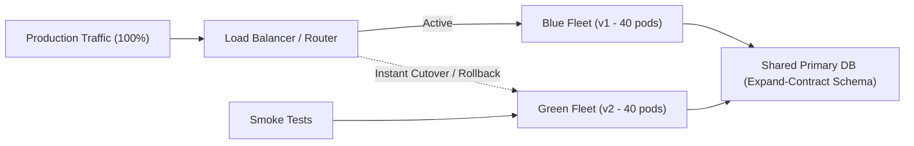
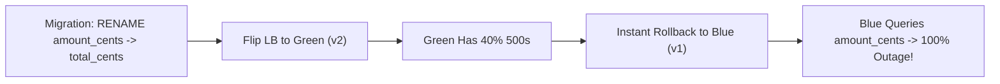

# Blue-Green Deployments: Instant Cutover, Instant Rollback, Safe DB

> **Prerequisites:** [Lesson 15: Rolling Deployments](../15-rolling-deployments/README.md).  
> **Estimated Reading Time:** 23–27 minutes  
> **Target Audience:** Backend and platform engineers designing instant-rollback release architectures and zero-downtime database migrations.  
> **Free PDF Notes:** [Download P5-SD-N-016.pdf](https://backendroadmap.com/notes/system-design/P5-SD-N-016.pdf)

> [!NOTE]
> **In one line:** Blue-Green deployment maintains **two identical production environments** (`Blue = v1`, `Green = v2`), warms and smoke-tests `Green` completely offline, **flips traffic at the router/LB in under a second**, and keeps `Blue` warm for **instant rollback**—while requiring **expand-and-contract** database migrations so `Blue` remains compatible if you roll back.

> [!TIP]
> **The Golden Rule:** Traffic cutover is instant, but **the database is shared**. Never run a destructive schema migration (`DROP COLUMN`, `RENAME`) before `Blue` is decommissioned; always use **Expand-and-Contract** so both `Blue` and `Green` work against the same database.

---

## 1. What Blue-Green Deployment Is, and What It Isn't

In a rolling deployment, `v1` and `v2` serve production traffic simultaneously for several minutes, and rolling back takes another several minutes. In **Blue-Green**, `Blue` (`v1`) serves 100% of production traffic while you stand up a full-capacity `Green` (`v2`) fleet alongside it. You run smoke tests against `Green` via an internal/preview URL, flip the load balancer target group from `Blue` to `Green` atomically, and keep `Blue` idle-but-warm for 15–60 minutes. If `Green` misbehaves, flipping back to `Blue` takes 1–5 seconds.

| Term | Precise Meaning | Example |
| :--- | :--- | :--- |
| **Blue Environment** | Currently live production fleet (`v1`) | 40 pods behind `prod-lb` |
| **Green Environment** | Newly provisioned, warmed candidate fleet (`v2`) | 40 pods tested via `green-preview.internal` |
| **Atomic Cutover** | Switching LB/Service selector or target group from Blue to Green | ALB listener rule or K8s Service `selector: version=green` |
| **Warm Standby Rollback** | Keeping Blue running after cutover for instant revert | Revert LB back to Blue in < 5 s |
| **Expand-and-Contract** | Multi-phase backward-compatible DB migration pattern | Add column -> dual-write -> backfill -> switch -> drop later |
| **Not** | Having two separate production databases | Syncing two live DBs causes split-brain and data loss |

### Why It Matters
1. Eliminates in-flight **version skew** between `v1` and `v2` application nodes—users hit 100% `Blue` or 100% `Green`.
2. Reduces **MTTR** for bad releases from minutes (rolling undo) to **seconds** (LB flip).
3. Forces clean **database migration discipline** (expand-and-contract), which prevents the #1 cause of failed rollbacks.

---

## 2. Anatomy: Load Balancer Cutover & Shared Database



Because `Blue` and `Green` share the same database, any write committed by `Green` after cutover must still be readable if you roll back to `Blue` 10 minutes later.

| Dimension | Rolling Update | Blue-Green | Canary |
| :--- | :--- | :--- | :--- |
| **Peak Compute Cost** | $1.0\text{x} + \text{maxSurge}$ (e.g., 1.25x) | **2.0x** during deploy & standby | $1.0\text{x} + \text{canary}$ (e.g., 1.05x) |
| **Cutover Speed** | Minutes (batched) | **Instant (< 5 s)** | Gradual (1% -> 10% -> 50% -> 100%) |
| **Rollback Speed** | Minutes (reverse rollout) | **Instant (< 5 s)** | **Instant (< 5 s)** |
| **Blast Radius on Bug** | Partial -> 100% | **100% immediately** | **1%–5% initially** |
| **Version Skew** | Yes (`v1` + `v2` live) | No (only 1 active at a time) | Yes (`v1` + `v2` live) |

> [!WARNING]
> **The 100% Blast Radius Trap:** Blue-Green gives you an instant rollback, **not** a small blast radius. When you flip 100% of traffic to `Green`, every user hits `v2` at once. A cold cache or hidden load bug affects 100% of users until you flip back. Always pre-warm `Green` caches or combine Blue-Green with Canary traffic shifting.

---

## 3. Mathematical Model: Compute Cost, Cold-Cache Stampede & Rollback MTTR

**1. Compute Cost Overhead.**  
If a fleet runs $N$ instances at hourly cost $c$, and `Green` runs for $T_{\text{deploy}} + T_{\text{standby}}$ hours per deploy across $D$ deploys per day:

$$\text{Extra Daily Cost} = D \cdot N \cdot c \cdot (T_{\text{deploy}} + T_{\text{standby}})$$

**Worked Numerical Example:**  
Suppose $N = 100$ instances at $c = \$0.20/\text{hr}$ (\$20/hr fleet), $D = 4$ deploys/day, $T_{\text{deploy}} = 0.25\text{ hr}$ (15 min), and $T_{\text{standby}} = 0.50\text{ hr}$ (30 min warm rollback window):

$$\text{Extra Daily Cost} = 4 \times 100 \times \$0.20 \times 0.75 = \$60/\text{day} \approx \$1{,}800/\text{month}$$

Compare that to a 24/7 fleet cost of $\$20 \times 24 \times 30 = \$14{,}400/\text{month}$: Blue-Green adds only **12.5%** to the monthly bill if `Blue` is torn down after 30 minutes (rather than kept idle 24/7, which would add 100%).

**2. Cold-Cache Stampede Risk at Cutover.**  
If `Green` uses an in-memory L1 cache with $0\%$ hit rate at $t = 0$ and cutover shifts $\lambda = 10{,}000\text{ RPS}$ instantly, a 90% normal cache hit rate suddenly becomes a **10x database read spike** ($1{,}000\text{ QPS} \rightarrow 10{,}000\text{ QPS}$) at the exact second of cutover. Always pre-warm L1 caches on `Green` (or shadow-read) before flipping traffic.

---

## 4. Metrics & Percentiles

| Metric | Meaning | Alert when |
| :--- | :--- | :--- |
| **Cutover error delta** | `err_rate(Green) - err_rate(Blue)` post-flip | > 0.1% for 30 s $\rightarrow$ auto-revert to Blue |
| **Cutover $p_{99}$ spike** | Latency jump immediately after LB switch | > 2x baseline (often cold JIT/cache/pools) |
| **DNS vs LB cutover lag** | % of clients still hitting Blue after flip | > 1% after 60 s (never use DNS for cutover!) |
| **DB connection spike** | Total connections from Blue + Green combined | > 80% of `max_connections` |
| **Warm standby duration** | Time Blue stays alive post-cutover | > 2 hours (wasting 2x compute) |

### Worked Example (Expand-and-Contract DB Migration)
You need to rename column `user.name` to `user.full_name` with Blue-Green:
1. **Expand:** Add nullable `full_name` column (takes 10 ms metadata lock in Postgres). `Blue` still reads/writes `name`.
2. **Deploy Green (Dual-Write):** `Green` writes *both* `name` and `full_name`, reads `full_name ?? name`. Flip LB to `Green`.
3. **Rollback check:** If `Green` crashes 10 min later, flip LB back to `Blue`—`name` is still populated, zero data loss!
4. **Backfill & Contract (days later):** Backfill old rows in batches, deploy `v3` reading only `full_name`, then drop `name`.

---

## 5. Compounding & Failure Modes

| Failure Mode | Mechanism | Outcome |
| :--- | :--- | :--- |
| **DNS-based cutover** | Clients/ISPs cache DNS TTL for hours | Traffic splits unpredictably; rollback fails |
| **2x DB connections** | Blue (40 pods) + Green (40 pods) connect at once | DB hits `max_connections` before cutover |
| **Cold JVM / L1 cache** | Green has empty connection pools & cold JIT | $p_{99}$ spikes 10x at instant 100% cutover |
| **Destructive DB migration** | `Green` migration drops column `Blue` needs | Instant rollback to `Blue` crashes with 500s |
| **Async workers left on Blue** | Blue keeps polling Kafka/SQS while idle | Old code processes new events after cutover |

---

## 6. Numbers Every Engineer Must Know

| Item | Typical | Implication |
| :--- | :---: | :--- |
| LB target group switch time | 1–5 seconds | Use LB/Service routing, never DNS |
| DNS TTL propagation tail | 5–60+ minutes | Rogue clients ignore short TTLs |
| Warm standby retention | 15–60 minutes | Covers immediate regressions without 100% 24/7 cost |
| DB pool multiplier | 2x during overlap | Size PgBouncer / `max_connections` for Blue + Green |
| Expand-contract contract delay | 24–72 hours | Only drop old columns after rollback window closes |

---

## 7. Protocol / Mechanism Deep Dive: LB Cutover & Expand-Contract Flow

```mermaid
sequenceDiagram
    participant CI as CD Controller
    participant LB as Load Balancer
    participant B as Blue (v1)
    participant G as Green (v2)
    participant DB as Shared DB
    CI->>DB: 1. Expand schema (add nullable col)
    CI->>G: 2. Deploy Green + warm caches/pools
    CI->>G: 3. Run smoke tests on preview URL
    CI->>LB: 4. Switch active target group Blue -> Green
    Note over LB,G: 100% traffic on Green (< 5s); Blue stays warm
    G->>DB: Dual-write old & new columns
    alt Regression detected
        CI->>LB: 5a. Instant rollback Green -> Blue (< 5s)
    else Healthy after 30 min
        CI->>B: 5b. Scale down Blue to 0
    end
```

| Question | Answer |
| :--- | :--- |
| **Why use a Load Balancer / K8s Service instead of Route53 DNS?** | DNS caching by browsers, OS resolvers, and ISPs ignores 5 s TTLs, making cutover gradual and rollback impossible to control. |
| **What happens to in-flight requests on Blue during cutover?** | The LB stops sending *new* requests to Blue, while Blue finishes draining existing in-flight requests (connection draining). |
| **What about background queue consumers (Kafka/SQS)?** | Stop Blue's consumers *before* or *at* cutover so `v1` doesn't race with `v2` on the same queue. |

**When not to use Blue-Green:** When you cannot afford **2x compute + 2x DB connections** during deploy (huge stateful/ML fleets), or when you want to limit blast radius to 1% of users before 100% cutover (use **Canary**, Lesson 17).

---

## 8. Hierarchical Budgets & Design Rules

| Slice | Rule | Control |
| :--- | :--- | :--- |
| **Routing** | Cut over at L4/L7 LB or Service selector, never DNS | ALB / Envoy / Argo Rollouts |
| **DB Migrations** | Strictly Expand-and-Contract; zero destructive DDL in-flight | Migration linter blocks `DROP`/`RENAME` |
| **Warmup** | Pre-warm HTTP pools, JIT, and L1 caches before flip | `/ready` + synthetic warmup script |
| **DB Connections** | `Blue + Green` pools fit inside `max_connections` | PgBouncer + 2x pool headroom |
| **Workers** | Pause Blue queue consumers at cutover | Leader election / consumer toggle |
| **Cost Cap** | Auto-teardown Blue after 30–60 min healthy | Automated CD cleanup job |

---

## 9. Top Mitigations

1. **Always cut over at the Load Balancer / Service Mesh**, never via DNS records.
2. **Enforce Expand-and-Contract** for every schema and message-format change so `Blue` remains 100% functional on rollback.
3. **Pre-warm `Green`** with synthetic read traffic and connection pool initialization before flipping production load.
4. **Account for 2x DB connections** (or use PgBouncer) while `Blue` and `Green` overlap.
5. **Drain `Blue` queue consumers cleanly** at cutover so old code doesn't process new events.
6. **Automate `Blue` teardown** after a 30–60 minute bake window to avoid paying 2x compute permanently.
7. **Watch `err_rate` and `p99` for 5 minutes post-flip** with an automated 1-click/auto-revert trigger.

---

## 10. Production Reference: The "Irreversible Migration" Rollback Failure

A SaaS billing service used Blue-Green deployments. For `v2`, an engineer included a migration `ALTER TABLE invoices RENAME COLUMN amount_cents TO total_cents`. After flipping to `Green`, a bug in `Green`'s PDF generator caused 40% 500 errors. The on-call engineer hit "Rollback to Blue" in 10 seconds—and **Blue immediately threw 100% 500 errors** because `amount_cents` no longer existed.



- **Root Cause:** Destructive `RENAME COLUMN` broke backward compatibility with `Blue`, destroying Blue-Green's instant-rollback guarantee.
- **Fix:** Added a CI migration linter banning `DROP`/`RENAME` in application PRs, and adopted the 4-step Expand-and-Contract workflow.

---

## 11. Multi-Language Production Code Tabs

An **Expand-and-Contract Dual-Write Repository + Blue-Green Traffic Switch** demonstrating safe rollback compatibility.

````carousel
```go
// Go: Blue-Green traffic router + Expand-Contract dual-write model.
package main

import (
	"fmt"
	"sync/atomic"
)

type Env string

const (
	Blue  Env = "blue-v1"
	Green Env = "green-v2"
)

type Router struct{ active atomic.Value }

func NewRouter(initial Env) *Router {
	r := &Router{}
	r.active.Store(initial)
	return r
}

func (r *Router) Cutover(target Env) { r.active.Store(target) }
func (r *Router) Active() Env        { return r.active.Load().(Env) }

// Expand-Contract: Green writes both old and new columns so Blue rollback stays safe.
type InvoiceRow struct {
	AmountCents int64  // legacy column (Blue reads this)
	TotalCents  *int64 // expanded column (Green reads TotalCents ?? AmountCents)
}

func WriteGreen(total int64) InvoiceRow {
	return InvoiceRow{AmountCents: total, TotalCents: &total}
}

func main() {
	router := NewRouter(Blue)
	fmt.Println("Active:", router.Active())
	router.Cutover(Green)
	fmt.Println("Cutover ->", router.Active(), "Row:", WriteGreen(4999))
	router.Cutover(Blue) // instant rollback
	fmt.Println("Rolled back ->", router.Active())
}
```
<!-- slide -->
```typescript
// TypeScript: Blue-Green router & Expand-Contract tolerant reader/writer.
type Environment = "blue" | "green";

export class BlueGreenRouter {
  constructor(private active: Environment = "blue") {}

  cutover(target: Environment): void {
    this.active = target;
  }

  route(): Environment {
    return this.active;
  }
}

interface InvoiceRecord {
  amount_cents?: number; // legacy
  total_cents?: number;  // expanded
}

export function readTotalCents(row: InvoiceRecord): number {
  return row.total_cents ?? row.amount_cents ?? 0;
}

export function writeGreenDual(total: number): InvoiceRecord {
  return { amount_cents: total, total_cents: total };
}
```
<!-- slide -->
```python
# Python: Blue-Green cost calculator + Expand-Contract dual-write helper.
def blue_green_monthly_overhead(instances: int, hourly_cost: float, deploys_per_day: int,
                                deploy_min: int = 15, standby_min: int = 30) -> dict:
    extra_hours_per_deploy = (deploy_min + standby_min) / 60.0
    extra_daily = deploys_per_day * instances * hourly_cost * extra_hours_per_deploy
    base_monthly = instances * hourly_cost * 24 * 30
    extra_monthly = extra_daily * 30
    return {
        "base_monthly_usd": round(base_monthly, 2),
        "extra_monthly_usd": round(extra_monthly, 2),
        "overhead_pct": round((extra_monthly / base_monthly) * 100, 2),
    }


def write_invoice_green(total_cents: int) -> dict:
    # Dual-write keeps Blue (v1) working if instant rollback occurs
    return {"amount_cents": total_cents, "total_cents": total_cents}


if __name__ == "__main__":
    print(blue_green_monthly_overhead(100, 0.20, 4))
    print(write_invoice_green(4999))
```
<!-- slide -->
```csharp
// C#: Blue-Green atomic switch + Expand-Contract dual-write record.
using System;

public sealed record InvoiceRow(long? AmountCents, long? TotalCents)
{
    public long ReadTotal() => TotalCents ?? AmountCents ?? 0;
    public static InvoiceRow WriteGreen(long total) => new(total, total);
}

public sealed class BlueGreenSwitch
{
    private volatile string _active = "blue";
    public string Active => _active;
    public void Cutover(string target) => _active = target;

    public static void Main()
    {
        var sw = new BlueGreenSwitch();
        sw.Cutover("green");
        Console.WriteLine($"Active={sw.Active}, Row={InvoiceRow.WriteGreen(4999)}");
        sw.Cutover("blue"); // instant rollback
        Console.WriteLine($"RolledBack={sw.Active}");
    }
}
```
````

---

## 12. Hands-On CLI Verification Workflows

```bash
# 1. Compute Blue-Green monthly cost overhead in Python
python3 -c "
inst, cost, deploys, mins = 100, 0.20, 4, 45
extra = deploys * inst * cost * (mins / 60) * 30
base = inst * cost * 24 * 30
print(f'Base=${base:.0f}/mo, Extra=${extra:.0f}/mo ({extra/base:.1%})')
"

# 2. Atomic Kubernetes Service cutover from Blue to Green
kubectl patch service checkout-api -p '{"spec":{"selector":{"version":"green"}}}'

# 3. Instant rollback back to Blue (< 2 seconds)
kubectl patch service checkout-api -p '{"spec":{"selector":{"version":"blue"}}}'

# 4. AWS ALB target group atomic weight flip
aws elbv2 modify-listener --listener-arn "$LISTENER_ARN" \
  --default-actions Type=forward,TargetGroupArn="$GREEN_TG_ARN"
```

---

## 13. Common Mistakes to Avoid

1. **Using DNS for Blue-Green cutover**, leaving stale clients on `Blue` or failing to roll back.
2. **Running destructive DB migrations** (`DROP`/`RENAME`) before `Blue` is retired.
3. **Forgetting to pre-warm `Green`**, causing cold-cache DB stampedes at 100% cutover.
4. **Not sizing DB `max_connections` for 2x pods** during the `Blue` + `Green` overlap.
5. **Leaving `Blue` background workers polling queues** after `Green` goes live.
6. **Keeping `Blue` running 24/7** instead of tearing it down after a 30–60 min standby window.
7. **Skipping smoke tests on `Green`'s preview endpoint** before flipping traffic.

---

## 14. Key Terms Glossary

| Key Term | Definition |
| :--- | :--- |
| **Blue / Green** | Live production (`v1`) and staged candidate (`v2`) fleets. |
| **Atomic Cutover** | Instant LB/Service switch sending 100% traffic to Green. |
| **Instant Rollback** | Flipping LB back to warm Blue in < 5 seconds. |
| **Warm Standby** | Keeping Blue running briefly post-cutover for fast revert. |
| **Expand-and-Contract** | Multi-step backward-compatible DB schema evolution. |
| **Dual-Write** | Writing both old and new columns during transition. |
| **Cold-Cache Stampede** | DB spike when an unwarmed Green fleet takes 100% load. |
| **Preview Endpoint** | Internal URL routing smoke tests exclusively to Green. |
| **Connection Draining** | Letting Blue finish in-flight requests after LB cutover. |
| **Blast Radius** | Fraction of users impacted by a bad release (100% in Blue-Green). |

---

## 15. System Design Interview Questions & Answers

### Basic Conceptual Questions

<details>
<summary><strong>Q1: How does Blue-Green deployment differ from a Rolling deployment? [BASIC]</strong></summary>

**Answer:**
Rolling replaces `v1` with `v2` gradually in-place, so both versions serve prod traffic simultaneously and rollback takes minutes. Blue-Green spins up a full `Green` (`v2`) fleet offline, tests it, flips 100% of traffic atomically at the LB, and keeps `Blue` (`v1`) warm for an instant (< 5 s) rollback.
</details>

<details>
<summary><strong>Q2: Why should you never use DNS to perform a Blue-Green cutover? [BASIC]</strong></summary>

**Answer:**
DNS resolvers, OS caches, and browsers often ignore short TTLs, causing traffic to split unpredictably between Blue and Green for minutes or hours and making instant rollback impossible. Always switch at a Load Balancer, API Gateway, or Service Mesh.
</details>

<details>
<summary><strong>Q3: What is the biggest drawback of Blue-Green deployment? [BASIC]</strong></summary>

**Answer:**
Twofold: (1) it requires up to 2x compute and DB connection capacity during deploy and warm standby, and (2) cutover sends 100% of traffic to `Green` at once, giving a 100% initial blast radius if a bug wasn't caught in smoke tests.
</details>

<details>
<summary><strong>Q4: Why do Blue and Green share one database instead of having two databases? [BASIC]</strong></summary>

**Answer:**
If Green had its own separate database, any orders or writes occurring after cutover would be lost or split-brained if you rolled back to Blue. Sharing one primary DB with Expand-and-Contract migrations keeps data consistent across rollbacks.
</details>

### Scenario-Based Architecture Questions

<details>
<summary><strong>Q5: How do you safely rename or drop a database column in a Blue-Green architecture? [SCENARIO]</strong></summary>

**Answer:**
Use **Expand-and-Contract**: (1) Add the new nullable column (`Expand`). (2) Deploy Green to dual-write both columns and read new-then-old. (3) Cut over to Green; rollback to Blue is 100% safe because the old column is still written. (4) Days later, backfill, deploy `v3` reading only the new column, and drop the old column (`Contract`).
</details>

<details>
<summary><strong>Q6: Right after flipping to Green, DB CPU spikes to 95% and latency jumps 8x, even though Green passed smoke tests. Why? [SCENARIO]</strong></summary>

**Answer:**
Cold L1 caches, cold JIT compilation, and uninitialized DB connection pools on Green! Smoke tests only hit a few endpoints. Fix by replaying a shadow read stream or running a cache-warmup script against Green before flipping production traffic.
</details>

<details>
<summary><strong>Q7: Your service has Kafka consumers and an HTTP API. How do you Blue-Green deploy it? [SCENARIO]</strong></summary>

**Answer:**
Deploy Green's HTTP pods and warm them, but keep Green's Kafka consumers paused (or in a separate consumer-group standby). At cutover, flip HTTP LB to Green, pause/drain Blue's Kafka consumers, and start Green's consumers—preventing `v1` and `v2` from racing on offsets.
</details>

<details>
<summary><strong>Q8: How do you control the 2x cost of Blue-Green for a 200-node service? [SCENARIO]</strong></summary>

**Answer:**
Only spin up Green right before deploy and automatically tear down Blue after a 30-minute healthy bake window (adds ~12% monthly cost for 4 deploys/day, not 100%). Alternatively, use Canary deployments (Lesson 17) where only 5% extra capacity is needed.
</details>

### Advanced & Tricky Interview Questions

<details>
<summary><strong>Q9: How do you combine Blue-Green and Canary to get the best of both worlds? [TRICKY]</strong></summary>

**Answer:**
Provision Green at 100% (or scaled-up) capacity, but instead of flipping 0% -> 100% at the LB, shift weighted target groups: 1% -> 10% -> 50% -> 100% over 15 minutes while comparing error/latency metrics. You get small blast radius *and* instant rollback.
</details>

<details>
<summary><strong>Q10: What happens if a `v2` bug corrupts data written to the shared DB before you roll back to Blue? [TRICKY]</strong></summary>

**Answer:**
An instant LB rollback stops *new* bad writes, but does not undo bad rows already written to the DB. Mitigate with schema/check constraints, shadow/canary validation, idempotent event logs, or point-in-time recovery + compensating scripts.
</details>

<details>
<summary><strong>Q11: Why can `ALTER TABLE ADD COLUMN` still cause an outage during Blue-Green? [TRICKY]</strong></summary>

**Answer:**
In older MySQL or careless Postgres DDL (e.g., `ADD COLUMN ... DEFAULT` in older versions, or `ACCESS EXCLUSIVE` lock waiting behind a long-running analytics query), the `ALTER` queues all subsequent reads and writes behind it. Always set `lock_timeout = '2s'` and run migrations outside heavy query locks.
</details>

<details>
<summary><strong>Q12: How do long-lived WebSocket connections behave during a Blue-Green cutover? [TRICKY]</strong></summary>

**Answer:**
Existing WebSockets stay connected to Blue until closed or drained. If you keep Blue alive for 30 minutes and then kill it, all remaining WebSockets disconnect simultaneously (thundering herd). Use jittered graceful reconnect signals (`close 1012 Service Restart`) spread over 2–5 minutes.
</details>

---

## 16. One-Page Master Cheat Sheet

```
+---------------------------------------------------------------------------------------------------------+
|                       BLUE-GREEN DEPLOYMENTS — MASTER CHEAT SHEET                                       |
+---------------------------------------------------------------------------------------------------------+
| 1. MECHANISM: Blue (v1) serves 100% -> Stand up & smoke-test Green (v2) -> Atomic LB flip (<5s).        |
+---------------------------------------------------------------------------------------------------------+
| 2. ROLLBACK: Keep Blue warm 15-60 min. Flip LB back in <5s. Auto-teardown Blue after bake to save $$$.  |
+---------------------------------------------------------------------------------------------------------+
| 3. NEVER USE DNS: Client/ISP DNS caching breaks cutover & rollback. Switch at LB / Gateway / Mesh.      |
+---------------------------------------------------------------------------------------------------------+
| 4. SAFE DB: Shared DB requires Expand-and-Contract (Add col -> Dual-write -> Switch -> Drop days later).|
+---------------------------------------------------------------------------------------------------------+
| 5. WATCH OUT FOR: Cold-cache DB stampede at 100% flip, 2x DB connections, and 100% initial blast radius.|
+---------------------------------------------------------------------------------------------------------+
| 6. BEST COMBO: Blue-Green + weighted LB canary (1% -> 10% -> 100%) = small blast radius + fast revert.  |
+---------------------------------------------------------------------------------------------------------+
```

---

## Further Reading & Sources

- Martin Fowler, *BlueGreenDeployment* ([martinfowler.com](https://martinfowler.com/bliki/BlueGreenDeployment.html)).
- Pramod Sadalage & Scott Ambler, *Refactoring Databases* (Expand-and-Contract / Evolutionary Database Design).
- AWS Whitepaper, *Blue/Green Deployments on AWS* ([docs.aws.amazon.com](https://docs.aws.amazon.com/)).

---

## Free PDF Notes

[P5-SD-N-016.pdf](https://backendroadmap.com/notes/system-design/P5-SD-N-016.pdf)

---

## Next

Continue with [Lesson 17: Canary Deployments: Ship to 1% First, Roll Back Automatically](../17-canary-deployments/README.md).