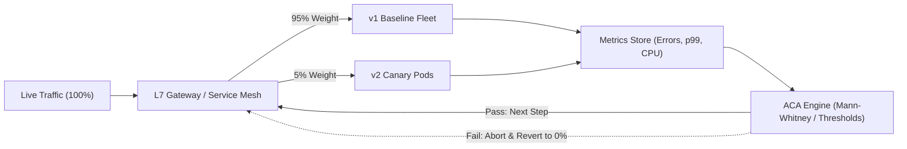
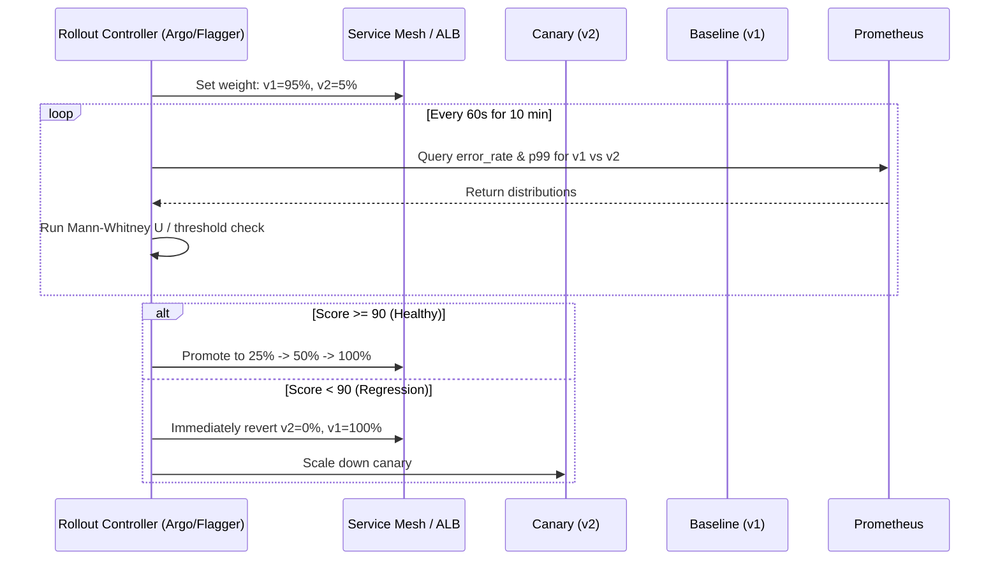
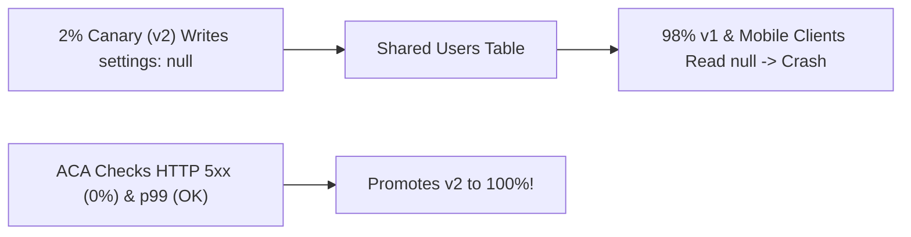

# Canary Deployments: Ship to 1% First, Roll Back Automatically

> **Prerequisites:** [Lesson 16: Blue-Green Deployments](../16-blue-green-deployments/README.md).  
> **Estimated Reading Time:** 24–28 minutes  
> **Target Audience:** Backend and SRE engineers building progressive delivery pipelines, automated canary analysis (ACA), and low-blast-radius releases.  
> **Free PDF Notes:** [Download P5-SD-N-017.pdf](https://backendroadmap.com/notes/system-design/P5-SD-N-017.pdf)

> [!NOTE]
> **In one line:** A canary deployment routes a **tiny slice of live traffic (1%–5%)** to `v2`, compares its golden signals (errors, $p_{99}$ latency, saturation) against a `v1` baseline using **Automated Canary Analysis (ACA)**, and either **promotes progressively** (1% $\rightarrow$ 5% $\rightarrow$ 25% $\rightarrow$ 100%) or **rolls back automatically**.

> [!TIP]
> **The Golden Rule:** A canary is only useful if it gets **statistically significant traffic** *and* you compare `v2` against a **concurrent `v1` baseline** (not yesterday's metrics, which ignore current traffic shifts).

---

## 1. What a Canary Deployment Is, and What It Isn't

Staging never has production's data skew, traffic patterns, or third-party latency. Instead of flipping 100% of users to `v2` (Blue-Green) or rolling out blindly (Rolling), a canary deployment puts a small `v2` cohort alongside `v1` and shifts 1% of traffic to it. If `v2` leaks memory, throws 500s on a rare payload, or spikes $p_{99}$ latency, 99% of users never notice and the controller reverts traffic to 0% in seconds.

| Term | Precise Meaning | Example |
| :--- | :--- | :--- |
| **Canary Cohort** | Small `v2` deployment receiving initial live traffic | 1–2 `v2` pods at 1%–5% weight |
| **Baseline Cohort** | Concurrent `v1` pods used as the control group | Ideally same size as canary for fair comparison |
| **Traffic Shifting** | Weighted routing at L7 LB / Service Mesh (Envoy, Istio, ALB) | 1% $\rightarrow$ 5% $\rightarrow$ 25% $\rightarrow$ 50% $\rightarrow$ 100% |
| **Automated Canary Analysis (ACA)** | Statistical engine comparing canary vs baseline metrics | Kayenta / Argo Rollouts / Flagger |
| **Blast Radius** | Fraction of users/requests exposed to a faulty release | Capped at 1%–5% during initial bake |
| **Not** | Testing in production without alerts or automated rollback | That's just shipping bugs to 1% of users forever |

### Why It Matters
1. **Limits blast radius** by 20x–100x compared to instant 100% cutovers.
2. Catches **slow-burn bugs** (memory leaks, connection leaks, subtle $p_{99}$ regressions) that 15-second readiness probes miss.
3. Enables **true Continuous Deployment** with confidence because bad releases self-heal automatically.

---

## 2. Anatomy: Progressive Traffic Shifting & ACA Loop



A dedicated **Control/Baseline** pod (deployed fresh alongside the canary, at the same pod age) prevents "JVM/cache warmup bias" from making `v2` look falsely slower than long-running `v1` pods.

| Stage | Traffic % | Typical Bake Time | What It Catches |
| :--- | :---: | :---: | :--- |
| **Stage 1 (Smoke)** | 1% | 5–10 min | Crashes, config errors, 5xx spikes |
| **Stage 2 (Early)** | 5% | 10–15 min | $p_{99}$ regressions, DB query issues |
| **Stage 3 (Scale)** | 25% | 15–20 min | Connection pool pressure, memory leaks |
| **Stage 4 (Majority)** | 50% | 10–15 min | Downstream rate limits, cache pressure |
| **Stage 5 (Full)** | 100% | — | Complete rollout; retire `v1` |

> [!WARNING]
> **The Low-Traffic Canary Trap:** If your service only receives 10 RPS, a 1% canary gets **0.1 RPS** (6 requests/minute). In a 10-minute bake, that's only 60 requests—far too few to detect a 2% error regression! At low RPS, either use **5%–10% canary**, extend the bake window, or route **internal/synthetic shadow traffic** first.

---

## 3. Mathematical Model: Sample Size, Confidence & Blast Radius

**1. Minimum Requests Needed to Detect an Error Regression.**  
To distinguish a baseline error rate $p_1$ from a degraded canary error rate $p_2$ with 95% confidence ($Z_{\alpha/2} = 1.96$) and 80% statistical power ($Z_{\beta} = 0.84$), the required sample size $n$ in the canary cohort is approximately:

$$n \approx \frac{(Z_{\alpha/2} + Z_{\beta})^2 \cdot \big(p_1(1-p_1) + p_2(1-p_2)\big)}{(p_2 - p_1)^2} \approx \frac{7.84 \cdot (p_1 + p_2)}{(p_2 - p_1)^2}$$

**Worked Numerical Example:**  
Suppose baseline error rate is $p_1 = 0.005$ (0.5%) and you want to catch a jump to $p_2 = 0.020$ (2.0%):

$$n \approx \frac{7.84 \times (0.005 + 0.020)}{(0.020 - 0.005)^2} = \frac{7.84 \times 0.025}{0.000225} = \frac{0.196}{0.000225} \approx 871\text{ requests}$$

- At **1,000 RPS** and **1% canary** (10 RPS): 871 requests arrive in **87 seconds** ($\sim 1.5$ min). Fast and reliable!
- At **20 RPS** and **1% canary** (0.2 RPS): 871 requests take **4,355 seconds** (**72 minutes**!). You must raise the initial canary weight to 5%–10% or use synthetic load.

**2. Blast Radius Reduction.**  
If a faulty release runs for 5 minutes before rollback:
- **100% deploy:** $1{,}000\text{ RPS} \times 300\text{ s} = 300{,}000$ impacted requests.
- **1% canary:** $10\text{ RPS} \times 300\text{ s} = 3{,}000$ impacted requests (**99% reduction**).

---

## 4. Metrics & Percentiles

| Metric | Comparison Method | Abort Condition |
| :--- | :--- | :--- |
| **HTTP 5xx / gRPC Error Rate** | Canary vs Baseline ratio | Canary > $2\times$ baseline OR > 1% absolute |
| **Latency $p_{95}$ / $p_{99}$** | Mann-Whitney U test (non-parametric) | Canary $p_{99}$ > $1.25\times$ baseline for 2 intervals |
| **Memory RSS / Heap** | Slope over bake window | Monotonic upward slope > 5%/10 min (leak!) |
| **CPU per request** | `(cpu_canary / rps_canary)` vs baseline | > 20% regression (inefficient code) |
| **Business KPI** | Checkout conversion / payment auth rate | > 1% drop vs baseline |

### Worked Example (Why Percentile Averages Lie)
A canary receives 5% traffic. Average latency is 42 ms (`v1` is 40 ms)—looks fine! However, `v2` introduced an unindexed DB query on 2% of requests (enterprise accounts).  
- `v1` $p_{99}$ = 110 ms; `v2` $p_{99}$ = **1,850 ms** (16.8x worse!).  
- ACA checks **$p_{99}$** (not mean) and automatically aborts at Stage 1, protecting 95% of users.

---

## 5. Compounding & Failure Modes

| Failure Mode | Mechanism | Outcome |
| :--- | :--- | :--- |
| **Comparing against yesterday** | Today's traffic has different payload mix | False rollbacks at peak or missed bugs at trough |
| **Stateful/sticky user flips** | User hits `v2` on request 1, `v1` on request 2 | Broken UI/session if `v1` & `v2` aren't compatible |
| **Canary poisons shared DB/cache** | 1% canary writes corrupt records to shared DB | 99% `v1` users hit corrupted data! |
| **Single-pod minimum > 1%** | Fleet has 10 pods; 1 canary pod = ~9% traffic | Use L7 weighted routing (Envoy), not pod-count ratio |
| **Alert fatigue / manual gates** | Every canary pauses for human approval | Pipeline backs up; engineers rubber-stamp |

---

## 6. Numbers Every Engineer Must Know

| Item | Typical | Implication |
| :--- | :---: | :--- |
| Initial canary weight | 1%–5% | Small blast radius; 5% needed for lower-RPS services |
| Minimum sample size | ~500–1,000 requests/stage | Needed for statistical significance on 1%–2% deltas |
| Total canary rollout time | 30–60 minutes | Slower than Blue-Green; don't bypass during SEV-1 hotfix |
| Rollback trigger time | 30–120 seconds | Automated Prometheus/Datadog query interval |
| Pod-count vs L7 mesh | Pod-count min = $1/(N+1)$ | 20 pods = ~4.8% min without L7 traffic splitting |

---

## 7. Protocol / Mechanism Deep Dive: Automated Canary Analysis (ACA)



| Question | Answer |
| :--- | :--- |
| **Why use Mann-Whitney U instead of a t-test for latency?** | Latency distributions are heavily right-skewed (not Gaussian). Mann-Whitney U is non-parametric and compares rank distributions accurately without assuming normality. |
| **How do you route 1% if you only have 5 pods?** | Use an L7 proxy (Envoy/Istio/Nginx/ALB weighted target groups) to split requests 99:1 regardless of pod count. |
| **Should a user stay on `v2` across requests during a canary?** | For frontend/session flows, yes (consistent hashing on `user_id` or canary cookie). For stateless APIs, random per-request routing gives cleaner A/B samples. |

**When not to use Canary Deployments:** During an **emergency SEV-1 security/outage hotfix** (where a 45-minute canary bake prolongs the outage—use fast Blue-Green or Rolling), or for **tiny internal batch jobs** with 10 runs/day (no statistical sample).

---

## 8. Hierarchical Budgets & Design Rules

| Slice | Rule | Control |
| :--- | :--- | :--- |
| **Traffic Split** | L7 weighted routing (1% $\rightarrow$ 5% $\rightarrow$ 25% $\rightarrow$ 100%) | Istio / Envoy / ALB weights |
| **Baseline** | Compare `v2` against *concurrent* `v1` (not historical) | Label metrics `version=canary` vs `baseline` |
| **Sample Floor** | Require $\ge 500$ requests per stage before promoting | ACA minimum sample check |
| **Auto-Abort** | Revert to 0% automatically on 2 consecutive failed intervals | Argo Rollouts `AnalysisTemplate` |
| **Hotfix Bypass** | Maintain a documented emergency fast-path | `--skip-canary` with incident ticket |
| **Data Safety** | Canary must be backward-compatible with `v1` | Expand-and-contract + schema checks |

---

## 9. Top Mitigations

1. **Always compare canary against a concurrent `v1` baseline**, never against yesterday's metrics.
2. **Use L7 weighted routing** so 1% traffic works even on small 5–10 pod fleets.
3. **Gate promotion on tail latency ($p_{99}$), error rate, and saturation**, not averages.
4. **Enforce a minimum sample size** before ACA can declare a stage healthy.
5. **Isolate or tag canary writes** (or ensure backward compatibility) so a buggy 1% canary doesn't poison shared state for 99% `v1` users.
6. **Automate rollback**—if a human has to wake up at 3 AM to click abort, it's not Automated Canary Analysis.
7. **Provide an emergency hotfix fast-path** so engineers aren't blocked waiting 45 minutes during a SEV-1.

---

## 10. Production Reference: The "Silent 1% Poisoning" Incident

A social platform rolled out a `v2` profile service to a 2% canary. HTTP status codes were 200 OK and $p_{99}$ latency looked identical to `v1`—so ACA promoted `v2` to 100% after 30 minutes. Ten minutes later, mobile apps crashed globally: `v2` had a serialization bug that wrote `settings: null` instead of `{}` into the shared `users` table whenever a user updated their bio.



- **Root Cause:** ACA only checked HTTP 5xx and latency, not downstream client crash telemetry or schema validation; and `v2` wrote invalid data to the shared DB.
- **Fix:** Added JSON schema validation on DB writes, included mobile crash-free session rate and domain-level validation errors in the ACA scorecard, and gated schema-writing changes behind feature flags.

---

## 11. Multi-Language Production Code Tabs

An **Automated Canary Analysis (ACA) Evaluator & Sample Size Calculator**.

````carousel
```go
// Go: Automated Canary Analysis (ACA) evaluator + deterministic user bucketing.
package main

import (
	"fmt"
	"hash/fnv"
)

type Metrics struct {
	Requests  int
	Errors    int
	P99Ms     float64
}

func EvaluateCanary(baseline, canary Metrics) (promote bool, reason string) {
	if canary.Requests < 500 {
		return false, "insufficient sample size (<500 requests)"
	}
	baseErr := float64(baseline.Errors) / float64(baseline.Requests)
	canErr := float64(canary.Errors) / float64(canary.Requests)
	if canErr > baseErr*2.0 && canErr > 0.005 {
		return false, fmt.Sprintf("error regression: canary=%.2f%% baseline=%.2f%%", canErr*100, baseErr*100)
	}
	if canary.P99Ms > baseline.P99Ms*1.25 {
		return false, fmt.Sprintf("p99 regression: canary=%.1fms baseline=%.1fms", canary.P99Ms, baseline.P99Ms)
	}
	return true, "healthy"
}

func RouteToCanary(userID string, weightPct uint32) bool {
	h := fnv.New32a()
	h.Write([]byte(userID))
	return (h.Sum32() % 100) < weightPct
}

func main() {
	ok, msg := EvaluateCanary(Metrics{10000, 30, 110}, Metrics{1000, 18, 120})
	fmt.Printf("Promote=%v (%s) | user-42 in 5%% canary=%v\n", ok, msg, RouteToCanary("user-42", 5))
}
```
<!-- slide -->
```typescript
// TypeScript: ACA evaluator and statistical sample-size estimator.
interface CohortMetrics {
  requests: number;
  errors: number;
  p99Ms: number;
}

export function requiredCanarySamples(p1: number, p2: number): number {
  if (p2 <= p1) throw new Error("p2 must exceed p1");
  return Math.ceil((7.84 * (p1 + p2)) / Math.pow(p2 - p1, 2));
}

export function evaluateCanary(base: CohortMetrics, can: CohortMetrics): { action: "PROMOTE" | "WAIT" | "ROLLBACK"; reason: string } {
  if (can.requests < 500) return { action: "WAIT", reason: "Need >= 500 requests" };
  const baseErr = base.errors / base.requests;
  const canErr = can.errors / can.requests;
  if (canErr > Math.max(0.005, baseErr * 2)) {
    return { action: "ROLLBACK", reason: `Error rate ${(canErr * 100).toFixed(2)}% > 2x baseline` };
  }
  if (can.p99Ms > base.p99Ms * 1.25) {
    return { action: "ROLLBACK", reason: `p99 ${can.p99Ms}ms > 1.25x baseline` };
  }
  return { action: "PROMOTE", reason: "All golden signals within threshold" };
}

console.log("Samples needed (0.5% -> 2.0%):", requiredCanarySamples(0.005, 0.02));
console.log(evaluateCanary({ requests: 10000, errors: 30, p99Ms: 110 }, { requests: 1000, errors: 18, p99Ms: 120 }));
```
<!-- slide -->
```python
# Python: Canary sample-size math + ACA scorecard evaluator.
import math


def min_canary_samples(p1: float, p2: float) -> int:
    """95% confidence, 80% power sample size to detect error jump p1 -> p2."""
    return math.ceil(7.84 * (p1 + p2) / ((p2 - p1) ** 2))


def aca_decision(base_req: int, base_err: int, base_p99: float,
                 can_req: int, can_err: int, can_p99: float) -> str:
    if can_req < 500:
        return "HOLD: insufficient sample"
    b_rate, c_rate = base_err / base_req, can_err / can_req
    if c_rate > max(0.005, b_rate * 2.0):
        return f"ROLLBACK: error rate {c_rate:.2%} vs baseline {b_rate:.2%}"
    if can_p99 > base_p99 * 1.25:
        return f"ROLLBACK: p99 {can_p99}ms vs baseline {base_p99}ms"
    return "PROMOTE"


if __name__ == "__main__":
    print("Samples needed (0.5% -> 2.0%):", min_canary_samples(0.005, 0.02))
    print(aca_decision(10000, 30, 110.0, 1000, 18, 120.0))
```
<!-- slide -->
```csharp
// C#: Automated Canary Analysis (ACA) evaluator.
using System;

public sealed record CohortStats(int Requests, int Errors, double P99Ms);

public static class CanaryJudge
{
    public static (bool Promote, string Reason) Evaluate(CohortStats baseline, CohortStats canary)
    {
        if (canary.Requests < 500) return (false, "Wait: <500 canary requests");
        double baseErr = baseline.Errors / (double)baseline.Requests;
        double canErr = canary.Errors / (double)canary.Requests;
        if (canErr > Math.Max(0.005, baseErr * 2.0))
            return (false, $"Rollback: error {canErr:P2} vs {baseErr:P2}");
        if (canary.P99Ms > baseline.P99Ms * 1.25)
            return (false, $"Rollback: p99 {canary.P99Ms}ms vs {baseline.P99Ms}ms");
        return (true, "Promote");
    }

    public static void Main()
    {
        Console.WriteLine(Evaluate(new(10000, 30, 110), new(1000, 18, 120)));
    }
}
```
````

---

## 12. Hands-On CLI Verification Workflows

```bash
# 1. Calculate minimum canary sample size in Python
python3 -c "
import math
p1, p2 = 0.005, 0.020
print('Required canary requests:', math.ceil(7.84 * (p1 + p2) / (p2 - p1)**2))
"

# 2. Watch an Argo Rollouts canary progression & ACA analysis
kubectl argo rollouts get rollout checkout-api --watch

# 3. Manually promote or abort a canary rollout
kubectl argo rollouts promote checkout-api
kubectl argo rollouts abort checkout-api

# 4. Inspect Istio VirtualService traffic weights
kubectl get virtualservice checkout-vs -o jsonpath='{.spec.http[0].route}'
```

---

## 13. Common Mistakes to Avoid

1. **Comparing canary metrics against yesterday's baseline** instead of a concurrent `v1` baseline.
2. **Promoting a 1% canary with too few requests** (no statistical power to catch regressions).
3. **Monitoring averages instead of $p_{95}/p_{99}$**, missing tail-latency explosions.
4. **Relying on manual dashboard watching** instead of Automated Canary Analysis (ACA).
5. **Forgetting that a canary writes to the shared DB**, potentially poisoning data for `v1` users.
6. **Using pod-count ratios on small fleets** (1 of 10 pods = 10%, not 1%).
7. **Forcing a 45-minute canary bake during a SEV-1 hotfix** instead of having an emergency bypass.

---

## 14. Key Terms Glossary

| Key Term | Definition |
| :--- | :--- |
| **Canary Deployment** | Progressive rollout sending 1%–5% live traffic to `v2` first. |
| **ACA** | Automated Canary Analysis comparing `v2` vs `v1` metrics. |
| **Baseline Cohort** | Concurrent `v1` pods serving as the statistical control group. |
| **Blast Radius** | Percentage of users exposed to a faulty release. |
| **Traffic Shifting** | L7 weighted routing (1% $\rightarrow$ 5% $\rightarrow$ 25% $\rightarrow$ 100%). |
| **Mann-Whitney U** | Non-parametric statistical test ideal for skewed latency data. |
| **Bake Time** | Observation window at each canary traffic percentage. |
| **Shadow Traffic** | Mirroring live read requests to `v2` without returning `v2` responses. |
| **Auto-Abort** | Automatic revert to 0% canary on SLO/metric breach. |
| **Statistical Power** | Probability of detecting a real regression given sample size $n$. |

---

## 15. System Design Interview Questions & Answers

### Basic Conceptual Questions

<details>
<summary><strong>Q1: What is a canary deployment and why is it safer than Blue-Green? [BASIC]</strong></summary>

**Answer:**
A canary deployment routes a small percentage (1%–5%) of live traffic to `v2` before gradually ramping to 100%. Unlike Blue-Green (which exposes 100% of users on cutover), canary limits the initial blast radius to 1%–5% and catches slow-burn issues like memory leaks.
</details>

<details>
<summary><strong>Q2: What is Automated Canary Analysis (ACA)? [BASIC]</strong></summary>

**Answer:**
ACA is a controller (e.g., Argo Rollouts, Kayenta, Flagger) that queries golden signals (error rate, $p_{99}$ latency, CPU/memory) for both the `v2` canary and a concurrent `v1` baseline, runs statistical comparisons, and automatically promotes or aborts the rollout.
</details>

<details>
<summary><strong>Q3: Why should you compare a canary to a concurrent `v1` baseline instead of historical metrics? [BASIC]</strong></summary>

**Answer:**
Traffic volume, payload mix, and downstream dependencies change continuously throughout the day. Comparing `v2` against a concurrent `v1` baseline isolates code regressions from external traffic or dependency fluctuations.
</details>

<details>
<summary><strong>Q4: How do you achieve a 1% canary if your service only runs 5 pods? [BASIC]</strong></summary>

**Answer:**
Pod-count routing would give 1/6 = 16.7%. Instead, use an L7 load balancer or service mesh (Envoy/Istio/ALB) with weighted target routing (`99` weight to `v1` service, `1` weight to `v2` service).
</details>

### Scenario-Based Architecture Questions

<details>
<summary><strong>Q5: Your service gets 30 RPS. Why did your 1%, 10-minute canary miss a 2% error bug? [SCENARIO]</strong></summary>

**Answer:**
At 30 RPS and 1%, the canary only saw $0.3\text{ RPS} \times 600\text{ s} = 180$ requests. Detecting a 2% error jump reliably requires ~800–1,000 requests. Increase the initial canary weight to 5%–10% or extend the bake window / add synthetic shadow traffic.
</details>

<details>
<summary><strong>Q6: How do you prevent a buggy canary from corrupting shared database state for the other 99% of users? [SCENARIO]</strong></summary>

**Answer:**
Enforce strict DB schema constraints, run shadow read-only mirroring first for read paths, gate risky write-path changes behind feature flags targeted at internal/beta accounts, and use backward-compatible schemas.
</details>

<details>
<summary><strong>Q7: Design a multi-stage canary schedule for a high-traffic checkout API (5,000 RPS). [SCENARIO]</strong></summary>

**Answer:**
Stage 1: 1% (50 RPS) for 5 min (15,000 requests—catches fast crashes/5xx). Stage 2: 5% for 10 min (catches $p_{99}$ and DB query issues). Stage 3: 25% for 15 min (catches memory/connection leaks). Stage 4: 50% for 10 min $\rightarrow$ 100%. Auto-abort on 5xx > 2x baseline or $p_{99}$ > 1.25x baseline.
</details>

<details>
<summary><strong>Q8: A canary passes all HTTP 5xx and latency checks, yet breaks business logic. How do you catch this? [SCENARIO]</strong></summary>

**Answer:**
Include **business/domain metrics** in the ACA scorecard (e.g., payment authorization rate, checkout completion rate, 4xx validation error rate, and client-side crash reports), not just infrastructure metrics.
</details>

### Advanced & Tricky Interview Questions

<details>
<summary><strong>Q9: Why does comparing a 1-hour-old canary pod against a 5-day-old `v1` pod cause false aborts? [TRICKY]</strong></summary>

**Answer:**
Cold JIT compilation, cold L1 caches, and unpooled connections make a newly started pod slower than a 5-day-old warmed pod. Fix by spinning up a fresh `v1` **baseline pod** at the same time as the `v2` canary pod so both have identical warmup age.
</details>

<details>
<summary><strong>Q10: What is traffic shadowing (dark launching) and how does it complement canarying? [TRICKY]</strong></summary>

**Answer:**
Traffic shadowing mirrors a copy of live read requests asynchronously to `v2` and discards `v2`'s response (0% user blast radius). It validates `v2` performance and serialization under real payloads before you even route 1% of live user-facing traffic.
</details>

<details>
<summary><strong>Q11: How do you handle canarying in a multi-region architecture? [TRICKY]</strong></summary>

**Answer:**
Treat your smallest or lowest-risk region (e.g., `eu-west` or an internal dogfood cell) as a **regional canary** first (0% $\rightarrow$ 100% in Region 1), bake for 1–2 hours, and only then roll out progressively to remaining regions.
</details>

<details>
<summary><strong>Q12: When should you deliberately skip a canary deployment? [TRICKY]</strong></summary>

**Answer:**
During a **SEV-1 outage or active security exploit** where a 45-minute canary bake causes more harm than the fix's risk. Maintain a documented emergency fast-path that ships directly via Blue-Green/Rolling with post-incident review.
</details>

---

## 16. One-Page Master Cheat Sheet

```
+---------------------------------------------------------------------------------------------------------+
|                        CANARY DEPLOYMENTS — MASTER CHEAT SHEET                                          |
+---------------------------------------------------------------------------------------------------------+
| 1. FLOW: Route 1% -> 5% -> 25% -> 50% -> 100% via L7 Mesh/ALB; auto-abort to 0% on SLO breach.          |
+---------------------------------------------------------------------------------------------------------+
| 2. CONCURRENT BASELINE: Compare v2 against a fresh concurrent v1 baseline (never yesterday's metrics).  |
+---------------------------------------------------------------------------------------------------------+
| 3. SAMPLE MATH: n ~ 7.84*(p1+p2)/(p2-p1)^2. 0.5%->2% needs ~871 reqs. Low RPS? Use 5-10% or shadow.     |
+---------------------------------------------------------------------------------------------------------+
| 4. GOLDEN SIGNALS: Gate on 5xx ratio, p99 (Mann-Whitney U), memory leak slope, AND business KPIs.       |
+---------------------------------------------------------------------------------------------------------+
| 5. WATCH OUT FOR: Shared DB data corruption (1% canary can poison 99% v1) & cold-JVM warmup bias.       |
+---------------------------------------------------------------------------------------------------------+
| 6. EMERGENCY PATH: Always keep a documented skip-canary bypass for SEV-1 hotfixes.                      |
+---------------------------------------------------------------------------------------------------------+
```

---

## Further Reading & Sources

- Google SRE Workbook, Chapter 16, *Canarying Releases* ([sre.google](https://sre.google/workbook/canarying-releases/)).
- Netflix Tech Blog, *Automated Canary Analysis at Netflix with Kayenta*.
- Argo Rollouts Documentation, *Canary Deployment Strategy & Analysis* ([argoproj.github.io](https://argoproj.github.io/argo-rollouts/)).

---

## Free PDF Notes

[P5-SD-N-017.pdf](https://backendroadmap.com/notes/system-design/P5-SD-N-017.pdf)

---

## Next

Continue with [Lesson 18: Feature Flags: Kill Switches, Targeting and Flag Debt](../18-feature-flags/README.md).