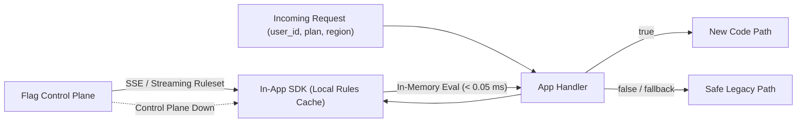
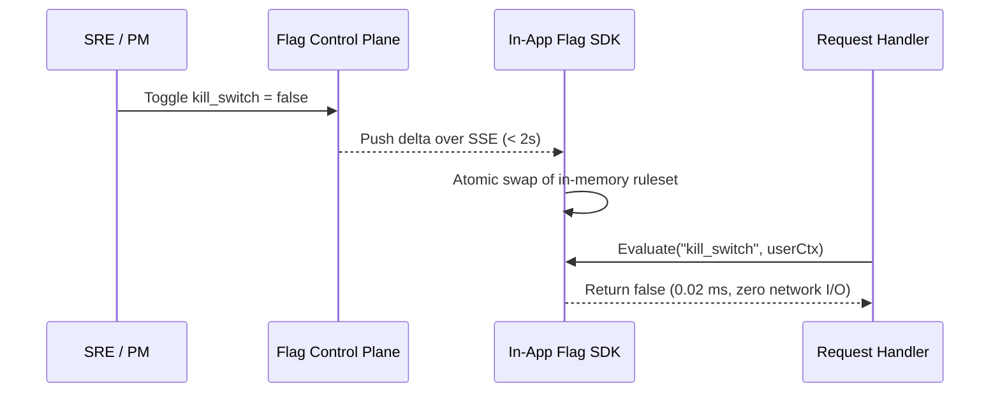
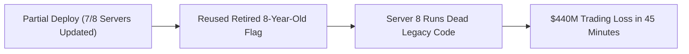

# Feature Flags: Kill Switches, Targeting and Flag Debt

> **Prerequisites:** [Lesson 17: Canary Deployments](../17-canary-deployments/README.md).  
> **Estimated Reading Time:** 23–27 minutes  
> **Target Audience:** Backend and product engineers decoupling deployment from release, building instant kill switches, and managing flag lifecycle debt.  
> **Free PDF Notes:** [Download P5-SD-N-018.pdf](https://backendroadmap.com/notes/system-design/P5-SD-N-018.pdf)

> [!NOTE]
> **In one line:** Feature flags **decouple code deployment from feature release** by wrapping code paths in runtime-evaluated conditionals—giving you **sub-second kill switches**, **targeted rollouts** (staff $\rightarrow$ beta $\rightarrow$ 10% $\rightarrow$ 100%), and **A/B experiments**, at the cost of **combinatorial testing complexity and flag debt** if flags aren't retired.

> [!TIP]
> **The Golden Rule:** Every feature flag must have an **owner, a type, a safe fallback default, and an expiration date** at creation time. Treat temporary release flags like perishable food—if you don't clean them up, they rot your codebase.

---

## 1. What Feature Flags Are, and What They Isn't

A team finishes a new checkout recommendation engine and merges it behind `enable_new_recs = false`. The code ships to production on Tuesday as part of a normal deploy—zero user impact. On Wednesday, product enables it for internal employees (`email endsWith @company.com`), then 5% of users, then 100%. When a downstream ML service spikes CPU on Friday, the on-call flips `enable_new_recs = false` in **1 second** without redeploying a single pod.

| Term | Precise Meaning | Example |
| :--- | :--- | :--- |
| **Release Flag** | Short-lived flag hiding incomplete or newly shipped code | `new_checkout_ui` (remove in 2–4 weeks) |
| **Ops / Kill Switch** | Long-lived circuit-breaker flag to shed non-critical load | `disable_ml_recommendations` during SEV-1 |
| **Experiment / A/B Flag** | Deterministic bucketing splitting users for KPI measurement | `pricing_tier_test` (`control` vs `variant_b`) |
| **Permission / Entitlement** | Long-lived flag gating paid/plan features | `sso_enabled` for Enterprise tier |
| **Deterministic Hashing** | `hash(flag_key + user_id) % 100` for sticky rollouts | User 42 always gets the same bucket |
| **Flag Debt** | Stale flags left in code long after 100% rollout | Dead `if/else` branches causing bugs |
| **Not** | A replacement for CI/CD testing or a place for business config | Don't store 500-row pricing tables in flags |

### Why It Matters
1. **Deploy $\neq$ Release:** Engineers merge small PRs daily (trunk-based development) without long-lived feature branches or merge conflicts.
2. **Instant mitigation:** Turning off a misbehaving feature takes **< 1 second** via flag propagation, faster than any rollback.
3. **Unchecked flag debt** caused Knight Capital's infamous **$440M loss in 45 minutes** when a stale flag was accidentally reactivated.

---

## 2. Anatomy: Local SDK Evaluation & Streaming Control Plane



Production feature flag SDKs **never** make a synchronous HTTP call per request to evaluate a flag. Instead, the control plane streams rule updates (SSE/WebSocket/polling) to an **in-memory ruleset** inside the app process, so evaluation takes microseconds and survives control-plane outages.

| Flag Type | Expected Lifespan | Who Owns It | Cleanup Policy |
| :--- | :---: | :--- | :--- |
| **Release Toggle** | 1–4 weeks | Feature Engineer | Delete immediately after 100% + bake |
| **Experiment (A/B)** | 2–8 weeks | Product / Data | Delete winner/loser after analysis |
| **Ops Kill Switch** | Permanent | SRE / Platform | Keep tested in GameDays |
| **Entitlement** | Permanent | Billing / Auth | Move to dedicated entitlement service |

> [!WARNING]
> **The Combinatorial Explosion Trap:** $N$ independent boolean flags create $2^N$ possible code paths! With just 10 active flags in one service, there are $1{,}024$ combinations—you can never test them all. Keep release flags short-lived, avoid nesting flags inside flags, and test both `all-false` and `all-true` in CI.

---

## 3. Mathematical Model: Deterministic Bucketing & Combinatorial Complexity

**1. Sticky Deterministic Bucketing.**  
To ensure `user_id` stays in the same rollout bucket across requests and servers without central state, hash the concatenation of `flag_key` and `user_id` (including `flag_key` prevents **correlation bias** where the same 5% of users get *every* buggy beta feature):

$$\text{bucket} = \text{FNV1a}(\text{flag\_key} + \text{":"} + \text{user\_id}) \bmod 10{,}000$$

Enable the feature if $\text{bucket} < \text{rollout\_pct} \times 100$ (0.01% granularity).

**2. Combinatorial State Space.**  
With $k$ active boolean flags in a module, the number of distinct runtime states is $2^k$.
- $k = 5 \rightarrow 32$ states
- $k = 15 \rightarrow 32{,}768$ states
- $k = 30 \rightarrow 1{,}073{,}741{,}824$ states (impossible to reason about!)

**3. Evaluation Latency Budget.**  
If a request evaluates $m$ flags:
- **In-memory local SDK:** $m \times 0.02\text{ ms} = 0.2\text{ ms}$ for 10 flags.
- **Remote RPC per flag:** $m \times 5\text{ ms} = 50\text{ ms}$ + failure coupling! Always evaluate locally.

---

## 4. Metrics & Percentiles

| Metric | Meaning | Alert when |
| :--- | :--- | :--- |
| **SDK eval latency $p_{99}$** | Time to evaluate flag in-process | > 0.5 ms (indicates lock contention or remote call) |
| **Rule propagation lag** | Time from UI toggle to all pods updated | > 5 s for kill switches |
| **Fallback evaluation rate** | % of evals hitting hardcoded default | > 0% (means SDK failed to initialize) |
| **Stale flag count** | Flags unchanged at 100% or 0% for > 30 days | > 5 per team (flag debt SLO breach) |
| **Active flags per service** | Total non-permanent flags in codebase | > 15 (combinatorial risk) |

### Worked Example (Kill Switch During Downstream Outage)
A product page calls `RecommendationsService` ($p_{99} = 40\text{ ms}$). During a traffic spike, `RecommendationsService` degrades to $3{,}000\text{ ms}$ timeouts, exhausting thread pools on the product page API.  
- The SRE toggles `kill_switch_recommendations = false` in the flag UI.
- SSE pushes the new rule to all 80 API pods in **1.2 seconds**.
- Product pages skip the recommendation call, returning cached popular items instead. Thread pool saturation clears in 5 seconds—zero redeploy needed.

---

## 5. Compounding & Failure Modes

| Failure Mode | Mechanism | Outcome |
| :--- | :--- | :--- |
| **Remote eval per request** | App calls flag API over HTTP on every request | Flag provider outage takes down your entire app |
| **No flag-key salt in hash** | `hash(user_id) % 100` used for all flags | Same 1% of users suffer every experimental bug |
| **Stale flag reactivation** | Old dead flag flipped on by mistake | Knight Capital-style catastrophic execution |
| **Non-monotonic state** | Flag toggled mid-request or mid-session | User sees mixed old/new UI or broken state |
| **Missing safe default** | SDK fails to load; flag defaults to `true` | Unfinished feature exposed to 100% of users |

---

## 6. Numbers Every Engineer Must Know

| Item | Typical | Implication |
| :--- | :---: | :--- |
| Local SDK evaluation | 5–50 microseconds | Zero measurable latency impact |
| SSE/streaming propagation | 0.5–3 seconds | Fast enough for SEV-1 kill switches |
| Release flag max TTL | 14–30 days | Auto-file cleanup PR/ticket on expiry |
| Max active release flags | < 10–15 per service | Keeps $2^k$ state space manageable |
| Bucketing granularity | 10,000 buckets (0.01%) | Supports 0.1% or 0.5% micro-rollouts |

---

## 7. Protocol / Mechanism Deep Dive: Local Evaluation & Consistency



| Question | Answer |
| :--- | :--- |
| **How do you prevent a flag from changing mid-request?** | Evaluate flags once at the request boundary (or snapshot the ruleset pointer per request) so downstream handlers see a consistent view. |
| **What happens if the Flag Control Plane goes completely down?** | Existing pods keep evaluating their last-known in-memory ruleset; new pods boot from a local/S3 snapshot or hardcoded safe defaults. |
| **How do you test feature flags in CI?** | Run unit/integration tests with flags forced both `off` and `on`, and ban nested flags in code review. |

**When not to use Feature Flags:** Never use feature flags for **database schema migrations** (schemas don't toggle in 1 s), **secrets/credentials**, or **long-term multi-tenant configuration tables** (use a config/entitlements DB instead).

---

## 8. Hierarchical Budgets & Design Rules

| Slice | Rule | Control |
| :--- | :--- | :--- |
| **Evaluation** | In-memory local SDK only; zero per-request network calls | Architecture review + latency alert |
| **Defaults** | Every flag has an explicit, safe hardcoded fallback (`false`) | Linter requires fallback argument |
| **Salting** | Hash `flag_key + ":" + user_id` for percentage rollouts | Shared SDK helper |
| **Metadata** | Require `owner`, `type`, and `expires_at` on creation | Flag platform schema enforcement |
| **Cleanup** | Auto-create cleanup ticket when 100% for > 14 days | Bot / weekly flag-debt report |
| **Telemetry** | Log/tag traces with `flag_key=variant` for debugging | OpenTelemetry span attributes |

---

## 9. Top Mitigations

1. **Always evaluate flags locally in memory** via streaming/polling SDKs with hardcoded safe defaults.
2. **Salt your hash with `flag_key`** (`hash(flag_key + ":" + user_id)`) so the same users aren't guinea pigs for every rollout.
3. **Enforce an expiration date** on every release and experiment flag; automate stale-flag cleanup PRs.
4. **Separate permanent Ops Kill Switches** from temporary Release Flags and test kill switches in GameDays.
5. **Avoid nesting flags**—keep flag checks at clean architectural seams (router/service boundary), not scattered across 20 helper functions.
6. **Attach evaluated flag variants to traces and logs** so on-call engineers can immediately correlate errors with a flag flip.
7. **Snapshot flag values per request** so a mid-request toggle cannot produce half-old, half-new behavior.

---

## 10. Production Reference: Knight Capital's $440M Stale Flag Catastrophe (2012)

In 2012, Knight Capital deployed a new automated equity-routing system (`RLP`). During deployment, one of eight servers did not receive the new code, and the deployment reused an **old, retired feature flag** from 8 years earlier (`Power Peg`) that was still sitting in the codebase. When the flag was activated, the un-updated server executed the dead legacy test code—buying and selling millions of shares erratically and losing **$440 million in 45 minutes**, nearly bankrupting the firm.



- **Root Cause:** Dead flag code was never removed (massive flag debt), a retired flag name was reused, and deployment lacked automated verification across all 8 servers.
- **Fix (Industry Lessons):** Never reuse flag keys, delete release flag code immediately after rollout, and enforce automated flag-debt expiration.

---

## 11. Multi-Language Production Code Tabs

A zero-dependency **Local Feature Flag Evaluator** supporting safe defaults, targeting rules, and salted deterministic percentage bucketing.

````carousel
```go
// Go: local in-memory feature flag evaluator with salted FNV-1a bucketing.
package main

import (
	"fmt"
	"hash/fnv"
	"sync/atomic"
)

type FlagRule struct {
	Key        string
	Enabled    bool
	RolloutPct int // 0..100
	AllowUsers map[string]bool
}

type FlagClient struct {
	rules atomic.Value // map[string]FlagRule
}

func NewFlagClient(initial map[string]FlagRule) *FlagClient {
	c := &FlagClient{}
	c.rules.Store(initial)
	return c
}

func (c *FlagClient) IsEnabled(key, userID string, defaultVal bool) bool {
	m := c.rules.Load().(map[string]FlagRule)
	rule, ok := m[key]
	if !ok || !rule.Enabled {
		return defaultVal
	}
	if rule.AllowUsers[userID] {
		return true
	}
	h := fnv.New32a()
	h.Write([]byte(key + ":" + userID)) // salt with flag key to avoid correlation bias
	return int(h.Sum32()%100) < rule.RolloutPct
}

func main() {
	fc := NewFlagClient(map[string]FlagRule{
		"new_checkout": {Key: "new_checkout", Enabled: true, RolloutPct: 10, AllowUsers: map[string]bool{"staff-1": true}},
	})
	fmt.Println("staff-1:", fc.IsEnabled("new_checkout", "staff-1", false))
	fmt.Println("user-42:", fc.IsEnabled("new_checkout", "user-42", false))
}
```
<!-- slide -->
```typescript
// TypeScript: local feature flag evaluator with targeting & salted FNV-1a bucketing.
interface FlagRule {
  enabled: boolean;
  rolloutPct: number;
  allowUsers?: Set<string>;
}

function fnv1a32(input: string): number {
  let hash = 0x811c9dc5;
  for (let i = 0; i < input.length; i++) {
    hash ^= input.charCodeAt(i);
    hash = Math.imul(hash, 0x01000193) >>> 0;
  }
  return hash;
}

export class FlagClient {
  constructor(private rules: Record<string, FlagRule>) {}

  isEnabled(key: string, userId: string, fallback = false): boolean {
    const rule = this.rules[key];
    if (!rule || !rule.enabled) return fallback;
    if (rule.allowUsers?.has(userId)) return true;
    const bucket = fnv1a32(`${key}:${userId}`) % 10000;
    return bucket < rule.rolloutPct * 100;
  }
}

const flags = new FlagClient({ new_recs: { enabled: true, rolloutPct: 15, allowUsers: new Set(["beta-1"]) } });
console.log("beta-1:", flags.isEnabled("new_recs", "beta-1", false));
console.log("user-99:", flags.isEnabled("new_recs", "user-99", false));
```
<!-- slide -->
```python
# Python: local feature flag evaluator with salted SHA-256 bucketing (stdlib only).
import hashlib
from dataclasses import dataclass, field


@dataclass(frozen=True)
class FlagRule:
    enabled: bool
    rollout_pct: float  # 0.0 to 100.0
    allow_users: frozenset[str] = field(default_factory=frozenset)


class FlagClient:
    def __init__(self, rules: dict[str, FlagRule]):
        self._rules = rules

    def is_enabled(self, key: str, user_id: str, default: bool = False) -> bool:
        rule = self._rules.get(key)
        if rule is None or not rule.enabled:
            return default
        if user_id in rule.allow_users:
            return True
        digest = hashlib.sha256(f"{key}:{user_id}".encode()).digest()
        bucket = int.from_bytes(digest[:4], "big") % 10_000
        return bucket < int(rule.rollout_pct * 100)


if __name__ == "__main__":
    client = FlagClient({"new_checkout": FlagRule(True, 10.0, frozenset({"staff-1"}))})
    print("staff-1:", client.is_enabled("new_checkout", "staff-1"))
    print("user-42:", client.is_enabled("new_checkout", "user-42"))
```
<!-- slide -->
```csharp
// C#: local feature flag evaluator with salted deterministic bucketing.
using System;
using System.Collections.Generic;
using System.Security.Cryptography;
using System.Text;

public sealed record FlagRule(bool Enabled, double RolloutPct, HashSet<string> AllowUsers);

public sealed class FlagClient
{
    private readonly Dictionary<string, FlagRule> _rules;
    public FlagClient(Dictionary<string, FlagRule> rules) => _rules = rules;

    public bool IsEnabled(string key, string userId, bool fallback = false)
    {
        if (!_rules.TryGetValue(key, out var rule) || !rule.Enabled) return fallback;
        if (rule.AllowUsers.Contains(userId)) return true;
        byte[] hash = SHA256.HashData(Encoding.UTF8.GetBytes($"{key}:{userId}"));
        uint bucket = BitConverter.ToUInt32(hash, 0) % 10_000;
        return bucket < (uint)(rule.RolloutPct * 100);
    }

    public static void Main()
    {
        var fc = new FlagClient(new() { ["new_checkout"] = new(true, 10.0, new() { "staff-1" }) });
        Console.WriteLine($"staff-1={fc.IsEnabled("new_checkout", "staff-1")}, user-42={fc.IsEnabled("new_checkout", "user-42")}");
    }
}
```
````

---

## 12. Hands-On CLI Verification Workflows

```bash
# 1. Verify salted deterministic bucketing uniformity across 10,000 users
python3 -c "
import hashlib
def enabled(key, uid, pct=10.0):
    b = int.from_bytes(hashlib.sha256(f'{key}:{uid}'.encode()).digest()[:4], 'big') % 10000
    return b < pct * 100
hits = sum(enabled('new_checkout', f'user-{i}') for i in range(10000))
print(f'10% target -> actual {hits/100:.2f}% ({hits}/10000)')
"

# 2. Audit codebase for stale feature flags (e.g., flags older than 30 days)
grep -rn "is_enabled(" src/ | sort

# 3. Verify OpenFeature / flagd local evaluation endpoint
curl -s -X POST http://localhost:8013/schema.v1.Service/ResolveBoolean \
  -H "Content-Type: application/json" \
  -d '{"flagKey":"new_checkout","context":{"targetingKey":"user-42"}}'
```

---

## 13. Common Mistakes to Avoid

1. **Making a synchronous network call per flag evaluation** instead of local in-memory evaluation.
2. **Hashing only `user_id` without `flag_key`**, causing the same 5% of users to get every beta bug.
3. **Never deleting release flags**, accumulating $2^N$ untested code paths and Knight Capital-style risk.
4. **Reusing old flag names** instead of creating unique immutable flag keys.
5. **Missing safe hardcoded defaults** when the flag SDK fails to initialize.
6. **Evaluating the same flag multiple times mid-request**, risking inconsistent state if toggled live.
7. **Storing complex business data or DB schemas in feature flags**.

---

## 14. Key Terms Glossary

| Key Term | Definition |
| :--- | :--- |
| **Feature Flag** | Runtime conditional decoupling code deployment from feature release. |
| **Kill Switch** | Permanent ops flag to disable failing/expensive features instantly. |
| **Release Toggle** | Temporary flag hiding unfinished work during trunk-based development. |
| **Flag Debt** | Stale flags and dead code branches left after rollout completes. |
| **Local Evaluation** | Evaluating flags in-process from a streamed ruleset (< 0.05 ms). |
| **Salted Bucketing** | Hashing `flag_key + user_id` for independent sticky rollouts. |
| **Trunk-Based Dev** | Merging small daily PRs to `main` behind flags instead of long branches. |
| **Safe Default** | Hardcoded fallback value used if the flag control plane is unreachable. |
| **Combinatorial Explosion** | $2^N$ possible states created by $N$ active boolean flags. |
| **A/B Experiment** | Flag splitting users into cohorts to measure product/KPI impact. |

---

## 15. System Design Interview Questions & Answers

### Basic Conceptual Questions

<details>
<summary><strong>Q1: What does "decoupling deployment from release" mean? [BASIC]</strong></summary>

**Answer:**
Deployment is pushing code binaries to production servers (an engineering event). Release is making a feature visible to users (a product/ops event). Feature flags let you deploy unfinished or dark code safely and release it later with a 1-second toggle.
</details>

<details>
<summary><strong>Q2: What are the four main categories of feature flags? [BASIC]</strong></summary>

**Answer:**
1) **Release flags** (short-lived, hide incomplete code), 2) **Ops / Kill switches** (long-lived, shed load in outages), 3) **Experiment / A/B flags** (short-lived, measure KPIs), and 4) **Permission / Entitlement flags** (long-lived, gate paid plans).
</details>

<details>
<summary><strong>Q3: Why must feature flag evaluation happen locally in memory rather than via an API call? [BASIC]</strong></summary>

**Answer:**
Per-request HTTP calls add 5–20 ms latency per flag and create a hard availability dependency on the flag provider. Streaming rulesets to an in-memory SDK keeps evaluation under 0.05 ms and survives control-plane outages.
</details>

<details>
<summary><strong>Q4: What is flag debt and why is it dangerous? [BASIC]</strong></summary>

**Answer:**
Flag debt is leaving old flags and dead code branches in the codebase after a feature is 100% rolled out. It creates $2^N$ untested combinations, confuses engineers, and risks catastrophic incidents if a dead flag is accidentally reactivated (e.g., Knight Capital).
</details>

### Scenario-Based Architecture Questions

<details>
<summary><strong>Q5: How do you implement sticky 10% rollouts across 50 stateless servers without a database? [SCENARIO]</strong></summary>

**Answer:**
Use deterministic hashing: `bucket = hash(flag_key + ":" + user_id) % 10000`, enabling the feature if `bucket < 1000`. Because the hash is pure and deterministic, all 50 servers compute the exact same decision for `user_id` with zero shared state.
</details>

<details>
<summary><strong>Q6: Your recommendation engine is timing out during a traffic spike. How do feature flags help? [SCENARIO]</strong></summary>

**Answer:**
Use a pre-built **Ops Kill Switch** (`enable_ml_recs = false`). The SSE control plane pushes the change in < 2 seconds, and API pods immediately fall back to a fast cached "popular items" list—shedding load and saving the site without a redeploy.
</details>

<details>
<summary><strong>Q7: Why should you include `flag_key` in the bucketing hash (`hash(flag_key + user_id)`)? [SCENARIO]</strong></summary>

**Answer:**
If you only hash `user_id`, then `user_42` falls into bucket 3 for *every* 5% rollout across the entire company—meaning the same 5% of users experience every experimental bug and skew A/B experiment results. Salting with `flag_key` randomizes cohorts per flag.
</details>

<details>
<summary><strong>Q8: Design a governance process to keep flag debt under control in a 200-engineer org. [SCENARIO]</strong></summary>

**Answer:**
Require `owner`, `type`, and `expires_at` at flag creation; alert and auto-file Jira/PR cleanup tasks when a release flag sits at 100% for > 14 days; track active release flags per service as an engineering health metric; and ban reusing flag keys.
</details>

### Advanced & Tricky Interview Questions

<details>
<summary><strong>Q9: What happens if a flag is toggled while a multi-step request is halfway through execution? [TRICKY]</strong></summary>

**Answer:**
Step 1 could execute the `false` branch and Step 2 the `true` branch, causing corrupted state. Fix by evaluating/snapshotting the request's flag context once at the request entry point and passing that immutable context down.
</details>

<details>
<summary><strong>Q10: How do you debug a production bug that only affects users with a specific combination of 3 flags? [TRICKY]</strong></summary>

**Answer:**
Attach evaluated flag keys and variants as structured attributes on OpenTelemetry spans and error logs (`flags.new_checkout=true, flags.v2_pricing=variant_b`). That lets you filter errors by flag state immediately during an incident.
</details>

<details>
<summary><strong>Q11: Feature flags vs Canary deployments — when do you use each? [TRICKY]</strong></summary>

**Answer:**
Use **Canary deployments** to validate *infrastructure, runtime, memory, and code-wide* safety of a new binary/container (`v2`) before 100% rollout. Use **Feature flags** to control *business/product features* inside that binary, target specific user segments, and provide instant kill switches long after deployment finishes.
</details>

<details>
<summary><strong>Q12: How do you handle client-side (browser/mobile) feature flags without leaking unreleased secrets? [TRICKY]</strong></summary>

**Answer:**
Never ship the entire server-side targeting ruleset (which may contain customer emails or unreleased flag names) to the browser. Instead, have a BFF/edge endpoint evaluate *only* the flags relevant to that authenticated user and send down a flat `{flagKey: boolean}` map.
</details>

---

## 16. One-Page Master Cheat Sheet

```
+---------------------------------------------------------------------------------------------------------+
|                          FEATURE FLAGS — MASTER CHEAT SHEET                                             |
+---------------------------------------------------------------------------------------------------------+
| 1. CORE IDEA: Deploy != Release. Ship dark code behind flags; toggle in <2s without redeploying.        |
+---------------------------------------------------------------------------------------------------------+
| 2. LOCAL EVAL: Stream ruleset via SSE to in-memory SDK (<0.05 ms). NEVER make per-request HTTP calls.   |
+---------------------------------------------------------------------------------------------------------+
| 3. SALTED BUCKETING: hash(flag_key + ":" + user_id) % 10000. Prevents same users getting all beta bugs. |
+---------------------------------------------------------------------------------------------------------+
| 4. TYPES: Release (delete in 2-4w) · Experiment (2-8w) · Ops Kill Switch (perm) · Entitlement (perm).   |
+---------------------------------------------------------------------------------------------------------+
| 5. FLAG DEBT: N flags = 2^N states. Enforce owner + expiry + auto-cleanup; never reuse retired keys!    |
+---------------------------------------------------------------------------------------------------------+
| 6. OBSERVABILITY: Tag OTel traces/logs with active flag variants + snapshot flags at request boundary.  |
+---------------------------------------------------------------------------------------------------------+
```

---

## Further Reading & Sources

- Pete Hodgson, *Feature Toggles (aka Feature Flags)* ([martinfowler.com](https://martinfowler.com/articles/feature-toggles.html)).
- OpenFeature Specification, *Cloud-Native Feature Flagging Standard* ([openfeature.dev](https://openfeature.dev/)).
- SEC / Post-Mortem Analysis of Knight Capital Group's 2012 Deployment Incident.

---

## Free PDF Notes

[P5-SD-N-018.pdf](https://backendroadmap.com/notes/system-design/P5-SD-N-018.pdf)

---

## Next

Continue with [Track 15, Lesson 01: Object Storage Fundamentals](../../15-storage/01-object-storage-fundamentals/README.md).