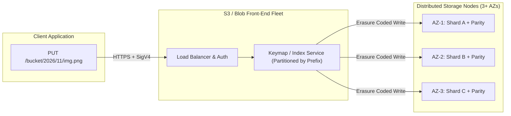
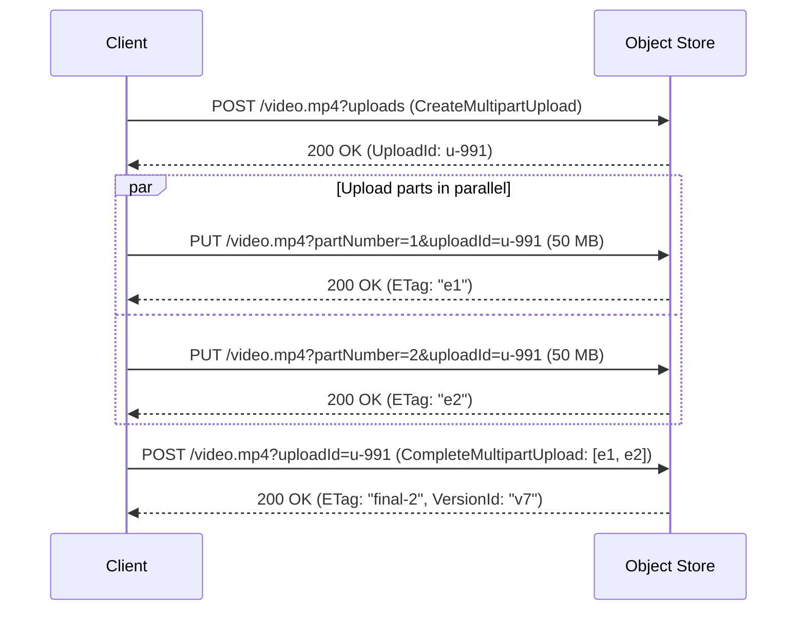
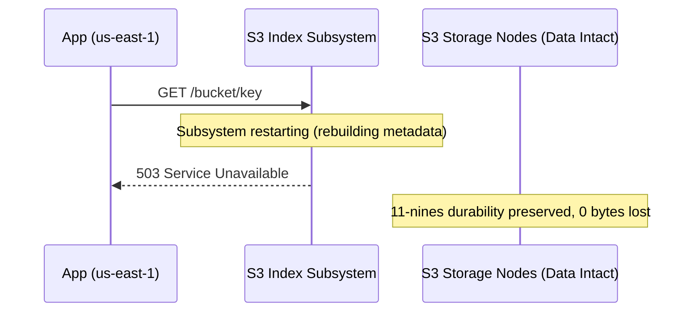

# Object Storage Fundamentals: Buckets, Keys and Eleven Nines (S3, Blob)

> **Prerequisites:** [Lesson 18: Feature Flags](../../14-observability-and-delivery/18-feature-flags/README.md).  
> **Estimated Reading Time:** 24–28 minutes  
> **Target Audience:** Backend engineers choosing storage for unstructured data, and candidates asked "how does S3 achieve 11 nines of durability, and why is it not a filesystem?"  
> **Free PDF Notes:** [Download SD-O-001.pdf](https://backendroadmap.com/notes/system-design/SD-O-001.pdf)

> [!NOTE]
> **In one line:** Object storage stores immutable blobs of data addressed by a **flat key** inside a **bucket** over **HTTP**, with rich metadata attached directly to each object. By trading away POSIX file locking, in-place byte-range writes, and directory renames, systems like Amazon S3 and Azure Blob Storage scale to trillions of objects and deliver **99.999999999% (11 nines)** annual durability across multiple Availability Zones.

> [!TIP]
> **The Golden Rule:** Never treat an object store like a POSIX filesystem. Keys with slashes (`2026/11/invoice.pdf`) are **flat strings**, not directories—renaming a "folder" of 100,000 objects means copying and deleting 100,000 objects.

---

## 1. What Object Storage Is, and What It Isn't

A team migrates a legacy image-processing service to the cloud and mounts an S3 bucket as a local directory using a FUSE adapter. At first it works, until concurrent workers try to append to the same log file, rename a folder with 50,000 thumbnails, and run `ls -la` on a prefix containing 2 million keys. Appends silently overwrite each other, the folder rename stalls for 20 minutes, and `ls` costs dollars in `ListObjectsV2` API calls. The problem is not S3—it is treating an HTTP key-value blob store as a POSIX filesystem.

| Term | Precise Meaning | Example |
| :--- | :--- | :--- |
| **Bucket / Container** | Top-level namespace for objects, policies, and replication rules | `prod-invoices-us-east-1` |
| **Object** | Immutable payload (0 B to 5 TB in S3) + system/user metadata + version ID | `invoice.pdf` + `Content-Type` |
| **Key** | Flat UTF-8 string (up to 1,024 bytes) uniquely identifying an object in a bucket | `tenants/42/2026/inv-001.pdf` |
| **Prefix** | Leading substring of a key used for lexical range queries and partitioning | `tenants/42/2026/` (not a real folder) |
| **ETag** | Opaque entity tag (MD5 for single-part puts; hash-of-parts for multipart) | `"9b2cf535f27731c974343645a3985328"` |
| **Multipart Upload** | Splitting a large object into 5 MB–5 GB parts uploaded in parallel | Uploading a 2 GB video in 100 parts |
| **Durability vs Availability** | Probability an object is *not lost* per year vs probability it can be *read right now* | 99.999999999% vs 99.99% |
| **Not** | A POSIX filesystem, a low-latency database, or a block device | Cannot `fseek` + overwrite 4 KB |

### Why It Matters
1. Object storage is the default home for user uploads, backups, data lakes, ML datasets, and static assets in almost every modern system design interview.
2. Knowing *why* it has no atomic `rename()` or in-place `write()` explains multipart uploads, prefix-based partitioning, and why databases do not run directly on raw S3 GET/PUT.
3. Distinguishing **durability** (11 nines) from **availability** (3–4 nines) is a classic interview probe.

---

## 2. Anatomy: Flat Keyspace vs Hierarchical Filesystem



When you `PUT` an object, the front-end authenticates the request, looks up the key's partition in a distributed index, and writes the payload using **erasure coding** (or multi-way replication) across storage nodes in at least three physically separated Availability Zones before returning `200 OK`.

| Dimension | Object Storage (S3, Blob, GCS) | File Storage (EFS, NFS) | Block Storage (EBS) |
| :--- | :--- | :--- | :--- |
| **Access Protocol** | HTTP/HTTPS REST (`PUT`, `GET`, `DELETE`) | POSIX / NFSv4 / SMB | NVMe / iSCSI (raw sectors) |
| **Namespace** | Flat bucket + key string | Hierarchical directory tree | Raw block addresses (LBA) |
| **Mutability** | Immutable (overwrite whole object or upload new version) | In-place byte-range updates + file locks | In-place 4 KB–64 KB block writes |
| **Latency (First Byte)** | 10–100 ms | 1–10 ms | 0.1–1 ms |
| **Scale** | Virtually unlimited (exabytes, trillions of objects) | Petabytes | Terabytes per volume (64 TB EBS) |
| **Cost per GB/month** | ~$0.023 (Standard) down to $0.00099 (Deep Archive) | ~$0.30 (EFS Standard) | ~$0.08–$0.125 (gp3/io2) |

> [!WARNING]
> **The #1 Trap: "Folder Rename" and Read-After-Write Assumptions.** Object stores have no `mv` or `rename` primitive. Moving `logs/2025/` to `archive/2025/` requires issuing `CopyObject` + `DeleteObject` for *every single key*, which is neither atomic nor free. Also remember: while S3 provides **strong read-after-write consistency** for all `PUT` and `DELETE` operations since December 2020, concurrent `PUT`s to the same key still follow **last-writer-wins** with no distributed lock unless you pass conditional headers (`If-None-Match: *` or `If-Match: <etag>`).

---

## 3. Mathematical Model: Eleven Nines via Replication & Erasure Coding

Why does a single disk fail, and how do you get from a 2% annual disk failure rate to $99.999999999\%$ (11 nines) durability?

**Independent Replica Model.** Suppose a single storage node/disk has an Annualized Failure Rate (AFR) of $p = 0.02$ (2% per year), and a failed disk takes $T_{\text{repair}} = 4\text{ hours}$ to rebuild from peers. The probability that a disk is down at a random instant—or fails during the repair window of another—is bounded by:

$$p_{\text{window}} \approx p \cdot \frac{T_{\text{repair}}}{8760\text{ h/yr}} = 0.02 \times \frac{4}{8760} \approx 9.13 \times 10^{-6}$$

For $k = 3$ independent replicas stored across separate fault domains, losing all 3 before repair completes has annual probability:

$$P_{\text{loss, 3-rep}} \approx p \cdot \binom{3}{1}\text{?} \quad \text{More precisely: } P_{\text{loss}} \approx 3 \cdot p \cdot \left(p_{\text{window}}\right)^2 = 3 \times 0.02 \times (9.13 \times 10^{-6})^2 \approx 5.0 \times 10^{-12}$$

That yields durability $D = 1 - 5.0 \times 10^{-12} = 99.9999999995\%$ (**11 nines**).

**Storage Overhead: Replication vs Reed-Solomon Erasure Coding.** Storing 3 full replicas costs **$3.0\times$** raw disk space (200% overhead). With $(k, m)$ Reed-Solomon erasure coding, an object is split into $k$ data shards and $m$ parity shards; any $k$ of the $k + m$ shards reconstruct the original object.

$$\text{Storage Overhead Factor} = \frac{k + m}{k}, \qquad \text{Tolerated Simultaneous Failures} = m$$

**Worked Numerical Example.** With $(k=8, m=4)$ erasure coding across 12 nodes in 3 AZs:
- **Storage overhead:** $(8 + 4)/8 = 1.5\times$ (50% overhead—half the disk cost of $3\times$ replication!).
- **Fault tolerance:** Survives up to $m = 4$ simultaneous node failures (even an entire AZ losing 4 shards).
- **Expected object loss:** Out of $10^{11}$ (100 billion) objects stored at 11 nines ($P_{\text{loss}} = 10^{-11}$/yr), you expect **$10^{11} \times 10^{-11} = 1$ object lost per year**—versus 2 billion objects lost if stored on single un-replicated disks!

---

## 4. Metrics & Percentiles

| Metric | Meaning | Alert when |
| :--- | :--- | :--- |
| **`5xx` / `503 SlowDown` rate** | Server errors or per-prefix request throttling | > 0.1% of requests (add jittered retry / key entropy) |
| **`4xx` (`403`, `404`, `412`) rate** | Auth/IAM failures, missing keys, or conditional-write conflicts | Sudden spike after deploy or key-rotation |
| **Time to First Byte (TTFB) $p_{99}$** | Latency from request send to first response byte | > 150 ms for small objects in same region |
| **PUT / GET throughput (Gbps)** | Aggregate bytes/s transferred | Approaching NIC or NAT Gateway bandwidth cap |
| **`ListObjectsV2` call rate** | Pagination scans over prefixes | Rising linearly with bucket size (anti-pattern) |
| **Multipart orphan bytes** | Uncommitted parts from aborted uploads | > 1% of bucket size (missing lifecycle abort rule) |

### Worked Example (50 TB Media Bucket)
A video platform stores **50 TB** across **10 million objects** (average 5 MB each) in S3 Standard ($0.023/GB-month) and serves **500 `GET`/s** plus **50 `PUT`/s**:
- **Storage cost:** $50{,}000\text{ GB} \times \$0.023 = \$1{,}150/\text{month}$.
- **Request cost:** $500 \times 2.6\text{M s/mo} \approx 1.3\text{B GETs}$ ($\times \$0.0004/1000 = \$520$) + $130\text{M PUTs}$ ($\times \$0.005/1000 = \$650$) = **$1,170/month**.
- **Internet egress cost:** If 100 TB/month leaves AWS directly to users at $\$0.09/\text{GB}$, egress is **$9,000/month**—nearly **4×** storage and requests combined! Putting CloudFront in front cuts egress and offloads `GET`s.

---

## 5. Compounding & Failure Modes

How do S3/Blob failures manifest in real distributed systems?

1. **Correlated Failures vs Independent Failures.** The 11-nines math assumes independent node failures. A misconfigured lifecycle rule, an accidental `aws s3 rm --recursive`, or a compromised IAM key deletes objects across *all* 3 AZs simultaneously—durability against hardware failure does not protect against logical deletion.
2. **Per-Prefix Rate Limits (`503 SlowDown`).** S3 allows **3,500 `PUT/COPY/POST/DELETE`** and **5,500 `GET/HEAD`** requests per second *per partitioned prefix*. If all uploads land under `uploads/2026-11-25/`, hot partitions can throttle until S3 auto-splits the prefix; if you exceed limits immediately during a spike, you get `503 SlowDown`.
3. **Orphaned Multipart Uploads.** If a client starts a multipart upload for a 5 GB file, uploads 4.9 GB of parts, and crashes before calling `CompleteMultipartUpload`, those 4.9 GB remain billed forever in hidden storage—invisible to `ListObjectsV2`—until you run `AbortMultipartUpload` or configure a lifecycle rule.
4. **NAT Gateway Egress Tax.** Routing S3 traffic from private VPC subnets through a NAT Gateway instead of a **Gateway VPC Endpoint** adds $0.045/GB in NAT processing charges on every gigabyte read or written.

---

## 6. Numbers Every Engineer Must Know

| Item | Typical | Implication |
| :--- | :---: | :--- |
| **S3 Standard Durability** | `99.999999999%` (11 nines) | ~1 object lost per 100 billion per year |
| **S3 Standard Availability** | `99.99%` (SLA `99.9%`) | Expect ~52 min/yr of transient 5xx; always retry with backoff |
| **S3 Single-AZ (One Zone-IA)** | `99.5%` avail, 11 nines *within AZ* | Lost if an entire AZ burns/floods; use only for re-creatable data |
| **Max Object Size (S3 / Azure Blob)** | `5 TB` (S3) / `190.7 TB` (Block Blob) | Single `PUT` max is 5 GB (S3); use multipart above 100 MB |
| **S3 Per-Prefix Throughput** | `3,500` PUT/s · `5,500` GET/s | Partition keys by prefix or hash if bursting higher |
| **Small-Object TTFB** | `10–50 ms` ($p_{50}$), `50–150 ms` ($p_{99}$) | Do not use S3 as an OLTP row store |
| **Multipart Part Size** | `5 MB` min (except last), `5 GB` max | 10,000 parts max per object |

---

## 7. Protocol Deep Dive: Multipart Upload & Conditional Writes



| Question | Answer |
| :--- | :--- |
| **Why multipart above 100 MB?** | Parallelizes TCP streams, bounds retry blast radius to 1 part (not 4 GB), and is required above 5 GB |
| **Is `CompleteMultipartUpload` atomic?** | Yes—readers either see the previous version or the complete new object, never partial parts |
| **How do you prevent concurrent overwrite races?** | Conditional writes: `If-None-Match: *` (create-only) or `If-Match: "<etag>"` (optimistic CAS) |
| **How do you verify end-to-end integrity?** | Send `Content-MD5` or `x-amz-checksum-sha256` on `PUT`; S3 rejects corrupted payloads with `400 BadDigest` |

**When NOT to use Object Storage:**
- Sub-millisecond random reads/writes or in-place byte mutations (database WALs, SQLite/Postgres data files → use **Block Storage**).
- Shared POSIX semantics with file locking (`flock`) and atomic directory renames across compute nodes (legacy build caches, HPC → use **File Storage**).
- Millions of tiny (< 1 KB) mutable records queried by secondary attributes (use a database; metadata overhead and per-request pricing dominate).

---

## 8. Hierarchical Budgets & Design Rules

| Slice | Rule | Control |
| :--- | :--- | :--- |
| **Key Design** | Treat keys as flat strings; avoid sequential hot prefixes if > 3.5k PUT/s | Hash prefix (`a3f9/2026-11-25/...`) or distribute across prefixes |
| **Multipart** | Use multipart for objects > 100 MB; abort stale uploads automatically | Lifecycle rule: `AbortIncompleteMultipartUpload` after 7 days |
| **Metadata** | Never `ListObjectsV2` on hot request paths | Store object keys, sizes, and tags in Postgres/DynamoDB |
| **Concurrency** | Guard shared-key updates with optimistic locking | `If-Match: <etag>` or `If-None-Match: *` |
| **Network** | Keep in-region traffic off NAT Gateways and public internet | VPC Gateway Endpoint (S3) / Private Endpoint (Azure) |
| **Security** | Block public access at account/bucket level; encrypt at rest & in transit | `BlockPublicAcls`, TLS-only bucket policy, SSE-KMS |
| **Durability** | Hardware 11 nines != deletion protection | Versioning + MFA Delete + Cross-Region Replication (CRR) |

---

## 9. Top Mitigations

1. **Enable `AbortIncompleteMultipartUpload` (7 days)** on every bucket to eliminate silent billing leaks from crashed uploads.
2. **Use VPC Gateway Endpoints** for S3 so EC2/EKS/Lambda traffic never pays NAT Gateway $0.045/GB processing fees.
3. **Index object metadata in a database** instead of calling `ListObjectsV2` on user-facing APIs.
4. **Use conditional writes (`If-None-Match: *` / `If-Match`)** when multiple writers might race on the same key (e.g., distributed locks, leader election, or deduplicated ingestion).
5. **Retry `500`/`503 SlowDown` with exponential backoff and full jitter**, and spread keys across prefixes if bursting > 3,500 PUT/s.
6. **Put a CDN (CloudFront / Cloudflare) in front of read-heavy public/signed assets** to slash $0.09/GB egress and absorb `GET` spikes.
7. **Enable Bucket Versioning + Block Public Access** by default via Terraform/IaC policy-as-code.

---

## 10. Production Reference: The 2017 Amazon S3 `us-east-1` Outage (Why Availability != Durability)

On **February 28, 2017**, an AWS engineer debugging a billing-system issue in `us-east-1` ran a command intended to remove a small number of servers from the S3 **index subsystem**. Due to an incorrect parameter, a much larger set of servers—including servers supporting both the index subsystem and the placement subsystem—was removed.

- **What broke:** Because S3's index subsystem had not been restarted in years, restarting it required rebuilding massive in-memory metadata tables, taking **~4 hours**. During that window, **no objects were lost** (durability held), but `GET`, `PUT`, and `LIST` requests failed across `us-east-1`—taking down Slack, Trello, Quora, and even the AWS Health Dashboard (which stored its status icons in S3 `us-east-1`!).
- **Root cause:** Blast-radius isolation was insufficient in the index subsystem, and clients had no multi-region fallback for critical read paths.
- **Fix:** AWS partitioned the index subsystem into smaller cells to bound recovery time, and engineers learned a permanent architectural lesson: **11 nines of durability does not mean 11 nines of availability**.



---

## 11. Multi-Language Production Code Tabs

Implementing **resilient object PUT with SHA-256 integrity, conditional write (`If-None-Match: *`), and jittered retry on `503 SlowDown`** using standard/official idioms.

````carousel
```go
// Go: PutObject with conditional write (If-None-Match), SHA-256 checksum, and jittered retry.
package storage

import (
	"bytes"
	"context"
	"crypto/sha256"
	"encoding/base64"
	"errors"
	"math/rand/v2"
	"net/http"
	"time"
)

type ObjectClient interface {
	PutIfAbsent(ctx context.Context, bucket, key string, body []byte, sha256B64 string) (int, error)
}

func PutWithRetry(ctx context.Context, client ObjectClient, bucket, key string, data []byte) error {
	sum := sha256.Sum256(data)
	checksum := base64.StdEncoding.EncodeToString(sum[:])

	const maxAttempts = 5
	for attempt := 0; attempt < maxAttempts; attempt++ {
		status, err := client.PutIfAbsent(ctx, bucket, key, bytes.Clone(data), checksum)
		if err == nil && status >= 200 && status < 300 {
			return nil
		}
		if status == http.StatusPreconditionFailed { // 412: object already exists
			return errors.New("conflict: key already exists")
		}
		if status != http.StatusServiceUnavailable && status != http.StatusInternalServerError && err == nil {
			return errors.New("non-retryable client error")
		}
		// Full-jitter exponential backoff: [0, base * 2^attempt]
		capMs := min(100*(1<<attempt), 2000)
		sleep := time.Duration(rand.IntN(capMs+1)) * time.Millisecond
		select {
		case <-time.After(sleep):
		case <-ctx.Done():
			return ctx.Err()
		}
	}
	return errors.New("exhausted retries on object store")
}
```
<!-- slide -->
```typescript
// TypeScript: Resilient conditional PUT with SHA-256 integrity & full-jitter backoff (Node 20+ / Web Crypto).
import { createHash } from "node:crypto";

export interface PutResult {
  status: number;
  etag?: string;
}

export async function putIfAbsentWithRetry(
  putFn: (key: string, body: Uint8Array, sha256B64: string) => Promise<PutResult>,
  key: string,
  body: Uint8Array,
  maxAttempts = 5
): Promise<PutResult> {
  const sha256B64 = createHash("sha256").update(body).digest("base64");

  for (let attempt = 0; attempt < maxAttempts; attempt++) {
    const res = await putFn(key, body, sha256B64); // sends If-None-Match: * + x-amz-checksum-sha256
    if (res.status >= 200 && res.status < 300) return res;
    if (res.status === 412) {
      throw new Error(`Conflict (412): object '${key}' already exists`);
    }
    if (res.status !== 503 && res.status !== 500) {
      throw new Error(`Non-retryable status ${res.status}`);
    }
    const maxDelayMs = Math.min(100 * 2 ** attempt, 2000);
    const delayMs = Math.floor(Math.random() * (maxDelayMs + 1));
    await new Promise((r) => setTimeout(r, delayMs));
  }
  throw new Error(`Exhausted ${maxAttempts} retries putting '${key}'`);
}
```
<!-- slide -->
```python
# Python: Erasure-coding / 3-replica durability math + resilient conditional PUT (stdlib only).
import hashlib
import base64
import math
import random
import time

def annual_loss_prob_replicas(disk_afr: float = 0.02, repair_hours: float = 4.0, replicas: int = 3) -> float:
    """Approximate annual probability of losing all `replicas` before repair completes."""
    p_window = disk_afr * (repair_hours / 8760.0)
    return replicas * disk_afr * (p_window ** (replicas - 1))

def erasure_overhead(k: int, m: int) -> tuple[float, int]:
    """Return (storage_multiplier, tolerated_simultaneous_failures) for (k, m) Reed-Solomon."""
    return (k + m) / k, m

def put_if_absent_with_retry(put_fn, key: str, payload: bytes, max_attempts: int = 5) -> dict:
    """put_fn(key, payload, sha256_b64) -> (status_code, etag)."""
    sha256_b64 = base64.b64encode(hashlib.sha256(payload).digest()).decode("ascii")
    for attempt in range(max_attempts):
        status, etag = put_fn(key, payload, sha256_b64)
        if 200 <= status < 300:
            return {"status": status, "etag": etag}
        if status == 412:
            raise FileExistsError(f"412 Precondition Failed: {key} already exists")
        if status not in (500, 503):
            raise RuntimeError(f"Non-retryable status {status}")
        cap_s = min(0.1 * (2 ** attempt), 2.0)
        time.sleep(random.uniform(0, cap_s))
    raise TimeoutError(f"Exhausted {max_attempts} retries for {key}")
```
<!-- slide -->
```csharp
// C#: Conditional PUT with SHA-256 checksum and jittered exponential backoff.
using System.Security.Cryptography;

public sealed record PutResponse(int StatusCode, string? ETag);

public static class ObjectUploader
{
    public static async Task<PutResponse> PutIfAbsentWithRetryAsync(
        Func<string, byte[], string, CancellationToken, Task<PutResponse>> putFn,
        string key,
        byte[] payload,
        int maxAttempts = 5,
        CancellationToken ct = default)
    {
        string sha256B64 = Convert.ToBase64String(SHA256.HashData(payload));

        for (int attempt = 0; attempt < maxAttempts; attempt++)
        {
            var res = await putFn(key, payload, sha256B64, ct); // sends If-None-Match: *
            if (res.StatusCode is >= 200 and < 300) return res;
            if (res.StatusCode == 412)
                throw new InvalidOperationException($"412 Conflict: '{key}' already exists.");
            if (res.StatusCode is not (500 or 503))
                throw new HttpRequestException($"Non-retryable status {res.StatusCode}");

            int capMs = Math.Min(100 * (1 << attempt), 2000);
            int delayMs = Random.Shared.Next(0, capMs + 1);
            await Task.Delay(delayMs, ct);
        }
        throw new TimeoutException($"Exhausted {maxAttempts} retries for '{key}'.");
    }
}
```
````

---

## 12. Hands-On CLI Verification Workflows

Verify the durability math in Python:

```bash
python -c "
p_win = 0.02 * (4 / 8760)
p_loss = 3 * 0.02 * (p_win ** 2)
print(f'P(loss/yr) = {p_loss:.2e}, Durability = {(1 - p_loss)*100:.11f}%')
print(f'RS(8,4) overhead = {(8+4)/8:.2f}x vs 3-rep = 3.00x')
"
```

Inspect real S3 buckets, multipart orphans, and conditional writes via AWS CLI:

```bash
# 1. Conditional PUT (fails with 412 PreconditionFailed if key already exists)
aws s3api put-object \
  --bucket prod-invoices \
  --key tenants/42/inv-001.pdf \
  --body ./inv-001.pdf \
  --if-none-match "*"

# 2. Find hidden orphaned multipart uploads costing money
aws s3api list-multipart-uploads --bucket prod-invoices

# 3. Verify Block Public Access is enforced
aws s3api get-public-access-block --bucket prod-invoices
```

---

## 13. Common Mistakes to Avoid

1. **Mounting S3 via FUSE as a POSIX filesystem** for databases, logs, or concurrent writes.
2. **Calling `ListObjectsV2` in hot request paths** instead of indexing object metadata in a database.
3. **Treating key prefixes as real folders** and expecting `mv` / rename to be atomic or $O(1)$.
4. **Forgetting `AbortIncompleteMultipartUpload` lifecycle rules**, silently leaking gigabytes of unreferenced parts.
5. **Routing S3 traffic through a NAT Gateway** instead of a free VPC Gateway Endpoint.
6. **Confusing 11-nines durability with availability**—and skipping Versioning or Cross-Region Replication.
7. **Omitting conditional headers (`If-None-Match: *`)** when multiple workers write to the same deterministic key.

---

## 14. Key Terms Glossary

| Key Term | Definition |
| :--- | :--- |
| **Bucket / Container** | Top-level logical namespace holding objects, access policies, and lifecycle rules. |
| **Key** | Flat UTF-8 string uniquely identifying an object inside a bucket. |
| **Prefix** | Leading substring of a key used to simulate hierarchy and partition throughput. |
| **ETag** | Entity tag returned on PUT/GET; MD5 for single-part objects, opaque hash for multipart. |
| **Erasure Coding** | Splitting data into $k$ data + $m$ parity shards so any $k$ shards reconstruct the object. |
| **Durability** | Annual probability an object is not permanently lost (11 nines = $99.999999999\%$). |
| **Availability** | Probability the service successfully responds to a request right now (e.g., $99.99\%$). |
| **Multipart Upload** | Uploading a large object as independent 5 MB–5 GB parts committed atomically. |
| **Conditional Write** | Using `If-None-Match: *` or `If-Match: <etag>` to prevent concurrent overwrite races. |
| **Strong Read-After-Write** | Guarantee that a `GET` or `LIST` immediately reflects a completed `PUT` or `DELETE`. |

---

## 15. System Design Interview Questions & Answers

### Basic Conceptual Questions

<details>
<summary><strong>Q1: What is the difference between object storage, file storage, and block storage? [BASIC]</strong></summary>

**Answer:**
Object storage (S3, Blob) exposes immutable blobs via HTTP under a flat keyspace. File storage (EFS, NFS) exposes a hierarchical directory tree with POSIX file locking and in-place edits. Block storage (EBS) exposes raw fixed-size blocks (4 KB–64 KB) over NVMe/iSCSI to a single VM for OS disks and databases.
</details>

<details>
<summary><strong>Q2: What does "11 nines of durability" mean in practice? [BASIC]</strong></summary>

**Answer:**
$99.999999999\%$ annual durability means if you store 100 billion ($10^{11}$) objects, you statistically expect to lose at most 1 object per year due to hardware/media failure. It does **not** protect against accidental deletion or ransomware—you need Versioning and Object Lock for that.
</details>

<details>
<summary><strong>Q3: Are folders in S3 real? What happens when you rename one? [BASIC]</strong></summary>

**Answer:**
No. Keys like `a/b/file.txt` are flat strings; `/` is just a delimiter convention for `ListObjectsV2`. Renaming a "folder" of $N$ objects requires $N$ `CopyObject` calls followed by $N$ `DeleteObject` calls—it is $O(N)$, slow, and non-atomic.
</details>

<details>
<summary><strong>Q4: Why is S3 not suitable as a database storage engine? [BASIC]</strong></summary>

**Answer:**
S3 has 10–100 ms first-byte latency, no in-place byte-range writes (you must rewrite the whole object), and no cross-object transactions. Databases need sub-millisecond random 4 KB–16 KB I/O on block storage (though analytical engines like DuckDB/Iceberg/Snowflake *do* batch immutable Parquet files on S3).
</details>

### Scenario-Based Architecture Questions

<details>
<summary><strong>Q5: Users upload 4 GB videos from mobile clients over flaky LTE. How do you design the upload? [SCENARIO]</strong></summary>

**Answer:**
Use **Multipart Upload** (e.g., 16–32 MB parts) directly from the client via pre-signed URLs. If a part fails on LTE, the client retries only that 16 MB part rather than restarting 4 GB. Configure a 7-day `AbortIncompleteMultipartUpload` lifecycle rule to clean up abandoned uploads.
</details>

<details>
<summary><strong>Q6: Your analytics pipeline ingests 15,000 objects/second into `events/2026/11/25/` and sees `503 SlowDown`. Why, and how do you fix it? [SCENARIO]</strong></summary>

**Answer:**
S3 limits a single partitioned prefix to ~3,500 `PUT`/s. While S3 eventually auto-splits hot prefixes, sudden bursts hit `503 SlowDown`. Fix it by prepending a short hash or shard ID (e.g., `events/a3f9/2026/11/25/...`) to spread writes across many partitions, and use exponential backoff with full jitter.
</details>

<details>
<summary><strong>Q7: Your EKS cluster reads 200 TB/month from S3 in the same region and your AWS bill shows $9,000 in NAT Gateway charges. Why? [SCENARIO]</strong></summary>

**Answer:**
Pods in private subnets are reaching S3's public IP via the NAT Gateway ($0.045/GB processing fee). Add a **VPC Gateway Endpoint** for S3 (which is free) so all in-region S3 traffic stays on the AWS private backbone at $0/GB.
</details>

<details>
<summary><strong>Q8: Two microservices occasionally write to the same S3 key concurrently, and one silently overwrites the other. How do you prevent this? [SCENARIO]</strong></summary>

**Answer:**
Use S3 **conditional writes**: pass `If-None-Match: *` for create-once semantics (returns `412 Precondition Failed` if the key exists), or `If-Match: "<etag>"` for optimistic compare-and-swap updates.
</details>

### Advanced & Tricky Interview Questions

<details>
<summary><strong>Q9: How does erasure coding achieve 11 nines of durability at half the storage cost of 3-way replication? [TRICKY]</strong></summary>

**Answer:**
3-way replication costs $3\times$ storage (200% overhead) and tolerates 2 failures. Reed-Solomon $(k=8, m=4)$ splits data into 8 data + 4 parity shards ($1.5\times$ storage, only 50% overhead) and tolerates up to 4 simultaneous node failures across 3+ AZs, yielding higher fault tolerance at half the disk cost.
</details>

<details>
<summary><strong>Q10: S3 advertises 11 nines durability but only 99.99% availability. How can both be true? [TRICKY]</strong></summary>

**Answer:**
Durability measures whether bytes are permanently destroyed; availability measures whether the front-end/index plane can serve your request *right now*. During the 2017 `us-east-1` outage, the index subsystem was offline for 4 hours (violating availability), while 100% of stored object bytes remained intact on disk (preserving durability).
</details>

<details>
<summary><strong>Q11: Why can't you rely on S3 `ETag` as a universal MD5 checksum? [TRICKY]</strong></summary>

**Answer:**
For single-part uploads encrypted with SSE-S3, `ETag` is the MD5 of the object. For **multipart uploads** or objects encrypted with **SSE-KMS**, `ETag` is *not* the MD5 of the file (for multipart, it is the MD5 of the concatenated part MD5s followed by `-<partCount>`). Always use `x-amz-checksum-sha256` for end-to-end integrity.
</details>

<details>
<summary><strong>Q12: How do modern cloud-native databases (Snowflake, Neon, Turbopuffer) run on S3 if S3 has 50 ms latency and no in-place writes? [TRICKY]</strong></summary>

**Answer:**
They batch writes into immutable **Log-Structured Merge (LSM)** segments or **Apache Iceberg / Parquet** files (amortizing 50 ms PUTs over megabytes), use **NVMe local SSDs** as a hot read/write cache, and use conditional PUTs (`If-None-Match` / `If-Match`) or a small consensus/catalog store for atomic metadata commits.
</details>

---

## 16. One-Page Master Cheat Sheet

```
+---------------------------------------------------------------------------------------------------------+
|                  OBJECT STORAGE FUNDAMENTALS — MASTER CHEAT SHEET                                       |
+---------------------------------------------------------------------------------------------------------+
| 1. MODEL: Bucket + flat Key (<=1024 B) + immutable Value (<=5 TB) + Metadata over HTTP/HTTPS.           |
|    Keys with "/" are flat strings, NOT directories (no atomic O(1) folder rename).                      |
+---------------------------------------------------------------------------------------------------------+
| 2. DURABILITY vs AVAILABILITY:                                                                          |
|    - 11 nines (99.999999999%) durability = ~1 lost object / 100B / yr via Erasure Coding across 3+ AZs. |
|    - 99.99% availability = ~52 min/yr transient errors -> always retry 500/503 with full jitter.        |
+---------------------------------------------------------------------------------------------------------+
| 3. THROUGHPUT & SIZE LIMITS:                                                                            |
|    - 3,500 PUT/s and 5,500 GET/s per partitioned prefix -> add hash prefix if bursting higher.          |
|    - Single PUT <= 5 GB; use Multipart Upload > 100 MB + 7-day AbortIncompleteMultipartUpload rule.     |
+---------------------------------------------------------------------------------------------------------+
| 4. CONSISTENCY & CONCURRENCY:                                                                           |
|    - Strong read-after-write consistency; prevent races with If-None-Match: * or If-Match: <etag>.      |
+---------------------------------------------------------------------------------------------------------+
| 5. COST TRAPS: NAT Gateway egress ($0.045/GB -> use VPC Gateway Endpoint) + Internet egress ($0.09/GB   |
|    -> use CloudFront CDN) + ListObjectsV2 in hot paths (-> index metadata in a DB).                     |
+---------------------------------------------------------------------------------------------------------+
```

---

## Further Reading & Sources

- Amazon Web Services, [Amazon S3 Consistency & Performance Guidelines](https://docs.aws.amazon.com/AmazonS3/latest/userguide/optimizing-performance.html).
- Amazon Web Services, [Summary of the Amazon S3 Service Disruption in the Northern Virginia (US-EAST-1) Region (2017)](https://aws.amazon.com/message/41926/).
- Martin Kleppmann, *Designing Data-Intensive Applications*, Chapter 3 ("Storage and Retrieval") & Chapter 5 ("Replication").
- Microsoft Azure Architecture Center, [Azure Blob Storage Overview & Architecture](https://learn.microsoft.com/en-us/azure/storage/blobs/storage-blobs-introduction).

---

## Free PDF Notes

[SD-O-001.pdf](https://backendroadmap.com/notes/system-design/SD-O-001.pdf)

---

## Next

Continue with [Lesson 02: Block Storage vs File Storage: EBS, EFS, NFS, IOPS and Throughput](../02-block-storage-vs-file-storage/README.md).
