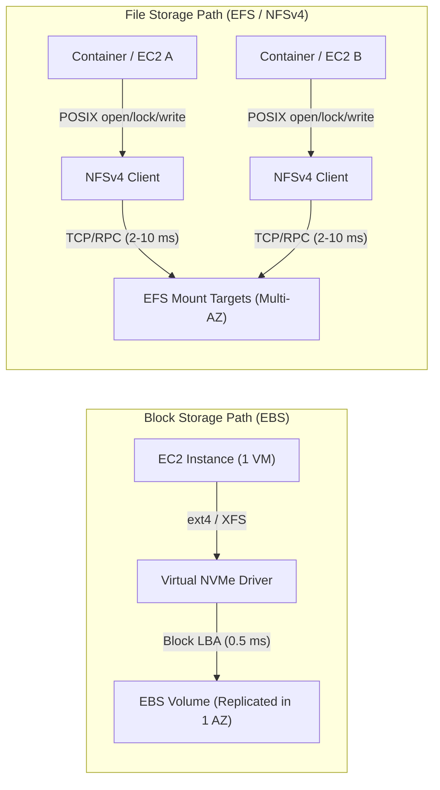
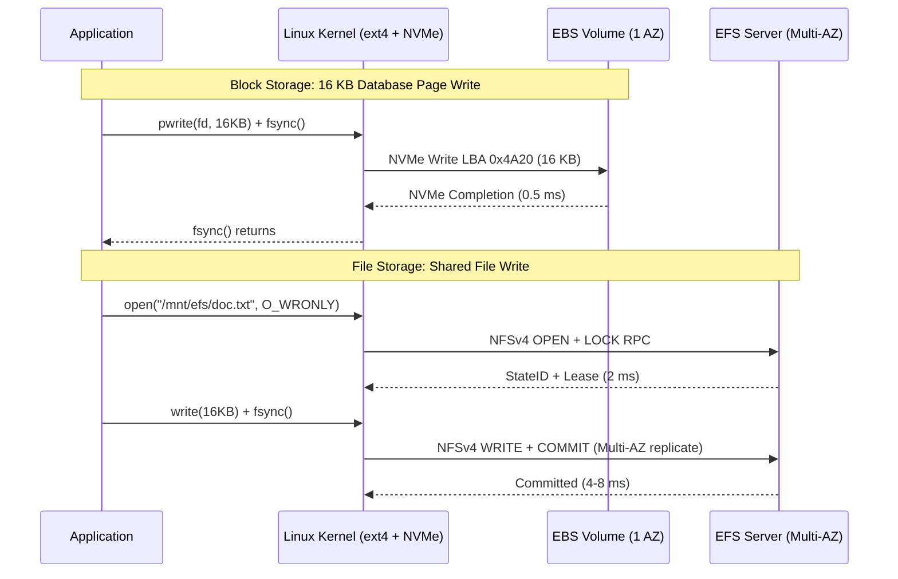
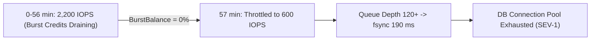

# Block Storage vs File Storage: EBS, EFS, NFS, IOPS and Throughput

> **Prerequisites:** [Lesson 01: Object Storage Fundamentals](../01-object-storage-fundamentals/README.md).  
> **Estimated Reading Time:** 24–28 minutes  
> **Target Audience:** Backend and infrastructure engineers sizing database volumes, shared filesystems, and answering "EBS vs EFS vs S3—which do you pick, and how do you size IOPS and throughput?"  
> **Free PDF Notes:** [Download SD-O-002.pdf](https://backendroadmap.com/notes/system-design/SD-O-002.pdf)

> [!NOTE]
> **In one line:** **Block storage** (EBS, Persistent Disk) gives a single VM raw fixed-size blocks over NVMe/iSCSI for sub-millisecond random I/O (databases, OS disks). **File storage** (EFS, NFS, FSx) mounts a shared POSIX directory tree over the network so *many* compute nodes can read and write the same files concurrently—at the cost of higher latency and network-filesystem locking overhead.

> [!TIP]
> **The Golden Rule:** Put **databases** on **block storage** (or local NVMe) for predictable sub-millisecond IOPS; put **shared POSIX workloads** (CMS assets, ML training checkpoints, legacy lift-and-shift apps) on **file storage**; put **everything else** (uploads, backups, static media) on **object storage**.

---

## 1. What Block Storage and File Storage Are, and What They Aren't

A team deploys a 3-node PostgreSQL cluster and decides to store the Postgres `PGDATA` directory on Amazon EFS (NFSv4) so that if the primary node dies, a standby node can instantly mount the same files. Under load, write latency jumps from 0.8 ms to 18 ms, `fsync()` stalls during checkpointing, and throughput hits a ceiling. Meanwhile, another team puts 500 GB of user-uploaded PDFs onto an EBS `gp3` volume attached to a single EC2 instance—and discovers they cannot autoscale horizontally because a standard EBS volume can only be attached to one EC2 instance at a time.

| Term | Precise Meaning | Example |
| :--- | :--- | :--- |
| **Block Storage** | Raw fixed-size sectors (512 B / 4 KB) addressed by Logical Block Address (LBA); formatted with ext4/XFS by the OS | AWS EBS, GCP Persistent Disk, Azure Managed Disks |
| **File Storage** | Network-attached hierarchical filesystem exposing directories, permissions, and POSIX locks | AWS EFS (NFSv4.1), Azure Files (SMB), FSx for Lustre |
| **IOPS** | Input/Output Operations Per Second—how many discrete reads/writes complete per second | 3,000 IOPS baseline on EBS `gp3` |
| **Throughput (MB/s)** | Bytes transferred per second: $\text{IOPS} \times \text{I/O Block Size}$ | 125 MB/s baseline on `gp3` |
| **Queue Depth** | Number of concurrent in-flight I/O requests waiting on the device | NVMe supports up to 64K queues |
| **Multi-Attach** | Allowing one block volume to attach to multiple VMs (requires a cluster-aware filesystem like GFS2/OCFS2) | EBS `io2` Multi-Attach (up to 16 instances) |
| **Not** | Interchangeable: mounting ext4 via Multi-Attach without a cluster filesystem corrupts metadata immediately | Use NFS/EFS for shared files |

### Why It Matters
1. Choosing between EBS, EFS, and S3 is one of the most frequent "storage layer" probes in system design interviews.
2. Sizing a database volume requires understanding the relationship between **IOPS**, **I/O size**, **throughput**, and **queue depth** (Little's Law for disk!).
3. Knowing the difference between **network-attached block storage** (EBS) and **instance-store local NVMe** prevents catastrophic data loss on VM termination.

---

## 2. Anatomy: Block Storage vs File Storage Data Paths



In **block storage**, the filesystem (`ext4`, `XFS`) lives inside your VM's kernel. The kernel translates file writes into 4 KB–16 KB block writes and sends them over the cloud hypervisor's NVMe-oF fabric to an EBS volume replicated within a **single Availability Zone**. In **file storage**, the filesystem and lock manager live *on the remote EFS servers* across multiple AZs; every `open()`, `stat()`, `write()`, and `fsync()` is a network RPC.

| Dimension | Block Storage (EBS `gp3` / `io2`) | File Storage (EFS / NFSv4) | Instance Store (Local NVMe) |
| :--- | :--- | :--- | :--- |
| **Attachment** | 1 VM (except specialized `io2` Multi-Attach) | Up to thousands of VMs/containers concurrently | Physically soldered to 1 host VM |
| **Scope / Durability** | Single AZ (replicated inside AZ); survives VM stop | Multi-AZ (3+ AZs); survives AZ outage | Ephemeral—lost on host failure or stop |
| **Latency ($p_{50}$)** | 0.2–1.0 ms | 1–10 ms (metadata ops slower) | 0.05–0.15 ms |
| **Max IOPS** | 16,000 (`gp3`) to 256,000 (`io2` Block Express) | 50,000+ read / 10,000+ write (Elastic mode) | 1,000,000+ |
| **Max Throughput** | 1,000 MB/s (`gp3`) to 4,000 MB/s (`io2`) | Up to 10+ GB/s read | 10+ GB/s |
| **Cost (us-east-1)** | ~$0.08/GB-mo (`gp3`) | ~$0.30/GB-mo (EFS Standard) | Bundled with instance (e.g., `i3en`) |

> [!WARNING]
> **The #1 Trap: Metadata Amplification on NFS/EFS.** A single `git status`, `npm install`, or `tar -xf` issues tens of thousands of tiny sequential `stat()` and `create()` RPCs. Even if your EFS throughput is 1 GB/s, **each sequential metadata RPC waits 2–5 ms**, making small-file workloads 10×–50× slower than local disk!

---

## 3. Mathematical Model: IOPS, Throughput, Block Size & Little's Law

Every storage performance bottleneck obeys two fundamental equations:

$$\text{Throughput (MB/s)} = \frac{\text{IOPS} \times \text{I/O Size (KB)}}{1024}$$

$$\text{IOPS}_{\text{achieved}} = \frac{\text{Queue Depth (Concurrency)}}{\text{Average I/O Latency (s)}} \qquad \text{(Little's Law)}$$

Notice how **I/O size** determines whether you hit the **IOPS ceiling** or the **throughput ceiling** first:
- **OLTP databases** (Postgres, MySQL) perform random **8 KB–16 KB** page reads/writes → **IOPS-bound**.
- **Analytics / streaming / backups** perform sequential **256 KB–1 MB** reads/writes → **Throughput-bound**.

**Worked Numerical Example (Sizing EBS `gp3` for PostgreSQL).**
Suppose a PostgreSQL primary needs **8,000 random 16 KB IOPS** at peak, and a `gp3` volume gives 3,000 IOPS + 125 MB/s baseline (expandable up to 16,000 IOPS and 1,000 MB/s):
1. **Required throughput:**
   $$\text{Throughput} = \frac{8{,}000 \times 16\text{ KB}}{1024} = 125\text{ MB/s}$$
   So we must provision **8,000 IOPS** (paying for +5,000 extra IOPS), while the baseline **125 MB/s** throughput is *just* enough (provision 200 MB/s for headroom).
2. **Maximum IOPS at Queue Depth 1:** If a single-threaded batch job issues synchronous 16 KB reads with `0.5 ms` ($0.0005\text{ s}$) latency and queue depth $Q = 1$:
   $$\text{IOPS}_{\text{QD=1}} = \frac{1}{0.0005\text{ s}} = 2{,}000\text{ IOPS}$$
   Even if you pay for 16,000 IOPS, a single-threaded `QD=1` process can never exceed 2,000 IOPS! You need $Q \ge 8{,}000 \times 0.0005 = 4$ concurrent I/O requests to saturate 8,000 IOPS.

---

## 4. Metrics & Percentiles

| Metric | Meaning | Alert when |
| :--- | :--- | :--- |
| **Read/Write Latency ($p_{99}$)** | Time for device to complete an I/O request | > 2 ms on `io2`/`gp3`, > 20 ms on EFS |
| **IOPS Utilization (%)** | $\text{Actual IOPS} / \text{Provisioned IOPS}$ | Sustained > 80% (queueing delay explodes) |
| **Throughput Utilization (%)** | $\text{Actual MB/s} / \text{Provisioned MB/s}$ | Sustained > 80% |
| **Volume Queue Length** | Average number of pending I/O requests | > 4 per volume for OLTP workloads |
| **`gp2` Burst Credit Balance** | Remaining I/O credits (legacy `gp2` volumes) | < 20% (throttles down to 3 IOPS/GB!) |
| **EFS `PercentIOLimit`** | Fraction of EFS filesystem IOPS ceiling used | > 80% |

### Worked Example (`gp2` Burst Exhaustion vs `gp3`)
A 100 GB legacy EBS `gp2` volume has a baseline of **300 IOPS** ($3 \times 100$) and bursts up to **3,000 IOPS** using a 5.4M I/O credit bucket. During a database reindex sustaining 2,000 IOPS, it burns $2{,}000 - 300 = 1{,}700\text{ credits/s}$. After $5{,}400{,}000 / 1{,}700 \approx 3{,}176\text{ s}$ (~53 minutes), the bucket hits zero and the database is abruptly throttled to **300 IOPS**—a 6.7× cliff! Migrating to **`gp3`** decouples IOPS from volume size (3,000 baseline IOPS at 100 GB, zero burst cliff, and 20% cheaper).

---

## 5. Compounding & Failure Modes

How do block and file storage fail at scale?

1. **EC2 Instance Bandwidth Ceiling (The Hidden Cap).** An EBS `io2` volume can deliver 4,000 MB/s, but if you attach it to a `t3.large` or `m6i.large` instance whose EBS-optimized bandwidth cap is **~590 MB/s** (baseline) or **1,250 MB/s** (burst), the VM NIC—not the volume—throttles your database.
2. **Single-AZ Blast Radius of Block Storage.** EBS volumes live in *one* AZ. If `us-east-1a` fails, your EBS volume is unreachable until the AZ recovers. High-availability databases on EBS *must* replicate at the application layer (e.g., Postgres streaming replication to a standby in `us-east-1b`) or use periodic EBS snapshots to S3.
3. **NFS Lock Contention & Stale File Handles.** On EFS/NFS, if a client crashes while holding a POSIX byte-range lock (`fcntl`), other clients block until the NFSv4 lease expires (typically 90 seconds). Storing SQLite on NFS frequently leads to `database is locked` or corruption because POSIX locking semantics over NFS are fragile.
4. **Cross-AZ EFS Latency & Data Transfer.** Mounting an EFS mount target in `az-b` from an EC2 instance in `az-a` adds cross-AZ network latency *and* $0.01/GB cross-AZ data transfer charges on every read and write. Always mount the EFS target in the **same AZ** as the compute node.

---

## 6. Numbers Every Engineer Must Know

| Item | Typical | Implication |
| :--- | :---: | :--- |
| **Local NVMe SSD Latency** | `0.05 – 0.15 ms` | Fastest storage; ephemeral unless replicated |
| **EBS `gp3` / `io2` Latency** | `0.3 – 1.0 ms` | Standard for OLTP databases; single-AZ |
| **EFS (NFSv4) Latency** | `1 – 10 ms` (data), `2 – 15 ms` (metadata) | Good for shared files; poor for small-file bursts |
| **EBS `gp3` Baseline** | `3,000 IOPS`, `125 MB/s` (any size) | Always prefer `gp3` over legacy `gp2` |
| **EBS `io2` Block Express Max** | `256,000 IOPS`, `4,000 MB/s`, `64 TB` | 99.999% (5 nines) durability vs 99.8% for `gp3` |
| **EBS Snapshot Incrementals** | Stored in **S3** (multi-AZ) | Only changed blocks are copied; first restore lazy-loads |
| **Cross-AZ Block Replication** | `0.5 – 2 ms` RTT added per synchronous commit | Why synchronous multi-AZ DB writes cost ~1–2 ms |

---

## 7. Protocol Deep Dive: NVMe Block I/O vs NFSv4 File RPC



| Question | Answer |
| :--- | :--- |
| **Why is EBS faster than EFS?** | EBS avoids per-file RPCs (`OPEN`, `GETATTR`, `LOCK`) and replicates within 1 AZ rather than synchronously across 3 AZs |
| **Why does a newly restored EBS snapshot feel slow at first?** | EBS snapshots live in S3; blocks are **lazy-loaded** on first read unless you enable Fast Snapshot Restore (FSR) or pre-warm with `fio`/`dd` |
| **Can two EC2 instances mount the same `gp3` volume?** | No. Only `io2` supports Multi-Attach, and even then you need a cluster filesystem (GFS2/OCFS2) or you will corrupt the disk |

**When NOT to use Block or File Storage:**
- **Don't use Block Storage** for static user uploads, backups, or data accessed by 100 stateless containers simultaneously (use S3/Object Storage or EFS).
- **Don't use File Storage (EFS/NFS)** for OLTP databases (Postgres, MySQL, MongoDB, SQLite), high-rate message queues, or workloads with millions of tiny (< 4 KB) files.

---

## 8. Hierarchical Budgets & Design Rules

| Slice | Rule | Control |
| :--- | :--- | :--- |
| **Volume Type** | Default to `gp3` over `gp2`; use `io2` only for >16k IOPS or 99.999% durability | Terraform policy / AWS Config rule |
| **Throughput Match** | Size $\text{MB/s} \ge \text{IOPS} \times \text{IO\_Size} / 1024$ and verify EC2 EBS bandwidth | Instance + volume sizing checklist |
| **Durability (EBS)** | EBS is single-AZ; protect databases with cross-AZ replication + automated snapshots | WAL archiving to S3 + hourly snapshots |
| **EFS Mounting** | Always mount the EFS target in the **same AZ** as the compute instance | DNS `<az-id>.<fs-id>.efs.<region>.amazonaws.com` |
| **EFS Performance** | Use **Elastic Throughput** mode for spiky workloads; avoid tiny sequential metadata storms | Cache static assets locally or in Redis/S3 |
| **Encryption** | Encrypt all EBS volumes and EFS filesystems at rest and in transit (TLS for EFS) | KMS CMK + `tls` mount option |

---

## 9. Top Mitigations

1. **Migrate all `gp2` volumes to `gp3`**—live, zero-downtime modification—to eliminate burst-credit cliffs and save ~20% on cost.
2. **Pre-warm EBS volumes restored from snapshots** using Fast Snapshot Restore (FSR) or `fio` before putting a database replica into production traffic.
3. **Check the EC2 instance's EBS bandwidth limit** before upgrading EBS IOPS; a small instance will bottleneck a fast volume.
4. **Use database-level cross-AZ replication** (e.g., Postgres streaming replica in AZ-2) instead of relying on EBS alone for AZ-failure survival.
5. **Mount EFS using the AZ-specific DNS name** so containers never pay cross-AZ latency or $0.01/GB transfer fees.
6. **Enable EFS Lifecycle Management** (move untouched files to EFS Infrequent Access after 30 days) to cut $0.30/GB-mo down to ~$0.016/GB-mo.
7. **Never run SQLite or local-lock-dependent apps on NFS/EFS**; use a proper client-server database or local EBS.

---

## 10. Production Reference: EBS `gp2` Burst Exhaustion During a Traffic Spike

A high-growth SaaS platform ran its primary PostgreSQL database on a **200 GB EBS `gp2`** volume (`600 IOPS` baseline, `3,000 IOPS` burst). Everything ran smoothly at 400 IOPS for months. During a marketing launch, a background analytics job + user traffic pushed disk writes to **2,200 IOPS**.

- **What happened:** For the first 56 minutes, the `gp2` burst bucket masked the load. At minute 57, `BurstBalance` hit `0%`. IOPS dropped instantly from 2,200 to **600**, disk queue depth spiked to 120+, `fsync()` latency jumped from 0.7 ms to **190 ms**, and the API connection pool exhausted—causing a 45-minute SEV-1 outage.
- **Root cause:** Relying on `gp2` burst credits for sustained database I/O without alerting on `BurstBalance`.
- **Fix:** Live-migrated the volume to **`gp3` with 6,000 provisioned IOPS and 250 MB/s throughput** (no burst dependency) and added a CloudWatch alarm at `IOPS > 80%` of provisioned capacity.



---

## 11. Multi-Language Production Code Tabs

A **Storage Sizing & Bottleneck Calculator** that computes required throughput, Little's Law minimum queue depth, `gp2` time-to-exhaustion, and recommends Block vs File vs Object storage.

````carousel
```go
// Go: Storage IOPS/Throughput sizing and gp2 burst-exhaustion calculator.
package sizing

import "math"

type WorkloadSpec struct {
	TargetIOPS      float64
	IOSizeKB        float64
	DeviceLatencyMs float64
}

type SizingResult struct {
	RequiredThroughputMBs float64
	MinQueueDepth         int
	Gp2ExhaustionSeconds  float64
}

func CalculateStorageNeeds(w WorkloadSpec, gp2SizeGB float64) SizingResult {
	throughput := (w.TargetIOPS * w.IOSizeKB) / 1024.0
	latencySec := w.DeviceLatencyMs / 1000.0
	minQD := int(math.Ceil(w.TargetIOPS * latencySec))

	baseline := math.Max(100.0, 3.0*gp2SizeGB)
	exhaustSec := math.Inf(1)
	if w.TargetIOPS > baseline {
		exhaustSec = 5_400_000.0 / (w.TargetIOPS - baseline)
	}
	return SizingResult{
		RequiredThroughputMBs: math.Round(throughput*100) / 100,
		MinQueueDepth:         minQD,
		Gp2ExhaustionSeconds:  math.Round(exhaustSec),
	}
}
```
<!-- slide -->
```typescript
// TypeScript: Storage IOPS/Throughput sizing and gp2 burst-exhaustion calculator.
export interface WorkloadSpec {
  targetIops: number;
  ioSizeKb: number;
  deviceLatencyMs: number;
}

export function calculateStorageNeeds(spec: WorkloadSpec, gp2SizeGb: number) {
  const throughputMbs = (spec.targetIops * spec.ioSizeKb) / 1024;
  const minQueueDepth = Math.ceil(spec.targetIops * (spec.deviceLatencyMs / 1000));
  const gp2Baseline = Math.max(100, 3 * gp2SizeGb);
  const exhaustSeconds =
    spec.targetIops > gp2Baseline ? 5_400_000 / (spec.targetIops - gp2Baseline) : Infinity;

  return {
    throughputMbs: Number(throughputMbs.toFixed(2)),
    minQueueDepth,
    gp2ExhaustionMinutes: Number((exhaustSeconds / 60).toFixed(1)),
  };
}
```
<!-- slide -->
```python
# Python: IOPS, Throughput, Little's Law Queue Depth & gp2 burst-exhaustion calculator.
import math

def size_block_volume(target_iops: float, io_size_kb: float, latency_ms: float, gp2_size_gb: float = 100.0) -> dict:
    throughput_mbs = (target_iops * io_size_kb) / 1024.0
    min_queue_depth = math.ceil(target_iops * (latency_ms / 1000.0))
    gp2_baseline = max(100.0, 3.0 * gp2_size_gb)
    exhaust_s = (
        5_400_000.0 / (target_iops - gp2_baseline)
        if target_iops > gp2_baseline
        else float("inf")
    )
    return {
        "throughput_mbs": round(throughput_mbs, 2),
        "min_queue_depth": min_queue_depth,
        "gp2_baseline_iops": gp2_baseline,
        "gp2_exhaustion_min": round(exhaust_s / 60.0, 1) if math.isfinite(exhaust_s) else None,
    }
```
<!-- slide -->
```csharp
// C#: Storage IOPS/Throughput sizing and gp2 burst-exhaustion calculator.
public sealed record StorageSizing(double ThroughputMBs, int MinQueueDepth, double? Gp2ExhaustionMinutes);

public static class StorageCalculator
{
    public static StorageSizing SizeVolume(
        double targetIops, double ioSizeKb, double latencyMs, double gp2SizeGb = 100)
    {
        double throughputMBs = Math.Round((targetIops * ioSizeKb) / 1024.0, 2);
        int minQd = (int)Math.Ceiling(targetIops * (latencyMs / 1000.0));
        double baseline = Math.Max(100.0, 3.0 * gp2SizeGb);
        double? exhaustMin = targetIops > baseline
            ? Math.Round((5_400_000.0 / (targetIops - baseline)) / 60.0, 1)
            : null;
        return new StorageSizing(throughputMBs, minQd, exhaustMin);
    }
}
```
````

---

## 12. Hands-On CLI Verification Workflows

Benchmark random IOPS vs sequential throughput on Linux using `fio` (never run destructive write tests on mounted production disks):

```bash
# 1. Measure 4 KB random read IOPS at Queue Depth 32
fio --name=randread --ioengine=libaio --direct=1 --bs=4k --iodepth=32 \
    --size=1G --rw=randread --filename=/tmp/fio-test.bin

# 2. Measure 256 KB sequential write throughput
fio --name=seqwrite --ioengine=libaio --direct=1 --bs=256k --iodepth=8 \
    --size=1G --rw=write --filename=/tmp/fio-test.bin
```

Inspect real-time disk queue depth and latency with `iostat`, and live-upgrade EBS `gp2` → `gp3`:

```bash
# Watch await (latency ms), aqu-sz (avg queue depth), and r/s + w/s (IOPS)
iostat -xz 1

# Live zero-downtime upgrade from gp2 to gp3 with 6,000 IOPS and 250 MB/s
aws ec2 modify-volume \
  --volume-id vol-0123456789abcdef0 \
  --volume-type gp3 \
  --iops 6000 \
  --throughput 250
```

---

## 13. Common Mistakes to Avoid

1. **Running OLTP databases (Postgres/MySQL/SQLite) on EFS/NFS** instead of block storage.
2. **Staying on `gp2` without monitoring `BurstBalance`**, leading to sudden throttling cliffs.
3. **Provisioning high-IOPS EBS volumes on small EC2 instances** whose EBS bandwidth cap throttles the volume.
4. **Assuming EBS survives an Availability Zone outage** without cross-AZ DB replication or S3 snapshots.
5. **Mounting EFS across Availability Zones**, paying extra latency and $0.01/GB cross-AZ transfer fees.
6. **Treating instance-store local NVMe as persistent**, losing data when the VM stops or terminates.
7. **Benchmarking with `QD=1` synchronous reads** and wondering why a 16,000-IOPS volume only hits 2,000 IOPS.

---

## 14. Key Terms Glossary

| Key Term | Definition |
| :--- | :--- |
| **Block Storage** | Raw fixed-size sectors (LBA) attached to a VM and formatted with a local filesystem (EBS). |
| **File Storage** | Shared network filesystem (NFSv4/SMB) supporting concurrent multi-node POSIX access (EFS). |
| **IOPS** | Input/Output Operations Per Second; bottleneck for small random I/O (4–16 KB). |
| **Throughput** | Data transfer rate in MB/s ($\text{IOPS} \times \text{I/O Size}$); bottleneck for large sequential I/O. |
| **Queue Depth** | Concurrent in-flight I/O requests; determines achieved IOPS via Little's Law. |
| **Burst Credits (`gp2`)** | Accumulated I/O tokens allowing temporary spikes above baseline 3 IOPS/GB. |
| **Instance Store** | Physically attached host NVMe SSD; ultra-fast (0.1 ms) but ephemeral. |
| **Fast Snapshot Restore** | Pre-hydrating EBS snapshot blocks from S3 so newly restored volumes avoid lazy-load latency. |
| **Multi-Attach** | Attaching one `io2` block volume to multiple VMs (requires a cluster-aware filesystem). |
| **Metadata Amplification** | Performance collapse on NFS/EFS when workloads issue thousands of tiny `stat`/`open` RPCs. |

---

## 15. System Design Interview Questions & Answers

### Basic Conceptual Questions

<details>
<summary><strong>Q1: When do you choose Block Storage (EBS) over File Storage (EFS)? [BASIC]</strong></summary>

**Answer:**
Choose Block Storage (EBS) when a single VM needs sub-millisecond random I/O, such as PostgreSQL, MySQL, Kafka brokers, or OS boot disks. Choose File Storage (EFS) when multiple VMs or containers must concurrently read/write a shared POSIX directory tree.
</details>

<details>
<summary><strong>Q2: What is the difference between IOPS and Throughput? [BASIC]</strong></summary>

**Answer:**
IOPS counts how many discrete I/O operations complete per second; Throughput measures bytes per second ($\text{Throughput} = \text{IOPS} \times \text{I/O Size}$). Databases doing 8–16 KB random I/O are IOPS-bound; video/analytics pipelines doing 256 KB–1 MB sequential I/O are throughput-bound.
</details>

<details>
<summary><strong>Q3: Why is instance-store local NVMe dangerous for primary state? [BASIC]</strong></summary>

**Answer:**
Instance-store NVMe is physically attached to the host server. If the host fails, or you stop/terminate the VM, every byte on that NVMe is permanently lost. Use it only for caches, scratch space, or databases with built-in cluster replication (e.g., Cassandra, Kafka with RF=3).
</details>

<details>
<summary><strong>Q4: Why is `gp3` almost always better than `gp2`? [BASIC]</strong></summary>

**Answer:**
`gp2` ties IOPS to volume size (3 IOPS/GB) and relies on burst credits that can exhaust under sustained load. `gp3` gives 3,000 IOPS and 125 MB/s baseline at any size, lets you scale IOPS and throughput independently, has no burst cliff, and costs ~20% less per GB.
</details>

### Scenario-Based Architecture Questions

<details>
<summary><strong>Q5: A PostgreSQL database needs 10,000 random 16 KB IOPS. How do you size the EBS `gp3` volume? [SCENARIO]</strong></summary>

**Answer:**
Throughput needed is $10{,}000 \times 16\text{ KB} / 1024 \approx 156.25\text{ MB/s}$. Provision `gp3` with at least 10,000 IOPS (12,000 for headroom) and 200 MB/s throughput, verify the EC2 instance's EBS bandwidth exceeds 200 MB/s, and place a streaming replica in a second AZ because EBS is single-AZ.
</details>

<details>
<summary><strong>Q6: You mount EFS on 50 ECS tasks to serve a WordPress/CMS media library, and page loads stall during `composer install` or deploys. Why? [SCENARIO]</strong></summary>

**Answer:**
`composer install` or asset extraction performs thousands of tiny sequential `stat`/`create` metadata RPCs over NFSv4 (2–10 ms each). Keep code/dependencies on the container's local overlay/EBS disk, and use EFS (or better yet, S3 + CloudFront) only for shared user-uploaded media.
</details>

<details>
<summary><strong>Q7: You restored a 2 TB production database from an EBS snapshot, and queries are timing out for the first 30 minutes despite 16,000 provisioned IOPS. Why? [SCENARIO]</strong></summary>

**Answer:**
EBS snapshots live in S3 and **lazy-load** blocks on first read. Every cold page read fetches a block from S3 over the network. Fix it by enabling **Fast Snapshot Restore (FSR)** before restoring, or pre-warming the volume by reading all blocks sequentially (`fio`/`dd`) before routing traffic.
</details>

<details>
<summary><strong>Q8: Two EC2 instances need to share 500 GB of data. A junior engineer proposes EBS Multi-Attach with ext4. What happens? [SCENARIO]</strong></summary>

**Answer:**
`ext4` and `XFS` are single-host filesystems—they cache directory/inode metadata in each VM's RAM without coordination. Mounting the same block device read-write from two VMs with `ext4` will silently corrupt the filesystem. Use **EFS** (or a cluster-aware filesystem like GFS2 on `io2` Multi-Attach).
</details>

### Advanced & Tricky Interview Questions

<details>
<summary><strong>Q9: Your `io2` volume has 0.4 ms latency and 32,000 provisioned IOPS, yet your benchmark only gets 2,500 IOPS. Why? [TRICKY]</strong></summary>

**Answer:**
By Little's Law, $\text{IOPS} = \text{Queue Depth} / \text{Latency}$. At `QD=1` (single-threaded synchronous I/O) and $0.4\text{ ms}$, the theoretical ceiling is $1 / 0.0004 = 2{,}500\text{ IOPS}$. You must increase concurrency (`iodepth >= 13` or async `io_uring`/multiple worker threads) to saturate 32,000 IOPS.
</details>

<details>
<summary><strong>Q10: How does EBS survive a disk failure if it is single-AZ, and why does it still need snapshots? [TRICKY]</strong></summary>

**Answer:**
EBS replicates every write across multiple storage servers/racks within a *single* AZ (99.8%–99.999% annual volume durability). However, an entire AZ outage or power/cooling event makes the volume unreachable, and logical corruption (`DROP TABLE`) replicates instantly—so cross-AZ DB replication and S3 snapshots are still mandatory.
</details>

<details>
<summary><strong>Q11: Why is `fsync()` latency on EFS higher than on EBS even when network RTT is under 0.5 ms? [TRICKY]</strong></summary>

**Answer:**
EFS must synchronously replicate writes across **multiple Availability Zones** (3+ AZs) before acknowledging `COMMIT`, whereas EBS replicates within a single AZ. Cross-AZ fiber RTT plus distributed lock/metadata coordination adds several milliseconds per `fsync()`.
</details>

<details>
<summary><strong>Q12: When would you deliberately choose local NVMe Instance Store over EBS `io2` for a production database? [TRICKY]</strong></summary>

**Answer:**
For ultra-low-latency ($0.1\text{ ms}$) or massive-throughput ($10+\text{ GB/s}$) workloads like **Cassandra, ScyllaDB, ClickHouse, or Kafka** where the database *already* replicates across 3+ nodes in different AZs at the application layer—eliminating the need to pay twice for EBS's underlying replication.
</details>

---

## 16. One-Page Master Cheat Sheet

```
+---------------------------------------------------------------------------------------------------------+
|               BLOCK STORAGE vs FILE STORAGE — MASTER CHEAT SHEET                                        |
+---------------------------------------------------------------------------------------------------------+
| 1. BLOCK (EBS): 1 VM · raw LBA · ext4/XFS in OS · 0.3-1 ms · single-AZ -> Use for OLTP DBs & boot disks.|
| 2. FILE (EFS/NFS): Many VMs · POSIX tree + locks · 1-10 ms · multi-AZ -> Use for shared POSIX files.    |
| 3. LOCAL NVMe: 0.1 ms · ephemeral -> Use for caches or app-replicated DBs (Kafka, Cassandra).           |
+---------------------------------------------------------------------------------------------------------+
| 4. CORE FORMULAS:                                                                                       |
|    Throughput (MB/s) = (IOPS * IO_Size_KB) / 1024                                                       |
|    Achieved IOPS     = Queue_Depth / Latency_sec   (Little's Law: QD=1 @ 0.5 ms caps at 2,000 IOPS!)    |
+---------------------------------------------------------------------------------------------------------+
| 5. WATCH OUT FOR:                                                                                       |
|    - gp2 burst cliff (upgrade to gp3!)      - EC2 EBS bandwidth cap (instance throttles volume)       |
|    - Snapshot lazy-loading (use FSR/prewarm)- NFS metadata storms (stat/open RPCs) & cross-AZ EFS fees. |
+---------------------------------------------------------------------------------------------------------+
```

---

## Further Reading & Sources

- Amazon Web Services, [Amazon EBS Volume Types & Performance](https://docs.aws.amazon.com/ebs/latest/userguide/ebs-volume-types.html).
- Amazon Web Services, [Amazon EFS Performance & Throughput Modes](https://docs.aws.amazon.com/efs/latest/ug/performance.html).
- Brendan Gregg, *Systems Performance: Enterprise and the Cloud* (2nd ed.), Chapter 9 ("Disks").
- Martin Kleppmann, *Designing Data-Intensive Applications*, Chapter 3 ("Storage and Retrieval").

---

## Free PDF Notes

[SD-O-002.pdf](https://backendroadmap.com/notes/system-design/SD-O-002.pdf)

---

## Next

Continue with [Lesson 03: Blob Storage Patterns: Hot, Cool & Archive Tiers, Versioning, WORM](../03-blob-storage-patterns/README.md).
