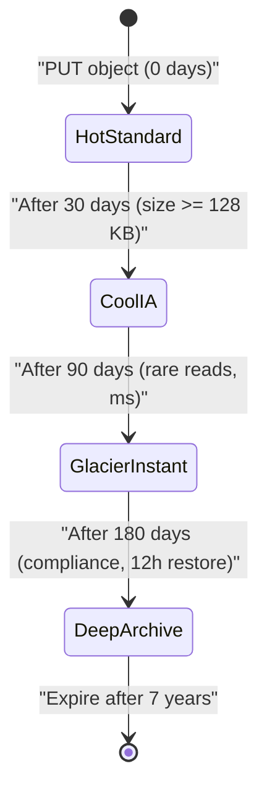
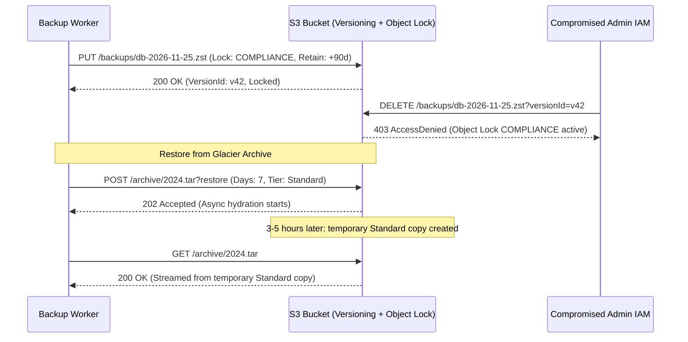
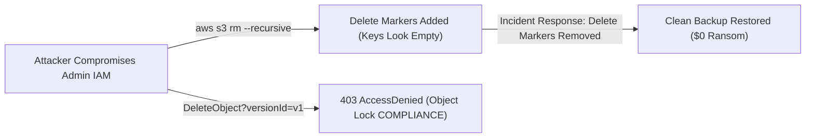

# Blob Storage Patterns: Hot, Cool & Archive Tiers, Versioning, WORM

> **Prerequisites:** [Lesson 02: Block Storage vs File Storage](../02-block-storage-vs-file-storage/README.md).  
> **Estimated Reading Time:** 24–28 minutes  
> **Target Audience:** Backend and cloud architects designing cost-optimized data retention, ransomware-proof backups, and regulatory compliance (SEC, HIPAA, GDPR) on object/blob storage.  
> **Free PDF Notes:** [Download SD-O-003.pdf](https://backendroadmap.com/notes/system-design/SD-O-003.pdf)

> [!NOTE]
> **In one line:** Production object storage is rarely left in a single "Standard/Hot" tier. By combining **lifecycle tiering** (Hot → Cool → Archive), **object versioning** (protecting against accidental overwrites/deletes), and **WORM Object Lock** (Write-Once-Read-Many immutability against ransomware), you cut storage bills by **70–95%** while making backups tamper-proof.

> [!TIP]
> **The Golden Rule:** Never move small or short-lived objects to Cool/Archive tiers—**minimum storage duration** (30–180 days) and **per-object transition fees** can make archiving *more expensive* than leaving data in Standard.

---

## 1. What Blob Storage Patterns Are, and What They Aren't

A fintech company stores 400 TB of daily database snapshots, compliance audit logs, and user-uploaded receipts in S3 Standard ($9,200/month). An engineer adds a naive lifecycle rule to transition *all* objects to Glacier Deep Archive after 7 days—including 2 KB JSON telemetry files that are read back every week by an analytics job. The next month's bill jumps instead of dropping: Glacier Deep Archive charges a 180-day minimum duration, 40 KB of metadata overhead per object, and retrieval fees plus a 12-hour restore wait that breaks the analytics pipeline.

| Term | Precise Meaning | Example |
| :--- | :--- | :--- |
| **Hot / Standard Tier** | Immediate millisecond access, highest $/GB, lowest $/request | S3 Standard, Azure Hot, GCS Standard |
| **Cool / Infrequent Access (IA)** | Lower $/GB (~45% cheaper), higher $/GET, 30-day min duration | S3 Standard-IA, Azure Cool, GCS Nearline |
| **Archive Tier** | Ultra-cheap $/GB (~$0.001–$0.004/GB), offline/async restore (minutes to 12 hours), 90–180 day min | S3 Glacier Flexible / Deep Archive, Azure Archive |
| **Intelligent Tiering** | Automated per-object tiering based on access patterns (small monthly monitoring fee per object) | S3 Intelligent-Tiering |
| **Object Versioning** | Keeps all historical versions of a key; `DELETE` writes a **Delete Marker** instead of erasing bytes | Recovering from `rm -rf` or bad overwrite |
| **WORM (Object Lock)** | Write-Once-Read-Many immutability until a `RetainUntilDate` or `LegalHold` clears | Compliance mode (even root cannot delete) |
| **Not** | A free lunch: Cold/Archive tiers punish frequent reads, early deletes, and tiny (< 128 KB) objects | Batch tiny files into Parquet/tar before archiving |

### Why It Matters
1. Storage cost optimization (Hot vs Cool vs Archive) is a standard follow-up in every media, logging, or backup system design interview.
2. **Versioning + WORM Object Lock** is the industry-standard defense against ransomware and insider sabotage.
3. Knowing **minimum billable size (128 KB)** and **minimum storage duration (30–180 days)** separates production architects from textbook guesses.

---

## 2. Anatomy: Lifecycle State Machine & Versioning Delete Markers



When **Versioning** is enabled, overwriting `report.pdf` creates a new version (`v2`) while `v1` remains stored as a **noncurrent version**. A standard `DELETE report.pdf` does *not* erase `v1` or `v2`; it inserts a **Delete Marker (`v3`)** at the top of the version stack so `GET report.pdf` returns `404 Not Found`. You recover the file simply by deleting the Delete Marker—and you must configure a **NoncurrentVersionExpiration** lifecycle rule so old versions don't accumulate forever.

| Tier (AWS S3 us-east-1) | $/GB-mo | Min Duration | Min Billable Size | Retrieval Time | Best For |
| :--- | :---: | :---: | :---: | :---: | :--- |
| **S3 Standard (Hot)** | `$0.023` | None | None | Milliseconds | Active app data, hot media |
| **S3 Standard-IA (Cool)** | `$0.0125` | 30 days | 128 KB | Milliseconds | Monthly backups, older uploads |
| **S3 Glacier Instant Retrieval** | `$0.004` | 90 days | 128 KB | Milliseconds | Medical images, quarterly reports |
| **S3 Glacier Flexible** | `$0.0036` | 90 days | 40 KB metadata | 1 min – 12 hrs | Disaster recovery snapshots |
| **S3 Glacier Deep Archive** | `$0.00099` | 180 days | 40 KB metadata | 12 – 48 hrs | 7-year SEC/HIPAA/audit retention |

> [!WARNING]
> **The #1 Trap: Small-Object Archiving & Governance vs Compliance Mode.** S3 Standard-IA and Glacier Instant Retrieval bill every object as **at least 128 KB**. If you transition 10 million 4 KB logs, you pay for $10\text{M} \times 128\text{ KB} = 1.28\text{ TB}$ instead of $40\text{ GB}$—a **32× cost explosion**! Likewise, if you use Object Lock **Governance Mode** instead of **Compliance Mode** for ransomware backups, an attacker who compromises an admin IAM role with `s3:BypassGovernanceRetention` can still wipe your backups.

---

## 3. Mathematical Model: Break-Even Access Rate & Small-Object Penalty

When does moving 1 GB from **Hot** ($C_{\text{hot}} = \$0.023/\text{GB-mo}$) to **Cool** ($C_{\text{cool}} = \$0.0125/\text{GB-mo}$) actually save money if Cool charges a retrieval fee ($C_{\text{ret}} = \$0.01/\text{GB read}$)?

Let $r$ be the number of times the entire dataset is read per month. Total monthly cost per GB is:

$$\text{Cost}_{\text{hot}}(r) = C_{\text{hot}}, \qquad \text{Cost}_{\text{cool}}(r) = C_{\text{cool}} + r \cdot C_{\text{ret}}$$

Setting them equal gives the **break-even read frequency** $r^*$:

$$r^* = \frac{C_{\text{hot}} - C_{\text{cool}}}{C_{\text{ret}}} = \frac{0.023 - 0.0125}{0.01} = 1.05\text{ full reads/month}$$

If an object is read **more than ~1 time per month**, keep it in **Hot**; if read **less than once a month** (and survives > 30 days), move it to **Cool**.

**Small-Object Minimum Size Penalty.** For $N$ objects of average size $s_{\text{avg}} < s_{\text{min}}$ (where $s_{\text{min}} = 128\text{ KB}$ in IA):

$$\text{Effective Cost Multiplier} = \frac{s_{\text{min}}}{s_{\text{avg}}}$$

**Worked Numerical Example.** Suppose you have **50 million 4 KB JSON events** ($200\text{ GB}$ raw) and transition them to S3 Standard-IA:
- **Transition API cost:** $50{,}000{,}000 / 1{,}000 \times \$0.01 = \$500$ one-time!
- **Billed IA storage:** $50\text{M} \times 128\text{ KB} \approx 6{,}400\text{ GB} \times \$0.0125 = \$80/\text{month}$ (vs $200\text{ GB} \times \$0.023 = \$4.60/\text{month}$ in Hot!).
- **Fix:** Compact those 4 KB events into **64 MB Parquet/Zstd files** ($3{,}125$ objects) *before* tiering: transition cost drops from **$500 to $0.03**, and IA storage drops from **$80/mo to $2.50/mo**!

---

## 4. Metrics & Percentiles

| Metric | Meaning | Alert when |
| :--- | :--- | :--- |
| **Noncurrent Version Ratio** | $\text{Noncurrent Bytes} / \text{Current Bytes}$ | > 30% (missing `NoncurrentVersionExpiration` rule) |
| **Average Object Size** | $\text{BucketBytes} / \text{ObjectCount}$ | < 128 KB on IA/Intelligent-Tiering buckets |
| **Early-Deletion Fee Spike** | Objects deleted/overwritten before 30/90/180-day min | Any unexpected spike in billing |
| **Archive Restore Queue / Latency** | Time for `RestoreObject` jobs to hydrate to temp copy | Exceeds RTO/RPO SLA during DR drills |
| **Object Lock Compliance Coverage** | % of backup buckets with `COMPLIANCE` mode + MFA Delete | < 100% on critical backup/audit buckets |
| **Delete Marker Count** | Accumulated delete markers slowing `ListObjectsV2` | > 10% of key count (enable `ExpiredObjectDeleteMarker`) |

### Worked Example (1 PB Backup Vault with Versioning)
A backup bucket holds **1 PB** of current snapshots plus **400 TB** of noncurrent versions (retention 30 days). Moving noncurrent versions to Glacier Instant Retrieval ($0.004/GB-mo) after 7 days and expiring them at 30 days reduces noncurrent storage cost from $400{,}000 \times \$0.023 = \$9{,}200/\text{mo}$ to $400{,}000 \times \$0.004 = \$1{,}600/\text{mo}$—saving **$7,600/month** while keeping 30-day instant rollback.

---

## 5. Compounding & Failure Modes

1. **Ransomware & Compromised Root/IAM Credentials.** If an attacker gains admin IAM access, they can delete objects, delete *versions*, and even delete the bucket—unless **Object Lock (Compliance Mode)** is enabled. In Compliance Mode, *nobody* (not even the AWS root account) can shorten the retention date or delete the locked version until `RetainUntilDate` passes.
2. **Tombstone (Delete Marker) Accumulation.** Deleting 10 million keys in a versioned bucket leaves 10 million Delete Markers. `ListObjectsV2` still scans them, slowing listings from 50 ms to minutes. Always enable `ExpiredObjectDeleteMarker: true` in your lifecycle policy.
3. **Restore Storm During Disaster Recovery.** If 500 TB of backups sit in Glacier Deep Archive (12–48 hr restore) and you need a 2-hour RTO, you miss your SLA by 10+ hours. Archive tiers trade **RTO** for **cost**.
4. **Intelligent-Tiering Monitoring Fee on Tiny Objects.** S3 Intelligent-Tiering charges `$0.0025` per 1,000 objects/month for monitoring—and skips objects `< 128 KB` entirely. On 1 billion 10 KB objects, you pay `$2,500/month` in monitoring fees for *zero* tiering savings.

---

## 6. Numbers Every Engineer Must Know

| Item | Typical | Implication |
| :--- | :---: | :--- |
| **Hot vs Cool Break-Even** | `~1 full read / month` | Read > 1×/mo → keep in Hot; < 1×/mo → Cool |
| **IA / Intelligent-Tiering Min Size** | `128 KB` per object | Compact small files into Parquet/tar before tiering |
| **Min Retention Windows** | `30d` (IA), `90d` (Glacier), `180d` (Deep) | Deleting early still bills the remaining days |
| **Deep Archive Cost** | `~$0.00099 / GB-mo` (~$1 / TB-mo) | 23× cheaper than S3 Standard |
| **Glacier Restore Time** | `1–5 min` (Expedited), `3–5 hr` (Std), `12–48 hr` (Deep) | Match tier to your Recovery Time Objective (RTO) |
| **WORM Compliance Mode** | Immutable even to AWS Root | Test with short retention (1 day) in staging first! |

---

## 7. Protocol Deep Dive: WORM Object Lock & Glacier Restore Flow



| Question | Answer |
| :--- | :--- |
| **Governance vs Compliance Mode?** | **Governance** allows `s3:BypassGovernanceRetention` override; **Compliance** blocks *everyone* including root until `RetainUntilDate` |
| **What is a Legal Hold?** | An independent `ON/OFF` lock with no expiry date; blocks deletion even if `RetainUntilDate` has passed |
| **Does `RestoreObject` permanently move an archived object to Hot?** | No—it creates a **temporary** Standard copy for `Days` days, then deletes the temp copy while the Archive copy stays |

**When NOT to use Tiering / WORM:**
- **Don't use Cool/Archive** for objects `< 128 KB` or objects deleted within 30 days (ephemeral temp files, CI build artifacts).
- **Don't use WORM Compliance Mode** on buckets where GDPR "Right to Erasure" requires deleting individual user records before retention expires (encrypt per-user with a KMS/DEK key and **crypto-shred** the key instead, or keep PII out of WORM buckets).

---

## 8. Hierarchical Budgets & Design Rules

| Slice | Rule | Control |
| :--- | :--- | :--- |
| **Small Files** | Never transition objects < 128 KB to IA/Glacier | Batch/compact into 64–256 MB Parquet or `.tar.zst` |
| **Lifecycle Rules** | Always pair `Transition` with `NoncurrentVersionExpiration` & `AbortIncompleteMultipartUpload` | Standard Terraform bucket module |
| **RTO Alignment** | Match archive tier to Disaster Recovery RTO | Instant Retrieval (ms RTO) vs Deep Archive (12–48h RTO) |
| **Ransomware** | Enable Versioning + Object Lock **COMPLIANCE** on backup/audit buckets | Separate AWS backup account + SCPs |
| **Delete Markers** | Clean up orphaned delete markers automatically | `ExpiredObjectDeleteMarker: true` |
| **GDPR + WORM** | Never mix mutable PII with immutable WORM buckets | Envelope-encrypt per tenant; crypto-shred key on erasure |

---

## 9. Top Mitigations

1. **Compact tiny files (< 128 KB)** into 64 MB+ archives before transitioning to Cool or Archive tiers.
2. **Always configure `NoncurrentVersionExpiration`** (e.g., 30–90 days) when enabling Versioning, or old versions silently double your bill.
3. **Enable `Object Lock (COMPLIANCE)`** on all immutable audit logs and disaster-recovery backup buckets.
4. **Monitor `S3 Storage Lens`** for average object size, noncurrent version percentage, and incomplete multipart bytes.
5. **Test `RestoreObject` in DR drills**—never discover during a SEV-1 that your backups take 12 hours to thaw.
6. **Use S3 Batch Operations** if you need to retroactively apply Object Lock or restore thousands of archived keys.

---

## 10. Production Reference: Ransomware Attack Defeated by Versioning + Object Lock

A mid-sized healthcare SaaS suffered an IAM credential leak when a developer's CI token was exposed. The attacker used the compromised admin role to encrypt production RDS databases and issued `aws s3 rm --recursive` against the company's primary backup bucket.

- **What happened:** The attacker's `aws s3 rm` succeeded in placing **Delete Markers** on the current keys, making the bucket appear empty in the console. However, the backup bucket had **Versioning + Object Lock (Compliance Mode, 30-day retention)** enabled. When the attacker tried to delete the underlying `VersionId`s and shorten the retention period, S3 rejected every call with `403 AccessDenied`.
- **Recovery:** The security team revoked the leaked IAM credentials, removed the Delete Markers via a 10-line script, and restored the RDS snapshots from the intact `v1` backup objects within 2 hours—paying **$0 ransom**.



---

## 11. Multi-Language Production Code Tabs

A **Tier Cost & Break-Even Analyzer** plus **Safe Versioned Restore (removing Delete Markers)** pattern.

````carousel
```go
// Go: Storage tier break-even & small-object penalty calculator.
package blobpatterns

import "math"

type TierCost struct {
	Name          string
	PerGBMonth    float64
	RetrievalPerGB float64
	MinSizeKB     float64
}

func MonthlyCostPerGB(t TierCost, avgObjKB float64, readsPerMonth float64) float64 {
	// Effective billed size cannot be less than MinSizeKB
	multiplier := math.Max(1.0, t.MinSizeKB/avgObjKB)
	storageCost := t.PerGBMonth * multiplier
	retrievalCost := readsPerMonth * t.RetrievalPerGB
	return math.Round((storageCost+retrievalCost)*10000) / 10000
}

func BreakEvenReadsPerMonth(hotPerGB, coolPerGB, coolRetrievalPerGB float64) float64 {
	if coolRetrievalPerGB <= 0 {
		return math.Inf(1)
	}
	return math.Round(((hotPerGB-coolPerGB)/coolRetrievalPerGB)*100) / 100
}
```
<!-- slide -->
```typescript
// TypeScript: Tier cost model accounting for 128 KB minimum billable size & retrieval fees.
export interface TierSpec {
  name: string;
  perGbMonth: number;
  retrievalPerGb: number;
  minSizeKb: number;
}

export function effectiveMonthlyCost(
  tier: TierSpec,
  rawGb: number,
  avgObjectKb: number,
  readsPerMonth: number
): number {
  const sizeMultiplier = Math.max(1, tier.minSizeKb / avgObjectKb);
  const storage = rawGb * sizeMultiplier * tier.perGbMonth;
  const retrieval = rawGb * readsPerMonth * tier.retrievalPerGb;
  return Number((storage + retrieval).toFixed(2));
}

export function breakEvenReads(hotPerGb = 0.023, coolPerGb = 0.0125, retrievalPerGb = 0.01): number {
  return Number(((hotPerGb - coolPerGb) / retrievalPerGb).toFixed(2));
}
```
<!-- slide -->
```python
# Python: Tier cost & small-object penalty simulator (stdlib only).
def compare_tiers(raw_gb: float, avg_obj_kb: float, reads_per_month: float) -> dict[str, float]:
    tiers = {
        "hot_standard":  {"gb_mo": 0.0230,  "ret_gb": 0.00, "min_kb": 0.0},
        "cool_ia":       {"gb_mo": 0.0125,  "ret_gb": 0.01, "min_kb": 128.0},
        "glacier_inst":  {"gb_mo": 0.0040,  "ret_gb": 0.03, "min_kb": 128.0},
        "deep_archive":  {"gb_mo": 0.00099, "ret_gb": 0.02, "min_kb": 40.0},
    }
    out = {}
    for name, t in tiers.items():
        mult = max(1.0, t["min_kb"] / avg_obj_kb) if avg_obj_kb > 0 else 1.0
        cost = raw_gb * mult * t["gb_mo"] + raw_gb * reads_per_month * t["ret_gb"]
        out[name] = round(cost, 2)
    return out
```
<!-- slide -->
```csharp
// C#: Storage tier cost & break-even calculator.
public sealed record StorageTier(string Name, double PerGbMonth, double RetrievalPerGb, double MinSizeKb);

public static class TierAnalyzer
{
    public static double MonthlyCost(StorageTier tier, double rawGb, double avgObjKb, double readsPerMonth)
    {
        double multiplier = Math.Max(1.0, tier.MinSizeKb / avgObjKb);
        double storage = rawGb * multiplier * tier.PerGbMonth;
        double retrieval = rawGb * readsPerMonth * tier.RetrievalPerGb;
        return Math.Round(storage + retrieval, 2);
    }

    public static double BreakEvenReadsPerMonth(
        double hotPerGb = 0.023, double coolPerGb = 0.0125, double retrievalPerGb = 0.01)
        => Math.Round((hotPerGb - coolPerGb) / retrievalPerGb, 2);
}
```
````

---

## 12. Hands-On CLI Verification Workflows

Verify the small-object penalty and break-even math in Python:

```bash
python -c "
# 200 GB of 4 KB objects in Standard-IA (128 KB min billable size = 32x penalty!)
raw_gb, avg_kb = 200, 4
hot = raw_gb * 0.023
ia_penalty = raw_gb * (128 / avg_kb) * 0.0125
print(f'Hot: \${hot:.2f}/mo vs IA with 4KB objects: \${ia_penalty:.2f}/mo (32x penalty!)')
print(f'Break-even reads/mo (Hot vs IA): {(0.023 - 0.0125)/0.01:.2f}')
"
```

Configure Versioning, Object Lock, and Glacier Restore via AWS CLI:

```bash
# 1. Enable Versioning on a bucket
aws s3api put-bucket-versioning \
  --bucket prod-backups-vault \
  --versioning-configuration Status=Enabled

# 2. List Delete Markers to recover accidentally deleted keys
aws s3api list-object-versions \
  --bucket prod-backups-vault \
  --query "DeleteMarkers[?IsLatest==\`true\`].[Key,VersionId]"

# 3. Initiate a 7-day Glacier restore
aws s3api restore-object \
  --bucket prod-backups-vault \
  --key snapshots/2024-01.tar.zst \
  --restore-request '{"Days":7,"GlacierJobParameters":{"Tier":"Standard"}}'
```

---

## 13. Common Mistakes to Avoid

1. **Transitioning millions of tiny (< 128 KB) files to IA/Glacier**, paying 128 KB minimum size + transition fees.
2. **Enabling Versioning without `NoncurrentVersionExpiration`**, letting overwritten versions grow unboundedly.
3. **Using Object Lock Governance Mode for ransomware protection**, which an attacker with admin IAM can bypass.
4. **Assuming Glacier Deep Archive restores instantaneously** when your DR Recovery Time Objective is 1 hour.
5. **Deleting objects from IA/Glacier before 30/90/180 days**, triggering early-deletion charges.
6. **Putting GDPR-erasable PII into WORM Compliance buckets** without per-user crypto-shredding.
7. **Forgetting `ExpiredObjectDeleteMarker` cleanup**, letting delete markers slow `ListObjectsV2`.

---

## 14. Key Terms Glossary

| Key Term | Definition |
| :--- | :--- |
| **Hot / Standard Tier** | Highest $/GB storage class with millisecond access and no minimum duration. |
| **Cool / IA Tier** | Lower $/GB storage for infrequently read data (30-day min, 128 KB min size, retrieval fee). |
| **Archive Tier** | Lowest $/GB offline storage requiring asynchronous `RestoreObject` (minutes to 48 hours). |
| **Lifecycle Policy** | Declarative rules automating tier transitions and version/multipart expirations. |
| **Object Versioning** | Retaining every overwrite and delete as immutable historical `VersionId`s. |
| **Delete Marker** | Placeholder version inserted by `DELETE` in a versioned bucket; hides key with `404`. |
| **WORM (Object Lock)** | Write-Once-Read-Many immutability preventing deletion/overwrite until `RetainUntilDate`. |
| **Governance vs Compliance** | Bypassable by privileged IAM (`Governance`) vs unbreakable even by root (`Compliance`). |
| **Legal Hold** | Indefinite `ON/OFF` immutability flag independent of retention dates. |
| **Crypto-Shredding** | Destroying a user's encryption key to render WORM-locked PII permanently unreadable. |

---

## 15. System Design Interview Questions & Answers

### Basic Conceptual Questions

<details>
<summary><strong>Q1: What are the three main blob storage tiers and when do you use each? [BASIC]</strong></summary>

**Answer:**
**Hot/Standard** for frequently accessed data; **Cool/IA** for data read less than ~1×/month with millisecond access (e.g., 30-day-old uploads); **Archive** (Glacier/Deep Archive) for compliance or disaster recovery backups where minutes-to-hours restore latency is acceptable.
</details>

<details>
<summary><strong>Q2: How does Object Versioning handle a `DELETE` request? [BASIC]</strong></summary>

**Answer:**
It does not delete the underlying bytes. Instead, it inserts a **Delete Marker** as the latest version, so normal `GET`s return `404 Not Found`. You can restore the object by deleting the Delete Marker, or permanently erase it by deleting the specific `VersionId`.
</details>

<details>
<summary><strong>Q3: What is WORM storage (Object Lock)? [BASIC]</strong></summary>

**Answer:**
Write-Once-Read-Many storage prevents an object version from being overwritten or deleted until a specified `RetainUntilDate` or `LegalHold` is lifted—used for SEC/HIPAA compliance and ransomware-proof backups.
</details>

<details>
<summary><strong>Q4: What is the difference between Glacier Instant Retrieval and Glacier Deep Archive? [BASIC]</strong></summary>

**Answer:**
Glacier Instant Retrieval costs ~$0.004/GB-mo and serves reads in **milliseconds** (90-day min). Glacier Deep Archive costs ~$0.00099/GB-mo (4× cheaper) but requires an asynchronous `RestoreObject` job taking **12–48 hours** (180-day min).
</details>

### Scenario-Based Architecture Questions

<details>
<summary><strong>Q5: A team moves 100M 5 KB log files to S3 Standard-IA and the bill triples. Why? [SCENARIO]</strong></summary>

**Answer:**
S3 Standard-IA bills a **128 KB minimum** per object ($25.6\times$ the actual 5 KB size) plus `$0.01` per 1,000 transition requests ($1,000 just to transition!). Compact the 5 KB logs into 64 MB Parquet/Zstd files *before* transitioning.
</details>

<details>
<summary><strong>Q6: Design a ransomware-proof backup architecture on S3. [SCENARIO]</strong></summary>

**Answer:**
Write backups to a **dedicated isolated AWS account** (separate from production IAM) with **Bucket Versioning** and **Object Lock in Compliance Mode** (e.g., 30-day retention). Even if production admin credentials are stolen, the attacker cannot delete or shorten the lock on existing backup versions.
</details>

<details>
<summary><strong>Q7: Your app stores user avatars that are overwritten frequently. You enabled Versioning 2 years ago and storage grew 10x. Fix it. [SCENARIO]</strong></summary>

**Answer:**
Every overwrite created a retained noncurrent version. Add a lifecycle rule with `NoncurrentVersionExpiration` (e.g., delete noncurrent versions after 7–30 days) and `ExpiredObjectDeleteMarker: true` to prune old versions and delete markers automatically.
</details>

<details>
<summary><strong>Q8: When does Hot storage beat Cool storage? [SCENARIO]</strong></summary>

**Answer:**
At the break-even read rate $r^* = (C_{\text{hot}} - C_{\text{cool}}) / C_{\text{ret}} \approx (0.023 - 0.0125)/0.01 = 1.05$ full reads/month. Any dataset read more than ~1×/month—or deleted before 30 days, or averaging < 128 KB per object—is cheaper in Hot/Standard.
</details>

### Advanced & Tricky Interview Questions

<details>
<summary><strong>Q9: How do you satisfy GDPR "Right to Erasure" if audit/backup data is stored in a WORM Compliance bucket? [TRICKY]</strong></summary>

**Answer:**
Use **crypto-shredding**: encrypt each user's PII with a unique per-user Data Encryption Key (DEK) stored in a mutable KMS/key vault *outside* the WORM bucket. On a GDPR deletion request, delete the user's DEK—the WORM-locked ciphertext remains immutable for compliance but is mathematically unrecoverable.
</details>

<details>
<summary><strong>Q10: Why did S3 Intelligent-Tiering not save money on a bucket with 500M 20 KB IoT payloads? [TRICKY]</strong></summary>

**Answer:**
Intelligent-Tiering skips objects **smaller than 128 KB** (leaving them in Frequent Access) *and* charges `$0.0025` per 1,000 objects/month in monitoring fees ($1,250/month for 500M objects) for zero tiering benefit.
</details>

<details>
<summary><strong>Q11: What happens if you call `RestoreObject` on a Glacier object and read it 10 days later when `Days=7`? [TRICKY]</strong></summary>

**Answer:**
The temporary Standard copy expired after 7 days; the `GET` fails with `403 InvalidObjectState` and you must issue `RestoreObject` again and wait 3–12 hours.
</details>

<details>
<summary><strong>Q12: Why is Governance Mode insufficient against a determined attacker? [TRICKY]</strong></summary>

**Answer:**
An attacker who compromises an admin IAM principal can grant themselves `s3:BypassGovernanceRetention` and delete Governance-locked objects immediately. Only **Compliance Mode** prevents even the root account from deleting locked versions before `RetainUntilDate`.
</details>

---

## 16. One-Page Master Cheat Sheet

```
+---------------------------------------------------------------------------------------------------------+
|                  BLOB STORAGE PATTERNS — MASTER CHEAT SHEET                                             |
+---------------------------------------------------------------------------------------------------------+
| 1. TIERS: Hot ($0.023) -> Cool/IA ($0.0125, 30d min) -> Glacier Inst ($0.004, ms) -> Deep ($0.00099,12h)|
| 2. BREAK-EVEN: Cool beats Hot only if read < ~1x/month AND age >= 30d AND object size >= 128 KB.        |
| 3. TINY FILES TRAP: IA/Glacier bill >= 128 KB/obj -> compact 4 KB logs into 64 MB Parquet/tar first!    |
| 4. VERSIONING: DELETE adds a Delete Marker; always pair with NoncurrentVersionExpiration (7-30d).       |
| 5. WORM (OBJECT LOCK): Use COMPLIANCE Mode (not Governance) in a separate account for ransomware defense|
|    and use per-user crypto-shredding if GDPR Right-to-Erasure applies.                                  |
+---------------------------------------------------------------------------------------------------------+
```

---

## Further Reading & Sources

- Amazon Web Services, [Amazon S3 Storage Classes & Lifecycle Transitions](https://docs.aws.amazon.com/AmazonS3/latest/userguide/storage-class-intro.html).
- Amazon Web Services, [Protecting Data with Amazon S3 Object Lock (WORM)](https://docs.aws.amazon.com/AmazonS3/latest/userguide/object-lock.html).
- Microsoft Azure, [Access Tiers for Blob Data (Hot, Cool, Cold, Archive)](https://learn.microsoft.com/en-us/azure/storage/blobs/access-tiers-overview).
- Google Cloud, [Cloud Storage Classes & Autoclass](https://cloud.google.com/storage/docs/storage-classes).

---

## Free PDF Notes

[SD-O-003.pdf](https://backendroadmap.com/notes/system-design/SD-O-003.pdf)

---

## Next

Continue with [Lesson 04: File Upload Architecture: Direct Uploads, Virus Scanning & Events](../04-file-upload-architecture/README.md).
