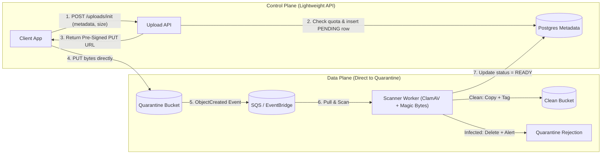
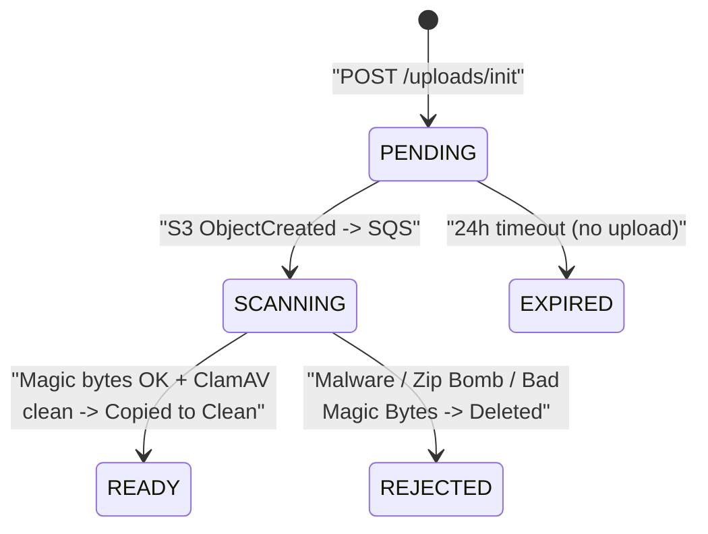
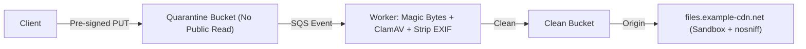

# File Upload Architecture: Direct Uploads, Virus Scanning & Events

> **Prerequisites:** [Lesson 03: Blob Storage Patterns](../03-blob-storage-patterns/README.md).  
> **Estimated Reading Time:** 24–28 minutes  
> **Target Audience:** Backend engineers building scalable media/document upload pipelines, and candidates asked "how do you handle 100k concurrent file uploads without melting your API servers?"  
> **Free PDF Notes:** [Download SD-O-004.pdf](https://backendroadmap.com/notes/system-design/SD-O-004.pdf)

> [!NOTE]
> **In one line:** Never proxy user file bytes through your application servers. Use the **Claim-Check / Direct-to-Object-Store** pattern: your API authenticates the request, enforces quotas, and issues a short-lived **pre-signed URL** to a **quarantine bucket**; the client uploads directly to S3/Blob, which triggers an **event-driven pipeline** (ClamAV/malware scan, magic-byte validation, thumbnailing) before promoting the file to the **clean bucket**.

> [!TIP]
> **The Golden Rule:** **Quarantine first, promote on clean.** Never allow public or downstream reads from the raw upload bucket—always scan and validate uploaded bytes asynchronously in an isolated quarantine bucket before moving them to production storage.

---

## 1. What File Upload Architecture Is, and What It Isn't

A team builds `POST /api/v1/upload` in Node.js/Go, buffering 50 MB PDFs and 500 MB videos in the API server's RAM before forwarding them to S3. At 500 concurrent uploads, the API fleet hits out-of-memory (OOM) kills, NAT/egress bandwidth doubles (once in from the user, once out to S3), and load-balancer 60-second request timeouts drop half the mobile uploads. Worse, an attacker uploads an HTML file with embedded `<script>` or an EICAR malware payload, and the CDN serves it directly to other users.

| Term | Precise Meaning | Example |
| :--- | :--- | :--- |
| **Proxied Upload (Anti-pattern)** | Client → Load Balancer → API Server → S3 (double bandwidth, ties up worker threads) | `POST /upload` buffering `multipart/form-data` |
| **Direct Upload (Claim-Check)** | API issues a pre-signed URL; Client `PUT`s bytes directly to S3/Blob | S3 Pre-Signed `PUT` / Azure SAS URL |
| **Quarantine (Staging) Bucket** | Untrusted landing zone where un-scanned uploads sit with zero public/CDN access | `s3://uploads-quarantine/` |
| **Clean (Production) Bucket** | Trusted bucket holding only malware-free, magic-byte-verified objects | `s3://uploads-clean/` |
| **Event-Driven Post-Processing** | S3 `ObjectCreated` event → SQS/EventBridge → Scanner + Transcoder workers | ClamAV + FFmpeg worker fleet |
| **Magic-Byte Validation** | Checking file header bytes (`%PDF-`, `89 50 4E 47`) rather than trusting `.pdf`/`.png` | Rejecting `malware.exe` renamed to `avatar.png` |
| **Not** | Trusting client `Content-Type` headers or assuming an upload finished just because you issued a URL | Verify via S3 event / `HeadObject` |

### Why It Matters
1. Direct-to-object-store upload is the canonical answer to "how do you upload large files at scale?" in system design interviews.
2. Separating **control plane** (auth, quota, metadata DB) from **data plane** (raw gigabytes flowing to S3) lets a tiny API fleet handle petabytes of uploads.
3. Asynchronous **quarantine → virus scan → promote** prevents both XSS/malware delivery and synchronous upload timeouts.

---

## 2. Anatomy: Proxied Upload vs Direct Quarantine-and-Promote Pipeline



Notice how **zero file bytes** touch `Upload API` or `Postgres`:
1. Client sends `{ filename, sizeBytes, contentType }` to `Upload API`.
2. `Upload API` checks user quota, creates a `PENDING` record with a UUID key, and signs a **5-minute pre-signed `PUT` URL** constrained by `Content-Length` and `Content-Type`.
3. Client uploads directly to `Quarantine Bucket` (using multipart upload for files > 100 MB).
4. `Quarantine Bucket` emits an `ObjectCreated` event to SQS/EventBridge.
5. `Scanner Worker` downloads the object, checks **magic bytes**, runs **ClamAV**, strips EXIF GPS metadata from images, copies the clean file to `Clean Bucket`, deletes it from Quarantine, and marks the DB row `READY`.

| Dimension | Proxied Through API | Direct Pre-Signed Upload |
| :--- | :--- | :--- |
| **API Memory / CPU** | High (buffers/streams every MB) | Near zero (signs URL in < 1 ms) |
| **Network Bandwidth** | $2\times$ (Ingress to API + Egress to S3) | $1\times$ (Direct to S3 edge) |
| **Timeout Risk** | High (LB 60s timeout kills slow 3G uploads) | Low (S3 handles long streams + multipart) |
| **Max Scale** | Bottlenecked by API pod count | Scales to S3's 3,500+ PUT/s per prefix |

> [!WARNING]
> **The #1 Trap: Trusting the Client Callback Instead of S3 Events.** Never mark an upload `READY` solely because the client called `POST /uploads/complete`. A malicious client can skip the `PUT` or upload a 0-byte file and still call `/complete`. Always drive state transitions (`PENDING` → `SCANNING` → `READY` / `INFECTED`) from **server-side S3 `ObjectCreated` events** (or verify via `HeadObject` + `ETag` + `ContentLength`).

---

## 3. Mathematical Model: Bandwidth Amplification & Scanner Queueing

**Bandwidth & Fleet Cost Savings.** Suppose $R = 200$ concurrent users upload $S = 25\text{ MB}$ files over $T = 10\text{ s}$:

$$\text{Aggregate Upload Rate} = \frac{R \times S}{T} = \frac{200 \times 25\text{ MB}}{10\text{ s}} = 500\text{ MB/s} = 4\text{ Gbps}$$

- **Proxied through API:** Your API fleet needs **4 Gbps ingress + 4 Gbps egress = 8 Gbps** NIC capacity and **5 GB** of in-flight RAM buffers (`200 × 25 MB`).
- **Direct to S3:** Your API fleet handles 200 tiny 1 KB JSON `init` requests ($\approx 20\text{ KB/s}$!)—a **25,000× reduction** in API data-plane traffic.

**Virus Scanner Capacity (Little's Law).** If average upload arrival rate is $\lambda = 40\text{ files/s}$ and each ClamAV worker takes $W = 0.25\text{ s}$ per file ($\mu_{\text{worker}} = 4\text{ files/s}$):

$$\text{Minimum Workers} = \left\lceil \frac{\lambda}{\mu_{\text{worker}}} \right\rceil = \left\lceil \frac{40}{4} \right\rceil = 10\text{ workers (provision 15 for 50\% headroom)}$$

---

## 4. Metrics & Percentiles

| Metric | Meaning | Alert when |
| :--- | :--- | :--- |
| **Time-to-Ready ($p_{99}$)** | Time from S3 `ObjectCreated` to `READY` in DB | > 10 s for documents/images |
| **Scanner Queue Depth / Age** | Backlog in upload SQS queue | Oldest message > 30 s (scale scanner pods) |
| **Infected / Magic-Mismatch Rate** | % of uploads failing ClamAV or header check | Sudden spike (active abuse / bot attack) |
| **Abandoned `PENDING` Ratio** | `init` calls never followed by an S3 `ObjectCreated` | > 30% (check client UX or URL expiry too short) |
| **ClamAV Signature Age** | Hours since `freshclam` updated virus definitions | > 6 hours (stale signatures miss zero-days) |
| **Pre-Signed URL `403` Rate** | Expired URLs or `Content-Length`/`Content-Type` mismatches | > 1% of upload attempts |

### Worked Example (`PENDING` → `READY` Pipeline)
An enterprise SaaS receives **1,000,000 PDF/image uploads/day** (~11.5/s average, 60/s peak):
- API `init` endpoint: 60 req/s × 1 KB = **60 KB/s** (2 small Go/Node pods handle it easily).
- Scanner fleet: at 60/s peak and 250 ms/scan, $60 \times 0.25 = 15$ concurrent workers needed; autoscaling 8–24 ECS/K8s pods keeps $p_{99}$ scan latency under 2 seconds.
- Abandoned `PENDING` rows: a daily cron cleans up DB rows stuck in `PENDING` > 24 hours, while Quarantine's 1-day lifecycle rule auto-deletes unpromoted objects.

---

## 5. Compounding & Failure Modes

1. **Duplicate `ObjectCreated` Events.** S3 Event Notifications are **at-least-once**. If the scanner receives the same event twice after already moving the file out of Quarantine, `GetObject` returns `404 NoSuchKey`—the worker must treat `NoSuchKey` (when DB status is already `READY`) as idempotent success, not a retryable error that clogs the DLQ.
2. **Zip Bombs & Decompression DoS.** A 42 KB `.zip` (`42.zip`) decompresses to 4.5 PB and crashes naive scanner workers. Always enforce strict decompression byte limits, timeout bounds, and memory cgroups on scanner containers.
3. **Polyglot / Stored XSS Files.** An attacker uploads an `.svg` or `.html` containing `<script>alert(document.cookie)</script>`. If served inline from your app domain, it executes XSS! Always serve user uploads from a **separate sandbox domain** (`usercontent.example-cdn.com`) with `Content-Disposition: attachment` and `X-Content-Type-Options: nosniff`.
4. **EXIF GPS Privacy Leak.** Smartphone JPEGs embed exact GPS coordinates and camera serial numbers in EXIF headers. Strip EXIF metadata during the post-upload processing step before promoting images to the clean bucket.

---

## 6. Numbers Every Engineer Must Know

| Item | Typical | Implication |
| :--- | :---: | :--- |
| **Pre-Signed URL TTL** | `1–15 minutes` | Short enough to limit leak blast radius; long enough for slow mobile |
| **Multipart Threshold** | `> 100 MB` (required > `5 GB`) | Enables parallel chunk upload and per-part resume on flaky networks |
| **Quarantine Lifecycle Expiry** | `1–3 days` | Auto-purges crashed/unscanned uploads without manual scripts |
| **ClamAV Scan Latency** | `50–300 ms` (images/PDFs) | Keep `clamd` daemon warm in RAM (cold CLI `clamscan` takes 10+ s!) |
| **S3 Event Delivery Latency** | `100 ms – 2 s` | Design UI with optimistic upload progress + polling/WebSocket for `READY` |
| **Sandbox Download Domain** | Separate origin from main app | Prevents stored XSS / cookie theft from uploaded HTML/SVG |

---

## 7. Protocol Deep Dive: Quarantine-to-Clean State Machine & Security Headers



| Question | Answer |
| :--- | :--- |
| **Why `clamd` daemon instead of `clamscan`?** | `clamscan` reloads ~300 MB of virus signatures from disk on every invocation (10–15 s); `clamd` keeps signatures in RAM and scans in ~100 ms |
| **How do you cap upload size on a pre-signed URL?** | Sign `Content-Length` (exact match) for `PUT`, or use a **Pre-Signed `POST` Policy** with `["content-length-range", 1, 52428800]` |
| **How do you prevent uploading `evil.exe` as `photo.png`?** | Inspect the first 16–512 **magic bytes** (`89 50 4E 47` for PNG, `25 50 44 46` for PDF) in the scanner worker—never trust file extensions |

**When NOT to use Direct-to-S3 + Async Scanning:**
- Tiny (< 100 KB) synchronous JSON/form payloads where the API immediately parses and discards the data in-memory without persisting a blob.
- Ultra-low-latency synchronous workflows where a user cannot wait 1–2 seconds for async scanning (though even then, upload to Quarantine and stream-scan inline is rare).

---

## 8. Hierarchical Budgets & Design Rules

| Slice | Rule | Control |
| :--- | :--- | :--- |
| **Data Plane** | Zero file bytes through API servers | Pre-signed `PUT`/`POST` URLs directly to Quarantine |
| **Trust Boundary** | Quarantine bucket is write-only for clients; never serve directly | Separate `quarantine` and `clean` buckets + IAM isolation |
| **Size & Type** | Enforce max bytes in signed policy and verify magic bytes server-side | `content-length-range` + libmagic header check |
| **Malware** | Scan every untrusted upload with warm `clamd` + decompression limits | Isolated container with memory/CPU cgroups & 10s timeout |
| **Delivery Security** | Serve user files from a separate sandbox domain | `Content-Disposition: attachment` + `X-Content-Type-Options: nosniff` |
| **Cleanup** | Auto-expire abandoned Quarantine objects and `PENDING` DB rows | 24h S3 lifecycle rule + daily DB reaper |

---

## 9. Top Mitigations

1. **Use Pre-Signed `POST` Policies (or exact `Content-Length` `PUT`s)** so clients cannot upload a 50 GB file on a 10 MB quota.
2. **Isolate Quarantine and Clean buckets**—only the scanner worker has `s3:GetObject` on Quarantine and `s3:PutObject` on Clean.
3. **Run `clamd` as a warm sidecar/daemon** (never cold-start `clamscan`) and alert if `freshclam` signatures are > 6 hours old.
4. **Validate magic bytes**, strip EXIF GPS metadata, and re-encode untrusted images (e.g., via `libvips`/Sharp) to neutralize embedded payloads.
5. **Serve downloaded files from a separate sandbox domain** with `X-Content-Type-Options: nosniff` and `Content-Disposition: attachment` to prevent stored XSS.
6. **Make scanner consumers idempotent** (handle `NoSuchKey` when DB is already `READY`) and route repeated failures to a DLQ.
7. **Set a 24-hour lifecycle expiration on Quarantine** so failed/aborted uploads never accumulate.

---

## 10. Production Reference: Stored XSS & Bandwidth Meltdown Fixed by Quarantine + Sandbox Domain

A B2B collaboration platform originally allowed users to upload attachments through their Rails API (`POST /attachments`) and served them from `app.example.com/files/:id` with the client-supplied `Content-Type`. Two incidents hit in one quarter:

1. **Bandwidth meltdown:** A customer imported 20,000 high-res PDFs concurrently, exhausting Puma worker threads and crashing the web tier for 25 minutes.
2. **Stored XSS:** A security researcher uploaded an `.svg` file containing an inline `<script>` tag; because it was served on `app.example.com` with `image/svg+xml`, opening the attachment executed JavaScript in the victim's authenticated session.

- **Fix:** Migrated to **Pre-Signed Direct Uploads → Quarantine Bucket → SQS + ClamAV/Magic-Byte Worker → Clean Bucket**, and moved all file downloads to a separate cookie-less domain (`files.example-cdn.net`) with `Content-Disposition: attachment` and `X-Content-Type-Options: nosniff`. API memory usage dropped 85% and stored XSS was eliminated.



---

## 11. Multi-Language Production Code Tabs

Implementing **Magic-Byte Validation + Idempotent Quarantine-to-Clean Promotion State Machine** across Go, TypeScript, Python, and C#.

````carousel
```go
// Go: Magic-byte validator + idempotent quarantine-to-clean promotion handler.
package upload

import (
	"bytes"
	"context"
	"errors"
)

type Status string

const (
	StatusPending  Status = "PENDING"
	StatusReady    Status = "READY"
	StatusRejected Status = "REJECTED"
)

func DetectAllowedMagic(header []byte) (string, bool) {
	switch {
	case bytes.HasPrefix(header, []byte{0x89, 'P', 'N', 'G', 0x0D, 0x0A, 0x1A, 0x0A}):
		return "image/png", true
	case bytes.HasPrefix(header, []byte{0xFF, 0xD8, 0xFF}):
		return "image/jpeg", true
	case bytes.HasPrefix(header, []byte("%PDF-")):
		return "application/pdf", true
	default:
		return "", false
	}
}

func ProcessQuarantineEvent(ctx context.Context, currentStatus Status, header []byte, clamClean bool) (Status, error) {
	if currentStatus == StatusReady || currentStatus == StatusRejected {
		return currentStatus, nil // idempotent on duplicate S3 events
	}
	if _, ok := DetectAllowedMagic(header); !ok || !clamClean {
		return StatusRejected, errors.New("failed magic-byte or malware check")
	}
	return StatusReady, nil
}
```
<!-- slide -->
```typescript
// TypeScript: Magic-byte validator & idempotent quarantine promotion check.
export type UploadStatus = "PENDING" | "READY" | "REJECTED";

export function detectAllowedMagic(header: Uint8Array): string | null {
  if (
    header.length >= 8 &&
    header[0] === 0x89 && header[1] === 0x50 && header[2] === 0x4e && header[3] === 0x47
  ) {
    return "image/png";
  }
  if (header.length >= 3 && header[0] === 0xff && header[1] === 0xd8 && header[2] === 0xff) {
    return "image/jpeg";
  }
  const ascii5 = new TextDecoder().decode(header.subarray(0, 5));
  if (ascii5 === "%PDF-") return "application/pdf";
  return null;
}

export function evaluateScanResult(
  currentStatus: UploadStatus,
  header: Uint8Array,
  clamClean: boolean
): UploadStatus {
  if (currentStatus === "READY" || currentStatus === "REJECTED") return currentStatus; // idempotent
  return detectAllowedMagic(header) && clamClean ? "READY" : "REJECTED";
}
```
<!-- slide -->
```python
# Python: Magic-byte validation, bandwidth & scanner sizing (stdlib only).
MAGIC_SIGNATURES = {
    b"\x89PNG\r\n\x1a\n": "image/png",
    b"\xff\xd8\xff": "image/jpeg",
    b"%PDF-": "application/pdf",
}

def detect_allowed_magic(header: bytes) -> str | None:
    for sig, mime in MAGIC_SIGNATURES.items():
        if header.startswith(sig):
            return mime
    return None

def evaluate_quarantine_upload(current_status: str, header: bytes, clam_clean: bool) -> str:
    if current_status in ("READY", "REJECTED"):
        return current_status  # idempotent for at-least-once S3 events
    if detect_allowed_magic(header) is None or not clam_clean:
        return "REJECTED"
    return "READY"

def scanner_workers_needed(arrival_per_sec: float, scan_time_s: float, headroom: float = 1.5) -> int:
    import math
    return math.ceil(arrival_per_sec * scan_time_s * headroom)
```
<!-- slide -->
```csharp
// C#: Magic-byte validation + idempotent quarantine promotion evaluator.
public enum UploadStatus { Pending, Ready, Rejected }

public static class UploadValidator
{
    private static readonly byte[] Png = [0x89, 0x50, 0x4E, 0x47, 0x0D, 0x0A, 0x1A, 0x0A];
    private static readonly byte[] Jpeg = [0xFF, 0xD8, 0xFF];
    private static readonly byte[] Pdf = "%PDF-"u8.ToArray();

    public static string? DetectAllowedMagic(ReadOnlySpan<byte> header)
    {
        if (header.StartsWith(Png)) return "image/png";
        if (header.StartsWith(Jpeg)) return "image/jpeg";
        if (header.StartsWith(Pdf)) return "application/pdf";
        return null;
    }

    public static UploadStatus Evaluate(UploadStatus current, ReadOnlySpan<byte> header, bool clamClean)
    {
        if (current is UploadStatus.Ready or UploadStatus.Rejected) return current; // idempotent
        return DetectAllowedMagic(header) is not null && clamClean
            ? UploadStatus.Ready
            : UploadStatus.Rejected;
    }
}
```
````

---

## 12. Hands-On CLI Verification Workflows

Test EICAR malware detection with `clamdscan` and inspect magic bytes locally:

```bash
# 1. Create the standard harmless EICAR test virus string & scan with clamdscan
printf 'X5O!P%%@AP[4\\PZX54(P^)7CC)7}$EICAR-STANDARD-ANTIVIRUS-TEST-FILE!$H+H*\n' > /tmp/eicar.txt
clamdscan --no-summary /tmp/eicar.txt

# 2. Verify true file type via magic bytes (ignores spoofed .png extension)
file --mime-type /tmp/eicar.txt
```

Verify direct pre-signed upload and Quarantine lifecycle configuration on S3:

```bash
# 1. Generate a 5-minute pre-signed PUT URL for Quarantine
URL=$(aws s3 presign s3://uploads-quarantine/u-123/doc.pdf --expires-in 300)

# 2. Upload directly from client with curl (bypasses API servers)
curl -X PUT -T ./doc.pdf -H "Content-Type: application/pdf" "$URL"

# 3. Verify 1-day auto-expiry lifecycle rule on Quarantine
aws s3api get-bucket-lifecycle-configuration --bucket uploads-quarantine
```

---

## 13. Common Mistakes to Avoid

1. **Proxying large file uploads through API servers**, causing OOM kills and $2\times$ bandwidth bills.
2. **Serving raw uploads directly from the upload bucket** before virus scanning completes.
3. **Trusting client-supplied `Content-Type` or file extensions** instead of checking magic bytes.
4. **Marking an upload `READY` from a client `/complete` callback** instead of server-side S3 `ObjectCreated` events.
5. **Serving user-uploaded HTML/SVG on the main app domain**, enabling stored XSS.
6. **Spawning cold `clamscan` CLI processes** (10+ s per file) instead of a warm `clamd` daemon (~100 ms).
7. **Forgetting a 24-hour lifecycle expiration on the Quarantine bucket**, leaking orphaned uploads.

---

## 14. Key Terms Glossary

| Key Term | Definition |
| :--- | :--- |
| **Claim-Check Pattern** | Storing a large payload in S3/Blob and passing only a lightweight reference/ID through APIs/queues. |
| **Pre-Signed URL / SAS** | Time-limited cryptographically signed URL granting scoped upload/download access without exposing IAM keys. |
| **Quarantine Bucket** | Isolated, non-public bucket holding untrusted uploads until scanning and validation pass. |
| **Clean Bucket** | Production bucket receiving only verified, malware-free objects. |
| **Magic Bytes** | Leading signature bytes of a file (`%PDF-`, `89 50 4E 47`) used to verify true file format. |
| **ClamAV (`clamd`)** | Open-source antivirus daemon keeping virus signatures in memory for fast streaming scans. |
| **Zip Bomb** | Tiny compressed archive that expands to gigabytes/petabytes to crash naive scanners. |
| **Stored XSS (SVG/HTML)** | Attack where uploaded active content executes JavaScript if served inline on the main origin. |
| **Sandbox Domain** | Separate cookie-less domain (`usercontent.example-cdn.com`) isolating downloaded user files. |
| **EXIF Stripping** | Removing embedded GPS/device metadata from uploaded photos for user privacy. |

---

## 15. System Design Interview Questions & Answers

### Basic Conceptual Questions

<details>
<summary><strong>Q1: Why should clients upload files directly to S3 instead of through your backend API? [BASIC]</strong></summary>

**Answer:**
Direct uploads keep gigabytes of data off your API servers—eliminating RAM/CPU buffering, avoiding $2\times$ network bandwidth (client→API→S3), preventing load-balancer request timeouts on slow mobile networks, and letting S3 scale the data plane independently.
</details>

<details>
<summary><strong>Q2: What is the Quarantine-and-Promote pattern? [BASIC]</strong></summary>

**Answer:**
Clients upload untrusted files to an isolated **Quarantine bucket** with no public/CDN access. An S3 `ObjectCreated` event triggers an async worker to validate magic bytes and run malware scanning (`clamd`); only clean files are copied to the **Clean bucket** and marked `READY`.
</details>

<details>
<summary><strong>Q3: Why check magic bytes if the browser already sent `Content-Type: image/png`? [BASIC]</strong></summary>

**Answer:**
Both `Content-Type` and the filename extension are attacker-controlled strings. Checking the actual leading **magic bytes** (`89 50 4E 47` for PNG, `%PDF-` for PDF) ensures the payload actually matches the expected format.
</details>

<details>
<summary><strong>Q4: What is the Claim-Check pattern in file upload architecture? [BASIC]</strong></summary>

**Answer:**
Instead of sending heavy binary blobs through APIs or message queues (SQS/Kafka have 256 KB–1 MB limits), you store the blob in S3/Blob and pass only the lightweight key/URL ("claim check") through your API, database, and event queue.
</details>

### Scenario-Based Architecture Questions

<details>
<summary><strong>Q5: Design an upload pipeline for 100k concurrent users uploading 50 MB–2 GB videos. [SCENARIO]</strong></summary>

**Answer:**
API `POST /uploads/init` checks auth/quotas, creates a `PENDING` DB row, and returns a Multipart Upload ID + pre-signed part URLs (16–32 MB chunks) pointing to a Quarantine bucket. Clients upload chunks in parallel directly to S3, call `CompleteMultipartUpload`, and S3 `ObjectCreated` triggers an SQS-backed worker fleet to scan, transcode (FFmpeg), and promote to Clean + CloudFront.
</details>

<details>
<summary><strong>Q6: A user uploads a 10 GB file using a pre-signed `PUT` URL when their plan only allows 10 MB. How do you prevent this? [SCENARIO]</strong></summary>

**Answer:**
Use a **Pre-Signed `POST` Policy** with `["content-length-range", 1, 10485760]` (or require exact `Content-Length` signed into a `PUT` URL). S3 enforces the byte limit at the edge and rejects oversized payloads with `400/403` before storing them.
</details>

<details>
<summary><strong>Q7: How do you protect users downloading uploaded files from Stored XSS? [SCENARIO]</strong></summary>

**Answer:**
Never serve user uploads inline from your main application origin. Serve them from a **separate sandbox domain** (`files.example-cdn.net` with no auth cookies), force `Content-Disposition: attachment` for non-image/risky types, and set `X-Content-Type-Options: nosniff`.
</details>

<details>
<summary><strong>Q8: Your ClamAV scanner pod OOM-crashes on a 200 KB `.zip` upload. What happened and how do you fix it? [SCENARIO]</strong></summary>

**Answer:**
It is a **Zip Bomb** expanding to gigabytes in memory/disk. Configure strict ClamAV limits (`MaxScanSize`, `MaxFileSize`, `MaxRecursion`), run scanners in cgroup-bounded containers with hard timeouts, and move poison messages to a Dead-Letter Queue (DLQ) after 1–2 attempts.
</details>

### Advanced & Tricky Interview Questions

<details>
<summary><strong>Q9: Why shouldn't the API mark an upload `READY` when the client calls `POST /uploads/complete`? [TRICKY]</strong></summary>

**Answer:**
Clients are untrusted and can crash or spoof `/complete` without uploading valid bytes. Drive `PENDING` → `SCANNING` → `READY` exclusively from **server-side S3 `ObjectCreated` events** (or verify via `HeadObject` + checksum), ensuring the bytes actually exist and passed scanning.
</details>

<details>
<summary><strong>Q10: S3 Event Notifications deliver the same `ObjectCreated` event twice after your worker already moved the file to Clean. What happens? [TRICKY]</strong></summary>

**Answer:**
A naive worker tries `GetObject` on Quarantine, gets `404 NoSuchKey`, and crashes—retrying until it lands in the DLQ. Make the worker **idempotent**: check the DB status first; if it is already `READY` or `REJECTED`, acknowledge and delete the SQS message immediately.
</details>

<details>
<summary><strong>Q11: How do you update the UI in real time while async virus scanning takes 1–3 seconds? [TRICKY]</strong></summary>

**Answer:**
Show an optimistic "Processing / Scanning..." state immediately after S3 `PUT` completes, and notify the client when `READY` via **WebSockets / Server-Sent Events (SSE)** or short exponential-backoff polling on `GET /uploads/:id`.
</details>

<details>
<summary><strong>Q12: Why is running `clamscan` in a serverless Lambda per file often slower and more expensive than an ECS/K8s `clamd` worker? [TRICKY]</strong></summary>

**Answer:**
`clamscan` loads ~300 MB of virus definitions from disk on every invocation (10–15 s cold overhead). A persistent `clamd` daemon keeps definitions in RAM and scans a file in ~100 ms—delivering 50× higher throughput per vCPU.
</details>

---

## 16. One-Page Master Cheat Sheet

```
+---------------------------------------------------------------------------------------------------------+
|               FILE UPLOAD ARCHITECTURE — MASTER CHEAT SHEET                                             |
+---------------------------------------------------------------------------------------------------------+
| 1. NEVER PROXY BYTES THROUGH API: API signs short-lived Pre-Signed URL; Client PUTs directly to S3.     |
| 2. QUARANTINE FIRST: Client -> Quarantine Bucket (no public read) -> S3 ObjectCreated -> SQS -> Worker. |
| 3. SCAN & VALIDATE: Check Magic Bytes + run warm clamd (with zip-bomb limits) + strip EXIF -> Clean.    |
| 4. STATE MACHINE: Drive PENDING -> READY from S3 events (not client callbacks); workers must be         |
|    idempotent on duplicate ObjectCreated deliveries.                                                    |
| 5. SERVE SAFELY: Separate sandbox domain + Content-Disposition: attachment + X-Content-Type-Options:    |
|    nosniff. Auto-expire Quarantine objects after 24h via lifecycle rule.                                |
+---------------------------------------------------------------------------------------------------------+
```

---

## Further Reading & Sources

- Amazon Web Services, [Uploading Objects Using Presigned URLs & POST Policies](https://docs.aws.amazon.com/AmazonS3/latest/userguide/PresignedUrlUploadObject.html).
- Gregor Hohpe & Bobby Woolf, *Enterprise Integration Patterns* ("Claim Check" pattern).
- OWASP, [File Upload Cheat Sheet](https://cheatsheetseries.owasp.org/cheatsheets/File_Upload_Cheat_Sheet.html).
- Amazon Web Services, [Configuring Amazon S3 Event Notifications](https://docs.aws.amazon.com/AmazonS3/latest/userguide/EventNotifications.html).

---

## Free PDF Notes

[SD-O-004.pdf](https://backendroadmap.com/notes/system-design/SD-O-004.pdf)

---

## Next

Continue with [Lesson 05: Pre-Signed URLs & SAS Tokens: How They Work and Their Risks](../05-pre-signed-urls-sas-tokens/README.md).
