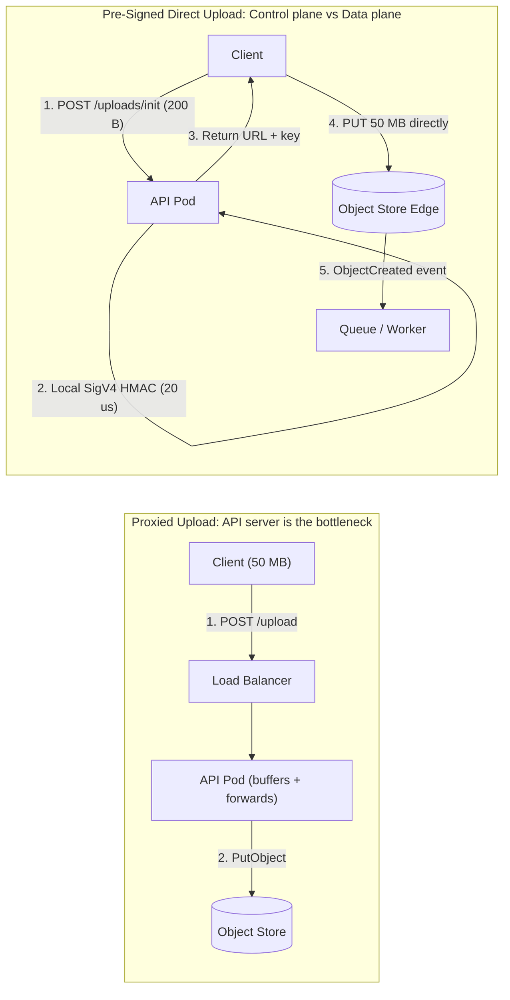
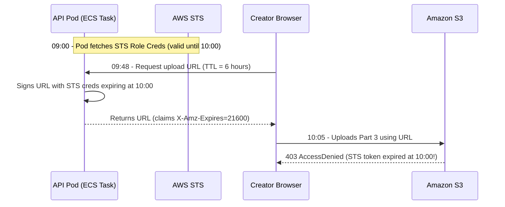

# Pre-Signed URLs & SAS Tokens: How They Work and Their Risks

> **Prerequisites:** [Lesson 04: File Upload Architecture](../04-file-upload-architecture/README.md).  
> **Estimated Reading Time:** 24–28 minutes  
> **Target Audience:** Backend and security engineers designing direct-to-object-store uploads/downloads, and candidates asked "how do you let clients upload or download private files without proxying bytes through your API servers?"  
> **Free PDF Notes:** [Download SD-O-005.pdf](https://backendroadmap.com/notes/system-design/SD-O-005.pdf)

> [!NOTE]
> **In one line:** A **pre-signed URL** (AWS S3 / GCS) or **Shared Access Signature (SAS) token** (Azure Blob Storage) is a **short-lived, HMAC-signed capability token** embedded in a URL that delegates exact, time-bounded object-store permissions (`GET` or `PUT`) to an untrusted client without exposing your cloud credentials or routing bytes through your backend.

> [!TIP]
> **The Golden Rule:** Mint pre-signed URLs with **minimum TTL** (seconds to a few minutes), **exact object key + HTTP verb**, and **signed constraints** (`content-length-range`, `Content-Type`, `Content-MD5` / SHA-256). Treat a pre-signed URL as a **bearer token**: anyone who intercepts it can use it until it expires.

---

## 1. What a Pre-Signed URL / SAS Token Is, and What It Isn't

Imagine your mobile app lets users upload 50 MB videos and download private invoices. If your API server proxies those bytes, a 100-pod fleet spends 90% of its CPU, memory, and NAT gateway bandwidth copying streams from sockets to S3. Instead, the client asks your API for permission, your API computes an **HMAC-SHA256 signature** locally (zero network call to S3!) using its IAM credentials, and returns a URL like:

`https://my-bucket.s3.amazonaws.com/uploads/u123/vid.mp4?X-Amz-Algorithm=AWS4-HMAC-SHA256&X-Amz-Credential=...&X-Amz-Date=20261125T080000Z&X-Amz-Expires=300&X-Amz-SignedHeaders=content-type%3Bhost&X-Amz-Signature=9f8a...`

The client sends the `PUT` directly to S3. S3 recomputes the HMAC using the same IAM secret, checks the expiration timestamp and signed headers, and accepts or rejects the bytes at the storage edge.

| Term | Precise Meaning | Example |
| :--- | :--- | :--- |
| **Pre-signed URL (S3 / GCS)** | A URL carrying SigV4 (AWS) or V4 RSA/HMAC (GCS) query parameters authorizing one HTTP verb on one object key until `Expires` | `PUT /u123/avatar.png` valid for 120 s |
| **SAS Token (Azure)** | A query-string capability token signed with a storage account key or User Delegation Key (Entra ID) | `?sv=2024-11-04&sp=rw&se=2026-11-25T08:05Z&sig=...` |
| **Bearer capability** | Possession of the URL equals permission; no session cookie or `Authorization` header is needed | Anyone with the URL can `GET` or `PUT` before expiry |
| **Signed headers** | HTTP headers included in the canonical string before signing; S3 rejects the request if the client omits or alters them | `host`, `content-type`, `x-amz-content-sha256` |
| **POST policy (`PresignedPost`)** | An HTML form/JSON policy signed with SigV4 that enforces conditions like `["content-length-range", 1, 10485760]` | Browser direct upload capped at 10 MiB |
| **STS / IAM session token** | Temporary AWS credentials (`AccessKeyId`, `SecretAccessKey`, `SessionToken`) for SDK-level multi-operation access | Mobile/CLI app uploading 500 multipart chunks |
| **Not** | An authentication session, an encryption mechanism, or a revocable API key (unless backed by User Delegation / IAM revocation) | Signing does not encrypt the URL or body |

### Why It Matters
1. **Offloads 100% of data-plane bandwidth** from your application tier and load balancers, cutting API compute and egress costs by 80–95%.
2. **Offline cryptographic minting:** Your API generates thousands of URLs per second in ~20 microseconds of local CPU with **zero RPCs** to S3/GCS/Azure.
3. **High-risk security surface:** Misconfigured TTLs, unsigned `Content-Length`, predictable keys, or leaked URLs in logs/Referrer headers are a top source of cloud storage breaches.

---

## 2. Anatomy: Proxied Upload vs Pre-Signed Direct Upload



Splitting the **control plane** (your API validates auth, quota, and filename, then mints a URL) from the **data plane** (the client streams bytes straight to S3/GCS/Azure) eliminates the API proxy bottleneck.

| Dimension | Proxied through API | Pre-Signed PUT URL | Pre-Signed POST Policy |
| :--- | :--- | :--- | :--- |
| **API bandwidth per 100 MB file** | 100 MB in + 100 MB out | ~500 bytes | ~1 KB |
| **Size limit enforcement** | Exact (stream byte counter) | Weak (unless `Content-Length` signed) | Exact (`content-length-range`) |
| **MIME / magic-byte check** | Synchronous before S3 write | Asynchronous after S3 write | Asynchronous after S3 write |
| **Revocation before expiry** | Immediate (API rejects) | Hard (must revoke IAM role / User Delegation Key) | Hard (same) |
| **Browser CORS needed** | No (same origin) | Yes (bucket CORS policy) | Yes (or form POST) |

> [!WARNING]
> **The #1 Trap: Unsigned `Content-Length` on `PUT` URLs.** A standard S3 `PUT` pre-signed URL without `content-length` in `X-Amz-SignedHeaders` lets an attacker upload a **5 TB object** using a URL meant for a 2 MB avatar. Either sign exact `Content-Length` (when known), use `PresignedPost` with `content-length-range`, or enforce bucket lifecycle/quota + async size validation.

---

## 3. Mathematical Model: Bandwidth Offload, Minting Cost & Blast Radius

**1. Data-plane offload factor.** If metadata/URL negotiation is $B_{\text{ctrl}} \approx 1\text{ KB}$ and average object size is $B_{\text{obj}}$, the API bandwidth reduction ratio is:

$$R_{\text{offload}} = 1 - \frac{B_{\text{ctrl}}}{2 \cdot B_{\text{obj}}}$$

(The factor of $2$ accounts for proxying both ingress from the client and egress to S3.)

For $B_{\text{obj}} = 20\text{ MB} = 20{,}971{,}520\text{ B}$ and $B_{\text{ctrl}} = 1{,}024\text{ B}$:

$$R_{\text{offload}} = 1 - \frac{1{,}024}{41{,}943{,}040} = 99.9975\%$$

At 500 uploads/s of 20 MB each, proxying requires $500 \times 20\text{ MB/s} = 10\text{ GB/s}$ ($80\text{ Gbps}$) ingress + $80\text{ Gbps}$ egress on your API tier. Pre-signed URLs reduce API traffic to $500\text{ KB/s}$ ($4\text{ Mbps}$).

**2. Replay / leak exposure window.** Because a pre-signed URL is a bearer token, the expected number of unauthorized operations if a URL leaks at rate $p_{\text{leak}}$ per request over TTL $T_{\text{TTL}}$ scales with the exposure window:

$$E[\text{abused bytes}] \propto p_{\text{leak}} \cdot \lambda \cdot T_{\text{TTL}} \cdot R_{\text{client}}$$

Reducing $T_{\text{TTL}}$ from $7\text{ days}$ ($604{,}800\text{ s}$) to $60\text{ s}$ shrinks the exposure window by **$10{,}080\times$**.

**3. Clock skew margin.** S3 allows $\pm 15\text{ minutes}$ of clock skew on the `X-Amz-Date` signing timestamp, but `X-Amz-Expires` is evaluated against S3's server clock. If a client takes $t_{\text{queue}}$ seconds before starting the upload and $t_{\text{upload}}$ seconds to finish? Note: **S3 checks expiration when the request *starts***, not when the last byte finishes (for single `PUT`), whereas **Azure SAS checks expiry when the request starts** as well—*except* multipart/block uploads where each part/block request is checked individually against `Expires`!

---

## 4. Metrics & Percentiles

| Metric | Meaning | Alert when |
| :--- | :--- | :--- |
| **URL minting latency $p_{99}$** | Time to authorize + sign URL locally | $> 15\text{ ms}$ (indicates DB/auth bottleneck, not HMAC) |
| **403 `AccessDenied` / `SignatureDoesNotMatch` rate** | Clients failing S3/Azure signature or header checks | $> 1\%$ of upload/download attempts |
| **403 `Request has expired` rate** | URLs expiring before client initiates transfer | $> 0.5\%$ (TTL too short or client clock/retry bug) |
| **Orphaned pending uploads** | DB records in `PENDING` state with no S3 `ObjectCreated` | $> 5\%$ of minted URLs after `TTL + 5 min` |
| **Oversized object rate** | Uploaded `Size` $>$ quota/limit in `ObjectCreated` event | Any occurrence $> 0$ (indicates missing policy/enforcement) |
| **URL reuse / multi-IP access** | Same signed URL accessed from $> 1$ distinct ASN/IP | Any hit on sensitive `GET` URLs (leak indicator) |

### Worked Example (Mobile Video Upload)
A user taps "Upload 120 MB video" on a flaky 4G connection (10 Mbps = 1.25 MB/s).
- Transfer time: $120 / 1.25 = 96\text{ s}$.
- If your API mints a **single `PUT` URL with `Expires = 60 s`**, and the user's app waits 15 s in a background queue before starting, it still has 45 s to *start* the single `PUT`. However, if the TCP connection drops at 70 s and the client retries at 75 s, S3 returns `403 Request has expired`.
- **Fix:** For files $> 5\text{ MB}$, use **multipart uploads** (Lesson 06) where each 10 MB part gets a fresh short-lived URL on demand (e.g., 120 s TTL), or mint a 15-minute `PUT` URL only after client readiness is confirmed.

---

## 5. Compounding & Failure Modes

What happens when three common mistakes compound in production?

| Failure Mode | Trigger | Compounding Effect |
| :--- | :--- | :--- |
| **1. Long TTL + Referrer Leak** | `GET` URL with `TTL = 7 days` embedded in `` or shared link | External analytics/third-party scripts receive URL in `Referer` header; leaked URL stays valid for 168 hours |
| **2. STS Role Expiry Cap** | API runs on EC2/ECS/Lambda with temporary IAM role credentials that expire in 1 hour, but mints S3 URLs with `Expires = 6 hours` | **Silent early expiry:** S3 rejects the URL after 1 hour when the underlying IAM session token expires, even though `X-Amz-Expires` says 6 hours |
| **3. Signed Header Mismatch** | API signs `Content-Type: image/png`, browser sends `image/jpeg` or omits header | S3 returns `403 SignatureDoesNotMatch` with an XML error exposing `CanonicalRequest` expectations |

> [!IMPORTANT]
> **The IAM Session Cap Rule (AWS & GCS):** A pre-signed URL can **never outlive the credentials that signed it**.
> - IAM User access keys: up to 7 days (SigV4 maximum).
> - EC2/ECS/Lambda IAM Role (STS): capped at the role's remaining session lifetime (often 15 min – 1 hour!).
> - Azure User Delegation SAS: capped at 7 days and revocable via Entra ID key revocation.

---

## 6. Numbers Every Engineer Must Know

| Item | Typical | Implication |
| :--- | :---: | :--- |
| Local HMAC-SHA256 signing CPU time | **~10–30 µs** | One API core can mint **30,000+ URLs/s** with zero S3 RPCs |
| AWS SigV4 max `X-Amz-Expires` | **604,800 s (7 days)** | Hard protocol limit for SigV4 query-string auth |
| STS / Lambda role credential lifetime | **15 min – 1 hour** | Limits effective URL TTL when signed by IAM roles |
| Recommended upload URL TTL | **60 – 300 s** | Enough to start upload; minimizes abuse window |
| Recommended sensitive download URL TTL | **15 – 60 s** | Browser starts download immediately; link cannot be bookmarked/shared |
| S3 single `PUT` max object size | **5 GB** | Larger objects require Multipart Upload (5 TB max) |
| Clock skew tolerance (AWS SigV4) | **±15 minutes** | Sync API servers with NTP/Chrony to avoid `RequestTimeTooSkewed` |

---

## 7. Protocol Deep Dive: How AWS SigV4 & Azure SAS Validate Without State

```mermaid
sequenceDiagram
    participant C as Client
    participant API as Backend API
    participant DB as Metadata DB
    participant S3 as Object Store Edge

    C->>API: POST /files/upload-url {filename, contentType, sizeBytes}
    API->>API: AuthZ + Quota check + validate sizeBytes <= 10 MB
    API->>DB: INSERT file_records (id, key, status='PENDING', expected_size)
    API->>API: Build CanonicalRequest + StringToSign + HMAC-SHA256(SigningKey)
    API-->>C: 200 OK {uploadUrl, fileId, requiredHeaders}
    C->>S3: PUT /bucket/key + requiredHeaders + X-Amz-Signature
    S3->>S3: Check Now() <= X-Amz-Date + X-Amz-Expires
    S3->>S3: Check IAM credential validity & bucket policy
    S3->>S3: Recompute HMAC-SHA256; constant-time compare
    S3-->>C: 200 OK + ETag
    S3->>API: Async Event (ObjectCreated) via Queue
    API->>DB: Verify actual size & update status='QUARANTINED' -> 'READY'
```

**Why does S3 need zero state to validate?** Both your API and S3 share the secret (or STS token). Your API signs a deterministic canonical string:
`HTTPVerb + "\n" + CanonicalURI + "\n" + CanonicalQueryString + "\n" + CanonicalHeaders + "\n" + SignedHeaders + "\n" + UNSIGNED-PAYLOAD`

| Question | Answer |
| :--- | :--- |
| **Can I revoke a single pre-signed URL?** | Not directly—it is stateless. To "revoke," you must delete/move the object, change the bucket policy, or rotate/revoke the signing key (which invalidates *all* URLs signed by that key). |
| **What if I need per-user revocation?** | Proxy downloads through a CDN with signed cookies/tokens (CloudFront/Cloudflare) or keep TTLs under 30 seconds and authorize on each request. |
| **Why `UNSIGNED-PAYLOAD` for browser uploads?** | Computing SHA-256 of a 500 MB file in browser JS before requesting a URL can freeze the UI; `UNSIGNED-PAYLOAD` skips body hashing at signing time (TLS still protects transit). |
| **What about `Content-Disposition`?** | Set `response-content-disposition=attachment; filename="report.pdf"` in the signed `GET` query string to prevent browsers from executing uploaded HTML/SVG inline (stored XSS defense). |

**When NOT to use pre-signed URLs:**
- **Tiny payloads (< 50 KB) at low QPS** where an extra round trip (`POST /init` + `PUT S3`) adds more latency than proxying.
- **Strict synchronous validation** where the API *must* inspect file bytes (e.g., reject invalid CSV/PDF before acknowledging the HTTP request).
- **Publicly cacheable assets** (use a CDN in front of a private bucket with Origin Access Control instead of unique per-user URLs that destroy CDN cache hit ratios!).

---

## 8. Hierarchical Budgets & Design Rules

| Slice | Rule | Control |
| :--- | :--- | :--- |
| **Object key** | Never trust client filenames; generate `tenantId/uuid` | Server-side UUIDv4/v7 key |
| **TTL** | Upload: 60–300 s; Sensitive Download: 15–60 s | Hard cap in URL minter |
| **Signing identity** | Never use root/long-lived IAM user keys in app pods; use short-lived roles or User Delegation Keys | IAM Role / Entra ID UDK |
| **Size & type** | Enforce `content-length-range` (POST) or signed `Content-Length` (PUT) + async verification | `PresignedPost` + S3 event check |
| **XSS prevention** | Never serve user-uploaded HTML/SVG inline on your main domain | Separate domain + `Content-Disposition: attachment` |
| **CDN caching** | Never put unique pre-signed query strings behind a public CDN | Use CDN signed URLs or OAC |
| **Logging** | Strip query strings (`X-Amz-Signature`, `sig=`) from access logs and telemetry | Log redaction middleware |

---

## 9. Top Mitigations

1. **Always generate server-side object keys (`uuid`)** so clients cannot overwrite another user's file or perform path traversal.
2. **Use `PresignedPost` (`content-length-range`)** for browser uploads when you want S3 to enforce min/max byte limits at the edge.
3. **Force `Content-Disposition: attachment`** on `GET` URLs for user-uploaded content, or serve from a separate sandboxed domain (e.g., `usercontent.example-cdn.com`) to prevent stored XSS via malicious `.svg` or `.html` uploads.
4. **Verify actual uploaded size and MIME magic bytes asynchronously** on the `ObjectCreated` event before marking the file `READY`.
5. **Account for IAM role credential lifetimes**: ensure your pod's IAM/STS session has at least `2 × URL_TTL` remaining before minting (refresh credentials proactively).
6. **Redact query strings in logs, error trackers, and `Referrer-Policy: no-referrer`** on pages rendering pre-signed URLs.
7. **Enable S3 Block Public Access** and restrict bucket CORS `AllowedOrigins` to your exact frontend domains.

---

## 10. Production Incident: The 6-Hour Upload URL That Died in 12 Minutes

**Incident (SEV-1):** A SaaS video platform allowed creators to upload 2 GB webinars using S3 pre-signed `PUT` URLs with `X-Amz-Expires = 21600` (6 hours). Suddenly, 18% of uploads began failing with `403 AccessDenied: Request has expired` just 10–15 minutes after starting.



**Root Cause:**
1. The API pods ran on ECS with an IAM Task Role whose STS credentials rotated every 60 minutes (default refresh at ~50 minutes).
2. At 09:48, the pod's cached STS token only had **12 minutes** of life left, yet the code requested a 6-hour pre-signed URL.
3. S3 enforces `min(URL_Expiry, Signing_Credential_Expiry)`. At 10:00, the STS token expired, invalidating every URL signed with it—even though `X-Amz-Expires` indicated 15:48.

**Fix:**
1. Switched to **multipart uploads** with **on-demand per-part URLs** (`TTL = 300 s`) fetched right before each 10 MB part.
2. Added a credential-freshness check in the URL minter: if `creds.ExpiresAt - now < 2 * urlTTL`, force an immediate STS credential refresh before signing.
3. Added a CloudWatch/Prometheus alert on S3 `403` responses containing `ExpiredToken` or `Request has expired`.

---

## 11. Multi-Language Production Code Tabs

Below are self-contained, zero-external-dependency implementations of **AWS SigV4 pre-signed `PUT` URL generation** (standard library HMAC-SHA256 only) in all four languages—showing the exact cryptographic signing protocol under the hood of every cloud SDK.

````carousel
```go
// Go: pure stdlib AWS SigV4 pre-signed PUT URL generator with signed Content-Type & Content-Length.
package main

import (
	"crypto/hmac"
	"crypto/sha256"
	"encoding/hex"
	"fmt"
	"net/url"
	"strconv"
	"time"
)

func hmacSHA256(key []byte, data string) []byte {
	mac := hmac.New(sha256.New, key)
	mac.Write([]byte(data))
	return mac.Sum(nil)
}

func sha256Hex(data string) string {
	sum := sha256.Sum256([]byte(data))
	return hex.EncodeToString(sum[:])
}

func PresignPutURL(
	bucket, region, objectKey, accessKey, secretKey string,
	contentType string, contentLength int64, ttlSeconds int, now time.Time,
) string {
	t := now.UTC()
	dateStamp := t.Format("20060102")
	amzDate := t.Format("20060102T150405Z")
	host := fmt.Sprintf("%s.s3.%s.amazonaws.com", bucket, region)
	scope := fmt.Sprintf("%s/%s/s3/aws4_request", dateStamp, region)

	q := url.Values{}
	q.Set("X-Amz-Algorithm", "AWS4-HMAC-SHA256")
	q.Set("X-Amz-Credential", accessKey+"/"+scope)
	q.Set("X-Amz-Date", amzDate)
	q.Set("X-Amz-Expires", strconv.Itoa(ttlSeconds))
	q.Set("X-Amz-SignedHeaders", "content-length;content-type;host")
	canonicalQuery := q.Encode() // url.Values.Encode sorts keys lexicographically

	canonicalHeaders := fmt.Sprintf("content-length:%d\ncontent-type:%s\nhost:%s\n", contentLength, contentType, host)
	canonicalRequest := fmt.Sprintf("PUT\n/%s\n%s\n%s\ncontent-length;content-type;host\nUNSIGNED-PAYLOAD",
		objectKey, canonicalQuery, canonicalHeaders)

	stringToSign := fmt.Sprintf("AWS4-HMAC-SHA256\n%s\n%s\n%s", amzDate, scope, sha256Hex(canonicalRequest))
	kDate := hmacSHA256([]byte("AWS4"+secretKey), dateStamp)
	kRegion := hmacSHA256(kDate, region)
	kService := hmacSHA256(kRegion, "s3")
	kSigning := hmacSHA256(kService, "aws4_request")
	signature := hex.EncodeToString(hmacSHA256(kSigning, stringToSign))

	return fmt.Sprintf("https://%s/%s?%s&X-Amz-Signature=%s", host, objectKey, canonicalQuery, signature)
}
```
<!-- slide -->
```typescript
// TypeScript: Node.js crypto SigV4 pre-signed PUT URL generator with strict header binding.
import { createHmac, createHash } from "node:crypto";

const hmac = (key: Buffer | string, data: string): Buffer =>
  createHmac("sha256", key).update(data, "utf8").digest();

const sha256 = (data: string): string =>
  createHash("sha256").update(data, "utf8").digest("hex");

export interface PresignPutOptions {
  bucket: string;
  region: string;
  objectKey: string;
  accessKey: string;
  secretKey: string;
  contentType: string;
  contentLength: number;
  ttlSeconds?: number;
  now?: Date;
}

export function presignPutUrl(opts: PresignPutOptions): string {
  const ttl = Math.min(opts.ttlSeconds ?? 120, 300); // hard cap at 5 minutes
  const now = (opts.now ?? new Date()).toISOString();
  const dateStamp = now.slice(0, 10).replace(/-/g, "");
  const amzDate = now.replace(/[-:]/g, "").replace(/\.\d+Z$/, "Z");

  const host = `${opts.bucket}.s3.${opts.region}.amazonaws.com`;
  const scope = `${dateStamp}/${opts.region}/s3/aws4_request`;
  const signedHeaders = "content-length;content-type;host";

  const params = new URLSearchParams({
    "X-Amz-Algorithm": "AWS4-HMAC-SHA256",
    "X-Amz-Credential": `${opts.accessKey}/${scope}`,
    "X-Amz-Date": amzDate,
    "X-Amz-Expires": String(ttl),
    "X-Amz-SignedHeaders": signedHeaders,
  });
  params.sort();
  const canonicalQuery = params.toString();

  const canonicalHeaders =
    `content-length:${opts.contentLength}\n` +
    `content-type:${opts.contentType}\n` +
    `host:${host}\n`;

  const canonicalRequest = [
    "PUT",
    `/${opts.objectKey}`,
    canonicalQuery,
    canonicalHeaders,
    signedHeaders,
    "UNSIGNED-PAYLOAD",
  ].join("\n");

  const stringToSign = ["AWS4-HMAC-SHA256", amzDate, scope, sha256(canonicalRequest)].join("\n");
  const kDate = hmac(`AWS4${opts.secretKey}`, dateStamp);
  const kRegion = hmac(kDate, opts.region);
  const kService = hmac(kRegion, "s3");
  const kSigning = hmac(kService, "aws4_request");
  const signature = hmac(kSigning, stringToSign).toString("hex");

  return `https://${host}/${opts.objectKey}?${canonicalQuery}&X-Amz-Signature=${signature}`;
}
```
<!-- slide -->
```python
# Python 3.13: stdlib AWS SigV4 pre-signed PUT URL generator with strict TTL & size caps.
import hashlib
import hmac
from datetime import datetime, timezone
from urllib.parse import urlencode


def _hmac(key: bytes, msg: str) -> bytes:
    return hmac.new(key, msg.encode("utf-8"), hashlib.sha256).digest()


def presign_put_url(
    bucket: str,
    region: str,
    object_key: str,
    access_key: str,
    secret_key: str,
    content_type: str,
    content_length: int,
    ttl_seconds: int = 120,
    now: datetime | None = None,
) -> str:
    if not (1 <= ttl_seconds <= 300):
        raise ValueError("ttl_seconds must be between 1 and 300")
    if content_length <= 0:
        raise ValueError("content_length must be positive")

    dt = (now or datetime.now(timezone.utc)).astimezone(timezone.utc)
    date_stamp = dt.strftime("%Y%m%d")
    amz_date = dt.strftime("%Y%m%dT%H%M%SZ")
    host = f"{bucket}.s3.{region}.amazonaws.com"
    scope = f"{date_stamp}/{region}/s3/aws4_request"
    signed_headers = "content-length;content-type;host"

    query_params = sorted([
        ("X-Amz-Algorithm", "AWS4-HMAC-SHA256"),
        ("X-Amz-Credential", f"{access_key}/{scope}"),
        ("X-Amz-Date", amz_date),
        ("X-Amz-Expires", str(ttl_seconds)),
        ("X-Amz-SignedHeaders", signed_headers),
    ])
    canonical_query = urlencode(query_params)
    canonical_headers = (
        f"content-length:{content_length}\n"
        f"content-type:{content_type}\n"
        f"host:{host}\n"
    )
    canonical_request = "\n".join([
        "PUT",
        f"/{object_key}",
        canonical_query,
        canonical_headers,
        signed_headers,
        "UNSIGNED-PAYLOAD",
    ])
    req_hash = hashlib.sha256(canonical_request.encode("utf-8")).hexdigest()
    string_to_sign = "\n".join(["AWS4-HMAC-SHA256", amz_date, scope, req_hash])

    k_date = _hmac(f"AWS4{secret_key}".encode("utf-8"), date_stamp)
    k_region = _hmac(k_date, region)
    k_service = _hmac(k_region, "s3")
    k_signing = _hmac(k_service, "aws4_request")
    signature = hmac.new(k_signing, string_to_sign.encode("utf-8"), hashlib.sha256).hexdigest()

    return f"https://{host}/{object_key}?{canonical_query}&X-Amz-Signature={signature}"
```
<!-- slide -->
```csharp
// C#: .NET stdlib AWS SigV4 pre-signed PUT URL generator.
using System.Security.Cryptography;
using System.Text;

public static class SigV4Presigner
{
    private static byte[] HmacSha256(byte[] key, string data) =>
        HMACSHA256.HashData(key, Encoding.UTF8.GetBytes(data));

    private static string Sha256Hex(string data) =>
        Convert.ToHexString(SHA256.HashData(Encoding.UTF8.GetBytes(data))).ToLowerInvariant();

    public static string PresignPutUrl(
        string bucket, string region, string objectKey,
        string accessKey, string secretKey,
        string contentType, long contentLength,
        int ttlSeconds = 120, DateTimeOffset? now = null)
    {
        if (ttlSeconds is < 1 or > 300)
            throw new ArgumentOutOfRangeException(nameof(ttlSeconds), "Keep upload TTL <= 300s.");

        var utc = (now ?? DateTimeOffset.UtcNow).ToUniversalTime();
        var dateStamp = utc.ToString("yyyyMMdd");
        var amzDate = utc.ToString("yyyyMMddTHHmmssZ");
        var host = $"{bucket}.s3.{region}.amazonaws.com";
        var scope = $"{dateStamp}/{region}/s3/aws4_request";
        const string signedHeaders = "content-length;content-type;host";

        var query = string.Join("&", new SortedDictionary<string, string>
        {
            ["X-Amz-Algorithm"] = "AWS4-HMAC-SHA256",
            ["X-Amz-Credential"] = $"{accessKey}/{scope}",
            ["X-Amz-Date"] = amzDate,
            ["X-Amz-Expires"] = ttlSeconds.ToString(),
            ["X-Amz-SignedHeaders"] = signedHeaders,
        }.Select(kv => $"{Uri.EscapeDataString(kv.Key)}={Uri.EscapeDataString(kv.Value)}"));

        var canonicalHeaders = $"content-length:{contentLength}\ncontent-type:{contentType}\nhost:{host}\n";
        var canonicalRequest = $"PUT\n/{objectKey}\n{query}\n{canonicalHeaders}\n{signedHeaders}\nUNSIGNED-PAYLOAD";
        var stringToSign = $"AWS4-HMAC-SHA256\n{amzDate}\n{scope}\n{Sha256Hex(canonicalRequest)}";

        var kDate = HmacSha256(Encoding.UTF8.GetBytes("AWS4" + secretKey), dateStamp);
        var kRegion = HmacSha256(kDate, region);
        var kService = HmacSha256(kRegion, "s3");
        var kSigning = HmacSha256(kService, "aws4_request");
        var sig = Convert.ToHexString(HmacSha256(kSigning, stringToSign)).ToLowerInvariant();

        return $"https://{host}/{objectKey}?{query}&X-Amz-Signature={sig}";
    }
}
```
````

---

## 12. Hands-On CLI Verification Workflows

Verify local signing, upload enforcement, and expiration using AWS CLI, Azure CLI, and `curl`:

```bash
# 1. Generate a 60-second pre-signed GET URL with AWS CLI
aws s3 presign s3://my-private-bucket/invoices/inv-42.pdf --expires-in 60

# 2. Test that altering a signed header (e.g., Content-Type) causes 403 SignatureDoesNotMatch
curl -i -X PUT -H "Content-Type: text/plain" -H "Content-Length: 5" --data "hello" "$PRESIGNED_PUT_URL"

# 3. Generate a 5-minute Azure Blob User Delegation SAS token (preferred over account-key SAS)
az storage blob generate-sas \
  --account-name mystorageacct \
  --container-name uploads \
  --name "u123/avatar.png" \
  --permissions w \
  --expiry "$(date -u -d '+5 minutes' +%Y-%m-%dT%H:%MZ)" \
  --auth-mode login --as-user

# 4. Benchmark local Python SigV4 signing throughput (no network calls)
python3 -c '
import time
from presign import presign_put_url
t0 = time.perf_counter()
for _ in range(10000):
    presign_put_url("b", "us-east-1", "k", "AKIA...", "secret", "image/png", 1024)
print(f"10k URLs in {(time.perf_counter()-t0)*1000:.1f} ms")
'
```

---

## 13. Common Mistakes to Avoid

1. **Signing `PUT` URLs without `Content-Length` or `PresignedPost` size bounds**, allowing gigabyte uploads on an avatar endpoint.
2. **Setting multi-day TTLs (`Expires = 7 days`)** on `GET` URLs for private files—leaked URLs stay valid for a week.
3. **Trusting client-supplied object keys** (`file.name = "../../other-user/secret.pdf"`), enabling overwrites and path traversal.
4. **Minting long-TTL URLs with short-lived IAM/STS role credentials**, causing silent early `403` failures when the role rotates.
5. **Serving user-uploaded SVG/HTML inline** on your primary domain via pre-signed `GET`, creating a stored XSS vulnerability.
6. **Putting unique pre-signed URLs behind a public CDN**, which gives a 0% cache hit ratio because every URL has a different signature.
7. **Logging full request URLs** in Nginx/Envoy/Datadog, leaking active bearer signatures to anyone with log access.
8. **Skipping async `ObjectCreated` verification**, leaving orphaned `PENDING` rows or un-scanned files marked `READY`.

---

## 14. Key Terms Glossary

| Key Term | Definition |
| :--- | :--- |
| **Pre-signed URL** | A URL containing a cryptographic signature authorizing a specific HTTP operation on an object until a timestamp. |
| **SAS Token** | Azure Blob Storage's Shared Access Signature query string granting scoped, time-limited access. |
| **User Delegation SAS** | An Azure SAS signed with Microsoft Entra ID credentials rather than the root storage account key. |
| **AWS SigV4** | AWS Signature Version 4; derives a daily/regional/service HMAC-SHA256 signing key to authenticate requests. |
| **Bearer Token** | A credential where possession alone grants access, without additional client authentication. |
| **Signed Headers** | HTTP headers included in the canonical signature; the client must send them identically. |
| **`PresignedPost`** | An S3 POST form policy allowing declarative constraints such as `content-length-range`. |
| **STS Session Cap** | The rule that a pre-signed URL expires when *either* `X-Amz-Expires` or the signing STS token expires. |
| **`Content-Disposition`** | Response header (`attachment` vs `inline`) controlling whether a browser downloads or renders a file. |
| **`UNSIGNED-PAYLOAD`** | SigV4 option allowing the client to skip hashing the request body when generating the signature. |

---

## 15. System Design Interview Questions & Answers

### Basic Conceptual Questions

<details>
<summary><strong>Q1: How does a pre-signed URL work without your API server calling S3? [BASIC]</strong></summary>

**Answer:**
Your API server and S3 share a secret (IAM secret key or STS session token). The API builds a canonical string containing the HTTP verb, bucket, object key, expiration timestamp, and required headers, and computes an HMAC-SHA256 signature locally in ~20 microseconds. When the client sends the request to S3, S3 recomputes the HMAC using the same secret and verifies the signature and expiration.
</details>

<details>
<summary><strong>Q2: What is the difference between an AWS pre-signed URL and an Azure SAS token? [BASIC]</strong></summary>

**Answer:**
Conceptually they are identical: stateless, HMAC-signed capability tokens in query parameters. AWS SigV4 ties the signature to a specific HTTP verb, object key, and signed headers. Azure SAS supports both **Service SAS** (scoped to one container/blob) and **Account SAS** (scoped to multiple services), and supports **Stored Access Policies** (server-side templates that *can* be modified/revoked) as well as **User Delegation SAS** backed by Entra ID.
</details>

<details>
<summary><strong>Q3: Why do pre-signed URLs improve scalability so dramatically? [BASIC]</strong></summary>

**Answer:**
They separate the **control plane** (auth, quota, metadata, ~1 KB JSON) from the **data plane** (megabytes or gigabytes of file bytes). Clients stream directly to/from S3's edge, eliminating API memory buffering, socket exhaustion, and double-egress bandwidth charges.
</details>

<details>
<summary><strong>Q4: What is the difference between a pre-signed `PUT` URL and a `PresignedPost`? [BASIC]</strong></summary>

**Answer:**
A pre-signed `PUT` signs a single HTTP `PUT` request; it cannot express ranges like "between 1 byte and 10 MB" (only an exact `Content-Length` if signed). A `PresignedPost` signs an HTML multipart/form-data policy document that supports condition operators like `["content-length-range", 1, 10485760]` and `["starts-with", "$Content-Type", "image/"]`.
</details>

### Scenario-Based Architecture Questions

<details>
<summary><strong>Q5: How do you prevent a malicious user from uploading a 10 GB file using a pre-signed URL meant for a 5 MB profile photo? [SCENARIO]</strong></summary>

**Answer:**
Three layers of defense: (1) Use `PresignedPost` with `["content-length-range", 1, 5242880]`—or for `PUT`, require the client to declare `sizeBytes` upfront, validate `sizeBytes <= 5 MB`, and include `content-length` in `X-Amz-SignedHeaders`. (2) On the S3 `ObjectCreated` event, inspect the actual `size` before marking the DB record `READY`, deleting anything oversized. (3) Set a bucket lifecycle rule to expire unconfirmed/quarantined objects after 24 hours.
</details>

<details>
<summary><strong>Q6: Users report that 2-hour video uploads fail with 403 midway, even though you set `X-Amz-Expires = 14400` (4 hours). What happened? [SCENARIO]</strong></summary>

**Answer:**
Two likely causes: (1) Your API pods are using an IAM Role (STS) whose temporary credentials expire in 1 hour, capping the pre-signed URL's effective lifetime at 1 hour regardless of `X-Amz-Expires`. (2) For multipart uploads, each part upload is a separate HTTP request; if the URL was minted 4 hours ago, parts started after expiry fail. Fix by refreshing STS credentials proactively and minting short-lived (300 s) per-part URLs on demand.
</details>

<details>
<summary><strong>Q7: How do you serve private user-uploaded files through a CDN without making the S3 bucket public? [SCENARIO]</strong></summary>

**Answer:**
Do **not** generate unique S3 pre-signed URLs behind a CDN—each unique signature busts the CDN cache. Instead, keep the S3 bucket private and grant the CDN (e.g., CloudFront Origin Access Control) read access to S3. Then issue **CDN Signed URLs or Signed Cookies** at the edge so the CDN caches one copy of the object while still enforcing per-user authorization and expiration.
</details>

<details>
<summary><strong>Q8: A user uploads `evil.svg` containing `<script>alert(document.cookie)</script>`. Another user views it via a pre-signed `GET` URL. Are you vulnerable? [SCENARIO]</strong></summary>

**Answer:**
If the `GET` URL is on your main origin or allows `inline` rendering, yes—Wait: S3 pre-signed URLs are hosted on `bucket.s3.amazonaws.com`, which isolates your main domain's cookies, *but* can still execute JS on the S3 origin (affecting other files in the same bucket) or trigger phishing/redirects. Always set `response-content-disposition=attachment` in the pre-signed `GET` URL or serve user content from a dedicated sandboxed domain with `X-Content-Type-Options: nosniff`.
</details>

### Advanced & Tricky Interview Questions

<details>
<summary><strong>Q9: How can you revoke a pre-signed URL immediately after a user's access is removed? [TRICKY]</strong></summary>

**Answer:**
You cannot revoke an individual stateless S3 pre-signed URL without side effects. Options: (1) Keep `GET` URL TTLs ultra-short (15–30 s) so revocation takes effect almost immediately. (2) In Azure, bind the SAS to a **Stored Access Policy** and delete/update the policy, or revoke the **User Delegation Key** (revokes all SAS tokens signed by that key). (3) Put a lightweight edge authorizer (CloudFront Functions / Cloudflare Worker) in front of the bucket that checks a fast revocation list (Redis/KV) before forwarding.
</details>

<details>
<summary><strong>Q10: Why shouldn't you use `UNSIGNED-PAYLOAD` for server-to-server sensitive uploads, and why do browsers use it? [TRICKY]</strong></summary>

**Answer:**
With `UNSIGNED-PAYLOAD`, an attacker who intercepts an unencrypted HTTP request (or a compromised proxy) could alter the body without invalidating the signature—though TLS prevents this in transit. More importantly, signing the payload SHA-256 (`x-amz-content-sha256`) guarantees end-to-end integrity from the signer to S3. Browsers use `UNSIGNED-PAYLOAD` because hashing a multi-gigabyte file in JS before even requesting the URL adds huge latency and memory pressure.
</details>

<details>
<summary><strong>Q11: What happens if a client's local clock is 2 hours behind UTC when using a pre-signed URL? [TRICKY]</strong></summary>

**Answer:**
Nothing breaks! Unlike SDK-signed requests where the *client* generates `X-Amz-Date`, a pre-signed URL's `X-Amz-Date` is stamped by your **API server** (which is NTP-synced). The client's clock is irrelevant—S3 compares the server-stamped `X-Amz-Date + X-Amz-Expires` against S3's own UTC clock.
</details>

<details>
<summary><strong>Q12: How do you prevent a client from replaying a pre-signed `PUT` URL to overwrite a file after it has already been uploaded and scanned? [TRICKY]</strong></summary>

**Answer:**
(1) Upload into a **quarantine prefix** (`quarantine/<uploadId>`) and, once the worker scans and verifies the file, copy/move it to `ready/<fileId>` and delete the quarantine object (or lock the bucket object via Object Lock / versioning). (2) Even if the client replays the `PUT` to `quarantine/<uploadId>` before TTL expires, the DB record is already `READY` and the worker ignores duplicate `ObjectCreated` events for finalized IDs.
</details>

---

## 16. One-Page Master Cheat Sheet

```
+---------------------------------------------------------------------------------------------------------+
|                    PRE-SIGNED URLs & SAS TOKENS — MASTER CHEAT SHEET                                    |
+---------------------------------------------------------------------------------------------------------+
| 1. CORE IDEA: Separate control plane (API mints HMAC URL in ~20 us) from data plane (client -> S3).     |
|    Offloads ~99.99% of API bandwidth for MB/GB files with zero RPCs to object storage.                  |
+---------------------------------------------------------------------------------------------------------+
| 2. BEARER RISK: Anyone with the URL can use it until expiry. Keep TTL short (60-300s PUT, 15-60s GET).  |
|    Redact signatures from logs; set Referrer-Policy: no-referrer.                                       |
+---------------------------------------------------------------------------------------------------------+
| 3. SIZE & TYPE: PUT without signed Content-Length allows 5 TB uploads! Use PresignedPost                |
|    (content-length-range) or signed Content-Length + async ObjectCreated verification.                  |
+---------------------------------------------------------------------------------------------------------+
| 4. STS TRAP: Effective TTL = min(X-Amz-Expires, Signing_Credential_Expiry). Refresh IAM role creds.     |
+---------------------------------------------------------------------------------------------------------+
| 5. SECURITY: Server-generated UUID keys · response-content-disposition=attachment (anti-XSS) ·          |
|    quarantine prefix -> scan -> move to ready prefix.                                                   |
+---------------------------------------------------------------------------------------------------------+
| 6. CDN: Never put unique S3 pre-signed URLs behind a CDN (0% hit rate). Use CDN Signed URLs + OAC.      |
+---------------------------------------------------------------------------------------------------------+
```

---

## Further Reading & Sources

- AWS S3 Documentation, [Sharing objects with presigned URLs](https://docs.aws.amazon.com/AmazonS3/latest/userguide/ShareObjectPreSignedURL.html) and [Authenticating Requests: Using Query Parameters (SigV4)](https://docs.aws.amazon.com/AmazonS3/latest/API/sigv4-query-string-auth.html).
- Microsoft Azure Documentation, [Grant limited access to Azure Storage resources using Shared Access Signatures (SAS)](https://learn.microsoft.com/en-us/azure/storage/common/storage-sas-overview).
- Google Cloud Storage, [Signed URLs](https://cloud.google.com/storage/docs/access-control/signed-urls).
- OWASP, [File Upload Cheat Sheet](https://cheatsheetseries.owasp.org/cheatsheets/File_Upload_Cheat_Sheet.html).

---

## Free PDF Notes

[SD-O-005.pdf](https://backendroadmap.com/notes/system-design/SD-O-005.pdf)

---

## Next

Continue with [Lesson 06: Multipart & Resumable Uploads: Parts, Retries and tus](../06-multipart-resumable-uploads/README.md): parts, retries, and resumable upload protocols.
