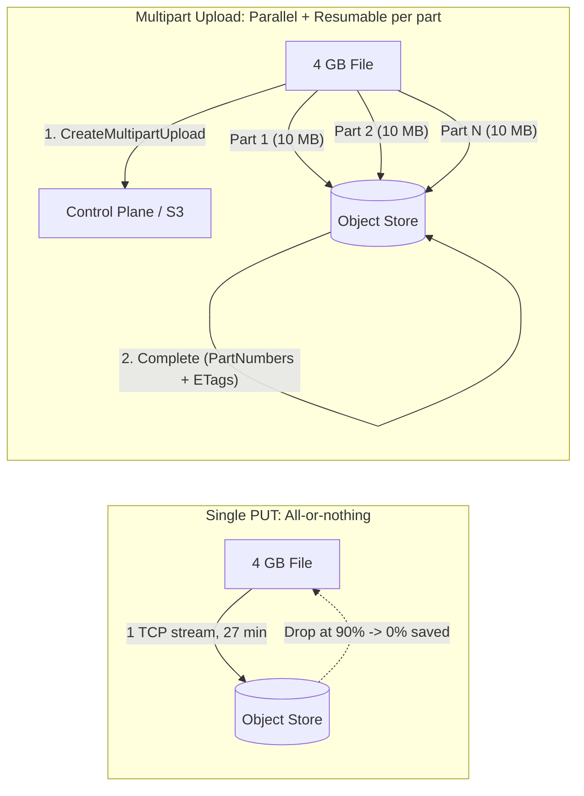
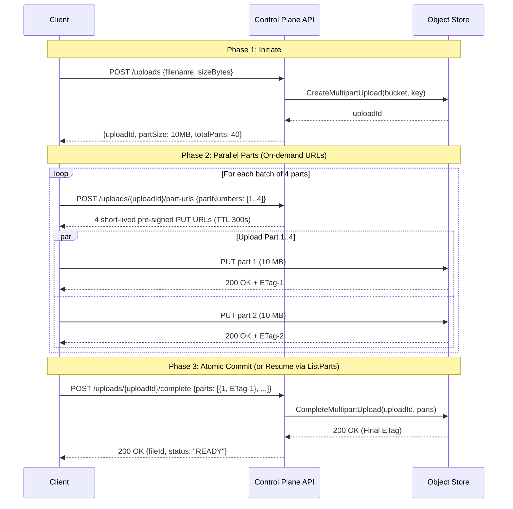

# Multipart & Resumable Uploads: Parts, Retries and tus

> **Prerequisites:** [Lesson 05: Pre-Signed URLs & SAS Tokens](../05-pre-signed-urls-sas-tokens/README.md).  
> **Estimated Reading Time:** 24–28 minutes  
> **Target Audience:** Backend and mobile/web engineers building reliable large-file upload pipelines, and candidates asked "how do you upload a 10 GB video over an unreliable mobile network?"  
> **Free PDF Notes:** [Download SD-O-006.pdf](https://backendroadmap.com/notes/system-design/SD-O-006.pdf)

> [!NOTE]
> **In one line:** **Multipart uploads** split a large object into independent chunks (parts) uploaded in parallel and stitched atomically at the object store; **resumable upload protocols (like tus)** add offset-based checkpointing so a dropped connection resumes from the last acknowledged byte instead of restarting from zero.

> [!TIP]
> **The Golden Rule:** Switch from single `PUT` to **multipart upload at 5–10 MB**. Choose part sizes between **8 MB and 64 MB** (never exceed the 10,000-part limit), upload 3–6 parts concurrently, and **always** attach an S3/GCS **AbortIncompleteMultipartUpload** lifecycle rule (e.g., 7 days) so abandoned parts don't silently drain your storage budget.

---

## 1. What Multipart & Resumable Uploads Are, and What They Aren't

Uploading a 4 GB video as a single HTTP `PUT` over a 20 Mbps mobile connection takes ~27 minutes. If the user walks into an elevator at minute 24 (3.5 GB sent), the TCP connection resets, **every single byte is discarded**, and the upload restarts from 0%.

**Multipart upload** solves this by splitting the file into numbered parts (e.g., 10 MB each). Each part is an independent HTTP `PUT` with its own retry and ETag. Only when all parts arrive does the client (or API) call `CompleteMultipartUpload`, which atomically stitches the parts into a single immutable object in S3/GCS/Azure.

| Term | Precise Meaning | Example |
| :--- | :--- | :--- |
| **Multipart upload (S3)** | Three-phase protocol (`Create` → `UploadPart` × $N$ → `Complete`) storing parts server-side until stitched | 4 GB file = 400 × 10 MB parts |
| **Resumable upload** | Any upload mechanism that queries the server for already-received bytes/parts and sends only what is missing | Resume at part 351 after crash |
| **tus protocol** | Open HTTP-based resumable upload standard using `POST` (create), `HEAD` (offset check), and `PATCH` (append bytes) | `Upload-Offset: 10485760` |
| **ETag (per-part)** | MD5 (or opaque token) returned by S3 for each uploaded part; required in `CompleteMultipartUpload` | `{PartNumber: 1, ETag: "\"9a8b...\""}` |
| **Parallelism** | Uploading $k$ parts concurrently over separate TCP/HTTP2 streams to saturate client uplink | 4 concurrent 10 MB part `PUT`s |
| **Orphaned parts** | Uploaded parts of an uncompleted/unaborted multipart upload; billed at normal storage rates | User closes tab mid-upload |
| **Not** | Client-side file compression or delta sync (parts are raw slices of the original byte stream) | Same total bytes, better reliability |

### Why It Matters
1. **Failure isolation:** A network drop at 90% only loses the in-flight part (e.g., 10 MB), not 3.6 GB.
2. **Throughput multiplication:** Parallel part uploads bypass single-TCP-stream congestion window limits (BDP bottleneck) and saturate high-bandwidth links.
3. **Hidden cost trap:** Incomplete multipart uploads are **invisible** in standard `ListObjects` calls, yet S3 bills you every month for their gigabytes until you explicitly abort or expire them.

---

## 2. Anatomy: Single PUT vs S3 Multipart vs tus Resumable



| Dimension | Single `PUT` | S3 / GCS Multipart | tus Protocol (v1.0 / IETF draft) |
| :--- | :--- | :--- | :--- |
| **Max object size** | 5 GB (S3) | 5 TB (S3) / 5 TB (GCS) | Unlimited (server-dependent) |
| **Parallelism** | 1 stream | High ($k$ concurrent parts) | Sequential `PATCH` (or `concat` extension) |
| **Resume granularity** | 0% (restart whole file) | Part boundary (e.g., 5–64 MB) | Exact byte offset (`Upload-Offset`) |
| **Direct to Object Store?** | Yes (pre-signed URL) | Yes (pre-signed per-part URLs) | Usually requires a tus server (`tusd`) in front |
| **Client memory footprint** | Streamed | $k \times \text{partSize}$ | Single chunk buffer |

> [!WARNING]
> **The #1 Trap: The 10,000-Part Limit & 5 MB Minimum.** In S3, every part except the *last* part must be at least **5 MiB**, and a single object can have at most **10,000 parts**. Choosing a fixed 5 MiB part size caps your maximum file size at $5\text{ MiB} \times 10{,}000 = 50\text{ GiB}$—if a user uploads a 100 GiB file with 5 MiB parts, part 10,001 fails! Always compute `partSize = max(5 MiB, ceil(fileSize / 10000))`.

---

## 3. Mathematical Model: Reliability, Part Sizing & Speedup

**1. Expected wasted bytes on failure.** Suppose packet/connection drops occur as a Poisson process with failure rate $\lambda_{\text{drop}}$ per second, and uplink bandwidth is $B$ bytes/s.
- For a single `PUT` of size $S$, upload time is $T = S/B$. If a failure occurs with probability $p$, expected wasted work per failure is $\approx S/2$.
- For multipart with $N = S / P$ parts of size $P$, a failure only discards the in-flight part(s): expected wasted work is $P/2$ (or $k \cdot P/2$ with $k$ concurrent streams).

**2. Optimal part size formula.** You want parts small enough to retry cheaply, large enough to stay well under S3's $N_{\max} = 10{,}000$ part limit and minimize HTTP/signing overhead:

$$P = \max\left(P_{\min},\; \left\lceil \frac{S}{N_{\max}} \right\rceil,\; P_{\text{target}}\right)$$

where $P_{\min} = 5\text{ MiB}$ (S3 floor) and $P_{\text{target}} \in [8\text{ MiB}, 64\text{ MiB}]$.

**Worked Example:** Upload a $S = 200\text{ GiB}$ ($204{,}800\text{ MiB}$) dataset over a $B = 50\text{ MB/s}$ connection:
- Minimum part size to respect $10{,}000$ parts: $\lceil 204{,}800 / 10{,}000 \rceil = 21\text{ MiB}$ (round up to power-of-two **$32\text{ MiB}$**).
- Number of parts: $N = 204{,}800 / 32 = 6{,}400$ parts.
- With $k = 4$ concurrent streams, each part takes $32 / (50/4) = 2.56\text{ s}$ (aggregate $50\text{ MB/s}$), finishing in $\approx 68\text{ minutes}$. A connection drop loses at most $32\text{ MiB}$ ($< 0.02\%$ of the file).

**3. Throughput speedup (Amdahl / BDP bound).** If a single TCP stream is capped at $B_{\text{tcp}}$ by RTT and window size ($W / \text{RTT}$), uploading $k$ parts in parallel achieves:

$$B_{\text{total}} = \min\left(B_{\text{uplink}},\; k \cdot B_{\text{tcp}}\right)$$

---

## 4. Metrics & Percentiles

| Metric | Meaning | Alert when |
| :--- | :--- | :--- |
| **Part retry rate** | `%` of `UploadPart` calls retried | $> 5\%$ (network degradation or part size too large) |
| **Incomplete multipart count** | Active `CreateMultipartUpload` sessions not completed | Growing monotonically (missing abort lifecycle) |
| **Orphaned multipart storage (GB)** | Bytes held in uncompleted parts | $> 2\%$ of total bucket size |
| **Complete latency $p_{99}$** | Time for `CompleteMultipartUpload` to stitch parts | $> 10\text{ s}$ (S3 scales linearly with part count) |
| **tus `HEAD` resume success rate** | Resumed uploads that complete without restarting | $< 95\%$ (offset mismatch or expired upload ID) |
| **End-to-end effective throughput** | `fileSize / totalWallTime` | $< 50\%$ of client uplink capacity |

### Worked Example (Orphaned Parts Cost)
Your platform handles 10,000 video uploads/day averaging 1 GB. 5% of users close their browser at ~50% completion without calling `AbortMultipartUpload`.
- Daily leaked storage: $10{,}000 \times 0.05 \times 0.5\text{ GB} = 250\text{ GB/day}$.
- After 1 year without a lifecycle rule: $250\text{ GB} \times 365 = 91.25\text{ TB}$ of invisible, unreferenced parts costing **~$2,100/month** in S3 Standard!
- **Fix:** An `AbortIncompleteMultipartUpload` rule with `DaysAfterInitiation: 3` caps orphaned storage at $3 \times 250\text{ GB} = 750\text{ GB}$ (~$17/month).

---

## 5. Compounding & Failure Modes

| Failure Mode | Trigger | Compounding Effect |
| :--- | :--- | :--- |
| **1. Part Reordering / Missing ETag** | Client uploads parts in parallel but submits `CompleteMultipartUpload` with unsorted `PartNumber`s or wrong ETags | S3 rejects `CompleteMultipartUpload` with `400 InvalidPartOrder` or `InvalidPart`; client must `ListParts` and re-submit |
| **2. Concurrent Overwrite of Same `uploadId`** | Two browser tabs resume the same upload simultaneously, writing different bytes to the same `PartNumber` | Silent data corruption! The last `UploadPart` wins for that `PartNumber`, mixing bytes from two files |
| **3. `CompleteMultipartUpload` Timeout** | Stitching 10,000 parts takes 5–15 s; client times out at 5 s and retries `CreateMultipartUpload` | Duplicate uploads + orphaned 10,000-part session |
| **4.tus `409 Conflict` Offset Mismatch** | Client thinks offset is 10 MB, server only flushed 8 MB before crash | Client must issue `HEAD` to reconcile `Upload-Offset` before sending `PATCH` |

---

## 6. Numbers Every Engineer Must Know

| Item | Typical | Implication |
| :--- | :---: | :--- |
| S3 minimum part size (except last) | **5 MiB** | Parts $< 5\text{ MiB}$ fail `CompleteMultipartUpload` with `EntityTooSmall` |
| S3 maximum part size | **5 GiB** | Single part cap |
| S3 maximum parts per object | **10,000** | Dictates dynamic part sizing for files $> 50\text{ GiB}$ |
| S3 max multipart object size | **5 TiB** | Hard limit for a single S3 object |
| Optimal concurrency ($k$) | **3 – 6 streams** | Saturates uplink without starving browser connection pool |
| Multipart threshold | **5 – 10 MB** | Below this, single `PUT` is faster (avoids 2 extra RPCs) |
| Lifecycle abort rule | **1 – 7 days** | Bounds orphaned part storage cost |

---

## 7. Protocol Deep Dive: S3 Multipart vs tus Resumable



**How `tus` differs:** Instead of your API calling S3 `CreateMultipartUpload`, the client speaks `tus` directly to a stateful/storage-backed endpoint (`tusd`):
1. `POST /files` with `Upload-Length: 4294967296` → returns `Location: /files/abc123`.
2. `PATCH /files/abc123` with `Upload-Offset: 0` and `Content-Type: application/offset+octet-stream` → returns `204 No Content` + `Upload-Offset: 10485760`.
3. On reconnect: `HEAD /files/abc123` → server returns `Upload-Offset: 10485760`, client resumes `PATCH` from byte `10485760`.

| Question | Answer |
| :--- | :--- |
| **Why expose `ETag` in S3 CORS?** | Browsers hide response headers by default; without `ExposeHeaders: ["ETag"]` in S3 CORS, JS cannot read part ETags to call `CompleteMultipartUpload`! |
| **How does a client resume an S3 multipart upload after app restart?** | Persist `uploadId` and `key` in `localStorage`/SQLite. On restart, call your API, which calls S3 `ListParts(uploadId)` to discover completed `(PartNumber, ETag, Size)` pairs and skips them. |
| **Does S3 `CompleteMultipartUpload` return a normal MD5 ETag?** | **No!** For multipart uploads, S3 returns `<md5-of-concatenated-binary-md5s>-<partCount>` (e.g., `d41d8cd98f...-40`). Never compare it to a whole-file MD5! |

**When NOT to use multipart/tus:**
- **Files under 5–10 MB:** The `Create` + `Complete` round trips add more latency than a single `PUT`.
- **Server-to-server transfers inside the same cloud region** below 100 MB (a single `PutObject` over AWS backbone rarely drops).

---

## 8. Hierarchical Budgets & Design Rules

| Slice | Rule | Control |
| :--- | :--- | :--- |
| **Part sizing** | `max(5 MiB, ceil(size / 10000), 8 MiB)` | Shared sizing helper on API & client |
| **Concurrency** | 3–6 concurrent part `PUT`s | Bounded worker pool / semaphore |
| **URL minting** | Mint per-part URLs in small batches on demand (TTL 300 s), not all 1,000 upfront | On-demand `/part-urls` endpoint |
| **CORS** | Explicitly expose `ETag` header in bucket CORS | `ExposeHeaders: ["ETag"]` |
| **Orphan cleanup** | Auto-abort incomplete uploads after 1–7 days | S3 `AbortIncompleteMultipartUpload` |
| **Retries** | Exponential backoff + jitter on `5xx`/network errors, max 3–5 retries per part | Retry wrapper per part |
| **Completion** | Sort parts ascending by `PartNumber` before `CompleteMultipartUpload` | Server-side sort + `ListParts` fallback |

---

## 9. Top Mitigations

1. **Always configure `AbortIncompleteMultipartUpload`** on every upload bucket (e.g., `DaysAfterInitiation: 3`) to prevent silent storage leaks.
2. **Mint per-part pre-signed URLs on demand** (batches of 5–10) rather than all parts at `t=0`, so slow uploads never hit URL/STS expiration.
3. **Expose `ETag` in S3 CORS** (`ExposeHeaders: ["ETag"]`); missing this is the #1 browser multipart integration bug.
4. **Use `ListParts` for true resumability** rather than trusting client-side `localStorage` alone—S3 is the source of truth for which parts durably landed.
5. **Compute part size dynamically** using `max(8 MiB, ceil(fileSize / 10000))` so 100+ GB files never hit the 10,000-part ceiling.
6. **Verify part count and total size** on `CompleteMultipartUpload` against the expected `fileSize` declared at `CreateMultipartUpload`.
7. **Support `Abort` on user cancel** so cancelled uploads free parts immediately instead of waiting for the lifecycle rule.

---

## 10. Production Incident: The Invisible 140 TB Storage Bill

**Incident (SEV-2 / FinOps):** A cloud backup startup noticed its S3 bill jumped by **$3,200/month** over 6 months, even though active user storage in their PostgreSQL `files` table was flat at 60 TB. Running `aws s3 ls --summarize` showed **60 TB** of objects—matching the database!


**Root Cause:**
1. The desktop sync client retried failed uploads by calling `CreateMultipartUpload` again instead of resuming via `ListParts`, leaving the old `uploadId` and its uploaded parts behind.
2. `ListObjectsV2` does **not** return in-progress multipart parts—only `ListMultipartUploads` reveals them.
3. The bucket had **no `AbortIncompleteMultipartUpload` lifecycle policy**, so 6 months of abandoned parts accumulated to **140 TB**.

**Fix:**
1. Applied an S3 Lifecycle rule (`AbortIncompleteMultipartUpload: DaysAfterInitiation = 2`), which reclaimed 140 TB within 48 hours.
2. Updated the desktop client to persist `uploadId` locally and resume via `ListParts` before falling back to a new upload.
3. Added a daily CloudWatch metric tracking `ListMultipartUploads` count and estimated part bytes.

---

## 11. Multi-Language Production Code Tabs

Idiomatic **dynamic part-sizing + bounded concurrent multipart uploader** (with retry and sorted completion) in all four languages.

````carousel
```go
// Go: dynamic part sizing + bounded concurrent part uploader with retries.
package main

import (
	"context"
	"fmt"
	"math"
	"sort"
	"sync"
)

const (
	minPartSize = 5 * 1024 * 1024  // 5 MiB S3 floor
	maxParts    = 10_000
	defaultPart = 16 * 1024 * 1024 // 16 MiB
)

type CompletedPart struct {
	PartNumber int
	ETag       string
}

func ComputePartSize(fileSize int64) int64 {
	byLimit := int64(math.Ceil(float64(fileSize) / float64(maxParts)))
	size := max(defaultPart, byLimit)
	return max(minPartSize, size)
}

func UploadMultipart(
	ctx context.Context,
	fileSize int64,
	concurrency int,
	uploadPart func(ctx context.Context, partNum int, offset, length int64) (string, error),
) ([]CompletedPart, error) {
	partSize := ComputePartSize(fileSize)
	totalParts := int((fileSize + partSize - 1) / partSize)

	jobs := make(chan int, totalParts)
	for p := 1; p <= totalParts; p++ {
		jobs <- p
	}
	close(jobs)

	var (
		mu      sync.Mutex
		results = make([]CompletedPart, 0, totalParts)
		firstEr error
		wg      sync.WaitGroup
	)

	for range concurrency {
		wg.Add(1)
		go func() {
			defer wg.Done()
			for partNum := range jobs {
				if ctx.Err() != nil {
					return
				}
				offset := int64(partNum-1) * partSize
				length := min(partSize, fileSize-offset)

				var etag string
				var err error
				for attempt := 0; attempt < 3; attempt++ {
					etag, err = uploadPart(ctx, partNum, offset, length)
					if err == nil {
						break
					}
				}
				mu.Lock()
				if err != nil && firstEr == nil {
					firstEr = fmt.Errorf("part %d failed: %w", partNum, err)
				} else if err == nil {
					results = append(results, CompletedPart{PartNumber: partNum, ETag: etag})
				}
				mu.Unlock()
			}
		}()
	}
	wg.Wait()
	if firstEr != nil {
		return nil, firstEr
	}
	sort.Slice(results, func(i, j int) bool { return results[i].PartNumber < results[j].PartNumber })
	return results, nil
}
```
<!-- slide -->
```typescript
// TypeScript: dynamic part sizing + concurrency-limited multipart upload with retries.
export interface CompletedPart {
  partNumber: number;
  etag: string;
}

const MIN_PART = 5 * 1024 * 1024;
const TARGET_PART = 16 * 1024 * 1024;
const MAX_PARTS = 10_000;

export function computePartSize(fileSize: number): number {
  return Math.max(MIN_PART, TARGET_PART, Math.ceil(fileSize / MAX_PARTS));
}

export async function uploadMultipart(
  fileSize: number,
  concurrency: number,
  uploadPart: (partNumber: number, offset: number, length: number) => Promise<string>,
): Promise<CompletedPart[]> {
  const partSize = computePartSize(fileSize);
  const totalParts = Math.ceil(fileSize / partSize);
  const queue = Array.from({ length: totalParts }, (_, i) => i + 1);
  const completed: CompletedPart[] = [];

  async function worker(): Promise<void> {
    while (queue.length > 0) {
      const partNumber = queue.shift()!;
      const offset = (partNumber - 1) * partSize;
      const length = Math.min(partSize, fileSize - offset);

      let lastErr: unknown;
      for (let attempt = 0; attempt < 3; attempt++) {
        try {
          const etag = await uploadPart(partNumber, offset, length);
          completed.push({ partNumber, etag });
          lastErr = undefined;
          break;
        } catch (err) {
          lastErr = err;
          await new Promise((r) => setTimeout(r, 100 * 2 ** attempt));
        }
      }
      if (lastErr) throw lastErr;
    }
  }

  await Promise.all(Array.from({ length: Math.min(concurrency, totalParts) }, worker));
  return completed.sort((a, b) => a.partNumber - b.partNumber);
}
```
<!-- slide -->
```python
# Python 3.13: dynamic part sizing + concurrent multipart upload with ThreadPoolExecutor.
import math
import time
from concurrent.futures import ThreadPoolExecutor, as_completed
from typing import Callable

MIN_PART = 5 * 1024 * 1024
TARGET_PART = 16 * 1024 * 1024
MAX_PARTS = 10_000


def compute_part_size(file_size: int) -> int:
    if file_size <= 0:
        raise ValueError("file_size must be positive")
    return max(MIN_PART, TARGET_PART, math.ceil(file_size / MAX_PARTS))


def upload_multipart(
    file_size: int,
    concurrency: int,
    upload_part: Callable[[int, int, int], str],
    already_uploaded: dict[int, str] | None = None,
) -> list[tuple[int, str]]:
    part_size = compute_part_size(file_size)
    total_parts = math.ceil(file_size / part_size)
    results = dict(already_uploaded or {})

    def _run_part(part_num: int) -> tuple[int, str]:
        offset = (part_num - 1) * part_size
        length = min(part_size, file_size - offset)
        for attempt in range(3):
            try:
                return part_num, upload_part(part_num, offset, length)
            except Exception:
                if attempt == 2:
                    raise
                time.sleep(0.1 * (2**attempt))
        raise RuntimeError("unreachable")

    pending = [p for p in range(1, total_parts + 1) if p not in results]
    with ThreadPoolExecutor(max_workers=min(concurrency, max(1, len(pending)))) as pool:
        futures = [pool.submit(_run_part, p) for p in pending]
        for fut in as_completed(futures):
            part_num, etag = fut.result()
            results[part_num] = etag

    return sorted(results.items(), key=lambda x: x[0])
```
<!-- slide -->
```csharp
// C#: dynamic part sizing + SemaphoreSlim-bounded concurrent multipart uploader.
public sealed record CompletedPart(int PartNumber, string ETag);

public static class MultipartUploader
{
    private const long MinPart = 5L * 1024 * 1024;
    private const long TargetPart = 16L * 1024 * 1024;
    private const int MaxParts = 10_000;

    public static long ComputePartSize(long fileSize) =>
        Math.Max(MinPart, Math.Max(TargetPart, (fileSize + MaxParts - 1) / MaxParts));

    public static async Task<IReadOnlyList<CompletedPart>> UploadAsync(
        long fileSize,
        int concurrency,
        Func<int, long, long, CancellationToken, Task<string>> uploadPartAsync,
        CancellationToken ct = default)
    {
        var partSize = ComputePartSize(fileSize);
        var totalParts = (int)((fileSize + partSize - 1) / partSize);
        using var gate = new SemaphoreSlim(concurrency);
        var results = new CompletedPart[totalParts];

        var tasks = Enumerable.Range(1, totalParts).Select(async partNum =>
        {
            await gate.WaitAsync(ct);
            try
            {
                var offset = (partNum - 1L) * partSize;
                var length = Math.Min(partSize, fileSize - offset);
                for (var attempt = 0; ; attempt++)
                {
                    try
                    {
                        var etag = await uploadPartAsync(partNum, offset, length, ct);
                        results[partNum - 1] = new CompletedPart(partNum, etag);
                        return;
                    }
                    catch when (attempt < 2)
                    {
                        await Task.Delay(TimeSpan.FromMilliseconds(100 * Math.Pow(2, attempt)), ct);
                    }
                }
            }
            finally
            {
                gate.Release();
            }
        });

        await Task.WhenAll(tasks);
        return results;
    }
}
```
````

---

## 12. Hands-On CLI Verification Workflows

Inspect, audit, and clean up multipart uploads on S3, or test a `tus` endpoint with `curl`:

```bash
# 1. List all in-progress (potentially orphaned!) multipart uploads in an S3 bucket
aws s3api list-multipart-uploads --bucket my-uploads-bucket

# 2. List already-uploaded parts for a specific UploadId (used for resume)
aws s3api list-parts --bucket my-uploads-bucket --key "videos/v123.mp4" --upload-id "$UPLOAD_ID"

# 3. Abort a stuck multipart upload manually
aws s3api abort-multipart-upload --bucket my-uploads-bucket --key "videos/v123.mp4" --upload-id "$UPLOAD_ID"

# 4. Verify bucket has an AbortIncompleteMultipartUpload lifecycle rule
aws s3api get-bucket-lifecycle-configuration --bucket my-uploads-bucket

# 5. Simulate a tus resumable upload (Create -> HEAD -> PATCH)
curl -i -X POST https://tus.example.com/files \
  -H "Tus-Resumable: 1.0.0" \
  -H "Upload-Length: 11"
# Suppose Location: /files/abc123; check offset:
curl -i -I https://tus.example.com/files/abc123 -H "Tus-Resumable: 1.0.0"
# Append first 5 bytes:
curl -i -X PATCH https://tus.example.com/files/abc123 \
  -H "Tus-Resumable: 1.0.0" \
  -H "Upload-Offset: 0" \
  -H "Content-Type: application/offset+octet-stream" \
  --data-binary "hello"
```

---

## 13. Common Mistakes to Avoid

1. **No `AbortIncompleteMultipartUpload` lifecycle rule**, causing invisible, uncapped storage bills.
2. **Hardcoding a 5 MiB part size**, which breaks any upload larger than 50 GiB due to the 10,000-part limit.
3. **Forgetting `ExposeHeaders: ["ETag"]` in S3 CORS**, leaving browser clients unable to complete uploads.
4. **Minting all 500 pre-signed part URLs at `t=0`** with a 5-minute TTL, causing later parts to fail with `403 Expired`.
5. **Comparing S3's multipart ETag to a local whole-file MD5** (multipart ETags have the `<hash>-<partCount>` format).
6. **Starting a brand-new `uploadId` on retry** instead of calling `ListParts` to resume.
7. **Uploading parts sequentially** when parallel streams would cut wall-clock time by 3–5×.
8. **Using multipart for tiny (< 5 MB) files**, adding unnecessary `Create` and `Complete` RPC latency.

---

## 14. Key Terms Glossary

| Key Term | Definition |
| :--- | :--- |
| **Multipart Upload** | Splitting an object into numbered parts uploaded independently and committed atomically. |
| **tus Protocol** | Open HTTP standard for resumable uploads using `POST`, `HEAD` (`Upload-Offset`), and `PATCH`. |
| **`CreateMultipartUpload`** | S3 API that initiates a session and returns an `UploadId`. |
| **`UploadPart`** | S3 API that uploads one numbered slice (5 MiB–5 GiB, except last part) and returns an `ETag`. |
| **`CompleteMultipartUpload`** | S3 API that atomically stitches ordered `(PartNumber, ETag)` pairs into one object. |
| **`ListParts`** | S3 API that lists durably stored parts for an `UploadId` to enable client resume. |
| **`AbortIncompleteMultipartUpload`** | Lifecycle rule that automatically deletes parts of unfinished uploads after $N$ days. |
| **Multipart ETag** | Composite hash `<md5-of-part-md5s>-<N>` returned by S3 for multipart objects. |
| **10,000-Part Limit** | Maximum number of parts allowed in a single S3 object. |
| **Upload-Offset** | `tus` HTTP header indicating the exact byte offset where the next `PATCH` must begin. |

---

## 15. System Design Interview Questions & Answers

### Basic Conceptual Questions

<details>
<summary><strong>Q1: Why use multipart upload instead of a single HTTP PUT? [BASIC]</strong></summary>

**Answer:**
Three reasons: (1) **Resilience**—a network drop at 90% only loses the current part (e.g., 16 MB), not the entire 5 GB file. (2) **Throughput**—uploading 3–6 parts in parallel saturates the client's uplink instead of being bottlenecked by one TCP stream. (3) **Scale**—S3 caps single `PUT` at 5 GB, while multipart supports up to 5 TB.
</details>

<details>
<summary><strong>Q2: What are the three phases of an S3 multipart upload? [BASIC]</strong></summary>

**Answer:**
(1) `CreateMultipartUpload` returns an `UploadId`. (2) `UploadPart` uploads each numbered part (returning an `ETag` per part). (3) `CompleteMultipartUpload` submits the ordered list of `(PartNumber, ETag)` pairs, and S3 atomically stitches them into the final object.
</details>

<details>
<summary><strong>Q3: How does the tus protocol work? [BASIC]</strong></summary>

**Answer:**
`tus` is an open HTTP protocol for byte-offset resumable uploads. The client sends `POST` with `Upload-Length` to create a resource, `PATCH` with `Upload-Offset` and `application/offset+octet-stream` to append bytes, and `HEAD` after any disconnection to ask the server for the current `Upload-Offset` and resume from that exact byte.
</details>

<details>
<summary><strong>Q4: What is the 5 MiB / 10,000-part rule in S3? [BASIC]</strong></summary>

**Answer:**
Every part except the final part must be at least **5 MiB**, and a single object can have at most **10,000 parts**. Therefore, if a file is larger than $5\text{ MiB} \times 10{,}000 = 50\text{ GiB}$, you must scale up the part size (`ceil(fileSize / 10000)`).
</details>

### Scenario-Based Architecture Questions

<details>
<summary><strong>Q5: A browser client uploads parts directly to S3, receives 200 OK for every part, but `CompleteMultipartUpload` fails because ETags are undefined in JS. Why? [SCENARIO]</strong></summary>

**Answer:**
By default, browsers do not expose response headers like `ETag` to JavaScript across origins. You must add `"ExposeHeaders": ["ETag"]` to the S3 bucket's CORS configuration.
</details>

<details>
<summary><strong>Q6: Users upload 50 GB genomics files over spotty Wi-Fi and often close their laptops mid-upload. How do you design both resume and cost control? [SCENARIO]</strong></summary>

**Answer:**
(1) Compute `partSize = max(16 MiB, ceil(fileSize / 10000))`. (2) Persist `(fileId, uploadId)` on your backend DB and in client local storage. On reconnect, the client calls `GET /uploads/{id}/status`, your API calls S3 `ListParts`, and returns the missing part numbers with fresh short-lived pre-signed URLs. (3) Add an S3 `AbortIncompleteMultipartUpload` lifecycle rule (e.g., 3 days) so abandoned uploads don't bill indefinitely.
</details>

<details>
<summary><strong>Q7: When would you choose tus over direct-to-S3 pre-signed multipart uploads? [SCENARIO]</strong></summary>

**Answer:**
Choose **tus** when you need byte-level (sub-5-MB) resumability over ultra-flaky mobile networks, when you must support multiple storage backends behind a single standard client SDK, or when you want to stream-inspect/encrypt bytes on your own ingestion tier. Choose **direct-to-S3 multipart** when you want zero data-plane proxy infrastructure and maximum parallel throughput.
</details>

<details>
<summary><strong>Q8: Your `CompleteMultipartUpload` call times out for 9,000-part files, and client retries create duplicate uploads. How do you fix it? [SCENARIO]</strong></summary>

**Answer:**
(1) Increase part size (e.g., 64 MB instead of 5 MB) to cut part count by 12×, making `CompleteMultipartUpload` finish in < 1 s. (2) Make the `/complete` endpoint idempotent using `uploadId`: if a retry arrives while `CompleteMultipartUpload` is in flight or already succeeded, return the existing `READY` record instead of initiating a new upload.
</details>

### Advanced & Tricky Interview Questions

<details>
<summary><strong>Q9: Why does S3 `ListObjectsV2` hide incomplete multipart uploads, and how do you audit them? [TRICKY]</strong></summary>

**Answer:**
Incomplete parts are not committed objects in the bucket namespace yet, so `ListObjectsV2` omits them. You must call `ListMultipartUploads` (and `ListParts` per `UploadId`) or enable S3 Storage Lens / Inventory reports to see how many gigabytes of orphaned parts you are being billed for.
</details>

<details>
<summary><strong>Q10: How do you verify end-to-end integrity of a multipart upload if S3's final ETag is NOT the file's MD5? [TRICKY]</strong></summary>

**Answer:**
Two ways: (1) Send `Content-MD5` (or `x-amz-checksum-sha256`) on **every `UploadPart`** request so S3 verifies each part in transit; and/or use S3's composite/full-object **CRC32 / CRC32C / SHA-256** checksum headers (`ChecksumAlgorithm`), which S3 validates and stores as object metadata. (2) Optionally compute the expected S3 multipart ETag locally (`MD5(concat(raw_part_md5s)) + "-" + N`) and compare.
</details>

<details>
<summary><strong>Q11: What happens if two processes upload different data to the same `PartNumber` of the same `UploadId` concurrently? [TRICKY]</strong></summary>

**Answer:**
S3 accepts both and overwrites the part with whichever `UploadPart` finishes last, returning different ETags. If the client sends the wrong ETag in `CompleteMultipartUpload`, S3 rejects it (`InvalidPart`); if it sends the winning ETag, the final object silently mixes parts from two writers. Prevent this with a single-writer upload lease or client-side lock per `uploadId`.
</details>

<details>
<summary><strong>Q12: Can you pause a multipart upload for 30 days and resume it? [TRICKY]</strong></summary>

**Answer:**
Technically S3 keeps `UploadId` alive until aborted or completed, *unless* a lifecycle rule aborts it. However, holding uncompleted parts for 30 days means paying storage for partial files and risking client-side file changes on disk. In practice, cap resumable windows at 24–72 hours via `AbortIncompleteMultipartUpload`.
</details>

---

## 16. One-Page Master Cheat Sheet

```
+---------------------------------------------------------------------------------------------------------+
|                    MULTIPART & RESUMABLE UPLOADS — MASTER CHEAT SHEET                                   |
+---------------------------------------------------------------------------------------------------------+
| 1. WHEN TO SWITCH: Single PUT for < 5-10 MB. Multipart for >= 10 MB (up to 5 TB).                       |
+---------------------------------------------------------------------------------------------------------+
| 2. S3 LIMITS: Min part = 5 MiB (except last). Max part = 5 GiB. Max parts = 10,000.                     |
|    Formula: partSize = max(5 MiB, targetPartSize, ceil(fileSize / 10000)).                              |
+---------------------------------------------------------------------------------------------------------+
| 3. THROUGHPUT & RESUME: 3-6 parallel part PUTs saturate uplink. Persist uploadId; resume via ListParts. |
|    Mint per-part pre-signed URLs on demand (300s TTL), NOT all upfront.                                 |
+---------------------------------------------------------------------------------------------------------+
| 4. CORS & ETAG: Must set ExposeHeaders: ["ETag"] in S3 CORS.                                            |
|    Multipart ETag = <md5-of-part-md5s>-<N> (NOT whole-file MD5!). Use per-part Content-MD5 / SHA256.    |
+---------------------------------------------------------------------------------------------------------+
| 5. ORPHAN TRAP: Incomplete parts are hidden from ListObjectsV2 but billed!                              |
|    ALWAYS add AbortIncompleteMultipartUpload lifecycle rule (e.g., 3 days).                             |
+---------------------------------------------------------------------------------------------------------+
| 6. TUS PROTOCOL: POST (Upload-Length) -> PATCH (Upload-Offset) -> HEAD (resume byte offset).            |
+---------------------------------------------------------------------------------------------------------+
```

---

## Further Reading & Sources

- Amazon S3 Documentation, [Uploading and copying objects using multipart upload](https://docs.aws.amazon.com/AmazonS3/latest/userguide/mpuoverview.html) and [S3 Multipart Upload Limits](https://docs.aws.amazon.com/AmazonS3/latest/userguide/qfacts.html).
- tus.io, [tus Resumable Upload Protocol 1.0](https://tus.io/protocols/resumable-upload).
- Google Cloud Storage, [Resumable uploads](https://cloud.google.com/storage/docs/resumable-uploads).
- IETF `httpwg`, [Resumable Uploads for HTTP (draft)](https://datatracker.ietf.org/doc/draft-ietf-httpbis-resumable-upload/).

---

## Free PDF Notes

[SD-O-006.pdf](https://backendroadmap.com/notes/system-design/SD-O-006.pdf)

---

## Next

Continue with [Lesson 07: File Metadata Storage: DB vs Object Store, Checksums, Hashes](../07-file-metadata-storage/README.md): separating metadata from bytes, checksums, and content addressing.
