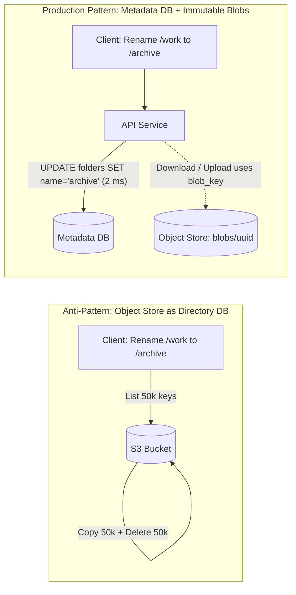
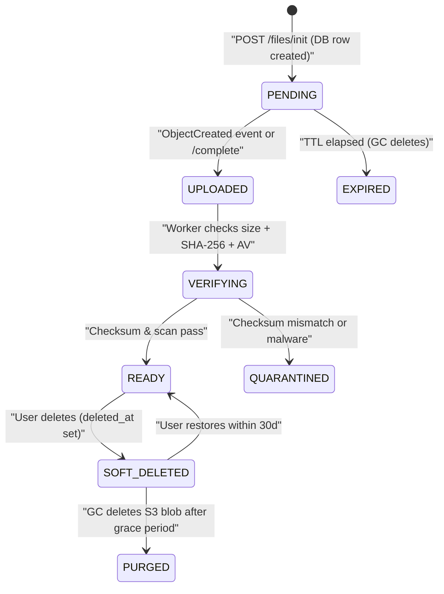
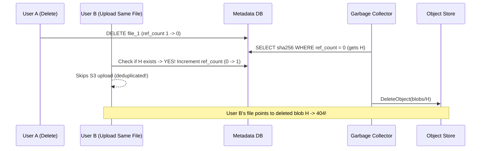

# File Metadata Storage: DB vs Object Store, Checksums, Hashes

> **Prerequisites:** [Lesson 06: Multipart & Resumable Uploads](../06-multipart-resumable-uploads/README.md).  
> **Estimated Reading Time:** 24–28 minutes  
> **Target Audience:** Backend engineers designing file-sharing, DAM, or cloud-drive systems, and candidates asked "where do you store file metadata, how do you verify integrity, and how do you model folders and permissions?"  
> **Free PDF Notes:** [Download SD-O-007.pdf](https://backendroadmap.com/notes/system-design/SD-O-007.pdf)

> [!NOTE]
> **In one line:** **Never store mutable, queryable, relational metadata inside an object store.** Keep **immutable file bytes** in S3/GCS/Azure Blob (addressed by UUID or content hash) and keep **mutable metadata** (names, folders, permissions, sizes, checksums, lifecycle state) in a transactional database—linked via a cryptographic **SHA-256 checksum**.

> [!TIP]
> **The Golden Rule:** Treat object storage as a **flat, immutable key-value blob store**, not a filesystem. Renaming a folder of 100,000 files in a database is a single `UPDATE` on one row (~2 ms); renaming a "folder" prefix in S3 requires copying and deleting 100,000 objects (~minutes and $$$).

---

## 1. What File Metadata Storage Is, and What It Isn't

Every file system—from Google Drive to a healthcare imaging archive—has two fundamentally different workloads:
1. **Bytes (Data Plane):** Multi-megabyte/gigabyte immutable payloads written once and streamed sequentially.
2. **Metadata (Control Plane):** Kilobyte-sized structured records (`filename`, `parent_folder_id`, `owner_id`, `acl`, `size_bytes`, `sha256`, `status`, `created_at`) that are queried, indexed, sorted, renamed, and permission-checked thousands of times per second.

Object stores (S3, GCS) let you attach up to 2 KB of custom headers (`x-amz-meta-*`) to an object, and they simulate folders using `/` delimiters in keys. That seduces teams into skipping a metadata database—until they need to list "all PDFs shared with Alice modified last week" or rename a top-level folder.

| Term | Precise Meaning | Example |
| :--- | :--- | :--- |
| **Data plane (Object Store)** | Immutable blob bytes stored under an opaque key | `blobs/sha256/9f86d081...` |
| **Control plane (Metadata DB)** | Transactional DB storing hierarchy, ACLs, MIME types, sizes, and state machines | PostgreSQL / Spanner / DynamoDB |
| **UUID-addressed key** | Random unique object key decoupled from user-facing filename | `obj_01J9Z...` |
| **Content-addressed key (CAS)** | Object key derived from cryptographic hash of its bytes | `sha256(bytes)` |
| **Checksum (integrity)** | Fast error-detection or cryptographic digest verifying no bit rot or tampering | `CRC32C` (hardware) / `SHA-256` |
| **ETag** | HTTP/S3 opaque validator; MD5 for small single `PUT`s, **not** MD5 for multipart or KMS-encrypted objects | `"d41d8cd98f...-12"` |
| **Soft delete / tombstone** | Marking a DB row `deleted_at = NOW()` before async GC deletes the underlying blob | 30-day Trash recovery |
| **Not** | Storing `BLOB`/`BYTEA` files inside PostgreSQL (bloats WAL, vacuum, and backups) | Keep DB rows under ~1 KB |

### Why It Matters
1. **O(1) folder renames & moves:** Decoupling logical paths (DB) from physical keys (S3) makes renames, moves, and sharing instant atomic transactions.
2. **Queryability & ACLs:** Object stores cannot run `JOIN`s, full-text search, or secondary index queries across millions of objects in milliseconds.
3. **End-to-end integrity:** Relying on S3's `ETag` breaks on multipart uploads and SSE-KMS encryption; explicit `SHA-256` / `CRC32C` checksums catch silent corruption.

---

## 2. Anatomy: Object-Store-Only vs Metadata DB + Immutable Blob Store



| Dimension | S3 Prefix / `x-amz-meta-*` Only | Metadata DB + Immutable Object Store |
| :--- | :--- | :--- |
| **Rename folder of 100k files** | 100k `CopyObject` + 100k `DeleteObject` (~minutes, ~$0.50) | **1 SQL `UPDATE`** (~2 ms, $0) |
| **List folder sorted by `updated_at`** | `ListObjectsV2` (lexicographical key order only!) | Indexed DB query (`p99 < 5 ms`) |
| **Search by tag, owner, MIME, size** | Full bucket scan or external S3 Inventory | Secondary / composite index |
| **Transactional state machine** | None (`PENDING` vs `SCANNED` vs `READY` is racy) | ACID transactions + `SELECT ... FOR UPDATE` |
| **Consistency between DB and S3** | Single system (no drift) | Needs **Outbox / Reconciliation GC** for orphans |

> [!WARNING]
> **The #1 Trap: Using S3 `ETag` as a Content Hash.** S3's `ETag` is **only** the raw MD5 of the file when uploaded as a single unencrypted (or SSE-S3) `PUT`. For **multipart uploads**, `ETag` is `<MD5-of-concatenated-part-MD5s>-<partCount>`. For **SSE-KMS** encrypted objects, `ETag` is **not MD5 at all**. Never use `ETag` for deduplication or client-side integrity verification—use explicit `SHA-256` or `CRC32C`.

---

## 3. Mathematical Model: Metadata Footprint, Hash Collisions & Bit-Rot

**1. Metadata DB sizing.** Suppose a cloud drive stores $N_{\text{files}} = 10^9$ (1 billion) files, with average object size $S_{\text{avg}} = 2\text{ MB}$ ($2\text{ PB}$ total blob storage).
If each metadata row (UUIDs, `parent_id`, `owner_id`, `name`, `size`, `sha256` 32 bytes, timestamps, indexes) takes $B_{\text{row}} \approx 400\text{ B}$:

$$M_{\text{DB}} = N_{\text{files}} \times B_{\text{row}} = 10^9 \times 400\text{ B} = 400\text{ GB}$$

Notice the **5,000:1 leverage ratio**: $400\text{ GB}$ of fast NVMe PostgreSQL/Spanner indexes **2,000,000 GB (2 PB)** of cheap object storage!

**2. Hash collision probability (Birthday Bound).** If you use a $b$-bit hash for integrity or content-addressing across $N$ distinct objects, collision probability is approximately:

$$P(\text{collision}) \approx \frac{N^2}{2^{b+1}}$$

- For **MD5** ($b = 128$): $N = 10^9 \implies P \approx 10^{18} / 2^{129} \approx 1.5 \times 10^{-21}$ (safe against *random* errors, **broken** against *adversarial* collision attacks!).
- For **SHA-256** ($b = 256$): $N = 10^{12} \implies P \approx 10^{24} / 2^{257} \approx 4 \times 10^{-54}$ (cryptographically collision-resistant).
- For **CRC32C** ($b = 32$): $N = 10^5 \implies P \approx 10^{10} / 2^{33} \approx 1.1$ (guaranteed collisions! Use CRC32C **only** for per-transfer bit-error detection, **never** for deduplication or content addressing).

**3. Reference-counted garbage collection safety.** If multiple metadata rows point to the same content-addressed blob (`ref_count`), deleting a file decrements `ref_count`. A blob is eligible for S3 deletion **only when** `ref_count == 0` **and** a grace period $T_{\text{grace}}$ (e.g., 24 h) has elapsed to prevent race conditions with concurrent uploads.

---

## 4. Metrics & Percentiles

| Metric | Meaning | Alert when |
| :--- | :--- | :--- |
| **Metadata query latency $p_{99}$** | Folder listing / permission check DB time | $> 20\text{ ms}$ (missing composite index or lock contention) |
| **Checksum mismatch rate** | Uploads/downloads failing SHA-256 or CRC32C verification | Any occurrence $> 0$ (network corruption, client bug, or tampering) |
| **DB–S3 orphan count** | Blobs in S3 with no matching DB row (`status != DELETED`) | $> 1\%$ of bucket objects (GC job failing) |
| **Dangling DB pointers** | `READY` DB rows whose S3 `HeadObject` returns `404` | **Any $> 0$ (SEV-1 data loss bug!)** |
| **Pending upload timeout rate** | Rows stuck in `PENDING` past URL TTL | $> 5\%$ (client abandonment or webhook failure) |
| **WAL / Vacuum bloat** | Dead tuples in `file_metadata` table | $> 20\%$ dead tuples (tune autovacuum) |

### Worked Example (Checksum Verification Pipeline)
A 1 GB medical DICOM archive is uploaded via multipart (100 × 10 MB parts).
- Client computes **CRC32C** per part in hardware (~10 GB/s on modern CPUs → 1 ms per 10 MB part) and **SHA-256** over the whole stream (~1.5 GB/s with SHA-NI → 660 ms total).
- Client sends `x-amz-checksum-crc32c` on each `UploadPart`, guaranteeing S3 catches any TCP/memory bit-flip in transit.
- Client passes the whole-file `sha256` to `POST /files/{id}/complete`. Your async worker verifies the assembled object's SHA-256 (or S3's `ChecksumSHA256`) and persists `sha256` in `file_metadata` before transitioning `status` from `VERIFYING` to `READY`.

---

## 5. Compounding & Failure Modes

| Failure Mode | Trigger | Compounding Effect |
| :--- | :--- | :--- |
| **1. Dual-Write Drift (S3 vs DB)** | API writes to S3, then crashes before committing DB row (or vice versa) | Either **orphaned blobs** (cost leak) or **dangling DB rows** (`404` on download—catastrophic UX) |
| **2. Eager Delete Race (CAS)** | User A deletes blob `H` (`ref_count` hits 0) at the exact millisecond User B deduplicates a new upload against `H` | **Data loss:** GC deletes `H` from S3 while User B's new file row points to `H`! |
| **3. Deep Folder Tree `JOIN`s** | Recursive CTE over 50-level nested folders on every permission check | DB CPU spikes to 100% on `GET /folders/{id}` |
| **4. Hot Partition on `tenant_id`** | One enterprise tenant has 50M files in a single DynamoDB/Cassandra partition | Throttled reads/writes for that tenant |

---

## 6. Numbers Every Engineer Must Know

| Item | Typical | Implication |
| :--- | :---: | :--- |
| Metadata row size (SQL + indexes) | **300 – 500 bytes** | 1 billion files $\approx$ 400 GB DB (fits on 1–2 shards) |
| S3 custom metadata (`x-amz-meta-*`) limit | **2 KB total** | Never use S3 headers as your primary metadata store |
| CRC32C throughput (hardware SSE4.2/ARM) | **10 – 20 GB/s** | Virtually free per-part/per-request bit-rot check |
| SHA-256 throughput (modern CPU w/ SHA-NI) | **1.5 – 3 GB/s** | Fast enough for streaming verification; avoid blocking web threads |
| DB `UPDATE` vs S3 `Copy+Delete` (10k files) | **2 ms vs ~30 s** | Always model folders/names in the DB, not S3 keys |
| PostgreSQL `BYTEA` practical ceiling | **< 100 KB** | Above that, store bytes in S3 and keep a pointer in DB |

---

## 7. Protocol Deep Dive: State Machine & Checksum Lifecycle



| Question | Answer |
| :--- | :--- |
| **Which database should I pick for file metadata?** | **PostgreSQL** (with `ltree` or closure table) works great up to ~1–2B rows with read replicas/sharding. **Google Spanner / CockroachDB** for global strong consistency. **DynamoDB / Cassandra** for massive scale if you pre-model access patterns (`PK = parent_id`, `SK = file_name`). |
| **How do you query folder hierarchies fast without recursive CTEs?** | Store a **materialized path** (`/root_id/folder_a/folder_b/`) or **closure table** (`ancestor_id, descendant_id, depth`). Checking if User X has inherited access to a file 20 levels deep becomes a single indexed `IN (ancestors)` lookup. |
| **Why `CRC32C` vs `SHA-256`?** | `CRC32C` is 10× faster and supported natively by S3/GCS for hardware-accelerated transit checks, but it is **not** cryptographically collision-resistant. Use `CRC32C` for transport integrity and `SHA-256` for content addressing, deduplication, and tamper-proofing. |

**When NOT to use a separate metadata DB:**
- **Append-only machine logs / data lake Parquet files** queried by Spark/Athena/Trino (use Iceberg/Delta Lake manifests on S3 instead of an OLTP DB).
- **Single-purpose static assets** (`avatars/{userId}.webp`) where the key is deterministic and no search, folders, or sharing exist.

---

## 8. Hierarchical Budgets & Design Rules

| Slice | Rule | Control |
| :--- | :--- | :--- |
| **Separation** | Blobs in Object Store; names, hierarchy, ACLs, state in DB | Strict schema boundary |
| **Addressing** | Keys are `uuid` or `sha256`, never user-supplied paths | Server-side key generator |
| **Integrity** | Require `SHA-256` (or `CRC32C` per part) + verify size on completion | Worker verification step |
| **State machine** | Never serve files until `status = 'READY'` | AuthZ / download guard |
| **Deletion** | Two-phase: soft delete in DB → grace period → S3 delete → hard delete | Async GC worker |
| **Hierarchy** | Materialized path or closure table for $O(1)$ ancestor ACL checks | Indexed path/ancestor column |
| **Consistency** | Never delete S3 blob before DB tombstone commits | DB-first deletion order |

---

## 9. Top Mitigations

1. **Decouple logical paths from S3 keys** so renames, moves, and restores are instant ACID database updates.
2. **Use a state machine (`PENDING` → `VERIFYING` → `READY` → `SOFT_DELETED`)** so incomplete or infected uploads are never downloadable.
3. **Verify `SHA-256` and `Content-Length`** asynchronously on upload completion; never trust `ETag` as a universal MD5.
4. **Delete DB-first, S3-second (with grace period):** Mark rows `SOFT_DELETED` (or `PURGING`), wait for any in-flight reads/dedup references to drain, then delete from S3.
5. **Run a periodic Reconciliation GC job** comparing S3 inventory against DB keys to clean up orphaned `PENDING` blobs.
6. **Enable S3 Versioning** on critical buckets so an accidental GC bug or `DeleteObject` can be rolled back.
7. **Index `(tenant_id, parent_id, name)`** and use keyset/cursor pagination (`WHERE (name, id) > ...`) for million-file folders instead of `OFFSET`.

---

## 10. Production Incident: The Content-Addressed GC Race That Deleted Live Files

**Incident (SEV-1):** A collaborative design tool used content-addressed storage (`blobs/<sha256>`) with a `ref_count` column in PostgreSQL. After a cleanup migration, 412 active customer files suddenly returned `404 NoSuchKey` from S3!



**Root Cause:**
1. The GC worker selected `sha256` hashes with `ref_count == 0` and immediately issued `S3.DeleteObject(H)` without locking or a grace period.
2. In the 50 ms window between GC's `SELECT` and `S3.DeleteObject`, User B uploaded a file with the same `sha256 = H`, saw the existing blob row, incremented `ref_count` back to `1`, and skipped uploading to S3.
3. GC proceeded to delete `blobs/H` from S3, causing permanent data loss for User B.

**Fix:**
1. **Two-phase tombstone with grace period:** Blobs with `ref_count == 0` are marked `unreferenced_at = NOW()` and only eligible for deletion after **24 hours**.
2. **Atomic `DELETE ... WHERE ref_count = 0 AND unreferenced_at < NOW() - INTERVAL '24 hours' RETURNING sha256`** inside a DB transaction, plus **never** allowing new uploads to resurrect a blob whose `unreferenced_at` is set (or clearing `unreferenced_at = NULL` atomically under `SELECT ... FOR UPDATE` before GC claims it).
3. Enabled **S3 Versioning** so deleted objects could be recovered within 30 days.

---

## 11. Multi-Language Production Code Tabs

Streaming **dual-checksum (`SHA-256` + `CRC32C`)** file verifier + metadata record builder in all four languages (using standard libraries / built-in crypto).

````carousel
```go
// Go: streaming SHA-256 + CRC32C (Castagnoli) metadata verifier in a single pass.
package main

import (
	"crypto/sha256"
	"encoding/base64"
	"encoding/hex"
	"hash/crc32"
	"io"
)

type FileDigest struct {
	SizeBytes  int64
	SHA256Hex  string
	CRC32CB64  string // Matches S3 x-amz-checksum-crc32c header format
}

var crc32cTable = crc32.MakeTable(crc32.Castagnoli)

func ComputeFileDigest(r io.Reader) (FileDigest, error) {
	sha := sha256.New()
	crc := crc32.New(crc32cTable)
	n, err := io.Copy(io.MultiWriter(sha, crc), r)
	if err != nil {
		return FileDigest{}, err
	}
	return FileDigest{
		SizeBytes: n,
		SHA256Hex: hex.EncodeToString(sha.Sum(nil)),
		CRC32CB64: base64.StdEncoding.EncodeToString(crc.Sum(nil)),
	}, nil
}
```
<!-- slide -->
```typescript
// TypeScript: streaming SHA-256 digest & metadata state transition guard.
import { createHash } from "node:crypto";
import { Readable } from "node:stream";

export type FileStatus = "PENDING" | "VERIFYING" | "READY" | "QUARANTINED" | "SOFT_DELETED";

export interface FileMetadata {
  id: string;
  blobKey: string;
  expectedSize: number;
  sha256?: string;
  status: FileStatus;
}

export async function verifyStream(
  stream: Readable,
  record: FileMetadata,
): Promise<FileMetadata> {
  if (record.status !== "PENDING" && record.status !== "VERIFYING") {
    throw new Error(`Invalid state transition from ${record.status}`);
  }
  const hash = createHash("sha256");
  let actualSize = 0;

  for await (const chunk of stream) {
    const buf = Buffer.isBuffer(chunk) ? chunk : Buffer.from(chunk);
    actualSize += buf.length;
    if (actualSize > record.expectedSize) {
      return { ...record, status: "QUARANTINED" };
    }
    hash.update(buf);
  }

  if (actualSize !== record.expectedSize) {
    return { ...record, status: "QUARANTINED" };
  }
  return { ...record, sha256: hash.digest("hex"), status: "READY" };
}
```
<!-- slide -->
```python
# Python 3.13: streaming SHA-256 + CRC32 verification & safe CAS reference-count GC guard.
import hashlib
import zlib
from dataclasses import dataclass
from typing import BinaryIO

CHUNK_SIZE = 1024 * 1024  # 1 MiB streaming buffer


@dataclass(frozen=True)
class FileDigest:
    size_bytes: int
    sha256_hex: str
    crc32_hex: str


def compute_digest(stream: BinaryIO) -> FileDigest:
    sha = hashlib.sha256()
    crc = 0
    total = 0
    while chunk := stream.read(CHUNK_SIZE):
        total += len(chunk)
        sha.update(chunk)
        crc = zlib.crc32(chunk, crc)
    return FileDigest(
        size_bytes=total,
        sha256_hex=sha.hexdigest(),
        crc32_hex=f"{crc & 0xFFFFFFFF:08x}",
    )


def verify_against_expected(stream: BinaryIO, expected_size: int, expected_sha256: str) -> bool:
    digest = compute_digest(stream)
    return digest.size_bytes == expected_size and digest.sha256_hex == expected_sha256.lower()
```
<!-- slide -->
```csharp
// C#: .NET streaming SHA-256 + size verification for uploaded blobs.
using System.Security.Cryptography;

public enum FileStatus { Pending, Verifying, Ready, Quarantined, SoftDeleted }

public sealed record FileDigest(long SizeBytes, string Sha256Hex);

public static class BlobVerifier
{
    public static async Task<FileDigest> ComputeDigestAsync(Stream stream, CancellationToken ct = default)
    {
        using var sha = IncrementalHash.CreateHash(HashAlgorithmName.SHA256);
        var buffer = new byte[1024 * 1024]; // 1 MiB
        long total = 0;
        int read;
        while ((read = await stream.ReadAsync(buffer, ct)) > 0)
        {
            total += read;
            sha.AppendData(buffer.AsSpan(0, read));
        }
        return new FileDigest(total, Convert.ToHexString(sha.GetHashAndReset()).ToLowerInvariant());
    }
}
```
````

---

## 12. Hands-On CLI Verification Workflows

Verify S3 object checksums, metadata headers, and local SHA-256 / CRC32C digests:

```bash
# 1. Compute SHA-256 locally and upload with S3 native SHA-256 checksum verification
SHA_B64=$(openssl dgst -sha256 -binary sample.pdf | base64)
aws s3api put-object \
  --bucket my-bucket \
  --key "blobs/sample.pdf" \
  --body sample.pdf \
  --checksum-algorithm SHA256 \
  --checksum-sha256 "$SHA_B64"

# 2. Retrieve object attributes including S3-verified checksum without downloading bytes
aws s3api get-object-attributes \
  --bucket my-bucket \
  --key "blobs/sample.pdf" \
  --object-attributes Checksum ObjectSize ETag

# 3. Demonstrate why ETag != MD5 for multipart uploads (upload 12 MB file with 6 MB parts)
dd if=/dev/urandom of=12mb.bin bs=1M count=12 status=none
md5sum 12mb.bin
aws s3 cp 12mb.bin s3://my-bucket/test/12mb.bin
aws s3api head-object --bucket my-bucket --key test/12mb.bin --query ETag
# Notice the ETag ends in "-2" (multipart composite hash), NOT the md5sum above!
```

---

## 13. Common Mistakes to Avoid

1. **Using S3 key prefixes as your folder hierarchy**, making folder renames $O(N)$ copy+delete operations.
2. **Trusting S3 `ETag` as a universal MD5**, which breaks on multipart uploads and SSE-KMS encryption.
3. **Storing large file blobs (`BYTEA`) inside PostgreSQL/MySQL**, bloating backups, WAL replication, and buffer pools.
4. **Deleting S3 blobs synchronously inside user `DELETE` requests** or deleting CAS blobs at `ref_count == 0` without a grace period.
5. **Using `OFFSET` pagination** on folders with 100,000+ files instead of cursor/keyset pagination.
6. **Serving files with `status == 'PENDING'`** before checksum verification and malware scanning complete.
7. **Storing permissions only at the leaf file** without an ancestor path/closure table, causing recursive `JOIN` storms.
8. **Using `CRC32` for deduplication** (32-bit birthday collisions happen at just ~77,000 files!).

---

## 14. Key Terms Glossary

| Key Term | Definition |
| :--- | :--- |
| **Control Plane (Metadata DB)** | Transactional database storing file names, hierarchy, ACLs, sizes, hashes, and states. |
| **Data Plane (Object Store)** | Flat, immutable blob store holding raw file bytes under UUID or content-addressed keys. |
| **Content-Addressed Storage (CAS)** | Storing blobs at a key equal to their cryptographic hash (`sha256(bytes)`). |
| **Bit Rot** | Silent data corruption on disk or in transit; caught by checksums. |
| **CRC32C** | Hardware-accelerated 32-bit cyclic redundancy check (Castagnoli) for fast transport integrity. |
| **SHA-256** | 256-bit cryptographic hash; safe for content addressing, integrity, and tamper detection. |
| **Materialized Path** | Storing full ancestor IDs (e.g., `/r1/f2/f3/`) in a column for fast subtree and ACL queries. |
| **Closure Table** | Join table storing all `(ancestor, descendant, depth)` pairs for $O(1)$ hierarchy lookups. |
| **Tombstone / Soft Delete** | Marking a row deleted (`deleted_at`) before asynchronous blob garbage collection. |
| **Reconciliation GC** | Background job comparing DB records and S3 inventory to clean up orphaned blobs. |

---

## 15. System Design Interview Questions & Answers

### Basic Conceptual Questions

<details>
<summary><strong>Q1: Why not store file metadata directly in S3 `x-amz-meta-*` headers and use S3 prefixes as folders? [BASIC]</strong></summary>

**Answer:**
S3 custom metadata is capped at 2 KB, cannot be indexed or queried (`WHERE owner = X AND size > 10MB`), and has no relational transactions. Furthermore, S3 has no real folders—renaming a "folder" of 50,000 files requires 50,000 `CopyObject` + 50,000 `DeleteObject` calls. A metadata DB makes folder renames an instant single-row `UPDATE`.
</details>

<details>
<summary><strong>Q2: Why shouldn't you store uploaded files as `BLOB` / `BYTEA` columns in PostgreSQL? [BASIC]</strong></summary>

**Answer:**
Database storage is 10–30× more expensive per GB than S3, large blobs pollute the DB buffer pool, bloat write-ahead logs (WAL) and replication streams, slow down backups/restores, and tie DB connection pools to slow client network downloads.
</details>

<details>
<summary><strong>Q3: What is the difference between CRC32C and SHA-256, and when do you use each? [BASIC]</strong></summary>

**Answer:**
`CRC32C` is a 32-bit non-cryptographic checksum that runs at 10–20 GB/s in CPU hardware—ideal for detecting accidental bit-flips in transit or on disk. `SHA-256` is a 256-bit cryptographic hash (~1.5–3 GB/s)—required for content-addressed storage, deduplication, and protection against malicious collisions.
</details>

<details>
<summary><strong>Q4: Why is S3's `ETag` unreliable as a file hash? [BASIC]</strong></summary>

**Answer:**
`ETag` is only the raw MD5 for single-part, unencrypted (or SSE-S3) uploads. For multipart uploads, `ETag` is `<md5-of-concatenated-part-md5s>-<partCount>`. For SSE-KMS encrypted objects, `ETag` is not an MD5 at all. Always use explicit `SHA-256` or `CRC32C` checksums.
</details>

### Scenario-Based Architecture Questions

<details>
<summary><strong>Q5: How do you model a Google Drive-style folder hierarchy in SQL so renaming a folder with 1 million descendants is instant? [SCENARIO]</strong></summary>

**Answer:**
Store `parent_id` and `name` on each `nodes` row, and address S3 blobs by immutable `blob_id` (UUID or SHA-256). Renaming a folder is a single `UPDATE nodes SET name = 'New' WHERE id = ?`—zero S3 calls and zero descendant row updates! For fast inherited-permission checks, use a **Closure Table** or **Materialized Path** (note: materialized paths require updating descendant path strings on *move*, whereas a closure table or ancestor array is cleaner for deep moves).
</details>

<details>
<summary><strong>Q6: A client uploads a 2 GB file, but your API crashes right after S3 accepts the upload and before the DB transaction commits. How do you recover? [SCENARIO]</strong></summary>

**Answer:**
First, create the DB row in `PENDING` state **before** minting the pre-signed URL. Second, rely on S3 `ObjectCreated` events (via SQS/EventBridge) as an asynchronous fallback to transition `PENDING` → `VERIFYING` → `READY` even if the client or API pod crashes. Third, run a daily Reconciliation GC that deletes S3 objects whose `PENDING` DB row expired (or has no DB row after 24 hours).
</details>

<details>
<summary><strong>Q7: How do you design a 30-day "Trash / Recycle Bin" without duplicating S3 storage? [SCENARIO]</strong></summary>

**Answer:**
Implement soft deletes in the metadata DB: set `deleted_at = NOW()` on the file/folder row and exclude `deleted_at IS NOT NULL` from normal queries. The S3 blob stays untouched (zero copy cost). Restoring simply sets `deleted_at = NULL`. After 30 days, an async GC job deletes the S3 blob (if `ref_count == 0`) and purges the DB row.
</details>

<details>
<summary><strong>Q8: How do you scale the metadata DB when you outgrow a single PostgreSQL instance at 5 billion files? [SCENARIO]</strong></summary>

**Answer:**
Shard horizontally by `tenant_id` / `root_org_id` (or `user_id` for consumer drives) so an entire user/org workspace—and all its folder `JOIN`s and `UNIQUE (parent_id, name)` constraints—lives on a single shard. Alternatively, use a distributed SQL DB like **Google Spanner** or **CockroachDB** with interleaved/colocated tables.
</details>

### Advanced & Tricky Interview Questions

<details>
<summary><strong>Q9: Explain the race condition when garbage-collecting content-addressed blobs (`ref_count == 0`), and how you solve it. [TRICKY]</strong></summary>

**Answer:**
If GC sees `ref_count == 0` and deletes the S3 blob while a concurrent upload deduplicates against that same `sha256` and increments `ref_count` to `1`, the new file points to a deleted blob (data loss). **Fix:** Never delete immediately at `ref_count == 0`. Set `unreferenced_at = NOW()`, enforce a 24-hour grace period, and have uploads either refuse to reuse blobs with `unreferenced_at IS NOT NULL` or atomically clear `unreferenced_at` under `SELECT ... FOR UPDATE` before GC's `DELETE ... WHERE ref_count = 0 AND unreferenced_at < NOW() - 24h` claims the row.
</details>

<details>
<summary><strong>Q10: Why can't you use `SHA-256` content-addressing alone if two users upload the exact same file with different KMS encryption keys? [TRICKY]</strong></summary>

**Answer:**
If Tenant A and Tenant B require **tenant-isolated encryption keys (CMK)** for compliance (HIPAA/PCI), storing one shared ciphertext encrypted with Tenant A's key breaks Tenant B's isolation/revocation guarantees. In multi-tenant CMK systems, deduplication must be scoped **per-tenant** (key = `tenant_id/sha256`), or use envelope encryption with per-tenant wrapped DEKs (which still prevents cross-tenant ciphertext sharing).
</details>

<details>
<summary><strong>Q11: How do you prevent a user from exhausting your DB or S3 with millions of `PENDING` rows by calling `/files/init` in a loop? [TRICKY]</strong></summary>

**Answer:**
Rate-limit `/files/init` per user/IP, cap concurrent `PENDING` uploads per user (e.g., max 20 active `PENDING` rows), and run a lightweight TTL sweeper that deletes expired `PENDING` rows after `URL_TTL + 1 hour` so they don't bloat the primary table.
</details>

<details>
<summary><strong>Q12: A user reports a downloaded file is corrupted, but S3 returned 200 OK. Where could corruption have happened and how do you prove it? [TRICKY]</strong></summary>

**Answer:**
Corruption can occur in client memory/disk *before* upload, over an unencrypted proxy, or on the client during download. By storing the client-computed `SHA-256` at upload time, verifying it in S3/worker, and returning `X-Content-Sha256` on download, you can isolate whether the bytes changed before S3 (client upload bug) or after S3 (client download/disk bug).
</details>

---

## 16. One-Page Master Cheat Sheet

```
+---------------------------------------------------------------------------------------------------------+
|                    FILE METADATA STORAGE — MASTER CHEAT SHEET                                           |
+---------------------------------------------------------------------------------------------------------+
| 1. GOLDEN SPLIT: Bytes (immutable, flat UUID/SHA-256 keys) -> Object Store (S3/GCS).                    |
|    Metadata (names, folders, ACLs, sizes, hashes, state) -> Transactional DB (Postgres/Spanner).        |
+---------------------------------------------------------------------------------------------------------+
| 2. RATIO & SCALE: ~400 B/row -> 1B files = 400 GB DB indexing ~2 PB of S3 (5,000:1 leverage).           |
|    Folder rename = 1 SQL UPDATE (2 ms) vs 100k S3 Copy+Delete calls (minutes).                          |
+---------------------------------------------------------------------------------------------------------+
| 3. CHECKSUMS: NEVER trust S3 ETag (breaks on multipart & SSE-KMS).                                      |
|    Use CRC32C (10-20 GB/s) for transport bit-rot; SHA-256 (1.5-3 GB/s) for CAS & tamper-proofing.       |
+---------------------------------------------------------------------------------------------------------+
| 4. STATE MACHINE: PENDING -> UPLOADED -> VERIFYING -> READY -> SOFT_DELETED -> PURGED.                  |
|    Never serve downloads until READY.                                                                   |
+---------------------------------------------------------------------------------------------------------+
| 5. SAFE GC: Delete DB-first (tombstone) -> 24h+ grace period -> S3 DeleteObject.                        |
|    Prevents CAS ref_count=0 race condition; enable S3 Versioning as safety net.                         |
+---------------------------------------------------------------------------------------------------------+
```

---

## Further Reading & Sources

- Amazon S3 Documentation, [Checking object integrity (CRC32C, SHA-256)](https://docs.aws.amazon.com/AmazonS3/latest/userguide/checking-object-integrity.html).
- Dropbox Engineering, [Magic Pocket: How Dropbox stores exabytes of data](https://dropbox.tech/infrastructure/inside-the-magic-pocket) (separation of block/metadata planes).
- Martin Kleppmann, *Designing Data-Intensive Applications*, Chapter 3 ("Storage and Retrieval") & Chapter 7 ("Transactions").
- Google Cloud Architecture Center, [Managing file metadata and object storage](https://cloud.google.com/architecture).

---

## Free PDF Notes

[SD-O-007.pdf](https://backendroadmap.com/notes/system-design/SD-O-007.pdf)

---

## Next

Continue with [Lesson 08: Chunking & Deduplication: Rolling Hashes and Delta Sync](../08-chunking-deduplication/README.md): content-defined chunking, Rabin/Gear rolling hashes, and Dropbox-style delta sync.
