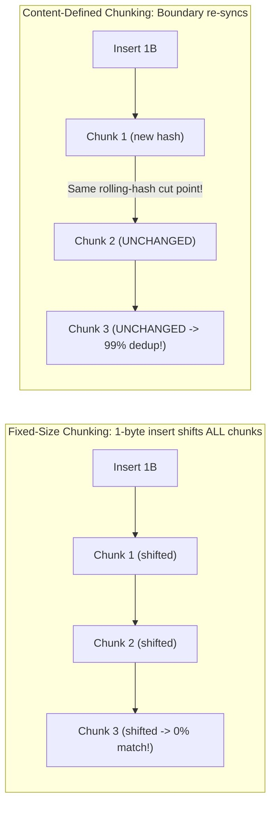
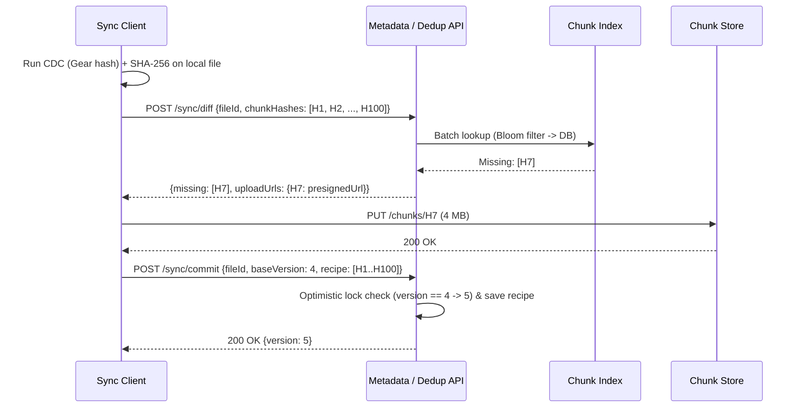
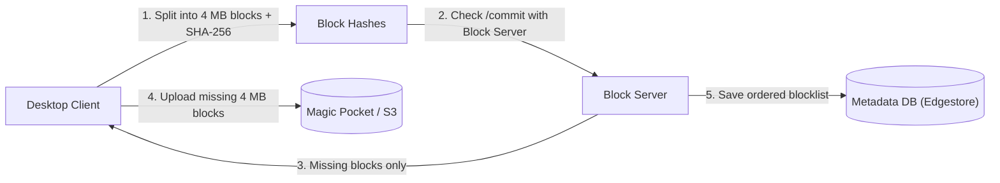

# Chunking & Deduplication: Rolling Hashes and Delta Sync

> **Prerequisites:** [Lesson 07: File Metadata Storage](../07-file-metadata-storage/README.md).  
> **Estimated Reading Time:** 25–30 minutes  
> **Target Audience:** Backend and storage engineers building cloud drives, backup agents, or artifact registries, and candidates asked "how does Dropbox or rsync sync a 2 GB file when you edit 10 bytes at the beginning?"  
> **Free PDF Notes:** [Download SD-O-008.pdf](https://backendroadmap.com/notes/system-design/SD-O-008.pdf)

> [!NOTE]
> **In one line:** **Content-Defined Chunking (CDC)** uses a **rolling hash** (Rabin fingerprint or FastCDC/Gear hash) to place chunk boundaries based on *file content* rather than fixed offsets, so inserting bytes at the start of a file only invalidates **one chunk** instead of shifting and re-uploading every chunk that follows (**delta sync** + **deduplication**).

> [!TIP]
> **The Golden Rule:** Never use fixed-size chunking for delta sync—a 1-byte insertion at offset 0 shifts every boundary and causes 0% deduplication. Use **Content-Defined Chunking (CDC)** with `min_size = 2–4 KB` and `max_size = 16–64 KB` (or `1–4 MB` for cloud drives) to bound chunk variance while preserving shift-invariance.

---

## 1. What Chunking & Deduplication Are, and What They Aren't

Suppose a user edits a single slide in a 500 MB PowerPoint or prepends 100 bytes to a 2 GB VM disk image.
- **Whole-file upload:** Re-uploads all 2 GB.
- **Fixed-size chunking (e.g., every 4 MB):** Because 100 bytes were inserted at offset 0, every single 4 MB boundary shifts by 100 bytes. All 500 chunks have completely different SHA-256 hashes—**0% deduplication**, re-uploading all 2 GB!
- **Content-Defined Chunking (CDC):** A sliding window computes a fast **rolling hash** at every byte offset. Whenever `rolling_hash & mask == 0`, it cuts a chunk boundary. Because the cut condition depends only on the local bytes in the window, inserting 100 bytes at the start only changes the **first chunk**; all subsequent boundaries re-synchronize and match the existing chunks on the server!

| Term | Precise Meaning | Example |
| :--- | :--- | :--- |
| **Fixed-size chunking** | Splitting a file every $C$ bytes (e.g., 4 MB) | Fast, zero CPU, **breaks on byte insertion** |
| **Content-Defined Chunking (CDC)** | Splitting when a sliding window's rolling hash matches a bitmask | Cut when `(hash & 0x1FFF) == 0` (avg 8 KB) |
| **Rolling hash** | Hash updated in $O(1)$ per byte as the window slides (`add(in)`, `remove(out)`) | Rabin fingerprint, Buzhash, Gear hash (FastCDC) |
| **Delta sync** | Sending only the chunk hashes not already present on the server | Upload 1 modified 4 MB chunk out of 500 |
| **Deduplication** | Storing each unique `sha256(chunk)` once across versions or users | 100 users upload same OS ISO → stored once |
| **Chunk index / recipe** | Ordered list of `(chunk_sha256, size)` representing a file version | `file_v2 = [H1', H2, H3, ..., H500]` |
| **Not** | Compression (gzip/zstd); dedup removes *identical* blocks across files/versions, compression shrinks *entropy* within a block | Usually run **CDC → Dedup → Compress → Encrypt** |

### Why It Matters
1. **10–100× bandwidth savings:** Cloud drives (Dropbox, iCloud), backup systems (Restic, Borg), and container/VM registries sync massive files after small edits in seconds.
2. **Massive storage reduction:** Across enterprise backups and shared team drives, CDC + deduplication routinely achieves **2× to 10×** storage savings.
3. **Resumability for free:** Every chunk is an immutable content-addressed blob (`PUT /chunks/{sha256}`); interrupted syncs never lose already-uploaded chunks.

---

## 2. Anatomy: Fixed-Size Chunking vs Content-Defined Chunking



| Dimension | Fixed-Size Chunking | Content-Defined Chunking (Rabin / FastCDC) |
| :--- | :--- | :--- |
| **Boundary rule** | `offset % C == 0` | `(rolling_hash & mask) == target` |
| **Effect of 1-byte insert at start** | Invalidates **100%** of chunks | Invalidates **1 chunk** (sometimes 2) |
| **CPU cost** | ~0 (just `seek`/`read`) | ~200 MB/s (Rabin) to **3+ GB/s** (FastCDC/Gear) |
| **Chunk size variance** | Exact ($C$ bytes) | Geometric distribution (needs `min_size` / `max_size` clamps) |
| **Best use case** | Append-only logs, S3 multipart | Delta sync, backups, VM/binary versioning |

> [!WARNING]
> **The #1 Trap: Unclamped CDC Chunk Sizes & Cross-Tenant Dedup Side Channels.**
> 1. Without `min_size` and `max_size` clamps, a run of zeros or unlucky bytes can produce 10-byte chunks (exploding metadata!) or 500 MB chunks (killing delta sync).
> 2. **Security trap (Cross-tenant dedup):** If User A can probe whether `sha256(secret_file)` already exists on the server (by seeing whether upload is skipped instantaneously), User A can confirm whether another user possesses a specific sensitive file (**oracle attack**). Always scope deduplication **per-tenant** or never expose upload-skip timing/responses across tenants!

---

## 3. Mathematical Model: Expected Chunk Size, Clamping & Metadata Overhead

**1. Expected chunk size.** If the rolling hash produces uniformly distributed bits and we cut whenever the lowest $k$ bits are zero (`(h & ((1 << k) - 1)) == 0`), the probability of a cut at any byte is $p = 2^{-k}$. The chunk length follows a geometric distribution with expected size:

$$E[\text{ChunkSize}] = \frac{1}{p} = 2^k \text{ bytes}$$

For example, $k = 13 \implies 2^{13} = 8{,}192\text{ B}$ ($8\text{ KiB}$) average; $k = 20 \implies 2^{20} = 1\text{ MiB}$ average.

**2. Clamping (`min_size` and `max_size`).**
- **Skip `min_size`** (e.g., $C_{\min} = \mu / 4$): Don't even evaluate the rolling hash for the first $C_{\min}$ bytes of a chunk. This eliminates tiny chunks *and* speeds up FastCDC by 25–40%!
- **Force cut at `max_size`** (e.g., $C_{\max} = 4\mu$): If no boundary is found by $C_{\max}$, force a cut so chunks never grow unbounded.

**3. Metadata overhead vs deduplication ratio.**
Suppose a $S = 1\text{ GB}$ ($10^9\text{ B}$) file is split into chunks of average size $\mu$, and each chunk recipe entry (`sha256` 32 B + `size` 4 B + overhead $\approx 40\text{ B}$) is stored in the recipe:

$$\text{Recipe Size} = \frac{S}{\mu} \times 40\text{ B}$$

| Average Chunk Size ($\mu$) | Chunks per 1 GB File | Recipe Size | Metadata Overhead | Delta Granularity |
| :---: | :---: | :---: | :---: | :---: |
| **4 KB** | 250,000 | 10 MB | 1.0% | Very fine (great for small DB/doc edits) |
| **64 KB** | 15,625 | 625 KB | 0.06% | Balanced (backups, general sync) |
| **4 MB** | 250 | 10 KB | 0.001% | Coarse (Dropbox-style cloud block storage) |

Notice the fundamental trade-off: **smaller chunks** yield better deduplication on small edits, **larger chunks** minimize chunk-index RAM, S3 `PUT` request counts, and recipe size!

---

## 4. Metrics & Percentiles

| Metric | Meaning | Alert when |
| :--- | :--- | :--- |
| **Deduplication ratio** | `logical_bytes / physical_stored_bytes` | Dropping unexpectedly (e.g., clients encrypting/compressing *before* CDC) |
| **Chunking throughput (MB/s)** | Client/worker CDC + SHA-256 speed | $< 200\text{ MB/s}$ (indicates slow byte-by-byte Rabin instead of Gear/FastCDC) |
| **Chunk cache / index hit rate** | `%` of `has_chunks` queries hitting RAM/Bloom filter | $< 85\%$ (disk IOPS bottleneck on chunk lookup) |
| **Tiny/oversized chunk rate** | `%` of chunks hitting `min_size` or `max_size` | $> 30\%$ hitting `max_size` (poor mask/normalization) |
| **Reassembly latency $p_{99}$** | Time to stream/stitch chunks for full-file download | $> 2\times$ single-object `GET` latency |
| **Orphaned chunk ratio** | Unreferenced chunks waiting for GC | $> 5\%$ of physical storage |

### Worked Example (Dropbox-Style Delta Sync)
A user edits 2 KB inside a 400 MB video/project file (previously 100 chunks of ~4 MB average).
1. Client runs CDC + SHA-256 locally in **~250 ms** (at 1.6 GB/s), producing 100 chunk hashes `[H1..H100]`.
2. Client sends a 3.2 KB `POST /files/check-chunks` request with those 100 hashes.
3. Server checks its chunk index and replies: `missing: [H42]` (only 1 chunk changed!).
4. Client uploads **only `H42` (4 MB)** instead of 400 MB—a **99% bandwidth reduction** and **100× faster sync**.
5. Client commits `POST /files/{id}/commit` with the ordered recipe `[H1..H41, H42_new, H43..H100]`.

---

## 5. Compounding & Failure Modes

| Failure Mode | Trigger | Compounding Effect |
| :--- | :--- | :--- |
| **1. Encryption / Compression Before CDC** | Client encrypts or gzips the whole file *before* running CDC | A 1-byte edit changes the entire compressed/encrypted bitstream → **0% deduplication!** Always run CDC **before** compression and encryption |
| **2. S3 Small-Object Request Explosion** | Choosing 4 KB CDC chunks and storing each 4 KB chunk as its own S3 object | 1 TB = 250M S3 `PUT`s = **$1,250 just in PUT API fees** + terrible read latency! Pack small chunks into **4–16 MB packfiles/containers** |
| **3. Chunk Index RAM Exhaustion** | 1 PB of 8 KB chunks = $1.25 \times 10^{11}$ entries × 40 B = **5 TB of index RAM** | Lookup falls back to random SSD reads, crushing ingest throughput (**chunk index bottleneck**) |
| **4. Cross-Tenant Oracle Leak** | Global dedup tells Client B "chunk H already exists, skip upload" | Attacker probes known hashes to detect if another customer holds a secret document |

---

## 6. Numbers Every Engineer Must Know

| Item | Typical | Implication |
| :--- | :---: | :--- |
| FastCDC (Gear hash) speed | **2 – 4 GB/s** | 5–10× faster than classic Rabin fingerprinting |
| Rabin fingerprint speed | **200 – 500 MB/s** | Legacy CDC standard (LBFS, Restic v1) |
| Dropbox-style cloud block size | **4 MB** | Balances S3 PUT cost vs delta sync savings |
| Backup CDC average chunk size | **16 KB – 1 MB** | Packed into multi-MB packfiles before S3 upload |
| S3 `PUT` cost | **$0.005 per 1,000 PUTs** | Never store raw 4 KB chunks as individual S3 objects |
| Dedup ratio (VMs / backups / docs) | **3× – 15× / 2× – 5× / 1.5×** | Media (MP4/JPEG) barely dedups across edits (~1.05×) |

---

## 7. Protocol Deep Dive: Delta Sync & FastCDC Gear Hash



**Why Gear Hash (FastCDC) replaced Rabin Fingerprinting:**
Classic Rabin fingerprinting treats a 48-byte sliding window as a polynomial over $\text{GF}(2)$, requiring a subtraction (`remove(out_byte)`) and modular reduction on every byte.
**Gear hash** replaces both with a single shift, add, and 256-entry lookup table:

$$h = (h \ll 1) + \text{GEAR}[\text{byte}]$$

Because a 64-bit unsigned integer naturally overflows, old bytes age out after 64 shifts with **zero** ring-buffer subtraction—making it ~10× faster!

| Question | Answer |
| :--- | :--- |
| **How do you store 4 KB–64 KB chunks in S3 without paying $1,000s in `PUT` fees?** | **Packfiles (Container Packing):** Buffer small deduplicated chunks into 4–16 MB packfiles (just like Git packfiles or Restic/Borg), upload one packfile to S3, and store `(chunk_sha256 -> packfile_id, offset, length)` in the index. |
| **What is "Normalized Chunking" in FastCDC?** | Standard CDC with `min_size` skews chunk sizes; FastCDC uses a *stricter* mask (more zero bits) before the average size and a *looser* mask after the average size to tighten the chunk-size distribution around the target mean. |
| **What if two clients edit the same file concurrently?** | Use **optimistic concurrency control** (`base_version`) on `POST /sync/commit`. The second client gets `409 Conflict` and creates a conflicted copy or merges. |

**When NOT to use CDC / Deduplication:**
- **Already-compressed/encrypted media streams** (H.264 video, JPEG, encrypted blobs): editing 1 frame re-encodes the stream, yielding ~0% deduplication.
- **Small ephemeral files (< 1 MB)** where a single `PUT` is simpler and faster than chunking + `diff` + `commit`.

---

## 8. Hierarchical Budgets & Design Rules

| Slice | Rule | Control |
| :--- | :--- | :--- |
| **Pipeline order** | **CDC → Dedup → Compress → Encrypt** (never encrypt/compress before CDC) | Client/agent pipeline |
| **Chunk clamping** | `min_size = target / 4`, `max_size = target * 4` | CDC parameters |
| **S3 object size** | Keep S3 objects $\ge 1\text{ MB}$ (use packfiles for small CDC chunks) | Packfile aggregator |
| **Index lookup** | Put an in-memory **Bloom filter** in front of the persistent chunk index | Avoids disk reads on misses |
| **Security** | Scope dedup **per-tenant** (or use convergent encryption + server-side HMAC) | Prevents cross-tenant oracle |
| **Concurrency** | Optimistic `base_version` check on recipe commit | `409 Conflict` on race |
| **GC safety** | Tombstone + 24 h grace period before deleting unreferenced chunks | Reference-counted GC |

---

## 9. Top Mitigations

1. **Always run CDC before compression and encryption** so small edits don't scramble the entire byte stream.
2. **Clamp chunk sizes** (`min_size` and `max_size`) and skip hashing for the first `min_size` bytes to boost speed and prevent tiny/giant chunks.
3. **Pack small chunks into 4–16 MB packfiles** before writing to S3 so `PUT` request fees and object counts stay tiny.
4. **Scope deduplication per-tenant** (or never leak "chunk already exists" timing across tenants) to eliminate cross-tenant oracle attacks.
5. **Use a Bloom filter** in front of the chunk index so novel chunks don't trigger unnecessary SSD/DB lookups.
6. **Verify `sha256(chunk_bytes) == expected_chunk_hash`** on upload so a buggy/malicious client cannot poison a shared content-addressed chunk!
7. **Use optimistic locking (`base_version`)** on recipe commits so concurrent syncs never silently overwrite each other.

---

## 10. Production Reference: How Dropbox's Magic Pocket & Block Sync Work

Dropbox's architecture (documented in their *Inside the Magic Pocket* and sync engine posts) is the canonical real-world reference for chunking and delta sync at exabyte scale:



- **Why 4 MB blocks?** At Dropbox's scale, 4 MB blocks keep the metadata blocklist small (a 1 GB file is just 250 hashes = 8 KB), saturate TCP connections, and map cleanly to erasure-coded storage extents in Magic Pocket.
- **Sub-block delta sync:** For files like large databases or documents where 4 MB is too coarse, Dropbox's newer sync engine (**Nucleus**) pairs block storage with **content-defined / rsync-style delta sync** so only changed ranges are transferred, while still storing immutable 4 MB blocks at rest.
- **Security:** Even when two users upload the exact same file, Dropbox isolates namespace/ownership in the Metadata DB (`Edgestore`) and encrypts blocks at rest, preventing unauthorized cross-user access.

---

## 11. Multi-Language Production Code Tabs

Self-contained **FastCDC (Gear rolling hash) Content-Defined Chunker + Delta Sync Diff** in all four languages (zero external dependencies).

````carousel
```go
// Go: FastCDC-style Gear rolling hash chunker with min/max clamping and SHA-256.
package main

import (
	"crypto/sha256"
	"encoding/hex"
)

type Chunk struct {
	Offset int
	Length int
	SHA256 string
}

var gearTable = func() [256]uint64 {
	var t [256]uint64
	x := uint64(0x9e3779b97f4a7c15)
	for i := range t {
		x ^= x << 13
		x ^= x >> 7
		x ^= x << 17
		t[i] = x
	}
	return t
}()

func ChunkCDC(data []byte, minSize, targetBits, maxSize int) []Chunk {
	mask := uint64((1 << targetBits) - 1)
	var chunks []Chunk
	start := 0
	for start < len(data) {
		end := min(start+maxSize, len(data))
		cut := end
		if end-start > minSize {
			var h uint64
			for i := start + minSize; i < end; i++ {
				h = (h << 1) + gearTable[data[i]]
				if (h & mask) == 0 {
					cut = i + 1
					break
				}
			}
		}
		sum := sha256.Sum256(data[start:cut])
		chunks = append(chunks, Chunk{
			Offset: start,
			Length: cut - start,
			SHA256: hex.EncodeToString(sum[:]),
		})
		start = cut
	}
	return chunks
}
```
<!-- slide -->
```typescript
// TypeScript: Gear rolling-hash Content-Defined Chunker + delta diff helper.
import { createHash } from "node:crypto";

export interface Chunk {
  offset: number;
  length: number;
  sha256: string;
}

const GEAR = (() => {
  const table = new BigUint64Array(256);
  let x = 0x9e3779b97f4a7c15n;
  for (let i = 0; i < 256; i++) {
    x ^= (x << 13n) & 0xffffffffffffffffn;
    x ^= x >> 7n;
    x ^= (x << 17n) & 0xffffffffffffffffn;
    table[i] = x;
  }
  return table;
})();

export function chunkCDC(data: Uint8Array, minSize = 2048, targetBits = 13, maxSize = 32768): Chunk[] {
  const mask = (1n << BigInt(targetBits)) - 1n;
  const chunks: Chunk[] = [];
  let start = 0;

  while (start < data.length) {
    const end = Math.min(start + maxSize, data.length);
    let cut = end;
    if (end - start > minSize) {
      let h = 0n;
      for (let i = start + minSize; i < end; i++) {
        h = ((h << 1n) + GEAR[data[i]]) & 0xffffffffffffffffn;
        if ((h & mask) === 0n) {
          cut = i + 1;
          break;
        }
      }
    }
    const sha256 = createHash("sha256").update(data.subarray(start, cut)).digest("hex");
    chunks.push({ offset: start, length: cut - start, sha256 });
    start = cut;
  }
  return chunks;
}

export function missingChunks(chunks: Chunk[], serverHas: Set<string>): Chunk[] {
  return chunks.filter((c) => !serverHas.has(c.sha256));
}
```
<!-- slide -->
```python
# Python 3.13: FastCDC Gear rolling-hash chunker demonstrating shift-invariant delta sync.
import hashlib
from dataclasses import dataclass

def _build_gear_table() -> list[int]:
    table, x = [], 0x9E3779B97F4A7C15
    for _ in range(256):
        x ^= (x << 13) & 0xFFFFFFFFFFFFFFFF
        x ^= x >> 7
        x ^= (x << 17) & 0xFFFFFFFFFFFFFFFF
        table.append(x)
    return table

GEAR = _build_gear_table()


@dataclass(frozen=True)
class Chunk:
    offset: int
    length: int
    sha256: str


def chunk_cdc(data: bytes, min_size: int = 2048, target_bits: int = 13, max_size: int = 32768) -> list[Chunk]:
    mask = (1 << target_bits) - 1
    chunks: list[Chunk] = []
    start, n = 0, len(data)
    while start < n:
        end = min(start + max_size, n)
        cut = end
        if end - start > min_size:
            h = 0
            for i in range(start + min_size, end):
                h = ((h << 1) + GEAR[data[i]]) & 0xFFFFFFFFFFFFFFFF
                if (h & mask) == 0:
                    cut = i + 1
                    break
        digest = hashlib.sha256(data[start:cut]).hexdigest()
        chunks.append(Chunk(start, cut - start, digest))
        start = cut
    return chunks
```
<!-- slide -->
```csharp
// C#: FastCDC Gear rolling-hash chunker with SHA-256 content addressing.
using System.Security.Cryptography;

public sealed record Chunk(int Offset, int Length, string Sha256);

public static class FastCdc
{
    private static readonly ulong[] Gear = BuildTable();

    private static ulong[] BuildTable()
    {
        var t = new ulong[256];
        ulong x = 0x9e3779b97f4a7c15UL;
        for (var i = 0; i < 256; i++)
        {
            x ^= x << 13;
            x ^= x >> 7;
            x ^= x << 17;
            t[i] = x;
        }
        return t;
    }

    public static List<Chunk> Chunk(ReadOnlySpan<byte> data, int minSize = 2048, int targetBits = 13, int maxSize = 32768)
    {
        var mask = (1UL << targetBits) - 1UL;
        var chunks = new List<Chunk>();
        var start = 0;

        while (start < data.Length)
        {
            var end = Math.Min(start + maxSize, data.Length);
            var cut = end;
            if (end - start > minSize)
            {
                ulong h = 0;
                for (var i = start + minSize; i < end; i++)
                {
                    h = (h << 1) + Gear[data[i]];
                    if ((h & mask) == 0)
                    {
                        cut = i + 1;
                        break;
                    }
                }
            }
            var hash = Convert.ToHexString(SHA256.HashData(data[start..cut])).ToLowerInvariant();
            chunks.Add(new Chunk(start, cut - start, hash));
            start = cut;
        }
        return chunks;
    }
}
```
````

---

## 12. Hands-On CLI Verification Workflows

Test shift-invariance (inserting 100 bytes at offset 0 of a 1 MB random buffer) using the Python CDC chunker, and compare with `rsync`:

```bash
# 1. Verify CDC shift-invariance: insert 100 bytes at the start of a 1 MB file
python3 -c '
import os
from cdc import chunk_cdc

orig = os.urandom(1024 * 1024)
edited = b"INSERTED_HEADER_" * 6 + orig  # 96-byte insert at offset 0

c1 = {c.sha256 for c in chunk_cdc(orig)}
c2 = chunk_cdc(edited)
reused = sum(c.length for c in c2 if c.sha256 in c1)
print(f"Total edited: {len(edited)} B | Reused from v1: {reused} B ({reused/len(edited)*100:.1f}%)")
'
# Output: Reused from v1: ~99.2% (only the very first ~8 KB chunk changed!)

# 2. Observe rsync delta transfer stats on a modified local file
rsync -av --stats --no-whole-file ./v2.bin ./remote_dir/v1.bin
```

---

## 13. Common Mistakes to Avoid

1. **Using fixed-size chunking for delta sync**, causing 0% chunk reuse whenever bytes are inserted or deleted.
2. **Compressing or encrypting before chunking**, which destroys content similarity across edits.
3. **Omitting `min_size` and `max_size` clamps**, leading to tiny-chunk metadata explosions or giant un-dedupable chunks.
4. **Storing 4 KB–64 KB CDC chunks as individual S3 objects**, paying massive S3 `PUT` API fees instead of packing into 4–16 MB packfiles.
5. **Exposing cross-tenant deduplication status**, creating a side-channel oracle that leaks whether another user owns a file.
6. **Trusting client-supplied chunk hashes without server-side verification**, allowing cache/chunk poisoning.
7. **Forgetting optimistic concurrency (`base_version`)** on recipe commits, causing silent lost updates.
8. **Using CDC on already-compressed video/images** and expecting 10× dedup savings.

---

## 14. Key Terms Glossary

| Key Term | Definition |
| :--- | :--- |
| **Content-Defined Chunking (CDC)** | Splitting a byte stream at boundaries determined by file content rather than fixed offsets. |
| **Rolling Hash** | A hash function updated in $O(1)$ per byte as a sliding window advances. |
| **Rabin Fingerprint** | Classic polynomial rolling hash over $\text{GF}(2)$ used in LBFS and early CDC systems. |
| **FastCDC / Gear Hash** | Modern shift-and-lookup-table rolling hash ~5–10× faster than Rabin fingerprinting. |
| **Delta Sync** | Transferring only the modified/missing chunks of a file instead of re-uploading the whole file. |
| **Deduplication** | Storing each unique content-addressed chunk only once across versions or files. |
| **Chunk Recipe / Manifest** | Ordered list of chunk hashes reconstructing a specific file version. |
| **Packfile** | A multi-megabyte container grouping many small CDC chunks into one S3 object. |
| **Shift-Invariance** | Property where inserting/deleting bytes only affects nearby chunk boundaries, not the rest of the file. |
| **Oracle Attack (Dedup)** | Side-channel where an attacker probes whether a known file hash already exists on the server. |

---

## 15. System Design Interview Questions & Answers

### Basic Conceptual Questions

<details>
<summary><strong>Q1: Why does fixed-size chunking fail for delta sync when you insert 10 bytes at the beginning of a file? [BASIC]</strong></summary>

**Answer:**
Fixed-size chunking cuts at `offset % C == 0`. Inserting 10 bytes at offset 0 shifts every subsequent byte by 10 positions, so every single chunk boundary shifts and every chunk's SHA-256 hash changes—resulting in 0% deduplication and a full re-upload.
</details>

<details>
<summary><strong>Q2: How does Content-Defined Chunking (CDC) solve the boundary-shift problem? [BASIC]</strong></summary>

**Answer:**
CDC slides a window across the file and computes a rolling hash at each byte, cutting a chunk whenever `(hash & mask) == 0`. Because the cut condition depends only on local byte content, inserting 10 bytes at the start only alters the first chunk; once the window passes the edit, it hits the exact same cut point and all remaining chunks match.
</details>

<details>
<summary><strong>Q3: What is a rolling hash, and why is FastCDC (Gear hash) preferred over Rabin fingerprinting? [BASIC]</strong></summary>

**Answer:**
A rolling hash updates in $O(1)$ time as a window slides one byte forward. FastCDC's Gear hash (`h = (h << 1) + GEAR[byte]`) needs no ring buffer or subtraction of the outgoing byte, running at 2–4 GB/s compared to ~200–500 MB/s for Rabin fingerprinting.
</details>

<details>
<summary><strong>Q4: Why do CDC algorithms enforce `min_size` and `max_size` bounds? [BASIC]</strong></summary>

**Answer:**
Because rolling-hash cuts follow a geometric distribution. Without `min_size`, lucky byte patterns produce tiny (e.g., 20-byte) chunks that explode metadata/index size; skipping `min_size` also boosts CPU speed. Without `max_size`, uniform data (like zeros) could produce a single 500 MB chunk, ruining delta sync.
</details>

### Scenario-Based Architecture Questions

<details>
<summary><strong>Q5: Design a Dropbox-like desktop sync engine for 5 GB engineering CAD files. [SCENARIO]</strong></summary>

**Answer:**
Run FastCDC on the client (e.g., 64 KB–1 MB average chunks, or 4 MB blocks with sub-block rsync) + SHA-256. Send the ordered chunk hash list to `POST /sync/diff`. The server checks its chunk index (Bloom filter + DB) and returns only missing hashes with pre-signed URLs. The client uploads only missing chunks, then commits the new ordered recipe with an optimistic `base_version` check.
</details>

<details>
<summary><strong>Q6: Your backup system uses 16 KB CDC chunks and writes each chunk as an S3 object. Your AWS bill for `PUT` requests is higher than storage! How do you fix it? [SCENARIO]</strong></summary>

**Answer:**
1 TB of 16 KB chunks = 64 million S3 `PUT`s ($320 per TB just in PUT fees!). Introduce **packfiles**: buffer deduplicated 16 KB chunks into 8 MB packfile blobs, upload each packfile with a single `PUT` (500× fewer requests), and store `(chunk_sha256 -> packfile_id, offset, length)` in the chunk index. Use S3 byte-range `GET`s on restore.
</details>

<details>
<summary><strong>Q7: Users report 0% deduplication on their encrypted SQLite backups even though only 1% of rows changed. Why? [SCENARIO]</strong></summary>

**Answer:**
They are encrypting (or gzipping) the file **before** chunking. Encryption turns a 1% edit into a completely different pseudo-random ciphertext (avalanche effect). The pipeline must always be **CDC → Deduplicate → Compress per-chunk → Encrypt per-chunk**.
</details>

<details>
<summary><strong>Q8: Your chunk index now has 50 billion chunk hashes (~2 TB) and no longer fits in Redis/RAM, slowing down ingest by 10×. What do you do? [SCENARIO]</strong></summary>

**Answer:**
(1) Increase average chunk size (e.g., 16 KB → 256 KB cuts index entries by 16×). (2) Put an in-memory **Bloom filter** in front of the on-disk index so brand-new chunks skip disk lookups. (3) Exploit **locality** (like Data Domain's Segment Locality): load the manifest/container index of the *previous* version of the file into RAM, since 95%+ of chunks in an edit match chunks from adjacent containers.
</details>

### Advanced & Tricky Interview Questions

<details>
<summary><strong>Q9: How can global cross-tenant deduplication leak confidential data, and how do you mitigate it? [TRICKY]</strong></summary>

**Answer:**
If Tenant B uploads a known template/salary spreadsheet and the server immediately skips the upload ("already exists"), Tenant B learns that *someone* on the platform owns that exact file (an existence oracle). **Mitigations:** (1) Scope deduplication **strictly per-tenant**. (2) If global dedup is required, always accept the upload (or use rate-limited, server-side async dedup) so client-visible responses/timings never reveal existence.
</details>

<details>
<summary><strong>Q10: How does `rsync`'s two-level checksum (Adler-32 + MD5/XXH128) differ from CDC? [TRICKY]</strong></summary>

**Answer:**
`rsync` is **point-to-point** between two machines holding `v1` and `v2`: the receiver computes fixed-block weak+strong hashes of `v1`, and the sender slides a 1-byte window over `v2` looking for matches against `v1`. **CDC** is **stateless/global**: it defines chunk boundaries from `v2` alone without needing `v1`'s block table, making it ideal for multi-version cloud storage and deduplication.
</details>

<details>
<summary><strong>Q11: What happens if a malicious client uploads corrupted bytes under a valid `sha256` chunk key in a shared CAS store? [TRICKY]</strong></summary>

**Answer:**
If the server trusts the client's claimed `sha256` without verifying, the attacker poisons that hash for every future user/version referencing it. The storage tier (or ingestion worker) **must** recompute `SHA-256` over the received chunk bytes and reject any mismatch (`400 Bad Request`).
</details>

<details>
<summary><strong>Q12: How do you garbage-collect packfiles when only 10% of chunks inside an 8 MB packfile are still referenced? [TRICKY]</strong></summary>

**Answer:**
Use **compaction** (mark-and-sweep, similar to LSM-tree or log-structured storage): track live byte ratio per packfile. When a packfile's live utilization drops below a threshold (e.g., 50%), a background compactor reads its live chunks, writes them into a new dense packfile, atomically updates the chunk index pointers, and deletes the old sparse packfile after a grace period.
</details>

---

## 16. One-Page Master Cheat Sheet

```
+---------------------------------------------------------------------------------------------------------+
|                    CHUNKING & DEDUPLICATION — MASTER CHEAT SHEET                                        |
+---------------------------------------------------------------------------------------------------------+
| 1. WHY CDC: Fixed chunking breaks on 1-byte insert (0% reuse). CDC cuts on rolling hash (hash & mask=0) |
|    so boundaries re-sync after an edit -> 99% chunk reuse (delta sync).                                 |
+---------------------------------------------------------------------------------------------------------+
| 2. FASTCDC (GEAR HASH): h = (h << 1) + GEAR[byte] -> 2-4 GB/s (10x faster than Rabin).                  |
|    Clamp with min_size (skip hashing!) and max_size (bound variance).                                   |
+---------------------------------------------------------------------------------------------------------+
| 3. PIPELINE ORDER: CDC -> Deduplicate -> Compress (zstd) -> Encrypt. NEVER encrypt/compress first!      |
+---------------------------------------------------------------------------------------------------------+
| 4. S3 & INDEX SCALE: Pack small (< 1 MB) CDC chunks into 4-16 MB packfiles to avoid S3 PUT fee explosion.|
|    Put a Bloom filter in front of the chunk index.                                                      |
+---------------------------------------------------------------------------------------------------------+
| 5. SECURITY: Verify SHA-256 server-side on chunk PUT. Scope dedup per-tenant (prevent oracle attacks).  |
+---------------------------------------------------------------------------------------------------------+
```

---

## Further Reading & Sources

- Wen Xia et al., [FastCDC: A Fast and Efficient Content-Defined Chunking Approach for Data Deduplication](https://www.usenix.org/conference/atc16/technical-sessions/presentation/xia) (USENIX ATC '16).
- Muthitacharoen et al., [A Low-bandwidth Network File System (LBFS)](https://pdos.csail.mit.edu/papers/lbfs:sosp01/lbfs.pdf) (SOSP '01, Rabin fingerprinting for CDC).
- Dropbox Engineering, [Inside the Magic Pocket](https://dropbox.tech/infrastructure/inside-the-magic-pocket) and [Rewriting the heart of our sync engine](https://dropbox.tech/infrastructure/rewriting-the-heart-of-our-sync-engine).
- Andrew Tridgell, [The rsync algorithm](https://rsync.samba.org/tech_report/).

---

## Free PDF Notes

[SD-O-008.pdf](https://backendroadmap.com/notes/system-design/SD-O-008.pdf)

---

## Next

Continue with [Lesson 09: Image Processing Pipelines: Thumbnails, WebP, AVIF, On-Demand](../09-image-processing-pipelines/README.md): async vs on-the-fly image resizing, modern codecs, and CDN caching.
