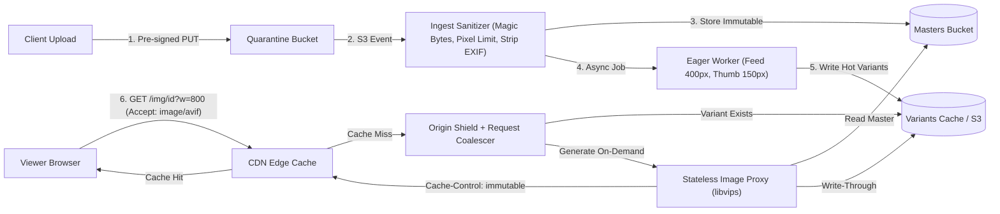
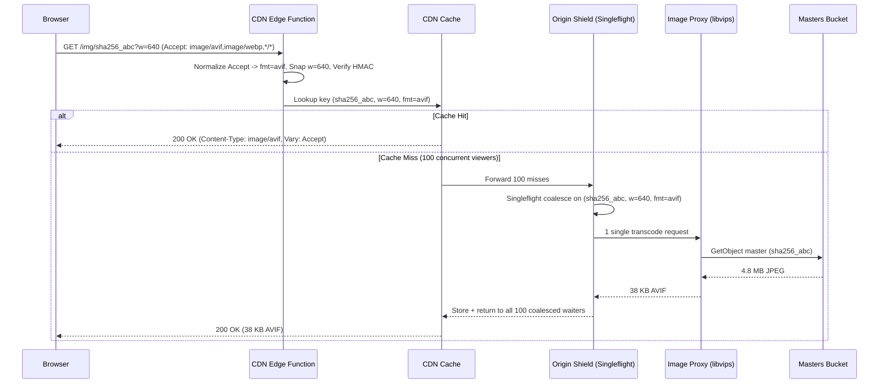
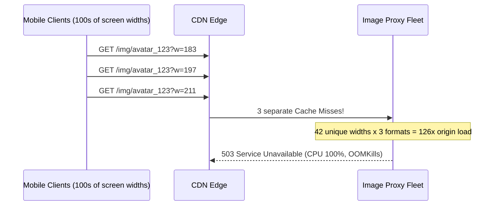

# Image Processing Pipelines: Thumbnails, WebP, AVIF, On-Demand

> **Prerequisites:** [Lesson 08: Chunking & Deduplication](../08-chunking-deduplication/README.md).  
> **Estimated Reading Time:** 24–28 minutes  
> **Target Audience:** Backend and platform engineers designing media-heavy applications (e-commerce, social feeds, SaaS DAM), and candidates asked "how do you store and serve millions of images at different sizes and formats?"  
> **Free PDF Notes:** [Download SD-O-009.pdf](https://backendroadmap.com/notes/system-design/SD-O-009.pdf)

> [!NOTE]
> **In one line:** An image processing pipeline separates **immutable original storage** from **derived variants** (resized thumbnails, WebP/AVIF transcodes, stripped EXIF). You choose between **eager pre-generation** (predictable read latency, wasted storage for unrequested variants) and **on-demand edge transformation** (zero wasted compute/storage, cold-miss tail latency that must be shielded by CDN caching and request coalescing).

> [!TIP]
> **The Golden Rule:** Store the original master once (content-addressed, EXIF-sanitized on ingest), never overwrite it, and derive variants lazily at the CDN/edge—except for the 2–3 guaranteed-viewed thumbnails (e.g., feed card, avatar) which you pre-warm asynchronously right after upload.

---

## 1. What an Image Processing Pipeline Is, and What It Isn't

A user uploads a 12 MP smartphone photo (4032 × 3024 pixels, 4.8 MB JPEG, containing GPS coordinates in EXIF metadata). Serving that raw 4.8 MB file into a 200 × 200 px mobile feed card wastes 98% of the user's bandwidth, stalls First Contentful Paint (FCP), leaks the user's home address via EXIF GPS tags, and blows up your CDN egress bill.

An image processing pipeline transforms uploaded originals into **sized, compressed, format-negotiated, metadata-stripped variants** and caches them close to users.

| Term | Precise Meaning | Example |
| :--- | :--- | :--- |
| **Master / Original** | Immutable source image stored after ingest validation and EXIF stripping | `s3://media-masters/sha256/ab/cd/abcd...jpg` |
| **Variant / Rendition** | A derived image at a specific width, height, crop mode, quality, and codec | `w=400,fit=cover,q=80,fmt=avif` |
| **Eager (Ahead-of-Time) Pipeline** | Worker queue generates fixed preset sizes immediately on upload | Upload -> SQS -> Lambda/Go worker -> S3 |
| **On-Demand (Lazy) Pipeline** | Image proxy generates the variant on first HTTP request and caches at CDN | `GET /img/abcd?w=400&fmt=webp` |
| **Content Negotiation** | Selecting WebP or AVIF automatically using the HTTP `Accept` header | `Accept: image/avif,image/webp,*/*` |
| **EXIF / Metadata Stripping** | Removing GPS, camera serial, and ICC bloat during ingest or transcoding | Drops 40–120 KB + privacy risk |
| **Not** | Storing 15 resized copies in your primary relational database or resizing inside your API monolith | Blocks API threads and bloats DB backups |

### Why It Matters
1. **Egress is the #1 media cost:** Converting a 4.8 MB JPEG into a 45 KB AVIF feed thumbnail cuts bandwidth by **99%**, directly reducing CDN egress bills and mobile bounce rates.
2. **Security & correctness:** Unvalidated image decoders (ImageMagick/libjpeg/libwebp CVEs) are a top RCE/DoS vector (`ImageTragick`, pixel-flood decompression bombs).
3. **Combinatorial explosion:** 10 widths × 3 DPRs (1x, 2x, 3x) × 3 formats (JPEG, WebP, AVIF) × 2 crop modes = **180 variants per image**. Eagerly generating all 180 is financially ruinous.

---

## 2. Anatomy: Eager vs. On-Demand Hybrid Pipeline



The production sweet spot is a **hybrid pipeline**:
1. **Ingest Quarantine:** Uploads land in an isolated quarantine bucket via pre-signed URLs. A sanitizer verifies magic bytes (not file extension), enforces max pixel dimensions (defeating decompression bombs), re-orients via EXIF orientation tag, and strips all private EXIF/XMP metadata before writing the immutable master.
2. **Eager Hot Path:** Immediately generate the 1–2 variants guaranteed to be viewed (e.g., `w=150` avatar, `w=400` feed card) so the uploader's feed renders with zero cold-start penalty.
3. **On-Demand Long Tail:** All other widths (`w=640`, `w=1200`), DPRs, and formats (AVIF/WebP) are generated lazily by a stateless `libvips` proxy behind an Origin Shield with **singleflight** request coalescing.

| Dimension | Eager (Pre-generated) | On-Demand (Lazy Proxy) | Hybrid (Recommended) |
| :--- | :--- | :--- | :--- |
| **First-read latency ($p_{99}$)** | 15–40 ms (CDN/S3 hit) | 150–800 ms (transcode cold miss) | 15–40 ms for hot variants; lazy for tail |
| **Storage amplification** | 3x–10x master size | ~1.2x–1.8x (only requested variants) | ~1.5x–2.2x |
| **Compute waste** | High (60–80% of variants never viewed) | Zero waste (pay only for requested) | Minimal waste |
| **Redesign / new breakpoint** | Requires full backfill job over millions of masters | Instant (just change URL params) | Instant for new breakpoints |
| **Failure blast radius** | Queue backlog delays new uploads | Traffic spike can overwhelm origin CPU | Shielded by CDN + singleflight |

> [!WARNING]
> **The #1 Trap: Unauthenticated Arbitrary Resize URLs.** If you expose `/resize?url=...&w=4000&h=4000` without HMAC URL signatures or an allowlist of widths, attackers can trigger a **cache-busting CPU DoS** by requesting `?w=401`, `?w=402`, `?w=403`... bypassing CDN cache and saturating your transcoding fleet. Always **HMAC-sign transformation parameters** and snap widths to discrete buckets (`200, 400, 800, 1200, 1600`).

---

## 3. Mathematical Model: Storage Amplification, Compression & Egress Savings

**1. Combinatorial Variant Explosion:**
For $N$ master images, if you eagerly generate $W$ widths, $D$ device pixel ratios, $F$ formats, and $C$ crop modes, total stored objects $O_{\text{eager}}$ and storage $S_{\text{eager}}$ are:

$$O_{\text{eager}} = N \times W \times D \times F \times C$$

$$S_{\text{eager}} = N \cdot \left( S_{\text{master}} + \sum_{i=1}^{W \cdot D \cdot F \cdot C} S_i \right)$$

With $N = 50\text{M}$ images, $W = 5$, $D = 2$, $F = 3$ (JPEG, WebP, AVIF), $C = 2$: $O_{\text{eager}} = 50\text{M} \times 60 = 3\text{ billion objects}$! Even at an average variant size of 60 KB, that is $180\text{ TB}$ of derived storage (plus $3\text{B} \times \$0.005 / 1000 = \$15{,}000$ just in S3 PUT requests).

**2. Bandwidth & Egress Cost Model:**
Let $R$ be monthly image requests, $h$ be the CDN cache hit ratio, $S_{\text{raw}}$ be raw JPEG size, and $r_{\text{codec}}$ be the compression ratio of WebP/AVIF relative to JPEG:

$$\text{Egress}_{\text{monthly}} = R \times S_{\text{raw}} \times r_{\text{codec}}$$

$$\text{Origin Fetch}_{\text{monthly}} = R \times (1 - h) \times S_{\text{raw}} \times r_{\text{codec}}$$

**Worked Numerical Example:**
Suppose an e-commerce platform serves $R = 500\text{M}$ product image views/month.
- Average unoptimized JPEG: $S_{\text{raw}} = 450\text{ KB}$.
- Optimized WebP ($r_{\text{webp}} = 0.65$): $292.5\text{ KB}$.
- Optimized AVIF ($r_{\text{avif}} = 0.45$): $202.5\text{ KB}$.
- Suppose 75% of browsers accept AVIF and 25% accept WebP:

$$\bar{S}_{\text{opt}} = (0.75 \times 202.5) + (0.25 \times 292.5) = 151.875 + 73.125 = 225\text{ KB}$$

- Unoptimized monthly egress: $500\text{M} \times 450\text{ KB} = 225{,}000\text{ GB} = 225\text{ TB}$. At $\$0.04/\text{GB}$ CDN egress = **$\$9{,}000/\text{month}$**.
- Optimized monthly egress: $500\text{M} \times 225\text{ KB} = 112.5\text{ TB}$. At $\$0.04/\text{GB}$ = **$\$4{,}500/\text{month}$** (saving **$\$54{,}000/\text{year}$** on egress alone, before even counting width resizing).

**3. Decompression Bomb Memory Bound:**
A compressed PNG/JPEG of only 500 KB can decode to a $30{,}000 \times 30{,}000$ RGBA bitmap:

$$M_{\text{raw}} = W \times H \times 4\text{ bytes} = 30{,}000 \times 30{,}000 \times 4 = 3.6\text{ GB RAM}$$

A single malicious upload can OOM-kill a 2 GB container before decoding even finishes. Always read image header dimensions *before* allocating pixel buffers and enforce $W \times H \le 100\text{ megapixels}$ (400 MB raw max).

---

## 4. Metrics & Percentiles

| Metric | Meaning | Alert when |
| :--- | :--- | :--- |
| **CDN Cache Hit Ratio (CHR)** | % of variant requests served from edge without hitting proxy | Drops below 95% (indicates cache-key fragmentation or un-snapped widths) |
| **Proxy Cold-Miss Latency $p_{99}$** | Time to fetch master + decode + resize + encode | Exceeds 450 ms for WebP or 1,200 ms for AVIF |
| **Ingest Queue Age $p_{99}$** | Time from upload to master sanitization + eager thumbs | Exceeds 10 seconds |
| **Coalesced Request Ratio** | % of origin misses merged by singleflight | Sudden spike > 30% (viral image stampede) |
| **Invalid / Blocked Upload Rate** | Uploads rejected for bad magic bytes or >100 MP | Spike indicates active fuzzing/DoS attempt |
| **Codec Negotiation Mix** | % AVIF vs WebP vs JPEG served | AVIF < 50% despite modern client base (check `Vary: Accept` cache config) |

### Worked Example: Cache-Key Fragmentation
A team enables `Vary: Accept` on their CDN for content negotiation. Chrome sends `Accept: image/avif,image/webp,image/apng,image/svg+xml,image/*,*/*;q=0.8`, Safari sends `Accept: image/webp,image/png,image/svg+xml,image/*;q=0.8,*/*;q=0.5`, and curl sends `Accept: */*`. Because `Vary: Accept` hashes the *entire raw header string*, CDN Cache Hit Ratio collapses from **97% to 61%**.
**Fix:** Normalize the `Accept` header at the CDN edge (CloudFront Function / Cloudflare Worker) into a single canonical header `X-Img-Format: avif | webp | jpeg`, and vary the cache key *only* on `X-Img-Format` + snapped width. CHR jumps back to **98.2%**.

---

## 5. Compounding & Failure Modes: Codec CPU vs. Network Trade-off

Image codecs trade **encoding CPU time** for **output byte size**:

| Codec | Relative File Size (at SSIM 0.96) | Relative Encode CPU Cost | Decode Speed | Browser Support (2026) | Best Use Case |
| :--- | :---: | :---: | :---: | :---: | :--- |
| **MozJPEG** | 1.00x (baseline) | 1x (~15 ms for 800px) | Fast | 100% | Fallback, legacy clients |
| **WebP (lossy)** | 0.65x–0.75x | 2x–3x (~35 ms for 800px) | Fast | ~97%+ | Default fast on-demand encode |
| **AVIF** | 0.40x–0.55x | 10x–25x (~250–600 ms for 800px) | Moderate | ~93%+ | High-traffic hot assets, pre-warmed |
| **JPEG XL (JXL)** | 0.35x–0.50x | 4x–8x | Fast | Limited (Safari/partial) | Archival masters (lossless JPEG recompression) |

**Failure Mode — AVIF CPU Starvation on Cold Cache:**
If your on-demand proxy synchronously encodes AVIF on every cache miss (350 ms CPU per request) on a 4-vCPU container, throughput caps at ~11 req/s per pod. During a cache flush or viral post, the queue backs up and requests time out at 504 Gateway Timeout.
**Mitigation:** On a cold miss for AVIF, either:
1. Serve **WebP** synchronously (35 ms) with `Cache-Control: max-age=60` and enqueue an **async background job** to encode AVIF and warm the variant cache; subsequent requests get AVIF from cache.
2. Or use `libvips` with `effort=4` (fast AVIF preset) instead of `effort=9`, trading 3% file size for 5x faster encoding.

---

## 6. Numbers Every Engineer Must Know

| Item | Typical | Implication |
| :--- | :---: | :--- |
| **libvips vs ImageMagick RAM** | 5x–10x less RAM in libvips | Streaming pipeline; never loads full uncompressed canvas |
| **libvips vs ImageMagick speed** | 4x–8x faster | Essential for synchronous on-demand proxies |
| **Max safe pixel limit** | 50–100 MP (e.g., 10,000 × 10,000) | Prevents decompression bomb OOMs |
| **EXIF metadata size** | 30–120 KB per smartphone photo | Stripping EXIF often shrinks thumbnails more than recompression |
| **Eager hot variants** | 2–3 sizes (e.g., 150px, 400px) | Covers 85%+ of feed/list views with zero cold start |
| **Allowed width buckets** | 6–8 discrete widths (`150, 320, 640, 960, 1280, 1920`) | Prevents cache-busting DoS and keeps CHR > 96% |
| **Immutable Cache-Control** | `public, max-age=31536000, immutable` | Content-addressed URLs never change; zero revalidation |

---

## 7. Protocol / Mechanism Deep Dive: Content Negotiation & Edge Normalization



### Key Design Questions
| Question | Answer |
| :--- | :--- |
| **Why `Vary: Accept` even after edge normalization?** | Downstream ISP proxies or browser caches must know the response depends on `Accept`, otherwise a browser could cache an AVIF response and fail if a different client shares a local cache. |
| **How do you handle animated GIFs/WebPs?** | Either transcode animated GIFs to **MP4/WebM** (`<video autoplay loop muted>`) for 90% bandwidth savings, or route multi-frame images to an async worker with a strict frame-count cap (e.g., max 150 frames). |
| **When NOT to use on-demand image processing?** | When you have a tiny, fixed catalog (e.g., 500 static marketing icons) where build-time generation is simpler, or for **medical/forensic imaging (DICOM)** where lossy recompression is legally prohibited. |

---

## 8. Hierarchical Budgets & Design Rules

| Slice | Rule | Control |
| :--- | :--- | :--- |
| **Ingest Validation** | Reject non-images and >100 MP bombs before decoding pixels | Magic-byte sniffer + header-only dimension probe |
| **Privacy & Compliance** | Strip GPS, device ID, and author EXIF on ingest; apply ICC sRGB profile | `vips_autorot` + `strip=true` before saving master |
| **URL Security** | Never allow unsigned arbitrary dimensions/crops | HMAC-SHA256 signature on canonical query string |
| **Cache Efficiency** | Snap arbitrary `w` to nearest bucket (`200, 400, 800, 1200`) | Edge worker rewrites `?w=387` -> `?w=400` |
| **CPU Protection** | Cap concurrent `libvips` threads per pod; bound AVIF `effort <= 4` | Semaphore + singleflight + fallback to WebP under load |
| **Storage Hygiene** | Content-addressed masters (`sha256`); immutable URLs for variants | S3 lifecycle rule expiring unaccessed variants after 90 days |

---

## 9. Top Mitigations

1. **Quarantine + Async Sanitization:** Never serve user-uploaded files directly from the upload bucket. Always pass through an isolated sanitizer container with no network egress and strict `RLIMIT_AS` memory limits.
2. **Switch from ImageMagick to `libvips`:** `libvips` streams scanlines tile-by-tile rather than allocating the entire uncompressed image in RAM, cutting memory usage by 5–10x and eliminating most OOM crashes.
3. **Edge Header Normalization:** Collapse noisy `Accept` headers into 3 canonical format tokens (`avif`, `webp`, `jpeg`) at the CDN edge so your cache key cardinality stays minimal.
4. **Singleflight Coalescing:** Deduplicate concurrent cache-miss requests for the same `(image_id, width, format)` at the Origin Shield so a viral post triggers 1 transcode, not 5,000.
5. **Discrete Width Buckets + Signed URLs:** Restrict widths to `[150, 320, 640, 960, 1280, 1920]` and require an HMAC signature (or path-based allowlist) to prevent cache-busting CPU DoS.
6. **Progressive & BlurHash Placeholders:** Store a 20-byte **BlurHash** (or 10×10 inline base64 WebP) in your database metadata row alongside image dimensions (`width`, `height`) to eliminate Cumulative Layout Shift (CLS = 0).
7. **Expire Cold Variants via Lifecycle Rules:** Since masters are durable, apply a 90-day S3 Intelligent-Tiering or expiration rule on the *variants* bucket—if an old rare variant is requested again, the proxy simply regenerates it.

---

## 10. Production Reference / War Story: The Viral Avatar Cache-Busting Outage

**Incident:** A social platform launched a new mobile app version that dynamically computed avatar image URLs using the device's exact logical pixel width multiplied by `devicePixelRatio`: `/img/avatar_123?w=183`, `/img/avatar_123?w=197`, `/img/avatar_123?w=211`.



**Root Cause:** Unbounded width parameters fragmented the CDN cache across 40+ slightly different pixel widths per device model. CDN Cache Hit Ratio plunged from 98% to 34%, multiplying origin transcoding traffic by 30x during morning peak. Additionally, the proxy lacked singleflight coalescing and was encoding AVIF synchronously at `effort=6`.

**Fix:**
1. **Immediate:** Deployed a CDN edge rule snapping any `w` parameter up to the nearest bucket in `[150, 320, 640, 1280]`. Cache Hit Ratio recovered to 97.8% within 15 minutes.
2. **Long-term:** Added HMAC URL signing, `singleflight` coalescing in the Go proxy, and switched AVIF cold misses to serve fast WebP (`max-age=60`) while asynchronously warming AVIF in the background.

---

## 11. Multi-Language Production Code Tabs

Below are production-ready implementations of **URL signing, width snapping, `Accept` format negotiation, and singleflight request coalescing** for an on-demand image proxy.

````carousel
```go
// Go: Canonical image variant key, HMAC verification, and singleflight coalescing
package main

import (
	"context"
	"crypto/hmac"
	"crypto/sha256"
	"encoding/hex"
	"fmt"
	"net/http"
	"strconv"
	"strings"
	"sync"
)

var allowedWidths = []int{150, 320, 640, 960, 1280, 1920}

func snapWidth(w int) int {
	for _, bucket := range allowedWidths {
		if w <= bucket {
			return bucket
		}
	}
	return allowedWidths[len(allowedWidths)-1]
}

func negotiateFormat(acceptHeader string) string {
	a := strings.ToLower(acceptHeader)
	if strings.Contains(a, "image/avif") {
		return "avif"
	}
	if strings.Contains(a, "image/webp") {
		return "webp"
	}
	return "jpeg"
}

func verifySignature(secret []byte, imageID string, width int, sig string) bool {
	mac := hmac.New(sha256.New, secret)
	fmt.Fprintf(mac, "%s:%d", imageID, width)
	expected := hex.EncodeToString(mac.Sum(nil))
	return hmac.Equal([]byte(expected), []byte(sig))
}

// Minimal Singleflight group to coalesce concurrent cold misses
type call struct {
	wg  sync.WaitGroup
	val []byte
	err error
}

type Coalescer struct {
	mu sync.Mutex
	m  map[string]*call
}

func (g *Coalescer) Do(key string, fn func() ([]byte, error)) ([]byte, error) {
	g.mu.Lock()
	if g.m == nil {
		g.m = make(map[string]*call)
	}
	if c, ok := g.m[key]; ok {
		g.mu.Unlock()
		c.wg.Wait()
		return c.val, c.err
	}
	c := new(call)
	c.wg.Add(1)
	g.m[key] = c
	g.mu.Unlock()

	c.val, c.err = fn()
	c.wg.Done()

	g.mu.Lock()
	delete(g.m, key)
	g.mu.Unlock()
	return c.val, c.err
}

func imageHandler(secret []byte, coalescer *Coalescer) http.HandlerFunc {
	return func(w http.ResponseWriter, r *http.Request) {
		id := r.URL.Query().Get("id")
		rawW, _ := strconv.Atoi(r.URL.Query().Get("w"))
		sig := r.URL.Query().Get("sig")

		snapped := snapWidth(rawW)
		if !verifySignature(secret, id, snapped, sig) {
			http.Error(w, "invalid signature", http.StatusForbidden)
			return
		}
		fmtOut := negotiateFormat(r.Header.Get("Accept"))
		cacheKey := fmt.Sprintf("%s:w%d:%s", id, snapped, fmtOut)

		bytes, err := coalescer.Do(cacheKey, func() ([]byte, error) {
			// Replace with libvips transcode + S3 master fetch
			return transcodeFromMaster(r.Context(), id, snapped, fmtOut)
		})
		if err != nil {
			http.Error(w, "processing error", http.StatusInternalServerError)
			return
		}
		w.Header().Set("Content-Type", "image/"+fmtOut)
		w.Header().Set("Vary", "Accept")
		w.Header().Set("Cache-Control", "public, max-age=31536000, immutable")
		w.Write(bytes)
	}
}

func transcodeFromMaster(_ context.Context, id string, w int, fmtOut string) ([]byte, error) {
	return []byte(fmt.Sprintf("mock-%s-%d-%s", id, w, fmtOut)), nil
}
```
<!-- slide -->
```typescript
// TypeScript (Edge Worker / Node): Normalize Accept, snap widths, verify HMAC
import crypto from "node:crypto";

const ALLOWED_WIDTHS = [150, 320, 640, 960, 1280, 1920] as const;
type ImageFormat = "avif" | "webp" | "jpeg";

export function snapWidth(requestedWidth: number): number {
  for (const bucket of ALLOWED_WIDTHS) {
    if (requestedWidth <= bucket) return bucket;
  }
  return ALLOWED_WIDTHS[ALLOWED_WIDTHS.length - 1];
}

export function negotiateFormat(acceptHeader: string = ""): ImageFormat {
  const lower = acceptHeader.toLowerCase();
  if (lower.includes("image/avif")) return "avif";
  if (lower.includes("image/webp")) return "webp";
  return "jpeg";
}

export function signVariantUrl(secret: string, imageId: string, width: number): string {
  const snapped = snapWidth(width);
  const sig = crypto
    .createHmac("sha256", secret)
    .update(`${imageId}:${snapped}`)
    .digest("hex");
  return `/img/${encodeURIComponent(imageId)}?w=${snapped}&sig=${sig}`;
}

export function verifyVariantSignature(
  secret: string,
  imageId: string,
  width: number,
  sig: string
): boolean {
  const expected = crypto
    .createHmac("sha256", secret)
    .update(`${imageId}:${width}`)
    .digest("hex");
  const a = Buffer.from(expected, "hex");
  const b = Buffer.from(sig, "hex");
  return a.length === b.length && crypto.timingSafeEqual(a, b);
}

// In-flight promise coalescing for Node/Edge origin proxy
const inFlight = new Map<string, Promise<Buffer>>();

export async function getOrTranscodeVariant(
  key: string,
  transcodeFn: () => Promise<Buffer>
): Promise<Buffer> {
  const existing = inFlight.get(key);
  if (existing) return existing;

  const work = transcodeFn().finally(() => inFlight.delete(key));
  inFlight.set(key, work);
  return work;
}
```
<!-- slide -->
```python
# Python: Ingest sanitizer (magic bytes, decompression bomb guard, EXIF strip)
import hashlib
import hmac
import io
from typing import Tuple

ALLOWED_WIDTHS = (150, 320, 640, 960, 1280, 1920)
MAX_PIXELS = 100_000_000  # 100 MP decompression bomb guard

def snap_width(requested: int) -> int:
    for bucket in ALLOWED_WIDTHS:
        if requested <= bucket:
            return bucket
    return ALLOWED_WIDTHS[-1]

def negotiate_format(accept_header: str) -> str:
    lower = (accept_header or "").lower()
    if "image/avif" in lower:
        return "avif"
    if "image/webp" in lower:
        return "webp"
    return "jpeg"

def detect_magic_format(data: bytes) -> str:
    if data[:3] == b"\xff\xd8\xff":
        return "jpeg"
    if data[:8] == b"\x89PNG\r\n\x1a\n":
        return "png"
    if data[:4] == b"RIFF" and data[8:12] == b"WEBP":
        return "webp"
    raise ValueError("Unsupported or spoofed image magic bytes")

def verify_hmac(secret: bytes, image_id: str, width: int, sig: str) -> bool:
    msg = f"{image_id}:{width}".encode("utf-8")
    expected = hmac.new(secret, msg, hashlib.sha256).hexdigest()
    return hmac.compare_digest(expected, sig)

def sanitize_and_hash_master(raw_bytes: bytes, dimensions: Tuple[int, int]) -> str:
    """Validate magic bytes and pixel ceiling before decoding full bitmap."""
    _ = detect_magic_format(raw_bytes)
    w, h = dimensions
    if w <= 0 or h <= 0 or (w * h) > MAX_PIXELS:
        raise ValueError(f"Pixel dimensions {w}x{h} exceed {MAX_PIXELS} limit")
    # In production: pyvips.Image.new_from_buffer(raw_bytes, "").autorot().jpegsave_buffer(strip=True)
    return hashlib.sha256(raw_bytes).hexdigest()
```
<!-- slide -->
```csharp
// C#: Width snapping, HMAC verification, and ConcurrentDictionary singleflight
using System;
using System.Collections.Concurrent;
using System.Security.Cryptography;
using System.Text;
using System.Threading.Tasks;

public sealed class ImagePipelineHelper
{
    private static readonly int[] AllowedWidths = { 150, 320, 640, 960, 1280, 1920 };
    private readonly ConcurrentDictionary<string, Lazy<Task<byte[]>>> _inFlight = new();

    public static int SnapWidth(int requestedWidth)
    {
        foreach (var bucket in AllowedWidths)
        {
            if (requestedWidth <= bucket) return bucket;
        }
        return AllowedWidths[^1];
    }

    public static string NegotiateFormat(string? acceptHeader)
    {
        var lower = (acceptHeader ?? string.Empty).ToLowerInvariant();
        if (lower.Contains("image/avif")) return "avif";
        if (lower.Contains("image/webp")) return "webp";
        return "jpeg";
    }

    public static bool VerifySignature(byte[] secret, string imageId, int width, string sigHex)
    {
        using var hmac = new HMACSHA256(secret);
        var payload = Encoding.UTF8.GetBytes($"{imageId}:{width}");
        var expected = Convert.ToHexString(hmac.ComputeHash(payload)).ToLowerInvariant();
        return CryptographicOperations.FixedTimeEquals(
            Encoding.ASCII.GetBytes(expected),
            Encoding.ASCII.GetBytes(sigHex.ToLowerInvariant())
        );
    }

    public async Task<byte[]> GetOrTranscodeAsync(string cacheKey, Func<Task<byte[]>> factory)
    {
        var lazyTask = _inFlight.GetOrAdd(
            cacheKey,
            _ => new Lazy<Task<byte[]>>(factory)
        );
        try
        {
            return await lazyTask.Value.ConfigureAwait(false);
        }
        finally
        {
            _inFlight.TryRemove(cacheKey, out _);
        }
    }
}
```
````

---

## 12. Hands-On CLI Verification Workflows

```bash
# 1. Inspect EXIF metadata and strip all private tags using exiftool / vips
vips copy input.jpg master_clean.jpg[strip,Q=90]
ls -lh input.jpg master_clean.jpg

# 2. Benchmark JPEG vs WebP vs AVIF file sizes at 800px width
vips thumbnail input.jpg out_800.jpg 800 --export-profile srgb
cwebp -q 80 out_800.jpg -o out_800.webp
avifenc --min 20 --max 35 -s 6 out_800.jpg out_800.avif
ls -lh out_800.*

# 3. Verify CDN content negotiation and cache headers with curl
curl -sI -H "Accept: image/avif,image/webp,*/*" "https://cdn.example.com/img/abc123?w=640" \
  | grep -iE "content-type|cache-control|vary|x-cache"

# 4. Verify magic bytes (first 12 bytes) to catch spoofed file extensions
python3 -c '
with open("input.jpg", "rb") as f:
    hdr = f.read(12)
print("Hex:", hdr.hex(), "| JPEG?", hdr[:3] == b"\xff\xd8\xff")
'
```

---

## 13. Common Mistakes to Avoid

1. **Serving raw uploads without EXIF stripping:** Leaks user GPS coordinates, camera serial numbers, and keeps 40–120 KB of dead metadata on every thumbnail.
2. **Ignoring EXIF orientation before stripping:** Smartphone photos often store pixels sideways with an `Orientation: 6` tag; stripping EXIF *before* auto-rotating (`autorot`) renders portraits sideways.
3. **Using `Vary: Accept` without edge header normalization:** Fragments the CDN cache across dozens of browser `Accept` strings and tanks your Cache Hit Ratio.
4. **Exposing unsigned, arbitrary `?w=&h=` parameters:** Allows attackers to request `?w=401`, `?w=402`, `?w=403` and DoS your transcoding servers.
5. **Using ImageMagick inside synchronous HTTP handlers without pixel limits:** Vulnerable to decompression bombs (`30,000x30,000` PNGs) and high per-request RAM spikes; prefer `libvips`.
6. **Pre-generating every width × DPR × format combination:** Creates 50–180x object explosion in S3, where 70%+ of variants are never requested once.
7. **Forgetting `width` and `height` attributes in HTML/JSON metadata:** Causes severe Cumulative Layout Shift (CLS) while images load.

---

## 14. Key Terms Glossary

| Key Term | Definition |
| :--- | :--- |
| **Master / Original** | Immutable, EXIF-sanitized source image stored at full resolution |
| **Variant / Rendition** | Derived image at a specific width, crop, quality, and codec |
| **On-Demand Proxy** | Stateless service (typically using `libvips`) that transforms images lazily on cache miss |
| **Content Negotiation** | Selecting AVIF, WebP, or JPEG dynamically based on the client's `Accept` header |
| **Edge Normalization** | Rewriting noisy `Accept` headers into canonical tokens at the CDN edge to protect cache hit ratio |
| **Decompression Bomb** | Small compressed image whose header declares huge pixel dimensions to OOM-kill decoders |
| **EXIF Stripping** | Removing embedded GPS, camera, and thumbnail metadata for privacy and byte savings |
| **Singleflight Coalescing** | Merging concurrent identical cache-miss requests so the origin transcodes once |
| **Width Snapping** | Rounding requested widths up to a fixed set of discrete buckets (`320, 640, 1280`) |
| **BlurHash** | Compact ~20–30 character string representing a blurred placeholder rendered before the image loads |

---

## 15. System Design Interview Questions & Answers

### Basic Conceptual Questions

<details>
<summary><strong>Q1: Why not just resize images in the browser using CSS? [BASIC]</strong></summary>

**Answer:**
CSS only scales the display size *after* the browser downloads the entire file. A 4.8 MB 12 MP JPEG still consumes 4.8 MB of mobile data, takes seconds to download, and consumes tens of megabytes of decoded bitmap memory on the device.
</details>

<details>
<summary><strong>Q2: What is the difference between WebP and AVIF? [BASIC]</strong></summary>

**Answer:**
WebP (based on VP8) is ~25–35% smaller than JPEG and encodes quickly (~2–3x JPEG CPU). AVIF (based on AV1) is ~45–55% smaller than JPEG with superior low-bitrate quality, but encoding is 10–25x more CPU-intensive, making it better suited for pre-warmed hot assets or async background encoding.
</details>

<details>
<summary><strong>Q3: Why should you strip EXIF metadata on ingest? [BASIC]</strong></summary>

**Answer:**
Two reasons: **privacy** (EXIF often contains exact GPS coordinates, timestamps, and device serial numbers) and **performance** (EXIF/ICC profiles can add 30–120 KB, which is larger than the entire resized thumbnail). Always apply EXIF auto-rotation *before* stripping.
</details>

<details>
<summary><strong>Q4: Why do engineers prefer libvips over ImageMagick for on-demand proxies? [BASIC]</strong></summary>

**Answer:**
`libvips` uses a demand-driven, streaming tile pipeline that processes scanlines as they flow, using 5–10x less RAM and running 4–8x faster than ImageMagick, which typically decodes the entire uncompressed image into memory.
</details>

### Scenario-Based Architecture Questions

<details>
<summary><strong>Q5: Design an image pipeline for an Instagram-like app with 50M daily uploads. Eager, lazy, or hybrid? [SCENARIO]</strong></summary>

**Answer:**
**Hybrid.** Quarantine and sanitize the upload (magic bytes, pixel limit, auto-rotate, strip EXIF) to an immutable master bucket. Eagerly generate the 2 guaranteed-viewed sizes (avatar 150px, feed card 640px WebP/AVIF) via an async worker queue so feed scrolling has zero cold-start latency. Generate all other sizes (full-screen 1280px, tablet 960px) lazily on-demand via a `libvips` proxy behind CDN + Origin Shield.
</details>

<details>
<summary><strong>Q6: Your CDN cache hit ratio dropped from 97% to 60% after enabling WebP/AVIF negotiation. Why, and how do you fix it? [SCENARIO]</strong></summary>

**Answer:**
`Vary: Accept` makes the CDN cache key include the raw `Accept` header string, which differs across Chrome, Safari, Firefox, and bots. Fix it by normalizing the `Accept` header at the CDN edge (Cloudflare Worker / CloudFront Function) into a canonical token (`avif`, `webp`, or `jpeg`) and keying the cache on that token instead of the raw header.
</details>

<details>
<summary><strong>Q7: A user uploads a 200 KB PNG that crashes your transcoding worker with an OOM error. What happened? [SCENARIO]</strong></summary>

**Answer:**
It is a **decompression bomb** (pixel flood). The PNG header declares e.g. `40,000 × 40,000` pixels of solid color (highly compressible to 200 KB), which expands to $40{,}000^2 \times 4 = 6.4\text{ GB}$ of raw RGBA RAM when decoded. Fix: probe image dimensions from the header *before* allocating pixel buffers and reject anything above 50–100 megapixels.
</details>

<details>
<summary><strong>Q8: Your marketing team wants to change product card thumbnails from 300px to 360px across 20M products. How does your architecture handle this? [SCENARIO]</strong></summary>

**Answer:**
Because masters are stored immutably at full resolution and variants are generated on-demand (with discrete bucket snapping or signed URLs), you simply update the frontend URL parameter to `w=360` (or the `400` bucket) and sign it. No 20M-object backfill migration is required; the CDN + proxy warms the new size organically as users browse.
</details>

### Advanced & Tricky Interview Questions

<details>
<summary><strong>Q9: How do you prevent a cache-busting DoS attack on an on-demand image proxy? [TRICKY]</strong></summary>

**Answer:**
1. **HMAC-SHA256 sign** every transformation URL (`id + width + crop + quality`) using a server-side secret so users cannot invent arbitrary parameters.
2. **Snap widths** to a small discrete allowlist (`150, 320, 640, 960, 1280, 1920`).
3. **Rate-limit** uncached origin misses at the WAF/Origin Shield.
</details>

<details>
<summary><strong>Q10: A celebrity posts a new photo and 50,000 followers request the uncached 640px AVIF variant in the same second. How do you survive the thundering herd? [TRICKY]</strong></summary>

**Answer:**
Use an **Origin Shield** with **request coalescing (singleflight)**. The 50,000 edge misses collapse at the shield into 1 singleflight key `(id, 640, avif)` so the `libvips` proxy transcodes the image exactly once and fans the result out to all waiting edge nodes. Optionally serve fast WebP synchronously and warm AVIF asynchronously.
</details>

<details>
<summary><strong>Q11: How do you handle smart cropping (e.g., faces) without running ML inference on every CDN cache miss? [TRICKY]</strong></summary>

**Answer:**
Run lightweight face/saliency detection **once during ingest** when creating the master, and store the bounding box / focal point `(x, y)` in the image's database metadata row. The frontend then includes `&fp=0.42,0.28` in the signed variant URL so the stateless `libvips` proxy performs a deterministic, zero-ML crop in milliseconds.
</details>

<details>
<summary><strong>Q12: Why should variant URLs be content-addressed (immutable) rather than mutable (e.g., `/avatars/user_42.jpg`)? [TRICKY]</strong></summary>

**Answer:**
Mutable URLs force short `max-age` TTLs or expensive CDN cache invalidations (`CreateInvalidation`) whenever a user updates their photo, and risk stale images stuck in ISP/browser caches. Content-addressed URLs (`/img/sha256_abc?w=320`) allow `Cache-Control: public, max-age=31536000, immutable`, giving near-100% cache efficiency and instant updates when the user's DB record points to the new hash.
</details>

---

## 16. One-Page Master Cheat Sheet

```
+---------------------------------------------------------------------------------------------------------+
|                    IMAGE PROCESSING PIPELINES — MASTER CHEAT SHEET                                      |
+---------------------------------------------------------------------------------------------------------+
| 1. SEPARATE: Immutable Master (EXIF-stripped, auto-rotated, magic-byte checked) vs Derived Variants.    |
+---------------------------------------------------------------------------------------------------------+
| 2. HYBRID: Pre-warm 2-3 hot sizes (150px, 400px) on upload; derive tail widths & codecs on-demand.      |
+---------------------------------------------------------------------------------------------------------+
| 3. CODECS: MozJPEG (1.0x, fast) | WebP (0.65x, 2-3x CPU) | AVIF (0.45x, 10-25x CPU -> async/warm).     |
+---------------------------------------------------------------------------------------------------------+
| 4. SECURITY: Probe dimensions first (<100 MP bomb guard) · HMAC-sign URLs · Snap widths to 6-8 buckets. |
+---------------------------------------------------------------------------------------------------------+
| 5. CACHE: Normalize Accept at CDN edge -> key on (id, snapped_w, fmt) · Singleflight at Origin Shield.  |
+---------------------------------------------------------------------------------------------------------+
| 6. ENGINE: Use libvips (streaming scanlines, 5-10x less RAM than ImageMagick) + immutable Cache-Control.|
+---------------------------------------------------------------------------------------------------------+
```

---

## Further Reading & Sources

- AWS Solutions Library, [Serverless Image Handler](https://aws.amazon.com/solutions/implementations/serverless-image-handler/) (CloudFront + Lambda + Sharp/libvips reference architecture).
- Cloudflare Docs, [Image Optimization & Content Negotiation](https://developers.cloudflare.com/images/).
- libvips Documentation, [Why libvips is fast and low-memory](https://www.libvips.org/API/current/How-it-works.html).
- web.dev (Google), [Use WebP and AVIF images](https://web.dev/articles/serve-images-webp) and [Prevent Cumulative Layout Shift](https://web.dev/articles/cls).

---

## Free PDF Notes

[SD-O-009.pdf](https://backendroadmap.com/notes/system-design/SD-O-009.pdf)

---

## Next

Continue with [Lesson 10: Video Streaming: Transcoding, HLS, DASH & Adaptive Bitrate](../10-video-streaming/README.md).
