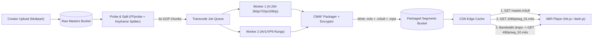
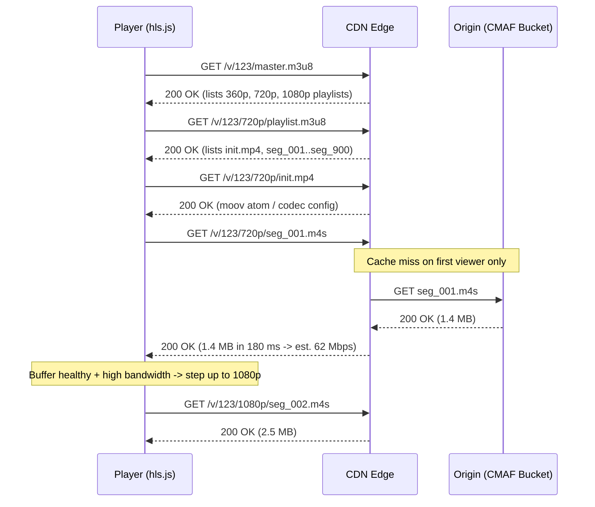
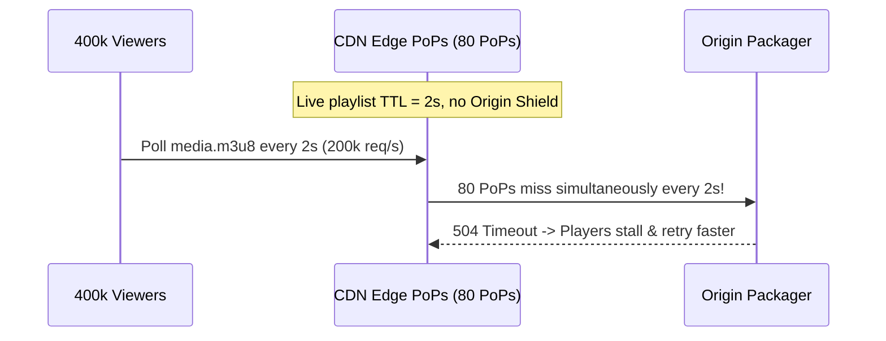

# Video Streaming: Transcoding, HLS, DASH & Adaptive Bitrate

> **Prerequisites:** [Lesson 09: Image Processing Pipelines](../09-image-processing-pipelines/README.md).  
> **Estimated Reading Time:** 25–30 minutes  
> **Target Audience:** Backend and media-platform engineers designing VOD or live video systems (YouTube, Netflix, Coursera, Loom), and candidates asked "design a video streaming platform."  
> **Free PDF Notes:** [Download SD-O-010.pdf](https://backendroadmap.com/notes/system-design/SD-O-010.pdf)

> [!NOTE]
> **In one line:** Video streaming works by **splitting** a master video into short, fixed-duration **segments** (2–6 seconds) across an **Adaptive Bitrate (ABR) ladder** (e.g., 360p, 720p, 1080p, 4K), indexed by a **manifest** (HLS `.m3u8` or DASH `.mpd`) so the player switches quality seamlessly mid-playback over standard HTTP/CDN caching.

> [!TIP]
> **The Golden Rule:** Never stream a single monolithic `.mp4` over HTTP range requests for adaptive playback, and never transcode a 2-hour video on a single machine. Split at **GOP (keyframe) boundaries**, transcode chunks in parallel, and align keyframes across every bitrate rung so ABR switches are glitch-free.

---

## 1. What Video Streaming Architecture Is, and What It Isn't

If you upload a 4 GB 4K `.mov` file and serve it directly from S3, a user on 4G mobile stalls every 2 seconds, burns gigabytes of data, and cannot seek cleanly without buffering megabytes of MP4 headers. Worse, if the user's bandwidth drops from 25 Mbps to 3 Mbps while entering a subway tunnel, a monolithic file cannot downshift to 480p.

Modern Video on Demand (VOD) solves this with **segmented HTTP streaming** (HLS and MPEG-DASH) backed by a **distributed DAG transcoding pipeline**.

| Term | Precise Meaning | Example |
| :--- | :--- | :--- |
| **Container vs Codec** | Container wraps streams (MP4, fMP4, TS); codec compresses pixels/audio (H.264, H.265/HEVC, VP9, AV1) | `.m4s` (fMP4) holding H.264 + AAC |
| **GOP (Group of Pictures)** | Sequence of frames starting with an **I-frame** (keyframe) followed by predicted P/B frames | 2-second GOP at 30 fps = 60 frames |
| **Segment / Chunk** | Self-contained 2–6 s media file starting on an IDR keyframe, fetched via plain HTTP `GET` | `seg_0042.m4s` |
| **ABR Ladder** | Set of (resolution, bitrate) rungs produced for one video | 360p@800k, 720p@2.8M, 1080p@5M |
| **Manifest / Playlist** | Text/XML index listing available rungs (master) and segment URLs (media) | `master.m3u8` (HLS) / `manifest.mpd` (DASH) |
| **HLS / MPEG-DASH** | HTTP-based adaptive streaming protocols (Apple HLS vs open ISO MPEG-DASH) | Both support CMAF `.m4s` segments |
| **CMAF** | Common Media Application Format—one set of fMP4 segments shared by both HLS and DASH | Halves storage & doubles CDN CHR |
| **Not** | Custom TCP/UDP sockets or RTMP to end-user browsers | End-user playback is plain HTTP/2 & HTTP/3 |

### Why It Matters
1. **CDN-native scalability:** Because segments are immutable 2–6 s HTTP files, standard CDNs cache them at 98%+ hit ratios—turning video delivery into static-file serving.
2. **Instant ABR switching:** Aligned keyframes let the player switch from `1080p/seg_05.m4s` to `480p/seg_06.m4s` with zero visual tearing or audio desync.
3. **Parallel transcoding:** Splitting a 1-hour video into 600 six-second chunks lets 100 workers transcode it in ~45 seconds instead of 1.5 hours.

---

## 2. Anatomy: Distributed DAG Transcoding & ABR Playback



1. **Chunked Upload & Probe:** Creators upload multi-GB files via S3 Multipart Upload (resumable). A lightweight prober inspects codecs, resolution, frame rate, and audio channels.
2. **Split-and-Stitch DAG:** Instead of transcoding a 2-hour movie sequentially, a splitter cuts the master at **keyframe boundaries** into independent 6-second chunks. A fleet of spot-instance workers transcodes all chunks × all ladder rungs in parallel.
3. **CMAF Packaging:** Segments are packaged as **fragmented MP4 (fMP4 / `.m4s`)** with identical keyframe alignment so both HLS (`master.m3u8`) and DASH (`manifest.mpd`) point to the **exact same segment files**—saving 50% storage and avoiding split CDN caches.

| Protocol | Segment Format | Manifest Format | Primary Ecosystem | Low-Latency Mode |
| :--- | :--- | :--- | :--- | :--- |
| **HLS** | MPEG-TS (`.ts`) or fMP4 (`.m4s`) | `.m3u8` (M3U8 text) | Apple iOS/macOS/tvOS (native), Web (`hls.js`) | LL-HLS (partial segments) |
| **MPEG-DASH** | fMP4 (`.m4s`) / WebM | `.mpd` (XML) | Android, Smart TVs, Web (`dash.js`, Shaka) | LL-DASH (chunked CMAF) |
| **CMAF (Unified)** | fMP4 (`.m4s`) | Both `.m3u8` + `.mpd` | Universal (one segment set for both) | Yes |

> [!WARNING]
> **The #1 Trap: Misaligned Keyframes (GOPs) Across Rungs.** If 1080p places keyframes every 2.0 seconds and 480p places keyframes every 3.0 seconds (e.g., due to scene-cut detection), the player cannot cleanly switch rungs at segment boundaries—causing visible stutter, audio pops, or buffer stalls. Always force fixed GOPs (`-g 60 -keyint_min 60 -sc_threshold 0` for 30 fps / 2 s) across every rung.

---

## 3. Mathematical Model: ABR Ladder Storage, Segment Size & Startup Latency

**1. Total Transcoded Bitrate & Storage Amplification:**
Given an ABR ladder with $K$ video rungs of bitrates $b_1, b_2, \dots, b_K$ (bps) and audio bitrate $b_a$ (bps), for a video of duration $T$ seconds:

$$S_{\text{total}} = \frac{T}{8} \left( b_a + \sum_{k=1}^{K} b_k \right) \text{ bytes}$$

**Worked Numerical Example (1-hour 1080p VOD):**
Suppose $T = 3{,}600\text{ s}$ with a 5-rung H.264 ladder + 128 kbps AAC audio:
- Rungs: `360p` (800 kbps), `480p` (1,400 kbps), `720p` (2,800 kbps), `1080p` (5,000 kbps), `1080p-HQ` (8,000 kbps).
- Sum of video bitrates: $0.8 + 1.4 + 2.8 + 5.0 + 8.0 = 18.0\text{ Mbps}$.
- Total with audio: $18.128\text{ Mbps}$.

$$S_{\text{total}} = \frac{3{,}600 \times 18.128 \times 10^6}{8} \approx 8.16\text{ GB per video}$$

If you *didn't* use CMAF and stored separate `.ts` (HLS) and `.m4s` (DASH) copies, storage doubles to **16.32 GB** per hour of video. With 100,000 hours of content, CMAF saves **816 TB** of S3 storage.

**2. Segment Duration Trade-off ($t_{\text{seg}}$):**
- **Shorter segments** ($t_{\text{seg}} = 2\text{ s}$): Faster ABR reaction to bandwidth drops and lower live latency, but higher manifest size, more HTTP requests, and slightly worse compression efficiency (more I-frames).
- **Longer segments** ($t_{\text{seg}} = 6\text{–}10\text{ s}$): Better compression and fewer HTTP requests, but slow ABR reaction and higher seek/startup latency.

Number of segments per rung:

$$N_{\text{seg}} = \left\lceil \frac{T}{t_{\text{seg}}} \right\rceil$$

For $T = 3{,}600\text{ s}$ and $t_{\text{seg}} = 4\text{ s}$, each rung has $900$ segments (4,500 segment files across 5 rungs).

**3. Playback Startup Time ($T_{\text{start}}$):**

$$T_{\text{start}} = T_{\text{DNS+TLS}} + T_{\text{master.m3u8}} + T_{\text{media.m3u8}} + T_{\text{init.mp4}} + T_{\text{seg}_1}$$

To keep $T_{\text{start}} < 1.0\text{ s}$, players start on a **conservative initial rung** (e.g., 480p/720p) for `seg_1` and upgrade to 1080p on `seg_2` once throughput is measured.

---

## 4. Metrics & Percentiles

| Metric | Meaning | Alert when |
| :--- | :--- | :--- |
| **Rebuffering Ratio** | $\frac{\text{Total stall time}}{\text{Total playback time}}$ | Exceeds 0.5% (1% = users abandon) |
| **Video Startup Time (VST) $p_{95}$** | Time from play click to first rendered frame | Exceeds 1.5 s (VOD) or 3.0 s (Live) |
| **Transcode Real-Time Factor** | $\frac{\text{Transcode wall time}}{\text{Video duration}}$ | Exceeds 0.3x for VOD (backlog risk) |
| **CDN Cache Hit Ratio (Segments)** | % of `.m4s` requests served from edge | Drops below 95% |
| **ABR Oscillation Rate** | Quality switches per minute per session | > 2 switches/min (unstable buffer logic) |
| **Fatal Playback Error Rate** | % of sessions hitting 404/5xx or decode error | Exceeds 0.2% |

### Worked Example: Rebuffering vs. Bitrate Choice
A 10-minute (600 s) lecture is watched by 10,000 students on variable Wi-Fi.
- **Naive fixed 1080p (5 Mbps):** 8% of students have < 5 Mbps bandwidth and experience 18 s of total stalls each -> Rebuffering Ratio = $18 / 600 = 3.0\%$.
- **ABR (360p–1080p, 4 s segments):** The player downshifts to 720p (2.8 Mbps) or 480p (1.4 Mbps) before the 12-second buffer empties -> Rebuffering Ratio drops to **0.18%**, while average delivered bitrate remains 3.9 Mbps.

---

## 5. Compounding & Failure Modes: Per-Title Encoding & Codec Selection

**Static Ladders Waste Bits:**
A talking-head coding tutorial (mostly static screen) compresses cleanly at 1080p in **600 kbps**, whereas a high-motion action movie needs **6,000 kbps** for the same 1080p VMAF score.

**Per-Title Encoding (Netflix / YouTube approach):**
Run a fast complexity analysis (or 2-pass CRF probe) per video to construct a custom bitrate ladder targeting a **VMAF perceptual quality score** (e.g., VMAF 93 for top rung, VMAF 80 for mobile rung), cutting average bandwidth by **30–50%** with identical perceived quality.

| Codec | Bandwidth Savings vs H.264 | Encode CPU Cost | Hardware Decode Support | Typical Strategy |
| :--- | :---: | :---: | :---: | :--- |
| **H.264 (AVC)** | Baseline (1.0x) | 1x | Universal (100%) | Always encode as universal baseline |
| **H.265 (HEVC)** | 35–45% smaller | 4x–6x | Apple, Modern Smart TVs | Required for 4K HDR on Apple/TVs |
| **VP9** | 30–40% smaller | 3x–5x | Chrome, Android, YouTube | Web/Android 1080p–4K |
| **AV1** | 45–55% smaller | 10x–20x (SVT-AV1 faster) | Modern Android, Chrome, Apple M3+ | Encode **only top 5–10% most-watched videos** |

---

## 6. Numbers Every Engineer Must Know

| Item | Typical | Implication |
| :--- | :---: | :--- |
| **VOD segment duration** | 4–6 seconds | Balances compression efficiency and ABR responsiveness |
| **Live segment duration** | 1–2 seconds (or 200 ms LL-HLS parts) | Keeps glass-to-glass latency under 3–6 s |
| **Client playback buffer** | 10–30 seconds (VOD) | Absorbs transient Wi-Fi drops without stalling |
| **Keyframe (IDR) interval** | Exactly 2 s (e.g., 60 frames @ 30 fps) | Enables clean ABR switching and seeking |
| **VMAF quality threshold** | 90–95 (HD), < 70 (noticeable artifacts) | Industry-standard perceptual quality metric |
| **AV1 ROI threshold** | Top 5–10% of catalog by views | High encode cost only pays off on high-view-count videos |
| **Long-tail transcode rule** | H.264 360p/720p/1080p only | Don't burn AV1/4K GPU cycles on videos with 3 views |

---

## 7. Protocol / Mechanism Deep Dive: HLS & ABR Loop



### When NOT to Use Segmented HLS/DASH
| Scenario | Better Alternative | Why |
| :--- | :--- | :--- |
| **Interactive 1:1 / group video calls** | **WebRTC** (SRTP over UDP) | HLS/DASH has 2–10 s buffering latency; calls require < 200 ms |
| **Short < 5 s looping UI clips / stickers** | Progressive MP4/WebM (`<video loop muted>`) | Single tiny file (< 200 KB); manifest overhead slows startup |
| **Sub-second sports betting / auction streams** | WebRTC or MoQ (Media over QUIC) | Even LL-HLS (1.5–3 s) is too slow for real-time bidding |

---

## 8. Hierarchical Budgets & Design Rules

| Slice | Rule | Control |
| :--- | :--- | :--- |
| **GOP Alignment** | Every rung must have identical IDR keyframe timestamps | `-g 60 -keyint_min 60 -sc_threshold 0` |
| **Storage Efficiency** | Package once as **CMAF fMP4** shared by HLS & DASH | Single `.m4s` segment set + dual manifests |
| **Compute ROI** | Encode H.264 for all uploads; trigger AV1/VP9 only when views > threshold | View-counter event triggers tier-2 transcode |
| **Upload Resilience** | Support pause/resume on multi-GB uploads | S3 Multipart Upload (5–100 MB parts) + client-side MD5 |
| **Startup Latency** | Keep `master.m3u8` + `init.mp4` tiny; start on mid-rung (480p/720p) | Gzip manifests; `Cache-Control: immutable` on `.m4s` |
| **Live vs VOD** | Short `max-age=1` on live `.m3u8` sliding window; `immutable` on `.m4s` | Separate CDN cache behaviors for `.m3u8` vs `.m4s` |

---

## 9. Top Mitigations

1. **Split-and-Stitch Parallel Transcoding:** Split incoming masters at keyframe boundaries into 6-second chunks and transcode across spot workers in parallel, cutting 2-hour movie turnaround from hours to ~1 minute.
2. **Enforce Fixed GOPs (`-sc_threshold 0`):** Disable scene-cut keyframe insertion so every ABR rung has exact keyframe alignment at segment boundaries.
3. **Adopt CMAF (fMP4) Packaging:** Serve both Apple HLS and Android/Web DASH from the exact same `.m4s` segments, halving origin storage and doubling CDN cache hit ratio.
4. **Tiered Codec Strategy (View-Count Triggered):** Transcode every upload to H.264 immediately; only spend expensive AV1/HEVC compute on videos that cross e.g. 1,000 views.
5. **Separate Manifest vs. Segment Cache TTLs:** For live streams, cache `.m3u8` playlists for 1 second (or half the segment duration) while caching `.m4s` segments for 1 year (`immutable`).
6. **Hardware/Spot Fallback & Priority Queues:** Isolate paid/creator-live transcodes from bulk backfill jobs using separate worker queues so backfills never starve new uploads.
7. **Sprite Sheets for Scrubbing Previews:** Generate a lightweight JPEG sprite sheet + WebVTT timeline during transcode so timeline hover-scrubbing never downloads video segments.

---

## 10. Production Reference / War Story: The Live Stream Manifest Cache Stampede

**Incident:** During a major sports broadcast with 400,000 concurrent viewers on HLS, the origin packaging cluster collapsed with 100% CPU and 504 errors every 2 seconds.



**Root Cause:** All 400,000 players polled the live `media.m3u8` every 2 seconds. Because the CDN was configured with `Cache-Control: no-cache` on `.m3u8` (instead of `max-age=1`) and had no Origin Shield / request collapsing, every 2-second segment rollover sent tens of thousands of simultaneous manifest requests directly to the origin packager.

**Fix:**
1. Set `Cache-Control: public, max-age=1` on live `.m3u8` playlists (and `immutable` on `.m4s` segments).
2. Enabled **Origin Shield + CDN Request Collapsing** so all 80 PoPs coalesce into a single origin fetch per second.
3. Added **jitter** on client playlist polling and enabled **Delta Playlists** (HLS `EXT-X-SKIP`) to shrink manifest payloads by 85%.

---

## 11. Multi-Language Production Code Tabs

Below are production-shaped implementations for **generating HLS master/media playlists, computing ABR ladders, and orchestrating chunked transcode jobs**.

````carousel
```go
// Go: Generate an HLS Master Playlist (.m3u8) from an ABR ladder
package main

import (
	"fmt"
	"strings"
)

type ABRRung struct {
	Name       string
	Width      int
	Height     int
	Bandwidth  int // bits per second (video + audio)
	Codecs     string
	Playlist   string
}

func BuildMasterM3U8(rungs []ABRRung) string {
	var b strings.Builder
	b.WriteString("#EXTM3U\n")
	b.WriteString("#EXT-X-VERSION:7\n")
	b.WriteString("#EXT-X-INDEPENDENT-SEGMENTS\n\n")

	for _, r := range rungs {
		fmt.Fprintf(
			&b,
			"#EXT-X-STREAM-INF:BANDWIDTH=%d,RESOLUTION=%dx%d,CODECS=\"%s\"\n%s\n",
			r.Bandwidth, r.Width, r.Height, r.Codecs, r.Playlist,
		)
	}
	return b.String()
}

func main() {
	ladder := []ABRRung{
		{Name: "360p", Width: 640, Height: 360, Bandwidth: 928000, Codecs: "avc1.4d401e,mp4a.40.2", Playlist: "360p/index.m3u8"},
		{Name: "720p", Width: 1280, Height: 720, Bandwidth: 2928000, Codecs: "avc1.4d401f,mp4a.40.2", Playlist: "720p/index.m3u8"},
		{Name: "1080p", Width: 1920, Height: 1080, Bandwidth: 5128000, Codecs: "avc1.640028,mp4a.40.2", Playlist: "1080p/index.m3u8"},
	}
	fmt.Println(BuildMasterM3U8(ladder))
}
```
<!-- slide -->
```typescript
// TypeScript: ABR segment-size estimator & HLS/DASH manifest builder
export interface AbrRung {
  name: string;
  width: number;
  height: number;
  videoKbps: number;
  audioKbps: number;
  codecs: string;
}

export function estimateStorageBytes(durationSec: number, ladder: AbrRung[]): number {
  const totalKbps = ladder.reduce((acc, r) => acc + r.videoKbps + r.audioKbps, 0);
  // 1 kbps = 1000 bits/sec -> divide by 8 for bytes
  return Math.ceil((durationSec * totalKbps * 1000) / 8);
}

export function buildMediaPlaylist(
  segmentDurationSec: number,
  segmentCount: number,
  prefixUrl: string
): string {
  const lines = [
    "#EXTM3U",
    "#EXT-X-VERSION:7",
    `#EXT-X-TARGETDURATION:${Math.ceil(segmentDurationSec)}`,
    "#EXT-X-MEDIA-SEQUENCE:0",
    "#EXT-X-PLAYLIST-TYPE:VOD",
    `#EXT-X-MAP:URI="${prefixUrl}/init.mp4"`,
  ];
  for (let i = 0; i < segmentCount; i++) {
    const idx = String(i).padStart(4, "0");
    lines.push(`#EXTINF:${segmentDurationSec.toFixed(3)},`);
    lines.push(`${prefixUrl}/seg_${idx}.m4s`);
  }
  lines.push("#EXT-X-ENDLIST");
  return lines.join("\n");
}
```
<!-- slide -->
```python
# Python: Split-and-stitch FFmpeg command builder with aligned GOPs
from dataclasses import dataclass
from typing import List

@dataclass
class Rung:
    name: str
    width: int
    height: int
    bitrate_k: int

DEFAULT_LADDER = [
    Rung("360p", 640, 360, 800),
    Rung("720p", 1280, 720, 2800),
    Rung("1080p", 1920, 1080, 5000),
]

def build_ffmpeg_chunk_cmd(
    input_chunk: str,
    output_dir: str,
    rung: Rung,
    fps: int = 30,
    gop_sec: int = 2,
) -> List[str]:
    gop_frames = fps * gop_sec
    return [
        "ffmpeg", "-y", "-i", input_chunk,
        "-vf", f"scale={rung.width}:{rung.height}",
        "-c:v", "libx264", "-preset", "veryfast",
        "-b:v", f"{rung.bitrate_k}k",
        "-maxrate", f"{int(rung.bitrate_k * 1.15)}k",
        "-bufsize", f"{rung.bitrate_k * 2}k",
        "-g", str(gop_frames),
        "-keyint_min", str(gop_frames),
        "-sc_threshold", "0",  # Critical: disable scene-cut IDR to align ABR rungs
        "-c:a", "aac", "-b:a", "128k",
        "-f", "hls",
        "-hls_time", str(gop_sec * 2),  # 4s segments
        "-hls_segment_type", "fmp4",
        "-hls_fmp4_init_filename", "init.mp4",
        f"{output_dir}/{rung.name}/index.m3u8",
    ]

if __name__ == "__main__":
    print(" ".join(build_ffmpeg_chunk_cmd("chunk_001.mp4", "/tmp/out", DEFAULT_LADDER[1])))
```
<!-- slide -->
```csharp
// C#: Bandwidth-based ABR rung selector (client/server simulation)
using System;
using System.Collections.Generic;
using System.Linq;

public sealed record VideoRung(string Name, int Width, int Height, int BandwidthBps);

public static class AbrSelector
{
    private const double SafetyFactor = 0.75; // Leave 25% headroom for throughput jitter

    public static VideoRung SelectNextRung(
        IReadOnlyList<VideoRung> ladder,
        double measuredThroughputBps,
        double bufferSeconds)
    {
        var ordered = ladder.OrderByDescending(r => r.BandwidthBps).ToList();

        // Emergency downshift when buffer is critically low (< 4 seconds)
        if (bufferSeconds < 4.0)
        {
            return ordered.Last();
        }

        var safeBudget = measuredThroughputBps * SafetyFactor;
        foreach (var rung in ordered)
        {
            if (rung.BandwidthBps <= safeBudget)
            {
                return rung;
            }
        }
        return ordered.Last();
    }
}
```
````

---

## 12. Hands-On CLI Verification Workflows

```bash
# 1. Inspect keyframe (IDR) timestamps in a video using ffprobe
ffprobe -v error -select_streams v:0 -skip_frame nokey \
  -show_entries frame=pkt_pts_time -of csv=p=0 input.mp4 | head -n 10

# 2. Transcode a sample into CMAF fMP4 HLS segments with aligned 2s GOPs
ffmpeg -i input.mp4 -c:v libx264 -g 60 -keyint_min 60 -sc_threshold 0 \
  -c:a aac -b:a 128k -f hls -hls_time 4 -hls_segment_type fmp4 \
  -hls_fmp4_init_filename init.mp4 out/index.m3u8

# 3. Inspect generated m3u8 manifest and verify #EXT-X-MAP init segment
cat out/index.m3u8

# 4. Verify CDN caching headers on manifest vs segment
curl -sI https://cdn.example.com/v/123/master.m3u8 | grep -iE "cache-control|content-type"
curl -sI https://cdn.example.com/v/123/720p/seg_0001.m4s | grep -iE "cache-control|content-type"
```

---

## 13. Common Mistakes to Avoid

1. **Streaming raw monolithic MP4s instead of segmented HLS/DASH:** Prevents mid-playback quality downshifting and causes poor mobile buffering.
2. **Misaligned GOPs across ABR rungs:** Leaving `-sc_threshold` enabled causes keyframes at different timestamps per rung, resulting in stalls or visual glitches during quality switches.
3. **Storing separate `.ts` (HLS) and `.m4s` (DASH) segments:** Doubles origin storage and splits your CDN cache in half; use **CMAF** fMP4 segments for both.
4. **Transcoding long videos sequentially on one node:** Turns a 2-hour 4K upload into a multi-hour bottleneck; split at keyframes and transcode chunks in parallel.
5. **Encoding AV1 for every upload regardless of views:** Burns 15x CPU on videos that only get 2 views; gate expensive codecs behind a view-count threshold.
6. **Setting `no-cache` on live `.m3u8` playlists without Origin Shield:** Causes a thundering-herd origin meltdown every segment rollover.
7. **Forgetting to strip/normalize audio loudness (EBU R128):** Causes jarring volume jumps between user-generated videos or ads.

---

## 14. Key Terms Glossary

| Key Term | Definition |
| :--- | :--- |
| **ABR (Adaptive Bitrate)** | Player logic that dynamically picks the best quality rung based on measured throughput and buffer depth |
| **HLS (HTTP Live Streaming)** | Apple's HTTP adaptive streaming protocol using `.m3u8` manifests |
| **MPEG-DASH** | Open ISO standard for HTTP adaptive streaming using XML `.mpd` manifests |
| **CMAF** | Common Media Application Format—shared fMP4 (`.m4s`) segments usable by both HLS and DASH |
| **GOP (Group of Pictures)** | Frames between two IDR keyframes; determines segment alignment and seek granularity |
| **VMAF** | Netflix's perceptual video quality metric (0–100) used for per-title encoding |
| **Per-Title Encoding** | Customizing the ABR bitrate ladder per video based on its visual complexity |
| **Rebuffering Ratio** | Percentage of total playback time spent stalled waiting for the buffer |
| **Split-and-Stitch DAG** | Splitting a video at keyframes to transcode chunks in parallel before stitching manifests |
| **Origin Shield** | Intermediate caching layer between CDN edge PoPs and the origin packager |

---

## 15. System Design Interview Questions & Answers

### Basic Conceptual Questions

<details>
<summary><strong>Q1: What is the difference between a video container and a video codec? [BASIC]</strong></summary>

**Answer:**
A **codec** (H.264, H.265, VP9, AV1) compresses and decompresses the raw video/audio frames. A **container** (MP4, fMP4, MKV, MPEG-TS) is the wrapper format that multiplexes the compressed video track, audio tracks, subtitles, and timing metadata into a file or segment.
</details>

<details>
<summary><strong>Q2: Why do HLS and DASH split videos into 2–6 second segments instead of serving one MP4? [BASIC]</strong></summary>

**Answer:**
Small, self-contained segments allow the player to switch quality rungs (e.g., 1080p down to 480p) at any segment boundary when network speed changes, enable instant seeking via manifest offsets, and cache cleanly at CDN edge PoPs as immutable HTTP objects.
</details>

<details>
<summary><strong>Q3: What is CMAF and why does it matter? [BASIC]</strong></summary>

**Answer:**
CMAF (Common Media Application Format) standardizes fragmented MP4 (`.m4s`) segments so both HLS (`.m3u8`) and MPEG-DASH (`.mpd`) reference the exact same media files. This cuts origin storage by 50% and consolidates CDN cache hits onto one set of segment URLs.
</details>

<details>
<summary><strong>Q4: What is a GOP and why must it be aligned across all ABR rungs? [BASIC]</strong></summary>

**Answer:**
A Group of Pictures (GOP) is the sequence of frames starting with an independent keyframe (I-frame) followed by predicted frames (P/B). Every ABR rung must place keyframes at the exact same timestamps (e.g., every 2.0 s) so the player can switch from one rung's segment $N$ to another rung's segment $N+1$ without missing reference frames.
</details>

### Scenario-Based Architecture Questions

<details>
<summary><strong>Q5: Design YouTube's upload and transcoding pipeline for 500 hours of video uploaded per minute. [SCENARIO]</strong></summary>

**Answer:**
1. Resumable **Multipart Upload** to S3/GCS.
2. **Probe & Keyframe Split:** Divide each video into 4–6 s chunks at IDR boundaries.
3. **Priority Queues:** Route chunks to a spot-instance transcoding fleet. Immediately generate low/mid H.264 rungs (`360p`, `720p`) so the video is playable within ~60 seconds.
4. **Tiered Codecs:** Generate `1080p`/`4K` and `VP9`/`AV1` asynchronously, gating expensive AV1 encodes behind a view-count threshold.
5. **CMAF Package** into `.m4s` + `.m3u8`/`.mpd` and serve via CDN.
</details>

<details>
<summary><strong>Q6: A user uploads a 2-hour 4K lecture and expects it to be playable in 2 minutes. How? [SCENARIO]</strong></summary>

**Answer:**
A single worker cannot transcode 2 hours of 4K in 2 minutes. Use **split-and-stitch parallel transcoding**: split the 2-hour master into 1,200 six-second chunks and fan them out to 100+ workers in parallel, prioritizing the `360p` and `720p` H.264 rungs first. Playability is ready in ~60–90 seconds while higher rungs finish in the background.
</details>

<details>
<summary><strong>Q7: How do you reduce video CDN egress costs by 35% without degrading perceived quality? [SCENARIO]</strong></summary>

**Answer:**
1. Implement **Per-Title Encoding** (target VMAF 92 instead of fixed bitrates—saves 30%+ on simple content like slides/screencasts).
2. Encode **AV1/VP9** for the top 10% most-viewed videos (which often drive 80%+ of egress).
3. Cap initial startup rung to `480p`/`720p` and avoid pre-buffering > 20–30 s ahead so abandoned views don't waste megabytes.
</details>

<details>
<summary><strong>Q8: Your live stream has 300,000 concurrent viewers and the origin server is melting. Where do you look first? [SCENARIO]</strong></summary>

**Answer:**
Check the `.m3u8`/`.mpd` **manifest cache headers** and **Origin Shield**. In live streaming, clients poll the manifest every 1–2 seconds. If manifests are `no-cache` or bypass request collapsing, 300k clients hit origin every 2 seconds. Set `Cache-Control: max-age=1` on live manifests, enable Origin Shield request collapsing, and keep `.m4s` segments `immutable`.
</details>

### Advanced & Tricky Interview Questions

<details>
<summary><strong>Q9: How does Low-Latency HLS (LL-HLS) achieve < 2 s latency over standard HTTP/CDN? [TRICKY]</strong></summary>

**Answer:**
Instead of waiting for a full 4-second segment to finish encoding before publishing, LL-HLS splits each segment into tiny **200–500 ms CMAF parts** (`EXT-X-PART`) and uses **blocking playlist reloads** (the client requests the next playlist with `_HLS_msn` and `_HLS_part` query params, and the CDN/origin holds the HTTP response until that part is ready, pushing it immediately).
</details>

<details>
<summary><strong>Q10: Why can't you use HLS/DASH for a Zoom-style 1:1 video call? [TRICKY]</strong></summary>

**Answer:**
Even LL-HLS requires segmenting, manifest updates, and a client jitter buffer of at least 1–2 seconds—making conversational turn-taking impossible. Interactive calls require **WebRTC** (SRTP over UDP with congestion control like GCC), which targets < 150–200 ms glass-to-glass latency by sending individual frames without waiting for segment boundaries.
</details>

<details>
<summary><strong>Q11: How do you protect paid/DRM video content without breaking CDN caching? [TRICKY]</strong></summary>

**Answer:**
Encrypt the `.m4s` segments *once* using **Common Encryption (CENC)** with a content key (AES-128 CTR/CBCS). Because all authorized users receive the *exact same encrypted `.m4s` bytes*, the CDN caches segments at 99% hit ratio. Authorization happens when the player requests the **decryption license/key** from a separate License Server (Widevine/FairPlay/PlayReady), which is tiny and uncached.
</details>

<details>
<summary><strong>Q12: A user seeks to 42:15 in a 1-hour video. What HTTP requests does the player actually make? [TRICKY]</strong></summary>

**Answer:**
The player already has the `media.m3u8` in memory, sums `#EXTINF` durations to find that 42:15 falls in `seg_0633.m4s` (at 4 s/seg), cancels any in-flight segment downloads, and issues `GET /720p/seg_0633.m4s` (plus `seg_0634.m4s`). No range-request seeking into a giant MP4 header is needed.
</details>

---

## 16. One-Page Master Cheat Sheet

```
+---------------------------------------------------------------------------------------------------------+
|                    VIDEO STREAMING & ABR — MASTER CHEAT SHEET                                           |
+---------------------------------------------------------------------------------------------------------+
| 1. CORE IDEA: Split video into 2-6s self-contained segments across an ABR ladder -> serve over HTTP/CDN.|
+---------------------------------------------------------------------------------------------------------+
| 2. CMAF: Use fMP4 (.m4s) segments shared by HLS (.m3u8) & DASH (.mpd) -> 50% less storage, 2x CDN CHR.  |
+---------------------------------------------------------------------------------------------------------+
| 3. ALIGNMENT: Force fixed GOPs (-sc_threshold 0) across all rungs so ABR switches never glitch/stall.   |
+---------------------------------------------------------------------------------------------------------+
| 4. TRANSCODE: Split-and-stitch DAG at keyframes in parallel; gate expensive AV1 behind view thresholds. |
+---------------------------------------------------------------------------------------------------------+
| 5. CACHING: Live .m3u8 = max-age=1 + Origin Shield collapsing | .m4s segments = immutable (1 year).     |
+---------------------------------------------------------------------------------------------------------+
| 6. DRM: Encrypt segments once (CENC) for 99% CDN caching; authorize per-user via License Server.        |
+---------------------------------------------------------------------------------------------------------+
```

---

## Further Reading & Sources

- Apple Developer, [HTTP Live Streaming (HLS) Authoring Specification](https://developer.apple.com/documentation/http-live-streaming/hls-authoring-specification-for-apple-devices).
- Netflix TechBlog, [Per-Title Encode Optimization](https://netflixtechblog.com/per-title-encode-optimization-7e99442b62a2).
- DASH Industry Forum, [CMAF & Low-Latency Streaming Guidelines](https://dashif.org/guidelines/).
- Mux Engineering Blog, [How Video Streaming Works: Segments, GOPs, and ABR](https://www.mux.com/blog).

---

## Free PDF Notes

[SD-O-010.pdf](https://backendroadmap.com/notes/system-design/SD-O-010.pdf)

---

## Next

Continue with [Lesson 11: CDN for Private Content: Signed Cookies, Cache Keys, Shielding](../11-cdn-for-private-content/README.md).
