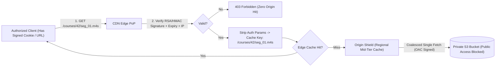
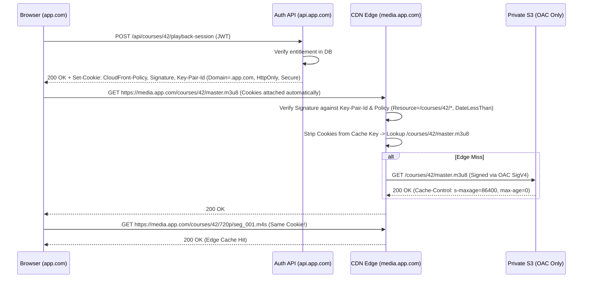
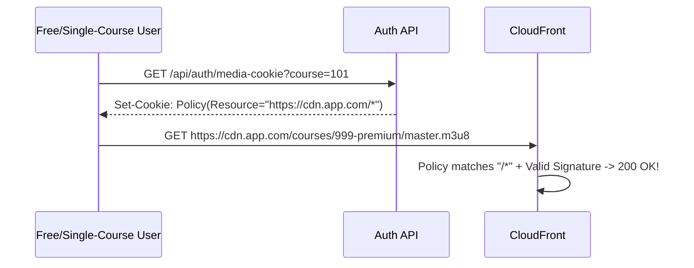

# CDN for Private Content: Signed Cookies, Cache Keys, Shielding

> **Prerequisites:** [Lesson 10: Video Streaming: Transcoding, HLS, DASH & Adaptive Bitrate](../10-video-streaming/README.md).  
> **Estimated Reading Time:** 24–28 minutes  
> **Target Audience:** Backend and security architects serving paid, user-owned, or multi-tenant assets (courses, SaaS attachments, private HLS video) at global scale, and candidates asked "how do you cache private files on a CDN without leaking them?"  
> **Free PDF Notes:** [Download SD-O-011.pdf](https://backendroadmap.com/notes/system-design/SD-O-011.pdf)

> [!NOTE]
> **In one line:** Serving private content through a CDN requires decoupling **authentication** (verified at the edge via cryptographic **Signed URLs** or **Signed Cookies**) from the **cache key** (which must *exclude* per-user tokens so all authorized users share the same cached object), while locking the origin bucket via **Origin Access Control (OAC)** and collapsing misses with an **Origin Shield**.

> [!TIP]
> **The Golden Rule:** Never include the user's signature, session cookie, or `Authorization` header in the CDN cache key for shared private assets—verify the signature *first* at the edge, strip it from the cache key, and lock the S3/GCS origin so zero traffic can bypass the CDN.

---

## 1. What CDN for Private Content Is, and What It Isn't

A common misconception is that "private content cannot be cached on a CDN." If you bypass the CDN and proxy every 5 MB PDF or 2 GB video segment through your API server (`GET /api/download?id=42` -> check JWT -> stream from S3), your API pods saturate on network I/O, egress costs triple, and global users suffer 400 ms+ TTFB.

Conversely, if you simply put a CDN in front of S3 with `Authorization` in the cache key, every user gets a private cache partition (Cache Hit Ratio -> ~0%), or worse, if you forget `Vary` / cache-key rules, User A's confidential invoice leaks to User B.

| Term | Precise Meaning | Example |
| :--- | :--- | :--- |
| **Signed URL** | A URL with query parameters (`Expires`, `Signature`, `Key-Pair-Id`) granting access to *one* specific object | `https://cdn.app/doc.pdf?Expires=...&Signature=...` |
| **Signed Cookie** | Cryptographic cookies (`CloudFront-Policy`, `Signature`, `Key-Pair-Id`) granting access to a *wildcard path prefix* | `Policy: Resource = https://cdn.app/course-42/*` |
| **Cache Key** | The tuple `(host, path, selected headers/query)` the CDN uses to store and look up cached bytes | Exclude `Signature` and `Expires` from cache key! |
| **Origin Shield** | A centralized mid-tier caching layer between 100+ Edge PoPs and your Origin (S3) | Collapses 50 PoP misses into 1 origin fetch |
| **OAC / OAI** | Origin Access Control—IAM policy ensuring S3 accepts requests *only* from your CloudFront distribution | Blocks direct `s3.amazonaws.com` URLs |
| **Edge Auth (JWT/HMAC)** | Running lightweight verification in a CDN Edge Worker (Cloudflare Worker / CloudFront Function) | Sub-millisecond verification before cache lookup |
| **Not** | Setting `Cache-Control: private` on shared paid assets, or proxying S3 streams through your Node/Go API | Defeats CDN caching entirely |

### Why It Matters
1. **HLS/DASH video requires Signed Cookies (or Edge JWTs):** A 1-hour HLS video has 900 `.m4s` segment URLs. You cannot practically pre-sign 900 individual URLs inside `media.m3u8` without breaking shared caching and player logic; a single **Signed Cookie** unlocks `/courses/42/*`.
2. **Cache-key hygiene prevents data leaks and 0% CHR:** Including `Signature` in the cache key gives every user a unique cache entry (0% reuse); caching `Set-Cookie` or personalized responses without isolation leaks private data.
3. **Origin protection:** Without OAC/mTLS, anyone who discovers your underlying S3 bucket name (`my-private-media.s3.amazonaws.com`) can bypass your CDN paywall completely.

---

## 2. Anatomy: Edge Verification + Stripped Cache Key + Origin Shield



Notice the two-stage pipeline at the Edge PoP:
1. **Authentication Gate (Pre-Cache):** The CDN validates the cryptographic signature (`CloudFront-Signature` or Edge Worker JWT) *before* touching the cache. Expired or tampered requests die immediately with `403 Forbidden` at the edge.
2. **Cache Lookup (Post-Auth):** Once authorized, the CDN looks up the object using **only** the canonical path (`/courses/42/seg_01.m4s`), completely ignoring who signed the token. User 1 warms the cache; Users 2..10,000 get instant edge hits.

| Mechanism | Scope | Max URL Length Issue? | Best For |
| :--- | :--- | :--- | :--- |
| **Signed URL** | Single object (or exact path) | No | One-off downloads, email links, mobile apps without cookie jars |
| **Signed Cookie** | Wildcard path (`/courses/42/*`) | N/A (sent in `Cookie` header) | HLS/DASH video segments, multi-file web portals, SPAs |
| **Edge Worker JWT + S3 SigV4** | Arbitrary custom claims (`tenant_id`, `role`, `plan`) | N/A | Multi-tenant SaaS, instant revocation via Edge KV |

> [!WARNING]
> **The #1 Trap: Leaving `Signature` / `Cookie` in the CDN Cache Key.** If your CDN cache policy forwards all query strings or all cookies to the cache key, then `seg_01.m4s?Expires=1700000100&Sig=AAA` and `seg_01.m4s?Expires=1700000200&Sig=BBB` are treated as **two completely different objects**. Your Cache Hit Ratio drops to near zero and your origin S3 egress bill explodes.

---

## 3. Mathematical Model: Cache Hit Ratio, Origin Shielding & Cost

**1. Origin Request Amplification Without vs. With Origin Shield:**
Suppose a CDN has $P = 120$ Edge PoPs worldwide. For a newly published private course video (1,000 segments):
- **Without Origin Shield:** Each PoP experiences a cold miss on first regional view:

$$R_{\text{origin, no-shield}} = P \times N_{\text{segments}} = 120 \times 1{,}000 = 120{,}000\text{ S3 GETs}$$

- **With Origin Shield:** All 120 PoPs route misses through 1 (or 2–3 regional) Origin Shield PoP(s):

$$R_{\text{origin, shield}} = S_{\text{shields}} \times N_{\text{segments}} = 1 \times 1{,}000 = 1{,}000\text{ S3 GETs}$$

That is a **120x reduction** in S3 GET requests and S3-to-CDN data transfer!

**2. Bandwidth Cost: API Proxy vs. CDN + OAC:**
Suppose you serve $V = 50\text{ TB/month}$ of private enterprise PDFs and training videos.
- **Proxying through EC2/ECS API servers:** You pay S3-to-EC2 (free in same AZ, $\$0.01\text{–}\$0.02/\text{GB}$ cross-AZ) + EC2-to-Internet egress ($\$0.09/\text{GB}$) + compute for proxy pods.
  - Egress alone: $50{,}000\text{ GB} \times \$0.09 = \$4{,}500/\text{month}$ + ~$\$1{,}200$ compute = **$\$5{,}700/\text{month}$**.
- **CloudFront + Origin Shield + S3 OAC:** S3-to-CloudFront transfer is **$\$0.00/\text{GB}$** (on AWS), and CloudFront egress at 50 TB scale is ~$\$0.04\text{–}\$0.06/\text{GB}$ (or $\$0.00$ egress on Cloudflare R2).
  - Cost: $50{,}000 \times \$0.05 = \mathbf{\$2{,}500/\text{month}}$ (and $p_{95}$ TTFB drops from 380 ms to **28 ms**).

**3. Token Expiry vs. Clock Skew Window:**
If a Signed URL/Cookie has TTL $T_{\text{ttl}}$ and client/edge clock skew is $\Delta_{\text{skew}}$, a user starting a 2-hour movie needs:

$$T_{\text{ttl}} \ge T_{\text{playback}} + \Delta_{\text{skew}}$$

Or better: issue short-lived Signed Cookies ($T_{\text{ttl}} = 15\text{ min}$) and silently refresh them via `/api/session/refresh` every 10 minutes while the user's subscription is active.

---

## 4. Metrics & Percentiles

| Metric | Meaning | Alert when |
| :--- | :--- | :--- |
| **Edge Auth 403 Rate** | % of requests rejected at edge for invalid/expired signature | Sudden spike > 5% (clock skew, broken signing key rotation, or scraping) |
| **Cache Hit Ratio (Private Path)** | % of authorized requests served from Edge + Shield | Drops below 90% (check if `Cookie` or `QueryString` leaked into cache key) |
| **Origin Shield Hit Ratio** | % of Edge PoP misses absorbed by Shield | Drops below 70% on popular assets |
| **Direct-to-S3 Bypass Attempts** | 403s on S3 bucket from non-CDN principals | > 0 sustained (verify OAC bucket policy is locked) |
| **Key Rotation Overlap Health** | Failures during RSA key-pair rotation | Any 403 spike after deploying new `Key-Pair-Id` |

### Worked Example: The Leaked Cache Key
An ed-tech platform deploys Signed Cookies for `/videos/*`. A week later, AWS S3 egress is **18 TB** instead of the expected **0.5 TB**.
- **Diagnosis:** The CloudFront Cache Policy had `Cookies: All` enabled so the origin could read something—which accidentally added `CloudFront-Signature` (unique per user!) to the **cache key**.
- **Fix:** Changed Cache Policy to `Cookies: None` (CloudFront still validates `CloudFront-*` cookies *before* cache lookup even when `Cookies: None` is set in the cache key!). Cache Hit Ratio jumped from **4% to 98.4%** within an hour.

---

## 5. Compounding & Failure Modes: Revocation, Cross-Domain Cookies & Key Rotation

| Failure Mode | Why It Happens | Production Impact | Mitigation |
| :--- | :--- | :--- | :--- |
| **Instant Revocation Gap** | Signed URLs/Cookies are stateless; once issued for 2 hours, a banned user still has access until `Expires` | Terminated employee or refunded user downloads files for 2 hours | Keep cookie TTL short (5–15 min) + refresh endpoint, OR check a revocation bloom filter/KV at Edge Worker |
| **Third-Party Cookie Blocking** | `api.app.com` sets a cookie for `cdn.otherdomain.com`; Safari ITP / Chrome blocks third-party cookies | Video player fails with 403 on Safari/iOS | Host CDN on a **same-site subdomain** (`media.app.com` when app is `app.com`) with `Domain=.app.com; Secure; SameSite=Lax` |
| **Hard Key-Pair Cutover** | Deleting old `Key-Pair-Id` immediately when rotating RSA keys | All in-flight users with active cookies immediately get 403 | Maintain **2 active public keys** in the CDN Key Group during a 24-hour overlap window |
| **Browser Cache Leakage on Shared PC** | CDN caches object; browser also caches it locally with `public, max-age=86400` | Next user on a library/kiosk PC reads previous user's private PDF from disk cache | Return `Cache-Control: public, s-maxage=86400, max-age=0, must-revalidate` (caches at CDN, forces browser to revalidate!) |

---

## 6. Numbers Every Engineer Must Know

| Item | Typical | Implication |
| :--- | :---: | :--- |
| **Signed Cookie size** | ~350–600 bytes (3 cookies) | Fits comfortably in 4 KB cookie limit; negligible header overhead |
| **Short-lived cookie TTL** | 5–15 minutes (with silent refresh) | Limits stolen/revoked token window without hurting UX |
| **Signed URL TTL** | 60–300 seconds (one-off download) | Prevents link sharing on forums |
| **Edge Worker auth latency** | 0.2–1.5 ms | Negligible compared to 20–50 ms TLS/RTT |
| **Key-pair rotation overlap** | >= 2x max token TTL | Zero 403s during key rotation |
| **`s-maxage` vs `max-age`** | `s-maxage=86400, max-age=0` | Caches on CDN shared edge, prevents stale/leaked local browser cache |
| **Max active CloudFront keys** | 5 public keys per Key Group | Plenty for zero-downtime key rotation |

---

## 7. Protocol / Mechanism Deep Dive: Signed Cookie + Edge Auth Sequence



### When NOT to Use CDN Caching for Private Content
| Scenario | Why | Alternative |
| :--- | :--- | :--- |
| **User-specific dynamically generated PDFs** (e.g., bank statement with user's name) | 100% unique per user (1 view total); caching wastes edge memory | Direct S3 Pre-signed URL (no CDN needed) or stream on demand |
| **Strict HIPAA/PCI data prohibiting third-party edge storage** | Compliance forbids decrypted bytes residing on shared CDN PoP disks | Direct encrypted origin or dedicated VPC/Customer-Managed Key (CMK) setup |
| **Ultra-sensitive 1-time secrets** | Needs immediate, synchronous DB revocation on every byte read | App-tier auth + S3 Pre-signed URL with 30 s TTL |

---

## 8. Hierarchical Budgets & Design Rules

| Slice | Rule | Control |
| :--- | :--- | :--- |
| **Origin Lockdown** | Block all public access on S3/GCS; allow *only* CDN Service Principal | S3 Block Public Access + OAC Bucket Policy (`aws:SourceArn`) |
| **Cache Key Isolation** | Never include `Signature`, `Expires`, `Authorization`, or `CloudFront-*` in cache key | Explicit CDN Cache Policy allowlist (path + normalized format only) |
| **Browser Cache Safety** | Cache at CDN edge, not in shared browser disk cache | `Cache-Control: public, s-maxage=86400, max-age=0, must-revalidate` |
| **Domain Alignment** | Serve private CDN on a sibling subdomain (`media.app.com`) | Avoids Safari ITP third-party cookie blocking |
| **Token Lifecycle** | Short TTL (10–15 min) + background refresh; 24 h overlap for RSA key rotation | Key Group with `[current_key, next_key]` |
| **Path Scoping** | Scope Signed Cookie policy to `/tenant/{id}/*` or `/course/{id}/*`, never `/*` | Prevents horizontal privilege escalation across courses/tenants |

---

## 9. Top Mitigations

1. **Enforce Origin Access Control (OAC):** Disable all public S3 bucket ACLs/policies and grant `s3:GetObject` *exclusively* to your CloudFront distribution ARN (`Condition: StringEquals aws:SourceArn`).
2. **Exclude Auth Artifacts from the Cache Key:** Explicitly configure the CDN Cache Policy to ignore query parameters (`Expires`, `Signature`, `Key-Pair-Id`) and `Cookie` headers when computing the cache key.
3. **Use `s-maxage` + `max-age=0`:** Keep objects hot on the CDN (`s-maxage=86400`), while forcing browsers (`max-age=0, must-revalidate`) to re-check edge auth on every session.
4. **Enable Origin Shield:** Funnel all regional Edge PoP misses through a single Origin Shield near your S3 bucket, cutting origin S3 GETs and miss latency spikes by 10–100x.
5. **Scope Wildcard Policies Narrowly:** Always bind Signed Cookie policies to `/courses/42/*` or `/tenants/acme/*`, never `/*`, so a valid cookie for Course A cannot be replayed against Course B.
6. **Bind to Client IP (When Appropriate) & Short TTLs:** For high-value downloads, include `IpAddress` in the custom policy (note: skip IP binding for mobile users who switch Wi-Fi <-> 5G mid-stream) and keep TTLs at 5–15 minutes.
7. **Automate Key Rotation with Dual-Key Overlap:** Publish the new public key to the CDN Key Group *before* switching the signing API, and keep the old public key active until `max_ttl` has elapsed.

---

## 10. Production Reference / War Story: The Horizontal Privilege Escalation Cookie

**Incident:** An online learning platform discovered that users who bought a single $19 course could watch *every* $299 masterclass on the platform for free.



**Root Cause:** To avoid issuing new cookies when a user navigated between courses, an engineer set the CloudFront Custom Policy resource to `https://cdn.app.com/*` instead of `https://cdn.app.com/courses/101/*`. Because the CDN only verifies cryptographic policy matching (it has no knowledge of your database entitlements), any user with a valid cookie could fetch any path on the CDN.

**Fix:**
1. Replaced the global `/*` policy with **path-scoped Signed Cookies** (`/courses/101/*`) issued per course playback session.
2. For users enrolled in multiple courses simultaneously, migrated to an **Edge Worker JWT verifier** that checks an `entitlements` claim (or tenant ID) against the requested URL prefix in < 1 ms before cache lookup.

---

## 11. Multi-Language Production Code Tabs

Below are production-shaped implementations for **generating CloudFront Custom Policy Signed URLs/Cookies (RSA-SHA1/SHA256) and Edge HMAC-signed private tokens**.

````carousel
```go
// Go: Generate CloudFront-compatible Custom Policy & Signed Cookie values
package main

import (
	"crypto"
	"crypto/rand"
	"crypto/rsa"
	"crypto/sha1"
	"encoding/base64"
	"encoding/json"
	"fmt"
	"strings"
	"time"
)

// CloudFront requires URL-safe base64 with +, =, / replaced by -, _, ~
func cfBase64(data []byte) string {
	s := base64.StdEncoding.EncodeToString(data)
	s = strings.ReplaceAll(s, "+", "-")
	s = strings.ReplaceAll(s, "=", "_")
	s = strings.ReplaceAll(s, "/", "~")
	return s
}

func BuildScopedSignedCookies(
	privKey *rsa.PrivateKey,
	keyPairID string,
	resourceWildcard string, // e.g., "https://media.app.com/courses/42/*"
	ttl time.Duration,
) (map[string]string, error) {
	expires := time.Now().Add(ttl).Unix()
	policyObj := map[string]any{
		"Statement": []map[string]any{
			{
				"Resource": resourceWildcard,
				"Condition": map[string]any{
					"DateLessThan": map[string]int64{"AWS:EpochTime": expires},
				},
			},
		},
	}
	policyJSON, err := json.Marshal(policyObj)
	if err != nil {
		return nil, err
	}

	h := sha1.Sum(policyJSON)
	sig, err := rsa.SignPKCS1v15(rand.Reader, privKey, crypto.SHA1, h[:])
	if err != nil {
		return nil, fmt.Errorf("sign policy: %w", err)
	}

	return map[string]string{
		"CloudFront-Policy":      cfBase64(policyJSON),
		"CloudFront-Signature":   cfBase64(sig),
		"CloudFront-Key-Pair-Id": keyPairID,
	}, nil
}
```
<!-- slide -->
```typescript
// TypeScript: Scoped Signed Cookie generator + Edge Worker verifier
import crypto from "node:crypto";

function toCloudFrontBase64(buf: Buffer): string {
  return buf
    .toString("base64")
    .replace(/\+/g, "-")
    .replace(/=/g, "_")
    .replace(/\//g, "~");
}

export function createSignedCookies(
  privateKeyPem: string,
  keyPairId: string,
  resourcePattern: string, // e.g. "https://media.app.com/courses/42/*"
  ttlSeconds: number
): Record<string, string> {
  const epochExpires = Math.floor(Date.now() / 1000) + ttlSeconds;
  const policy = JSON.stringify({
    Statement: [
      {
        Resource: resourcePattern,
        Condition: {
          DateLessThan: { "AWS:EpochTime": epochExpires },
        },
      },
    ],
  });

  const signer = crypto.createSign("RSA-SHA1");
  signer.update(policy);
  const signature = signer.sign(privateKeyPem);

  return {
    "CloudFront-Policy": toCloudFrontBase64(Buffer.from(policy, "utf8")),
    "CloudFront-Signature": toCloudFrontBase64(signature),
    "CloudFront-Key-Pair-Id": keyPairId,
  };
}

// Edge Worker: Verify HMAC token & strip auth query params from cache key
export function verifyAndNormalizeCacheKey(
  urlStr: string,
  secret: string
): { authorized: boolean; cacheKey: string } {
  const url = new URL(urlStr);
  const exp = Number(url.searchParams.get("exp") ?? "0");
  const sig = url.searchParams.get("sig") ?? "";
  if (!exp || Date.now() / 1000 > exp) {
    return { authorized: false, cacheKey: "" };
  }

  const expected = crypto
    .createHmac("sha256", secret)
    .update(`${url.pathname}:${exp}`)
    .digest("hex");

  const valid =
    sig.length === expected.length &&
    crypto.timingSafeEqual(Buffer.from(sig), Buffer.from(expected));

  // Strip auth params so all authorized users share the exact same cache key
  url.searchParams.delete("exp");
  url.searchParams.delete("sig");
  return { authorized: valid, cacheKey: url.pathname };
}
```
<!-- slide -->
```python
# Python: Generate & verify path-scoped HMAC CDN tokens (Edge / FastAPI)
import hashlib
import hmac
import time
from urllib.parse import urlparse

def sign_private_prefix(secret: bytes, path_prefix: str, ttl_sec: int = 900) -> str:
    """Issue a scoped token valid for all objects under path_prefix (e.g. /courses/42/)."""
    exp = int(time.time()) + ttl_sec
    payload = f"{path_prefix}:{exp}".encode("utf-8")
    sig = hmac.new(secret, payload, hashlib.sha256).hexdigest()
    return f"prefix={path_prefix}&exp={exp}&sig={sig}"

def verify_edge_request(secret: bytes, request_url: str, token_cookie: dict) -> tuple[bool, str]:
    """Verify scoped cookie at edge and return canonical cache key without auth params."""
    parsed = urlparse(request_url)
    prefix = token_cookie.get("prefix", "")
    exp = int(token_cookie.get("exp", 0))
    sig = token_cookie.get("sig", "")

    if not parsed.path.startswith(prefix) or time.time() > exp:
        return False, ""

    expected = hmac.new(secret, f"{prefix}:{exp}".encode("utf-8"), hashlib.sha256).hexdigest()
    if not hmac.compare_digest(expected, sig):
        return False, ""

    # Canonical cache key excludes cookie/token so all authorized users share 1 cached copy
    return True, parsed.path
```
<!-- slide -->
```csharp
// C#: RSA-SHA1 CloudFront Signed Cookie Policy builder
using System;
using System.Collections.Generic;
using System.Security.Cryptography;
using System.Text;
using System.Text.Json;

public static class CloudFrontCookieSigner
{
    private static string ToCfBase64(byte[] bytes) =>
        Convert.ToBase64String(bytes)
            .Replace('+', '-')
            .Replace('=', '_')
            .Replace('/', '~');

    public static Dictionary<string, string> CreateScopedCookies(
        RSA privateKey,
        string keyPairId,
        string resourceWildcard,
        TimeSpan ttl)
    {
        var expires = DateTimeOffset.UtcNow.Add(ttl).ToUnixTimeSeconds();
        var policyObj = new
        {
            Statement = new[]
            {
                new
                {
                    Resource = resourceWildcard,
                    Condition = new Dictionary<string, object>
                    {
                        ["DateLessThan"] = new Dictionary<string, long>
                        {
                            ["AWS:EpochTime"] = expires
                        }
                    }
                }
            }
        };

        var policyBytes = Encoding.UTF8.GetBytes(JsonSerializer.Serialize(policyObj));
        var signature = privateKey.SignData(
            policyBytes,
            HashAlgorithmName.SHA1,
            RSASignaturePadding.Pkcs1);

        return new Dictionary<string, string>
        {
            ["CloudFront-Policy"] = ToCfBase64(policyBytes),
            ["CloudFront-Signature"] = ToCfBase64(signature),
            ["CloudFront-Key-Pair-Id"] = keyPairId
        };
    }
}
```
````

---

## 12. Hands-On CLI Verification Workflows

```bash
# 1. Generate an RSA-2048 key pair for CloudFront Signed URLs / Cookies
openssl genrsa -out cf_private_key.pem 2048
openssl rsa -pubout -in cf_private_key.pem -out cf_public_key.pem

# 2. Verify that direct S3 access is BLOCKED (must return 403 AccessDenied)
curl -sI https://my-private-media.s3.us-east-1.amazonaws.com/courses/42/master.m3u8 | head -n 5

# 3. Verify that unauthenticated CDN request is BLOCKED at Edge (403)
curl -sI https://media.app.com/courses/42/master.m3u8 | head -n 5

# 4. Verify Signed Cookie grants 200 OK + Edge Cache Hit on second request
curl -sI -b "CloudFront-Policy=...; CloudFront-Signature=...; CloudFront-Key-Pair-Id=K123" \
  https://media.app.com/courses/42/master.m3u8 | grep -iE "HTTP/|x-cache|cache-control"
```

---

## 13. Common Mistakes to Avoid

1. **Leaving `Signature` or `Cookie` in the CDN cache key:** Turns every user into a unique cache miss and drops Cache Hit Ratio to ~0%.
2. **Leaving the S3 bucket publicly readable:** Attackers bypass your CDN paywall by hitting `https://bucket.s3.amazonaws.com/key` directly; always enforce OAC.
3. **Scoping Signed Cookies to `/*` instead of `/course/42/*`:** Enables horizontal privilege escalation where any authenticated user can read any other user's/course's assets.
4. **Setting `Cache-Control: public, max-age=86400` without `max-age=0` for browsers:** Allows a subsequent user on a shared computer to read private files from the local browser disk cache.
5. **Using Signed URLs for 900-segment HLS/DASH videos:** Forces rewriting manifests per user, prevents shared manifest caching, and breaks players when URLs expire mid-stream.
6. **Hosting the CDN on an unrelated domain while using Signed Cookies:** Safari ITP and modern browsers block third-party cookies; use a sibling subdomain (`media.app.com`).
7. **Rotating signing keys without an overlap period:** Immediately invalidates all active user sessions with 403 errors.

---

## 14. Key Terms Glossary

| Key Term | Definition |
| :--- | :--- |
| **Signed URL** | Time-limited, cryptographically signed URL granting access to a single private resource |
| **Signed Cookie** | Set of cryptographic cookies granting access to a wildcard URL prefix (ideal for HLS/DASH) |
| **Cache Key** | Set of request attributes (path, normalized headers) used by a CDN to index cached responses |
| **Origin Shield** | Centralized mid-tier cache between CDN Edge PoPs and the origin that collapses duplicate misses |
| **OAC (Origin Access Control)** | AWS mechanism restricting S3 bucket access exclusively to a specific CloudFront distribution |
| **`s-maxage` vs `max-age`** | `s-maxage` governs shared CDN cache TTL; `max-age=0` forces local browser revalidation |
| **Key Group** | Collection of active public keys on a CDN enabling zero-downtime key rotation |
| **Horizontal Privilege Escalation** | Vulnerability where a token for Resource A can access Resource B due to overly broad policy scope |
| **Edge Worker** | Lightweight serverless function (Cloudflare Worker / CloudFront Function) running auth at the PoP |
| **Request Collapsing** | Merging multiple simultaneous cache-miss requests for the same key into one origin fetch |

---

## 15. System Design Interview Questions & Answers

### Basic Conceptual Questions

<details>
<summary><strong>Q1: When should you use Signed Cookies instead of Signed URLs? [BASIC]</strong></summary>

**Answer:**
Use **Signed Cookies** when a user needs access to *multiple* files under a common path prefix—such as HLS/DASH video streaming (hundreds of `.m4s` segments + `.m3u8` manifests) or a multi-asset web portal—without rewriting every URL. Use **Signed URLs** for single-file downloads or native mobile apps where cookie jars are inconvenient.
</details>

<details>
<summary><strong>Q2: How can a CDN cache private content without leaking it to unauthorized users? [BASIC]</strong></summary>

**Answer:**
The CDN runs **authentication before cache lookup**. It verifies the cryptographic signature (Signed URL, Signed Cookie, or Edge JWT) first; unauthorized requests receive `403 Forbidden` immediately. Only after authorization succeeds does the CDN look up the object using a cache key that *excludes* the user's token.
</details>

<details>
<summary><strong>Q3: What is Origin Access Control (OAC) and why is it mandatory? [BASIC]</strong></summary>

**Answer:**
OAC locks down your S3/GCS origin bucket so it rejects all public internet requests and only accepts SigV4-signed requests originating from your specific CDN distribution ARN. Without OAC, anyone who guesses your bucket URL can bypass your CDN authentication and paywall.
</details>

<details>
<summary><strong>Q4: What is Origin Shield and what problem does it solve? [BASIC]</strong></summary>

**Answer:**
Origin Shield is a centralized caching layer sitting between 100+ global CDN Edge PoPs and your origin. Without it, a cold object requested in 100 cities triggers 100 separate origin fetches; with Origin Shield + request collapsing, those 100 misses collapse into **1** origin fetch.
</details>

### Scenario-Based Architecture Questions

<details>
<summary><strong>Q5: You added Signed URLs to your CloudFront distribution, and your S3 egress bill stayed huge. Why? [SCENARIO]</strong></summary>

**Answer:**
Your CloudFront Cache Policy is likely including all query strings (`Expires`, `Signature`, `Key-Pair-Id`) in the **cache key**. Because every user gets a unique `Expires` and `Signature`, CloudFront treats each user's request as a brand-new cache miss. Fix: configure the cache policy to exclude auth query parameters from the cache key (CloudFront still validates them before lookup).
</details>

<details>
<summary><strong>Q6: Design private video streaming for a paid course platform (100k concurrent students). [SCENARIO]</strong></summary>

**Answer:**
1. Store CMAF-packaged `.m4s` segments + `.m3u8` manifests in a private S3 bucket locked with **OAC**.
2. Serve via CDN on `media.courses.com` (same parent domain as `courses.com`) with **Origin Shield** enabled.
3. When a student opens a course, the API verifies enrollment and sets **path-scoped Signed Cookies** (`/courses/42/*`, 15-min TTL, silently refreshed).
4. Configure CDN cache key to `(host, path)` only, and set `Cache-Control: public, s-maxage=86400, max-age=0`.
</details>

<details>
<summary><strong>Q7: Safari users on iOS are getting 403 errors on your Signed Cookie video stream, while Chrome works. Why? [SCENARIO]</strong></summary>

**Answer:**
Your API (`api.mysite.com`) is setting Signed Cookies for a *different* root domain (`cdn-videos.net`), which Safari's Intelligent Tracking Prevention (ITP) blocks as a third-party cookie. Fix: attach a CNAME/custom domain to your CDN on the same root domain (`media.mysite.com`) and set `Domain=.mysite.com; Secure; SameSite=Lax`.
</details>

<details>
<summary><strong>Q8: How do you safely rotate your CDN signing private key without dropping active video streams? [SCENARIO]</strong></summary>

**Answer:**
Use a **CDN Key Group** that holds multiple active public keys simultaneously:
1. Add the new public key (`K_NEW`) alongside `K_OLD` in the Key Group.
2. Wait for CDN propagation, then switch your API to sign new cookies with `K_NEW`.
3. Keep `K_OLD` in the Key Group for at least `max_token_ttl` (e.g., 24 hours) until all old cookies expire, then remove `K_OLD`.
</details>

### Advanced & Tricky Interview Questions

<details>
<summary><strong>Q9: How do you support instant revocation (e.g., banning a user mid-stream) with stateless Signed Cookies? [TRICKY]</strong></summary>

**Answer:**
Pure RSA Signed Cookies cannot be revoked before `Expires`. Two solutions:
1. Keep cookie TTL very short (**2–5 minutes**) and require the player to hit `/api/refresh` (which checks the DB ban list).
2. Put an **Edge Worker** in front of the cache that verifies a JWT containing `jti`/`user_id` and checks a globally replicated **Edge KV / Bloom filter** of revoked user IDs in < 1 ms.
</details>

<details>
<summary><strong>Q10: Explain `Cache-Control: public, s-maxage=86400, max-age=0, must-revalidate` for private CDN assets. [TRICKY]</strong></summary>

**Answer:**
`s-maxage=86400` instructs the **shared CDN cache** to keep the asset for 24 hours (delivering high CHR), while `max-age=0, must-revalidate` tells the **user's local browser** not to serve the asset from disk without revalidating against the CDN edge—ensuring that if a user logs out or their cookie expires on a shared computer, the next person cannot pull the private file from browser cache.
</details>

<details>
<summary><strong>Q11: Why shouldn't you bind Signed Cookies to the client's IP address for mobile video streaming? [TRICKY]</strong></summary>

**Answer:**
Mobile users frequently roam between Wi-Fi and 5G/LTE or across carrier NAT gateways, changing their source IP address mid-playback. IP-bound cookies will suddenly fail with `403 Forbidden` and break the stream. Reserve IP binding for fixed corporate VPNs or single-shot desktop downloads.
</details>

<details>
<summary><strong>Q12: How does an Edge Worker + S3 SigV4 architecture improve over standard CloudFront Signed Cookies? [TRICKY]</strong></summary>

**Answer:**
Standard Signed Cookies only support simple conditions (path wildcard, expiry, IP). An Edge Worker (Cloudflare Worker / Lambda@Edge) can verify standard **Ed25519/RS256 JWTs**, enforce **multi-tenant RBAC claims**, check an **Edge KV revocation list**, and normalize `Accept` headers—all before looking up the stripped cache key or signing the origin request with SigV4.
</details>

---

## 16. One-Page Master Cheat Sheet

```
+---------------------------------------------------------------------------------------------------------+
|                    CDN FOR PRIVATE CONTENT — MASTER CHEAT SHEET                                         |
+---------------------------------------------------------------------------------------------------------+
| 1. TWO STAGES: Verify Auth FIRST at Edge (403 if invalid) -> Strip Auth from Cache Key -> Lookup Cache. |
+---------------------------------------------------------------------------------------------------------+
| 2. URL vs COOKIE: Signed URL (1 file) | Signed Cookie (path wildcard /courses/42/* for HLS/DASH).       |
+---------------------------------------------------------------------------------------------------------+
| 3. CACHE KEY TRAP: Never put Signature/Expires/Cookie in Cache Key (or CHR drops to ~0%).               |
+---------------------------------------------------------------------------------------------------------+
| 4. ORIGIN LOCKDOWN: Block public S3; allow ONLY CDN via OAC (aws:SourceArn) + enable Origin Shield.     |
+---------------------------------------------------------------------------------------------------------+
| 5. BROWSER SAFETY: s-maxage=86400, max-age=0, must-revalidate · Same-site subdomain (media.app.com).    |
+---------------------------------------------------------------------------------------------------------+
| 6. ROTATION & REVOCATION: 2+ keys in Key Group during rotation · Short TTL (5-15m) or Edge KV revocations|
+---------------------------------------------------------------------------------------------------------+
```

---

## Further Reading & Sources

- AWS CloudFront Developer Guide, [Serving Private Content with Signed URLs and Signed Cookies](https://docs.aws.amazon.com/AmazonCloudFront/latest/DeveloperGuide/PrivateContent.html) and [Origin Access Control (OAC)](https://docs.aws.amazon.com/AmazonCloudFront/latest/DeveloperGuide/private-content-restricting-access-to-s3.html).
- AWS CloudFront Docs, [Using Origin Shield to Protect Your Origin](https://docs.aws.amazon.com/AmazonCloudFront/latest/DeveloperGuide/origin-shield.html).
- Cloudflare Docs, [Signed URLs / Token Authentication at the Edge](https://developers.cloudflare.com/workers/examples/signing-requests/).
- RFC 9111, [HTTP Caching (`s-maxage` vs `max-age`)](https://www.rfc-editor.org/rfc/rfc9111).

---

## Free PDF Notes

[SD-O-011.pdf](https://backendroadmap.com/notes/system-design/SD-O-011.pdf)

---

## Next

Continue with [Lesson 12: Data Lifecycle Management: Rules, Retention & Legal Hold](../12-data-lifecycle-management/README.md).
