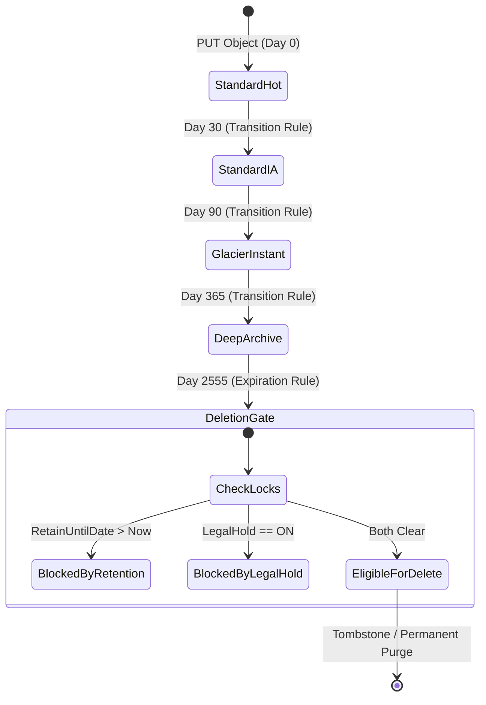
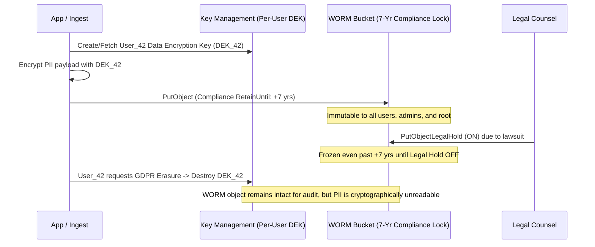
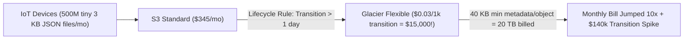

# Data Lifecycle Management: Rules, Retention & Legal Hold

> **Prerequisites:** [Lesson 11: CDN for Private Content: Signed Cookies, Cache Keys, Shielding](../11-cdn-for-private-content/README.md).  
> **Estimated Reading Time:** 23–27 minutes  
> **Target Audience:** Backend, data, and compliance engineers managing petabyte-scale object stores, audit logs, and GDPR/SEC-regulated datasets, and candidates asked "how do you control storage costs while satisfying 7-year retention and GDPR right-to-be-forgotten?"  
> **Free PDF Notes:** [Download SD-O-012.pdf](https://backendroadmap.com/notes/system-design/SD-O-012.pdf)

> [!NOTE]
> **In one line:** Data Lifecycle Management (DLM) automates how objects **transition** across storage tiers (Hot -> Infrequent Access -> Glacier), **expire** when no longer needed, and stay **immutable** under **Retention Locks** (WORM) or **Legal Holds**—balancing exponential storage cost growth against regulatory compliance and litigation risk.

> [!TIP]
> **The Golden Rule:** Never delete or tier objects using ad-hoc cron scripts that scan buckets with `LIST`—use native **bucket lifecycle policies** for automated tiering/expiration, keep **Legal Hold** decoupled from time-based retention, and watch out for **minimum storage duration penalties** on small objects.

---

## 1. What Data Lifecycle Management Is, and What It Isn't

Every production system accumulates data that follows a steep **access-decay curve**: 90% of reads hit objects created in the last 7–30 days, while 90% of your S3 bill comes from objects older than 90 days that nobody will ever open again—yet cannot be deleted due to tax, HIPAA, or SOC2 rules.

Without Data Lifecycle Management, you either pay $0.023/GB/month forever for dead logs, or an overzealous cleanup script deletes financial records needed for an active lawsuit.

| Term | Precise Meaning | Example |
| :--- | :--- | :--- |
| **Lifecycle Transition Rule** | Policy moving objects to cheaper storage classes after $N$ days | Standard -> Standard-IA (30d) -> Glacier (90d) |
| **Lifecycle Expiration Rule** | Policy permanently deleting objects (or noncurrent versions) after $N$ days | Delete temp uploads after 7 days; logs after 365 days |
| **Incomplete Multipart Cleanup** | Rule aborting orphaned multipart upload parts after $N$ days | `AbortIncompleteMultipartUpload: DaysAfterInitiation = 7` |
| **Object Lock (WORM)** | Write-Once-Read-Many protection preventing overwrite/delete until a retention date | SEC 17a-4 Compliance Mode (7 years) |
| **Governance vs Compliance Mode** | Governance allows privileged IAM override; Compliance blocks *everyone*, even root | Governance for dev/ops guardrails; Compliance for regulators |
| **Legal Hold** | Boolean flag (`ON`/`OFF`) freezing deletion *indefinitely* regardless of retention date | Lawsuit discovery freeze on `user_42/*` |
| **Not** | A backup strategy or a substitute for GDPR crypto-shredding | Lifecycle rules delete/tier; they don't protect against region loss |

### Why It Matters
1. **Silent cost explosion:** Uncleaned S3 **noncurrent versions** and **abandoned multipart uploads** routinely account for 20–40% of wasted cloud storage bills.
2. **Small-object transition traps:** Transitioning 100 million 4 KB log files to Glacier can cost **more** in transition API fees and 128 KB/40 KB minimum-size metadata overhead than leaving them in Standard!
3. **Legal & GDPR tension:** Regulators demand **7-year immutability** (WORM) for financial records, while GDPR Art. 17 demands **erasure on request**. You must design key boundaries and crypto-shredding to satisfy both.

---

## 2. Anatomy: Object State Machine (Tiering, Retention & Legal Hold)



Notice how **Lifecycle Rules** and **Object Locks** interact:
- Lifecycle transitions (moving from Standard -> IA -> Glacier) **still work** even when an object is under Retention or Legal Hold—saving you money while keeping it immutable.
- Lifecycle **expiration** (deletion) is **blocked** whenever `RetainUntilDate > Now` OR `LegalHold == ON`. Once the hold is lifted and retention expires, the lifecycle engine deletes it automatically.

| Storage Tier (AWS S3 Reference) | Storage Cost ($/GB/mo) | Min Duration | Min Billable Object Size | Retrieval Latency |
| :--- | :---: | :---: | :---: | :---: |
| **S3 Standard** | ~$0.023 | None | None | Milliseconds |
| **S3 Standard-IA** | ~$0.0125 | 30 days | 128 KB | Milliseconds |
| **S3 Glacier Instant Retrieval** | ~$0.004 | 90 days | 128 KB | Milliseconds |
| **S3 Glacier Flexible Retrieval** | ~$0.0036 | 90 days | 40 KB (metadata) | Minutes to hours |
| **S3 Glacier Deep Archive** | ~$0.00099 | 180 days | 40 KB (metadata) | 12–48 hours |

> [!WARNING]
> **The #1 Trap: Transitioning Tiny Objects (< 128 KB) to IA/Glacier.** S3 Standard-IA and Glacier Instant Retrieval bill a **128 KB minimum** per object *plus* a per-1,000-object transition fee ($0.01–$0.02/1k). If you transition 10 million 5 KB JSON events to Standard-IA, you get billed as if each file were 128 KB (25.6x inflation!) plus transition fees—**tripling** your bill instead of cutting it. Always **compact/batch small objects** (e.g., Parquet/tarball) before tiering.

---

## 3. Mathematical Model: Break-Even Tiering & Small-Object Penalty

**1. Total Monthly Cost of a Tier Transition:**
For $N$ objects of average size $s_{\text{obj}}$ (GB), transitioning from Standard ($C_{\text{std}}$) to a colder tier ($C_{\text{cold}}$) with transition fee $F_{\text{trans}}$ (per object) and minimum billable size $s_{\text{min}}$:

$$\text{Cost}_{\text{transition}} = N \cdot F_{\text{trans}}$$

$$\text{Cost}_{\text{cold/mo}} = N \cdot \max(s_{\text{obj}}, s_{\text{min}}) \cdot C_{\text{cold}}$$

$$\text{Break-Even Months} = \frac{N \cdot F_{\text{trans}}}{\text{Cost}_{\text{std/mo}} - \text{Cost}_{\text{cold/mo}}}$$

**Worked Numerical Example A (Healthy 10 MB Objects):**
Suppose you have $N = 1{,}000{,}000$ video/backup objects of $s_{\text{obj}} = 10\text{ MB}$ ($10{,}000\text{ GB} = 10\text{ TB}$).
- Standard cost: $10{,}000 \times \$0.023 = \mathbf{\$230/\text{month}}$.
- Glacier Deep Archive ($C_{\text{cold}} = \$0.00099/\text{GB}$, $F_{\text{trans}} = \$0.05 / 1{,}000$):
  - Transition one-time fee: $1{,}000{,}000 \times \$0.00005 = \$50$.
  - Monthly cold cost: $10{,}000 \times \$0.00099 = \mathbf{\$9.90/\text{month}}$.
  - Monthly savings: $\$230 - \$9.90 = \$220.10/\text{month}$.
  - Break-even: $\$50 / \$220.10 = \mathbf{0.23\text{ months}}$ (~7 days!).

**Worked Numerical Example B (The 5 KB Small-Object Trap):**
Suppose you have $N = 10{,}000{,}000$ small 5 KB audit logs ($50\text{ GB}$ total).
- Standard cost: $50\text{ GB} \times \$0.023 = \mathbf{\$1.15/\text{month}}$.
- Transitioning to **Glacier Instant Retrieval** ($s_{\text{min}} = 128\text{ KB}$, $C_{\text{cold}} = \$0.004/\text{GB}$, $F_{\text{trans}} = \$0.02 / 1{,}000$):
  - One-time transition fee: $10\text{M} \times \$0.00002 = \mathbf{\$200}$!
  - Billable cold size: $10\text{M} \times 128\text{ KB} = 1{,}280\text{ GB}$ (instead of 50 GB!).
  - Monthly cold cost: $1{,}280 \times \$0.004 = \mathbf{\$5.12/\text{month}}$ (4.4x *more expensive* than Standard!).
  - **Never** tier uncompacted < 128 KB objects.

---

## 4. Metrics & Percentiles

| Metric | Meaning | Alert when |
| :--- | :--- | :--- |
| **Noncurrent Version Ratio** | $\frac{\text{Bytes in old versions}}{\text{Total bucket bytes}}$ | Exceeds 20% (missing `NoncurrentVersionExpiration` rule) |
| **Incomplete Multipart Bytes** | Storage held by aborted/uncommitted uploads | > 1% of bucket or > $100/mo (missing `AbortIncompleteMultipartUpload`) |
| **Average Object Size by Tier** | Mean KB per object in IA/Glacier | < 128 KB in IA/Glacier Instant (bleeding money on min-size billing) |
| **Early Deletion Penalty Charges** | Fees for deleting IA/Glacier objects before 30/90/180d | Any unexpected spike (churning short-lived data into cold tiers) |
| **Legal Hold Object Count** | Objects currently frozen by `LegalHold=ON` | Stale holds not cleared months after litigation closed |

### Worked Example: The Hidden Versioning Bill
A SaaS app enables S3 Versioning for safety, overwriting a 50 MB index file every 5 minutes (288 versions/day). Without a `NoncurrentVersionExpiration` rule, after 1 year there are $288 \times 365 = 105{,}120$ old versions = **5.25 TB** of dead data for a single 50 MB file!
**Fix:** Add `NoncurrentVersionExpiration: NoncurrentDays = 30, NewerNoncurrentVersions = 3` to keep only the last 3–30 days of history.

---

## 5. Compounding & Failure Modes: Versioning, Deletes & GDPR

| Scenario | What Happens in S3/GCS | Hidden Risk |
| :--- | :--- | :--- |
| **`DELETE` on a Versioned Bucket** | Inserts a **Delete Marker**; the previous version stays and keeps billing you forever | Storage never shrinks until Delete Markers & noncurrent versions expire |
| **Deleting Before Minimum Duration** | Deleting a 10 GB Glacier Deep Archive object on Day 30 | Billed for the remaining 150 days (prorated early-deletion fee) |
| **GDPR Erasure vs. WORM Lock** | User invokes GDPR Right to be Forgotten, but data is inside a 7-year Compliance Lock | Cannot delete WORM object! Must use **Crypto-Shredding** (encrypt user PII with per-user DEK, delete the DEK) |
| **Bucket-Wide Retention Without Prefix** | Applying a 7-year Compliance Lock to an entire bucket | Temporary files and test uploads become undeletable for 7 years (even by AWS root!) |

---

## 6. Numbers Every Engineer Must Know

| Item | Typical | Implication |
| :--- | :---: | :--- |
| **IA / Glacier Instant min size** | 128 KB per object | Compact/batch small files before transitioning |
| **Glacier Flexible / Deep min** | 90 days / 180 days | Never move data that might be deleted within 3–6 months |
| **Incomplete MPU cleanup** | 7 days (`AbortIncompleteMultipartUpload`) | Free savings; prevents zombie upload part charges |
| **Lifecycle execution lag** | 24–48 hours (eventual) | Objects expire asynchronously; don't rely on exact-second deletion for security |
| **Delete Marker cleanup** | `ExpiredObjectDeleteMarker: true` | Removes orphan delete markers after old versions expire |
| **Compliance Lock permanence** | Cannot be shortened or deleted even by root | Test in **Governance Mode** first; never test Compliance Mode in prod casually |

---

## 7. Protocol / Mechanism Deep Dive: Retention vs. Legal Hold & Crypto-Shredding



### When NOT to Use Bucket Lifecycle Rules Alone
| Scenario | Why | Better Control |
| :--- | :--- | :--- |
| **Sub-second / exact-time PII deletion** | S3 lifecycle rules run asynchronously once per day (up to 48 h lag) | Application-triggered `DeleteObject` + crypto-shredding |
| **Access-pattern unknown / unpredictable** | Fixed 30/90-day rules may incur retrieval/early-delete penalties | **S3 Intelligent-Tiering** (zero retrieval fees, auto-moves based on actual reads) |
| **Tiny < 128 KB logs/events** | Per-object transition & min-size fees exceed Standard cost | Compact into 64–256 MB Parquet/zstd bundles via Kinesis Firehose/Spark first |

---

## 8. Hierarchical Budgets & Design Rules

| Slice | Rule | Control |
| :--- | :--- | :--- |
| **Hygiene Baseline** | Abort incomplete multipart uploads after 7 days on *every* bucket | `AbortIncompleteMultipartUpload: DaysAfterInitiation = 7` |
| **Version Control** | Cap noncurrent versions by age and count | `NoncurrentVersionExpiration: 30d` + `NewerNoncurrentVersions: 5` |
| **Size Guardrail** | Filter lifecycle transitions by minimum object size | `ObjectSizeGreaterThan: 131072` (128 KB) in S3 Lifecycle Filter |
| **Lock Safety** | Default to **Governance Mode**; use **Compliance Mode** only on dedicated audit buckets | Separate bucket for WORM vs mutable app data |
| **Legal Hold** | Keep Legal Hold independent of retention timers | Apply/clear via `PutObjectLegalHold` on specific prefixes/keys |
| **GDPR + Audit** | Encrypt user PII with per-subject DEKs before writing to WORM/backups | Crypto-shredding destroys DEK without violating WORM |

---

## 9. Top Mitigations

1. **Always Add `AbortIncompleteMultipartUpload` (7 Days):** Prevents silent billing leaks from crashed client/mobile uploads leaving 5 GB chunks in limbo.
2. **Filter Transitions by `ObjectSizeGreaterThan: 128 KB`:** Stops S3 from transitioning tiny files into tiers that bill a 128 KB minimum and charge per-object transition fees.
3. **Compact Small Events Before Tiering:** Batch logs/telemetry into 64–256 MB Parquet or `.tar.zst` archives before applying Glacier rules.
4. **Use `NoncurrentVersionExpiration` + `ExpiredObjectDeleteMarker`:** Prevents versioned buckets from growing unboundedly when files are updated or "deleted" (delete-markered).
5. **Use S3 Intelligent-Tiering for Unpredictable Workloads (> 128 KB):** Avoids early-deletion and retrieval-fee surprises when you don't know if 6-month-old files will be read again.
6. **Test Object Lock in Governance Mode First:** A misconfigured 100-year Compliance Lock on a 1 PB bucket cannot be undone even by AWS Support—you will pay for it for 100 years.
7. **Combine WORM + Crypto-Shredding for Regulated PII:** Store immutable audit trails while still honoring GDPR Art. 17 erasure by destroying the user's dedicated encryption key.

---

## 10. Production Reference / War Story: The $140,000 Lifecycle Transition Mistake

**Incident:** A telemetry team enabled an S3 Lifecycle Rule to transition all objects in their 15 TB IoT events bucket to **S3 Glacier Flexible Retrieval** after 1 day to "save 80% on storage."



**Root Cause:** The bucket held **4.5 billion** tiny 3 KB JSON files (only ~13.5 TB raw). Transitioning 4.5 billion objects to Glacier Flexible at $0.03 per 1,000 objects triggered **$135,000 in one-time transition API fees** in 48 hours, and Glacier's 40 KB/object metadata overhead inflated the billed storage footprint by > 13x!

**Fix:**
1. **Immediate:** Aborted the lifecycle rule and deleted the uncompacted raw JSONs after compacting them.
2. **Long-term:** Inserted a streaming **Parquet/Zstd compactor** (128 MB files) before S3 storage, and added `ObjectSizeGreaterThan: 131072` (128 KB) to all S3 Lifecycle transition filters.

---

## 11. Multi-Language Production Code Tabs

Below are production-shaped examples for **configuring S3 Lifecycle Rules with size filters, applying Object Lock Retention & Legal Hold, and implementing Crypto-Shredding**.

````carousel
```go
// Go (AWS SDK v2 pattern): Apply Object Lock Retention & Legal Hold safely
package main

import (
	"context"
	"fmt"
	"time"

	"github.com/aws/aws-sdk-go-v2/aws"
	"github.com/aws/aws-sdk-go-v2/service/s3"
	"github.com/aws/aws-sdk-go-v2/service/s3/types"
)

func ApplyRetentionAndHold(
	ctx context.Context,
	client *s3.Client,
	bucket, key string,
	retainDays int,
	legalHold bool,
) error {
	retainUntil := time.Now().UTC().Add(time.Duration(retainDays) * 24 * time.Hour)

	// 1. Apply Governance-mode retention (use Compliance only on dedicated audit buckets)
	_, err := client.PutObjectRetention(ctx, &s3.PutObjectRetentionInput{
		Bucket: aws.String(bucket),
		Key:    aws.String(key),
		Retention: &types.ObjectLockRetention{
			Mode:            types.ObjectLockRetentionModeGovernance,
			RetainUntilDate: aws.Time(retainUntil),
		},
	})
	if err != nil {
		return fmt.Errorf("put retention: %w", err)
	}

	// 2. Independently toggle Legal Hold (freezes deletion regardless of RetainUntilDate)
	status := types.ObjectLockLegalHoldStatusOff
	if legalHold {
		status = types.ObjectLockLegalHoldStatusOn
	}
	_, err = client.PutObjectLegalHold(ctx, &s3.PutObjectLegalHoldInput{
		Bucket: aws.String(bucket),
		Key:    aws.String(key),
		LegalHold: &types.ObjectLockLegalHold{
			Status: status,
		},
	})
	return err
}
```
<!-- slide -->
```typescript
// TypeScript: Build S3 Lifecycle Policy JSON with 128 KB min-size guard & MPU cleanup
export interface LifecyclePolicy {
  Rules: Array<{
    ID: string;
    Status: "Enabled" | "Disabled";
    Filter: {
      Prefix?: string;
      ObjectSizeGreaterThan?: number;
      And?: { Prefix?: string; ObjectSizeGreaterThan?: number };
    };
    Transitions?: Array<{ Days: number; StorageClass: string }>;
    NoncurrentVersionExpiration?: { NoncurrentDays: number; NewerNoncurrentVersions?: number };
    AbortIncompleteMultipartUpload?: { DaysAfterInitiation: number };
  }>;
}

export function buildSafeLifecyclePolicy(): LifecyclePolicy {
  return {
    Rules: [
      {
        ID: "abort-orphan-multipart-uploads",
        Status: "Enabled",
        Filter: { Prefix: "" },
        AbortIncompleteMultipartUpload: { DaysAfterInitiation: 7 },
      },
      {
        ID: "tier-large-objects-only",
        Status: "Enabled",
        Filter: {
          And: {
            Prefix: "logs/",
            ObjectSizeGreaterThan: 131072, // 128 KB guard prevents small-object cost trap
          },
        },
        Transitions: [
          { Days: 30, StorageClass: "STANDARD_IA" },
          { Days: 90, StorageClass: "GLACIER_IR" },
        ],
        NoncurrentVersionExpiration: {
          NoncurrentDays: 30,
          NewerNoncurrentVersions: 3,
        },
      },
    ],
  };
}
```
<!-- slide -->
```python
# Python: Crypto-shredding pattern for GDPR erasure inside WORM-locked archives
import os
from typing import Dict, Optional
from cryptography.hazmat.primitives.ciphers.aead import AESGCM

class KeyVault:
    """Simulates KMS / Key Vault storing per-user Data Encryption Keys (DEKs)."""
    def __init__(self) -> None:
        self._keys: Dict[str, bytes] = {}

    def get_or_create_dek(self, user_id: str) -> bytes:
        if user_id not in self._keys:
            self._keys[user_id] = AESGCM.generate_key(bit_length=256)
        return self._keys[user_id]

    def crypto_shred(self, user_id: str) -> None:
        """GDPR Art. 17 erasure: permanently destroy DEK; WORM-locked ciphertext becomes garbage."""
        self._keys.pop(user_id, None)

    def get_dek(self, user_id: str) -> Optional[bytes]:
        return self._keys.get(user_id)

def encrypt_for_worm(vault: KeyVault, user_id: str, plaintext: bytes) -> bytes:
    dek = vault.get_or_create_dek(user_id)
    nonce = os.urandom(12)
    return nonce + AESGCM(dek).encrypt(nonce, plaintext, None)

def decrypt_from_worm(vault: KeyVault, user_id: str, blob: bytes) -> Optional[bytes]:
    dek = vault.get_dek(user_id)
    if dek is None:
        return None  # User was crypto-shredded
    return AESGCM(dek).decrypt(blob[:12], blob[12:], None)
```
<!-- slide -->
```csharp
// C#: Evaluate effective object deletion eligibility (Retention + Legal Hold)
using System;

public enum LockMode { None, Governance, Compliance }

public sealed record ObjectLockState(
    LockMode Mode,
    DateTimeOffset? RetainUntilUtc,
    bool LegalHoldOn,
    DateTimeOffset? LifecycleExpireAtUtc
);

public static class LifecycleEvaluator
{
    public static (bool CanDelete, string Reason) EvaluateDeletion(
        ObjectLockState state,
        DateTimeOffset nowUtc,
        bool hasGovernanceBypassPermission = false)
    {
        if (state.LegalHoldOn)
        {
            return (false, "Blocked: Legal Hold is ON");
        }

        if (state.RetainUntilUtc.HasValue && state.RetainUntilUtc.Value > nowUtc)
        {
            if (state.Mode == LockMode.Compliance || !hasGovernanceBypassPermission)
            {
                return (false, $"Blocked: {state.Mode} retention active until {state.RetainUntilUtc:O}");
            }
        }

        if (state.LifecycleExpireAtUtc.HasValue && state.LifecycleExpireAtUtc.Value <= nowUtc)
        {
            return (true, "Eligible: Retention & Legal Hold clear, lifecycle expired");
        }

        return (false, "Retained: Lifecycle expiration date not reached");
    }
}
```
````

---

## 12. Hands-On CLI Verification Workflows

```bash
# 1. Inspect current S3 bucket lifecycle configuration
aws s3api get-bucket-lifecycle-configuration --bucket my-prod-bucket

# 2. Check Object Lock status, Retention, and Legal Hold on a specific object
aws s3api get-object-retention --bucket my-worm-bucket --key audit/2026/tx_99.json
aws s3api get-object-legal-hold --bucket my-worm-bucket --key audit/2026/tx_99.json

# 3. Place an object under Legal Hold (indefinite freeze)
aws s3api put-object-legal-hold --bucket my-worm-bucket --key audit/2026/tx_99.json \
  --legal-hold Status=ON

# 4. Find orphan incomplete multipart uploads costing money
aws s3api list-multipart-uploads --bucket my-prod-bucket --query 'Uploads[].{Key:Key,Initiated:Initiated}'
```

---

## 13. Common Mistakes to Avoid

1. **Transitioning < 128 KB objects to IA or Glacier:** Triggers 128 KB/40 KB minimum-size billing and huge per-object transition fees, often *increasing* your bill.
2. **Omitting `AbortIncompleteMultipartUpload`:** Crashed uploads leave gigabytes of invisible, unreferenced parts billing you every month.
3. **Enabling S3 Versioning without `NoncurrentVersionExpiration`:** Overwritten files accumulate infinite historical copies and delete markers forever.
4. **Testing WORM Compliance Mode on a production bucket:** Compliance Mode cannot be shortened or removed even by the AWS root account—always prototype in Governance Mode.
5. **Confusing Legal Hold with Time-Based Retention:** Legal Hold is a boolean freeze for active litigation; don't overwrite `RetainUntilDate` to simulate a hold.
6. **Relying on S3 Lifecycle Expiration for immediate GDPR deletion:** Lifecycle sweeps can lag 24–48 hours; delete PII explicitly (or crypto-shred) when immediate compliance is required.
7. **Writing custom `LIST` + `DELETE` cron scripts for millions of objects:** Costs thousands in `LIST` API calls and hits rate limits; use native bucket lifecycle rules.

---

## 14. Key Terms Glossary

| Key Term | Definition |
| :--- | :--- |
| **Lifecycle Transition** | Automated movement of objects to colder, cheaper storage classes based on age/size |
| **Lifecycle Expiration** | Automated permanent deletion of objects, noncurrent versions, or delete markers |
| **Object Lock (WORM)** | Write-Once-Read-Many immutability preventing overwrite or deletion until a retention date |
| **Governance Mode** | WORM mode where privileged IAM users with `s3:BypassGovernanceRetention` can override locks |
| **Compliance Mode** | Strictest WORM mode; nobody (including root) can delete or shorten retention before expiry |
| **Legal Hold** | Independent `ON`/`OFF` freeze preventing deletion regardless of retention date |
| **Delete Marker** | Placeholder inserted by `DELETE` on a versioned bucket; old versions remain billed |
| **Incomplete Multipart Upload** | Uncommitted upload parts from failed transfers that still incur storage charges |
| **Crypto-Shredding** | Achieving GDPR erasure on immutable/WORM storage by destroying the per-user encryption key |
| **Intelligent-Tiering** | Automated storage class that moves objects based on actual access patterns with zero retrieval fees |

---

## 15. System Design Interview Questions & Answers

### Basic Conceptual Questions

<details>
<summary><strong>Q1: What is the difference between Object Lock Retention and Legal Hold? [BASIC]</strong></summary>

**Answer:**
**Retention** is time-based (`RetainUntilDate`: e.g., lock for 7 years from creation). **Legal Hold** is an indefinite boolean flag (`ON` / `OFF`) used during active litigation or audits. An object cannot be deleted if *either* an active Retention date OR a Legal Hold is present.
</details>

<details>
<summary><strong>Q2: What is the difference between Governance Mode and Compliance Mode in WORM storage? [BASIC]</strong></summary>

**Answer:**
In **Governance Mode**, users with special IAM permissions (`s3:BypassGovernanceRetention`) can still delete or shorten retention—ideal for operational guardrails against accidental deletion or ransomware. In **Compliance Mode**, *no one*—not even the cloud account root user—can delete or shorten the lock until the timestamp passes, which is required for SEC 17a-4 / FINRA regulations.
</details>

<details>
<summary><strong>Q3: Why do deleted files in a versioned S3 bucket still cost money? [BASIC]</strong></summary>

**Answer:**
A standard `DELETE` on a versioned bucket only adds a **Delete Marker** as the latest version; all previous versions remain intact and continue accruing storage charges. You must configure a `NoncurrentVersionExpiration` + `ExpiredObjectDeleteMarker` lifecycle rule to actually reclaim space.
</details>

<details>
<summary><strong>Q4: What does `AbortIncompleteMultipartUpload` do and why should every bucket have it? [BASIC]</strong></summary>

**Answer:**
When a multi-GB upload fails or is closed by the user mid-transfer, the uploaded 5–100 MB parts remain stored and billed indefinitely in S3. Setting `AbortIncompleteMultipartUpload` (e.g., 7 days) automatically purges abandoned parts at zero extra cost.
</details>

### Scenario-Based Architecture Questions

<details>
<summary><strong>Q5: Your team transitioned 200M 10 KB log files to Glacier Instant Retrieval and the bill went UP. Why? [SCENARIO]</strong></summary>

**Answer:**
Two reasons: (1) S3 charges a per-1,000-object transition fee ($0.02/1k = $4,000 one-time), and (2) Glacier Instant bills a **128 KB minimum** per object, inflating 10 KB files by 12.8x! Fix: compact small logs into 64–256 MB Parquet/Zstd files before tiering, and set `ObjectSizeGreaterThan: 131072` on lifecycle rules.
</details>

<details>
<summary><strong>Q6: Design a storage lifecycle for a fintech storing 100 TB/yr of transaction receipts (hot for 30d, 7-yr SEC WORM). [SCENARIO]</strong></summary>

**Answer:**
1. Store receipts in a dedicated S3 bucket with **Object Lock (Compliance Mode, 7-year retention)** enabled at bucket default.
2. Add a Lifecycle Transition rule (with `> 128 KB` filter, or pre-compact daily batches): Standard (0–30d) -> Standard-IA (30–90d) -> Glacier Deep Archive (90d–7yr).
3. Add a Lifecycle Expiration rule at Day 2,556 (7 years + 1 day) so objects auto-purge immediately after their Compliance Lock expires (unless a Legal Hold is `ON`).
</details>

<details>
<summary><strong>Q7: How do you satisfy both 7-year immutable WORM retention and GDPR "Right to be Forgotten"? [SCENARIO]</strong></summary>

**Answer:**
Use **Crypto-Shredding**. Encrypt each user's PII fields with a dedicated per-user Data Encryption Key (DEK) stored in KMS/Key Vault *before* writing the record to WORM storage. When the user requests GDPR erasure, permanently destroy their DEK. The immutable WORM record remains intact for audit/compliance, while the PII inside it is cryptographically unrecoverable.
</details>

<details>
<summary><strong>Q8: A user deleted their account 2 hours ago, but their profile export is still in S3 despite a lifecycle rule. Why? [SCENARIO]</strong></summary>

**Answer:**
Cloud lifecycle expiration rules are **eventually consistent batch sweeps** that can take 24–48 hours to execute after an object becomes eligible. Never rely on lifecycle rules for immediate security or privacy deletion; issue an explicit synchronous `DeleteObject` (and `DeleteObjectVersion`) from your application workflow.
</details>

### Advanced & Tricky Interview Questions

<details>
<summary><strong>Q9: How does S3 Intelligent-Tiering differ from manual 30/90-day Lifecycle rules? [TRICKY]</strong></summary>

**Answer:**
Manual Lifecycle rules move objects purely by **creation age**, regardless of whether they are still actively read—risking expensive retrieval fees or early-deletion penalties if an old file becomes hot again. **S3 Intelligent-Tiering** monitors actual read access per object (> 128 KB), automatically moves unaccessed objects to Infrequent/Archive Instant tiers, and promotes them back on read with **zero retrieval fees**.
</details>

<details>
<summary><strong>Q10: Can a malicious admin with full root/AdministratorAccess delete an object under Compliance Mode? [TRICKY]</strong></summary>

**Answer:**
No—even the AWS account root user cannot delete the object, shorten its `RetainUntilDate`, or disable Compliance Mode on the bucket. The only way to lose the data prematurely is by **closing the entire AWS account** (which triggers account-closure deletion after the grace period).
</details>

<details>
<summary><strong>Q11: Why is `ObjectSizeGreaterThan` important when configuring Lifecycle transitions, and how do you handle mixed-size buckets? [TRICKY]</strong></summary>

**Answer:**
Without `ObjectSizeGreaterThan: 131072`, small thumbnails or JSON manifests (< 128 KB) get billed as 128 KB in IA/Glacier Instant and incur transition fees. In mixed-size buckets, add `ObjectSizeGreaterThan: 131072` to the transition rule so large media transitions to cold tiers while tiny metadata files stay in S3 Standard.
</details>

<details>
<summary><strong>Q12: How do you prevent ransomware from encrypting your backups and then deleting old versions? [TRICKY]</strong></summary>

**Answer:**
Enable **Bucket Versioning** + **Object Lock in Governance or Compliance Mode** (e.g., 30-day retention on backups). Even if an attacker compromises your application's IAM role and issues `DeleteObject` or `PutObject` (overwriting with encrypted bytes), the original unencrypted versions are immutable for 30 days and cannot be purged.
</details>

---

## 16. One-Page Master Cheat Sheet

```
+---------------------------------------------------------------------------------------------------------+
|                    DATA LIFECYCLE MANAGEMENT — MASTER CHEAT SHEET                                       |
+---------------------------------------------------------------------------------------------------------+
| 1. HYGIENE: Always set AbortIncompleteMultipartUpload (7d) + NoncurrentVersionExpiration + DeleteMarkers.|
+---------------------------------------------------------------------------------------------------------+
| 2. SMALL OBJECT TRAP: Never tier < 128 KB objects to IA/Glacier (128 KB min billing + transition fees). |
+---------------------------------------------------------------------------------------------------------+
| 3. WORM LOCKS: Governance (privileged bypass; ops safety) vs Compliance (nobody/root can delete; SEC).   |
+---------------------------------------------------------------------------------------------------------+
| 4. LEGAL HOLD: Independent ON/OFF boolean freeze; blocks expiration even past RetainUntilDate.          |
+---------------------------------------------------------------------------------------------------------+
| 5. GDPR + WORM: Encrypt PII with per-user DEK -> destroy DEK to crypto-shred without breaking WORM.     |
+---------------------------------------------------------------------------------------------------------+
| 6. TIMING: Lifecycle sweeps lag 24-48h -> use explicit DeleteObject for immediate privacy/security.     |
+---------------------------------------------------------------------------------------------------------+
```

---

## Further Reading & Sources

- AWS S3 User Guide, [Managing Your Storage Lifecycle](https://docs.aws.amazon.com/AmazonS3/latest/userguide/object-lifecycle-mgmt.html) and [Transitioning Objects (128 KB Minimum)](https://docs.aws.amazon.com/AmazonS3/latest/userguide/lifecycle-transition-general-considerations.html).
- AWS S3 User Guide, [Locking Objects with Object Lock (Governance, Compliance & Legal Hold)](https://docs.aws.amazon.com/AmazonS3/latest/userguide/object-lock.html).
- Google Cloud Storage Docs, [Object Lifecycle Management & Bucket Lock](https://cloud.google.com/storage/docs/lifecycle).
- NIST / GDPR Guidance, [Cryptographic Erasure (Crypto-Shredding)](https://csrc.nist.gov/glossary/term/cryptographic_erase).

---

## Free PDF Notes

[SD-O-012.pdf](https://backendroadmap.com/notes/system-design/SD-O-012.pdf)

---

## Next

Continue with [Lesson 13: Backup vs Archival: Glacier Tiers, WORM Locks & Cross-Region Copies](../13-backup-vs-archival/README.md).
