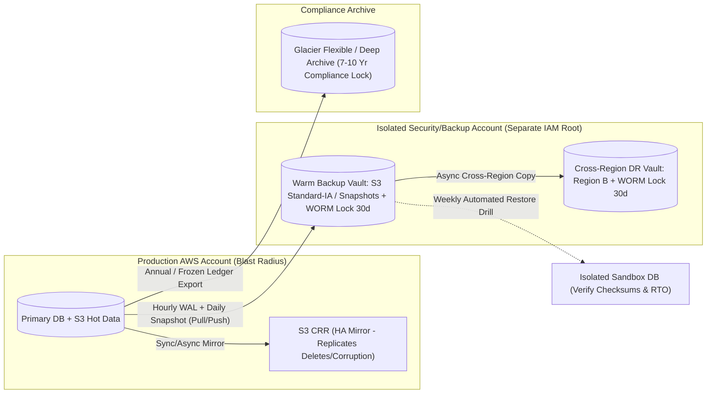
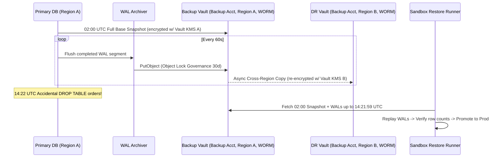
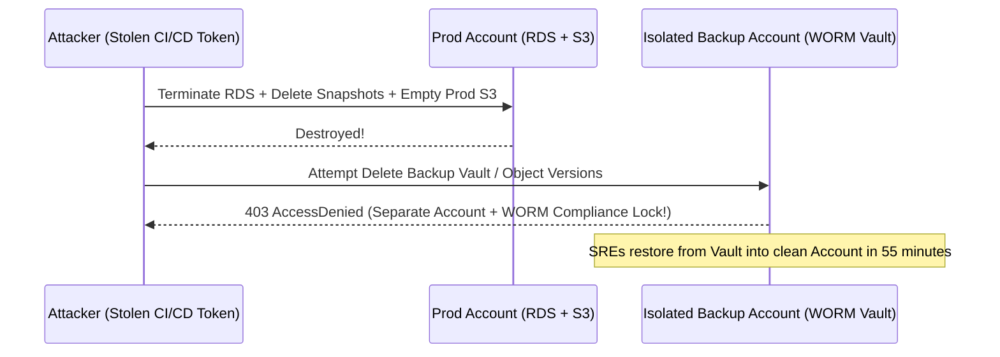

# Backup vs Archival: Glacier Tiers, WORM Locks & Cross-Region Copies

> **Prerequisites:** [Lesson 12: Data Lifecycle Management: Rules, Retention & Legal Hold](../12-data-lifecycle-management/README.md).  
> **Estimated Reading Time:** 25–29 minutes  
> **Target Audience:** Backend, SRE, and infrastructure architects designing disaster recovery (DR) and long-term compliance storage, and candidates asked "what is the difference between a backup and an archive, and how do you protect backups from ransomware?"  
> **Free PDF Notes:** [Download SD-O-013.pdf](https://backendroadmap.com/notes/system-design/SD-O-013.pdf)

> [!NOTE]
> **In one line:** **Backups** exist for **fast operational recovery** (low RTO/RPO) of *active* data after corruption, deletion, or regional outage; **Archives** exist for **cheap, immutable long-term retention** (years/decades) of *inactive* historical records for compliance or legal discovery. Putting active backups into 48-hour Glacier Deep Archive turns a 15-minute outage into a 2-day catastrophe.

> [!TIP]
> **The Golden Rule:** Follow the **3-2-1-1-0 rule** for backups (**3** copies, **2** media/tiers, **1** cross-region/offsite, **1** immutable/air-gapped WORM vault, **0** unverified restores)—and never rely on synchronous Cross-Region Replication (CRR) alone as a backup because CRR replicates accidental `DROP TABLE` and ransomware encryption too.

---

## 1. What Backup vs. Archival Is, and What It Isn't

Engineers routinely conflate **replication**, **backups**, and **archives**:
- "We have Multi-AZ and Cross-Region Replication enabled, so we don't need backups." -> When a bug runs `DELETE FROM users;` without a `WHERE` clause, replication faithfully deletes the `users` table in **both regions within seconds**.
- "We moved our database snapshots to Glacier Deep Archive to save 95%!" -> When the primary database corrupts at 2:00 PM, restoring 4 TB from Deep Archive takes **12–48 hours** just to stage the bytes before recovery even begins.

| Term | Precise Meaning | Example |
| :--- | :--- | :--- |
| **Backup** | Recoverable point-in-time copy of *live/active* data optimized for **RTO & RPO** | Hourly WAL + daily RDS snapshot in isolated vault |
| **Archive** | Long-term, rarely accessed copy of *historical/frozen* data optimized for **$/GB & compliance** | 7-year SEC trade logs in Glacier Deep Archive |
| **Replication (CRR / Read Replica)** | Real-time or near-real-time mirroring for **high availability & read scaling** | S3 CRR or Postgres streaming replica (NOT a backup!) |
| **RPO (Recovery Point Objective)** | Maximum acceptable data loss measured in time | `RPO = 5 min` -> continuous WAL/binlog shipping |
| **RTO (Recovery Time Objective)** | Maximum acceptable downtime to restore service | `RTO = 30 min` -> warm snapshots + automated restore |
| **WORM Air-Gap Vault** | Cross-account, Object-Locked backup vault unreachable by prod IAM roles | Protects against compromised admin / ransomware |
| **Not** | Treating S3 Versioning or CRR alone as a complete DR strategy | Neither protects against account-wide IAM compromise |

### Why It Matters
1. **Ransomware & insider threats:** Modern attackers target **production IAM credentials** to delete databases *and* their same-account backups first. Only **cross-account + WORM-locked** backups survive.
2. **Tier mismatch destroys SLAs:** Picking Glacier Flexible/Deep Archive for operational backups saves $0.01/GB/mo while violating a 1-hour RTO by 11–47 hours.
3. **Untested backups are Schrödinger's backups:** Roughly 20–30% of unverified backup pipelines silently fail on restore (missing KMS permissions, corrupt tarballs, schema drift, or forgotten WAL segments).

---

## 2. Anatomy: 3-2-1-1-0 Backup Vault vs. Compliance Archive



| Dimension | Operational Backup | Compliance Archive | Cross-Region Replication (CRR) |
| :--- | :--- | :--- | :--- |
| **Primary Goal** | Fast recovery (low RTO/RPO) | Lowest $/GB + legal retention | High availability & low read latency |
| **Data State** | Active, mutable production state | Frozen, historical, read-almost-never | Live mirror of current state |
| **Target Tier** | Standard / Standard-IA / Instant | Glacier Flexible / Deep Archive | Standard (in target region) |
| **Typical RTO** | Minutes to < 2 hours | 3–48 hours | Seconds (failover) |
| **Protects Against** | Corruption, `DROP TABLE`, ransomware | Audits, lawsuits, regulatory fines | Regional/AZ hardware outage |
| **Retention** | Short–medium (7–90 days rolling) | Long (3–10+ years) | Mirrors source deletes/markers |

> [!WARNING]
> **The #1 Trap: Same-Account Backups + Shared KMS Keys.** If your backups sit in the same AWS/GCP account as production—or use a KMS key that production admins can schedule for deletion—a compromised CI/CD pipeline or attacker can delete your backups or destroy the KMS key, rendering every backup unreadable. Always copy backups to a **separate isolated Backup Account** with an **SCP (Service Control Policy)** blocking vault deletion and a dedicated **WORM lock**.

---

## 3. Mathematical Model: RPO, RTO, Retrieval Cost & Restore Throughput

**1. Total Recovery Time ($T_{\text{RTO}}$) Decomposition:**

$$T_{\text{RTO}} = T_{\text{detect}} + T_{\text{stage}} + T_{\text{transfer}} + T_{\text{replay}} + T_{\text{verify}}$$

Where:
- $T_{\text{stage}}$: Glacier restore hydration time (**0 s** for Standard/IA/Instant, **3–5 h** for Glacier Flexible Standard, **12–48 h** for Deep Archive).
- $T_{\text{transfer}} = \frac{\text{Size}_{\text{DB}}}{\text{Bandwidth}_{\text{restore}}}$: Time to stream snapshot bytes to the new volume.
- $T_{\text{replay}}$: Time to apply incremental WAL/binlog files since the last full snapshot.

**Worked Numerical Example A (4 TB Database Restore: Warm Snapshot vs. Deep Archive):**
Suppose a 4 TB (`4,000 GB`) Postgres database suffers logical corruption at 14:00, with an RTO SLA of **2 hours**:
- **Using Warm Backup (S3 Standard-IA / EBS Snapshot):**
  - $T_{\text{detect}} = 10\text{ min}$, $T_{\text{stage}} = 0\text{ min}$, $T_{\text{transfer}}$ at 1 GB/s = $4{,}000\text{ s} \approx 67\text{ min}$, $T_{\text{replay}} = 15\text{ min}$, $T_{\text{verify}} = 10\text{ min}$.
  - $T_{\text{RTO}} = 10 + 0 + 67 + 15 + 10 = \mathbf{102\text{ min} (1.7\text{ hours})}$ -> **Meets 2h RTO!**
- **Using Glacier Deep Archive:**
  - $T_{\text{stage}} = 12\text{–}48\text{ hours}$ (720–2,880 min) *before* transfer even starts!
  - $T_{\text{RTO}} \approx \mathbf{13.5\text{–}49.5\text{ hours}}$ -> **Violates 2h RTO by 7x–25x.**

**2. Glacier Tier Retrieval Cost Model:**
Suppose you archive $100\text{ TB}$ ($102{,}400\text{ GB}$) for 7 years and must restore it once for an audit:

| Glacier Tier | Storage Cost ($100\text{ TB/mo}$) | Standard Retrieval ($/GB$) | Bulk Retrieval ($/GB$) | Expedited ($/GB$) | Total 100 TB Restore Fee (Standard) |
| :--- | :---: | :---: | :---: | :---: | :---: |
| **Glacier Instant** | ~$409.60 | $0.03 (per GB retrieved) | N/A | Instant | **$3,072** |
| **Glacier Flexible** | ~$368.64 | $0.01 (3–5 h) | **$0.0025** (5–12 h) | $0.03 (1–5 min) | **$1,024** (Bulk: **$256**) |
| **Glacier Deep Archive** | ~$101.38 | $0.02 (12 h) | **$0.0025** (48 h) | N/A | **$2,048** (Bulk: **$256**) |

Notice: For a full 100 TB restore where 48 hours is acceptable, **Bulk Retrieval** ($256) is **8x cheaper** than Standard Retrieval ($2,048).

---

## 4. Metrics & Percentiles

| Metric | Meaning | Alert when |
| :--- | :--- | :--- |
| **Actual RPO Lag** | `Now - Timestamp(Last Successful WAL/Snapshot)` | Exceeds 50% of RPO SLA (e.g., > 7.5 min for 15-min RPO) |
| **Drill-Measured RTO $p_{95}$** | End-to-end time in weekly automated restore tests | Exceeds 80% of contractual RTO |
| **Backup Job Success Rate** | % of scheduled snapshots completing with valid checksums | < 100% (any single failure pages on-call) |
| **Cross-Region Replication Lag** | Time for backup copy to land in DR Region B | Exceeds RPO window |
| **Restore Verification Age** | Days since last *automated full restore + query check* | > 7 days (tier-1 DBs) or > 30 days (tier-2) |

### Worked Example: Continuous WAL Archiving vs. Daily Snapshots
A payments database takes a full snapshot once every 24 hours at 02:00 UTC. At 23:55 UTC, a disk controller bug corrupts the primary volume.
- **Snapshots only:** RPO = **23 hours 55 minutes** of lost transactions (catastrophic!).
- **Snapshots + Continuous WAL Shipping (every 60 s to isolated S3 bucket):** RPO = **60 seconds**. During restore, the engine loads the 02:00 UTC snapshot and replays 21h 55m of WAL segments up to `23:54:00 UTC` (Point-in-Time Recovery / PITR).

---

## 5. Compounding & Failure Modes: What Breaks Real Restores

| Failure Mode | Why It Happens | Production Impact | Mitigation |
| :--- | :--- | :--- | :--- |
| **Ransomware Wipes Prod + Backups** | Same-account backups accessible by compromised admin/CI role | Total unrecoverable business loss | Separate **Backup Account** + **WORM Object Lock** + MFA Delete |
| **KMS Key Missing in DR Region** | Snapshot copied to Region B, but encrypted with Region A CMK or deleted key | Restore fails with `KMS.AccessDenied` during outage | Re-encrypt cross-region copies with a **Region B KMS key** |
| **Quota / Capacity Exhaustion on Restore** | DR Region B lacks EC2/RDS vCPU quota or IOPS limits to spin up restored cluster | Restore hangs waiting on AWS support ticket | Maintain **pre-approved DR quotas** + warm minimal standby |
| **Silent Corruption / Broken WAL Chain** | Missing 1 WAL segment out of 10,000 breaks PITR replay at 09:14 UTC | Cannot recover past 09:14 UTC | Continuous `pgBackRest` / WAL checksums + **weekly automated restore drill** |

---

## 6. Numbers Every Engineer Must Know

| Item | Typical | Implication |
| :--- | :---: | :--- |
| **Glacier Instant retrieval** | Milliseconds | Safe for warm archives or rarely-read user attachments |
| **Glacier Flexible retrieval** | 1–5 min (Expedited), 3–5 h (Standard), 5–12 h (Bulk) | Suitable for *secondary* backups, not primary RTO < 1h |
| **Glacier Deep Archive retrieval** | 12 h (Standard), 48 h (Bulk) | Strictly for **compliance archives**, never operational DR |
| **Minimum retention (Flexible / Deep)** | 90 days / 180 days | Early-deletion penalty if rotated sooner |
| **Restore verification cadence** | Weekly (automated) for Tier-1 DBs | Unverified backups fail ~25% of the time in real incidents |
| **3-2-1-1-0 rule** | 3 copies, 2 tiers, 1 cross-region, 1 immutable WORM, 0 errors | Gold-standard resilience against hardware, human, & cyber failure |

---

## 7. Protocol / Mechanism Deep Dive: Point-in-Time Recovery (PITR) & Cross-Region Isolation



### When NOT to Use Glacier Deep Archive
| Scenario | Why | Better Choice |
| :--- | :--- | :--- |
| **Primary database DR backups (RTO < 4h)** | 12–48 h staging delay blows RTO SLA | S3 Standard-IA / EBS Snapshots / AWS Backup Warm Vault |
| **Rolling 30-day snapshots** | 180-day minimum storage duration means you pay 6x for deleted snapshots | S3 Standard-IA (30d min) or Standard |
| **Frequent ad-hoc analytics queries** | Retrieval fees ($0.02/GB) + 12h wait cripple analysts | Parquet in S3 Standard-IA / Glacier Instant |

---

## 8. Hierarchical Budgets & Design Rules

| Slice | Rule | Control |
| :--- | :--- | :--- |
| **Account Isolation** | Never store the only backup in the same cloud account as production | Dedicated Security/Backup AWS Account + Organization SCP |
| **Immutability** | Lock all backups against deletion/overwrite for the retention window | WORM Object Lock (Governance/Compliance) on Backup Vault |
| **Regional Blast Radius** | Copy every Tier-1 backup asynchronously to a second geographic region | Cross-Region Backup Copy using Region B's independent KMS key |
| **RPO & RTO Separation** | Keep last 7–30 days of backups **warm**; move > 90-day compliance exports to **Glacier** | Dual policy: Warm Vault (RTO < 1h) vs Compliance Archive (7 yr) |
| **Restore Verification** | Treat backup as broken until an automated job restores & queries it | Weekly ephemeral restore test + alert on `RTO > SLA` |
| **Replication Hygiene** | Never market S3 CRR or DB Read Replicas as "backups" | Document CRR as HA only; pair with PITR snapshots |

---

## 9. Top Mitigations

1. **Enforce Cross-Account + WORM Vaults:** Push backups into a separate cloud account with Object Lock enabled and an SCP denying `s3:DeleteObjectVersion` and `kms:ScheduleKeyDeletion`.
2. **Use Independent KMS Keys per Region:** Ensure cross-region DR copies are re-encrypted with a KMS key residing in the *destination* region so a Region A outage cannot block decryption in Region B.
3. **Pair Daily Snapshots with Continuous WAL/Binlog Archiving:** Shrink RPO from 24 hours down to 1–5 minutes while keeping PITR restore capability for accidental `DROP`/`DELETE`.
4. **Automate Weekly Restore Drills:** Spin up an ephemeral instance weekly, restore the latest snapshot + WALs, run integrity queries (`SELECT COUNT(*)` / checksums), measure actual RTO, and tear down.
5. **Keep Operational Backups Out of Deep Archive:** Use Glacier Deep Archive strictly for > 90-day compliance archives, never for active DR snapshots where RTO is measured in minutes/hours.
6. **Pre-Warm DR Quotas & IaC:** Maintain Terraform/OpenTofu scripts and pre-approved vCPU/IOPS quotas in Region B so DR failover doesn't stall on cloud quota limits.
7. **Alert on Silent Backup Gaps:** Monitor `LastSuccessfulBackupAge` and `WALArchiveLag`—an unmonitored cron job that silently stopped 3 weeks ago is worse than no backup.

---

## 10. Production Reference / War Story: The Compromised CI/CD Ransomware Wipeout

**Incident:** An attacker stole an over-privileged Terraform CI/CD token from a third-party build runner and executed a script that terminated all production RDS instances, deleted all same-account EBS/RDS snapshots, and ran `s3 rm --recursive` on the company's backup bucket.



**Root Cause:** Production and backups initially shared an account, and the CI/CD role had `AdministratorAccess`. Fortunately, 3 months earlier, the SRE team had migrated Tier-1 backups to an **isolated Backup Account** with **WORM Vault Lock** (30-day minimum retention) that the CI/CD role had zero permissions to modify.

**Outcome & Fix:**
1. The company restored its entire database and object store from the WORM Vault into a clean account in **55 minutes**, losing only 4 minutes of WAL data.
2. **Hardening:** Stripped `AdministratorAccess` from CI/CD, enforced hardware MFA on root, and mandated **Cross-Account + WORM** for all Tier-1 and Tier-2 workloads.

---

## 11. Multi-Language Production Code Tabs

Below are production-shaped utilities for **RPO/RTO SLA validation, automated backup manifest checksum verification, and Glacier restore tier selection**.

````carousel
```go
// Go: Evaluate Backup RPO/RTO compliance and select optimal Glacier restore tier
package main

import (
	"fmt"
	"time"
)

type RestoreTier string

const (
	TierExpedited RestoreTier = "Expedited" // 1-5 min (Glacier Flexible only)
	TierStandard  RestoreTier = "Standard"  // 3-5h (Flexible) / 12h (Deep)
	TierBulk      RestoreTier = "Bulk"      // 5-12h (Flexible) / 48h (Deep), cheapest
)

type BackupHealth struct {
	LastSnapshotAt time.Time
	LastWALAt      time.Time
	RPOLimit       time.Duration
}

func (b BackupHealth) CheckRPO(now time.Time) error {
	walLag := now.Sub(b.LastWALAt)
	if walLag > b.RPOLimit {
		return fmt.Errorf("RPO BREACH: WAL lag %s exceeds limit %s", walLag, b.RPOLimit)
	}
	if now.Sub(b.LastSnapshotAt) > 25*time.Hour {
		return fmt.Errorf("WARNING: Base snapshot older than 25h")
	}
	return nil
}

func ChooseGlacierRestoreTier(storageClass string, rtoBudget time.Duration) (RestoreTier, error) {
	if storageClass == "DEEP_ARCHIVE" {
		if rtoBudget < 12*time.Hour {
			return "", fmt.Errorf("RTO %s impossible for DEEP_ARCHIVE (min 12h)", rtoBudget)
		}
		if rtoBudget >= 48*time.Hour {
			return TierBulk, nil
		}
		return TierStandard, nil
	}
	// Glacier Flexible Retrieval
	if rtoBudget <= 15*time.Minute {
		return TierExpedited, nil
	}
	if rtoBudget >= 12*time.Hour {
		return TierBulk, nil
	}
	return TierStandard, nil
}
```
<!-- slide -->
```typescript
// TypeScript: Backup manifest SHA-256 verifier & 3-2-1-1-0 policy auditor
import crypto from "node:crypto";

export interface BackupArtifact {
  id: string;
  region: string;
  accountId: string;
  storageClass: "STANDARD" | "STANDARD_IA" | "GLACIER" | "DEEP_ARCHIVE";
  wormLockedUntil?: Date;
  sha256: string;
  lastVerifiedRestoreAt?: Date;
}

export function audit32110Compliance(
  prodAccountId: string,
  prodRegion: string,
  copies: BackupArtifact[],
  now: Date = new Date()
): { compliant: boolean; violations: string[] } {
  const violations: string[] = [];

  if (copies.length < 2) {
    violations.push("Need >= 2 backup copies (plus 1 live prod = 3 total copies)");
  }

  const hasCrossRegion = copies.some((c) => c.region !== prodRegion);
  if (!hasCrossRegion) {
    violations.push("Missing cross-region copy outside " + prodRegion);
  }

  const hasIsolatedWorm = copies.some(
    (c) =>
      c.accountId !== prodAccountId &&
      c.wormLockedUntil !== undefined &&
      c.wormLockedUntil > now
  );
  if (!hasIsolatedWorm) {
    violations.push("Missing cross-account WORM-locked immutable copy");
  }

  const sevenDaysMs = 7 * 24 * 3600 * 1000;
  const hasRecentDrill = copies.some(
    (c) =>
      c.lastVerifiedRestoreAt !== undefined &&
      now.getTime() - c.lastVerifiedRestoreAt.getTime() <= sevenDaysMs
  );
  if (!hasRecentDrill) {
    violations.push("No verified restore drill within the last 7 days (0-error rule)");
  }

  return { compliant: violations.length === 0, violations };
}

export function verifyChecksum(data: Buffer, expectedSha256: string): boolean {
  const actual = crypto.createHash("sha256").update(data).digest("hex");
  return actual === expectedSha256.toLowerCase();
}
```
<!-- slide -->
```python
# Python: RTO & Glacier retrieval cost calculator for Backup vs Archive planning
from dataclasses import dataclass

@dataclass
class RestorePlan:
    tier: str
    staging_hours: float
    retrieval_cost_per_gb: float
    transfer_gb_per_sec: float = 0.5  # 500 MB/s realistic restore stream

TIERS = {
    "STANDARD_IA": RestorePlan("STANDARD_IA", staging_hours=0.0, retrieval_cost_per_gb=0.01),
    "GLACIER_INSTANT": RestorePlan("GLACIER_INSTANT", staging_hours=0.0, retrieval_cost_per_gb=0.03),
    "GLACIER_FLEX_STD": RestorePlan("GLACIER_FLEX_STD", staging_hours=4.0, retrieval_cost_per_gb=0.01),
    "GLACIER_FLEX_BULK": RestorePlan("GLACIER_FLEX_BULK", staging_hours=8.0, retrieval_cost_per_gb=0.0025),
    "DEEP_ARCHIVE_STD": RestorePlan("DEEP_ARCHIVE_STD", staging_hours=12.0, retrieval_cost_per_gb=0.02),
    "DEEP_ARCHIVE_BULK": RestorePlan("DEEP_ARCHIVE_BULK", staging_hours=48.0, retrieval_cost_per_gb=0.0025),
}

def estimate_restore(size_gb: float, tier_key: str) -> dict:
    plan = TIERS[tier_key]
    transfer_hours = (size_gb / plan.transfer_gb_per_sec) / 3600.0
    total_rto_hours = plan.staging_hours + transfer_hours
    retrieval_cost = size_gb * plan.retrieval_cost_per_gb
    return {
        "tier": plan.tier,
        "total_rto_hours": round(total_rto_hours, 2),
        "retrieval_cost_usd": round(retrieval_cost, 2),
    }

if __name__ == "__main__":
    for k in ("STANDARD_IA", "GLACIER_FLEX_STD", "DEEP_ARCHIVE_STD", "DEEP_ARCHIVE_BULK"):
        print(estimate_restore(4000, k))
```
<!-- slide -->
```csharp
// C#: Automated backup restore-drill gate & retention validator
using System;

public sealed record RestoreDrillResult(
    string BackupId,
    TimeSpan MeasuredRto,
    TimeSpan ContractRto,
    long ExpectedRowCount,
    long RestoredRowCount,
    bool ChecksumValid
)
{
    public bool Passed =>
        ChecksumValid &&
        RestoredRowCount == ExpectedRowCount &&
        MeasuredRto <= ContractRto;
}

public static class BackupDrillAuditor
{
    public static string Evaluate(RestoreDrillResult drill)
    {
        if (!drill.ChecksumValid)
            return $"FAIL [{drill.BackupId}]: Checksum mismatch — archive corrupted";
        if (drill.RestoredRowCount != drill.ExpectedRowCount)
            return $"FAIL [{drill.BackupId}]: Row count mismatch ({drill.RestoredRowCount} != {drill.ExpectedRowCount})";
        if (drill.MeasuredRto > drill.ContractRto)
            return $"WARN/FAIL [{drill.BackupId}]: RTO {drill.MeasuredRto} exceeded SLA {drill.ContractRto}";
        return $"PASS [{drill.BackupId}]: Verified in {drill.MeasuredRto} ({drill.RestoredRowCount} rows)";
    }
}
```
````

---

## 12. Hands-On CLI Verification Workflows

```bash
# 1. Initiate a Glacier restore request (Bulk tier for lowest cost on large archive)
aws s3api restore-object \
  --bucket my-archive-bucket \
  --key compliance/2020/ledger.tar.zst \
  --restore-request '{"Days":7,"GlacierJobParameters":{"Tier":"Bulk"}}'

# 2. Poll restore hydration status (ongoing-request="true" until staged)
aws s3api head-object \
  --bucket my-archive-bucket \
  --key compliance/2020/ledger.tar.zst \
  --query '{StorageClass:StorageClass,Restore:Restore}'

# 3. Inspect AWS Backup Vault Lock (WORM) configuration
aws backup describe-backup-vault --backup-vault-name prod-immutable-vault

# 4. Verify Cross-Region Replication status on an object
aws s3api head-object --bucket prod-backups-us-east-1 --key db/2026-11-25.dump \
  --query 'ReplicationStatus'
```

---

## 13. Common Mistakes to Avoid

1. **Treating Cross-Region Replication (CRR) or Read Replicas as backups:** Replicas mirror `DELETE`, `DROP TABLE`, and ransomware encryption within seconds.
2. **Storing operational DR backups in Glacier Deep Archive:** A 12–48 hour staging delay destroys any sub-4-hour RTO SLA.
3. **Keeping backups in the same cloud account without WORM locks:** A single compromised admin/CI token can delete production *and* all backups simultaneously.
4. **Encrypting cross-region DR copies with the primary region's KMS key:** If Region A is down, Region B cannot decrypt your backups.
5. **Never running automated restore drills:** Unverified backups frequently fail during real outages due to missing WAL files, expired permissions, or silent corruption.
6. **Ignoring Glacier minimum storage durations (90/180 days):** Rotating daily backups into Deep Archive and deleting them at Day 30 incurs massive early-deletion penalties.
7. **Forgetting to back up metadata, KMS policies, and IaC alongside data:** Restoring 4 TB of data is useless if you lost the Terraform/IAM/schema configs needed to run it.

---

## 14. Key Terms Glossary

| Key Term | Definition |
| :--- | :--- |
| **Backup** | Point-in-time copy of active data optimized for fast operational recovery (low RPO/RTO) |
| **Archive** | Long-term, rarely accessed copy of frozen historical data optimized for low $/GB & compliance |
| **RPO (Recovery Point Objective)** | Maximum tolerable data loss measured in time (e.g., 5 minutes) |
| **RTO (Recovery Time Objective)** | Maximum tolerable downtime to restore service (e.g., 1 hour) |
| **PITR (Point-in-Time Recovery)** | Combining a base snapshot + continuous WAL/binlog replay to recover to an exact second |
| **3-2-1-1-0 Rule** | 3 copies, 2 media/tiers, 1 cross-region, 1 immutable WORM air-gap, 0 unverified errors |
| **Glacier Flexible Retrieval** | Archive tier with 90d min duration and 1 min (Expedited) to 12 h (Bulk) retrieval |
| **Glacier Deep Archive** | Lowest-cost tier (~$0.00099/GB/mo), 180d min duration, 12–48 h retrieval |
| **Vault Lock (WORM)** | Immutable backup vault policy preventing deletion even by root/admin |
| **Hydration / Staging** | Temporary copying of Glacier archive bytes to accessible storage during restore |

---

## 15. System Design Interview Questions & Answers

### Basic Conceptual Questions

<details>
<summary><strong>Q1: What is the fundamental difference between a backup and an archive? [BASIC]</strong></summary>

**Answer:**
A **backup** is a recoverable copy of *active* operational data optimized for fast restoration (low RPO/RTO) after failure, corruption, or deletion. An **archive** is a long-term, immutable copy of *inactive/historical* data stored at minimal cost ($/GB) for regulatory compliance or legal discovery, where multi-hour retrieval latency is acceptable.
</details>

<details>
<summary><strong>Q2: Define RPO and RTO with a concrete example. [BASIC]</strong></summary>

**Answer:**
**RPO (Recovery Point Objective)** is how much data you can afford to lose (e.g., `RPO = 5 min` means WALs/binlogs must be shipped at least every 5 minutes). **RTO (Recovery Time Objective)** is how long the system can be down during recovery (e.g., `RTO = 1 hour` means snapshots must restore, replay logs, and pass health checks within 60 minutes).
</details>

<details>
<summary><strong>Q3: Why is S3 Cross-Region Replication (CRR) NOT a backup? [BASIC]</strong></summary>

**Answer:**
CRR mirrors mutations—including accidental deletes (Delete Markers), overwrites, and ransomware encryption—to the secondary region. It protects against **regional hardware/datacenter failure**, not against **logical corruption, human error, or cyberattacks**.
</details>

<details>
<summary><strong>Q4: Explain the 3-2-1-1-0 backup rule. [BASIC]</strong></summary>

**Answer:**
Maintain **3** total copies of data, on **2** different storage types/tiers, with **1** copy stored cross-region/offsite, **1** copy immutable/air-gapped (WORM Lock in an isolated account), and **0** errors verified via automated restore drills.
</details>

### Scenario-Based Architecture Questions

<details>
<summary><strong>Q5: Your CTO wants to move all daily Postgres backups to Glacier Deep Archive to save money. What do you say? [SCENARIO]</strong></summary>

**Answer:**
Push back with the math: Glacier Deep Archive has a **12–48 hour retrieval staging delay** and a **180-day minimum storage duration**. Moving 30-day rolling backups there both **violates operational RTO** (12–48h outage!) and **triggers 150-day early-deletion penalties**. Keep 7–30 days of operational backups in a warm tier (Standard-IA / EBS snapshots), and only use Deep Archive for > 90-day compliance archives.
</details>

<details>
<summary><strong>Q6: Design a ransomware-proof backup architecture for a 10 TB production database (RPO 5m, RTO 1h). [SCENARIO]</strong></summary>

**Answer:**
1. **Isolated Backup Account:** Separate AWS/GCP account with no shared IAM roles from prod and an Organization SCP blocking vault/key deletion.
2. **WORM Vault Lock:** 30-day Compliance/Governance lock on all snapshots and WAL archives.
3. **PITR:** Daily base snapshots + continuous WAL shipping every 60 seconds (`RPO < 5m`).
4. **Cross-Region DR:** Async copy to Region B encrypted with Region B's KMS key.
5. **Warm Tier:** Keep last 14 days warm in Standard-IA/EBS snapshots (`RTO < 1h`), verified by weekly automated restore drills.
</details>

<details>
<summary><strong>Q7: A developer ran `DROP TABLE invoices;` in prod at 11:03 UTC. How do you recover with minimal loss? [SCENARIO]</strong></summary>

**Answer:**
Use **Point-in-Time Recovery (PITR)**: spin up a new DB instance from the latest base snapshot (e.g., 02:00 UTC) and replay archived WAL/binlog segments up to `11:02:59 UTC` (one second before the `DROP TABLE`). Verify the `invoices` table, then either swap connection strings or export/re-import the recovered table.
</details>

<details>
<summary><strong>Q8: You need to restore 80 TB of 5-year-old compliance logs from Glacier Deep Archive for an audit due next week. Which tier? [SCENARIO]</strong></summary>

**Answer:**
Use **Bulk Retrieval** (48-hour staging). Because the audit deadline is next week, 48 hours easily fits the timeline, and Bulk Retrieval costs **$0.0025/GB** ($200 total) compared to Standard Retrieval at **$0.02/GB** ($1,600 total)—saving **$1,400** on a single restore.
</details>

### Advanced & Tricky Interview Questions

<details>
<summary><strong>Q9: Why must cross-region backup copies be re-encrypted with a destination-region KMS key? [TRICKY]</strong></summary>

**Answer:**
KMS keys are regional resources. If your Region B DR backup is encrypted with a Region A KMS key and Region A suffers a total control-plane outage, Region B cannot call Region A's KMS to decrypt the backup—rendering your cross-region DR copy useless during the exact regional disaster it was built for.
</details>

<details>
<summary><strong>Q10: How do you test backups without risking production or leaking PII into dev environments? [TRICKY]</strong></summary>

**Answer:**
Run weekly **automated restore drills** inside an **isolated, ephemeral DR/sandbox VPC** with zero outbound internet egress and production-grade IAM isolation. Immediately run automated SQL integrity/checksum assertions, record the measured RTO metric, run a PII-scrubbing pass if needed for debugging, and destroy the ephemeral instance on completion.
</details>

<details>
<summary><strong>Q11: What is the difference between Glacier Instant Retrieval and Glacier Flexible Retrieval for backup workloads? [TRICKY]</strong></summary>

**Answer:**
**Glacier Instant Retrieval** returns bytes in milliseconds (no staging job needed), making it viable for warm backups or user-facing archives, but costs ~$0.03/GB to retrieve. **Glacier Flexible Retrieval** is slightly cheaper to store (~$0.0036/GB) and much cheaper for bulk restores ($0.0025/GB), but requires an asynchronous `RestoreObject` staging job taking minutes to 12 hours before bytes can be read.
</details>

<details>
<summary><strong>Q12: How do immutable WORM backups interact with GDPR "Right to be Forgotten" requests? [TRICKY]</strong></summary>

**Answer:**
You cannot delete a single user's row out of an immutable WORM snapshot. Two standard patterns apply: (1) **Crypto-shredding** (encrypt user PII with per-user DEKs so destroying the DEK renders PII unreadable in all historical backups), or (2) **Post-restore suppression log**: keep an append-only list of erased `user_id`s in a separate table and automatically re-apply deletions immediately after any disaster restore.
</details>

---

## 16. One-Page Master Cheat Sheet

```
+---------------------------------------------------------------------------------------------------------+
|                    BACKUP VS ARCHIVAL — MASTER CHEAT SHEET                                              |
+---------------------------------------------------------------------------------------------------------+
| 1. BACKUP vs ARCHIVE: Backup = active data, fast RTO/RPO | Archive = frozen data, $/GB & compliance.    |
+---------------------------------------------------------------------------------------------------------+
| 2. REPLICATION != BACKUP: CRR & Read Replicas mirror DROP TABLE and ransomware deletes in seconds.      |
+---------------------------------------------------------------------------------------------------------+
| 3. 3-2-1-1-0 RULE: 3 copies · 2 tiers · 1 cross-region · 1 isolated WORM vault · 0 unverified errors.   |
+---------------------------------------------------------------------------------------------------------+
| 4. GLACIER TIERS: Instant (ms) | Flexible (1m-12h, 90d min) | Deep Archive (12-48h, 180d min, audit).  |
+---------------------------------------------------------------------------------------------------------+
| 5. PITR & KMS: Snapshot + continuous WAL/binlog = low RPO · Re-encrypt CRR copies with Region B KMS!    |
+---------------------------------------------------------------------------------------------------------+
| 6. DRILLS: Unverified backups fail ~25% of the time -> automate weekly isolated restore + RTO checks.   |
+---------------------------------------------------------------------------------------------------------+
```

---

## Further Reading & Sources

- AWS Well-Architected Framework, [Reliability Pillar: Backing Up Data](https://docs.aws.amazon.com/wellarchitected/latest/reliability-pillar/plan-for-disaster-recovery-dr.html).
- AWS Backup Developer Guide, [AWS Backup Vault Lock (WORM)](https://docs.aws.amazon.com/aws-backup/latest/devguide/vault-lock.html).
- Google SRE Book, [Chapter 26: Data Integrity: What You Read Is What You Wrote](https://sre.google/sre-book/data-integrity/).
- Veeam / NIST SP 800-34, [Contingency Planning & 3-2-1-1-0 Backup Strategy](https://csrc.nist.gov/pubs/sp/800/34/r1/upd1/final).

---

## Free PDF Notes

[SD-O-013.pdf](https://backendroadmap.com/notes/system-design/SD-O-013.pdf)

---

## Next

Continue with [Track 16, Lesson 01: Full-Text Search Basics: Why SQL LIKE Fails, Tokenizers & Analyzers](../../16-search/01-full-text-search-basics/README.md).
