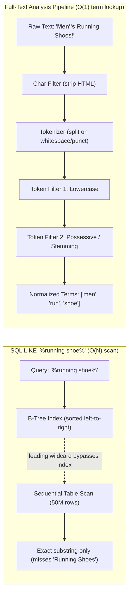
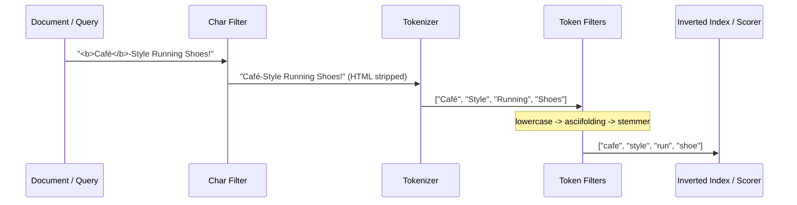
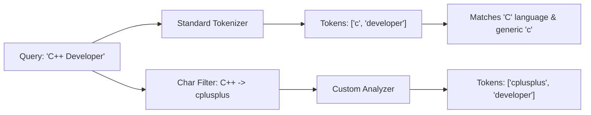

# Full-Text Search Basics: Why SQL LIKE Fails, Tokenizers & Analyzers

> **Prerequisites:** [Lesson 13: Backup vs Archival](../../15-storage/13-backup-vs-archival/README.md).  
> **Estimated Reading Time:** 24–28 minutes  
> **Target Audience:** Backend engineers replacing slow `LIKE '%term%'` queries with dedicated search, and candidates asked "why can't we just search in Postgres?"  
> **Free PDF Notes:** [Download SD-P-001.pdf](https://backendroadmap.com/notes/system-design/SD-P-001.pdf)

> [!NOTE]
> **In one line:** Relational B-tree indexes accelerate exact prefix lookups (`LIKE 'shoe%'`), not arbitrary substring or linguistic matching (`LIKE '%running shoes%'`). Full-text search solves this by passing text through an **analysis pipeline** (character filters, tokenizers, token filters) at index time and query time, turning unstructured prose into normalized, searchable tokens.

> [!TIP]
> **The Golden Rule:** Use the **exact same analyzer** (or a strict query-time subset) at query time and index time—except for synonyms or edge n-grams, which belong on only one side. If index time lowercases and stems `"Running"` to `"run"`, a query that forgets to lowercase `"RUNNING"` will return zero results.

---

## 1. What Full-Text Search Is, and What It Isn't

An e-commerce catalog has 50 million product descriptions. A user types `"men's running shoe"` into the search bar. In SQL, `WHERE description LIKE '%men''s running shoe%'` forces a full sequential table scan because a B-tree index is sorted from left to right—a leading wildcard `%` destroys prefix ordering. Worse, even if the scan finishes in 4 seconds, it misses `"Men's Trail Running Shoes"`, `"runners"`, and `"shoe for running"`, because `LIKE` knows nothing about case folding, punctuation, plurals, or word order.

| Term | Precise Meaning | Example |
| :--- | :--- | :--- |
| **B-tree prefix scan** | Ordered index lookup matching a fixed left prefix | `WHERE sku LIKE 'NIKE-99%'` |
| **Substring scan** | Leading-wildcard match requiring full scan or trigram index | `WHERE title LIKE '%running%'` |
| **Full-text search (FTS)** | Linguistic, token-based retrieval with relevance scoring | Matching `"running shoes"` to `"run shoe"` |
| **Character filter** | Pre-tokenizer step stripping or mapping raw characters | Removing HTML `<b>` tags, mapping `&` to `and` |
| **Tokenizer** | Splits a character stream into discrete tokens (words) | `"Red, fast-car"` -> `["Red", "fast", "car"]` |
| **Token filter** | Transforms, drops, or adds tokens after tokenization | Lowercase, stop-word removal, stemming |
| **Analyzer** | Complete pipeline: char filters + tokenizer + token filters | Standard analyzer, English analyzer |
| **Not** | A replacement for primary-key lookups or ACID transactions | Never use a search engine as your system of record |

### Why It Matters
1. `LIKE '%term%'` turns an $O(\log N)$ index lookup into an $O(N)$ disk/buffer-pool scan that saturates database IOPS under concurrent traffic.
2. Users expect linguistic tolerance (case-insensitivity, singular/plural, punctuation, typos) and ranked results—not boolean substring matching.
3. Understanding the analysis pipeline is the foundation for every downstream search decision: inverted indexes, BM25 scoring, faceting, and autocomplete.

---

## 2. Anatomy: SQL B-Tree Scan vs Full-Text Analysis Pipeline



At **index time**, every document field flows through its configured analyzer and emits normalized terms into an inverted index (covered in Lesson 02). At **query time**, the user's search string flows through the analyzer so `"Running Shoe"` becomes `["run", "shoe"]`, matching the indexed terms in microseconds.

| Capability | SQL `LIKE '%...%'` | Postgres `pg_trgm` (GIN) | Postgres `tsvector` / FTS | Dedicated Search (Lucene/ES) |
| :--- | :--- | :--- | :--- | :--- |
| **Leading wildcard** | Full table scan | Accelerated (trigram GIN) | No (token-based) | Yes (reverse/ngram/wildcard) |
| **Stemming & synonyms** | None | None | Built-in (`english` dict) | Rich, per-language + custom |
| **Relevance ranking** | None (boolean) | Similarity score | `ts_rank` (basic) | BM25, LTR, vector hybrid |
| **Scale ceiling** | Breaks < 100K rows | ~5–10M rows per node | ~10–50M rows per node | Billions of docs (sharded) |
| **Write amplification** | Low | High (3+ trigrams/char) | Moderate | Moderate (segment merges) |

> [!WARNING]
> **Analyzer mismatch is the #1 silent bug in search.** If you index a product SKU `"XK-402"` with the `standard` analyzer (which splits on hyphens into `["xk", "402"]`) and query it as a `keyword` (exact `"XK-402"`), you get zero hits. Always verify both index-time and query-time tokenization with `_analyze`.

---

## 3. Mathematical Model: Scan Cost, Trigram Expansion & Token Reduction

**1. Sequential Scan vs Inverted Term Lookup.**  
Suppose a table has $N = 5 \times 10^7$ rows, average row size $R = 512\text{ bytes}$, and sequential NVMe read throughput $B = 2\text{ GB/s}$ (or $500\text{ MB/s}$ shared under load). The total table size is:

$$D = N \times R = 5 \times 10^7 \times 512\text{ B} = 25.6\text{ GB}$$

A cold `LIKE '%running%'` sequential scan reads:

$$T_{\text{seq}} = \frac{D}{B} = \frac{25.6\text{ GB}}{0.5\text{ GB/s}} = 51.2\text{ s}$$

Even if 90% of pages sit in RAM, scanning 2.56 GB of cold pages at 500 MB/s takes $5.12\text{ s}$ per query—and just 20 concurrent searches saturate disk bandwidth. By contrast, an inverted index maps each normalized term to a postings list of matching doc IDs, reducing lookup to $O(1)$ dictionary hash/FST traversal plus reading $k$ matching postings ($k \ll N$).

**2. Trigram Index Amplification (`pg_trgm`).**  
A string of length $L$ padded with 2 leading spaces and 1 trailing space produces $L + 1$ trigrams (for $L \ge 1$). For an average 60-character product title across $5 \times 10^7$ rows:

$$\text{Trigrams per row} \approx 61, \qquad \text{Total index entries} \approx 3.05 \times 10^9$$

Each write must update ~61 GIN index postings, which is why `pg_trgm` slows heavy write workloads by 3–10x compared to a B-tree.

**3. Token Vocabulary Reduction (Heap's Law).**  
Vocabulary size $V$ (distinct terms) grows sub-linearly with total tokens $T$:

$$V(T) = k \, T^{\beta}, \qquad k \in [10, 100], \; \beta \in [0.4, 0.6]$$

With $T = 10^9$ tokens, $k = 30$, and $\beta = 0.5$:

$$V(10^9) = 30 \times (10^9)^{0.5} \approx 948{,}683 \text{ distinct terms}$$

Lowercasing and stemming shrink $V$ by another 30–50%, keeping the term dictionary compact in RAM.

---

## 4. Metrics & Percentiles

| Metric | Meaning | Alert when |
| :--- | :--- | :--- |
| **Query latency $p_{95} / p_{99}$** | End-to-end search execution time | $p_{99} > 200\text{ ms}$ for interactive search |
| **Zero-result rate (ZRR)** | % of queries returning 0 hits | Sudden jump $> 5\text{–}10\%$ (often analyzer/mapping bug) |
| **Analysis time / doc** | CPU time spent tokenizing during indexing | $> 2\text{ ms/doc}$ (regex char filters or heavy synonyms) |
| **Token expansion ratio** | Output tokens / input whitespace words | $> 5\times$ (unbounded n-grams bloating index size) |
| **DB CPU / IOPS on fallback** | Database load from `LIKE` queries | Any `LIKE '%...%'` in top-10 `pg_stat_statements` |
| **Recall@10** | Fraction of relevant docs in top 10 | Drops after analyzer or stemmer change |

### Worked Example (E-Commerce Search Migration)
A marketplace has 20M products (average 120-byte title + 400-byte description = 10.4 GB raw text) serving 150 search QPS. Currently, Postgres runs `WHERE title ILIKE '%wireless earbuds%'`, taking 680 ms $p_{50}$ and 2,400 ms $p_{99}$ at 85% DB CPU. Replacing `ILIKE` with a dedicated FTS analyzer (`standard` tokenizer + `lowercase` + `asciifolding` + `english` possessive/minimal stemmer) reduces the term vocabulary to ~420K unique terms. Query $p_{99}$ drops from 2,400 ms to 18 ms, DB CPU drops from 85% to 12%, and zero-result rate falls from 14.2% to 4.1% because `"AirPods"` and `"ear-bud"` now normalize cleanly.

---

## 5. Compounding & Failure Modes: Analyzer Pitfalls

Small mistakes in text analysis compound across millions of documents:

| Failure Mode | Mechanism | Blast Radius |
| :--- | :--- | :--- |
| **Over-aggressive stemming** | Porter stemmer maps `"university"` and `"universe"` to `"univers"` | False positives destroy precision |
| **Under-stemming / no folding** | `"café"` != `"cafe"` without `asciifolding` | Silent misses for international users |
| **Stop-word deletion** | Dropping `"to"`, `"be"`, `"or"`, `"not"` | `"To be or not to be"` becomes empty query `[]` -> 0 hits |
| **Regex char filter ReDoS** | Catastrophic backtracking in custom regex | Indexing threads stall at 100% CPU |
| **Index-time edge n-gram bloat** | Indexing 1–20 char prefixes on 500-char descriptions | $10\times$–$20\times$ index size explosion |

---

## 6. Numbers Every Engineer Must Know

| Item | Typical | Implication |
| :--- | :---: | :--- |
| Sequential scan (10 GB cold table) | ~5–20 seconds | Unusable for interactive search QPS |
| B-tree prefix `LIKE 'abc%'` | 0.5–3 ms | Fine for exact prefixes; useless for mid-string |
| Standard analyzer throughput | 20–80 MB/s per core | Regex char filters can cut this by 10x |
| Stemming vocabulary reduction | 30–45% fewer unique terms | Smaller dictionary, higher recall, slight precision loss |
| Stop-word index size savings | Only 5–15% with compression | Modern engines keep stop words and use BM25 IDF |
| Synonym expansion factor | 1.1x–3x postings | Multi-word synonyms require graph token filters |

---

## 7. Mechanism Deep Dive: The Analysis Pipeline



| Question | Answer |
| :--- | :--- |
| **Why do character filters run before the tokenizer?** | Because HTML tags (`<br>`, `&amp;`) or custom punctuation (`C++`, `AT&T`) would otherwise be split apart by the tokenizer. |
| **Why not always remove stop words?** | In modern BM25, common words (`"the"`, `"of"`) already get near-zero IDF weight and fast block-max skipping; removing them breaks exact phrases like `"The Who"` or `"Vitamin A"`. |
| **Standard vs Whitespace tokenizer?** | `whitespace` only splits on spaces (`"shoes!"` keeps `!`); `standard` follows Unicode UAX #29 word boundaries and strips punctuation. |
| **Keyword vs Text field?** | `keyword` skips tokenization entirely (exact match, sorting, aggregations); `text` runs the full analyzer for full-text search. |

**When not to use Full-Text Search:** Do not use full-text tokenization on IDs, UUIDs, emails, status enums, or prices. Tokenizing `"user_12345"` or `"2026-05-01"` splits them on `_` or `-`, causing partial matches and breaking exact filtering. Map those as `keyword` (or `numeric`/`date`).

---

## 8. Hierarchical Budgets & Design Rules

| Slice | Rule | Control |
| :--- | :--- | :--- |
| **Field typing** | `text` for prose, `keyword` for IDs/enums/exact tags | Explicit schema mappings (`dynamic: strict` in prod) |
| **Analyzer symmetry** | Match index & query analyzers by default | Separate `search_analyzer` only for synonyms/ngrams |
| **Stop words** | Keep them unless storage/CPU proves otherwise | Rely on BM25 IDF + `cutoff_frequency` |
| **Stemming** | Prefer light/minimal stemmers (`english` possessive + plural) | Test precision/recall on golden query set |
| **Unicode & accents** | Always lowercase + `asciifolding` for Latin catalogs | Preserve original in `sub-field` if exact match needed |
| **Multi-field pattern** | Index same field as `text` (analyzed) + `.keyword` (exact) | Enables both search and sorting/faceting |
| **SQL fallback** | Ban leading-wildcard `LIKE '%x%'` in OLTP hot paths | Enforce via linter / query timeout / pg_stat_statements |

---

## 9. Top Mitigations

1. **Never ship `LIKE '%...%'` on large tables**; route text search to Postgres `tsvector` (small/medium) or Elasticsearch/OpenSearch (large/complex).
2. **Use multi-fields (`title` as `text`, `title.keyword` as `keyword`)** so you never have to choose between full-text matching and exact sorting/filtering.
3. **Disable dynamic mapping in production** so an unexpected JSON key doesn't auto-create hundreds of `text`+`keyword` fields.
4. **Test every analyzer change with `_analyze` and a golden query dataset** before reindexing.
5. **Use `asciifolding` + `lowercase`** as your baseline token filters so `"São Paulo"` matches `"sao paulo"`.
6. **Avoid heavy regex char filters** on high-throughput ingestion; pre-clean HTML/markup upstream in the indexing pipeline.
7. **Keep stop words** in modern search engines unless you have a measured memory bottleneck; it preserves phrase queries like `"not working"`.

---

## 10. Production Reference: The "C++" & Hyphenation Outage

A developer job board indexed job descriptions using the default `standard` analyzer. Candidates searching for `"C++"` or `"C#"` got the exact same results as candidates searching for `"C"`—millions of irrelevant roles—because the `standard` tokenizer stripped `+` and `#` as punctuation. Meanwhile, searching for `"full-stack"` split into `["full", "stack"]`, matching `"full"` and `"stack"` separately across unrelated paragraphs.



**Root Cause:** Relying on a generic Unicode word-boundary tokenizer (`standard`) for domain-specific technical tokens (`C++`, `C#`, `.NET`, `full-stack`).  
**Fix:** Added a `mapping` character filter (`"C++" => "cplusplus"`, `"C#" => "csharp"`, `".NET" => "dotnet"`) before tokenization, and a `word_delimiter_graph` token filter preserving both the joined and split forms of hyphenated compounds (`"full-stack"` -> `["fullstack", "full", "stack"]`).

---

## 11. Multi-Language Production Code Tabs

A self-contained full-text analysis pipeline (character filter + tokenizer + lowercase + stop-word + suffix stemmer) in all four languages, zero external dependencies.

````carousel
```go
// Go: full-text analysis pipeline (char filter -> tokenizer -> token filters).
package main

import (
	"fmt"
	"regexp"
	"strings"
	"unicode"
)

var htmlTagRe = regexp.MustCompile(`<[^>]*>`)
var stopWords = map[string]bool{"the": true, "a": true, "an": true, "and": true, "for": true, "of": true}

func charFilter(raw string) string {
	noHTML := htmlTagRe.ReplaceAllString(raw, " ")
	return strings.ReplaceAll(noHTML, "&amp;", "and")
}

func tokenize(s string) []string {
	return strings.FieldsFunc(s, func(r rune) bool {
		return !unicode.IsLetter(r) && !unicode.IsDigit(r)
	})
}

func minimalStem(tok string) string {
	for _, suf := range []string{"ing", "ed", "es", "s"} {
		if len(tok) > len(suf)+2 && strings.HasSuffix(tok, suf) {
			return strings.TrimSuffix(tok, suf)
		}
	}
	return tok
}

func Analyze(raw string) []string {
	cleaned := charFilter(raw)
	rawTokens := tokenize(cleaned)
	out := make([]string, 0, len(rawTokens))
	for _, t := range rawTokens {
		low := strings.ToLower(t)
		if stopWords[low] {
			continue
		}
		out = append(out, minimalStem(low))
	}
	return out
}

func main() {
	fmt.Println(Analyze("<b>Men's</b> Running Shoes &amp; Socks"))
	// Output: [men running -> run? "runn" with naive suffix, shoes -> shoe, socks -> sock]
}
```
<!-- slide -->
```typescript
// TypeScript: configurable Analyzer pipeline (char filters -> tokenizer -> token filters).
const HTML_TAG_RE = /<[^>]*>/g;
const STOP_WORDS = new Set(["the", "a", "an", "and", "for", "of"]);

function charFilter(raw: string): string {
  return raw.replace(HTML_TAG_RE, " ").replace(/&amp;/g, " and ");
}

function standardTokenizer(text: string): string[] {
  return text.split(/[^a-zA-Z0-9]+/).filter(Boolean);
}

function minimalStem(token: string): string {
  for (const suffix of ["ing", "ed", "es", "s"]) {
    if (token.length > suffix.length + 2 && token.endsWith(suffix)) {
      return token.slice(0, -suffix.length);
    }
  }
  return token;
}

export function analyze(raw: string): string[] {
  const cleaned = charFilter(raw);
  const tokens = standardTokenizer(cleaned);
  const result: string[] = [];
  for (const tok of tokens) {
    const lower = tok.toLowerCase();
    if (STOP_WORDS.has(lower)) continue;
    result.push(minimalStem(lower));
  }
  return result;
}

console.log(analyze("<b>Men's</b> Running Shoes &amp; Socks"));
```
<!-- slide -->
```python
# Python: full-text analysis pipeline + LIKE vs FTS scan cost helper (stdlib only).
import re
import unicodedata

HTML_RE = re.compile(r"<[^>]*>")
TOKEN_RE = re.compile(r"[a-zA-Z0-9]+")
STOP_WORDS = {"the", "a", "an", "and", "for", "of"}

def char_filter(raw: str) -> str:
    text = HTML_RE.sub(" ", raw).replace("&amp;", " and ")
    # Decompose accents (ASCII folding)
    nfkd = unicodedata.normalize("NFKD", text)
    return "".join(c for c in nfkd if not unicodedata.combining(c))

def minimal_stem(token: str) -> str:
    for suffix in ("ing", "ed", "es", "s"):
        if len(token) > len(suffix) + 2 and token.endswith(suffix):
            return token[: -len(suffix)]
    return token

def analyze(raw: str) -> list[str]:
    cleaned = char_filter(raw)
    tokens = TOKEN_RE.findall(cleaned)
    out = []
    for tok in tokens:
        low = tok.lower()
        if low in STOP_WORDS:
            continue
        out.append(minimal_stem(low))
    return out

if __name__ == "__main__":
    print(analyze("<b>Café</b>-Style Running Shoes &amp; Socks!"))
```
<!-- slide -->
```csharp
// C#: full-text analysis pipeline with char filter, tokenizer, and token filters.
using System;
using System.Collections.Generic;
using System.Globalization;
using System.Text;
using System.Text.RegularExpressions;

public static class TextAnalyzer
{
    private static readonly Regex HtmlRe = new("<[^>]*>", RegexOptions.Compiled);
    private static readonly Regex TokenRe = new("[a-zA-Z0-9]+", RegexOptions.Compiled);
    private static readonly HashSet<string> StopWords = new() { "the", "a", "an", "and", "for", "of" };

    public static string CharFilter(string raw)
    {
        var noHtml = HtmlRe.Replace(raw, " ").Replace("&amp;", " and ");
        var norm = noHtml.Normalize(NormalizationForm.FormD);
        var sb = new StringBuilder(norm.Length);
        foreach (var ch in norm)
        {
            if (CharUnicodeInfo.GetUnicodeCategory(ch) != UnicodeCategory.NonSpacingMark)
                sb.Append(ch);
        }
        return sb.ToString();
    }

    public static List<string> Analyze(string raw)
    {
        var cleaned = CharFilter(raw);
        var tokens = new List<string>();
        foreach (Match m in TokenRe.Matches(cleaned))
        {
            var low = m.Value.ToLowerInvariant();
            if (StopWords.Contains(low)) continue;
            tokens.Add(MinimalStem(low));
        }
        return tokens;
    }

    private static string MinimalStem(string tok)
    {
        foreach (var suf in new[] { "ing", "ed", "es", "s" })
        {
            if (tok.Length > suf.Length + 2 && tok.EndsWith(suf))
                return tok[..^suf.Length];
        }
        return tok;
    }
}
```
````

---

## 12. Hands-On CLI Verification Workflows

Verify tokenization in Elasticsearch/OpenSearch and Postgres `tsvector` directly from the terminal:

```bash
# 1. Inspect how Elasticsearch / OpenSearch analyzes a string
curl -s -X POST "localhost:9200/_analyze?pretty" \
  -H "Content-Type: application/json" \
  -d '{
    "analyzer": "english",
    "text": "<b>Men'\''s</b> Café-Style Running Shoes!"
  }'

# 2. Test a custom analyzer pipeline inline without creating an index
curl -s -X POST "localhost:9200/_analyze?pretty" \
  -H "Content-Type: application/json" \
  -d '{
    "char_filter": ["html_strip"],
    "tokenizer": "standard",
    "filter": ["lowercase", "asciifolding", "porter_stem"],
    "text": "<b>Café</b> Running Shoes"
  }'

# 3. Compare Postgres LIKE vs GIN-indexed tsvector in psql
psql -c "EXPLAIN ANALYZE SELECT id FROM products WHERE title ILIKE '%running shoes%';"
psql -c "SELECT to_tsvector('english', 'Men''s Running Shoes') @@ plainto_tsquery('english', 'running shoe');"
```

---

## 13. Common Mistakes to Avoid

1. **Using `LIKE '%term%'` on growing OLTP tables** until a traffic spike saturates disk IOPS.
2. **Using different analyzers at index time and query time** without realizing why queries return 0 results.
3. **Tokenizing IDs, SKUs, or email addresses** as `text` instead of `keyword`.
4. **Relying on dynamic mappings in production**, creating thousands of unintended fields.
5. **Over-aggressive stemming** that conflates unrelated words (`"stocks"` vs `"stockings"`).
6. **Stripping stop words blindly**, breaking phrase queries like `"to be or not to be"`.
7. **Forgetting `asciifolding`**, causing `"resume"` to miss `"résumé"`.
8. **Putting expensive regex character filters** in the hot indexing path without benchmarking throughput.

---

## 14. Key Terms Glossary

| Key Term | Definition |
| :--- | :--- |
| **Full-text search** | Token-based linguistic retrieval with relevance scoring over unstructured text. |
| **B-tree index** | Balanced tree sorted left-to-right; accelerates prefix scans (`'abc%'`), not `'%abc%'`. |
| **Trigram (`pg_trgm`)** | 3-character sliding window index enabling substring `LIKE '%abc%'` at high write cost. |
| **Analyzer** | Ordered pipeline of character filters, one tokenizer, and zero or more token filters. |
| **Character filter** | Pre-tokenizer component that strips or maps raw characters (e.g., `html_strip`). |
| **Tokenizer** | Splits character stream into discrete tokens with byte offsets and positions. |
| **Token filter** | Modifies, deletes, or adds tokens (e.g., `lowercase`, `asciifolding`, stemmer). |
| **Stemming** | Heuristic suffix stripping to reduce inflected words to a common root (`"running"` -> `"run"`). |
| **Lemmatization** | Dictionary/morphological reduction to a valid base word (`"better"` -> `"good"`). |
| **Stop words** | High-frequency words (`"the"`, `"is"`) optionally filtered during analysis. |
| **Keyword field** | Unanalyzed string stored verbatim for exact match, sorting, and aggregations. |

---

## 15. System Design Interview Questions & Answers

### Basic Conceptual Questions

<details>
<summary><strong>Q1: Why does SQL <code>LIKE '%term%'</code> fail at scale? [BASIC]</strong></summary>

**Answer:**
A standard B-tree index is sorted lexicographically from the first character. A leading wildcard (`%term%`) means the database cannot jump to a prefix range and must perform a full sequential scan of the table (or index), turning $O(\log N)$ into $O(N)$. Under concurrent search load, scanning gigabytes of rows saturates I/O and CPU.
</details>

<details>
<summary><strong>Q2: What are the three stages of an analyzer, in order? [BASIC]</strong></summary>

**Answer:**
1. **Character filters** (0 or more): clean/map raw characters before splitting (e.g., strip HTML, map `C++` to `cplusplus`).
2. **Tokenizer** (exactly 1): splits text into tokens and records positions/offsets.
3. **Token filters** (0 or more): transform, remove, or add tokens (e.g., `lowercase`, `asciifolding`, `stemmer`).
</details>

<details>
<summary><strong>Q3: What is the difference between a <code>text</code> field and a <code>keyword</code> field? [BASIC]</strong></summary>

**Answer:**
A `text` field is passed through an analyzer (tokenized, lowercased, stemmed) for full-text search. A `keyword` field is not tokenized—it is stored as a single exact value for exact-match filtering, sorting, and aggregations (e.g., `status = "PAID"`, `sku = "NK-402"`).
</details>

<details>
<summary><strong>Q4: What is the difference between stemming and lemmatization? [BASIC]</strong></summary>

**Answer:**
Stemming uses fast heuristic rules to chop suffixes (`"studies"` -> `"studi"`), which is cheap and language-rule-based but can over-stem. Lemmatization uses a vocabulary and morphological analysis to return a real dictionary root (`"studies"` -> `"study"`, `"went"` -> `"go"`), which is more accurate but slower and harder to maintain.
</details>

### Scenario-Based Architecture Questions

<details>
<summary><strong>Q5: Your Postgres table has 5M products and search is timing out. When do you use <code>pg_trgm</code> vs <code>tsvector</code> vs Elasticsearch? [SCENARIO]</strong></summary>

**Answer:**
Use `pg_trgm` (GIN) if you specifically need arbitrary substring matching on short strings (like SKUs or usernames) and write volume is low. Use Postgres `tsvector` + GIN if you need linguistic full-text search, ~10M or fewer rows, and want to avoid operating a separate cluster. Move to Elasticsearch/OpenSearch when you exceed single-node capacity, need advanced relevance (BM25 tuning, synonyms, Learning to Rank, vector hybrid), or need sub-50 ms faceting at high QPS.
</details>

<details>
<summary><strong>Q6: Users report that searching for exact SKU <code>"AB-1234"</code> returns unrelated products containing <code>"1234"</code>. What happened? [SCENARIO]</strong></summary>

**Answer:**
The `sku` field was mapped as `text` using the `standard` analyzer, which split `"AB-1234"` on the hyphen into `["ab", "1234"]`. Changing the mapping to `keyword` (or querying `sku.keyword`) ensures `"AB-1234"` is indexed and matched as a single exact token.
</details>

<details>
<summary><strong>Q7: How do you support both full-text search and alphabetical sorting on a product <code>title</code>? [SCENARIO]</strong></summary>

**Answer:**
Use a multi-field mapping: index `title` as `text` (analyzed for search) and `title.keyword` (or `title.raw`) as `keyword` (unanalyzed, with Doc Values enabled) for sorting and exact aggregations.
</details>

<details>
<summary><strong>Q8: After adding a synonym filter for <code>"tv, television"</code>, index size jumped and phrase queries broke. Why? [SCENARIO]</strong></summary>

**Answer:**
Index-time synonyms expand postings for every occurrence and can misalign token positions for multi-word synonyms (`"smart tv"` vs `"television"`) unless a `synonym_graph` filter is used. Moving synonyms to **query-time only** (with `synonym_graph`) avoids reindexing, keeps index size flat, and allows instant synonym updates.
</details>

### Advanced & Tricky Interview Questions

<details>
<summary><strong>Q9: Why do modern search engines recommend keeping stop words instead of removing them? [TRICKY]</strong></summary>

**Answer:**
Removing stop words saves little disk space once postings are compressed, but breaks queries made entirely of stop words (`"to be or not to be"`, `"vitamin a"`). With BM25, high-frequency words naturally receive very low IDF weights, and block-max WAND skips them efficiently without losing recall on phrase queries.
</details>

<details>
<summary><strong>Q10: If you apply an edge n-gram filter for prefix matching, should you apply it at index time, query time, or both? [TRICKY]</strong></summary>

**Answer:**
**Index time only**, paired with a standard/whitespace `search_analyzer` at query time. If you apply edge n-grams at query time too, a query for `"runn"` expands into `["r", "ru", "run", "runn"]`, matching every word starting with `"r"` and destroying precision.
</details>

<details>
<summary><strong>Q11: Why can't a B-tree index accelerate <code>LIKE '%shoe%'</code>, and how does a reverse-string B-tree trick help <code>LIKE '%shoe'</code>? [TRICKY]</strong></summary>

**Answer:**
B-trees order keys from the first character. A leading `%` means any prefix is valid, so no contiguous key range exists. For a *trailing* match (`LIKE '%shoe'`), you can index `REVERSE(col)` in a B-tree and query `WHERE REVERSE(col) LIKE REVERSE('%shoe')` (`'eohs%'`), turning it back into an $O(\log N)$ prefix scan. That still fails for double-wildcards (`'%shoe%'`).
</details>

<details>
<summary><strong>Q12: What is Heap's Law and why does it matter for search memory sizing? [TRICKY]</strong></summary>

**Answer:**
Heap's Law states that vocabulary size grows as $V(T) = k T^\beta$ ($\beta \approx 0.4\text{–}0.6$). Because the term dictionary (or its FST index) must fit in RAM for fast lookups, unbounded token generation—such as indexing UUIDs, uncleaned HTML, or long n-grams—pushes $\beta$ toward $1.0$ and causes JVM/OS memory exhaustion.
</details>

---

## 16. One-Page Master Cheat Sheet

```
+---------------------------------------------------------------------------------------------------------+
|                    FULL-TEXT SEARCH BASICS — MASTER CHEAT SHEET                                         |
+---------------------------------------------------------------------------------------------------------+
| 1. WHY SQL LIKE FAILS: B-trees sort left-to-right. LIKE '%x%' -> O(N) full scan (50M rows = 51 s).     |
+---------------------------------------------------------------------------------------------------------+
| 2. ANALYSIS PIPELINE: Raw Text -> Char Filters -> Tokenizer -> Token Filters -> Normalized Terms.       |
+---------------------------------------------------------------------------------------------------------+
| 3. SYMMETRY RULE: Use the SAME analyzer at index & query time (except synonyms / edge n-grams).         |
+---------------------------------------------------------------------------------------------------------+
| 4. TEXT vs KEYWORD: 'text' = analyzed prose (search); 'keyword' = exact string (IDs, sort, facets).     |
|    Use multi-fields (title + title.keyword) to get both.                                                |
+---------------------------------------------------------------------------------------------------------+
| 5. PITFALLS: Analyzer mismatch (0 hits) · Over-stemming · Dropping stop words · Unbounded n-grams.      |
+---------------------------------------------------------------------------------------------------------+
| 6. VERIFY: Always test with POST /_analyze before indexing; track Zero-Result Rate (ZRR) in prod.       |
+---------------------------------------------------------------------------------------------------------+
```

---

## Further Reading & Sources

- Martin Kleppmann, *Designing Data-Intensive Applications*, Chapter 3 ("Storage and Retrieval" — Full-Text Indexes).
- Clinton Gormley & Zachary Tong, *Elasticsearch: The Definitive Guide*, "Analysis and Analyzers".
- PostgreSQL Documentation, [Full Text Search (`tsvector` / `tsquery`)](https://www.postgresql.org/docs/current/textsearch.html) and [`pg_trgm`](https://www.postgresql.org/docs/current/pgtrgm.html).
- Elasticsearch Reference, [Text Analysis Overview & `_analyze` API](https://www.elastic.co/guide/en/elasticsearch/reference/current/analysis.html).

---

## Free PDF Notes

[SD-P-001.pdf](https://backendroadmap.com/notes/system-design/SD-P-001.pdf)

---

## Next

Continue with [Lesson 02: Inverted Indexes: Postings Lists, Positions & Segments Explained](../02-inverted-indexes/README.md).
