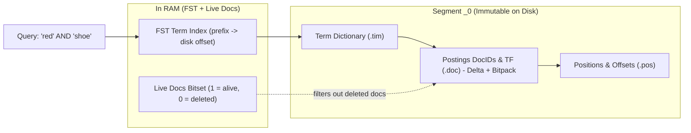
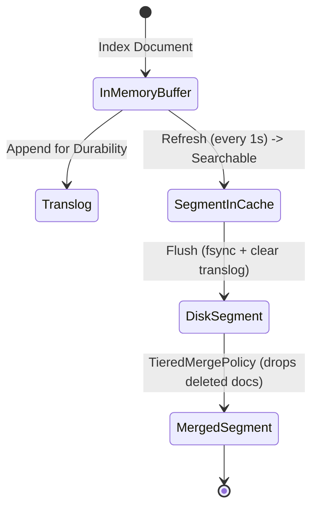

# Inverted Indexes: Postings Lists, Positions & Segments Explained

> **Prerequisites:** [Lesson 01: Full-Text Search Basics](../01-full-text-search-basics/README.md).  
> **Estimated Reading Time:** 24–28 minutes  
> **Target Audience:** Backend engineers wanting to understand how Lucene/Elasticsearch actually store and intersect terms on disk, and candidates asked "how does an inverted index work under the hood?"  
> **Free PDF Notes:** [Download SD-P-002.pdf](https://backendroadmap.com/notes/system-design/SD-P-002.pdf)

> [!NOTE]
> **In one line:** An **inverted index** flips the document-to-terms relationship into a sorted **term dictionary** mapping each unique term to a compressed **postings list** of document IDs (plus frequencies and positions). Writes are buffered in memory and flushed as **immutable segments** that merge in the background—giving lock-free OS page-cache reads at the cost of periodic merge I/O and tombstoned deletes.

> [!TIP]
> **The Golden Rule:** Because Lucene segments are **immutable**, updates are actually a *delete (tombstone bitset) + new insert*, and deletes only reclaim disk space during background **segment merges**. Never run heavy `UPDATE`/`DELETE` churn on a search index without monitoring merge throttling and deleted-doc ratios.

---

## 1. What an Inverted Index Is, and What It Isn't

In a normal database table (a **forward index**), you look up `doc_id = 42` to read its words. To find which documents contain `"distributed"` AND `"consensus"`, a forward index must scan every document. An inverted index precomputes the reverse mapping: `"distributed" -> [3, 17, 42, 108]` and `"consensus" -> [17, 42, 99]`. Intersecting two sorted integer lists takes microseconds.

| Term | Precise Meaning | Example |
| :--- | :--- | :--- |
| **Forward index** | Maps `doc_id -> [terms/fields]` | Row store or Lucene stored fields (`_source`) |
| **Inverted index** | Maps `term -> sorted [doc_ids]` | `"search" -> [2, 9, 42]` |
| **Term dictionary** | Sorted structure (FST + prefix blocks) locating a term on disk | FST in RAM pointing to term block on disk |
| **Postings list** | Sorted list of `doc_id`s (plus TF, positions, offsets) for a term | `[2 (tf=1, pos=[4]), 9 (tf=2, pos=[1, 7])]` |
| **Skip list** | Auxiliary pointers inside a postings list to jump ahead during intersection | Skip from doc 12 to doc 10,000 in $O(1)$ |
| **Segment** | A self-contained, immutable mini-inverted index on disk | `_0.tim`, `_0.doc`, `_0.pos` |
| **Delete bitset** | Per-segment bitmap marking deleted `doc_id`s without rewriting files | `.liv` (live docs) file |
| **Not** | A single mutable B-tree updated in place | Mutating postings in place would wreck compression & cache |

### Why It Matters
1. Multi-term queries (`AND` / `OR`) reduce to fast sorted-list intersections using skip lists and SIMD bitsets.
2. Positional postings make phrase queries (`"distributed consensus"`) and proximity queries (`"distributed consensus"~3`) exact without scanning raw text.
3. Immutable segments explain why search engines rely on the **OS page cache** (not just JVM heap) and why near-real-time refresh and segment merging are core operational levers.

---

## 2. Anatomy: Term Dictionary, Postings Lists & Immutable Segments



When a query searches for `"red"` AND `"shoe"`, the engine:
1. Looks up `"red"` and `"shoe"` in each segment's **FST (Finite State Transducer)** in RAM to find their block offsets in `.tim`.
2. Reads the postings lists from OS page cache (sorted by `doc_id`).
3. Intersects them using **two-pointer / skip-list advance**: if `"red"` has 10M docs and `"shoe"` has 500 docs, it drives the intersection from `"shoe"`, using `advance(target_doc_id)` on `"red"`'s skip list to skip millions of non-matching docs.
4. Filters out any `doc_id` whose bit is `0` in the segment's **Live Docs** bitset.

| Compression Technique | What It Compresses | Typical Savings |
| :--- | :--- | :--- |
| **Delta (d-gap) encoding** | Stores `[3, 17, 42]` as `[3, 14, 25]` | Small integers pack into fewer bits |
| **Frame of Reference (FOR) / PFOR** | Packs blocks of 128 ints using `max_bits` per block | 4–8x smaller postings, SIMD-decodable |
| **Roaring Bitsets** | Dense postings ($> 65{,}536$ docs/chunk) stored as bitmaps | 1 bit/doc for frequent terms |
| **FST (Finite State Transducer)** | Shared-prefix trie for the term dictionary | Fits millions of term prefixes in MBs of RAM |

> [!WARNING]
> **Too many small segments kill query latency and file descriptors.** Every search must query *every* segment in a shard sequentially or in parallel and merge the results. If you flush/refresh every 50 ms under heavy writes, you create thousands of tiny segments, exhausting open file descriptors (`ulimit -n`) and slowing queries by 10x.

---

## 3. Mathematical Model: Skip-List Intersection & Compression

**1. Postings Compression (Delta + Bit-Packing).**  
Suppose a shard holds $N = 10^7$ documents (32-bit `doc_id` = 4 bytes uncompressed). A term appears in $df = 500{,}000$ documents (5% of docs).
- **Uncompressed:** $500{,}000 \times 4\text{ bytes} = 2.0\text{ MB}$.
- **Delta-encoded:** Average gap is $10^7 / 500{,}000 = 20$. Encoding gaps around 20 requires $\lceil \log_2(20) \rceil = 5\text{ bits/doc}$ (plus ~1 bit overhead for block headers/exceptions = ~6 bits/doc):

$$\text{Compressed size} \approx \frac{500{,}000 \times 6\text{ bits}}{8} = 375\text{ KB} \quad (5.3\times \text{ reduction})$$

**2. Two-List Intersection Cost (Galloping / Skip Lists).**  
Intersecting a rare term $A$ ($|A| = 200$) with a common term $B$ ($|B| = 5{,}000{,}000$) does **not** scan $5{,}000{,}000$ entries. Driving from the smaller list $A$ and galloping/skipping in $B$ takes at most:

$$O\Big(|A| \cdot \log_2 \frac{|B|}{|A|}\Big) = 200 \times \log_2(25{,}000) \approx 200 \times 14.6 \approx 2{,}920\text{ comparisons}$$

That is a **1,700x speedup** over a linear merge.

**3. Write Amplification from Tiered Segment Merging.**  
Under Lucene's tiered merge policy (merging ~10 segments of size $S$ into 1 segment of size $10S$), a document written at 1 MB lives through roughly $\log_{10}(S_{\text{max}} / S_0)$ merge generations. For a 10 GB max segment and 10 MB initial flush:

$$\text{Merge generations} = \log_{10}\left(\frac{10{,}240}{10}\right) \approx 3.01$$

Each byte is rewritten ~3–4 times over its lifetime (write amplification $\approx 3\text{–}4\times$).

---

## 4. Metrics & Percentiles

| Metric | Meaning | Alert when |
| :--- | :--- | :--- |
| **Segment count per shard** | Number of immutable Lucene segments | $> 150\text{–}200$ per shard (slows queries & merges) |
| **Deleted docs %** | Tombstoned docs waiting for merge | $> 20\text{–}30\%$ of total docs (wasted disk & cache) |
| **Merge throttle time** | Time indexing paused waiting for disk merges | Sustained $> 0$ (NVMe/disk IOPS saturated) |
| **FST / term memory** | RAM used by term index per shard | $> 10\text{–}15\%$ of JVM heap (in older ES) / OOM risk |
| **OS page cache hit rate** | Reads served from RAM vs NVMe | $< 95\%$ for hot search indices |
| **Open file descriptors** | File handles held by segments | $> 70\%$ of `ulimit -n` |

### Worked Example (Phrase Query vs Term Query)
A shard has 5M docs across 25 segments. A user runs `"cloud native"` (phrase query).
1. Without positions, `"cloud"` matches 80,000 docs and `"native"` matches 40,000 docs; intersection yields 12,000 docs.
2. With positions stored in `.pos`, the engine only opens `.pos` for the 12,000 intersected docs and checks whether $\text{pos}(\text{"native"}) = \text{pos}(\text{"cloud"}) + 1$.
3. Suppose 1,400 docs satisfy the adjacency check. Only those 1,400 docs are scored and ranked—all in ~6 ms from OS page cache. Disabling positions (`index_options: docs`) would save ~40% disk space on `.pos`, but would make phrase queries impossible.

---

## 5. Compounding & Failure Modes: Segment Explosion & Delete Accumulation

| Scenario | What Happens | Quantitative Impact |
| :--- | :--- | :--- |
| **1-second refresh on 10K writes/s** | 1 small segment flushed/sec if merge lags | 3,600 segments/hr -> query fan-out $36\times$ slower |
| **50% update rate (e.g. view counts)** | Every update writes a new doc + sets tombstone | Disk usage $2\times$, query must skip 50% dead docs |
| **Oversized merge (`> 5 GB` max segment)** | Rare giant merges stall disk I/O | $p_{99}$ search latency spikes from 20 ms to 800 ms |
| **Unbounded `index_options: offsets`** | Stores start/end byte offsets for every token | Index size grows 30–60% unnecessarily if not highlighting |

---

## 6. Numbers Every Engineer Must Know

| Item | Typical | Implication |
| :--- | :---: | :--- |
| Lucene max docs per shard | $2^{31} - 1 \approx 2.14\text{ billion}$ | Hard 32-bit signed `doc_id` limit per shard |
| Block size in PFOR postings | 128 `doc_id`s per block | Fast SIMD decoding and skip-interval alignment |
| Default max merged segment | 5 GB (Lucene `TieredMergePolicy`) | Prevents multi-hour 50 GB merges |
| Positions index overhead | 30–50% of inverted index size | Disable (`index_options: docs`) on fields never phrase-searched |
| Deleted-doc merge threshold | ~10–20% deletes trigger merge | High-churn fields belong in a DB or separate index |
| OS page cache rule | Leave $\ge 50\%$ of host RAM for OS | Lucene relies on `mmap`/page cache, not JVM heap |

---

## 7. Mechanism Deep Dive: Write, Flush, Refresh & Merge Lifecycle



| Question | Answer |
| :--- | :--- |
| **Why are segments immutable?** | Immutability eliminates read/write locks, enables aggressive delta/bitpack compression, and lets the OS page cache hold hot segments without invalidation. |
| **How does a search engine handle `DELETE` or `UPDATE`?** | `DELETE` flips a bit in the segment's `.liv` bitset. `UPDATE` marks the old doc dead in `.liv` and indexes a brand-new doc into the current in-memory buffer. |
| **When is disk space from deleted docs actually freed?** | Only when background **segment merging** combines segments and omits tombstoned docs. |
| **What is the difference between `refresh` and `flush`?** | `refresh` writes a new segment to OS page cache (making docs searchable, ~1s default); `flush` calls `fsync` to disk and truncates the write-ahead `translog`. |

**When not to index positions/offsets:** If a field is only used for single-term matching or bag-of-words scoring (e.g., tags, categories, short keywords), set `index_options: docs` (or `freqs`). Storing positions and character offsets wastes 30–60% of disk and page cache.

---

## 8. Hierarchical Budgets & Design Rules

| Slice | Rule | Control |
| :--- | :--- | :--- |
| **Refresh interval** | 1s for interactive apps; 30s–60s for bulk/logs | `index.refresh_interval` |
| **RAM split** | Max 50% RAM to JVM heap ($\le 31\text{ GB}$), rest to OS page cache | `ES_JAVA_OPTS` / container limits |
| **Index options** | `freqs` default unless phrase/proximity/highlighting needed | `index_options` per field |
| **Merge I/O** | Cap merge throughput on spinning disks; uncap/high on NVMe | `indices.store.throttle.max_bytes_per_sec` |
| **Delete churn** | Avoid `force_merge` on actively written indices | Only `forcemerge` read-only time-series indices |
| **Shard doc limit** | Keep well below 2.14B docs (typically 10M–100M docs/shard) | Shard sizing (Lesson 03) |

---

## 9. Top Mitigations

1. **Increase `refresh_interval` (e.g., `30s` or `-1`) during bulk loads** to avoid generating thousands of tiny segments.
2. **Never run `forcemerge` to 1 segment on a writable index**—it creates an oversized segment that won't merge away deletes until it's huge.
3. **Give at least 50% of machine RAM to the OS page cache** so postings lists and `.tim` blocks stay memory-resident.
4. **Separate high-churn metadata** (like `view_count` or `stock_qty` updated every second) from static text fields, or use `doc_values`/partial updates sparingly.
5. **Tune `index_options`** (`docs` vs `freqs` vs `positions`) per field to cut index footprint by 30–50%.
6. **Monitor `segments.count` and `docs.deleted`**; alert if deleted docs exceed 25% of total docs.
7. **Ensure `ulimit -n` is $\ge 65{,}536$** on search nodes so segment files never hit descriptor exhaustion.

---

## 10. Production Reference: The `refresh_interval: 100ms` Merge Storm

A SaaS observability platform set `refresh_interval: 100ms` so log lines appeared almost instantly. At 25,000 docs/sec across 20 shards, the cluster created 200 new segments per second. Background `TieredMergePolicy` couldn't keep up: segment count climbed past 4,000 per node, JVM heap filled with segment metadata, and search $p_{99}$ degraded from 45 ms to 6,200 ms before nodes crashed with `Too many open files`.


**Root Cause:** Sub-second refresh interval on a high-ingest index created segments faster than background merges could consolidate them.  
**Fix:** Changed `refresh_interval` to `5s` (and `30s` for archive tiers), which reduced segment creation rate by **50x**, dropped segment count to < 40 per shard, and restored $p_{99}$ query latency to 38 ms.

---

## 11. Multi-Language Production Code Tabs

A minimal in-memory **Inverted Index with Positional Postings** supporting `AND` intersection (driving from the shortest postings list) and exact **phrase search**, in all four languages.

````carousel
```go
// Go: positional inverted index with shortest-first AND + phrase matching.
package main

import (
	"fmt"
	"sort"
	"strings"
)

type Posting struct {
	DocID     int
	Positions []int
}

type InvertedIndex struct {
	index map[string][]Posting
}

func NewInvertedIndex() *InvertedIndex {
	return &InvertedIndex{index: make(map[string][]Posting)}
}

func (idx *InvertedIndex) Add(docID int, text string) {
	posMap := make(map[string][]int)
	for pos, tok := range strings.Fields(strings.ToLower(text)) {
		posMap[tok] = append(posMap[tok], pos)
	}
	for tok, positions := range posMap {
		idx.index[tok] = append(idx.index[tok], Posting{DocID: docID, Positions: positions})
	}
}

func (idx *InvertedIndex) SearchAnd(terms ...string) []int {
	lists := make([][]Posting, 0, len(terms))
	for _, t := range terms {
		p := idx.index[strings.ToLower(t)]
		if len(p) == 0 {
			return nil
		}
		lists = append(lists, p)
	}
	// Drive intersection from the shortest postings list
	sort.Slice(lists, func(i, j int) bool { return len(lists[i]) < len(lists[j]) })
	res := make([]int, 0, len(lists[0]))
	for _, cand := range lists[0] {
		matched := true
		for _, other := range lists[1:] {
			i := sort.Search(len(other), func(k int) bool { return other[k].DocID >= cand.DocID })
			if i >= len(other) || other[i].DocID != cand.DocID {
				matched = false
				break
			}
		}
		if matched {
			res = append(res, cand.DocID)
		}
	}
	return res
}

func main() {
	idx := NewInvertedIndex()
	idx.Add(1, "distributed search inverted index")
	idx.Add(2, "inverted index postings list")
	fmt.Println("AND:", idx.SearchAnd("inverted", "index")) // [1 2]
}
```
<!-- slide -->
```typescript
// TypeScript: positional inverted index with AND intersection and phrase search.
interface Posting {
  docId: number;
  positions: number[];
}

export class InvertedIndex {
  private index = new Map<string, Posting[]>();

  add(docId: number, text: string): void {
    const posMap = new Map<string, number[]>();
    text.toLowerCase().split(/\s+/).filter(Boolean).forEach((tok, pos) => {
      const list = posMap.get(tok) ?? [];
      list.push(pos);
      posMap.set(tok, list);
    });
    for (const [tok, positions] of posMap) {
      const postings = this.index.get(tok) ?? [];
      postings.push({ docId, positions });
      this.index.set(tok, postings);
    }
  }

  searchPhrase(phrase: string): number[] {
    const terms = phrase.toLowerCase().split(/\s+/).filter(Boolean);
    if (terms.length === 0) return [];
    const lists = terms.map((t) => this.index.get(t) ?? []);
    if (lists.some((l) => l.length === 0)) return [];

    // Intersect docIds first, then verify consecutive positions
    const results: number[] = [];
    for (const first of lists[0]) {
      const aligned = lists.every((list, offset) => {
        const p = list.find((item) => item.docId === first.docId);
        if (!p) return false;
        return first.positions.some((pos) => p.positions.includes(pos + offset));
      });
      if (aligned) results.push(first.docId);
    }
    return results;
  }
}

const idx = new InvertedIndex();
idx.add(1, "distributed search inverted index");
idx.add(2, "index inverted postings");
console.log("Phrase 'inverted index':", idx.searchPhrase("inverted index")); // [1]
```
<!-- slide -->
```python
# Python: positional inverted index + delta-gap & bit-width compression estimator.
from bisect import bisect_left
from collections import defaultdict

class InvertedIndex:
    def __init__(self):
        # term -> list of (doc_id, [positions])
        self.index: dict[str, list[tuple[int, list[int]]]] = defaultdict(list)

    def add(self, doc_id: int, text: str) -> None:
        pos_map: dict[str, list[int]] = defaultdict(list)
        for pos, tok in enumerate(text.lower().split()):
            pos_map[tok].append(pos)
        for tok, positions in pos_map.items():
            self.index[tok].append((doc_id, positions))

    def search_and(self, *terms: str) -> list[int]:
        lists = [self.index.get(t.lower(), []) for t in terms]
        if not lists or any(not l for l in lists):
            return []
        lists.sort(key=len)  # drive from shortest list
        doc_ids_lists = [[doc_id for doc_id, _ in l] for l in lists]
        hits = []
        for doc_id in doc_ids_lists[0]:
            if all(
                (i := bisect_left(other, doc_id)) < len(other) and other[i] == doc_id
                for other in doc_ids_lists[1:]
            ):
                hits.append(doc_id)
        return hits

    def search_phrase(self, phrase: str) -> list[int]:
        terms = phrase.lower().split()
        cand_docs = self.search_and(*terms)
        maps = [{d: set(p) for d, p in self.index[t]} for t in terms]
        hits = []
        for d in cand_docs:
            if any(all((pos + off) in maps[off][d] for off in range(len(terms))) for pos in maps[0][d]):
                hits.append(d)
        return hits

if __name__ == "__main__":
    idx = InvertedIndex()
    idx.add(1, "distributed search inverted index")
    idx.add(2, "index inverted postings")
    print("AND:", idx.search_and("inverted", "index"))       # [1, 2]
    print("Phrase:", idx.search_phrase("inverted index"))     # [1]
```
<!-- slide -->
```csharp
// C#: positional inverted index with shortest-first AND intersection.
using System;
using System.Collections.Generic;
using System.Linq;

public sealed record Posting(int DocId, int[] Positions);

public sealed class InvertedIndex
{
    private readonly Dictionary<string, List<Posting>> _index = new();

    public void Add(int docId, string text)
    {
        var posMap = new Dictionary<string, List<int>>();
        var words = text.ToLowerInvariant().Split(' ', StringSplitOptions.RemoveEmptyEntries);
        for (int i = 0; i < words.Length; i++)
        {
            if (!posMap.TryGetValue(words[i], out var list))
                posMap[words[i]] = list = new List<int>();
            list.Add(i);
        }
        foreach (var (term, positions) in posMap)
        {
            if (!_index.TryGetValue(term, out var postings))
                _index[term] = postings = new List<Posting>();
            postings.Add(new Posting(docId, positions.ToArray()));
        }
    }

    public List<int> SearchAnd(params string[] terms)
    {
        var lists = terms.Select(t => _index.GetValueOrDefault(t.ToLowerInvariant())).ToList();
        if (lists.Any(l => l is null || l.Count == 0)) return new List<int>();
        lists.Sort((a, b) => a!.Count.CompareTo(b!.Count));

        var result = new List<int>();
        foreach (var cand in lists[0]!)
        {
            bool match = lists.Skip(1).All(other =>
                other!.BinarySearch(cand, Comparer<Posting>.Create((x, y) => x.DocId.CompareTo(y.DocId))) >= 0);
            if (match) result.Add(cand.DocId);
        }
        return result;
    }
}
```
````

---

## 12. Hands-On CLI Verification Workflows

Inspect live segments, deleted documents, and memory usage on an Elasticsearch/OpenSearch index:

```bash
# 1. View all segments per shard (count, size, docs, deleted docs, memory)
curl -s "localhost:9200/_cat/segments/products?v&h=shard,segment,docs.count,docs.deleted,size,size.memory"

# 2. Check deleted document ratio across indices
curl -s "localhost:9200/_cat/indices?v&h=index,docs.count,docs.deleted,store.size"

# 3. Inspect merge stats and throttles
curl -s "localhost:9200/_nodes/stats/indices/merges?pretty"

# 4. Trigger a manual refresh vs flush
curl -s -X POST "localhost:9200/products/_refresh"
curl -s -X POST "localhost:9200/products/_flush"
```

---

## 13. Common Mistakes to Avoid

1. **Setting `refresh_interval` too low (`< 1s`)** on high-ingest indices, causing segment explosion.
2. **Running `forcemerge` on actively written indices**, locking huge segments from reclaiming deletes.
3. **Allocating > 50% RAM to JVM heap**, starving the OS page cache that Lucene segments depend on.
4. **Indexing positions and offsets on every field**, bloating disk and page cache by 30–60%.
5. **Treating search indices like an OLTP table** with high-frequency `UPDATE`/`DELETE` churn.
6. **Ignoring `docs.deleted` ratios**, letting tombstones consume 30–50% of shard storage.
7. **Forgetting `ulimit -n`**, causing node crashes when segment counts spike.

---

## 14. Key Terms Glossary

| Key Term | Definition |
| :--- | :--- |
| **Inverted index** | Data structure mapping each term to a sorted list of documents containing it. |
| **Forward index** | Document-centric storage mapping `doc_id` to its fields/terms. |
| **Term dictionary** | Sorted list of all unique terms in a segment, indexed by an in-memory FST. |
| **FST (Finite State Transducer)** | Compact prefix-sharing graph mapping term prefixes to disk offsets in `.tim`. |
| **Postings list** | Sorted list of `doc_id`s (plus frequencies/positions) for a given term. |
| **Skip list** | Pointers inside a postings list allowing `advance(doc_id)` to jump over blocks. |
| **Delta / PFOR encoding** | Compressing sorted `doc_id` gaps into fixed-bit-width blocks of 128 ints. |
| **Segment** | Self-contained, immutable Lucene sub-index on disk. |
| **Live docs (`.liv`)** | Bitset tracking which documents in an immutable segment have not been deleted. |
| **TieredMergePolicy** | Background process merging similar-sized segments and purging tombstoned deletes. |
| **Refresh vs Flush** | `refresh` makes docs searchable (page cache); `flush` `fsync`s to disk and clears translog. |

---

## 15. System Design Interview Questions & Answers

### Basic Conceptual Questions

<details>
<summary><strong>Q1: How does an inverted index differ from a forward index? [BASIC]</strong></summary>

**Answer:**
A forward index maps `doc_id -> [terms]` (good for reading a known document). An inverted index maps `term -> sorted [doc_id]` (good for finding all documents containing a term or intersecting multiple terms in microseconds).
</details>

<details>
<summary><strong>Q2: What information is stored in a postings list besides document IDs? [BASIC]</strong></summary>

**Answer:**
Depending on `index_options`, a postings list stores term frequency (TF, how many times the term appears in that doc for BM25), term positions (for phrase and proximity queries), and optionally character offsets (for fast highlighting).
</details>

<details>
<summary><strong>Q3: Why are Lucene segments immutable? [BASIC]</strong></summary>

**Answer:**
Immutability means concurrent readers never need locks, postings can be heavily compressed with delta + bit-packing without leaving slack space for in-place edits, and the OS page cache can safely cache segment files without invalidation overhead.
</details>

<details>
<summary><strong>Q4: How do deletes and updates work if segments are immutable? [BASIC]</strong></summary>

**Answer:**
A `DELETE` sets a `0` bit in the segment's `.liv` (live docs) bitset. An `UPDATE` marks the old `doc_id` as deleted in `.liv` and indexes the new version into the current in-memory buffer. Space is reclaimed later when segments merge.
</details>

### Scenario-Based Architecture Questions

<details>
<summary><strong>Q5: You are intersecting a term with 10M docs and a term with 100 docs. How does the engine avoid scanning 10M entries? [SCENARIO]</strong></summary>

**Answer:**
It drives the intersection from the smallest postings list (100 docs) and calls `advance(target_doc_id)` on the 10M-doc postings list using its skip list, jumping over blocks of 128 documents at a time in $O(|A| \log(|B|/|A|))$ operations.
</details>

<details>
<summary><strong>Q6: A cluster has 40% deleted documents and queries are slowing down. What is happening and how do you fix it? [SCENARIO]</strong></summary>

**Answer:**
High update/delete churn created many tombstones. Queries still traverse postings and then filter out dead docs via `.liv`, wasting CPU, disk, and page cache. You fix it by reducing update churn (offload fast-changing counters to Redis/DB), tuning merge policy aggressiveness, or running `forcemerge` only on read-only indices.
</details>

<details>
<summary><strong>Q7: Why should you give 50% of host RAM to the OS page cache rather than the Elasticsearch JVM heap? [SCENARIO]</strong></summary>

**Answer:**
Lucene reads segment files (`.tim`, `.doc`, `.pos`) directly through the filesystem/OS page cache. Giving all RAM to JVM heap starves the page cache, forcing disk reads on every query and increasing GC pause times.
</details>

<details>
<summary><strong>Q8: Bulk indexing 100M documents is taking 6 hours instead of 1 hour. What segment-level settings do you tune? [SCENARIO]</strong></summary>

**Answer:**
Set `refresh_interval: -1` (or `60s`) and `number_of_replicas: 0` during the bulk load, then restore them afterward. This stops the cluster from flushing thousands of tiny segments and merging them repeatedly while data is still streaming in.
</details>

### Advanced & Tricky Interview Questions

<details>
<summary><strong>Q9: Why does a Lucene shard have a hard limit of ~2.14 billion documents? [TRICKY]</strong></summary>

**Answer:**
Internal Lucene `doc_id`s are 32-bit signed integers (`int32`, max $2^{31}-1 = 2{,}147{,}483{,}647$). Furthermore, every nested object counts as a separate hidden Lucene document toward that shard limit.
</details>

<details>
<summary><strong>Q10: What is the difference between an FST term index and a full term dictionary? [TRICKY]</strong></summary>

**Answer:**
Storing every unique term string in RAM would exhaust memory on billions of docs. Instead, Lucene stores the full term dictionary sorted on disk (`.tim`) in prefix blocks and keeps only an **FST (Finite State Transducer)** of block prefixes in RAM (~1–2% of the dictionary size) to jump directly to the right disk block.
</details>

<details>
<summary><strong>Q11: What is the difference between <code>refresh</code> and <code>flush</code>, and what happens if a node crashes between them? [TRICKY]</strong></summary>

**Answer:**
`refresh` writes a new segment to the OS page cache so it is searchable, without `fsync`ing to disk. `flush` `fsync`s segments to disk and truncates the `translog`. If a node crashes after `refresh` but before `flush`, the data is recovered by replaying the `translog` on startup.
</details>

<details>
<summary><strong>Q12: Why can <code>forcemerge(max_num_segments=1)</code> hurt an index that still receives writes or deletes? [TRICKY]</strong></summary>

**Answer:**
It creates a single multi-gigabyte segment. Because `TieredMergePolicy` prefers merging similar-sized segments and avoids merging huge segments until they accumulate a massive percentage of deletes, deleted documents in that giant segment will linger on disk for a long time.
</details>

---

## 16. One-Page Master Cheat Sheet

```
+---------------------------------------------------------------------------------------------------------+
|                    INVERTED INDEXES & SEGMENTS — MASTER CHEAT SHEET                                     |
+---------------------------------------------------------------------------------------------------------+
| 1. INVERTED INDEX: Term -> FST (RAM) -> Term Dict (.tim) -> Postings (.doc, .pos) sorted by doc_id.     |
+---------------------------------------------------------------------------------------------------------+
| 2. INTERSECTION: Shortest list drives skip-list advance() -> O(|A| log(|B|/|A|)), 1000x+ faster.        |
+---------------------------------------------------------------------------------------------------------+
| 3. COMPRESSION: Delta (d-gap) + PFOR bit-packing (128-doc blocks) + Roaring Bitsets for dense terms.    |
+---------------------------------------------------------------------------------------------------------+
| 4. IMMUTABLE SEGMENTS: Lock-free reads + OS page cache. Updates = tombstone (.liv) + new insert.        |
+---------------------------------------------------------------------------------------------------------+
| 5. LIFECYCLE: Buffer -> Refresh (1s, searchable) -> Flush (fsync, clear translog) -> Merge (frees space)|
+---------------------------------------------------------------------------------------------------------+
| 6. RAM RULE: <= 50% JVM heap (max 31 GB); >= 50% OS page cache for segment files.                       |
+---------------------------------------------------------------------------------------------------------+
```

---

## Further Reading & Sources

- Christopher Manning, Prabhakar Raghavan, Hinrich Schütze, *Introduction to Information Retrieval*, Chapters 1–2 ("Boolean Retrieval & Postings").
- Michael McCandless, ["Lucene's Handling of Deleted Documents"](https://blog.mikemccandless.com/) and FST Term Dictionary internals.
- Apache Lucene Documentation, [`Lucene99Codec` File Formats](https://lucene.apache.org/core/9_9_0/core/org/apache/lucene/codecs/lucene99/package-summary.html).
- Elasticsearch Reference, [Tune for Indexing Speed & Segment Merging](https://www.elastic.co/guide/en/elasticsearch/reference/current/tune-for-indexing-speed.html).

---

## Free PDF Notes

[SD-P-002.pdf](https://backendroadmap.com/notes/system-design/SD-P-002.pdf)

---

## Next

Continue with [Lesson 03: Elasticsearch / OpenSearch Architecture: Shards, Replicas, Sizing](../03-elasticsearch-opensearch-architecture/README.md).
