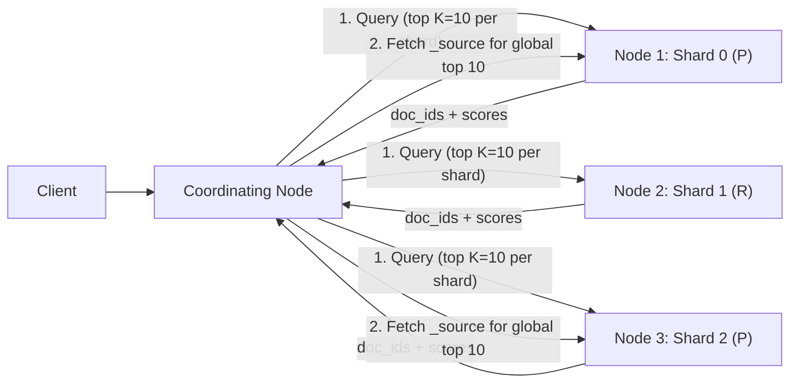
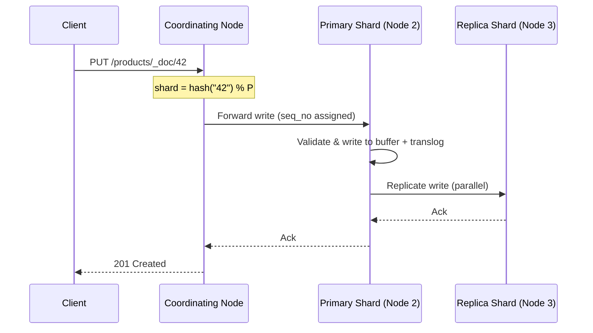
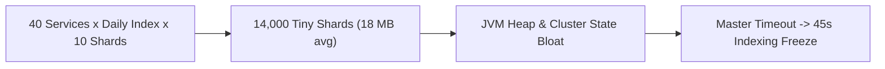

# Elasticsearch / OpenSearch Architecture: Shards, Replicas, Sizing

> **Prerequisites:** [Lesson 02: Inverted Indexes](../02-inverted-indexes/README.md).  
> **Estimated Reading Time:** 24–28 minutes  
> **Target Audience:** Backend and platform engineers designing, sizing, and operating Elasticsearch/OpenSearch clusters, and candidates asked "how do you shard and size a search cluster?"  
> **Free PDF Notes:** [Download SD-P-003.pdf](https://backendroadmap.com/notes/system-design/SD-P-003.pdf)

> [!NOTE]
> **In one line:** An Elasticsearch/OpenSearch index is split into **primary shards** (each a full Lucene instance for horizontal write/storage scaling) and **replica shards** (exact copies for high availability and horizontal read QPS scaling). Queries execute as a two-phase **scatter-gather** (Query-Then-Fetch) across one copy of every shard, while sizing balances shard size (10–50 GB), JVM heap ($\le 31\text{ GB}$), and total shards per node.

> [!TIP]
> **The Golden Rule:** Target **10–50 GB per shard**, keep **$\le 20$ shards per GB of JVM heap**, and **never exceed 31 GB JVM heap** (to preserve 32-bit compressed object pointers). Oversharding wastes heap and slows fan-out; undersharding makes recovery and rebalancing painful.

---

## 1. What Cluster Architecture Is, and What It Isn't

A single Lucene index lives on one machine and tops out at one node's disk, CPU, and RAM. Elasticsearch and OpenSearch wrap Lucene in a distributed cluster: an **index** is a logical namespace partitioned into $P$ **primary shards** (distributed across data nodes) and $R$ **replica sets** ($P \times R$ replica shards). Dedicated **cluster manager (master)** nodes maintain the cluster state (shard placements, mappings) via Raft/Zen2 consensus, while **coordinating** nodes route writes and scatter-gather reads.

| Term | Precise Meaning | Example |
| :--- | :--- | :--- |
| **Index** | Logical collection of documents sharing a mapping | `products_v1`, `logs-2026.11` |
| **Primary shard** | Independent Lucene index holding $1/P$ of the index's documents | `hash(doc_id) % 5` -> Shard 2 |
| **Replica shard** | Asynchronous/sync copy of a primary shard on a different node | Failover + extra read QPS |
| **Cluster manager (master)** | Elects leader, updates cluster state, allocates shards | 3 dedicated small nodes |
| **Coordinating node** | Receives client request, routes writes, merges scatter-gather reads | Any node (or dedicated) |
| **Query-Then-Fetch** | Phase 1: get top-K `(doc_id, score)` from all shards; Phase 2: fetch `_source` for global top-K | Default search execution |
| **Compressed OOPs** | JVM 32-bit pointer compression valid only when heap $< 32\text{ GB}$ | Set `-Xms31g -Xmx31g` max |
| **Not** | A system where adding replicas increases write throughput | Replicas *multiply* write work |

### Why It Matters
1. **Primary shard count is fixed at index creation** (changing it requires reindexing or `_split`/`_shrink`), so getting initial sizing right prevents painful migrations.
2. **Oversharding** (e.g., 1,000 tiny 50 MB shards) is the #1 cause of cluster OOMs and slow cluster-state updates.
3. **Deep pagination** (`from=10000, size=10`) multiplies memory and network cost across every shard in the fan-out.

---

## 2. Anatomy: Write Routing & Query-Then-Fetch Scatter-Gather



**Write path:** The coordinating node computes `shard = hash(_routing_or_id) % number_of_primary_shards`, forwards the write to the **primary shard**, which validates, indexes locally, and replicates in parallel to all **in-sync replica copies** before acknowledging the client.  
**Read path (Query-Then-Fetch):** The coordinating node sends the query to one copy (primary or replica, round-robin/adaptive replica selection) of each of the $P$ shards. Each shard returns its local top $K$ `(doc_id, score)` pairs. The coordinator merges the $P \times K$ results, picks the global top $K$, and fetches full `_source` documents only for those $K$ winners.

| Operation | Scales with Primary Shards ($P$) | Scales with Replicas ($R$) |
| :--- | :--- | :--- |
| **Total storage capacity** | Yes (splits data $P$ ways) | No (multiplies storage by $1 + R$) |
| **Write throughput** | Yes (parallelizes indexing) | No (every replica must also index) |
| **Read QPS** | Partially (more fan-out per query) | Yes (more copies to serve queries) |
| **Single-query latency** | Yes, up to core count (parallel shard scan) | No (only 1 copy per shard is queried) |

> [!WARNING]
> **Dedicated master/cluster-manager nodes are mandatory in production.** If a data node running heavy queries or GC pauses also holds the cluster-manager role, a 30-second GC pause triggers a master election, causing split-brain risk or cluster-wide write stalls. Always run **3 dedicated master-eligible nodes** with no data/ingest load.

---

## 3. Mathematical Model: Shard Sizing, Heap Budget & Fan-Out Cost

**1. Primary Shard Count Formula.**  
Suppose you have $D_{\text{raw}} = 1.2\text{ TB}$ of raw JSON documents. Indexing overhead (inverted index, doc values, stored fields, compression) typically yields an expansion factor $E \approx 1.1\text{–}1.5\times$ (say $E = 1.25$), plus a 20% headroom buffer for segment merges:

$$D_{\text{index}} = D_{\text{raw}} \times E = 1.2\text{ TB} \times 1.25 = 1.5\text{ TB} = 1{,}500\text{ GB}$$

Targeting $S_{\text{shard}} = 30\text{ GB}$ per primary shard (right in the 10–50 GB sweet spot):

$$P = \left\lceil \frac{1{,}500\text{ GB}}{30\text{ GB}} \right\rceil = 50\text{ primary shards}$$

With $R = 1$ replica for HA, total shards $= P \times (1 + R) = 100$ shards, and total storage $= 1{,}500 \times 2 = 3{,}000\text{ GB}$ (plus 20–25% free disk watermark headroom $\rightarrow \approx 4\text{ TB}$ provisioned disk).

**2. Node Count from Heap & Disk Constraints.**  
Each node has 64 GB RAM $\rightarrow$ 31 GB JVM heap (33 GB left for OS page cache). At $\le 20$ shards per GB of heap, each node safely holds $\le 620$ shards (though CPU/disk usually binds earlier). For 4 TB disk with 1 TB NVMe per node:

$$N_{\text{data}} = \left\lceil \frac{4\text{ TB}}{0.8\text{ TB usable}} \right\rceil = 5\text{ data nodes (minimum, } 20\text{ shards/node)}$$

**3. Deep Pagination Fan-Out Cost.**  
To return page `from = F`, `size = K` across $P$ shards, **each** shard must sort and return $F + K$ results, so the coordinator sorts $P \times (F + K)$ items:

$$\text{Coordinator items} = P \times (F + K)$$

For $P = 50$, $F = 10{,}000$, $K = 20$: every single query forces $50 \times 10{,}020 = 501{,}000$ scored doc IDs across the network and into coordinator heap!

---

## 4. Metrics & Percentiles

| Metric | Meaning | Alert when |
| :--- | :--- | :--- |
| **Cluster health** | `green` (all primaries+replicas), `yellow` (missing replicas), `red` (missing primary) | `yellow` $> 5\text{ min}$; `red` immediate page |
| **JVM heap usage** | Old-gen heap % after GC | $> 75\%$ sustained (triggers GC thrashing / circuit breakers) |
| **Disk watermark** | % disk used on data nodes | $> 85\%$ (low watermark stops allocation; 90% read-only) |
| **Search threadpool queue** | Queued search requests waiting for a thread | $> 0$ sustained or any rejections |
| **Shards per GB heap** | Total shards on node / JVM heap GB | $> 20$ shards/GB heap |
| **Query $p_{99}$ latency** | Coordinator end-to-end search time | $> 200\text{ ms}$ (or SLA breach) |

### Worked Example (QPS Scaling with Replicas)
A 3-node cluster hosts 1 index with $P = 3$ primary shards (30 GB each) and $R = 0$ replicas. Each node can execute 200 single-shard queries/sec at 15 ms $p_{95}$, so the cluster handles 200 search QPS (every query hits all 3 shards). Traffic grows to 550 QPS. Adding 2 replicas ($R = 2$, total $3 \times 3 = 9$ shards) and scaling to 9 data nodes gives 3 independent copies of every shard—raising read capacity to $3 \times 200 = 600$ QPS while keeping $p_{95}$ at 15 ms. Note that write throughput does *not* triple; it slightly decreases because each write must now be indexed on 3 nodes instead of 1.

---

## 5. Compounding & Failure Modes: Oversharding, Skew & Split-Brain

| Failure Mode | Mechanism | Blast Radius |
| :--- | :--- | :--- |
| **Oversharding** | Daily indices with 10 shards $\times$ 365 days = 3,650 shards of 5 MB each | Heap exhausted by shard metadata; cluster state updates take seconds |
| **Routing skew (hot shard)** | Routing by `tenant_id` when 1 whale tenant has 80% of docs | 1 node hits 100% CPU/disk while 9 nodes sit idle |
| **Deep pagination (`from > 10,000`)** | $P \times (F+K)$ heap allocation per request | Circuit breaker trips or OOM crash across coordinator |
| **Quorum loss (even master count)** | 2 master-eligible nodes; 1 dies -> no strict majority ($\lfloor 2/2 \rfloor + 1 = 2$) | Cluster freezes all writes and shard allocations |

---

## 6. Numbers Every Engineer Must Know

| Item | Typical | Implication |
| :--- | :---: | :--- |
| Target shard size | 10–50 GB | Best balance of query parallelism and recovery speed |
| Max shards per GB JVM heap | $\le 20$ | Exceeding this causes heap/GC pressure |
| Max JVM heap size | 31 GB (`< 32 GB`) | Crossing 32 GB disables Compressed OOPs (loses ~20% effective heap) |
| Master-eligible nodes | 3 (always odd) | Tolerates 1 failure without losing Raft quorum |
| Default `index.max_result_window` | 10,000 | Protects cluster from deep pagination OOMs |
| Disk watermarks (ES defaults) | 85% low / 90% high / 95% flood | At 95%, indices flip to `read_only_allow_delete` |

---

## 7. Mechanism Deep Dive: Document Routing & Split-Brain Prevention



| Question | Answer |
| :--- | :--- |
| **Why does `number_of_shards` matter forever, while `number_of_replicas` is dynamic?** | Primary routing uses `hash(id) % P`; changing $P$ invalidates where every document lives. Replicas are full copies of existing primaries and can be added/removed live. |
| **Why is `from + size` capped at 10,000?** | Every shard must build a priority queue of size `from + size`. Use `search_after` (cursor-based pagination with a tie-breaker sort key) for deep pagination. |
| **How does Elastic/OpenSearch prevent split-brain?** | Cluster coordination (Zen2/Raft) requires a strict quorum of $\lfloor N/2 \rfloor + 1$ master-eligible nodes (e.g., 2 of 3) to elect a leader and commit cluster state. |
| **What happens to IDF scores across shards?** | Each shard computes its own local IDF! If docs are evenly distributed, local IDF $\approx$ global IDF. For tiny indices, use `search_type=dfs_query_then_fetch` to pre-gather global term frequencies. |

**When not to shard:** If your entire index is under 30 GB and write throughput fits on 1 node, use **1 primary shard** ($P=1$, $R=1\text{ or }2$). A single shard avoids scatter-gather overhead, guarantees exact global BM25 IDF, and has zero cross-shard network fan-out.

---

## 8. Hierarchical Budgets & Design Rules

| Slice | Rule | Control |
| :--- | :--- | :--- |
| **Shard size** | 10–50 GB per shard; 1 primary if total $< 30\text{ GB}$ | ILM / ISM rollover (`max_primary_shard_size: 40gb`) |
| **Heap & RAM** | 50% RAM to JVM heap (max 31 GB), 50% to OS page cache | `-Xms31g -Xmx31g` |
| **Node roles** | 3 dedicated master nodes; separate data & ingest/coordinating if heavy | `node.roles: [master]` vs `[data]` |
| **Pagination** | `from + size <= 10,000`; use `search_after` + PIT for deep scrolls | `index.max_result_window` |
| **Rack awareness** | Spread primaries and replicas across Availability Zones | `cluster.routing.allocation.awareness.attributes: zone` |
| **Disk headroom** | Keep disk usage $< 75\%$ to allow merges and shard recovery | Autoscaling + disk alerts at 75%/85% |

---

## 9. Top Mitigations

1. **Use Index Lifecycle Management (ILM / ISM) rollover** by size (`40gb`) and age (`30d`) instead of creating fixed daily indices with arbitrary shard counts.
2. **Enforce 3 dedicated master nodes** across 3 Availability Zones so query/GC spikes never destabilize cluster state.
3. **Enable shard allocation awareness (`zone`)** so a primary and its replica never land in the same AZ.
4. **Replace deep `from`/`size` pagination with `search_after` + Point-In-Time (PIT)** for infinite scroll or exports.
5. **Never cross 31 GB JVM heap**; scale horizontally with more 64 GB RAM nodes rather than 256 GB monsters with 128 GB heap.
6. **Use `adaptive_replica_selection`** (enabled by default in modern versions) so slow/GC-ing nodes are bypassed automatically.
7. **Set `number_of_replicas >= 1`** in production; `R = 0` means a single disk failure causes permanent data loss.

---

## 10. Production Reference: The 14,000-Shard Cluster Freeze

A fast-growing fintech logged every microservice's daily events into separate indices (`svc-<name>-YYYY.MM.DD`), each with the old default of 5 primary shards + 1 replica = 10 shards/day/service. Across 40 services and 35 days of retention, the 12-node cluster accumulated **14,000 shards** averaging just 18 MB each. Cluster state grew to tens of megabytes, master elections timed out, and adding a single new field mapping froze all indexing across the cluster for 45 seconds.



**Root Cause:** Per-service daily indices with 5 primaries created 1,166 shards per node (~39 shards/GB heap), starving heap and overloading cluster-state propagation.  
**Fix:** Consolidated into shared data streams by tier (`logs-app-default`) with `1` primary shard and ILM rollover at `40 GB` or `7d`. Shard count dropped from **14,000 to 180**, JVM heap dropped from 84% to 38%, and $p_{99}$ search latency fell 4x.

---

## 11. Multi-Language Production Code Tabs

A production-style **Shard Router & Query-Then-Fetch Coordinator** demonstrating deterministic document routing, scatter-gather top-K merging, and cluster sizing calculation in all four languages.

````carousel
```go
// Go: deterministic shard routing + Query-Then-Fetch coordinator merge.
package main

import (
	"fmt"
	"hash/fnv"
	"sort"
)

type Hit struct {
	DocID string
	Score float64
	Shard int
}

func RouteShard(docID string, numPrimaries int) int {
	h := fnv.New32a()
	_, _ = h.Write([]byte(docID))
	return int(h.Sum32()) % numPrimaries
}

// QueryThenFetch simulates gathering local top-K from each shard and merging globally.
func QueryThenFetch(shardResults [][]Hit, k int) []Hit {
	var merged []Hit
	for _, sr := range shardResults {
		merged = append(merged, sr...)
	}
	sort.Slice(merged, func(i, j int) bool {
		return merged[i].Score > merged[j].Score
	})
	if len(merged) > k {
		merged = merged[:k]
	}
	return merged
}

func main() {
	fmt.Println("doc-992 routes to shard:", RouteShard("doc-992", 5))
	top := QueryThenFetch([][]Hit{
		{{DocID: "a", Score: 4.2, Shard: 0}, {DocID: "b", Score: 2.1, Shard: 0}},
		{{DocID: "c", Score: 5.8, Shard: 1}, {DocID: "d", Score: 3.9, Shard: 1}},
	}, 2)
	fmt.Println("Global top 2:", top)
}
```
<!-- slide -->
```typescript
// TypeScript: shard routing, sizing calculator, and Query-Then-Fetch merge.
export interface ShardHit {
  docId: string;
  score: number;
  shard: number;
}

export function routeShard(docId: string, numPrimaries: number): number {
  let hash = 2166136261;
  for (let i = 0; i < docId.length; i++) {
    hash ^= docId.charCodeAt(i);
    hash = Math.imul(hash, 16777619);
  }
  return (hash >>> 0) % numPrimaries;
}

export function recommendShards(rawGb: number, expansion = 1.25, targetShardGb = 30): number {
  const indexGb = rawGb * expansion;
  return Math.max(1, Math.ceil(indexGb / targetShardGb));
}

export function queryThenFetchMerge(shardTopKs: ShardHit[][], k: number): ShardHit[] {
  return shardTopKs
    .flat()
    .sort((a, b) => b.score - a.score)
    .slice(0, k);
}

console.log("Recommended primaries for 1200 GB:", recommendShards(1200)); // 50
```
<!-- slide -->
```python
# Python: cluster shard sizing calculator + Query-Then-Fetch scatter-gather simulator.
import hashlib
import heapq
import math

def route_shard(doc_id: str, num_primaries: int) -> int:
    digest = hashlib.md5(doc_id.encode("utf-8")).digest()
    return int.from_bytes(digest[:4], "big") % num_primaries

def size_cluster(raw_gb: float, expansion: float = 1.25, target_shard_gb: float = 30.0,
                 replicas: int = 1, node_heap_gb: int = 31) -> dict:
    index_gb = raw_gb * expansion
    primaries = max(1, math.ceil(index_gb / target_shard_gb))
    total_shards = primaries * (1 + replicas)
    total_disk_gb = index_gb * (1 + replicas) / 0.75  # keep 25% disk headroom
    min_nodes_by_heap = math.ceil(total_shards / (node_heap_gb * 20))
    return {
        "primaries": primaries,
        "total_shards": total_shards,
        "provisioned_disk_gb": round(total_disk_gb),
        "min_nodes_by_heap": min_nodes_by_heap,
    }

def query_then_fetch(shard_hits: list[list[tuple[float, str]]], k: int) -> list[tuple[float, str]]:
    # Each shard returns its local top-k; coordinator merges globally in O(P*k log k)
    return heapq.nlargest(k, (hit for shard in shard_hits for hit in shard), key=lambda x: x[0])

if __name__ == "__main__":
    print(size_cluster(1200))
    print(query_then_fetch([[(4.2, "a"), (2.1, "b")], [(5.8, "c"), (3.9, "d")]], k=2))
```
<!-- slide -->
```csharp
// C#: deterministic shard router and Query-Then-Fetch top-K coordinator.
using System;
using System.Collections.Generic;
using System.Linq;
using System.Security.Cryptography;
using System.Text;

public sealed record ShardHit(string DocId, double Score, int Shard);

public static class ClusterCoordinator
{
    public static int RouteShard(string docId, int numPrimaries)
    {
        var hash = SHA256.HashData(Encoding.UTF8.GetBytes(docId));
        uint val = BitConverter.ToUInt32(hash, 0);
        return (int)(val % (uint)numPrimaries);
    }

    public static List<ShardHit> QueryThenFetch(IEnumerable<IEnumerable<ShardHit>> shardHits, int k)
    {
        return shardHits
            .SelectMany(x => x)
            .OrderByDescending(h => h.Score)
            .Take(k)
            .ToList();
    }
}
```
````

---

## 12. Hands-On CLI Verification Workflows

Inspect cluster health, shard distribution, heap usage, and Query-Then-Fetch behavior:

```bash
# 1. Check cluster health and unassigned shards
curl -s "localhost:9200/_cluster/health?pretty"

# 2. List shard placement, state, and size across nodes
curl -s "localhost:9200/_cat/shards?v&s=store:desc"

# 3. Check JVM heap %, CPU, and disk usage per node
curl -s "localhost:9200/_cat/nodes?v&h=name,node.role,heap.percent,ram.percent,disk.used_percent,cpu"

# 4. Run search with dfs_query_then_fetch for exact global IDF on small indices
curl -s "localhost:9200/products/_search?search_type=dfs_query_then_fetch&pretty" \
  -H "Content-Type: application/json" \
  -d '{"query":{"match":{"title":"running shoes"}}}'
```

---

## 13. Common Mistakes to Avoid

1. **Oversharding** (hundreds of tiny shards per node), exhausting JVM heap and slowing cluster state.
2. **Crossing 32 GB JVM heap**, silently disabling Compressed OOPs and wasting ~20% of memory.
3. **Running `number_of_replicas: 0` in production**, turning any single node disk failure into data loss.
4. **Co-locating master and data roles** on the same nodes, causing GC-induced master elections.
5. **Using deep `from + size` pagination** (`from=50000`) instead of `search_after` + Point-In-Time.
6. **Ignoring Availability Zone awareness**, allowing a primary and its replica on the same AZ/rack.
7. **Letting disk usage cross 85–90%**, triggering flood-stage read-only index locks.

---

## 14. Key Terms Glossary

| Key Term | Definition |
| :--- | :--- |
| **Primary shard** | Authoritative partition of an index (one full Lucene instance); count fixed at creation. |
| **Replica shard** | Copy of a primary shard providing failover and parallel read QPS. |
| **Cluster manager (master)** | Node elected via Raft/Zen2 to manage cluster state and shard allocation. |
| **Coordinating node** | Node that routes writes and executes scatter-gather reads. |
| **Query-Then-Fetch** | Two-phase search: gather `(doc_id, score)` from all shards, then fetch `_source` for top K. |
| **Compressed OOPs** | JVM optimization using 32-bit object references when heap is $< 32\text{ GB}$. |
| **Data stream / ILM** | Automated index rollover based on shard size (e.g., 40 GB) and age. |
| **Allocation awareness** | Rule preventing primaries and replicas from landing in the same AZ/rack. |
| **Disk watermark** | Thresholds (85%/90%/95%) that stop shard allocation or lock writes to protect disk. |
| **`search_after`** | Cursor-based deep pagination avoiding $O(P \times (F+K))$ heap blowups. |

---

## 15. System Design Interview Questions & Answers

### Basic Conceptual Questions

<details>
<summary><strong>Q1: What is the difference between a primary shard and a replica shard? [BASIC]</strong></summary>

**Answer:**
A primary shard holds a partition ($1/P$) of the index's documents and handles initial writes. A replica shard is a full copy of a primary shard on another node; it provides high availability (promoted to primary if the primary dies) and scales read QPS. Replicas do *not* increase write throughput because every write must still be indexed on all replicas.
</details>

<details>
<summary><strong>Q2: Why can you change <code>number_of_replicas</code> dynamically, but not <code>number_of_shards</code>? [BASIC]</strong></summary>

**Answer:**
Document routing uses `hash(doc_id) % number_of_shards`. Changing the primary shard count would change the modulo result for almost every document, making existing documents unreachable. Replicas simply copy existing primaries, so they can be added or removed at any time.
</details>

<details>
<summary><strong>Q3: Explain Query-Then-Fetch in Elasticsearch/OpenSearch. [BASIC]</strong></summary>

**Answer:**
In Phase 1 (Query), the coordinating node fans out the query to one copy of every shard; each shard returns only its local top-K `(doc_id, score)` pairs. The coordinator merges them to find the global top K. In Phase 2 (Fetch), the coordinator requests the full `_source` JSON only for those K winning documents.
</details>

<details>
<summary><strong>Q4: What is the target shard size and why? [BASIC]</strong></summary>

**Answer:**
10–50 GB per shard. Shards much smaller than 10 GB waste JVM heap on segment/shard metadata (oversharding). Shards much larger than 50 GB take too long to copy across the network during node recovery or rebalancing.
</details>

### Scenario-Based Architecture Questions

<details>
<summary><strong>Q5: You need to store 3 TB of product/log data with 1 replica. How do you size the primaries, nodes, and heap? [SCENARIO]</strong></summary>

**Answer:**
At 1.25x index expansion, 3 TB raw $\approx 3.75\text{ TB}$ primary data. Targeting 35–40 GB per shard gives ~100 primary shards (or ~100 GB/shard if read-light logs, ~40 primaries). With 1 replica, total data is 7.5 TB; keeping 25% disk headroom requires 10 TB disk. Using 6 nodes with 2 TB NVMe and 64 GB RAM each (31 GB JVM heap, 33 GB OS page cache) yields ~33 shards/node—well under the 620-shard heap ceiling.
</details>

<details>
<summary><strong>Q6: Search QPS tripled and CPU is maxed out, but writes are low. How do you scale without reindexing? [SCENARIO]</strong></summary>

**Answer:**
Add data nodes and increase `index.number_of_replicas` (e.g., from 1 to 2 or 3). Because queries only hit one copy of each shard, more replicas spread read QPS across more nodes immediately with zero reindexing.
</details>

<details>
<summary><strong>Q7: Users paginate to page 500 (<code>from=10000, size=20</code>) and nodes are hitting circuit-breaker errors. Why, and how do you fix it? [SCENARIO]</strong></summary>

**Answer:**
Across $P$ shards, every shard must score, sort, and return $10{,}020$ doc IDs, forcing the coordinator to sort $P \times 10{,}020$ items in heap. Fix it by capping `index.max_result_window` at 10,000 and switching deep pagination / exports to `search_after` with a Point-In-Time (PIT) snapshot.
</details>

<details>
<summary><strong>Q8: A single node in a 10-node cluster is at 95% CPU while the others are at 10%. What happened? [SCENARIO]</strong></summary>

**Answer:**
Hot-shard skew: either custom `_routing` (e.g., by `tenant_id`) placed a massive tenant onto one shard, or one shard happens to hold a hot time/key range. Fix it by splitting the hot tenant across `routing_partition_size > 1` or moving the whale tenant to its own dedicated index.
</details>

### Advanced & Tricky Interview Questions

<details>
<summary><strong>Q9: Why should you never set Elasticsearch JVM heap above 31 GB (even on a 256 GB RAM server)? [TRICKY]</strong></summary>

**Answer:**
Below 32 GB, the JVM uses **Compressed OOPs** (32-bit pointers addressing up to 32 GB via 8-byte alignment). Crossing 32 GB forces 64-bit pointers, increasing object header and pointer memory by ~20–25%—meaning a 38 GB heap actually holds *less* data than a 31 GB heap while incurring longer GC pauses.
</details>

<details>
<summary><strong>Q10: Why can BM25 relevance scores look slightly wrong on a tiny multi-shard index? [TRICKY]</strong></summary>

**Answer:**
By default (`query_then_fetch`), each shard computes IDF using only its *local* document frequencies. On large indices with uniform random routing, local IDF $\approx$ global IDF. On small indices (e.g., 500 docs across 10 shards), random skew can distort local IDF. Use `1` shard for small indices, or `search_type=dfs_query_then_fetch` to aggregate global term frequencies first.
</details>

<details>
<summary><strong>Q11: What happens during a network partition if you configure 2 master-eligible nodes? [TRICKY]</strong></summary>

**Answer:**
With 2 master-eligible nodes, quorum is $\lfloor 2/2 \rfloor + 1 = 2$. If the two nodes are partitioned—or if just 1 node dies—neither side has 2 nodes, so the cluster loses quorum and stops all writes and shard allocations. Always use **3** (or an odd number) of dedicated master-eligible nodes.
</details>

<details>
<summary><strong>Q12: How does <code>_split</code> work if primary shard count is "fixed"? [TRICKY]</strong></summary>

**Answer:**
The `_split` API creates a *new* read-only-source-backed target index with a multiple of the original primary shard count (e.g., $2 \rightarrow 4$ or $2 \rightarrow 6$), hard-links the Lucene segments, and deletes non-matching docs in each split shard. It only works by integer multiples and requires the source index to be read-only during the split.
</details>

---

## 16. One-Page Master Cheat Sheet

```
+---------------------------------------------------------------------------------------------------------+
|                    ELASTICSEARCH / OPENSEARCH ARCHITECTURE — MASTER CHEAT SHEET                         |
+---------------------------------------------------------------------------------------------------------+
| 1. SHARDS: Primary = 1/P of data (fixed at creation). Replica = full copy (dynamic, scales read QPS).   |
+---------------------------------------------------------------------------------------------------------+
| 2. SIZING: 10–50 GB per shard · <= 20 shards/GB heap · JVM heap <= 31 GB (Compressed OOPs) + 50% OS RAM.|
+---------------------------------------------------------------------------------------------------------+
| 3. WRITE PATH: hash(id) % P -> Primary -> parallel replicate to In-Sync Replicas -> Ack.                |
+---------------------------------------------------------------------------------------------------------+
| 4. READ PATH: Query-Then-Fetch (scatter top-K doc_ids -> global merge -> fetch _source for K winners).  |
+---------------------------------------------------------------------------------------------------------+
| 5. TOPOLOGY: 3 dedicated master nodes (odd quorum) + AZ allocation awareness + ILM size rollover.       |
+---------------------------------------------------------------------------------------------------------+
| 6. PAGINATION: Never deep `from + size` (O(P*(F+K))). Use `search_after` + Point-In-Time (PIT).         |
+---------------------------------------------------------------------------------------------------------+
```

---

## Further Reading & Sources

- Elasticsearch Reference, [Size Your Shards](https://www.elastic.co/guide/en/elasticsearch/reference/current/size-your-shards.html) and [Heap Size Settings](https://www.elastic.co/guide/en/elasticsearch/reference/current/advanced-configuration.html#set-jvm-heap-size).
- OpenSearch Documentation, [Cluster Formation & Shard Allocation](https://opensearch.org/docs/latest/tuning-your-cluster/).
- Clinton Gormley & Zachary Tong, *Elasticsearch: The Definitive Guide*, "Distributed Document Store" & "Distributed Search Execution".
- Martin Kleppmann, *Designing Data-Intensive Applications*, Chapter 6 ("Partitioning").

---

## Free PDF Notes

[SD-P-003.pdf](https://backendroadmap.com/notes/system-design/SD-P-003.pdf)

---

## Next

Continue with [Lesson 04: Search Ranking & Relevance: TF-IDF, BM25, Boosting, Learning to Rank](../04-search-ranking-relevance/README.md).
