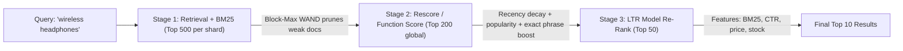
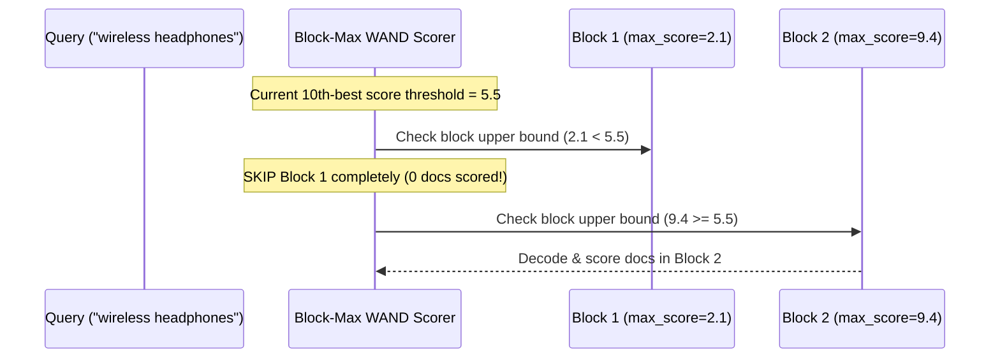
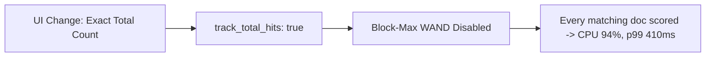

# Search Ranking & Relevance: TF-IDF, BM25, Boosting, Learning to Rank

> **Prerequisites:** [Lesson 03: Elasticsearch / OpenSearch Architecture](../03-elasticsearch-opensearch-architecture/README.md).  
> **Estimated Reading Time:** 25–28 minutes  
> **Target Audience:** Backend and search engineers tuning relevance, and candidates asked "how does BM25 work and how do you rank search results?"  
> **Free PDF Notes:** [Download SD-P-004.pdf](https://backendroadmap.com/notes/system-design/SD-P-004.pdf)

> [!NOTE]
> **In one line:** **BM25** is the default lexical scoring formula: it rewards documents where query terms appear frequently (with **diminishing returns** via $k_1$), penalizes overly long documents (via $b$), and weights rare terms higher via **IDF**. Production search layers **field boosting / recency decay** on top of BM25, and optionally **Learning to Rank (LTR)** to re-rank the top-K candidates using behavioral and business signals.

> [!TIP]
> **The Golden Rule:** Never tune relevance blind. Build a **200-query golden evaluation set** with human/click-derived relevance grades and measure **NDCG@10** before and after every BM25, boost, or LTR change.

---

## 1. What Search Ranking Is, and What It Isn't

Finding all 50,000 documents that contain `"wireless headphones"` is a **retrieval** problem (solved by the inverted index). Ordering those 50,000 documents so the best 10 appear on page 1 is a **ranking** problem. Naive TF-IDF fails because a 5,000-word spammy blog post repeating `"headphones"` 80 times outscores a crisp 12-word product title `"Sony WH-1000XM5 Wireless Headphones"`.

| Term | Precise Meaning | Example |
| :--- | :--- | :--- |
| **TF (Term Frequency)** | How often term $t$ appears in document $d$ | `"shoes"` appears 3 times in doc 42 |
| **IDF (Inverse Document Frequency)** | How rare term $t$ is across the corpus of $N$ docs | `"titanium"` has higher IDF than `"the"` |
| **BM25 (Okapi BM25)** | Probabilistic ranking with TF saturation ($k_1$) and length norm ($b$) | Default scorer in Lucene / ES / OpenSearch |
| **Field boosting** | Multiplying or weighting matches in high-signal fields | `title^3` vs `description^1` |
| **Function score / decay** | Blending lexical score with recency, popularity, or margin | Exponential decay on `published_at` |
| **Block-Max WAND** | Dynamic pruning algorithm skipping low-scoring docs in top-K | Cuts query latency 3–10x |
| **Learning to Rank (LTR)** | ML model (LambdaMART / XGBoost) re-ranking top $K$ candidates | Top 200 BM25 hits re-ordered by clicks/CVR |
| **Not** | A pure ML problem on day one | BM25 + clean schema beats naive ML without labels |

### Why It Matters
1. Moving a relevant result from position 4 to position 1 typically increases click-through rate (CTR) by 2–3x.
2. BM25's saturation ($k_1$) and length normalization ($b$) directly stop keyword stuffing.
3. Multi-stage ranking (BM25 retrieval $\rightarrow$ LTR re-ranking) gives ML-grade relevance at sub-50 ms latency.

---

## 2. Anatomy: Multi-Stage Search Ranking Pipeline



Why not run the heavy ML model (Stage 3) over all 50,000 matching documents? Because computing 40 features and running a boosted tree or neural cross-encoder takes ~0.2–2 ms *per document*: on 50,000 docs that is 10–100 seconds. Running BM25 with **Block-Max WAND** retrieves the top 200–500 candidates in 8 ms, and LTR re-ranks just those 200 candidates in 6 ms.

| Stage | Input Size | Scoring Cost / Doc | Typical Latency | Purpose |
| :--- | :--- | :--- | :--- | :--- |
| **1. BM25 + WAND** | Millions of docs | Nanoseconds (inverted index) | 5–15 ms | High recall, fast lexical ranking |
| **2. Rescore / Boost** | Top 200–500 | Microseconds | 2–5 ms | Phrase boosts, business signals, decay |
| **3. LTR (LambdaMART)** | Top 50–200 | ~50–100 $\mu$s | 5–15 ms | Behavioral & multi-feature optimization |

> [!WARNING]
> **Unbounded multiplicative boosts destroy lexical relevance.** If you multiply `bm25_score * popularity_count`, a wildly popular `"USB-C Cable"` with 100,000 sales will outrank a niche `"Thunderbolt 4 Dock"` even when the user explicitly searched `"Thunderbolt 4 Dock"`. Always bound business boosts with `log1p()` or `saturation()` and use `boost_mode: sum` or capped weights.

---

## 3. Mathematical Model: TF-IDF vs BM25 & NDCG@K

**1. BM25 Formula.**  
For a query $Q$ containing terms $q_1, \dots, q_n$ and a document $D$ of length $|D|$ (corpus average length $\text{avgdl}$):

$$\text{BM25}(D, Q) = \sum_{i=1}^{n} \text{IDF}(q_i) \cdot \frac{f(q_i, D) \cdot (k_1 + 1)}{f(q_i, D) + k_1 \cdot \left(1 - b + b \cdot \frac{|D|}{\text{avgdl}}\right)}$$

Where:
$$\text{IDF}(q_i) = \ln\left(1 + \frac{N - n(q_i) + 0.5}{n(q_i) + 0.5}\right)$$

Defaults in Lucene/Elasticsearch: $k_1 = 1.2$ (TF saturation), $b = 0.75$ (length normalization).

**Worked Numerical Example:**  
Suppose a catalog has $N = 1{,}000{,}000$ products with $\text{avgdl} = 10$ words in `title`. Query is `"titanium"` ($n(q) = 1{,}000$ docs).
1. **IDF:**
$$\text{IDF}(\text{"titanium"}) = \ln\left(1 + \frac{1{,}000{,}000 - 1{,}000 + 0.5}{1{,}000 + 0.5}\right) = \ln(1 + 998.5) \approx 6.907$$
2. **Doc A (concise title, $|D|=10$, $f=1$):**
$$\text{TF}_{\text{norm}} = \frac{1 \times (1.2 + 1)}{1 + 1.2 \times (1 - 0.75 + 0.75 \times \frac{10}{10})} = \frac{2.2}{2.2} = 1.000 \implies \text{Score}_A = 6.907$$
3. **Doc B (stuffed title, $|D|=10$, $f=10$):**
$$\text{TF}_{\text{norm}} = \frac{10 \times 2.2}{10 + 1.2} = \frac{22}{11.2} = 1.964 \implies \text{Score}_B = 13.565$$
Even with **10x** more repetitions, Doc B only scores **1.96x** higher (whereas linear TF-IDF would give 10x), and as $f \to \infty$, $\text{TF}_{\text{norm}}$ saturates at $k_1 + 1 = 2.2$.

**2. NDCG@K (Normalized Discounted Cumulative Gain).**  
Used to evaluate ranking quality against graded relevance labels $rel_i \in \{0, 1, 2, 3\}$:

$$\text{DCG@}K = \sum_{i=1}^{K} \frac{2^{rel_i} - 1}{\log_2(i + 1)}, \qquad \text{NDCG@}K = \frac{\text{DCG@}K}{\text{IDCG@}K}$$

An NDCG@10 of `1.0` means the top 10 results match the ideal ordering.

---

## 4. Metrics & Percentiles

| Metric | Meaning | Alert when |
| :--- | :--- | :--- |
| **NDCG@10** | Offline ranking quality vs graded golden set | Drops $> 0.02$ on CI evaluation |
| **MRR (Mean Reciprocal Rank)** | $1 / \text{rank of first relevant hit}$ | Drops for navigational/SKU queries |
| **CTR@1 / CTR@3** | Click-through rate on top 1 / top 3 results | Drops after deployment (online A/B) |
| **Mean Abandonment Rate** | % of searches with zero clicks | $> 20\%$ (results irrelevant or zero hits) |
| **Rescore / LTR latency $p_{99}$** | Extra time spent in Stage 2/3 re-ranking | $> 25\text{ ms}$ |
| **Total hits exact vs tracked** | Whether Block-Max WAND early termination is active | `track_total_hits: true` slowing $p_{99}$ |

### Worked Example (`track_total_hits` + Block-Max WAND)
An e-commerce search page displays `"10,000+ results"` and sorts by BM25 relevance. With `track_total_hits: 10000` (the ES default), Block-Max WAND skips any postings block whose maximum possible BM25 score is lower than the current 10th-best score—cutting $p_{99}$ latency from **140 ms to 18 ms**. When a developer sets `track_total_hits: true` to show `"Showing 482,911 results"`, WAND is forced to disable early termination and score all 482,911 docs, spiking $p_{99}$ back to 140 ms.

---

## 5. Compounding & Failure Modes: Relevance Anti-Patterns

| Failure Mode | Mechanism | Impact |
| :--- | :--- | :--- |
| **`track_total_hits: true` on high QPS** | Disables Block-Max WAND pruning | 3–8x higher CPU & $p_{99}$ latency |
| **Unbounded `field_value_factor`** | Raw `sales_count` overwhelms BM25 | Irrelevant bestsellers hijack specific queries |
| **`b = 0.75` on short uniform fields** | Short 1-word titles get over-boosted vs 4-word exact matches | Single-word noise outranks full product names |
| **Position bias in LTR training** | Training on raw clicks without propensity weighting | Model learns "position 1 is good" instead of relevance |

---

## 6. Numbers Every Engineer Must Know

| Item | Typical | Implication |
| :--- | :---: | :--- |
| Default BM25 $k_1$ | `1.2` | Saturation around 3–5 occurrences |
| Default BM25 $b$ | `0.75` | Set lower (`0.2–0.4`) for short titles/tags |
| Block-Max WAND speedup | 3x–10x faster top-K | Only works when sorting by `_score` without `track_total_hits: true` |
| Rescore window size | 100–500 docs per shard | Keeps Stage 2/3 under ~15 ms |
| Golden evaluation set size | 200–1,000 queries | Minimum for statistically reliable NDCG@10 |
| LTR feature count | 15–50 features | BM25 per field, exact match, CTR, freshness, price |

---

## 7. Mechanism Deep Dive: Block-Max WAND & BM25 Field Boosting



| Question | Answer |
| :--- | :--- |
| **How does `multi_match` (`best_fields` vs `most_fields` vs `cross_fields`) work?** | `best_fields` takes the highest-scoring field (good for `"title"` vs `"body"`). `most_fields` sums scores across fields (good for multiple language/synonym sub-fields). `cross_fields` treats fields like one combined field (essential for `"John Doe"` split across `first_name` and `last_name`). |
| **When should you tune `k1` and `b`?** | On short, structured fields like `product_title` or `tags`, lower `b` (e.g., `0.25`) so a 2-word title doesn't unfairly crush a 6-word descriptive title; lower `k1` (e.g., `0.8`) if repetition shouldn't matter much. |
| **When is Learning to Rank (LTR) worth the complexity?** | Only *after* you have clean analyzers, solid BM25 field boosts, and reliable click/conversion logs. Without good features and de-biased click labels, LTR overfits. |

**When not to use BM25:** Do not use BM25 for exact lookups (`sku = "NK-402"`), sorting by price/date (use `filter` context + `sort`), or semantic similarity where keywords don't overlap (use Vector / Hybrid Search, Lessons 09–11).

---

## 8. Hierarchical Budgets & Design Rules

| Slice | Rule | Control |
| :--- | :--- | :--- |
| **Evaluation** | Never ship a ranking change without offline NDCG@10 + online A/B | Golden query set in CI |
| **Early termination** | Keep `track_total_hits: 10000` (never `true` on hot path) | Search query template |
| **Business boosts** | Wrap popularity/margin in `log1p` or `saturation` | `function_score` / `rank_feature` |
| **Rescore window** | Cap `window_size` at 100–500 docs for phrase/LTR rescoring | `rescore.window_size` |
| **BM25 tuning** | Lower `b` (`0.2–0.4`) on short titles; keep `0.75` on long prose | Per-field `similarity` config |
| **Exactness** | Boost exact phrase (`match_phrase` with `slop`) in `should` or `rescore` | `bool.should` / `rescore` |

---

## 9. Top Mitigations

1. **Keep `track_total_hits` capped** (e.g., `10000`) so Block-Max WAND can skip non-competitive postings blocks.
2. **Use `rank_feature` fields** for static popularity/PageRank boosts—they integrate directly into Block-Max WAND instead of forcing full scans like `script_score`.
3. **Always bound business signals** (`log1p(sales)`, `sigmoid`, or `saturation`) so popularity never overrides query relevance.
4. **Use `cross_fields` for entity/name/address queries** so `"Alice Smith"` matches `first_name: Alice` + `last_name: Smith`.
5. **Debug unexpected rankings with `?explain=true`** (only in staging/debug, never in prod high-QPS) to inspect exact TF, IDF, and boost math.
6. **Separate retrieval from re-ranking**: let BM25 fetch top 200 candidates, then apply expensive phrase boosts or LTR only on those 200.

---

## 10. Production Reference: The `track_total_hits: true` Latency Spike

A media streaming site added a `"Showing 1,420,912 results"` counter to their search UI by setting `track_total_hits: true` on all search queries. Within an hour of deployment, cluster CPU jumped from 35% to 94% and $p_{99}$ search latency spiked from 32 ms to 410 ms.



**Root Cause:** `track_total_hits: true` forced Lucene to visit and count every matching postings entry instead of letting Block-Max WAND skip blocks below the top-10 score threshold.  
**Fix:** Reverted `track_total_hits` to `10000` and updated the UI to display `"10,000+ results"` when `hits.total.relation == "gte"`. CPU immediately dropped back to 36% and $p_{99}$ returned to 30 ms.

---

## 11. Multi-Language Production Code Tabs

A complete **BM25 Scorer + Bounded Popularity Boost + NDCG@K Evaluator** in all four languages, zero external dependencies.

````carousel
```go
// Go: Okapi BM25 scorer with bounded popularity boost.
package main

import (
	"fmt"
	"math"
)

func BM25TermScore(tf, docLen, avgDL int, df, totalDocs int, k1, b float64) float64 {
	idf := math.Log(1.0 + (float64(totalDocs)-float64(df)+0.5)/(float64(df)+0.5))
	norm := 1.0 - b + b*(float64(docLen)/avgDLFloat(avgDL))
	tfPart := (float64(tf) * (k1 + 1.0)) / (float64(tf) + k1*norm)
	return idf * tfPart
}

func avgDLFloat(v int) float64 {
	if v <= 0 {
		return 1.0
	}
	return float64(v)
}

func BoundedBoost(bm25 float64, sales int, weight float64) float64 {
	return bm25 + weight*math.Log1p(float64(sales))
}

func main() {
	s1 := BM25TermScore(1, 10, 10, 1000, 1_000_000, 1.2, 0.75)
	s2 := BM25TermScore(10, 10, 10, 1000, 1_000_000, 1.2, 0.75)
	fmt.Printf("f=1: %.3f | f=10 (saturated): %.3f\n", s1, s2)
	fmt.Printf("With bounded boost: %.3f\n", BoundedBoost(s1, 500, 0.2))
}
```
<!-- slide -->
```typescript
// TypeScript: BM25 scorer + NDCG@K evaluator.
export function bm25Term(
  tf: number,
  docLen: number,
  avgDl: number,
  df: number,
  totalDocs: number,
  k1 = 1.2,
  b = 0.75
): number {
  const idf = Math.log(1 + (totalDocs - df + 0.5) / (df + 0.5));
  const norm = 1 - b + b * (docLen / avgDl);
  const tfNorm = (tf * (k1 + 1)) / (tf + k1 * norm);
  return idf * tfNorm;
}

export function ndcgAtK(relevances: number[], k: number): number {
  const dcg = (rels: number[]) =>
    rels.slice(0, k).reduce((acc, rel, i) => acc + (2 ** rel - 1) / Math.log2(i + 2), 0);
  const ideal = [...relevances].sort((a, b) => b - a);
  const idcg = dcg(ideal);
  return idcg === 0 ? 0 : dcg(relevances) / idcg;
}

console.log("BM25 (tf=1):", bm25Term(1, 10, 10, 1000, 1_000_000).toFixed(3));
console.log("NDCG@4:", ndcgAtK([3, 1, 2, 0], 4).toFixed(3));
```
<!-- slide -->
```python
# Python: BM25 scorer, saturation boost, and NDCG@K metric (stdlib only).
import math

def bm25_term(tf: int, doc_len: int, avg_dl: float, df: int, total_docs: int,
              k1: float = 1.2, b: float = 0.75) -> float:
    idf = math.log(1.0 + (total_docs - df + 0.5) / (df + 0.5))
    norm = 1.0 - b + b * (doc_len / avg_dl)
    tf_norm = (tf * (k1 + 1.0)) / (tf + k1 * norm)
    return idf * tf_norm

def ndcg_at_k(relevances: list[int], k: int) -> float:
    def dcg(rels: list[int]) -> float:
        return sum((2 ** r - 1) / math.log2(i + 2) for i, r in enumerate(rels[:k]))
    idcg = dcg(sorted(relevances, reverse=True))
    return 0.0 if idcg == 0 else dcg(relevances) / idcg

if __name__ == "__main__":
    a = bm25_term(1, 10, 10.0, 1000, 1_000_000)
    b = bm25_term(10, 10, 10.0, 1000, 1_000_000)
    print(f"BM25 tf=1: {a:.3f}, tf=10: {b:.3f}, ratio: {b/a:.2f}x")
    print(f"NDCG@4: {ndcg_at_k([3, 1, 2, 0], 4):.3f}")
```
<!-- slide -->
```csharp
// C#: BM25 term scorer and NDCG@K evaluation.
using System;
using System.Collections.Generic;
using System.Linq;

public static class RankingMath
{
    public static double Bm25Term(int tf, int docLen, double avgDl, int df, int totalDocs, double k1 = 1.2, double b = 0.75)
    {
        double idf = Math.Log(1.0 + (totalDocs - df + 0.5) / (df + 0.5));
        double norm = 1.0 - b + b * (docLen / avgDl);
        double tfNorm = (tf * (k1 + 1.0)) / (tf + k1 * norm);
        return idf * tfNorm;
    }

    public static double NdcgAtK(IReadOnlyList<int> relevances, int k)
    {
        double Dcg(IEnumerable<int> rels) =>
            rels.Take(k).Select((r, i) => (Math.Pow(2, r) - 1.0) / Math.Log2(i + 2)).Sum();
        double idcg = Dcg(relevances.OrderByDescending(x => x));
        return idcg == 0 ? 0.0 : Dcg(relevances) / idcg;
    }
}
```
````

---

## 12. Hands-On CLI Verification Workflows

Inspect BM25 scoring breakdown, tune `k1`/`b`, and test `rescore` queries:

```bash
# 1. Explain exactly how a document's BM25 score was computed (staging/debug only!)
curl -s "localhost:9200/products/_search?pretty" \
  -H "Content-Type: application/json" \
  -d '{
    "explain": true,
    "query": {
      "multi_match": {
        "query": "wireless headphones",
        "fields": ["title^3", "description"]
      }
    }
  }'

# 2. Rescore top 200 hits with an exact phrase boost
curl -s "localhost:9200/products/_search?pretty" \
  -H "Content-Type: application/json" \
  -d '{
    "query": { "match": { "title": "wireless headphones" } },
    "rescore": {
      "window_size": 200,
      "query": {
        "rescore_query": { "match_phrase": { "title": { "query": "wireless headphones", "slop": 1 } } },
        "query_weight": 0.7,
        "rescore_query_weight": 1.5
      }
    }
  }'
```

---

## 13. Common Mistakes to Avoid

1. **Shipping relevance changes without an offline golden query set and NDCG@10 check.**
2. **Enabling `track_total_hits: true`**, silently disabling Block-Max WAND.
3. **Multiplying BM25 by raw popularity/sales**, letting bestsellers hijack specific queries.
4. **Using `explain: true` in production queries** (huge CPU and response-size overhead).
5. **Running heavy `script_score` across millions of docs** instead of `rescore` on the top 200.
6. **Training LTR on raw click logs** without correcting for position bias.
7. **Forgetting to tune `b` down** on short structured fields like titles.

---

## 14. Key Terms Glossary

| Key Term | Definition |
| :--- | :--- |
| **TF (Term Frequency)** | Number of times a term appears in a document. |
| **IDF (Inverse Document Frequency)** | Logarithmic rarity weight of a term across the corpus. |
| **BM25** | Probabilistic scoring function adding TF saturation ($k_1$) and length norm ($b$). |
| **Saturation ($k_1$)** | BM25 parameter bounding how much extra TF can increase a score. |
| **Length normalization ($b$)** | BM25 parameter penalizing documents longer than `avgdl`. |
| **Field boosting** | Weighting matches in high-signal fields (e.g., `title^3`) above body text. |
| **Block-Max WAND** | Dynamic pruning algorithm skipping postings blocks that cannot enter the top K. |
| **Rescore** | Second-stage scoring applied only to the top `window_size` hits per shard. |
| **Learning to Rank (LTR)** | ML model (e.g., LambdaMART) re-ranking top-K candidates using multiple features. |
| **NDCG@K** | Normalized Discounted Cumulative Gain: standard graded ranking quality metric. |

---

## 15. System Design Interview Questions & Answers

### Basic Conceptual Questions

<details>
<summary><strong>Q1: Why is BM25 better than classic TF-IDF? [BASIC]</strong></summary>

**Answer:**
Classic TF-IDF scales linearly with term frequency (a spam doc repeating a word 50 times scores 50x higher) and has no tunable document-length normalization. BM25 introduces **TF saturation ($k_1$)** so repeated occurrences have diminishing returns, and **length normalization ($b$)** relative to average document length (`avgdl`).
</details>

<details>
<summary><strong>Q2: What do the BM25 parameters $k_1$ and $b$ control? [BASIC]</strong></summary>

**Answer:**
$k_1$ (default `1.2`) controls term-frequency saturation: $k_1 = 0$ ignores TF completely; larger $k_1$ delays saturation. $b$ (default `0.75`) controls length normalization: $b = 0$ disables length penalty, while $b = 1$ fully normalizes by document length relative to `avgdl`.
</details>

<details>
<summary><strong>Q3: What is field boosting and when do you use it? [BASIC]</strong></summary>

**Answer:**
Multiplying the score contribution of matches in higher-signal fields (e.g., `title^3`, `brand^2`, `description^1`) so a match in the product title outranks an incidental mention in a long description.
</details>

<details>
<summary><strong>Q4: What is NDCG@10? [BASIC]</strong></summary>

**Answer:**
Normalized Discounted Cumulative Gain at rank 10. It measures how close a ranking is to the ideal ordering, giving higher weight to relevant documents placed at top positions (discounted by $\log_2(i+1)$) and normalized by the ideal DCG so scores fall in $[0, 1]$.
</details>

### Scenario-Based Architecture Questions

<details>
<summary><strong>Q5: Users search for "iPhone 15 case" and an unrelated best-selling "iPhone 15" phone ranks #1 because of a sales boost. How do you fix it? [SCENARIO]</strong></summary>

**Answer:**
Bound the sales boost using `log1p(sales)` or `saturation()` with a small weight, or use `rank_feature` with additive blending instead of raw multiplication. Also require all query terms (`minimum_should_match: 100%` or `operator: AND`) or boost `match_phrase` in `rescore`.
</details>

<details>
<summary><strong>Q6: You want to add a 30-feature XGBoost LTR model to your search engine without blowing up your 50 ms latency SLA. How? [SCENARIO]</strong></summary>

**Answer:**
Use a **two-stage (or three-stage) architecture**: let BM25 + Block-Max WAND retrieve the top 100–200 candidates per shard (~10 ms), then run the LTR model via `rescore` only on those top 200 candidates (~10–15 ms). Precompute static features (`popularity`, `avg_rating`) into the index.
</details>

<details>
<summary><strong>Q7: Why did setting <code>track_total_hits: true</code> triple search latency? [SCENARIO]</strong></summary>

**Answer:**
Because exact hit counting disables **Block-Max WAND** early termination. Without WAND, Lucene must visit and count every matching document in every postings list instead of skipping blocks whose max score cannot beat the current top-K threshold.
</details>

<details>
<summary><strong>Q8: How do you search across <code>first_name</code> and <code>last_name</code> when users type <code>"Alice Smith"</code>? [SCENARIO]</strong></summary>

**Answer:**
Use `multi_match` with `type: "cross_fields"` and `operator: "and"`. Unlike `best_fields` (which expects both `"Alice"` and `"Smith"` in the *same* field), `cross_fields` blends term frequencies across fields so `"Alice"` in `first_name` and `"Smith"` in `last_name` match cleanly.
</details>

### Advanced & Tricky Interview Questions

<details>
<summary><strong>Q9: How does Block-Max WAND skip documents safely without losing exact top-K results? [TRICKY]</strong></summary>

**Answer:**
Each block of 128 postings stores its **block-max impact** (the highest possible TF and smallest doc length in that block). During top-K traversal, if the sum of block-max upper bounds across query terms is strictly less than the current $K$-th best heap score, no document in that block can possibly enter the top K, so the engine skips the entire block.
</details>

<details>
<summary><strong>Q10: Why does training LTR directly on raw click logs produce a biased model? [TRICKY]</strong></summary>

**Answer:**
**Position bias:** users click position 1 far more often than position 5 even when position 5 is equally relevant. Training on raw clicks teaches the model to preserve the old ranking. Fix it using **Inverse Propensity Scoring (IPS)**, randomized/interleaved exploration, or human-judged golden labels.
</details>

<details>
<summary><strong>Q11: What happens to BM25 if a field has <code>norms: false</code>? [TRICKY]</strong></summary>

**Answer:**
Disabling `norms` removes the 1-byte-per-doc length normalization factor (`|D|/avgdl`), which saves memory/disk on fields used only for filtering, but forces BM25 to treat a 5-word doc and a 5,000-word doc as having the same length ($b = 0$). Never disable `norms` on scored full-text fields.
</details>

<details>
<summary><strong>Q12: When should you use <code>rescore</code> instead of putting a <code>match_phrase</code> inside <code>bool.should</code>? [TRICKY]</strong></summary>

**Answer:**
`match_phrase` reads positional postings (`.pos`), which is much more expensive than term-only postings (`.doc`). Putting `match_phrase` in `bool.should` evaluates positions across *every* matching document (potentially millions). Putting it in `rescore` with `window_size: 200` only checks positions for the top 200 BM25 candidates.
</details>

---

## 16. One-Page Master Cheat Sheet

```
+---------------------------------------------------------------------------------------------------------+
|                    SEARCH RANKING & RELEVANCE — MASTER CHEAT SHEET                                      |
+---------------------------------------------------------------------------------------------------------+
| 1. BM25: IDF (rarity) * TF_norm (k1=1.2 saturation, b=0.75 length norm). Stops keyword stuffing.        |
+---------------------------------------------------------------------------------------------------------+
| 2. BLOCK-MAX WAND: Skips postings blocks below top-K threshold (3–10x faster). Keep track_total_hits    |
|    capped (10,000); never set track_total_hits: true on hot paths.                                      |
+---------------------------------------------------------------------------------------------------------+
| 3. BOOSTING: Weight fields (title^3). Bound business signals with log1p() / saturation() / rank_feature.|
+---------------------------------------------------------------------------------------------------------+
| 4. MULTI-STAGE: Stage 1 BM25 (top 500) -> Stage 2 Rescore/Phrase (top 200) -> Stage 3 LTR (top 50).     |
+---------------------------------------------------------------------------------------------------------+
| 5. EVALUATION: Build a 200+ query golden set. Measure NDCG@10 offline + CTR/abandonment A/B online.     |
+---------------------------------------------------------------------------------------------------------+
| 6. DEBUG: Use ?explain=true in staging only; use cross_fields for multi-field entities (first+last).    |
+---------------------------------------------------------------------------------------------------------+
```

---

## Further Reading & Sources

- Stephen Robertson & Hugo Zaragoza, *The Probabilistic Relevance Framework: BM25 and Beyond* (Foundations and Trends in Information Retrieval).
- Elasticsearch Reference, [Practical BM25](https://www.elastic.co/blog/practical-bm25-part-1-how-shards-work-and-why-they-matter) and [Rescoring](https://www.elastic.co/guide/en/elasticsearch/reference/current/filter-search-results.html#rescore).
- Doug Turnbull & John Berryman, *Relevant Search* (Manning) — field boosting, `cross_fields`, and Learning to Rank.
- Apache Lucene, `BlockMaxConjunctionScorer` / WAND implementation notes.

---

## Free PDF Notes

[SD-P-004.pdf](https://backendroadmap.com/notes/system-design/SD-P-004.pdf)

---

## Next

Continue with [Lesson 05: Filtering & Faceting: Filter Context, Aggregations, Doc Values](../05-filtering-faceting/README.md).
