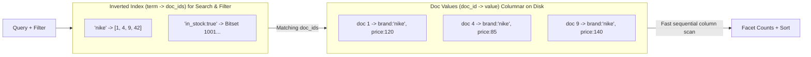
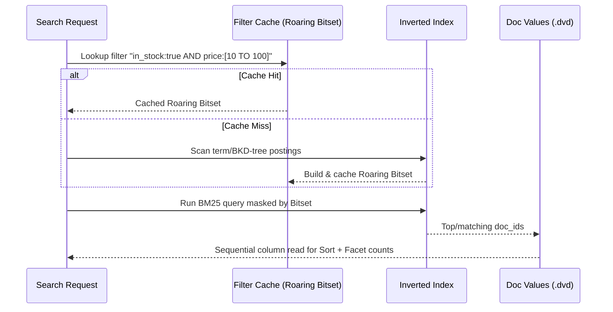
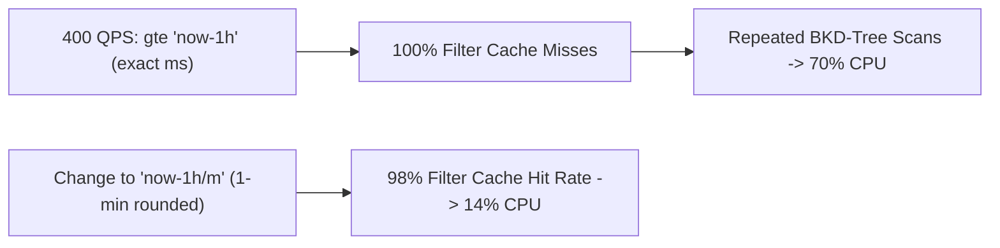

# Filtering & Faceting: Filter Context, Aggregations, Doc Values

> **Prerequisites:** [Lesson 04: Search Ranking & Relevance](../04-search-ranking-relevance/README.md).  
> **Estimated Reading Time:** 24–28 minutes  
> **Target Audience:** Backend engineers building e-commerce facets, analytics dashboards, and multi-filter search, and candidates asked "how do you make filtering and faceted counts fast at scale?"  
> **Free PDF Notes:** [Download SD-P-005.pdf](https://backendroadmap.com/notes/system-design/SD-P-005.pdf)

> [!NOTE]
> **In one line:** **Filter context** answers binary yes/no predicates (`brand = "Nike"`, `price <= 100`) without computing BM25 scores and caches results as **Roaring Bitsets**, while **faceting (aggregations)** and **sorting** read from **Doc Values**—an on-disk, OS-page-cached **columnar store** (`doc_id -> value`) that avoids scanning the inverted index or blowing up JVM heap.

> [!TIP]
> **The Golden Rule:** Put every non-scoring constraint (`status`, `tenant_id`, `in_stock`, `price` range) inside **`bool.filter`**, never `bool.must`. You skip BM25 math *and* unlock Lucene's per-segment bitset filter cache.

---

## 1. What Filtering & Faceting Are, and What They Aren't

On an e-commerce search page, a user types `"running shoes"` and sees a left sidebar: `Brand: Nike (412), Adidas (289), Asics (174)` and `In Stock Only (875)`. If you compute those counts in SQL with `GROUP BY brand` over 20M rows, or if you put `in_stock: true` inside a scored `must` clause, you waste CPU scoring booleans and risk OOMing your search nodes. Modern search engines separate **Filter Context** (binary bitset masks), **Query Context** (BM25 scoring), and **Doc Values** (columnar storage for fast aggregations and sorting).

| Term | Precise Meaning | Example |
| :--- | :--- | :--- |
| **Query context** | Evaluates *how well* a doc matches and computes `_score` | `match: { title: "running shoes" }` |
| **Filter context** | Evaluates *whether* a doc matches (yes/no); no `_score`, cacheable | `filter: [{ term: { in_stock: true } }]` |
| **Filter cache (Bitset)** | Per-segment Roaring Bitset caching matching `doc_id`s | Cached automatically for frequent filters |
| **Faceting (Aggregations)** | Computing bucket counts or stats (`terms`, `range`, `avg`) over hits | `Brand: Nike (412), Adidas (289)` |
| **Doc Values** | On-disk columnar store (`doc_id -> field_value`) built at index time | Powers `sort` and `aggs` via OS page cache |
| **Fielddata** | Legacy in-heap uninverted cache for `text` fields | Disabled by default; causes JVM OOMs |
| **Post-filter** | Filter applied *after* aggregations so facets stay broader than hits | Keep all brand counts visible after picking 1 brand |
| **Not** | A free operation on high-cardinality nested buckets | `terms` agg on 10M `user_id`s inside `date_histogram` = OOM |

### Why It Matters
1. Putting `tenant_id` or `in_stock` in `filter` instead of `must` cuts CPU and enables Roaring Bitset caching across queries.
2. Doc Values move sorting and faceting out of JVM heap into the OS page cache, eliminating GC pauses.
3. Knowing when to use `post_filter` vs `bool.filter` is a classic e-commerce UX and system-design requirement.

---

## 2. Anatomy: Inverted Index vs Doc Values & Filter Bitsets



Why does Lucene store **both** an inverted index and Doc Values for `keyword`/`numeric` fields?
- **Inverted index** (`term -> doc_ids`) is optimal for answering: *"Which docs have `brand = nike`?"*
- **Doc Values** (`doc_id -> brand`) is optimal for answering: *"Given these 50,000 matching docs from the query, what are their `brand`s and `price`s?"* Without Doc Values, the engine would have to scan every unique term in the inverted index to reverse-map `doc_id -> brand` in JVM heap (`fielddata`), which is slow and OOM-prone.

| Aspect | Filter Context (`bool.filter`) | Query Context (`bool.must`) | Doc Values (`aggs` / `sort`) |
| :--- | :--- | :--- | :--- |
| **Computes `_score`?** | No | Yes (BM25) | No |
| **Data structure** | Inverted index + Roaring Bitset | Inverted index + postings/WAND | On-disk columnar array |
| **Memory location** | Off-heap / Roaring Bitset cache | OS page cache | OS page cache |
| **Best for** | Exact match, ranges, ACLs, tenants | Full-text relevance | Sorting, `terms`/`range` facets, stats |

> [!WARNING]
> **Nested high-cardinality aggregations (`terms` inside `terms` inside `date_histogram`) cause OOMs.** A 3-level aggregation with `size: 1000` per level can allocate $1000 \times 1000 \times 100 = 10^8$ buckets in coordinator heap! Always bound `size`, use `composite` aggregations for pagination, and set `search.max_buckets` circuit breakers.

---

## 3. Mathematical Model: Roaring Bitset Memory & Aggregation Cardinality

**1. Roaring Bitset vs Dense Bitset Memory.**  
Suppose a shard holds $N = 10^7$ documents (`doc_id` 0 to $9{,}999{,}999$). A naive dense bitset uses 1 bit per document regardless of selectivity:

$$\text{Dense bitset} = \frac{10^7\text{ bits}}{8} = 1.25\text{ MB per cached filter}$$

Roaring Bitsets split the 32-bit `doc_id` space into chunks of $2^{16} = 65{,}536$ docs (153 chunks for $10^7$ docs):
- If a chunk has $< 4{,}096$ matching docs, it stores a sorted `uint16` **array** ($2\text{ bytes/doc}$).
- If a chunk has $\ge 4{,}096$ matching docs, it stores an **8 KB bitmap** ($65{,}536 / 8 = 8{,}192\text{ bytes}$).

For a rare filter matching $5{,}000$ docs across $10^7$:

$$\text{Roaring size} \approx 5{,}000 \times 2\text{ B} = 10\text{ KB} \quad (125\times \text{ smaller than dense bitset!})$$

And intersecting two Roaring Bitsets (e.g., `in_stock:true AND brand:nike`) runs in microseconds using bitwise `AND` / SIMD instructions.

**2. Distributed `terms` Aggregation Error & `shard_size`.**  
In a cluster with $P$ shards, each shard returns its local top `shard_size` buckets (default: `size * 1.5 + 10`) to the coordinator. If `size = 10` across $P = 20$ shards, each shard returns 25 buckets. A term ranked #26 on every shard (e.g., 100 docs/shard = 2,000 global docs) might be missed while a term ranked #10 on one shard (500 docs) is included! Increasing `shard_size` reduces this approximation error at the cost of network/heap:

$$\text{Coordinator buckets} = P \times \text{shard\_size}$$

**3. Bucket Explosion Formula.**  
With $L$ nested `terms` aggregations of cardinality $C_1, C_2, C_3$:

$$\text{Max buckets} = \prod_{i=1}^{L} \min(\text{size}_i, C_i)$$

For `date_histogram` (365 days) $\times$ `user_id` (`size: 10000`) $\times$ `category` (`size: 50`): $365 \times 10{,}000 \times 50 = 182.5\text{ million buckets}$ $\rightarrow$ instant circuit breaker or OOM.

---

## 4. Metrics & Percentiles

| Metric | Meaning | Alert when |
| :--- | :--- | :--- |
| **Query cache hit ratio** | % of filter bitset lookups served from cache | $< 70\%$ (thrashing cache or uncacheable `now` ranges) |
| **Aggregations latency $p_{99}$** | Time spent in `aggs` phase per query | $> 50\text{ ms}$ (high-cardinality `terms` or deep nesting) |
| **Fielddata / circuit breaker trips** | Heap rejections during aggregations | Any `circuit_breaking_exception` |
| **Doc values disk/cache ratio** | OS page cache hit rate for `.dvd` files | $< 95\%$ (disk I/O during sorting/faceting) |
| **`doc_count_error_upper_bound`** | Worst-case missed count on `terms` agg | Exceeds UI tolerance (increase `shard_size`) |

### Worked Example (E-Commerce Multi-Select Facets with `post_filter`)
A user searches `"jacket"` (50,000 hits) and clicks the checkbox `Brand = Patagonia` (1,200 hits).
- If you put `brand: "Patagonia"` inside `bool.filter`, the aggregations only see those 1,200 Patagonia jackets, so `North Face` and `Columbia` disappear from the sidebar—the user can't multi-select another brand!
- Instead, you put `brand: "Patagonia"` in **`post_filter`**. Now `bool.filter` (e.g., `in_stock: true`) + `query` (`"jacket"`) feed the `aggs` (returning `Patagonia (1200)`, `North Face (980)`, `Columbia (840)`), and `post_filter` narrows *only* the returned search hits to the 1,200 Patagonia jackets.
- Cost: aggregations run over 50,000 docs instead of 1,200 docs (~3 ms extra), so only use `post_filter` when the UI explicitly needs un-narrowed sibling facets.

---

## 5. Compounding & Failure Modes: Uncacheable Filters & High-Cardinality Facets

| Failure Mode | Mechanism | Impact |
| :--- | :--- | :--- |
| **Using `now` in date range filters** | `gte: "now-7d"` changes every millisecond | Filter cache miss rate = 100%; bitsets rebuilt constantly |
| **Enabling `fielddata: true` on `text`** | Uninverts tokenized text into JVM heap | Rapid Old-Gen heap exhaustion & GC storms |
| **High-cardinality `terms` (`size: 50000`)** | Coordinator merges $P \times 50{,}000$ string buckets | Network & heap spike on every search |
| **BSON/JSON `numeric` mapped as `text` or vice versa** | Range queries on `text` fail or scan all terms | 100x slower range filters |

---

## 6. Numbers Every Engineer Must Know

| Item | Typical | Implication |
| :--- | :---: | :--- |
| Roaring Bitset switch threshold | 4,096 docs per 65,536-doc chunk | Sparse filters take bytes; dense filters take 8 KB/chunk |
| Default `search.max_buckets` | 65,536 buckets | Protects nodes from nested-aggregation OOMs |
| Filter cache size | ~10% of JVM heap | Only caches segments with $\ge 10{,}000$ docs (or 3% of index) |
| Date rounding for caching | Round `now` to `now/m` or `now/h` | Turns 0% cache hit rate into > 95% |
| `eager_global_ordinals` | Prebuilds keyword ordinals on refresh | Trades 10–50 ms refresh time for 5–10x faster `terms` aggs |

---

## 7. Mechanism Deep Dive: Filter Bitset Caching & Doc Values Execution



| Question | Answer |
| :--- | :--- |
| **How are numeric/date range filters (`price:[10 TO 100]`) executed so fast?** | Numeric/date fields are indexed in a **BKD-tree** (block k-d tree) in Lucene, not an inverted index of strings—making range scans $O(\log N + k)$ and cacheable as a Roaring Bitset. |
| **What are Global Ordinals?** | Each `keyword` string in a shard is mapped to a dense integer ordinal (`0, 1, 2, ...`). `terms` aggregations count integers in a flat array instead of hashing strings, then map only the top-K ordinals back to strings. |
| **When should you disable `doc_values: false`?** | Only on `keyword`/`numeric` fields you will **never** sort, aggregate, or script on (e.g., an opaque external trace ID used only for exact lookup). |

**When not to use `post_filter`:** Never use `post_filter` when there are no aggregations, or when you *want* facets to reflect the active filter. In those cases `bool.filter` is strictly faster because it narrows the doc set *before* scoring and aggregating.

---

## 8. Hierarchical Budgets & Design Rules

| Slice | Rule | Control |
| :--- | :--- | :--- |
| **Filter vs Must** | All non-scoring predicates go in `bool.filter` | Query builder / code review |
| **Date rounding** | Round `now` in range filters (`now-24h/h` or `now-7d/d`) | Query template |
| **Bucket limits** | Keep `search.max_buckets <= 65536`; bound `terms.size <= 100` | Cluster setting + API validation |
| **Deep agg paging** | Use `composite` aggregation instead of huge `terms.size` | Analytics query design |
| **Keyword ordinals** | Set `eager_global_ordinals: true` on high-QPS facet fields | Field mapping |
| **Text aggregations** | Never enable `fielddata: true`; use `.keyword` sub-field | Multi-field mapping |

---

## 9. Top Mitigations

1. **Move all exact/range predicates (`status`, `tenant_id`, `price`, `date`) to `bool.filter`** to skip scoring and leverage Roaring Bitset caching.
2. **Round relative timestamps (`now/m` or `now/h`)** so repeated dashboard/search queries hit the filter cache.
3. **Use `keyword` + Doc Values for all faceting and sorting**, never `fielddata` on `text`.
4. **Enable `eager_global_ordinals: true`** on your top 3–5 e-commerce facet fields (`brand`, `category`, `color`) to eliminate cold-start latency after segment refreshes.
5. **Enforce `search.max_buckets`** and cap `terms` aggregation `size` in your API gateway.
6. **Use `execution_hint: map`** only on rare high-cardinality subsets; keep default `global_ordinals` for broad queries.
7. **Use `post_filter` selectively** only for multi-select facet sidebars where sibling counts must stay visible.

---

## 10. Production Reference: The `now-1h` Cache-Busting Storm

An analytics dashboard ran a `bool.filter` with `timestamp >= "now-1h"` at 400 QPS across 800M log events. Because `now` resolves to the exact millisecond on every request, every single query had a different range key (`1732500001123` vs `1732500001140`), resulting in a **0% filter cache hit rate**. Nodes spent 70% of CPU repeatedly scanning BKD-trees and rebuilding identical bitsets.



**Root Cause:** Unrounded `now` timestamps prevented Lucene's query cache from reusing Roaring Bitsets across requests.  
**Fix:** Changed the filter to `"now-1h/m"` (rounding to the nearest minute). Filter cache hit rate jumped from **0% to 98%**, and cluster CPU dropped from 70% to 14%.

---

## 11. Multi-Language Production Code Tabs

A **Filter Bitset & Doc-Values Facet Engine** demonstrating `bool.filter` bitset intersection and columnar Doc Values `terms` aggregation in all four languages.

````carousel
```go
// Go: Filter Bitset (uint64 mask) + Columnar Doc Values faceting.
package main

import (
	"fmt"
	"sort"
)

type DocValues struct {
	Brand   []string
	InStock []bool
	Price   []int
}

func FilterAndFacet(dv DocValues, maxPrice int) map[string]int {
	facets := make(map[string]int)
	// Sequential columnar scan over Doc Values (cache-friendly, no inverted index needed)
	for docID := 0; docID < len(dv.Brand); docID++ {
		if dv.InStock[docID] && dv.Price[docID] <= maxPrice {
			facets[dv.Brand[docID]]++
		}
	}
	return facets
}

func main() {
	dv := DocValues{
		Brand:   []string{"Nike", "Adidas", "Nike", "Asics", "Nike"},
		InStock: []bool{true, true, false, true, true},
		Price:   []int{90, 110, 80, 95, 75},
	}
	counts := FilterAndFacet(dv, 100)
	keys := make([]string, 0, len(counts))
	for k := range counts {
		keys = append(keys, k)
	}
	sort.Slice(keys, func(i, j int) bool { return counts[keys[i]] > counts[keys[j]] })
	for _, k := range keys {
		fmt.Printf("%s (%d)\n", k, counts[k])
	}
}
```
<!-- slide -->
```typescript
// TypeScript: Filter bitset intersection + Doc Values terms aggregation.
export interface DocValuesStore {
  brand: string[];
  inStock: boolean[];
  price: number[];
}

export function filterAndFacet(
  dv: DocValuesStore,
  candidateDocIds: number[],
  maxPrice: number
): Array<[string, number]> {
  const counts = new Map<string, number>();
  for (const docId of candidateDocIds) {
    if (!dv.inStock[docId] || dv.price[docId] > maxPrice) continue;
    const b = dv.brand[docId];
    counts.set(b, (counts.get(b) ?? 0) + 1);
  }
  return [...counts.entries()].sort((a, b) => b[1] - a[1]);
}

const dv: DocValuesStore = {
  brand: ["Nike", "Adidas", "Nike", "Asics", "Nike"],
  inStock: [true, true, false, true, true],
  price: [90, 110, 80, 95, 75],
};
console.log(filterAndFacet(dv, [0, 1, 2, 3, 4], 100)); // [["Nike", 2], ["Asics", 1]]
```
<!-- slide -->
```python
# Python: Filter bitset intersection + Doc Values columnar faceting (stdlib only).
from collections import Counter

class DocValuesStore:
    def __init__(self, brands: list[str], in_stock: list[bool], prices: list[int]):
        self.brands = brands
        self.in_stock = in_stock
        self.prices = prices

    def filter_and_facet(self, query_doc_ids: set[int], max_price: int,
                         selected_brand: str | None = None) -> tuple[list[int], list[tuple[str, int]]]:
        # Filter context (bitset/set): in_stock and price <= max_price
        base_hits = [
            d for d in sorted(query_doc_ids)
            if self.in_stock[d] and self.prices[d] <= max_price
        ]
        # Facets computed BEFORE post_filter so sibling brand counts remain visible
        facets = Counter(self.brands[d] for d in base_hits).most_common()
        # Post-filter narrows final hits only
        final_hits = [d for d in base_hits if selected_brand is None or self.brands[d] == selected_brand]
        return final_hits, facets

if __name__ == "__main__":
    dv = DocValuesStore(
        brands=["Nike", "Adidas", "Nike", "Asics", "Nike"],
        in_stock=[True, True, False, True, True],
        prices=[90, 110, 80, 95, 75],
    )
    hits, facets = dv.filter_and_facet({0, 1, 2, 3, 4}, max_price=100, selected_brand="Nike")
    print("Hits:", hits, "Facets:", facets)
```
<!-- slide -->
```csharp
// C#: Columnar Doc Values faceting with post-filter support.
using System;
using System.Collections.Generic;
using System.Linq;

public sealed class DocValuesStore
{
    private readonly string[] _brands;
    private readonly bool[] _inStock;
    private readonly int[] _prices;

    public DocValuesStore(string[] brands, bool[] inStock, int[] prices)
        => (_brands, _inStock, _prices) = (brands, inStock, prices);

    public (List<int> Hits, List<KeyValuePair<string, int>> Facets) Search(
        IEnumerable<int> candidates, int maxPrice, string? selectedBrand = null)
    {
        var baseHits = candidates.Where(d => _inStock[d] && _prices[d] <= maxPrice).ToList();
        var facets = baseHits
            .GroupBy(d => _brands[d])
            .Select(g => new KeyValuePair<string, int>(g.Key, g.Count()))
            .OrderByDescending(kv => kv.Value)
            .ToList();
        var hits = selectedBrand is null
            ? baseHits
            : baseHits.Where(d => _brands[d] == selectedBrand).ToList();
        return (hits, facets);
    }
}
```
````

---

## 12. Hands-On CLI Verification Workflows

Test `bool.filter` + `terms` aggregations + `post_filter`, and inspect query cache stats:

```bash
# 1. Search with query + filter context + terms faceting + post_filter
curl -s "localhost:9200/products/_search?pretty" \
  -H "Content-Type: application/json" \
  -d '{
    "query": {
      "bool": {
        "must":   { "match": { "title": "running shoes" } },
        "filter": [
          { "term":  { "in_stock": true } },
          { "range": { "price": { "lte": 150 } } }
        ]
      }
    },
    "aggs": {
      "brands": { "terms": { "field": "brand.keyword", "size": 10, "shard_size": 50 } }
    },
    "post_filter": { "term": { "brand.keyword": "Nike" } }
  }'

# 2. Inspect filter (query) cache hit/miss and eviction stats
curl -s "localhost:9200/_nodes/stats/indices/query_cache?pretty"

# 3. Inspect fielddata memory usage (should be near 0 if using doc_values)
curl -s "localhost:9200/_cat/fielddata?v"
```

---

## 13. Common Mistakes to Avoid

1. **Putting exact filters (`in_stock`, `tenant_id`, `status`) in `bool.must`** instead of `bool.filter`.
2. **Using unrounded `now` in date range filters**, causing 0% filter cache hit rate.
3. **Enabling `fielddata: true` on `text` fields** instead of using `.keyword` Doc Values.
4. **Creating deeply nested `terms` aggregations** without bounding `size`, triggering bucket OOMs.
5. **Using `post_filter` when you don't have aggregations** (wastes CPU).
6. **Ignoring `doc_count_error_upper_bound`** on high-cardinality `terms` aggregations across many shards.
7. **Forgetting `eager_global_ordinals: true`** on high-QPS facet fields, causing p99 spikes right after segment refreshes.

---

## 14. Key Terms Glossary

| Key Term | Definition |
| :--- | :--- |
| **Filter context** | Binary yes/no evaluation (`bool.filter`); skips BM25 scoring and caches bitsets. |
| **Query context** | Relevance-scored evaluation (`bool.must` / `should`); computes `_score`. |
| **Roaring Bitset** | Hybrid compressed bitset (array for sparse chunks, 8 KB bitmap for dense chunks). |
| **Doc Values** | On-disk columnar store (`doc_id -> value`) used for sorting, aggregations, and scripts. |
| **Fielddata** | Legacy in-JVM-heap uninverted cache for `text` fields; disabled by default. |
| **Global ordinals** | Shard-level dense integer mapping for `keyword` terms accelerating `terms` aggs. |
| **BKD-tree** | Block k-d tree indexing numeric, date, and geo fields for fast range filters. |
| **Post-filter** | Filter applied *after* aggregations so sibling facet counts remain visible. |
| **`shard_size`** | Number of top buckets each shard returns to the coordinator for `terms` merging. |
| **`search.max_buckets`** | Cluster circuit breaker capping total aggregation buckets per request. |

---

## 15. System Design Interview Questions & Answers

### Basic Conceptual Questions

<details>
<summary><strong>Q1: What is the difference between Query Context and Filter Context? [BASIC]</strong></summary>

**Answer:**
**Query context** (`must`, `should`) asks *"How well does this document match?"* and computes a BM25 `_score`. **Filter context** (`filter`, `must_not`) asks *"Does this document match?"* (yes/no), skips scoring, and caches results per segment as Roaring Bitsets.
</details>

<details>
<summary><strong>Q2: What are Doc Values and why do they exist alongside the inverted index? [BASIC]</strong></summary>

**Answer:**
An inverted index maps `term -> doc_ids` (fast for finding docs). Doc Values store the transpose `doc_id -> field_value` in a compressed, on-disk columnar format in the OS page cache. This lets sorting and aggregations read values for matching `doc_ids` sequentially without scanning the inverted index or loading strings into JVM heap.
</details>

<details>
<summary><strong>Q3: Why is <code>fielddata</code> disabled by default on <code>text</code> fields? [BASIC]</strong></summary>

**Answer:**
`fielddata` uninverts all tokenized terms into the **JVM heap** at query time, which consumes massive memory and triggers GC pauses or OOM crashes. Sorting and faceting should use a `.keyword` sub-field backed by off-heap Doc Values.
</details>

<details>
<summary><strong>Q4: What is a <code>post_filter</code> and when do you use it? [BASIC]</strong></summary>

**Answer:**
A `post_filter` runs *after* aggregations are computed, narrowing only the returned search hits. You use it in e-commerce multi-select faceting so that selecting `Brand = Nike` filters the product grid while keeping `Adidas (289)` and `Asics (174)` visible in the sidebar.
</details>

### Scenario-Based Architecture Questions

<details>
<summary><strong>Q5: Your multi-tenant search cluster has <code>tenant_id</code> in <code>bool.must</code>. What happens when you move it to <code>bool.filter</code>? [SCENARIO]</strong></summary>

**Answer:**
First, the engine stops wasting CPU computing BM25 IDF/TF scores for `tenant_id`. Second, the `tenant_id` filter is cached as a Roaring Bitset per segment, so subsequent queries for that tenant intersect the cached bitset in microseconds.
</details>

<details>
<summary><strong>Q6: A dashboard running <code>timestamp >= "now-15m"</code> at 500 QPS has 0% query cache hits. Why, and how do you fix it? [SCENARIO]</strong></summary>

**Answer:**
`now` evaluates to the exact millisecond, so every request has a unique range key and misses the cache. Rounding to `"now-15m/m"` (nearest minute) lets all queries within that minute share the exact same cached Roaring Bitset.
</details>

<details>
<summary><strong>Q7: Facet counts for a <code>terms</code> aggregation on <code>brand</code> are slightly inaccurate on a 20-shard index. Why? [SCENARIO]</strong></summary>

**Answer:**
Each shard only returns its local top `shard_size` buckets to the coordinator. A brand that ranks just below `shard_size` on several shards can be undercounted or omitted. Increasing `shard_size` (e.g., from 25 to 100) fixes the accuracy at a small network/CPU cost.
</details>

<details>
<summary><strong>Q8: Users see 2-second latency spikes on facet queries right after every index refresh. What is happening? [SCENARIO]</strong></summary>

**Answer:**
**Global ordinals** for the `keyword` facet field are built lazily on the first aggregation after a new segment is refreshed. Setting `eager_global_ordinals: true` in the mapping shifts that work into the background refresh thread so user queries stay fast.
</details>

### Advanced & Tricky Interview Questions

<details>
<summary><strong>Q9: How do Roaring Bitsets keep filter cache memory small for both very sparse and very dense filters? [TRICKY]</strong></summary>

**Answer:**
Roaring Bitsets partition the 32-bit `doc_id` space into chunks of $65{,}536$ integers. Chunks with $< 4{,}096$ hits use a sorted `uint16` array ($2\text{ B/doc}$), while chunks with $\ge 4{,}096$ hits use a fixed 8 KB bitmap ($1\text{ bit/doc}$). Thus sparse filters take kilobytes and dense filters cap at 8 KB per 65K docs.
</details>

<details>
<summary><strong>Q10: Why are numeric and date range filters NOT stored in a standard string inverted index? [TRICKY]</strong></summary>

**Answer:**
A term dictionary would have to enumerate every unique timestamp/price inside `[10 TO 100]` and union thousands of postings lists. Instead, Lucene indexes numbers, dates, and IPs in a **BKD-tree** (block k-d tree), which resolves multi-dimensional and range queries in $O(\log N + k)$.
</details>

<details>
<summary><strong>Q11: How do you export or paginate through 500,000 unique facet buckets without tripping <code>search.max_buckets</code>? [TRICKY]</strong></summary>

**Answer:**
Use a **`composite` aggregation** with `after` key pagination (e.g., `size: 1000` per page). Unlike `terms`, `composite` streams buckets in deterministic lexicographical order without holding all 500,000 buckets in memory at once.
</details>

<details>
<summary><strong>Q12: Why doesn't Lucene cache a filter bitset on a brand-new 500-doc segment? [TRICKY]</strong></summary>

**Answer:**
Small segments are scanned directly in microseconds and will soon be merged away anyway. Caching bitsets for tiny segments would thrash the query cache LRU. Lucene's default policy only caches filters on segments with $\ge 10{,}000$ documents (or $\ge 3\%$ of total index docs).
</details>

---

## 16. One-Page Master Cheat Sheet

```
+---------------------------------------------------------------------------------------------------------+
|                    FILTERING & FACETING — MASTER CHEAT SHEET                                            |
+---------------------------------------------------------------------------------------------------------+
| 1. FILTER CONTEXT: Put exact/range predicates in bool.filter -> skips BM25 + caches Roaring Bitsets.   |
+---------------------------------------------------------------------------------------------------------+
| 2. ROARING BITSETS: < 4096 hits/chunk = uint16 array; >= 4096 = 8 KB bitmap. Round 'now' (now-1h/m)!   |
+---------------------------------------------------------------------------------------------------------+
| 3. DOC VALUES: On-disk columnar store (doc_id -> val) in OS page cache. Powers sort & aggs off-heap.   |
+---------------------------------------------------------------------------------------------------------+
| 4. FIELDDATA: Never enable on text (JVM OOM). Always use .keyword sub-fields + eager_global_ordinals.  |
+---------------------------------------------------------------------------------------------------------+
| 5. FACETS: Bound terms.size + search.max_buckets (65536). Increase shard_size if counts drift.          |
+---------------------------------------------------------------------------------------------------------+
| 6. POST_FILTER: Runs AFTER aggs so multi-select sidebars keep sibling counts; avoid if no aggs.        |
+---------------------------------------------------------------------------------------------------------+
```

---

## Further Reading & Sources

- Elasticsearch Reference, [Query and Filter Context](https://www.elastic.co/guide/en/elasticsearch/reference/current/query-filter-context.html) and [Doc Values](https://www.elastic.co/guide/en/elasticsearch/reference/current/doc-values.html).
- Daniel Lemire et al., *Roaring Bitmaps: Implementation of an Optimized Software Library*.
- Adrien Grand, ["Frame of Reference and Roaring Bitmaps in Lucene"](https://www.elastic.co/blog/frame-of-reference-and-roaring-bitmaps).
- Elasticsearch Reference, [Aggregations & `composite` / `post_filter`](https://www.elastic.co/guide/en/elasticsearch/reference/current/search-aggregations.html).

---

## Free PDF Notes

[SD-P-005.pdf](https://backendroadmap.com/notes/system-design/SD-P-005.pdf)

---

## Next

Continue with [Lesson 06: Indexing Pipelines: CDC, Bulk Writes & Zero-Downtime Reindexing](../06-indexing-pipelines/README.md).
