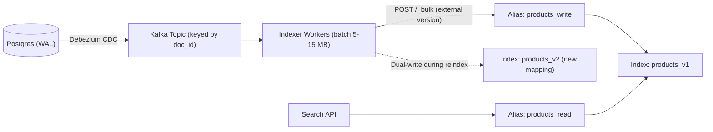
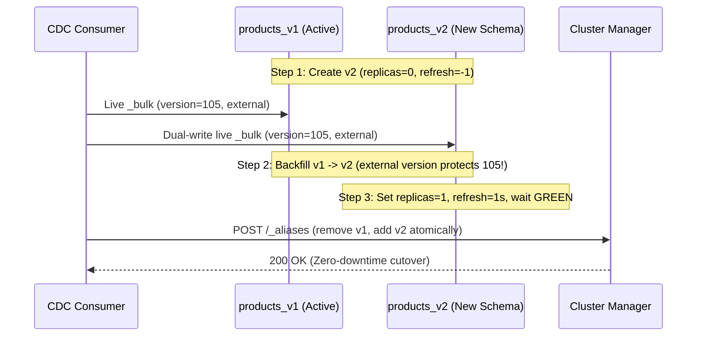
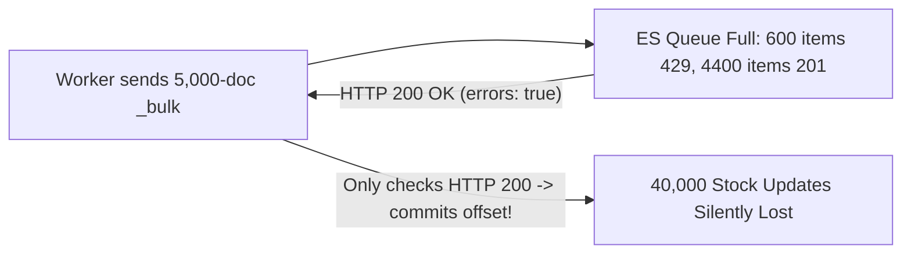

# Indexing Pipelines: CDC, Bulk Writes & Zero-Downtime Reindexing

> **Prerequisites:** [Lesson 05: Filtering & Faceting](../05-filtering-faceting/README.md).  
> **Estimated Reading Time:** 24–28 minutes  
> **Target Audience:** Backend and data engineers syncing databases to search engines, and candidates asked "how do you keep Elasticsearch in sync with Postgres and reindex with zero downtime?"  
> **Free PDF Notes:** [Download SD-P-006.pdf](https://backendroadmap.com/notes/system-design/SD-P-006.pdf)

> [!NOTE]
> **In one line:** Never dual-write directly from application code to Postgres and Elasticsearch—network failures cause silent drift. Use **Change Data Capture (CDC)** (e.g., Debezium + Kafka) or a **transactional outbox** feeding **bulk-batched, idempotent writes** (`_bulk`, 5–15 MB batches) with external versioning, and perform schema/analyzer changes via **index aliases + blue-green zero-downtime reindexing**.

> [!TIP]
> **The Golden Rule:** Always point application reads and writes at an **Index Alias** (`products_read`, `products_write`), never a concrete index name (`products_v1`). When you need to change a mapping or shard count, create `products_v2`, backfill + replay CDC, verify counts, and **atomically swap the alias** in one cluster-state operation.

---

## 1. What an Indexing Pipeline Is, and What It Isn't

Your Postgres `products` table is the source of truth; Elasticsearch is a derived read index. If your API handler saves a product to Postgres and then calls `es.index(...)` directly (**dual write**), any crash, timeout, or race condition between the two calls leaves Postgres and search permanently out of sync. Production systems decouple OLTP commits from search indexing using **CDC** (reading the Postgres WAL via Debezium) or a **transactional outbox**, batching mutations into `_bulk` requests.

| Term | Precise Meaning | Example |
| :--- | :--- | :--- |
| **Dual write** | App writes DB then search in two separate calls | Anti-pattern: partial failures cause drift |
| **CDC (Change Data Capture)** | Streaming committed DB changes from the WAL (binlog/WAL) | Postgres WAL -> Debezium -> Kafka -> Search |
| **Transactional outbox** | Writing domain row + event row in one DB transaction | Atomic DB commit, relayed to Kafka/worker |
| **Bulk API (`_bulk`)** | Sending hundreds/thousands of index/delete ops in one HTTP call | 1,000–5,000 docs (5–15 MB) per batch |
| **External versioning** | Rejecting stale out-of-order writes via monotonic `version` | `version_type=external` with DB `updated_at` / LSN |
| **Index alias** | Virtual pointer (`products_read` -> `products_v2`) | Atomic swap in milliseconds |
| **Zero-downtime reindex** | Building `v2` in background, catching up delta, swapping alias | Zero read/write interruption |
| **Not** | A 1-request-per-doc synchronous HTTP loop | Single-doc HTTP indexing is 20–50x slower than `_bulk` |

### Why It Matters
1. Dual writes are the #1 source of "ghost products" (deleted in DB, still in search) and missing products.
2. Unbatched single-document indexing saturates search threadpools and HTTP connections.
3. Because primary shard count and field types cannot be mutated in place, **alias-based zero-downtime reindexing** is mandatory for schema evolution.

---

## 2. Anatomy: CDC Bulk Pipeline & Blue-Green Alias Reindexing



During a **zero-downtime reindex** from `products_v1` to `products_v2`:
1. Create `products_v2` with the new analyzer/mapping/shard count (with `refresh_interval: -1`, `number_of_replicas: 0` for fast backfill).
2. Enable dual-indexing in the consumer (or replay Kafka from the checkpoint offset) so live updates hit `v2`.
3. Run `_reindex` (or a Spark/Kafka backfill) from `v1` (or Postgres) into `v2`, using `version_type: external` so older backfill docs never overwrite newer live CDC events!
4. Restore `refresh_interval: 1s` and `number_of_replicas: 1` on `v2`, wait for `green`, and atomically swap `products_read` and `products_write` to `v2`.

| Approach | Consistency | DB Load | Complexity | Best For |
| :--- | :--- | :--- | :--- | :--- |
| **App dual-write** | Poor (silent drift) | None | Low | Prototypes only |
| **Periodic SQL polling** | Laggy (minutes), misses deletes | High (`SELECT WHERE updated_at`) | Low | Small internal tools |
| **Transactional outbox** | Strong (atomic with DB tx) | Low (1 extra insert) | Medium | Domain-event architectures |
| **WAL CDC (Debezium)** | Strong, captures deletes & order | Near-zero (reads WAL) | Medium-High | High-throughput production search |

> [!WARNING]
> **Out-of-order writes corrupt search without external versioning.** During retries, DLQ replays, or parallel reindexing, an older update (`v10`) can arrive *after* a newer update (`v11`). Always pass a monotonic DB sequence (WAL LSN or `updated_at_us`) with `version_type=external` so Elasticsearch rejects stale overwrites with `409 Conflict` (which the indexer safely ignores).

---

## 3. Mathematical Model: Bulk Batch Sizing, Backpressure & Reindex Time

**1. Optimal Bulk Batch Size & Throughput.**  
Each HTTP `_bulk` call incurs fixed network + coordinator parse overhead $T_{\text{overhead}} \approx 5\text{ ms}$, plus per-doc indexing time $t_{\text{doc}} \approx 0.1\text{ ms}$ (parallelized across shards). For a batch of $B$ documents (average 2 KB each):

$$T_{\text{batch}}(B) = T_{\text{overhead}} + B \cdot t_{\text{doc}}, \qquad \text{Throughput}(B) = \frac{B}{T_{\text{batch}}(B)}$$

- At $B = 1$ (single-doc writes): $\frac{1}{5.1\text{ ms}} \approx 196\text{ docs/s}$.
- At $B = 2{,}500$ (5 MB batch): $\frac{2{,}500}{5 + 250\text{ ms}} \approx 9{,}800\text{ docs/s}$ (**50x faster**!).
Beyond 15–20 MB per batch, coordinator heap pressure and request timeouts increase without further throughput gains.

**2. Zero-Downtime Reindex Duration.**  
Suppose you need to reindex $N = 10^8$ documents (200 GB). With 4 indexer workers sending 10 MB `_bulk` batches at an aggregate sustained rate of $R = 40{,}000\text{ docs/s}$:

$$T_{\text{reindex}} = \frac{10^8\text{ docs}}{40{,}000\text{ docs/s}} = 2{,}500\text{ s} \approx 42\text{ minutes}$$

If you forgot to disable replicas (`R=1`) and `refresh_interval` (`1s`), indexing throughput typically halves ($20{,}000\text{ docs/s} \rightarrow 84\text{ minutes}$) and doubles merge I/O.

**3. Bulk Queue Rejection & Backpressure.**  
Elasticsearch's `write` threadpool queue is bounded (typically `200`–`1000` requests). If $W$ concurrent bulk workers exceed `threads + queue_size`, the node returns **`429 Too Many Requests` (`EsRejectedExecutionException`)**. Workers must treat `429` at the *item* level inside `_bulk` responses with exponential backoff + jitter.

---

## 4. Metrics & Percentiles

| Metric | Meaning | Alert when |
| :--- | :--- | :--- |
| **CDC / Kafka consumer lag** | Seconds/messages behind DB WAL | $> 30\text{ s}$ (freshness SLA breach) |
| **Bulk item error / 429 rate** | Per-item rejections inside `_bulk` response | $> 0.1\%$ (backpressure or mapping error) |
| **Write threadpool rejections** | Rejected bulk requests on data nodes | Any sustained rejections |
| **Indexing latency $p_{99}$** | Time for `_bulk` request to ack | $> 2\text{ s}$ |
| **DLQ message count** | Poison docs failing schema validation | $> 0$ (investigate mapping mismatch) |
| **Index doc count drift** | `|DB_count - ES_count|` | $> 0.1\%$ after lag settles |

### Worked Example (Partial `_bulk` Failure Handling)
A worker sends a `_bulk` request with 2,000 items. Elasticsearch returns **HTTP `200 OK`**, with `"errors": true` in the JSON body: 1,994 items succeeded (`200`/`201`), 4 items failed with `429` (write queue full), and 2 items failed with `400` (`mapper_parsing_exception`: string `"N/A"` sent for an integer `price` field).
- **Wrong:** Checking only the outer HTTP status (`200 OK`) and committing the Kafka offset—silently dropping 6 documents!
- **Right:** Parse `items[]` in the `_bulk` response: retry the `429` items with exponential backoff, ignore `409` (stale external version), and route the `400` mapping errors to a **Dead-Letter Queue (DLQ)** before committing the Kafka offset.

---

## 5. Compounding & Failure Modes: Dual-Write Drift & Reindex Collisions

| Failure Mode | Mechanism | Impact |
| :--- | :--- | :--- |
| **Ignoring HTTP 200 `"errors": true`** | Outer `_bulk` returns 200 even when items fail | Silent data loss; DB and search drift |
| **Unkeyed Kafka topic** | Same `doc_id` lands on different partitions | Delete arrives before create -> ghost doc |
| **Backfill without `version_type=external`** | Old snapshot doc overwrites fresh CDC update | Stale price/stock shown to users |
| **Reindexing into live-traffic shards** | Backfill saturates `write` threadpool & merge IOPS | Live search $p_{99}$ degrades 5–10x |

---

## 6. Numbers Every Engineer Must Know

| Item | Typical | Implication |
| :--- | :---: | :--- |
| Optimal `_bulk` batch size | 5–15 MB (1,000–5,000 docs) | Best throughput without coordinator heap spikes |
| `_bulk` speedup vs single-doc | 20x–50x higher docs/sec | Never index 1 doc/request in a pipeline |
| Backfill `refresh_interval` | `-1` (disabled) during load | Restore to `1s` before swapping alias |
| Backfill `number_of_replicas` | `0` during load | Restore to `1+` and wait for `green` before swap |
| Atomic alias swap time | $< 10\text{ ms}$ | Single cluster-state update (`_aliases`) |
| `write` threadpool queue | 200–1,000 per node | Exceeding it returns per-item `429` |

---

## 7. Mechanism Deep Dive: Atomic Alias Swap & External Versioning



| Question | Answer |
| :--- | :--- |
| **Why key the Kafka topic by `doc_id`?** | Partitioning by `doc_id` guarantees that all `CREATE`, `UPDATE`, and `DELETE` events for the same document are processed **in order** by a single consumer. |
| **How does `version_type=external` prevent stale overwrites?** | If `v2` already has `doc 42` at `version=105`, a backfill write with `version=98` is rejected with `409 Conflict` instead of overwriting newer data. |
| **What if a document needs data joined from 3 SQL tables (e.g., `products` + `brands` + `inventory`)?** | Either enrich in a stream processor (Flink / Kafka Streams) or have the indexer worker fetch/cache the joined view before emitting the denormalized search document. |

**When not to use CDC:** If your data is append-only time-series logs or metrics generated directly by microservices, stream straight from Kafka/FluentBit into an Elasticsearch Data Stream—there is no relational DB to capture from.

---

## 8. Hierarchical Budgets & Design Rules

| Slice | Rule | Control |
| :--- | :--- | :--- |
| **Sync mechanism** | CDC (Debezium) or Transactional Outbox; zero app dual-writes | Architecture standard |
| **Ordering** | Partition Kafka by `doc_id`; use `version_type=external` | Producer key + `_bulk` metadata |
| **Batching** | Flush `_bulk` on `5 MB` OR `500 ms` linger, whichever comes first | Indexer batcher |
| **Error handling** | Inspect every item in `_bulk` response; retry `429`, DLQ `400` | Worker retry + DLQ |
| **Schema changes** | Always use aliases (`_read`, `_write`) + blue-green reindex | `_aliases` atomic swap |
| **Backfill isolation** | Throttle `_reindex` (`requests_per_second`) or use separate nodes | Rate limit + `replicas: 0` |

---

## 9. Top Mitigations

1. **Ban application-level dual writes**; use Debezium CDC or a transactional outbox.
2. **Always check `response.errors` and per-item status codes** inside `_bulk` responses—never assume HTTP `200` means all docs succeeded.
3. **Pass `version_type=external` with a monotonic DB version/LSN** so retries and backfills never overwrite newer state.
4. **Use size + time batching** (e.g., 5–10 MB or 500 ms max wait) to balance throughput and freshness SLA.
5. **Throttle backfills (`requests_per_second`)** and temporarily set `refresh_interval: -1`, `replicas: 0` on the target index during initial load.
6. **Run a periodic reconciliation job** (comparing DB IDs/checksums vs search index) to detect and heal silent drift.
7. **Always read/write via Aliases** so zero-downtime reindexing is a routine operation, not an emergency.

---

## 10. Production Reference: The Silent `_bulk` HTTP 200 Data Loss

An e-commerce team migrated their catalog sync to `_bulk` batches of 5,000 docs. Their worker checked `if resp.StatusCode == 200 { commitKafkaOffset() }`. During a Black Friday flash sale, Elasticsearch's write queue hit capacity and rejected 12% of items inside `_bulk` with per-item `429` errors—while still returning **HTTP `200 OK`** for the batch. Over 40,000 price and stock updates were silently dropped, leaving out-of-stock items searchable as "In Stock".



**Root Cause:** Elasticsearch's `_bulk` endpoint returns HTTP `200 OK` even when individual items fail with `429` or `400`; the worker ignored `errors: true` in the JSON payload.  
**Fix:** Rewrote the worker to inspect `items[]`, retry `429`/`5xx` items with exponential backoff, route `400` schema errors to a DLQ, and only commit Kafka offsets once zero retryable failures remain.

---

## 11. Multi-Language Production Code Tabs

A **Bulk Batcher with Per-Item `429` Retry & `409` External-Version Handling** in all four languages.

````carousel
```go
// Go: _bulk response parser separating successes, retryable 429s, stale 409s, and DLQ 400s.
package main

import "fmt"

type BulkAction struct {
	DocID   string
	Version int64
	Payload string
}

type BulkItemResult struct {
	DocID  string
	Status int
	Error  string
}

type BatchOutcome struct {
	Retry []BulkAction
	DLQ   []BulkItemResult
	OK    int
}

func ClassifyBulkResponse(actions []BulkAction, results []BulkItemResult) BatchOutcome {
	var out BatchOutcome
	for i, res := range results {
		switch {
		case res.Status >= 200 && res.Status < 300:
			out.OK++
		case res.Status == 409:
			// Stale external version: newer version already indexed; safely ignore
			out.OK++
		case res.Status == 429 || res.Status >= 500:
			out.Retry = append(out.Retry, actions[i])
		default:
			out.DLQ = append(out.DLQ, res)
		}
	}
	return out
}

func main() {
	actions := []BulkAction{{DocID: "1", Version: 10}, {DocID: "2", Version: 5}, {DocID: "3", Version: 12}}
	results := []BulkItemResult{{DocID: "1", Status: 201}, {DocID: "2", Status: 409}, {DocID: "3", Status: 429}}
	fmt.Printf("%+v\n", ClassifyBulkResponse(actions, results))
}
```
<!-- slide -->
```typescript
// TypeScript: Size-and-time bounded _bulk batcher with per-item classification.
export interface BulkDoc {
  docId: string;
  version: number;
  body: Record<string, unknown>;
}

export interface BulkItemStatus {
  docId: string;
  status: number;
  error?: string;
}

export function classifyBulkResults(
  docs: BulkDoc[],
  statuses: BulkItemStatus[]
): { succeeded: number; retry: BulkDoc[]; dlq: BulkItemStatus[] } {
  let succeeded = 0;
  const retry: BulkDoc[] = [];
  const dlq: BulkItemStatus[] = [];

  statuses.forEach((res, idx) => {
    if ((res.status >= 200 && res.status < 300) || res.status === 409) {
      succeeded++; // 409 = stale external version, safe to drop
    } else if (res.status === 429 || res.status >= 500) {
      retry.push(docs[idx]);
    } else {
      dlq.push(res);
    }
  });
  return { succeeded, retry, dlq };
}
```
<!-- slide -->
```python
# Python: NDJSON _bulk payload builder + per-item 429/409/400 response handler (stdlib only).
import json

def build_bulk_ndjson(index_alias: str, docs: list[dict]) -> str:
    lines = []
    for d in docs:
        action = {
            "index": {
                "_index": index_alias,
                "_id": d["id"],
                "version": d["version"],
                "version_type": "external",
            }
        }
        lines.append(json.dumps(action))
        lines.append(json.dumps(d["source"]))
    return "\n".join(lines) + "\n"

def classify_bulk_response(docs: list[dict], items: list[dict]) -> dict:
    retry, dlq, ok = [], [], 0
    for doc, item in zip(docs, items):
        op = next(iter(item.values()))
        status = op["status"]
        if 200 <= status < 300 or status == 409:  # 409 = stale version ignored
            ok += 1
        elif status == 429 or status >= 500:
            retry.append(doc)
        else:
            dlq.append({"doc_id": doc["id"], "status": status, "error": op.get("error")})
    return {"ok": ok, "retry": retry, "dlq": dlq}

if __name__ == "__main__":
    sample = [{"id": "p1", "version": 42, "source": {"title": "Running Shoe"}}]
    print(build_bulk_ndjson("products_write", sample))
```
<!-- slide -->
```csharp
// C#: _bulk response classifier handling 2xx, 409 (external version), 429 retry, and DLQ.
using System.Collections.Generic;

public sealed record BulkDoc(string DocId, long Version, string Json);
public sealed record BulkStatus(string DocId, int Status, string? Error);

public static class BulkClassifier
{
    public static (int Ok, List<BulkDoc> Retry, List<BulkStatus> Dlq) Classify(
        IReadOnlyList<BulkDoc> docs, IReadOnlyList<BulkStatus> results)
    {
        int ok = 0;
        var retry = new List<BulkDoc>();
        var dlq = new List<BulkStatus>();
        for (int i = 0; i < results.Count; i++)
        {
            int s = results[i].Status;
            if ((s >= 200 && s < 300) || s == 409) ok++;
            else if (s == 429 || s >= 500) retry.Add(docs[i]);
            else dlq.Add(results[i]);
        }
        return (ok, retry, dlq);
    }
}
```
````

---

## 12. Hands-On CLI Verification Workflows

Execute a zero-downtime reindex and atomic alias swap via `curl`:

```bash
# 1. Create new index v2 tuned for fast backfill (refresh=-1, replicas=0)
curl -s -X PUT "localhost:9200/products_v2" -H "Content-Type: application/json" -d '{
  "settings": { "number_of_shards": 5, "number_of_replicas": 0, "refresh_interval": "-1" },
  "mappings": { "properties": { "title": { "type": "text" }, "price": { "type": "integer" } } }
}'

# 2. Throttled reindex from v1 to v2 keeping external versions safe
curl -s -X POST "localhost:9200/_reindex?requests_per_second=5000&wait_for_completion=false" \
  -H "Content-Type: application/json" -d '{
    "source": { "index": "products_v1" },
    "dest":   { "index": "products_v2", "version_type": "external" }
  }'

# 3. Restore replicas & refresh, wait for green, then atomically swap aliases
curl -s -X PUT "localhost:9200/products_v2/_settings" -H "Content-Type: application/json" \
  -d '{"index": {"number_of_replicas": 1, "refresh_interval": "1s"}}'

curl -s -X POST "localhost:9200/_aliases" -H "Content-Type: application/json" -d '{
  "actions": [
    { "remove": { "index": "products_v1", "alias": "products_read" } },
    { "add":    { "index": "products_v2", "alias": "products_read" } }
  ]
}'
```

---

## 13. Common Mistakes to Avoid

1. **Application-level dual writes** (saving to Postgres then calling ES directly), causing silent drift.
2. **Checking only HTTP `200 OK` on `_bulk`** and ignoring `errors: true` and per-item `429`/`400` failures.
3. **Indexing 1 document per HTTP request** instead of 5–15 MB `_bulk` batches.
4. **Omitting `version_type=external`**, letting retries or backfills overwrite newer documents.
5. **Hardcoding concrete index names (`products_v1`)** in application code instead of Aliases.
6. **Running unthrottled `_reindex`** on a live production cluster without setting `requests_per_second`.
7. **Forgetting to restore `refresh_interval: 1s` and `number_of_replicas: 1`** before swapping the read alias.

---

## 14. Key Terms Glossary

| Key Term | Definition |
| :--- | :--- |
| **Dual write** | Writing to DB and search separately from app code; prone to partial-failure drift. |
| **CDC (Change Data Capture)** | Streaming committed DB changes from the write-ahead log (e.g., Debezium). |
| **Transactional outbox** | Storing an event in an outbox table inside the same DB transaction as the row. |
| **Bulk API (`_bulk`)** | NDJSON endpoint batching thousands of index/update/delete ops in one request. |
| **External versioning** | Rejecting writes whose version $\le$ the currently indexed version (`409 Conflict`). |
| **Index alias** | Logical pointer to one or more concrete indices enabling atomic cutovers. |
| **Blue-green reindex** | Building `v2` alongside `v1`, catching up live changes, and swapping the alias. |
| **Dead-Letter Queue (DLQ)** | Queue holding poison documents (e.g., `400` mapping errors) for inspection. |
| **Backpressure (`429`)** | Per-item rejection when search `write` queues are full; requires backoff. |
| **Reconciliation** | Periodic job comparing DB state against search index to heal drift. |

---

## 15. System Design Interview Questions & Answers

### Basic Conceptual Questions

<details>
<summary><strong>Q1: Why is application-level dual writing to Postgres and Elasticsearch an anti-pattern? [BASIC]</strong></summary>

**Answer:**
Because there is no distributed transaction between Postgres and Elasticsearch. If the app commits to Postgres and then crashes or times out before indexing to Elasticsearch, the search index misses the update forever. Worse, concurrent updates can arrive at Elasticsearch out of order.
</details>

<details>
<summary><strong>Q2: How does CDC (Change Data Capture) solve the dual-write problem? [BASIC]</strong></summary>

**Answer:**
CDC (e.g., Debezium) tails the database's committed Write-Ahead Log (WAL) and publishes every insert, update, and delete to Kafka. Because the WAL is the database's own commit log, every committed DB change is guaranteed to be captured without extra DB queries or app dual-writes.
</details>

<details>
<summary><strong>Q3: What is the optimal batch size for Elasticsearch <code>_bulk</code> requests? [BASIC]</strong></summary>

**Answer:**
Typically **5–15 MB** (around 1,000–5,000 average documents) or a short time window (e.g., 500 ms), whichever comes first. Smaller batches waste HTTP/coordination overhead; much larger batches risk coordinator heap pressure and timeouts.
</details>

<details>
<summary><strong>Q4: What is an Index Alias and why should apps never reference concrete index names? [BASIC]</strong></summary>

**Answer:**
An alias is a virtual name pointing to a concrete index (`products_read -> products_v1`). Because primary shard count and field mappings cannot be changed in place, aliases let you build `products_v2` in the background and swap traffic atomically in milliseconds with zero downtime.
</details>

### Scenario-Based Architecture Questions

<details>
<summary><strong>Q5: Walk through a zero-downtime reindex of 100M products when you need to change an analyzer and increase primary shards from 5 to 20. [SCENARIO]</strong></summary>

**Answer:**
1. Create `products_v2` with 20 primaries, the new analyzer, `refresh_interval: -1`, and `replicas: 0`.
2. Start dual-writing live CDC events to `products_v2` (with `version_type=external`).
3. Backfill the 100M docs from `v1` (or Postgres) into `v2` using throttled `_bulk` with `version_type=external` so backfill never overwrites newer CDC events.
4. Restore `refresh_interval: 1s` and `replicas: 1` on `v2`, wait for `green`, verify doc counts, and atomically swap `products_read`/`products_write` aliases from `v1` to `v2`.
</details>

<details>
<summary><strong>Q6: Your indexer receives HTTP <code>200 OK</code> from <code>_bulk</code>, yet documents are missing in search. What happened? [SCENARIO]</strong></summary>

**Answer:**
`_bulk` returns HTTP `200 OK` even when individual items inside the batch fail with `429` (queue full) or `400` (mapping error). If the worker only checks the HTTP status code and commits the Kafka offset, failed items are silently lost. You must inspect `errors: true` and `items[]` per item.
</details>

<details>
<summary><strong>Q7: During a Kafka replay, an older update overwrote a newer price in Elasticsearch. How do you prevent this? [SCENARIO]</strong></summary>

**Answer:**
Partition the Kafka topic by `doc_id` for per-document ordering, and include a monotonic DB version (e.g., `updated_at_epoch_us` or WAL LSN) with `version_type=external` on every `_bulk` action. Elasticsearch rejects any older version with `409 Conflict`.
</details>

<details>
<summary><strong>Q8: How do you handle indexing a product document that requires joining <code>products</code>, <code>brands</code>, and <code>inventory</code> tables? [SCENARIO]</strong></summary>

**Answer:**
Use CDC on all three tables into Kafka, then either join/enrich in a stateful stream processor (Kafka Streams / Flink) or have the indexer worker update only the changed sub-fields via partial `_update` (or fetch the latest joined row from a read replica) before emitting the `_bulk` batch.
</details>

### Advanced & Tricky Interview Questions

<details>
<summary><strong>Q9: Why does setting <code>number_of_replicas: 0</code> and <code>refresh_interval: -1</code> speed up backfills so much, and what is the risk? [TRICKY]</strong></summary>

**Answer:**
It eliminates replica network/CPU duplication and stops Lucene from creating and merging thousands of tiny 1-second segments during bulk ingestion—often doubling or tripling throughput. The risk is zero fault tolerance during the backfill (if a node dies, you restart the backfill into `v2`), which is acceptable because `v1` is still serving live traffic.
</details>

<details>
<summary><strong>Q10: What happens if a DB row is deleted while the indexer worker is down, and how does CDC handle it? [TRICKY]</strong></summary>

**Answer:**
With SQL polling (`WHERE updated_at > last_run`), hard deletes are invisible unless you use soft-delete tombstones. With WAL-based CDC (Debezium), the `DELETE` WAL record emits a tombstone/delete event to Kafka, which the worker translates into a `_bulk` `delete` action when it comes back online.
</details>

<details>
<summary><strong>Q11: How do you handle a <code>400 mapper_parsing_exception</code> in a bulk pipeline without stalling the entire Kafka partition? [TRICKY]</strong></summary>

**Answer:**
Never retry a `400` mapping error infinitely—it's a poison message that will block the partition forever. Route `400` items to a **Dead-Letter Queue (DLQ)** with the error payload and alert on DLQ depth, while retrying only transient `429`/`5xx` errors with backoff.
</details>

<details>
<summary><strong>Q12: Why is <code>_reindex</code> from <code>v1</code> to <code>v2</code> sometimes impossible without going back to Postgres? [TRICKY]</strong></summary>

**Answer:**
`_reindex` reads the `_source` JSON stored inside `v1`. If `_source` was disabled (`_source: { enabled: false }`) to save disk, or if `v2` needs a brand-new field that was never stored in `v1` (e.g., `brand_country`), you must backfill from the primary database (or an enriched data lake) instead of `_reindex`.
</details>

---

## 16. One-Page Master Cheat Sheet

```
+---------------------------------------------------------------------------------------------------------+
|                    INDEXING PIPELINES & REINDEXING — MASTER CHEAT SHEET                                 |
+---------------------------------------------------------------------------------------------------------+
| 1. NO DUAL WRITES: Use WAL CDC (Debezium + Kafka keyed by doc_id) or Transactional Outbox.              |
+---------------------------------------------------------------------------------------------------------+
| 2. BULK API: Batch 5–15 MB (1K–5K docs) or 500 ms. 20–50x faster than single-doc HTTP writes.           |
+---------------------------------------------------------------------------------------------------------+
| 3. CHECK ITEMS[]: HTTP 200 can have errors:true! Retry 429/5xx, ignore 409, route 400 to DLQ.           |
+---------------------------------------------------------------------------------------------------------+
| 4. VERSIONING: Always pass monotonic DB version/LSN + version_type=external to stop stale overwrites.   |
+---------------------------------------------------------------------------------------------------------+
| 5. ZERO-DOWNTIME REINDEX: Always read/write via Aliases. Create v2 (replicas=0, refresh=-1) ->          |
|    dual-write CDC + throttled backfill -> restore replicas & refresh -> atomic POST /_aliases swap.     |
+---------------------------------------------------------------------------------------------------------+
| 6. RECONCILE: Run periodic DB vs Search count/checksum audits to catch and heal silent drift.           |
+---------------------------------------------------------------------------------------------------------+
```

---

## Further Reading & Sources

- Martin Kleppmann, *Designing Data-Intensive Applications*, Chapter 11 ("Stream Processing — Change Data Capture").
- Debezium Documentation, [Outbox Event Router & Postgres Connector](https://debezium.io/documentation/reference/stable/transformations/outbox-event-router.html).
- Elasticsearch Reference, [Bulk API](https://www.elastic.co/guide/en/elasticsearch/reference/current/docs-bulk.html), [Reindex API](https://www.elastic.co/guide/en/elasticsearch/reference/current/docs-reindex.html), and [Aliases](https://www.elastic.co/guide/en/elasticsearch/reference/current/aliases.html).
- Gunnar Morling, *Reliable Microservices Data Exchange With the Outbox Pattern*.

---

## Free PDF Notes

[SD-P-006.pdf](https://backendroadmap.com/notes/system-design/SD-P-006.pdf)

---

## Next

Continue with [Lesson 07: Search Consistency: Refresh Delays, Read-Your-Writes & Drift](../07-search-consistency/README.md).
