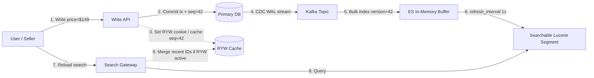
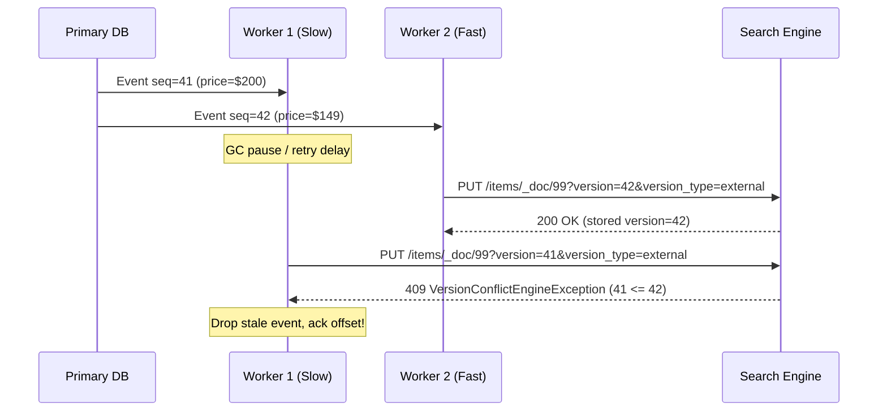
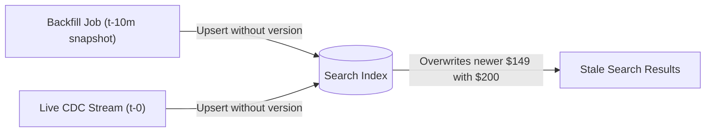

# Search Consistency: Refresh Delays, Read-Your-Writes & Drift

> **Prerequisites:** [Lesson 06: Indexing Pipelines](../06-indexing-pipelines/README.md).  
> **Estimated Reading Time:** 24–28 minutes  
> **Target Audience:** Backend and search engineers handling stale search results, read-your-writes bugs, and silent index drift between primary databases and Elasticsearch/OpenSearch.  
> **Free PDF Notes:** [Download SD-P-007.pdf](https://backendroadmap.com/notes/system-design/SD-P-007.pdf)

> [!NOTE]
> **In one line:** A search engine is an **eventually consistent secondary index** with two separate lag layers: pipeline lag (DB commit to index write) and **refresh lag** (in-memory buffer to searchable Lucene segment). Bridging the gap requires **monotonically increasing version numbers** (`external` versioning) to stop out-of-order overwrites, **read-your-writes** bypasses for the acting user, and continuous **reconciliation** to heal silent drift.

> [!TIP]
> **The Golden Rule:** Never call `refresh=true` on every write in production, and never trust wall-clock timestamps for CDC ordering. Use primary-DB sequence numbers for optimistic concurrency (`version_type=external`), keep `refresh_interval` at `1s–30s`, and serve the author's own recent writes from the primary DB or a short-lived cache.

---

## 1. What Search Consistency Is, and What It Isn't

A seller updates a product price from `$200` to `$149` and clicks Save. The primary Postgres database commits in 4 ms. The seller immediately reloads the catalog search page—and still sees `$200`. Worse, an hour later, a nightly bulk backfill overwrites `$149` back to `$200` because it read a stale snapshot.

| Term | Precise Meaning | Example |
| :--- | :--- | :--- |
| **Near-real-time (NRT) search** | Documents become searchable after a periodic segment refresh, not on commit | Elasticsearch `refresh_interval: 1s` |
| **Refresh delay** | Time between an index/update API call returning `200 OK` and the segment becoming visible to queries | 1,000 ms default in ES/OpenSearch |
| **Pipeline lag** | Time between the primary DB commit and the indexing worker writing to the search cluster | CDC Debezium + Kafka consumer lag (200 ms–5 s) |
| **Read-your-writes (RYW)** | Guarantee that a user who just modified a document immediately sees their own change | Seller edits listing, sees `$149` on reload |
| **Index drift** | Silent divergence between the primary DB state and the search index | Deleted row still appears in search |
| **Tombstone** | Explicit delete marker or soft-delete flag propagated through the pipeline | `DELETE` CDC event -> ES `_delete` |
| **External versioning** | Passing the DB's monotonic sequence/version so stale writes are rejected (`409 Conflict`) | `version=42&version_type=external` |
| **Not** | Turning Elasticsearch into a transactional primary store | Search engines lack multi-doc ACID |

### Why It Matters
1. **User trust breaks on RYW violations:** Users who edit a profile, post a ticket, or change a price assume the system broke if search shows the old state 500 ms later.
2. **Out-of-order events corrupt state silently:** Without monotonic versioning, a slow retry or parallel Kafka partition overwrites newer state with older state.
3. **Drift compounds invisibly:** Dropped DLQ messages, partial bulk failures, and missed deletes accumulate until 2–5% of search results point to deleted or wrong records.

---

## 2. Anatomy: The Two Lag Layers & Read-Your-Writes Bypass



A write travels through two distinct buffers before a normal search query can see it:
1. **Pipeline buffer:** DB WAL -> CDC connector -> Kafka -> indexer worker -> search bulk API.
2. **Engine buffer:** Search node's translog + in-memory indexing buffer -> OS page cache segment created on `refresh`.

| Consistency Strategy | Latency Impact | Write Throughput Impact | Best For |
| :--- | :--- | :--- | :--- |
| **Default NRT (`1s` refresh)** | 1–3 s stale | Highest (batched segments) | Public catalog, logs, analytics |
| **`refresh=wait_for` on write** | Writer blocks up to `1s` | Moderate (no extra segments) | Admin tools, low-QPS mutations |
| **`refresh=true` on write** | Immediate visibility | **Severe** (tiny segments, merge storm) | Integration tests only |
| **RYW Cache / DB Overlay** | 0 ms for acting user | Zero impact on search cluster | E-commerce sellers, SaaS CRUD |
| **Async Reconciliation** | Heals drift in minutes/hours | Low (throttled background scan) | All production search systems |

> [!WARNING]
> **Never call `?refresh=true` on user-facing write paths.** Every forced refresh flushes the in-memory buffer into a tiny Lucene segment on disk. At 500 writes/sec, this creates 500 tiny segments per second, exhausting file descriptors, thrashing the JVM heap with segment readers, and triggering a cascading background merge storm that stalls queries.

---

## 3. Mathematical Model: End-to-End Staleness, Segment Churn & Drift Probability

**Total visibility lag ($L_{\text{vis}}$).** The time from primary DB commit to search visibility is the sum of CDC capture ($L_{\text{cdc}}$), broker/worker queuing ($L_{\text{pipe}}$), bulk batching window ($L_{\text{batch}}$), and the uniform wait for the next refresh tick ($[0, T_{\text{refresh}}]$):

$$L_{\text{vis}} = L_{\text{cdc}} + L_{\text{pipe}} + L_{\text{batch}} + U(0, T_{\text{refresh}})$$

Expected staleness is $\mathbb{E}[L_{\text{vis}}] = L_{\text{cdc}} + L_{\text{pipe}} + L_{\text{batch}} + \frac{T_{\text{refresh}}}{2}$, while worst-case $p_{99}$ staleness adds the full $T_{\text{refresh}}$ plus any GC or merge pause.

**Segment creation rate under forced refresh.** If $W$ writes/sec arrive on $S$ shards and each write forces a refresh instead of batching over $T_{\text{refresh}}$:

$$R_{\text{seg, forced}} = \frac{W}{S}, \qquad R_{\text{seg, NRT}} = \frac{1}{T_{\text{refresh}}}$$

With $W = 1{,}000\text{ writes/s}$, $S = 10\text{ shards}$, and $T_{\text{refresh}} = 1\text{ s}$:
- NRT creates $10 \times 1 = 10$ segments/sec cluster-wide.
- Forced refresh creates $1{,}000$ segments/sec cluster-wide ($100\times$ more segments), causing Lucene's `TieredMergePolicy` to saturate disk I/O.

**Drift accumulation without reconciliation.** If a pipeline has per-event drop/corruption probability $p_{\text{err}}$ (e.g., transient bulk rejection not retried or missed delete) across $N_{\text{mut}}$ daily mutations, expected drifted documents after $D$ days is:

$$\mathbb{E}[\text{Drift}(D)] = N_{\text{mut}} \cdot D \cdot p_{\text{err}}$$

At $N_{\text{mut}} = 2{,}000{,}000\text{/day}$ and $p_{\text{err}} = 5 \times 10^{-5}$ (0.005%), you accumulate $100$ silent mismatches per day—3,000 broken search records per month.

---

## 4. Metrics & Percentiles

| Metric | Meaning | Alert when |
| :--- | :--- | :--- |
| **End-to-end indexing lag $p_{99}$** | `index_timestamp - db_commit_timestamp` | Exceeds SLO (e.g., $> 5\text{ s}$) |
| **Refresh time $p_{99}$** | Time spent creating new Lucene segments | $> 200\text{ ms}$ (merge pressure) |
| **Segment count per shard** | Active immutable Lucene segments | $> 150$ per shard (search slowdown) |
| **Version conflict rate (`409`)** | Stale writes rejected by external versioning | Sudden spike (reprocessing/race) |
| **Drift rate (%)** | Sampled IDs where DB $\neq$ Search | $> 0.1\%$ of catalog |
| **DLQ / failed bulk items** | Documents failing mapping or analyzer | $> 0$ sustained |

### Worked Example (E-Commerce Price Update)
A catalog has 5M SKUs on 10 shards (`refresh_interval = 2s`). Average pipeline lag is $L_{\text{cdc}} = 80\text{ ms}$, $L_{\text{pipe}} = 120\text{ ms}$, $L_{\text{batch}} = 250\text{ ms}$.
- **Expected visibility lag:** $80 + 120 + 250 + \frac{2000}{2} = 1{,}450\text{ ms}$.
- **Worst-case normal lag:** $80 + 120 + 250 + 2000 = 2{,}450\text{ ms}$.
- If a seller updates a SKU, the Write API stores `(doc_id, version=42, payload)` in Redis for 10 s. When the seller searches within 10 s, the Search Gateway fetches top 20 IDs from Elasticsearch, checks Redis for any modified IDs belonging to that seller, and patches the response in $< 2\text{ ms}$—delivering 0 ms RYW without touching `refresh_interval`.

---

## 5. Compounding & Failure Modes: Out-of-Order Races & Merge Storms

When multiple workers consume from a pipeline or a backfill runs concurrently with live CDC, out-of-order delivery turns transient latency into permanent data corruption.

| Failure Mode | Trigger | Compounding Effect |
| :--- | :--- | :--- |
| **ABA Stale Overwrite** | Worker A stalls on `seq=41`; Worker B indexes `seq=42`; Worker A resumes | Search permanently shows `seq=41` until next edit |
| **Missing Tombstone** | Hard `DELETE` in DB not captured (or bulk delete fails silently) | Ghost listings appear in search, fail at checkout (`404`) |
| **Merge Storm** | `refresh=true` or `refresh_interval=100ms` under write burst | Disk I/O hits 100%, search $p_{99}$ jumps 50 ms $\to$ 4,000 ms |
| **Primary-Replica Shard Lag** | Replica lags behind primary shard during heavy segment sync | Same query alternates between old and new results on refresh |

---

## 6. Numbers Every Engineer Must Know

| Item | Typical | Implication |
| :--- | :---: | :--- |
| Default `refresh_interval` | `1s` | Writes visible in ~1 s; tune to `5s–30s` for write-heavy indexes |
| Translog `fsync` | Per request (default) | Ensures durability before refresh; async mode risks 5 s loss on crash |
| `refresh=wait_for` ceiling | Up to `refresh_interval` | Safe for low-QPS admin writes; never blocks longer than 1 interval |
| Healthy segments per shard | `20–80` | Above ~200 increases query CPU and heap footprint |
| RYW Redis overlay TTL | `10–30 s` | Must exceed $p_{99.9}$ pipeline + refresh lag |
| Reconciliation sample rate | `1–5%` daily or continuous | Catches silent drift before customers notice |

---

## 7. Protocol Deep Dive: Optimistic Concurrency with External Versioning



| Question | Answer |
| :--- | :--- |
| **Why not use wall-clock timestamps?** | Clock skew across app/DB nodes can let an older write carry a newer timestamp. |
| **What if a document is deleted and re-inserted?** | Use soft-deletes (`deleted_at`) or a global monotonic sequence (`LSN` / `txid`), not a per-row counter starting at 1. |
| **Should Worker 1 retry a `409 Conflict`?** | **No.** A `409` with `external` versioning proves a newer version is already indexed; treat it as a successful no-op. |
| **How does `wait_for` differ from `refresh=true`?** | `wait_for` waits for the *next scheduled* refresh tick rather than forcing an extra segment creation. |

**When not to use RYW overlays:** For global multi-user feeds or analytics dashboards where strict per-user read-your-writes is unnecessary, standard 1–5 s NRT eventual consistency is simpler and cheaper.

---

## 8. Hierarchical Budgets & Design Rules

| Slice | Rule | Control |
| :--- | :--- | :--- |
| Refresh interval | `1s` for user-facing; `15s–30s` for bulk/logs | Index settings (`index.refresh_interval`) |
| Concurrency control | Always pass monotonic `version` + `version_type=external` | Reject stale writes at the search engine |
| Partitioning | Partition Kafka by `doc_id` | Preserves per-document order in-flight |
| RYW UX | Serve acting user's writes from DB/Redis overlay for 15 s | Search Gateway merge layer |
| Deletes | Propagate tombstones with version; soft-delete in index first | Nightly tombstone GC after 7 days |
| Drift healing | Continuous checksum/count comparison + targeted reindex | Automated reconciliation job |

---

## 9. Top Mitigations

1. **Attach a monotonic DB sequence (`txid` or `updated_seq`) to every index write** and enforce `version_type=external`.
2. **Partition your ingestion queue by `document_id`** so updates to the same entity are serialized.
3. **Never use `refresh=true` in request paths**; use `refresh=wait_for` only for rare admin mutations.
4. **Implement a Read-Your-Writes (RYW) overlay** in Redis or the API gateway for the mutating user/session.
5. **Treat `409 VersionConflict` as success**, not a DLQ error, when using external versioning.
6. **Use soft-deletes or versioned tombstones** so a delayed update never resurrects a deleted document.
7. **Run a throttled drift reconciler** comparing `(id, version)` tuples between the DB replica and search index via `search_after`.

---

## 10. Production Reference: SEV-1 Ghost Inventory & Price Rollback

**Incident:** During a flash sale, a marketplace ran a catalog backfill job from a read replica while live price updates flowed via Kafka. Within 20 minutes, 12% of discounted items reverted to pre-sale prices in search, and 400 sold-out items remained searchable.



- **Root Cause:** The search indexer used default internal versioning (last-write-wins). The backfill read a 10-minute-old replica snapshot and overwrote live CDC updates. Additionally, `DELETE` events lacked a version number and were silently skipped when the bulk batch hit a transient `429` error.
- **Fix:** Added a `version` column (Postgres `nextval` sequence) updated on every row mutation, switched all ES bulk operations (including backfills and deletes) to `version_type=external`, partitioned Kafka by `item_id`, and added an hourly `search_after` reconciliation job.

---

## 11. Multi-Language Production Code Tabs

Optimistic external versioning + Read-Your-Writes (RYW) overlay check in Go, TypeScript, Python, and C#.

````carousel
```go
// Go: External-versioned index write (ignoring 409) + RYW overlay merge.
package searchconsistency

import (
	"context"
	"errors"
	"net/http"
)

var ErrTransient = errors.New("transient search error")

type Doc struct {
	ID      string
	Price   int
	Version int64 // Monotonic DB sequence
}

type SearchClient interface {
	UpsertExternal(ctx context.Context, doc Doc) (status int, err error)
}

func IndexDocument(ctx context.Context, client SearchClient, doc Doc) error {
	status, err := client.UpsertExternal(ctx, doc)
	if err != nil {
		return err
	}
	if status == http.StatusConflict {
		// 409 means a newer version is already indexed; safe no-op.
		return nil
	}
	if status >= 500 || status == http.StatusTooManyRequests {
		return ErrTransient
	}
	return nil
}

// OverlayRYW patches stale search hits with recent writes from the user's RYW cache.
func OverlayRYW(hits []Doc, recentWrites map[string]Doc) []Doc {
	for i, h := range hits {
		if fresh, ok := recentWrites[h.ID]; ok && fresh.Version > h.Version {
			hits[i] = fresh
		}
	}
	return hits
}
```
<!-- slide -->
```typescript
// TypeScript: External versioning handler & RYW overlay merge.
export interface SearchDoc {
  id: string;
  price: number;
  version: number; // Monotonic DB sequence
}

export interface SearchBackend {
  indexExternal(doc: SearchDoc): Promise<{ status: number }>;
}

export async function indexWithExternalVersion(
  backend: SearchBackend,
  doc: SearchDoc
): Promise<"indexed" | "stale_ignored"> {
  const res = await backend.indexExternal(doc);
  if (res.status === 409) {
    // Newer version already present; do not retry or send to DLQ.
    return "stale_ignored";
  }
  if (res.status >= 400) {
    throw new Error(`Indexing failed with status ${res.status}`);
  }
  return "indexed";
}

export function applyReadYourWrites(
  hits: SearchDoc[],
  rywCache: Map<string, SearchDoc>
): SearchDoc[] {
  return hits.map((hit) => {
    const recent = rywCache.get(hit.id);
    return recent && recent.version > hit.version ? recent : hit;
  });
}
```
<!-- slide -->
```python
# Python: External versioning simulator & RYW staleness calculator (stdlib only).
from dataclasses import dataclass

@dataclass
class Doc:
    id: str
    price: int
    version: int

class VersionedIndex:
    def __init__(self) -> None:
        self.store: dict[str, Doc] = {}

    def upsert_external(self, doc: Doc) -> int:
        existing = self.store.get(doc.id)
        if existing and doc.version <= existing.version:
            return 409  # VersionConflict: reject stale write
        self.store[doc.id] = doc
        return 200

    def overlay_ryw(self, hits: list[Doc], ryw_cache: dict[str, Doc]) -> list[Doc]:
        merged = []
        for h in hits:
            fresh = ryw_cache.get(h.id)
            merged.append(fresh if fresh and fresh.version > h.version else h)
        return merged

if __name__ == "__main__":
    idx = VersionedIndex()
    assert idx.upsert_external(Doc("sku-1", 149, version=42)) == 200
    assert idx.upsert_external(Doc("sku-1", 200, version=41)) == 409  # Stale blocked
    assert idx.store["sku-1"].price == 149
```
<!-- slide -->
```csharp
// C#: External versioning client & RYW overlay merge.
using System.Collections.Generic;
using System.Threading.Tasks;

public sealed record SearchDoc(string Id, int Price, long Version);

public interface ISearchBackend
{
    Task<int> UpsertExternalAsync(SearchDoc doc);
}

public static class ConsistencyHelper
{
    public static async Task<bool> IndexSafeAsync(ISearchBackend backend, SearchDoc doc)
    {
        int status = await backend.UpsertExternalAsync(doc);
        if (status == 409) return false; // Stale write ignored safely
        if (status >= 400) throw new HttpRequestException($"Search error: {status}");
        return true;
    }

    public static List<SearchDoc> ApplyRywOverlay(
        IReadOnlyList<SearchDoc> hits,
        IReadOnlyDictionary<string, SearchDoc> rywCache)
    {
        var result = new List<SearchDoc>(hits.Count);
        foreach (var hit in hits)
        {
            if (rywCache.TryGetValue(hit.Id, out var fresh) && fresh.Version > hit.Version)
                result.Add(fresh);
            else
                result.Add(hit);
        }
        return result;
    }
}
```
````

---

## 12. Hands-On CLI Verification Workflows

Verify external versioning, refresh intervals, and segment counts directly against Elasticsearch/OpenSearch:

```bash
# 1. Index doc with external version 42
curl -X PUT "http://localhost:9200/products/_doc/99?version=42&version_type=external" \
  -H "Content-Type: application/json" -d '{"price": 149}'

# 2. Attempt stale overwrite with version 41 (expect HTTP 409 Conflict)
curl -i -X PUT "http://localhost:9200/products/_doc/99?version=41&version_type=external" \
  -H "Content-Type: application/json" -d '{"price": 200}'

# 3. Check refresh interval & segment count per shard
curl -s "http://localhost:9200/products/_settings?pretty" | grep refresh_interval
curl -s "http://localhost:9200/_cat/segments/products?v&h=shard,segment,docs.count,size"
```

Run the Python staleness & RYW check:

```bash
python3 -c '
cdc, pipe, batch, refresh = 80, 120, 250, 2000
print("Expected lag ms:", cdc + pipe + batch + refresh / 2)
print("Worst-case lag ms:", cdc + pipe + batch + refresh)
'
```

---

## 13. Common Mistakes to Avoid

1. **Calling `?refresh=true` on every application write**, causing segment explosions and merge storms.
2. **Using wall-clock timestamps (`updated_at`) for `version_type=external`** instead of monotonic DB sequences.
3. **Retrying `409 Conflict` responses** in Kafka consumers, clogging the DLQ with harmless stale events.
4. **Running bulk backfills without external versioning**, silently rolling back live updates.
5. **Forgetting delete tombstones**, leaving deleted or sold-out items in search results indefinitely.
6. **Assuming partition-key ordering guarantees global consistency** when retries or backfills run in parallel.
7. **Skipping drift reconciliation**, allowing 0.01% daily errors to compound into thousands of broken records.

---

## 14. Key Terms Glossary

| Key Term | Definition |
| :--- | :--- |
| **Near-Real-Time (NRT)** | Search visibility model where writes become queryable after periodic segment refreshes. |
| **`refresh_interval`** | Frequency at which in-memory buffers are flushed into searchable Lucene segments. |
| **`refresh=wait_for`** | Write option that blocks the caller until the next scheduled refresh instead of forcing one. |
| **Translog** | Write-ahead transaction log on each shard ensuring durability before disk flush. |
| **Read-Your-Writes (RYW)** | Consistency guarantee that a user immediately sees their own mutations. |
| **External Versioning** | Concurrency control using caller-supplied monotonic sequence numbers (`version_type=external`). |
| **Index Drift** | Divergence between the primary database and the search index over time. |
| **Tombstone** | Versioned delete marker preventing stale updates from resurrecting deleted documents. |
| **Merge Storm** | Disk and CPU saturation caused by excessive small segments triggering background merges. |
| **Reconciler** | Background job comparing primary DB state against the search index to heal drift. |

---

## 15. System Design Interview Questions & Answers

### Basic Conceptual Questions

<details>
<summary><strong>Q1: Why is there a delay between writing to Elasticsearch and seeing the document in search? [BASIC]</strong></summary>

**Answer:**
Documents are first written to an in-memory buffer and the translog for durability. They only become searchable when a `refresh` creates a new immutable Lucene segment in the OS page cache, which happens periodically (default `1s`) rather than per write.
</details>

<details>
<summary><strong>Q2: What is the difference between `refresh=true` and `refresh=wait_for`? [BASIC]</strong></summary>

**Answer:**
`refresh=true` forces an immediate segment creation for that request, which causes severe segment fragmentation and merge storms under load. `refresh=wait_for` does not create an extra segment; it simply holds the client response open until the next scheduled refresh tick completes.
</details>

<details>
<summary><strong>Q3: What is index drift and how does it happen? [BASIC]</strong></summary>

**Answer:**
Index drift is silent divergence between the primary database and the search index. It happens due to dropped CDC events, partial bulk failures, missed delete tombstones, schema mapping rejections, or out-of-order overwrites.
</details>

<details>
<summary><strong>Q4: Why do search engines use `refresh` instead of writing directly to disk segments on every commit? [BASIC]</strong></summary>

**Answer:**
Lucene inverted indexes are immutable segments. Rebuilding or writing a segment per single document write would destroy write throughput and thrash disk I/O. Batching writes in memory over `1s–30s` amortizes the cost of building FSTs and posting lists.
</details>

### Scenario-Based Architecture Questions

<details>
<summary><strong>Q5: A user edits their listing title and immediately reloads search, seeing the old title. How do you fix this without hurting cluster throughput? [SCENARIO]</strong></summary>

**Answer:**
Implement a Read-Your-Writes (RYW) overlay. When the Write API commits to the primary DB, it caches the updated document (with its sequence version) in Redis keyed by `user_id` with a short TTL (e.g., 15 s, exceeding $p_{99.9}$ indexing lag). The Search Gateway checks this cache for the requesting user and patches any matching IDs in the search response.
</details>

<details>
<summary><strong>Q6: A nightly backfill job runs alongside live CDC updates. How do you prevent the backfill from overwriting newer changes? [SCENARIO]</strong></summary>

**Answer:**
Attach a monotonic sequence number (`version`) to every row in the primary DB, incremented on every update/delete. Configure both the live CDC indexer and the backfill job to pass `?version=<seq>&version_type=external` to the search engine. Any older snapshot record from the backfill is safely rejected with `409 Conflict`.
</details>

<details>
<summary><strong>Q7: Your search $p_{99}$ latency spiked from 40 ms to 3,000 ms after a new team deployed a feature. Segment count per shard is 800. What happened? [SCENARIO]</strong></summary>

**Answer:**
The new feature is almost certainly calling `refresh=true` (or setting `refresh_interval` too low, e.g., `10ms`) on a high-throughput write path. This floods shards with tiny segments, exhausting file descriptors and triggering continuous background merges. Remove `refresh=true`, restore `refresh_interval >= 1s`, and let segments merge down.
</details>

<details>
<summary><strong>Q8: How do you design a drift reconciliation pipeline for a 50M-document catalog? [SCENARIO]</strong></summary>

**Answer:**
Use a streaming cursor (`search_after` on `_id` in search, keyset pagination on `id` in the DB replica) scanning 5–10% of the catalog per hour or full scans overnight. Compare `(id, version)` pairs: reindex missing or older-versioned docs with `version_type=external`, and issue versioned deletes for orphaned IDs in search.
</details>

### Advanced & Tricky Interview Questions

<details>
<summary><strong>Q9: Why can wall-clock timestamps fail as external version numbers? [TRICKY]</strong></summary>

**Answer:**
Distributed app servers and DB replicas suffer from NTP clock skew. If Node A's clock is 500 ms ahead of Node B's clock, an earlier write from Node A gets a higher timestamp and permanently blocks or overwrites a genuinely newer write from Node B. Use a single-source monotonic sequence (`LSN`, `txid`, or DB sequence).
</details>

<details>
<summary><strong>Q10: A document is deleted in Postgres, then an older update event arrives late from Kafka. How do you stop it from resurrecting the document? [TRICKY]</strong></summary>

**Answer:**
If you hard-delete the document from Elasticsearch, ES forgets its version number, so a late `PUT` with an older version will recreate it. Fix this by indexing a soft-delete tombstone (`{"deleted": true}`) with the delete's higher `version`, filtering `deleted: false` in queries, and purging old tombstones only after Kafka retention expires.
</details>

<details>
<summary><strong>Q11: Even after `refresh` completes on the primary shard, a user occasionally sees stale results on alternate reloads. Why? [TRICKY]</strong></summary>

**Answer:**
Replica shard refresh lag. Writes are replicated to replica shards, but primary and replica shards run their `refresh_interval` timers independently (or a replica is slightly behind). Fix by routing a user's queries consistently to the same shard copy using `preference=_sessionid` or `preference=user_123`.
</details>

<details>
<summary><strong>Q12: When would you disable `refresh_interval` (`-1`) entirely? [TRICKY]</strong></summary>

**Answer:**
During initial bulk indexing or full index rebuilds into a green/shadow index before an alias swap. Setting `refresh_interval: -1` and `number_of_replicas: 0` maximizes bulk ingestion speed by avoiding segment creation and replication overhead until the load finishes.
</details>

---

## 16. One-Page Master Cheat Sheet

```
+---------------------------------------------------------------------------------------------------------+
|                    SEARCH CONSISTENCY — MASTER CHEAT SHEET                                              |
+---------------------------------------------------------------------------------------------------------+
| 1. TWO LAG LAYERS: Pipeline lag (DB -> CDC -> Kafka -> Indexer) + Refresh lag (Buffer -> Segment).      |
|    Total Lag = L_cdc + L_pipe + L_batch + U(0, T_refresh).                                              |
+---------------------------------------------------------------------------------------------------------+
| 2. NEVER USE refresh=true IN PROD: Causes segment explosion & merge storms. Use refresh=wait_for        |
|    only for rare admin mutations, or keep refresh_interval at 1s-30s.                                   |
+---------------------------------------------------------------------------------------------------------+
| 3. ORDERING: Partition Kafka by doc_id AND enforce version_type=external with monotonic DB sequences.   |
|    Treat HTTP 409 VersionConflict as a safe no-op.                                                      |
+---------------------------------------------------------------------------------------------------------+
| 4. READ-YOUR-WRITES: Cache actor's recent writes in Redis (TTL > p99.9 lag) and overlay in Gateway.     |
|    Use preference=<session_id> to avoid primary/replica refresh skew.                                   |
+---------------------------------------------------------------------------------------------------------+
| 5. TOMBSTONES & DRIFT: Soft-delete with version so late events don't resurrect docs. Run throttled      |
|    keyset/search_after reconcilers to heal silent drift.                                                |
+---------------------------------------------------------------------------------------------------------+
```

---

## Further Reading & Sources

- Elasticsearch Documentation, [Near real-time search & Tune for indexing speed](https://www.elastic.co/guide/en/elasticsearch/reference/current/tune-for-indexing-speed.html).
- Elasticsearch Documentation, [Optimistic concurrency control & External versioning](https://www.elastic.co/guide/en/elasticsearch/reference/current/optimistic-concurrency-control.html).
- Martin Kleppmann, *Designing Data-Intensive Applications*, Chapter 5 ("Read-Your-Writes Consistency") & Chapter 11 ("Derived Data").
- Uber Engineering Blog, [Indexing and Consistency in Distributed Search](https://www.uber.com/blog/engineering/).

---

## Free PDF Notes

[SD-P-007.pdf](https://backendroadmap.com/notes/system-design/SD-P-007.pdf)

---

## Next

Continue with [Lesson 08: Autocomplete at Scale: Tries, Edge N-Grams & Caching](../08-autocomplete-at-scale/README.md): Tries, Edge N-Grams, FSTs & multi-tier caching.
