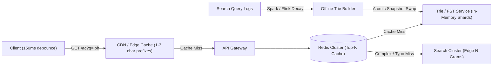
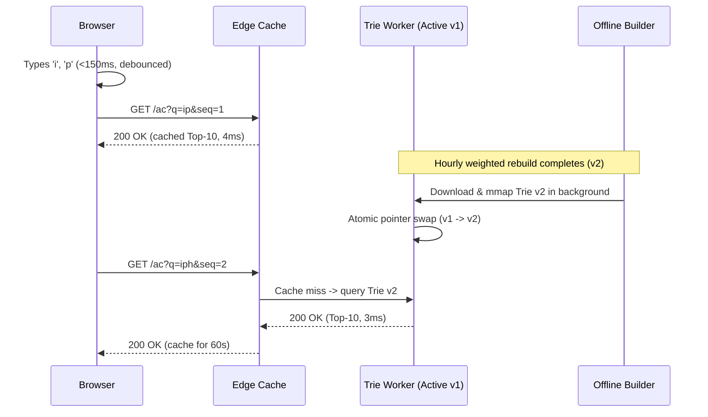

# Autocomplete at Scale: Tries, Edge N-Grams & Caching

> **Prerequisites:** [Lesson 07: Search Consistency](../07-search-consistency/README.md).  
> **Estimated Reading Time:** 24–28 minutes  
> **Target Audience:** Engineers designing typeahead/search-as-you-type systems under strict $< 30\text{ ms}$ $p_{99}$ budgets and high QPS.  
> **Free PDF Notes:** [Download SD-P-008.pdf](https://backendroadmap.com/notes/system-design/SD-P-008.pdf)

> [!NOTE]
> **In one line:** Autocomplete is a **read-heavy prefix-lookup problem** where every keystroke fires a query. At scale, you **precompute Top-$K$ suggestions at each trie node** (or compile into a compressed **FST**) for $O(|p|)$ lookups, pair it with **edge n-grams** for multi-word/fuzzy matching, and absorb 80%+ of keystrokes in **CDN/Redis caches**.

> [!TIP]
> **The Golden Rule:** Never traverse a subtree at query time to rank suggestions. Precompute the Top-10 weighted completions per prefix offline, debounce client keystrokes (150–200 ms), and serve short prefixes (`1–3` chars) directly from edge/CDN cache.

---

## 1. What Autocomplete Is, and What It Isn't

A user types `iph` into a storefront search bar. Before they finish typing `iphone 16 pro`, the backend must return the top 10 ranked completions in under 30 ms—while handling $5\times$ to $10\times$ more QPS than full-text search because every keystroke triggers a request.

| Term | Precise Meaning | Example |
| :--- | :--- | :--- |
| **Prefix Trie** | Tree where each edge is a character and nodes store Top-$K$ completions | `i -> p -> h -> ["iphone 16", ...]` |
| **Radix / Patricia Trie** | Compressed trie merging single-child chains into one edge | `iph` as one edge instead of 3 nodes |
| **FST (Finite State Transducer)** | Compressed DAG sharing both prefixes and suffixes in minimal RAM | Lucene `CompletionSuggester` |
| **Edge N-Gram** | Index-time tokenization producing all prefixes of a token (`i`, `ip`, `iph`) | Elasticsearch `edge_ngram` analyzer |
| **Debouncing** | Client-side delay waiting for a typing pause before sending a request | 150 ms pause after keystroke |
| **Query Log Aggregation** | Offline pipeline counting and decaying query frequencies | Last 7 days search logs -> weights |
| **Not** | Running `LIKE 'iph%'` on a relational database or scanning full inverted indexes | `LIKE` fails at high QPS |

### Why It Matters
1. **Keystroke amplification:** A single 8-character search generates up to 8 autocomplete requests; at 5,000 searches/s, autocomplete sees 25,000–40,000 QPS.
2. **Latency budget is tiny:** Human perception of "instant" UI is $< 50\text{ ms}$ round-trip, leaving $< 15\text{–}30\text{ ms}$ for the backend.
3. **Freshness vs. stability:** Trending queries ("world cup score") must surface within minutes without rebuilding a 10 GB trie synchronously on the serving path.

---

## 2. Anatomy: Trie-in-RAM vs. Edge N-Grams + Multi-Tier Cache



| Approach | Lookup Time | Memory Footprint | Multi-Word / Fuzzy | Best For |
| :--- | :--- | :--- | :--- | :--- |
| **Standard Trie + Top-$K$** | $O(L)$ (~0.1 ms) | High (pointers + copies) | Poor (strict prefix) | Fast pure-prefix typeahead |
| **FST (Compressed)** | $O(L)$ (~0.2 ms) | **Very Low** (10x smaller) | Prefix only (or fuzzy automaton) | Large dictionaries (10M+ terms) |
| **Edge N-Gram (ES/OS)** | $O(\text{postings})$ (10–30 ms) | Medium (disk + OS cache) | **Excellent** (token-level + typo) | Product catalogs, multi-word |
| **Redis Sorted Sets (`ZRANGEBYLEX`)** | $O(\log N)$ (1–3 ms) | Medium-High | Prefix only | Small-medium catalogs (< 1M) |

> [!WARNING]
> **Never traverse all descendants of a prefix node at query time.** For a 1-character prefix like `s`, a naive trie walk visits millions of nodes, blowing past your 30 ms SLA and pegging CPU at 100%. Always store the precomputed Top-$K$ list directly on each node.

---

## 3. Mathematical Model: QPS Amplification, Trie Memory & Exponential Decay

**QPS amplification from keystrokes.** If average query length is $L_{\text{avg}}$ characters, debouncing reduces requests by factor $\alpha \in (0, 1]$, and search QPS is $Q_{\text{search}}$:

$$Q_{\text{ac}} = Q_{\text{search}} \cdot L_{\text{avg}} \cdot \alpha$$

With $Q_{\text{search}} = 2{,}000\text{ QPS}$, $L_{\text{avg}} = 10$, and $\alpha = 0.4$ (150 ms debounce):
$$Q_{\text{ac}} = 2{,}000 \times 10 \times 0.4 = 8{,}000\text{ QPS}$$

**Naive Trie with Top-$K$ memory.** For $N$ unique phrases of average length $L$, storing $K$ pointers/strings at each of the $\approx N \cdot L$ nodes:

$$M_{\text{trie}} \approx N_{\text{nodes}} \cdot \left( C_{\text{node}} + K \cdot C_{\text{entry}} \right)$$

For $N = 10{,}000{,}000$ phrases, $N_{\text{nodes}} \approx 40{,}000{,}000$, $K = 10$, and $C_{\text{entry}} = 16\text{ bytes}$ (ID + score) plus $C_{\text{node}} = 64\text{ bytes}$:
$$M_{\text{trie}} \approx 4 \times 10^7 \times (64 + 160) \approx 8.96\text{ GB}$$
Compressing into a **Radix Trie** or **FST** reduces node count by $4\times\text{–}10\times$, fitting cleanly in $< 2\text{ GB}$ RAM.

**Exponential decay for trending queries.** To prevent old popular queries from dominating forever, score each query $q$ with half-life $H$ (e.g., 7 days):

$$\text{Score}(q, t) = \sum_{i \in \text{events}(q)} 2^{-\frac{t - t_i}{H}}$$

---

## 4. Metrics & Percentiles

| Metric | Meaning | Alert when |
| :--- | :--- | :--- |
| **Autocomplete $p_{99}$ latency** | End-to-end backend response time | $> 30\text{ ms}$ |
| **Edge/Redis cache hit ratio** | % of keystrokes served before Trie/ES | $< 75\%$ |
| **Zero-result rate** | % of prefixes returning 0 suggestions | $> 5\%$ (missing fallback/fuzzy) |
| **CTR (Click-Through Rate)** | % of sessions clicking a suggestion | Dropping $> 3\%$ week-over-week |
| **Trie snapshot age** | Time since last offline weight rebuild | $> 2\times$ rebuild cadence |
| **Memory utilization** | Heap/RSS of in-memory Trie/FST nodes | $> 80\%$ (risk of OOM on swap) |

### Worked Example (Cache Hit Sizing)
An English catalog receives 10,000 autocomplete QPS.
- There are only $26$ 1-char prefixes and $26^2 = 676$ 2-char prefixes (plus digits/spaces $\approx 1{,}500$ hot keys).
- By Zipf's law, 1–3 character prefixes account for ~65% of all keystrokes, and popular 4+ char prefixes account for another 20%.
- Caching just the top 50,000 prefix keys in Redis/CDN ($\approx 25\text{ MB}$ total) absorbs **85% of traffic** (8,500 QPS), leaving only 1,500 QPS for the in-memory Trie/FST cluster.

---

## 5. Compounding & Failure Modes: Cache Stampedes & Cold Swaps

| Failure Mode | Trigger | Compounding Effect |
| :--- | :--- | :--- |
| **No Client Debounce** | Mobile app fires on every `onChange` | $3\times$ QPS spike; older slow responses overwrite newer UI state |
| **Trie Rebuild Lockout** | Mutating the live trie in-place during updates | Read locks stall $p_{99}$ latency from 5 ms to 500 ms |
| **Edge N-Gram Index Bloat** | Indexing `min_gram=1, max_gram=20` on 50M docs | Inverted index balloons $5\times$, exhausting OS page cache |
| **Prefix-Only Blindness** | User types `pro iphone` instead of `iphone pro` | Pure trie returns 0 results; needs token-order-independent fallback |

---

## 6. Numbers Every Engineer Must Know

| Item | Typical | Implication |
| :--- | :---: | :--- |
| Client debounce window | `150–200 ms` | Cuts keystroke QPS by 50–70% without feeling laggy |
| Backend $p_{99}$ SLA | `< 20–30 ms` | Leaves room for 20 ms network RTT to hit < 50 ms UX |
| 1-to-3 char prefix count (ASCII) | `~48,000` keys | Easily fits in < 30 MB of CDN/Redis memory |
| FST compression vs. naive Trie | `5x–10x` smaller | 10M phrases fit in ~1–2 GB RAM |
| Edge n-gram `max_gram` | `10–15` chars | Beyond 15 chars wastes index space with minimal recall gain |
| Top-$K$ per node | `5–10` items | Mobile shows 5–6; desktop shows 8–10 |

---

## 7. Protocol Deep Dive: Atomic Snapshot Swap & Debounced Request Ordering



| Question | Answer |
| :--- | :--- |
| **How do you update the trie without locks?** | Build a new immutable trie/FST snapshot offline, `mmap` or load it into RAM, and swap an atomic pointer. |
| **How do you prevent out-of-order responses in the UI?** | Attach a monotonic `seq` ID or `AbortController` in the browser so stale responses are discarded. |
| **How do you handle typos (`iphnoe`)?** | Fall back to an edge n-gram search index with `fuzziness: AUTO` or Levenshtein automaton on cache/trie miss. |
| **How do you filter offensive/banned suggestions?** | Apply a curated blocklist during the offline Trie build *and* a fast bloom/set check before returning. |

**When not to use an in-memory Trie:** If your catalog has complex per-user permissions (ACLs), real-time stock filtering (`in_stock: true`), or arbitrary multi-word matching, use Elasticsearch `search_as_you_type` / edge n-grams instead of a static global trie.

---

## 8. Hierarchical Budgets & Design Rules

| Slice | Rule | Control |
| :--- | :--- | :--- |
| Client | Debounce 150 ms; cancel in-flight requests | `AbortController` + min query length 1–2 |
| Edge / CDN | Cache 1–3 char prefixes with `stale-while-revalidate` | `Cache-Control: public, max-age=60` |
| Trie / FST | Immutable snapshots; zero write locks on read path | Atomic pointer swap + sharded by first char |
| Ranking | Precompute Top-10 per node using decayed log counts | Exponential decay half-life = 7 days |
| Fallback | Route zero-hit or multi-word queries to Edge N-Gram ES | Circuit breaker at 25 ms timeout |
| Safety | Strip PII, profanity, and 0-result queries offline | Blocklist filter in builder pipeline |

---

## 9. Top Mitigations

1. **Precompute Top-$K$ at every trie node** so query complexity is strictly $O(|p|)$, independent of corpus size.
2. **Debounce keystrokes (150 ms) and abort stale in-flight requests** on the client.
3. **Cache 1–3 character prefixes at the CDN/Redis edge** to absorb 70–85% of QPS.
4. **Use FSTs or Radix Tries** instead of pointer-heavy object tries to cut RAM by $5\times\text{–}10\times$.
5. **Swap trie snapshots atomically** (double-buffering) so updates never block live reads.
6. **Add an Edge N-Gram + fuzzy fallback** for multi-word out-of-order queries and typos.
7. **Apply exponential time decay and blocklists** during offline aggregation to keep suggestions fresh and safe.

---

## 10. Production Reference: High-QPS Prefix Cache Stampede & Out-of-Order UI

**Incident:** A retail site launched a homepage redesign with autocomplete enabled on every keystroke without debouncing. During a TV ad spike, 1-character queries (`a`, `s`, `i`) bypassed Redis due to a 60-second TTL expiration without jitter, triggering a stampede onto the Elasticsearch edge n-gram cluster.


- **Root Cause:** Autocomplete shared the same Elasticsearch cluster as full-text product search, had no client debounce, and used a fixed Redis TTL without request coalescing (`singleflight`).
- **Fix:** Isolated autocomplete onto a dedicated in-memory FST/Trie tier, added 150 ms client debouncing, enabled `singleflight` + jittered TTLs in Redis, and cached 1–2 char prefixes at the CDN edge.

---

## 11. Multi-Language Production Code Tabs

In-memory Prefix Trie with precomputed Top-$K$ suggestions at every node in Go, TypeScript, Python, and C#.

````carousel
```go
// Go: Prefix Trie with precomputed Top-K per node for O(len(prefix)) lookup.
package autocomplete

import "sort"

type Suggestion struct {
	Term  string
	Score int
}

type Node struct {
	children map[rune]*Node
	topK     []Suggestion
}

type Trie struct {
	root *Node
	k    int
}

func NewTrie(k int) *Trie {
	return &Trie{root: &Node{children: make(map[rune]*Node)}, k: k}
}

func (t *Trie) Insert(term string, score int) {
	curr := t.root
	for _, ch := range term {
		if curr.children[ch] == nil {
			curr.children[ch] = &Node{children: make(map[rune]*Node)}
		}
		curr = curr.children[ch]
		curr.topK = mergeTopK(curr.topK, Suggestion{term, score}, t.k)
	}
}

func (t *Trie) Query(prefix string) []Suggestion {
	curr := t.root
	for _, ch := range prefix {
		curr = curr.children[ch]
		if curr == nil {
			return nil
		}
	}
	return curr.topK
}

func mergeTopK(list []Suggestion, item Suggestion, k int) []Suggestion {
	updated := false
	for i := range list {
		if list[i].Term == item.Term {
			list[i].Score = item.Score
			updated = true
			break
		}
	}
	if !updated {
		list = append(list, item)
	}
	sort.Slice(list, func(i, j int) bool { return list[i].Score > list[j].Score })
	if len(list) > k {
		list = list[:k]
	}
	return list
}
```
<!-- slide -->
```typescript
// TypeScript: Precomputed Top-K Prefix Trie for O(|prefix|) autocomplete.
export interface Suggestion {
  term: string;
  score: number;
}

class TrieNode {
  children = new Map<string, TrieNode>();
  topK: Suggestion[] = [];
}

export class AutocompleteTrie {
  private root = new TrieNode();
  constructor(private readonly k = 5) {}

  insert(term: string, score: number): void {
    let curr = this.root;
    for (const ch of term) {
      let next = curr.children.get(ch);
      if (!next) {
        next = new TrieNode();
        curr.children.set(ch, next);
      }
      curr = next;
      const idx = curr.topK.findIndex((s) => s.term === term);
      if (idx >= 0) curr.topK[idx].score = score;
      else curr.topK.push({ term, score });
      curr.topK.sort((a, b) => b.score - a.score);
      if (curr.topK.length > this.k) curr.topK.length = this.k;
    }
  }

  query(prefix: string): Suggestion[] {
    let curr: TrieNode | undefined = this.root;
    for (const ch of prefix) {
      curr = curr.children.get(ch);
      if (!curr) return [];
    }
    return curr.topK;
  }
}
```
<!-- slide -->
```python
# Python: Precomputed Top-K Prefix Trie + QPS amplification calculator (stdlib only).
class TrieNode:
    __slots__ = ("children", "top_k")
    def __init__(self) -> None:
        self.children: dict[str, TrieNode] = {}
        self.top_k: list[tuple[int, str]] = []  # (-score, term)

class AutocompleteTrie:
    def __init__(self, k: int = 5) -> None:
        self.root = TrieNode()
        self.k = k

    def insert(self, term: str, score: int) -> None:
        curr = self.root
        for ch in term:
            if ch not in curr.children:
                curr.children[ch] = TrieNode()
            curr = curr.children[ch]
            items = {t: s for s, t in curr.top_k}
            items[term] = -score
            curr.top_k = sorted((s, t) for t, s in items.items())[:self.k]

    def query(self, prefix: str) -> list[tuple[str, int]]:
        curr = self.root
        for ch in prefix:
            if ch not in curr.children:
                return []
            curr = curr.children[ch]
        return [(t, -s) for s, t in curr.top_k]

if __name__ == "__main__":
    trie = AutocompleteTrie(k=3)
    for term, score in [("iphone 16", 950), ("iphone 15", 600), ("ipad pro", 800)]:
        trie.insert(term, score)
    assert trie.query("ip") == [("iphone 16", 950), ("ipad pro", 800), ("iphone 15", 600)]
```
<!-- slide -->
```csharp
// C#: Precomputed Top-K Prefix Trie for O(prefix.Length) lookups.
using System.Collections.Generic;
using System.Linq;

public sealed record Suggestion(string Term, int Score);

public sealed class AutocompleteTrie
{
    private sealed class Node
    {
        public Dictionary<char, Node> Children { get; } = new();
        public List<Suggestion> TopK { get; set; } = new();
    }

    private readonly Node _root = new();
    private readonly int _k;

    public AutocompleteTrie(int k = 5) => _k = k;

    public void Insert(string term, int score)
    {
        var curr = _root;
        foreach (char ch in term)
        {
            if (!curr.Children.TryGetValue(ch, out var next))
            {
                next = new Node();
                curr.Children[ch] = next;
            }
            curr = next;
            var map = curr.TopK.ToDictionary(s => s.Term, s => s.Score);
            map[term] = score;
            curr.TopK = map.Select(kv => new Suggestion(kv.Key, kv.Value))
                           .OrderByDescending(s => s.Score)
                           .Take(_k)
                           .ToList();
        }
    }

    public IReadOnlyList<Suggestion> Query(string prefix)
    {
        var curr = _root;
        foreach (char ch in prefix)
        {
            if (!curr.Children.TryGetValue(ch, out curr))
                return Array.Empty<Suggestion>();
        }
        return curr.TopK;
    }
}
```
````

---

## 12. Hands-On CLI Verification Workflows

Test Elasticsearch `search_as_you_type` / `edge_ngram` and verify Redis `ZRANGEBYLEX` prefix lookups:

```bash
# 1. Elasticsearch: Create index with edge_ngram analyzer
curl -X PUT "http://localhost:9200/ac_products" -H "Content-Type: application/json" -d '{
  "settings": {
    "analysis": {
      "filter": { "autocomplete_filter": { "type": "edge_ngram", "min_gram": 1, "max_gram": 15 } },
      "analyzer": { "autocomplete": { "type": "custom", "tokenizer": "standard", "filter": ["lowercase", "autocomplete_filter"] } }
    }
  },
  "mappings": {
    "properties": { "title": { "type": "text", "analyzer": "autocomplete", "search_analyzer": "standard" } }
  }
}'

# 2. Redis: Prefix lookup via ZRANGEBYLEX (score=0 required for lexicographical order)
redis-cli ZADD ac:terms 0 "iphone 15" 0 "iphone 16" 0 "ipad pro"
redis-cli ZRANGEBYLEX ac:terms "[ip" "[ip\xff" LIMIT 0 5
```

Calculate keystroke QPS amplification and FST memory savings in Python:

```bash
python3 -c '
search_qps, avg_len, debounce_factor = 2000, 10, 0.4
print("Autocomplete QPS:", search_qps * avg_len * debounce_factor)
'
```

---

## 13. Common Mistakes to Avoid

1. **Traversing trie subtrees on every query** instead of precomputing Top-$K$ at each node.
2. **Running autocomplete on the primary SQL database** with `LIKE 'prefix%'` under high QPS.
3. **Omitting client-side debouncing**, multiplying backend QPS by $5\times\text{–}10\times$.
4. **Updating a live in-memory trie with read/write locks** instead of atomic snapshot swaps.
5. **Using `edge_ngram` at both index time and search time**, which turns `"iph"` into `"i"`, `"ip"`, `"iph"` and matches irrelevant terms.
6. **Sharing the main search cluster with uncached 1-char autocomplete**, risking cascading outages.
7. **Forgetting offensive-term blocklists and PII scrubbing** when building suggestions from raw query logs.

---

## 14. Key Terms Glossary

| Key Term | Definition |
| :--- | :--- |
| **Prefix Trie** | Tree structure indexing strings character-by-character for $O(|p|)$ prefix lookup. |
| **Radix Trie** | Space-optimized trie merging chains of single-child nodes. |
| **Finite State Transducer (FST)** | Directed acyclic graph sharing both prefixes and suffixes for minimal RAM usage. |
| **Edge N-Gram** | Token filter emitting all prefixes of a word from index 1 up to `max_gram`. |
| **Precomputed Top-$K$** | Storing the highest-ranked $K$ completions directly on each trie node. |
| **Debouncing** | Delaying API calls until the user pauses typing for a fixed window (e.g., 150 ms). |
| **Exponential Decay** | Weighting recent search queries higher than older ones using a half-life function. |
| **Atomic Snapshot Swap** | Loading a new immutable trie in memory and swapping the active reference lock-free. |
| **`ZRANGEBYLEX`** | Redis sorted-set command for lexicographical range (prefix) queries. |
| **`singleflight`** | Coalescing concurrent identical cache-miss requests into one backend call. |

---

## 15. System Design Interview Questions & Answers

### Basic Conceptual Questions

<details>
<summary><strong>Q1: Why is a Trie with precomputed Top-K faster than a standard Trie? [BASIC]</strong></summary>

**Answer:**
A standard trie finds the prefix node in $O(|p|)$ time, but then must traverse the entire subtree of descendants to collect and sort all matching completions—which for short prefixes like `"a"` can be millions of nodes. Precomputing Top-$K$ at each node keeps the query strictly $O(|p|)$.
</details>

<details>
<summary><strong>Q2: What is the difference between a Trie and an FST (Finite State Transducer)? [BASIC]</strong></summary>

**Answer:**
A Trie shares common prefixes only. An FST is a minimal directed acyclic graph that shares both common prefixes *and* common suffixes, reducing memory usage by $5\times\text{–}10\times$ while still supporting $O(|p|)$ lookups.
</details>

<details>
<summary><strong>Q3: Why should `edge_ngram` be used at index time, not search time? [BASIC]</strong></summary>

**Answer:**
At index time, `"iphone"` is split into `"i"`, `"ip"`, `"iph"`, `"ipho"`, `"iphon"`, `"iphone"`. At search time, you want to match the user's exact prefix `"iph"` using the `standard` analyzer. If you also ran `edge_ngram` at search time, `"iph"` would expand to `"i"`, matching every word starting with `"i"`.
</details>

<details>
<summary><strong>Q4: How does client-side debouncing help autocomplete scalability? [BASIC]</strong></summary>

**Answer:**
Instead of firing a network request on every keystroke, the client waits 150–200 ms after the last keystroke. Fast typists skip intermediate prefixes, cutting backend QPS by 50–70% with negligible impact on perceived responsiveness.
</details>

### Scenario-Based Architecture Questions

<details>
<summary><strong>Q5: Design autocomplete for 10M queries at 30,000 QPS with a 25 ms p99 latency SLA. [SCENARIO]</strong></summary>

**Answer:**
1. Client debounces 150 ms and uses `AbortController` for stale requests.
2. CDN/Edge caches 1–3 char prefixes (absorbing ~65% of traffic).
3. Redis cluster caches top 100k hot prefixes (absorbing another ~20%).
4. Remaining ~4,500 QPS hits stateless in-memory FST/Trie nodes sharded by first character (`a-m`, `n-z`) or replicated across pods.
5. Offline Spark/Flink job aggregates query logs with 7-day exponential decay and pushes atomic FST snapshots hourly.
</details>

<details>
<summary><strong>Q6: How do you handle trending breaking news queries (e.g., an earthquake) in an hourly-rebuilt Trie? [SCENARIO]</strong></summary>

**Answer:**
Run a lightweight streaming tier (Flink/Kafka -> Redis) tracking 5-minute query velocity spikes. The autocomplete API merges the static hourly FST Top-10 with any trending burst terms from Redis, or triggers an incremental hot-patch tier without waiting for the full 10M-phrase rebuild.
</details>

<details>
<summary><strong>Q7: Your autocomplete only matches from the start of the phrase, so typing "16 pro" misses "iphone 16 pro". How do you fix this? [SCENARIO]</strong></summary>

**Answer:**
A pure phrase trie only matches left-anchored prefixes. To support mid-phrase token matching, route queries (or trie misses) to an Elasticsearch `edge_ngram` or `search_as_you_type` index where each word is tokenized independently (`iphone`, `16`, `pro`), or index rotated token suffixes into the trie.
</details>

<details>
<summary><strong>Q8: How do you prevent inappropriate or PII queries from appearing in global autocomplete? [SCENARIO]</strong></summary>

**Answer:**
Require a minimum frequency threshold (e.g., $\ge 10$ distinct users/IPs) before a query enters the trie, run regex/NER PII scrubbers (emails, SSNs, phone numbers) in the log aggregator, and enforce a curated profanity/legal blocklist both at build time and as a fast runtime filter.
</details>

### Advanced & Tricky Interview Questions

<details>
<summary><strong>Q9: How do you shard a Trie if it exceeds a single machine's RAM? [TRICKY]</strong></summary>

**Answer:**
Shard by prefix range (e.g., `a–f`, `g–m`, `n–z`), routed at the API gateway based on the first 1–2 characters of the query. Because `"s"` and `"t"` are much hotter than `"x"` or `"z"`, use consistent prefix-range splitting based on traffic volume—not equal alphabet slices—so shards stay balanced.
</details>

<details>
<summary><strong>Q10: Why can't you easily personalize a global Top-K Trie per user? [TRICKY]</strong></summary>

**Answer:**
Precomputing Top-$K$ per node for millions of users would multiply memory by $N_{\text{users}}$. Instead, keep the global Trie shared, fetch Top-20 candidates, and re-rank them at query time using a tiny per-user history list (e.g., user's last 20 searches or category affinities) stored in Redis.
</details>

<details>
<summary><strong>Q11: A user types fast: "ip" (takes 40 ms) then "iph" (takes 10 ms). How does the UI avoid showing "ip" results after "iph" results? [TRICKY]</strong></summary>

**Answer:**
The client must track a monotonic request sequence number (or cancel the `"ip"` request via `AbortController`). When `"ip"` arrives late with `seq=1 < currentSeq=2`, the UI discards it.
</details>

<details>
<summary><strong>Q12: How do you support fuzzy/typo-tolerant autocomplete without blowing up latency? [TRICKY]</strong></summary>

**Answer:**
Keep the hot path exact-prefix (FST/Trie) for $< 5\text{ ms}$. Only when the exact prefix returns $< K$ results (e.g., 0 hits on `"iphnoe"`), fall back to a Levenshtein automaton (edit distance 1) on the FST or an Elasticsearch `edge_ngram` query with `fuzziness: 1` under a strict 20 ms timeout.
</details>

---

## 16. One-Page Master Cheat Sheet

```
+---------------------------------------------------------------------------------------------------------+
|                    AUTOCOMPLETE AT SCALE — MASTER CHEAT SHEET                                           |
+---------------------------------------------------------------------------------------------------------+
| 1. QPS AMPLIFICATION: Every keystroke = 1 query. Debounce 150-200 ms + AbortController cuts QPS 60%.    |
+---------------------------------------------------------------------------------------------------------+
| 2. DATA STRUCTURES:                                                                                     |
|    - Trie + Precomputed Top-K per node -> O(|prefix|) lookup, zero subtree traversal at query time.     |
|    - FST -> Shares prefixes & suffixes; 5x-10x smaller RAM than naive Trie.                             |
|    - Edge N-Gram (ES) -> Token-level & typo-tolerant; index-time only, standard analyzer at query time. |
+---------------------------------------------------------------------------------------------------------+
| 3. CACHING: 1-3 char prefixes (~48k keys) absorb ~65% of QPS at CDN/Edge; Redis absorbs another ~20%.   |
+---------------------------------------------------------------------------------------------------------+
| 4. UPDATES: Offline log aggregation (7-day exponential decay) -> atomic snapshot swap (zero locks).     |
+---------------------------------------------------------------------------------------------------------+
| 5. SAFETY: Minimum unique-user threshold + PII/profanity blocklists + singleflight on cache misses.     |
+---------------------------------------------------------------------------------------------------------+
```

---

## Further Reading & Sources

- Elasticsearch Documentation, [`search_as_you_type` & Edge N-Gram Tokenizer](https://www.elastic.co/guide/en/elasticsearch/reference/current/search-as-you-type.html).
- Andrew Gallant (BurntSushi), [Index 1,600,000,000 Keys with Automata and Rust (FSTs)](https://burntsushi.net/transducers/).
- Alex Xu, *System Design Interview*, Chapter 13 ("Design a Search Autocomplete System").
- Lucene Documentation, [`CompletionSuggester` & FST Internals](https://lucene.apache.org/core/).

---

## Free PDF Notes

[SD-P-008.pdf](https://backendroadmap.com/notes/system-design/SD-P-008.pdf)

---

## Next

Continue with [Lesson 09: Vector Search Fundamentals: Embeddings, Cosine Similarity, HNSW, IVF](../09-vector-search-fundamentals/README.md): Embeddings, similarity metrics, HNSW graphs & IVF clustering.
