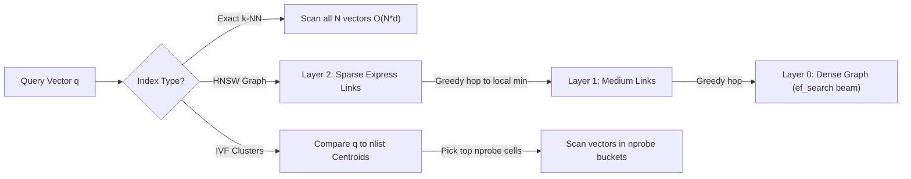
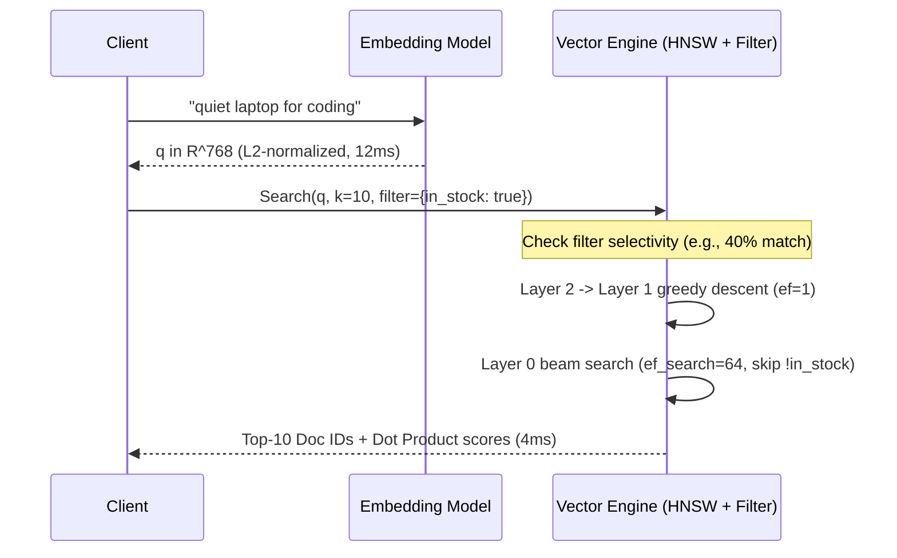
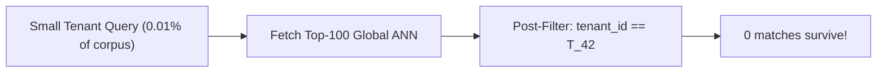

# Vector Search Fundamentals: Embeddings, Cosine Similarity, HNSW, IVF

> **Prerequisites:** [Lesson 08: Autocomplete at Scale](../08-autocomplete-at-scale/README.md).  
> **Estimated Reading Time:** 25–28 minutes  
> **Target Audience:** Backend and AI/search engineers designing semantic retrieval, RAG pipelines, and recommendation engines.  
> **Free PDF Notes:** [Download SD-P-009.pdf](https://backendroadmap.com/notes/system-design/SD-P-009.pdf)

> [!NOTE]
> **In one line:** Vector search maps text, images, or items into high-dimensional **embeddings** ($\mathbb{R}^d$) where semantic closeness equals geometric distance. Because exact brute-force $k$-NN scans scale as $O(N \cdot d)$ and fail above ~100k vectors, production engines use **Approximate Nearest Neighbor (ANN)** indexes—principally **HNSW** (hierarchical navigable graphs for speed/recall) and **IVF** (clustered inverted lists for lower RAM).

> [!TIP]
> **The Golden Rule:** Always L2-normalize unit vectors at index and query time when using Cosine Similarity so you can compute **Dot Product** (fewer CPU cycles, faster SIMD), and choose **HNSW** when RAM is available ($< 50\text{ ms}$ SLA, $> 95\%$ recall) or **IVF-PQ** when fitting hundreds of millions of vectors into bounded memory.

---

## 1. What Vector Search Is, and What It Isn't

A user searches `"laptop for machine learning"` in a catalog where the best product is titled `"Mobile Workstation 64GB RAM RTX 4090"`. Keyword search (BM25) scores zero overlap on `"laptop"`, `"machine"`, or `"learning"`. Vector search embeds both the query and the product into 768-dimensional vectors that land near each other in semantic space.

| Term | Precise Meaning | Example |
| :--- | :--- | :--- |
| **Embedding** | Dense float vector $\mathbf{v} \in \mathbb{R}^d$ learned by a neural encoder | `text-embedding-3-small` ($d = 1536$) |
| **Cosine Similarity** | Angle between two vectors, ignoring magnitude | $\cos(\theta) = \frac{\mathbf{a}\cdot\mathbf{b}}{\|\mathbf{a}\|\|\mathbf{b}\|}$ |
| **Dot Product (IP)** | Inner product $\sum a_i b_i$; equals Cosine when vectors are L2-normalized | Fastest SIMD hardware metric |
| **Euclidean ($L_2$)** | Straight-line distance $\|\mathbf{a} - \mathbf{b}\|_2$ | Image/spatial embeddings |
| **Exact $k$-NN** | Brute-force scan against every vector in the corpus | 100% recall, $O(N \cdot d)$ |
| **ANN** | Approximate Nearest Neighbor trading tiny recall loss for $100\times$ speed | HNSW, IVF-Flat, ScaNN, DiskANN |
| **HNSW** | Hierarchical Navigable Small World multi-layer proximity graph | Sub-10 ms queries, high RAM |
| **IVF** | Inverted File Index partitioning vectors into $k$-means Voronoi cells | Scans only `nprobe` clusters |
| **Not** | A drop-in replacement for exact ID, SKU, or error-code matching | Dense vectors blur rare tokens |

### Why It Matters
1. **Vocabulary mismatch:** Synonyms (`"car"` vs `"automobile"`) and conceptual queries (`"quiet hotel near beach"`) fail in pure lexical search.
2. **Brute force hits a wall:** Scanning 10M 1536-dim `float32` vectors is 60 GB of memory bandwidth per single query—impossible above a few QPS.
3. **ANN is the core tradeoff:** Every vector database interview centers on **Recall vs. Latency vs. Memory**.

---

## 2. Anatomy: Exact $k$-NN vs. HNSW vs. IVF



| Index | Query Complexity | Memory Overhead | Recall@10 | Build Speed | Best For |
| :--- | :--- | :--- | :--- | :--- | :--- |
| **Flat (Exact $k$-NN)** | $O(N \cdot d)$ | $1.0\times$ (raw vectors) | $100\%$ | Instant | $< 50\text{k}$ vectors, ground-truth eval |
| **HNSW** | $O(\log N \cdot M \cdot d)$ | $1.3\times\text{–}1.8\times$ (graph edges) | $95\text{–}99\%$ | Slow (CPU heavy) | Low latency ($< 10\text{ ms}$), high recall |
| **IVF-Flat** | $O(\text{nlist} \cdot d + \frac{N \cdot \text{nprobe}}{\text{nlist}} \cdot d)$ | $1.05\times$ | $85\text{–}96\%$ | Fast ($k$-means) | Large corpora, lower RAM overhead |
| **IVF-PQ** | Fast (ADC lookup tables) | $0.05\times\text{–}0.15\times$ | $70\text{–}88\%$ | Moderate | Billion-scale compressed in RAM |

> [!WARNING]
> **HNSW graphs live in RAM (or mmap'd page cache) and hate random disk I/O.** If your HNSW graph + vectors exceed available RAM, page faults during random graph-edge hops will spike $p_{99}$ latency from `5 ms` to `400+ ms`.

---

## 3. Mathematical Model: Similarity Metrics, Memory & Recall Tradeoffs

**Cosine Similarity vs. Dot Product vs. $L_2$.** For vectors $\mathbf{a}, \mathbf{b} \in \mathbb{R}^d$:

$$\text{Cosine}(\mathbf{a}, \mathbf{b}) = \frac{\sum_{i=1}^d a_i b_i}{\|\mathbf{a}\|_2 \|\mathbf{b}\|_2}, \qquad \|\mathbf{a} - \mathbf{b}\|_2^2 = \|\mathbf{a}\|_2^2 + \|\mathbf{b}\|_2^2 - 2(\mathbf{a} \cdot \mathbf{b})$$

When vectors are L2-normalized ($\|\mathbf{a}\|_2 = \|\mathbf{b}\|_2 = 1$):
1. $\text{Cosine}(\mathbf{a}, \mathbf{b}) = \mathbf{a} \cdot \mathbf{b}$ (eliminates two norm computations per comparison).
2. $\|\mathbf{a} - \mathbf{b}\|_2^2 = 2 - 2(\mathbf{a} \cdot \mathbf{b})$, so Cosine, Dot Product, and $L_2$ produce the **exact same ranking**.

**Raw & HNSW Memory Sizing.** For $N$ vectors of dimension $d$ stored as `float32` (4 bytes) with HNSW average degree $2M$ at layer 0 (and $\approx M$ across upper layers, stored as 4-byte node IDs):

$$\text{RAM}_{\text{HNSW}} \approx N \cdot \left( 4d + 8M \cdot 1.1 \right) \text{ bytes}$$

**Worked Numerical Example:** $N = 10{,}000{,}000$ vectors, $d = 768$, $M = 16$:
- Raw vectors: $10^7 \times 768 \times 4 = 30.72\text{ GB}$
- Graph links ($\approx 10^7 \times 8 \times 16 \times 1.1$): $\approx 1.41\text{ GB}$
- Total HNSW RAM: $\approx 32.1\text{ GB}$ (plus ~10–15% JVM/allocator overhead $\approx 36\text{ GB}$).

**IVF Cell Sizing.** Optimal cluster count $\text{nlist} \approx \sqrt{N}$ to $4\sqrt{N}$. For $N = 10^7$, $\text{nlist} = 4{,}096$ gives $\approx 2{,}441$ vectors/cell. Scanning $\text{nprobe} = 64$ cells inspects only $64 / 4{,}096 = 1.56\%$ of the corpus ($156{,}250$ vectors + $4{,}096$ centroids).

---

## 4. Metrics & Percentiles

| Metric | Meaning | Alert when |
| :--- | :--- | :--- |
| **Recall@K** | Fraction of true exact-$k$-NN top-$K$ returned by ANN | $< 0.90$ (or $< 0.95$ for RAG) |
| **Query latency $p_{99}$** | End-to-end vector search time | $> 30\text{ ms}$ (in-RAM HNSW) |
| **Embedding latency $p_{99}$** | Time to encode query text into vector | $> 50\text{ ms}$ (blocks search) |
| **Page fault / major I/O rate** | Disk reads triggered during HNSW traversal | $> 0$ sustained (index doesn't fit RAM) |
| **Tombstone / deleted ratio** | Soft-deleted nodes still traversed in HNSW graph | $> 15\%$ (recall & speed degrade) |
| **Index build / merge CPU** | CPU spent constructing HNSW segments | Starving query threads |

### Worked Example (Brute Force vs. HNSW Speedup)
Corpus: $N = 1{,}000{,}000$ vectors, $d = 768$ (`float32`).
- **Exact $k$-NN:** $10^6 \times 768 = 7.68 \times 10^8$ multiply-adds + $3.07\text{ GB}$ DRAM read per query $\approx 150\text{–}300\text{ ms}$ on a single server core.
- **HNSW ($M=16$, `ef_search=64`):** Visits $\approx 800\text{–}1{,}200$ nodes total ($\sim 0.1\%$ of corpus) $\approx 2\text{–}4\text{ ms}$ per query at **97% Recall@10**—a **$75\times$ speedup**.

---

## 5. Compounding & Failure Modes: Pre-Filtering vs. Post-Filtering

Vector search becomes tricky when combined with metadata filters (`WHERE brand = 'Apple' AND price < 1000`).

| Failure Mode | Trigger | Compounding Effect |
| :--- | :--- | :--- |
| **Post-filtering starvation** | Fetch Top-100 ANN, then filter `category = 'rare'` (1% selectivity) | Returns only 1 result instead of 10! |
| **Pre-filtering graph disconnect** | Filter masks 99% of nodes during HNSW walk | Greedy graph walk gets trapped in a dead-end, returning poor recall |
| **Tombstone rot** | Heavy updates/deletes in HNSW without compaction | Traversal wastes hops on deleted nodes, degrading latency & recall |
| **Unnormalized Dot Product** | Long documents have larger norms in some models | Long docs win every query regardless of angle/relevance |

---

## 6. Numbers Every Engineer Must Know

| Item | Typical | Implication |
| :--- | :---: | :--- |
| Common embedding dimensions $d$ | `384, 768, 1024, 1536, 3072` | Higher $d$ = linearly more RAM & distance compute |
| `float32` vs `float16` vs `int8` | `4 B` vs `2 B` vs `1 B` per dim | `int8` cuts RAM $4\times$ with $< 1\text{–}2\%$ recall loss |
| HNSW query latency (1M–10M in RAM) | `2–15 ms` | Fast enough for real-time RAG and e-commerce |
| Embedding model API latency | `20–80 ms` (remote) / `5–15 ms` (local GPU) | Often slower than the vector search itself! |
| IVF `nlist` heuristic | $\sqrt{N}$ to $4\sqrt{N}$ | Balances centroid scan vs. bucket scan |
| Exact $k$-NN crossover | `~50k–100k` vectors | Below this, brute-force SIMD is simpler and 100% exact |

---

## 7. Protocol Deep Dive: HNSW Multi-Layer Search & Filtered ANN



| Question | Answer |
| :--- | :--- |
| **How does HNSW avoid local minima?** | Upper layers have long-range "highway" edges (exponentially decaying probability per level) to jump across the space; Layer 0 uses a priority queue beam of size `ef_search`. |
| **How do modern engines solve the filter problem?** | **Single-stage filtered HNSW** (checks bitset during graph traversal, expanding `ef_search` dynamically) or **fallback to exact scan** if filter selectivity $< 1\text{–}5\%$. |
| **How do you measure Recall@10?** | Run exact brute-force $k$-NN on 1,000 sampled queries as ground truth, then compute $| \text{ANN}_{10} \cap \text{Exact}_{10} | / 10$. |
| **Why do updates in HNSW require care?** | HNSW has no cheap "remove node and rewire" operation; engines mark old nodes as tombstones and rely on periodic segment merges to rebuild clean graphs. |

**When not to use Vector Search:** Do not use dense vector search for exact identifiers (`SKU-99421`, `ERR_CONN_RESET`), strict boolean compliance rules, or tabular aggregations. Use inverted indexes or SQL for those.

---

## 8. Hierarchical Budgets & Design Rules

| Slice | Rule | Control |
| :--- | :--- | :--- |
| Corpus $< 50\text{k}$ | Use Exact $k$-NN (Flat) | Zero index build cost, 100% recall |
| Corpus $50\text{k–}50\text{M}$ | Use HNSW in RAM (with `float16` or `int8`) | Pin index in memory; alert on page faults |
| Corpus $> 100\text{M}$ | Use IVF-PQ or DiskANN (SSD-backed) | Keep compressed codes in RAM, full vectors on NVMe |
| Vectors | L2-normalize before indexing if using Cosine | Use `dot_product` metric for SIMD speed |
| Filtering | Use bitset-aware single-stage HNSW; exact scan if $< 2\%$ pass | Prevents 0-result post-filtering bugs |
| Query embedding | Cache frequent query embeddings in Redis | Cuts embedding API cost & 20–50 ms latency |

---

## 9. Top Mitigations

1. **L2-normalize all embeddings** and use Dot Product to eliminate norm divisions at query time.
2. **Cache query embeddings** in Redis (especially head queries) to bypass 30–80 ms model inference.
3. **Never use naive post-filtering** on selective predicates; use single-stage filtered ANN or exact-scan fallback.
4. **Size RAM for $1.5\times$ raw vector footprint** (or quantize to `int8`/`float16`) so HNSW never swaps to disk.
5. **Monitor tombstone ratio** and trigger `force_merge` / compaction when deletes exceed 15%.
6. **Evaluate Recall@K offline** against exact $k$-NN before shipping any embedding model or index change.

---

## 10. Production Reference: Post-Filtering Starvation in Filtered RAG

**Incident:** A multi-tenant SaaS knowledge base stored 5M document chunks in a vector index with `tenant_id` metadata. Small tenants (owning ~500 chunks, 0.01% of the index) reported "No results found" for obvious queries.



- **Root Cause:** The retrieval service queried global Top-100 HNSW results and applied `tenant_id` as a post-filter. Statistically, 0 of the 100 global neighbors belonged to the small tenant.
- **Fix:** Switched to **tenant-partitioned routing** (dedicated small-tenant collections/shards) + **single-stage bitset-filtered HNSW** with automatic exact-scan fallback whenever the tenant's matching bitset cardinality was $< 5{,}000$ vectors.

---

## 11. Multi-Language Production Code Tabs

Cosine similarity, L2 normalization, and exact $k$-NN ground-truth scorer in Go, TypeScript, Python, and C#.

````carousel
```go
// Go: L2 normalization, Dot Product (cosine on unit vectors), and exact Top-K.
package vectorsearch

import (
	"math"
	"sort"
)

func Normalize(v []float32) []float32 {
	var sum float64
	for _, x := range v {
		sum += float64(x) * float64(x)
	}
	norm := float32(math.Sqrt(sum))
	out := make([]float32, len(v))
	if norm == 0 {
		return out
	}
	for i, x := range v {
		out[i] = x / norm
	}
	return out
}

func DotProduct(a, b []float32) float32 {
	var sum float32
	for i := range a {
		sum += a[i] * b[i]
	}
	return sum
}

type Match struct {
	ID    string
	Score float32
}

func ExactTopK(query []float32, corpus map[string][]float32, k int) []Match {
	q := Normalize(query)
	results := make([]Match, 0, len(corpus))
	for id, vec := range corpus {
		results = append(results, Match{ID: id, Score: DotProduct(q, vec)})
	}
	sort.Slice(results, func(i, j int) bool { return results[i].Score > results[j].Score })
	if len(results) > k {
		results = results[:k]
	}
	return results
}
```
<!-- slide -->
```typescript
// TypeScript: L2 normalization, Dot Product, and Exact Top-K scorer.
export function normalize(vec: number[]): number[] {
  const norm = Math.sqrt(vec.reduce((acc, x) => acc + x * x, 0));
  return norm === 0 ? vec.map(() => 0) : vec.map((x) => x / norm);
}

export function dotProduct(a: number[], b: number[]): number {
  let sum = 0;
  for (let i = 0; i < a.length; i++) sum += a[i] * b[i];
  return sum;
}

export interface VectorMatch {
  id: string;
  score: number;
}

export function exactTopK(
  query: number[],
  corpus: Map<string, number[]>,
  k: number
): VectorMatch[] {
  const q = normalize(query);
  const scored: VectorMatch[] = [];
  for (const [id, vec] of corpus.entries()) {
    scored.push({ id, score: dotProduct(q, vec) });
  }
  scored.sort((a, b) => b.score - a.score);
  return scored.slice(0, k);
}
```
<!-- slide -->
```python
# Python: L2 normalization, Cosine/Dot Product, and Recall@K evaluator (stdlib only).
import math

def normalize(v: list[float]) -> list[float]:
    norm = math.sqrt(sum(x * x for x in v))
    return [x / norm for x in v] if norm > 0 else [0.0] * len(v)

def dot(a: list[float], b: list[float]) -> float:
    return sum(x * y for x, y in zip(a, b))

def exact_top_k(query: list[float], corpus: dict[str, list[float]], k: int) -> list[str]:
    q = normalize(query)
    scored = [(dot(q, normalize(v)), doc_id) for doc_id, v in corpus.items()]
    scored.sort(reverse=True)
    return [doc_id for _, doc_id in scored[:k]]

def recall_at_k(ann_ids: list[str], exact_ids: list[str], k: int) -> float:
    return len(set(ann_ids[:k]) & set(exact_ids[:k])) / float(k)

if __name__ == "__main__":
    docs = {"d1": [0.9, 0.1], "d2": [0.1, 0.9], "d3": [0.8, 0.2]}
    exact = exact_top_k([1.0, 0.0], docs, k=2)
    assert exact == ["d1", "d3"]
    assert recall_at_k(["d1", "d2"], exact, k=2) == 0.5
```
<!-- slide -->
```csharp
// C#: L2 normalization, Dot Product, and Exact Top-K retrieval.
using System;
using System.Collections.Generic;
using System.Linq;

public static class VectorMath
{
    public static float[] Normalize(float[] v)
    {
        double sum = 0;
        for (int i = 0; i < v.Length; i++) sum += v[i] * (double)v[i];
        float norm = (float)Math.Sqrt(sum);
        var res = new float[v.Length];
        if (norm == 0) return res;
        for (int i = 0; i < v.Length; i++) res[i] = v[i] / norm;
        return res;
    }

    public static float Dot(float[] a, float[] b)
    {
        float sum = 0;
        for (int i = 0; i < a.Length; i++) sum += a[i] * b[i];
        return sum;
    }

    public static List<(string Id, float Score)> ExactTopK(
        float[] query, IReadOnlyDictionary<string, float[]> corpus, int k)
    {
        var q = Normalize(query);
        return corpus
            .Select(kv => (Id: kv.Key, Score: Dot(q, kv.Value)))
            .OrderByDescending(x => x.Score)
            .Take(k)
            .ToList();
    }
}
```
````

---

## 12. Hands-On CLI Verification Workflows

Create an Elasticsearch `dense_vector` HNSW index, run a `knn` query, and estimate HNSW memory footprint via Python:

```bash
# 1. Create an Elasticsearch index with 384-dim HNSW vector field (dot_product)
curl -X PUT "http://localhost:9200/semantic_docs" -H "Content-Type: application/json" -d '{
  "mappings": {
    "properties": {
      "title": { "type": "text" },
      "embedding": {
        "type": "dense_vector",
        "dims": 384,
        "index": true,
        "similarity": "dot_product",
        "index_options": { "type": "hnsw", "m": 16, "ef_construction": 100 }
      }
    }
  }
}'

# 2. Estimate HNSW RAM footprint for N vectors, dim D, M links
python3 -c '
N, D, M = 10_000_000, 768, 16
vec_gb = N * D * 4 / (1024**3)
graph_gb = N * 8 * M * 1.1 / (1024**3)
print(f"Vectors: {vec_gb:.2f} GB, Graph: {graph_gb:.2f} GB, Total: {vec_gb + graph_gb:.2f} GB")
'
```

---

## 13. Common Mistakes to Avoid

1. **Using HNSW for $< 50{,}000$ vectors**, adding build complexity when exact $k$-NN is faster and 100% accurate.
2. **Forgetting to L2-normalize vectors** before using `dot_product` similarity.
3. **Applying selective metadata filters as post-filters**, returning fewer than $K$ results.
4. **Under-provisioning RAM for HNSW**, causing disk page faults that destroy $p_{99}$ latency.
5. **Re-embedding identical head queries on every request** instead of caching query embeddings.
6. **Using vector search alone for exact IDs, SKUs, or rare proper nouns**, where lexical BM25 excels.
7. **Never measuring Recall@K against exact $k$-NN**, flying blind on ANN accuracy.

---

## 14. Key Terms Glossary

| Key Term | Definition |
| :--- | :--- |
| **Embedding** | Dense floating-point vector representing semantic meaning of data. |
| **Cosine Similarity** | Normalized inner product measuring the angle between two vectors. |
| **Dot Product (IP)** | Inner product $\sum a_i b_i$; identical to Cosine for unit-normalized vectors. |
| **Exact $k$-NN** | Exhaustive scan comparing the query against every vector in the dataset. |
| **ANN** | Approximate Nearest Neighbor algorithms trading minor recall loss for sub-linear speed. |
| **HNSW** | Hierarchical Navigable Small World multi-layer proximity graph. |
| **IVF** | Inverted File Index partitioning vectors into $k$-means clusters (`nlist` / `nprobe`). |
| **Recall@K** | Percentage of true exact top-$K$ neighbors found by an ANN search. |
| **Pre- vs Post-Filtering** | Applying metadata predicates before/during graph traversal vs. after top-$K$ ANN retrieval. |
| **Unit Normalization** | Scaling a vector so its $L_2$ norm equals 1.0. |

---

## 15. System Design Interview Questions & Answers

### Basic Conceptual Questions

<details>
<summary><strong>Q1: Why do we use Approximate Nearest Neighbor (ANN) instead of exact k-NN? [BASIC]</strong></summary>

**Answer:**
Exact $k$-NN has $O(N \cdot d)$ query complexity and saturates memory bandwidth at scale (e.g., 10M 768-d vectors = 30 GB read per query). ANN indexes like HNSW and IVF prune the search space to $< 1\%$ of vectors, achieving 2–15 ms latency at 95–99% recall.
</details>

<details>
<summary><strong>Q2: When are Cosine Similarity and Dot Product identical? [BASIC]</strong></summary>

**Answer:**
When all indexed vectors and query vectors are L2-normalized to unit length ($\|\mathbf{v}\|_2 = 1$). Under unit length, $\cos(\theta) = \mathbf{a}\cdot\mathbf{b}$, which saves norm calculations and maximizes SIMD throughput.
</details>

<details>
<summary><strong>Q3: What is the core architectural difference between HNSW and IVF? [BASIC]</strong></summary>

**Answer:**
HNSW builds a multi-layer proximity graph in memory and navigates greedily from sparse upper layers down to a dense Layer 0. IVF partitions space into $k$-means clusters (`nlist`) and only scans the closest `nprobe` clusters at query time, trading slightly lower recall/speed for much lower memory overhead.
</details>

<details>
<summary><strong>Q4: When should you NOT use vector search? [BASIC]</strong></summary>

**Answer:**
For exact keyword/ID lookups (SKUs, UUIDs, error codes), strict boolean filtering, or when the corpus is tiny ($< 50\text{k}$ vectors) where exact $k$-NN or BM25 is simpler and 100% deterministic.
</details>

### Scenario-Based Architecture Questions

<details>
<summary><strong>Q5: You need to index 50M 768-dim vectors with a 20 ms p99 latency SLA. How do you size memory and pick an index? [SCENARIO]</strong></summary>

**Answer:**
Raw `float32` takes $50\text{M} \times 768 \times 4 \approx 153.6\text{ GB}$, plus ~10 GB for HNSW ($M=16$) = ~165 GB RAM (or ~200 GB with overhead). To cut cost, quantize to `int8` (~40 GB vectors + 10 GB graph = ~50 GB RAM) and shard across 4–8 nodes so each shard fits comfortably in RAM with zero disk page faults.
</details>

<details>
<summary><strong>Q6: Users filter vector search by `brand = "Acme"` (0.5% of catalog) and get 2 results instead of 10. Why, and how do you fix it? [SCENARIO]</strong></summary>

**Answer:**
That is post-filtering starvation: fetching global Top-100 ANN hits and then filtering leaves almost nothing. Fix it with single-stage bitset-filtered HNSW (evaluating the filter during graph traversal) and an automatic fallback to exact brute-force scan when the filter bitset has $< 5{,}000$ matching docs.
</details>

<details>
<summary><strong>Q7: Your semantic search p99 latency is 95 ms, even though HNSW takes only 5 ms. Where is the time going? [SCENARIO]</strong></summary>

**Answer:**
Query embedding inference. Calling a remote or CPU-bound transformer model on every search adds 40–80 ms. Fix it by caching normalized query embeddings in Redis (for head/repeat queries), hosting a quantized ONNX/GPU embedding service co-located with the search tier, and using smaller dimensions (e.g., 384 or Matryoshka truncation).
</details>

<details>
<summary><strong>Q8: How do you evaluate if an ANN index change or new embedding model is actually better? [SCENARIO]</strong></summary>

**Answer:**
Separate **ANN recall** from **embedding quality**. Measure ANN Recall@10 against exact $k$-NN on a 1,000-query sample to verify index health ($> 95\%$). Measure end-to-end relevance (nDCG@10, MRR) using human-judged query-document pairs before deploying.
</details>

### Advanced & Tricky Interview Questions

<details>
<summary><strong>Q9: Why do heavy document updates and deletes degrade HNSW performance over time? [TRICKY]</strong></summary>

**Answer:**
Removing a node from an HNSW graph without breaking navigability is expensive, so engines mark deleted vectors as tombstones. Over time, traversal wastes hops stepping through tombstones to reach live neighbors, inflating latency and hurting recall until a background segment merge rebuilds the graph.
</details>

<details>
<summary><strong>Q10: Why can pre-filtering break an HNSW graph even if you only visit matching nodes? [TRICKY]</strong></summary>

**Answer:**
If a filter is very selective (e.g., 0.1% of nodes match) and the graph walk is strictly forbidden from stepping onto non-matching nodes, the remaining 0.1% subgraph becomes disconnected. Single-stage filtered HNSW solves this by **allowing hops through non-matching nodes** to bridge the graph, while only adding *matching* nodes to the Top-$K$ result heap.
</details>

<details>
<summary><strong>Q11: What is the "Curse of Dimensionality" and how does it affect vector search? [TRICKY]</strong></summary>

**Answer:**
As dimension $d$ grows very large, pairwise distances between random points concentrate around the mean (ratio of nearest to farthest distance approaches 1), making space-partitioning trees (like KD-trees) degrade to brute-force $O(N)$ scans. Graph-based ANN (HNSW) and quantization (PQ) remain effective because real embeddings lie on lower-dimensional semantic manifolds.
</details>

<details>
<summary><strong>Q12: How do Matryoshka Embeddings (MRL) help system architects? [TRICKY]</strong></summary>

**Answer:**
Models trained with Matryoshka Representation Learning pack the most important semantic information into the first dimensions. You can truncate a 1536-dim vector to 256 or 512 dims for the in-RAM HNSW first-pass (cutting RAM and latency by $3\times\text{–}6\times$), then rescore the top 100 candidates using full 1536-dim vectors from disk.
</details>

---

## 16. One-Page Master Cheat Sheet

```
+---------------------------------------------------------------------------------------------------------+
|                    VECTOR SEARCH FUNDAMENTALS — MASTER CHEAT SHEET                                      |
+---------------------------------------------------------------------------------------------------------+
| 1. METRICS: L2-normalize vectors -> Dot Product == Cosine Similarity (faster SIMD, same ranking).       |
+---------------------------------------------------------------------------------------------------------+
| 2. INDEX CHOICE:                                                                                        |
|    - < 50k vectors: Exact k-NN (100% recall, zero build cost).                                          |
|    - 50k - 50M: HNSW in RAM (2-15 ms, 95-99% recall, ~1.4x raw RAM).                                    |
|    - > 100M / tight RAM: IVF-PQ or DiskANN.                                                             |
+---------------------------------------------------------------------------------------------------------+
| 3. FILTERING: Avoid naive post-filtering (starvation). Use single-stage bitset-filtered HNSW +          |
|    exact-scan fallback for < 2% selectivity.                                                            |
+---------------------------------------------------------------------------------------------------------+
| 4. LATENCY: Cache query embeddings in Redis; pin HNSW in RAM (page faults = 100x latency spike).        |
+---------------------------------------------------------------------------------------------------------+
| 5. HYGIENE: Monitor Recall@10 vs exact k-NN and compact tombstones when deletes exceed 15%.             |
+---------------------------------------------------------------------------------------------------------+
```

---

## Further Reading & Sources

- Malkov & Yashunin, *Efficient and robust approximate nearest neighbor search using Hierarchical Navigable Small World graphs* (IEEE TPAMI, 2018).
- FAISS Wiki (Meta AI), [Guidelines to choose an index](https://github.com/facebookresearch/faiss/wiki/Guidelines-to-choose-an-index).
- Qdrant / Elasticsearch Documentation, [Filtered Vector Search & HNSW Internals](https://qdrant.tech/articles/filtrable-hnsw/).
- Pinecone Engineering, [Understanding Vector Similarity & ANN](https://www.pinecone.io/learn/).

---

## Free PDF Notes

[SD-P-009.pdf](https://backendroadmap.com/notes/system-design/SD-P-009.pdf)

---

## Next

Continue with [Lesson 10: Vector Index Tuning: HNSW M, ef_search & int8 Quantisation](../10-vector-index-tuning/README.md): Tuning HNSW parameters, scalar/binary quantization, and two-stage rescoring.
